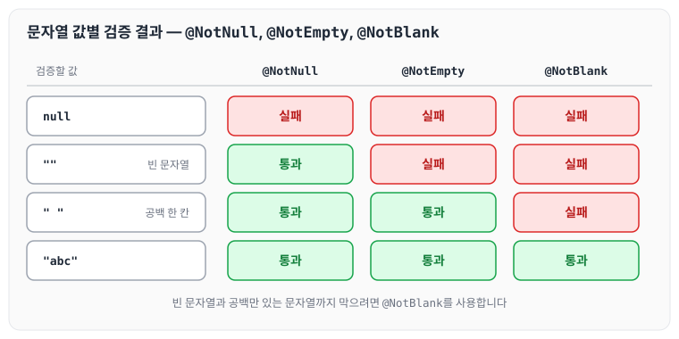
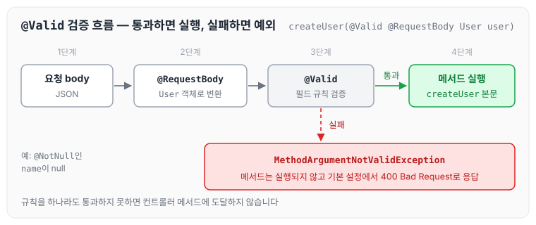

오늘은 Validation으로 다양한 값을 확인하는 방법을 정리합니다.

Spring Boot에서는 Bean Validation을 사용해 전달받은 데이터를 쉽게 검증할 수 있습니다. 검증할 객체의 필드에 검증 규칙을 어노테이션으로 정의하고, 요청 값을 받는 파라미터에 `@Valid`를 붙여 검증을 진행하면 됩니다.

## Validation 어노테이션 종류

Spring Boot에서 사용하는 검증 어노테이션은 Bean Validation 표준에 정의되어 있으며, 대표적인 것은 아래와 같습니다.

1. `@NotNull` : 값이 null이 아닌지 확인
2. `@NotEmpty` : 문자열, 컬렉션 또는 배열이 null이 아니고 값이 있는지 확인
3. `@NotBlank` : 문자열이 null이 아니고, trim() 후 길이가 0보다 큰지 확인
4. `@Min` : 숫자가 특정 최소값 이상인지 확인
5. `@Max` : 숫자가 특정 최대값 이하인지 확인
6. `@DecimalMin` : 숫자가 특정 최소값 이상인지 확인 (소수점 이하 포함)
7. `@DecimalMax` : 숫자가 특정 최대값 이하인지 확인 (소수점 이하 포함)
8. `@Size` : 문자열, 컬렉션 또는 배열의 크기가 특정 범위 내에 있는지 확인
9. `@Email` : 문자열이 유효한 이메일 주소 형식인지 확인
10. `@Pattern` : 문자열이 특정 패턴과 일치하는지 확인

그 외에도 다양한 어노테이션을 제공합니다.

이 중 `@NotNull`, `@NotEmpty`, `@NotBlank`는 비슷해 보이지만, 위 정의대로 문자열 값에 적용하면 결과가 서로 다릅니다. 값마다 통과 여부를 정리하면 아래와 같습니다.



빈 문자열과 공백만 있는 문자열까지 막으려면 `@NotBlank`를 사용해야 합니다.

## 사용 방법

컨트롤러 메서드에서 `@RequestBody` 파라미터에 `@Valid`를 붙이면, 요청 body를 객체로 변환한 뒤 필드에 정의한 규칙으로 검증합니다. 규칙을 하나라도 통과하지 못하면 메서드가 실행되지 않고 `MethodArgumentNotValidException`이 발생하며, 기본 설정에서는 400 Bad Request로 응답합니다.



요청 값을 엔티티 대신 별도의 DTO로 받아 `@Valid`로 검증하는 예는 [스프링 부트와 JPA로 만드는 API 기본](../boot-jpa-api-basics/)에서도 다루었습니다. 어노테이션별 사용 예시는 아래와 같습니다.

### 1. null 값 체크

`@NotNull`을 붙인 `name`이 null이면 검증에 실패합니다.

```java
public void createUser(@Valid @RequestBody User user) {
    // ...
}
public class User {
    @NotNull
    private String name;
    // ...
}
```

### 2. 공백 체크

`@NotBlank`를 붙인 `title`은 null이거나 빈 문자열, 공백만 있는 문자열이면 검증에 실패합니다.

```java
public void createPost(@Valid @RequestBody Post post) {
    // ...
}
public class Post {
    @NotBlank
    private String title;
    // ...
}
```

### 3. 최소값, 최대값 확인

`quantity`는 1 이상, `price`는 100 이하인지 확인합니다.

```java
public void createProduct(@Valid @RequestBody Product product) {
    // ...
}
public class Product {
    @Min(1)
    private int quantity;
    @Max(100)
    private double price;
    // ...
}
```

다만 Bean Validation의 `@Min`, `@Max` 문서에는 `double`과 `float`가 반올림 오차 때문에 지원 대상이 아니라고 적혀 있습니다(구현체에 따라 근사적으로 지원할 수 있습니다).

### 4. 크기 범위 체크

`@Size(min = 1, max = 100)`을 붙인 `bio`는 길이가 1 이상 100 이하인지 확인합니다.

```java
public void updateProfile(@Valid @RequestBody Profile profile) {
    // ...
}
public class Profile {
    @Size(min = 1, max = 100)
    private String bio;
    // ...
}
```

### 5. 패턴 체크

`@Pattern`은 값이 특정 패턴을 따르는지 확인합니다. 아래 예제의 `username`은 영문 대소문자와 숫자로만 이루어져야 합니다.

```java
public void createAccount(@Valid @RequestBody Account account) {
    // ...
}
public class Account {
    @Pattern(regexp = "[A-Za-z0-9]+")
    private String username;
    // ...
}
```

위와 같이 검증할 필드에 어노테이션을 붙이고, 파라미터에 `@Valid`를 붙여 사용하면 됩니다.

## 마무리

오늘은 `@Valid`와 Bean Validation 어노테이션의 사용법에 대해 정리하였습니다. 편하게 유효성을 체크할 수 있어서 좋았고, 직접 정의한 규칙만 검증된다는 점이 안정적으로 느껴졌습니다. 어떤 어노테이션은 클래스 위에 선언하기만 해도 자동으로 처리해 주어서 편리하지만 그만큼 위험성도 있는데, Bean Validation은 제가 지정한 것들만 적용된다는 점에서 알아 두면 좋을 것 같습니다.
