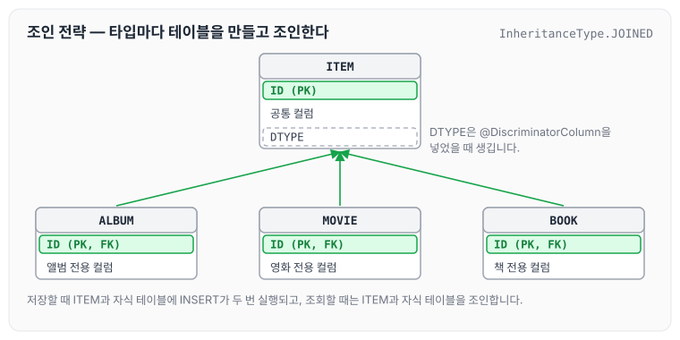
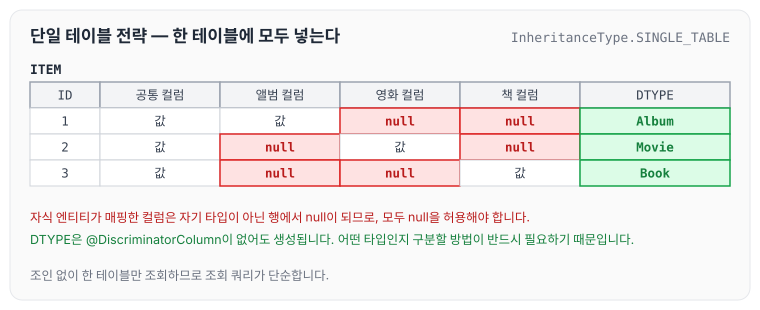
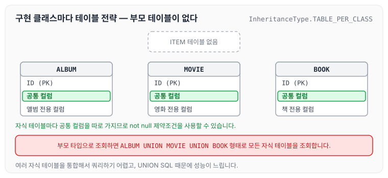
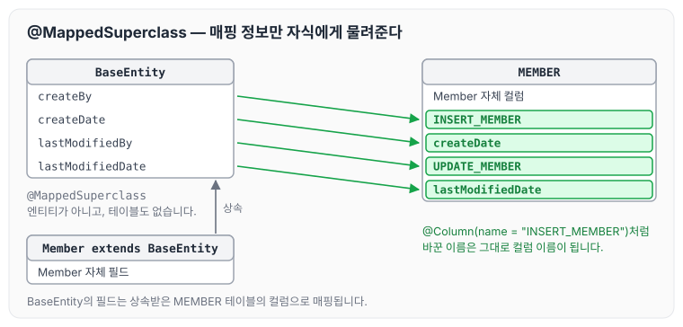

이전에 [다양한 연관관계 매핑](../jpa-association-types/)에 대해 작성하였습니다. 오늘은 객체의 상속 구조를 테이블에 매핑하는 상속관계 매핑과, 공통 매핑 정보를 모으는 `@MappedSuperclass`에 대해 정리하도록 하겠습니다.

## 상속관계 매핑

관계형 데이터베이스에는 상속 관계라는 개념이 없습니다. 다만 슈퍼타입과 서브타입으로 나누는 모델링 기법이 객체의 상속과 비슷합니다. 상속관계 매핑은 객체의 상속 구조를 데이터베이스의 슈퍼타입·서브타입 관계에 맞춰 연결하는 작업입니다.

슈퍼타입·서브타입 논리 모델을 실제 물리 모델로 구현하는 방법은 세 가지입니다.

- 각각을 테이블로 변환 → 조인 전략
- 하나의 통합 테이블로 변환 → 단일 테이블 전략
- 서브타입마다 테이블로 변환 → 구현 클래스마다 테이블 전략

아래에서는 상품을 슈퍼타입으로 두고 앨범, 영화, 책을 서브타입으로 두는 구조를 예로 각 전략의 테이블 구조를 그렸습니다.

### 조인 전략

조인 전략은 슈퍼타입과 서브타입을 각각 테이블로 만들고, 서브타입 테이블이 슈퍼타입 테이블의 기본 키를 기본 키이자 외래 키로 사용합니다.



조인 전략을 사용할 때 `@DiscriminatorColumn`을 넣지 않으면 `DTYPE` 컬럼이 생기지 않습니다. 객체 관점에서는 문제가 없지만, 데이터베이스만 놓고 보면 어떤 타입의 데이터가 들어왔는지 찾기가 어려워집니다. 그래서 조인 전략을 사용할 때는 `@DiscriminatorColumn`을 함께 써 주는 편이 좋습니다.

조인 전략의 장점은 아래와 같습니다.

- 테이블이 정규화됩니다.
- 외래 키 참조 무결성 제약조건을 활용할 수 있습니다.
- 저장 공간이 효율적입니다.

단점은 아래와 같습니다.

- 조회할 때 조인을 많이 사용하게 되어 성능이 떨어집니다.
- 조회 쿼리가 복잡합니다.
- 데이터를 저장할 때 INSERT SQL이 두 번 호출됩니다.

### 단일 테이블 전략

단일 테이블 전략은 슈퍼타입과 서브타입의 컬럼을 하나의 테이블에 모두 넣습니다.



단일 테이블 전략은 `@DiscriminatorColumn`이 없어도 `DTYPE`이 생성됩니다. 한 테이블에 앨범, 영화, 책이 모두 들어가므로 어떤 타입인지 구분할 방법이 반드시 필요하기 때문입니다.

단일 테이블 전략의 장점은 아래와 같습니다.

- 조인이 필요 없습니다.
- 조회 쿼리가 단순합니다.

단점은 아래와 같습니다.

- 자식 엔티티가 매핑한 컬럼은 모두 null을 허용해야 합니다.
- 모든 것을 한 테이블에 저장하므로 테이블이 커질 수 있고, 상황에 따라서는 조회 성능이 오히려 느려질 수 있습니다.

### 구현 클래스마다 테이블 전략

구현 클래스마다 테이블 전략은 슈퍼타입 테이블 없이 서브타입마다 공통 컬럼까지 포함한 테이블을 만듭니다. **사용하지 않는 것이 좋은 전략입니다.**



구현 클래스마다 테이블 전략의 장점은 아래와 같습니다.

- 서브타입을 명확하게 구분해서 처리할 때 효과적입니다.
- not null 제약조건을 사용할 수 있습니다.

단점은 아래와 같습니다.

- 여러 자식 테이블을 함께 조회할 때 UNION SQL이 나가면서 성능이 느립니다.
- 자식 테이블을 통합해서 쿼리하기 어렵습니다.

## 주요 어노테이션

상속관계 매핑에 사용하는 어노테이션은 아래와 같습니다.

- `@Inheritance(strategy = InheritanceType.XXX)`
    - `JOINED`: 조인 전략
    - `SINGLE_TABLE`: 단일 테이블 전략
    - `TABLE_PER_CLASS`: 구현 클래스마다 테이블 전략
- `@DiscriminatorColumn(name = "DTYPE")`
- `@DiscriminatorValue("XXX")`

## Mapped Superclass

`id`, `name`처럼 여러 엔티티가 공통으로 쓰는 매핑 정보가 필요할 때 사용합니다. 이름은 비슷하지만 상속관계 매핑은 아닙니다.

- 엔티티가 아니며, 테이블과 매핑되지도 않습니다.
- 부모 클래스를 상속받는 자식 클래스에 매핑 정보만 제공합니다.
- 조회와 검색이 불가능합니다(`em.find(BaseEntity)`를 쓸 수 없습니다).
- 직접 생성해서 쓸 일이 없으므로 추상 클래스로 만드는 것을 권장합니다.

### @MappedSuperclass

`@MappedSuperclass`의 역할은 아래와 같습니다.

- 테이블과는 관계없이, 엔티티가 공통으로 사용하는 매핑 정보를 모으는 역할을 합니다.
- 주로 등록일, 수정일, 등록자, 수정자처럼 모든 엔티티에 공통으로 적용하는 정보를 모을 때 사용합니다.
- 참고로 `@Entity` 클래스가 상속해서 매핑 정보까지 물려받을 수 있는 부모는 엔티티이거나 `@MappedSuperclass`로 지정한 클래스뿐입니다. 둘 다 아닌 일반 클래스를 상속하면 부모 클래스의 필드는 테이블에 매핑되지 않습니다.

등록자, 등록일, 수정자, 수정일을 모은 BaseEntity는 아래와 같습니다.

```java
package helloJpa;

import javax.persistence.Column;
import javax.persistence.MappedSuperclass;
import java.time.LocalDateTime;

@MappedSuperclass// 속성을 같이 쓰고 싶다고 할때 사용한다. 공통적으로 사용할 속성을 사용 할 때 쓴다.
public abstract class BaseEntity {

    @Column(name = "INSERT_MEMBER")//이런식으로 변경도 가능
    private String createBy;
    private LocalDateTime createDate;
    @Column(name = "UPDATE_MEMBER")//이런식으로 변경도 가능
    private String lastModifiedBy;
    private LocalDateTime lastModifiedDate;
```

Member는 BaseEntity를 상속받기만 하면 됩니다.

```java
package helloJpa;

import javax.persistence.*;

@Entity
public class Member extends BaseEntity {

  	...
}
```



그림처럼 BaseEntity의 필드는 BaseEntity 테이블이 아니라 상속받은 MEMBER 테이블의 컬럼으로 매핑됩니다. 그래서 Member에서 BaseEntity의 속성을 바로 사용할 수 있습니다.

```java
public class JpaMain {

    public static void main(String[] args) {
       ...
        try {
            Member member = new Member();
            member.setCreateBy("오늘생성..");
            em.persist(member);
```

## 마무리

오늘은 객체의 상속 구조를 테이블에 매핑하는 세 가지 전략과 `@MappedSuperclass`에 대해 정리하였습니다. `@MappedSuperclass`는 공통 매핑 정보를 쓸 때 기본적으로 많이 사용하며, DBA가 갑작스럽게 모든 테이블에 공통 날짜 컬럼을 넣어 달라고 요청하는 상황에서도 유용합니다. 기본 속성을 한데 묶어서 넣어 주고 싶을 때 사용하는 것이라고 생각하면 좀 더 편하게 다가오는 것 같습니다. 다음 글에서는 [프록시의 동작 원리](../jpa-proxy/)에 대해 정리하도록 하겠습니다.

> 이 글은 인프런 김영한 님의 [자바 ORM 표준 JPA 프로그래밍 — 기본편](https://www.inflearn.com/course/ORM-JPA-Basic)을 들으며 정리한 노트입니다.
