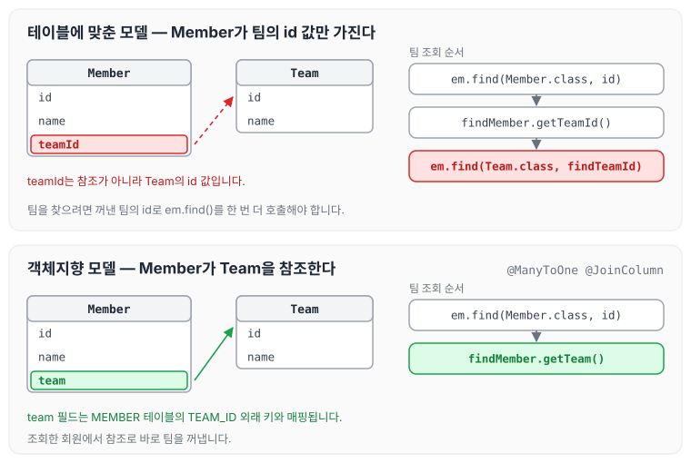
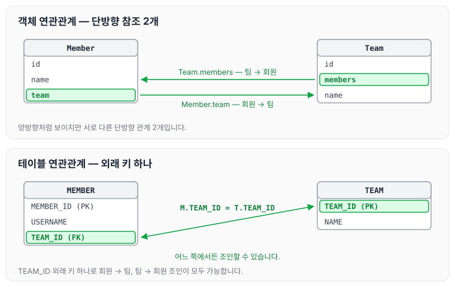
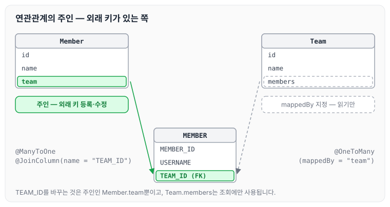
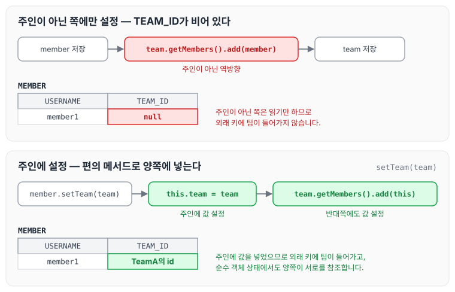

이전에 [엔티티 매핑](../jpa-entity-mapping/)에 대해 작성하였습니다. 오늘은 객체의 참조와 테이블의 외래 키를 연결하는 연관관계 매핑에 대해 정리하도록 하겠습니다.

## 연관관계 매핑의 목표와 용어

이번 글의 목표는 아래와 같습니다.

- 객체와 테이블 연관관계의 차이를 이해합니다.
- 객체의 참조와 테이블의 외래 키를 매핑합니다.

연관관계 매핑에서 사용하는 용어는 아래와 같습니다.

- 방향(Direction): 단방향, 양방향
- 다중성: 다대일(N:1), 일대다(1:N), 일대일(1:1), 다대다(N:M)
- 연관관계의 주인(Owner): 객체를 양방향 연관관계로 만들면 관리하는 주인이 필요합니다.

## 연관관계가 필요한 이유

연관관계가 필요한 이유는 객체지향 설계의 목표에서 찾을 수 있습니다.

> 객체지향 설계의 목표는 자율적인 객체들의 협력 공동체를 만드는 것입니다.

## 예제 시나리오

예제로 사용할 상황은 아래와 같습니다.

- 회원과 팀이 있습니다.
- 회원은 하나의 팀에만 소속될 수 있습니다.
- 회원과 팀은 다대일 관계입니다.

## 단방향 연관관계

### 객체를 테이블에 맞추어 모델링

먼저 객체를 테이블 구조에 그대로 맞추어, Member가 팀의 식별자 `teamId`를 값으로 가지도록 모델링하면 아래와 같습니다.

```java
package helloJpa;

import javax.persistence.EntityManager;
import javax.persistence.EntityManagerFactory;
import javax.persistence.EntityTransaction;
import javax.persistence.Persistence;
import java.util.List;

public class JpaMain {

    public static void main(String[] args) {
        EntityManagerFactory emf = Persistence.createEntityManagerFactory("hello");// 애플리케이션 에서 한개만 만들어 져야된다.

        EntityManager em = emf.createEntityManager();//하나의 단위를 만들때마다 만들어 줘야된다.

        EntityTransaction tx = em.getTransaction();
        tx.begin();

        try {
            Team team = new Team();
            team.setName("TeamA");
            em.persist(team);

            Member member = new Member();
            member.setName("member1");
            member.setTeamId(team.getId());
            em.persist(member);

            Member findMember = em.find(Member.class, member.getId());
            Long findTeamId = findMember.getTeamId();
            Team findTeam = em.find(Team.class, findTeamId);

            tx.commit();
        } catch (Exception e) {
            tx.rollback();
        } finally {
            em.close();
        }
        emf.close();
    }
}
```

객체를 테이블에 맞춰 모델링하다 보니 객체지향적이지 않은 부분이 생깁니다. 회원을 저장할 때 팀 객체가 아니라 `team.getId()`로 꺼낸 팀의 id를 `setTeamId()`에 넣고 있습니다. 객체지향이라면 Member 안에 Team이 있어서 `member.setTeam(team)`처럼 팀을 직접 넣을 수 있어야 합니다.

조회할 때도 마찬가지입니다. 회원을 조회한 뒤 회원이 가진 팀의 id를 꺼내고, 그 id로 다시 팀을 조회해야 팀 이름을 알 수 있습니다. 객체 사이에 연관관계가 없기 때문에 조회할 때마다 DB에서 계속 꺼내는 일이 발생하며, 전혀 객체지향스럽지 못합니다.



그림의 위쪽처럼 Member가 팀의 id 값만 가지고 있으면 팀을 찾기 위해 `em.find()`를 한 번 더 호출해야 합니다. 정리하면 아래와 같습니다.

- 객체를 테이블에 맞추어 데이터 중심으로 모델링하면 협력 관계를 만들 수 없습니다.
- 테이블은 외래 키로 조인을 사용해서 연관된 테이블을 찾습니다.
- 객체는 참조를 사용해서 연관된 객체를 찾습니다.
- 테이블과 객체 사이에는 이런 큰 간격이 있습니다.

### 객체지향 모델링

Member에는 Many, Team에는 One으로 다대일 관계를 맺어 주고, 조인은 `TEAM_ID` 컬럼으로 한다고 명시해서 연관관계를 매핑하였습니다. 그림의 아래쪽 모델에 해당합니다.

```java
package helloJpa;

import javax.persistence.*;
import java.util.Date;

@Entity
public class Member {

  ...
//    @Column(name = "TEAM_NO")
//    private Long teamId;

@ManyToOne// JPA에게 일대다 다대일 관계인지 알려줘야된다.
@JoinColumn(name = "TEAM_ID")// 어떤 컬럼명으로 조인을 할지 알려줘야한다.
private Team team;

   ...
}
```

이제 회원에 팀을 직접 넣고, 조회한 회원에서 `getTeam()`으로 바로 팀을 꺼낼 수 있습니다.

```java
package helloJpa;

import javax.persistence.EntityManager;
import javax.persistence.EntityManagerFactory;
import javax.persistence.EntityTransaction;
import javax.persistence.Persistence;
import java.util.List;

public class JpaMain {

    public static void main(String[] args) {
        EntityManagerFactory emf = Persistence.createEntityManagerFactory("hello");// 애플리케이션 에서 한개만 만들어 져야된다.
        EntityManager em = emf.createEntityManager();//하나의 단위를 만들때마다 만들어 줘야된다.
        EntityTransaction tx = em.getTransaction();
        tx.begin();

        try {
// 저장
            Team team = new Team();
            team.setName("TeamA");
            em.persist(team);

            Member member = new Member();
            member.setName("member1");
            member.setTeam(team);

            em.persist(member);

            Member findMember = em.find(Member.class, member.getId());
            Team findTeam = findMember.getTeam();

            System.out.println("findTeamName = " + findTeam.getName());

            tx.commit();
        } catch (Exception e) {
            tx.rollback();
        } finally {
            em.close();
        }
        emf.close();
    }
}

```

## 양방향 연관관계와 연관관계의 주인

테이블 연관관계는 단방향 예제와 차이가 없습니다. 테이블은 외래 키로 조인을 하기 때문입니다. 하지만 객체는 회원에서 팀으로 가는 방향만 있었고, 팀에서 회원으로 가는 방향은 없었습니다. 그래서 팀에서 회원으로 갈 수 있도록 Team에 `List members`를 추가하였습니다.

### 연관관계의 주인과 mappedBy

Team에 회원 목록을 추가하고 `@OneToMany(mappedBy = "team")`을 붙이면 아래와 같습니다.

```java
@Entity
public class Team {

    @Id
    @GeneratedValue
    @Column(name = "TEAM_ID")
    private Long id;
    private String name;

    @OneToMany(mappedBy = "team")
    private List<Member> members = new ArrayList<>();

	...
}
```

이제 조회한 회원에서 팀으로, 다시 팀에서 회원 목록으로 탐색할 수 있습니다.

```java
package helloJpa;

import javax.persistence.EntityManager;
import javax.persistence.EntityManagerFactory;
import javax.persistence.EntityTransaction;
import javax.persistence.Persistence;
import java.util.List;

public class JpaMain {

    public static void main(String[] args) {
        EntityManagerFactory emf = Persistence.createEntityManagerFactory("hello");// 애플리케이션 에서 한개만 만들어 져야된다.

        EntityManager em = emf.createEntityManager();//하나의 단위를 만들때마다 만들어 줘야된다.

        EntityTransaction tx = em.getTransaction();
        tx.begin();

        try {
// 저장
            ...

            Member findMember = em.find(Member.class, member.getId());
            List<Member> members = findMember.getTeam().getMembers();

            for (Member member1 : members) {
                System.out.println(member1.getName());
            }

            tx.commit();
        } catch (Exception e) {
            tx.rollback();
        } finally {
            em.close();
        }
        emf.close();
    }
}
```

mappedBy는 JPA를 배울 때 가장 이해하기 어려운 부분 중 하나이고, 처음에는 이해하기 쉽지 않습니다. mappedBy를 이해하려면 객체와 테이블이 연관관계를 맺는 방식의 차이를 먼저 알아야 합니다.

## 객체와 테이블이 관계를 맺는 차이

객체와 테이블의 연관관계 수를 비교하면 아래와 같습니다.

- 객체 연관관계 = 2개
    - 회원 → 팀 연관관계 1개(단방향)
    - 팀 → 회원 연관관계 1개(단방향)
- 테이블 연관관계 = 1개
    - 회원 ↔ 팀의 연관관계 1개(양방향)

테이블은 외래 키 하나로 연관관계가 끝나지만, 객체는 연관관계를 2개 잡아 주어야 한다는 차이가 있습니다.



### 객체의 양방향 관계

객체의 양방향 관계는 사실 양방향 관계가 아니라 서로 다른 단방향 관계 2개입니다. 객체를 양방향으로 참조하려면 아래처럼 단방향 연관관계를 2개 만들어야 합니다.

- A→B (`a.getB()`)
- B→A (`b.getA()`)

### 테이블의 양방향 연관관계

테이블은 외래 키 하나로 두 테이블의 연관관계를 관리합니다. `MEMBER.TEAM_ID` 외래 키 하나로 양방향 연관관계를 가지며, 아래처럼 양쪽으로 조인할 수 있습니다.

```sql
SELECT *
  FROM MEMBER M
  JOIN TEAM T ON M.TEAM_ID = T.TEAM_ID

SELECT *
  FROM TEAM T
  JOIN MEMBER M ON T.TEAM_ID = M.TEAM_ID
```

## 외래 키를 관리할 쪽 정하기

객체에 참조가 2개 생기면 아래와 같은 딜레마가 생깁니다.

- Member의 team 값을 변경했을 때 MEMBER의 외래 키를 변경해야 할지,
- Team의 members 값을 변경했을 때 MEMBER의 외래 키를 변경해야 할지 정해야 합니다.

하지만 DB 기준으로는 외래 키 값만 변경하면 됩니다. 그래서 둘 중 하나를 주인으로 두고, 주인 쪽으로만 외래 키를 관리한다는 규칙이 생깁니다.

## 연관관계의 주인(Owner)

양방향 매핑 규칙은 아래와 같습니다.

- 객체의 두 관계 중 하나를 연관관계의 주인으로 지정합니다.
- 연관관계의 주인만이 외래 키를 관리(등록, 수정)합니다.
- 주인이 아닌 쪽은 읽기만 가능합니다.
- 주인은 mappedBy 속성을 사용하지 않습니다.
- 주인이 아니면 mappedBy 속성으로 주인을 지정합니다.

## 연관관계의 주인을 정하는 기준

**외래 키가 있는 곳을 주인으로 정합니다.** 이 예제에서는 외래 키 `TEAM_ID`가 MEMBER 테이블에 있으므로 `Member.team`이 연관관계의 주인입니다.



그림처럼 외래 키를 바꾸는 것은 주인인 `Member.team`뿐이고, `mappedBy = "team"`을 지정한 `Team.members`는 조회에만 사용됩니다.

## 양방향 매핑 시 가장 많이 하는 실수

가장 많이 하는 실수는 연관관계의 주인에 값을 입력하지 않는 것입니다. 아래 코드는 역방향, 즉 주인이 아닌 `Team.members`에만 회원을 추가하였습니다.

```java
Member member = new Member();
member.setName("member1");
em.persist(member);

Team team = new Team();
team.setName("TeamA");

//역방향(주인이 아닌 방향)만 연관관계 설정정
team.getMembers().add(member);
em.persist(team);
```

주인이 아닌 쪽은 읽기만 가능하므로, 이렇게 저장하면 회원의 외래 키 `TEAM_ID`에 팀이 들어가지 않습니다. 연관관계는 주인을 통해서 넣어야 하며, 가장 좋은 방법은 객체지향처럼 양쪽 모두에 값을 넣는 것입니다.



## 양방향 연관관계 주의점

양방향 연관관계를 사용할 때는 아래 내용을 주의합니다.

- 순수 객체 상태를 고려해서 항상 양쪽에 값을 설정합니다.
- 연관관계 편의 메서드를 생성합니다.
- 양방향 매핑 시 무한 루프를 조심합니다.
    - 예: `toString()`, lombok, JSON 생성 라이브러리

연관관계 편의 메서드를 적용한 Member는 아래와 같습니다. `setTeam()`에서 팀을 넣으면서 팀의 회원 목록에도 자기 자신을 추가합니다.

```java
package helloJpa;

import javax.persistence.*;
import java.util.Date;

@Entity
public class Member {

    @Id
    @GeneratedValue
    @Column(name = "MEMBER_ID")
    private Long id;

    @Column(name = "USERNAME")
    private String name;

//    @Column(name = "TEAM_NO")
//    private Long teamId;

    // JPA에게 일대다 다대일 관계인지 알려줘야된다.
    @ManyToOne
    @JoinColumn(name = "TEAM_ID")
    private Team team;

    public void setTeam(Team team) {
        this.team = team;
        team.getMembers().add(this);
    }

    ...

}
```

## 양방향 매핑 정리

양방향 매핑을 정리하면 아래와 같습니다.

- 단방향 매핑만으로도 이미 연관관계 매핑은 완료됩니다.
- 양방향 매핑은 반대 방향으로 조회(객체 그래프 탐색)하는 기능이 추가된 것뿐입니다.
- JPQL에서 역방향으로 탐색할 일이 많습니다.
- 단방향 매핑을 잘하고 양방향은 필요할 때 추가해도 됩니다.

## 마무리

오늘은 객체의 참조와 테이블의 외래 키를 연결하는 단방향·양방향 연관관계 매핑과 연관관계의 주인에 대해 정리하였습니다. 테이블을 어떻게 연관관계로 매핑하는지 궁금했는데, 생각보다 간단하게 해결할 수 있었습니다. 다만 잘못 사용하면 찾기 어려운 오류를 만들 수도 있을 것 같아, 사용하는 개념을 정확하게 알고 사용해야겠다는 생각이 들었습니다. 다음 글에서는 [다양한 연관관계 매핑](../jpa-association-types/)에 대해 정리하도록 하겠습니다.

> 이 글은 인프런 김영한 님의 [자바 ORM 표준 JPA 프로그래밍 — 기본편](https://www.inflearn.com/course/ORM-JPA-Basic)을 들으며 정리한 노트입니다.
