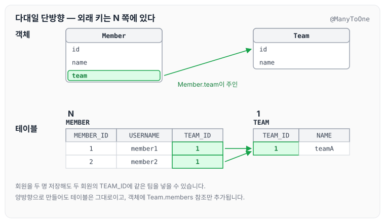
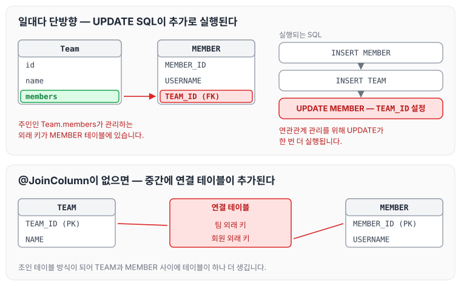
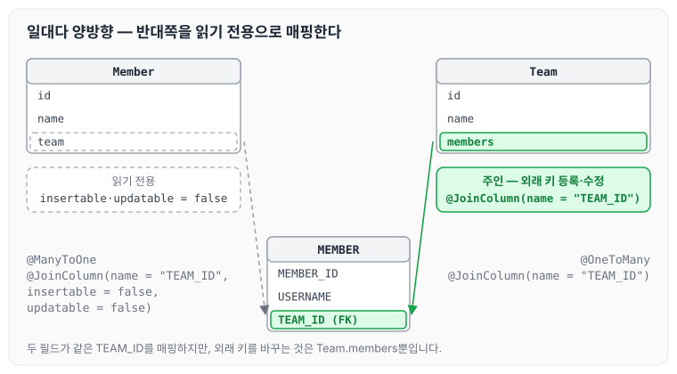
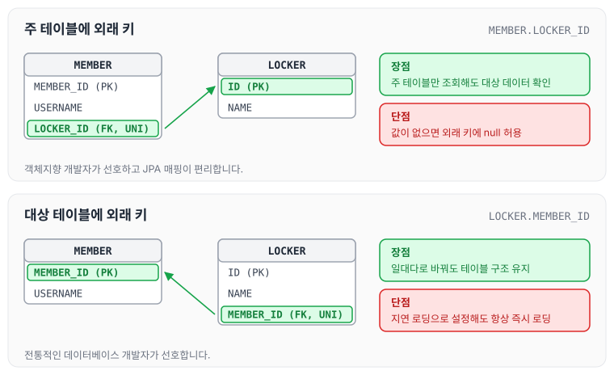

이전에 [연관관계 매핑 기초](../jpa-association-basics/)에 대해 작성하였습니다. 오늘은 다중성에 따라 다대일, 일대다, 일대일 연관관계를 단방향과 양방향으로 매핑하는 방법에 대해 정리하도록 하겠습니다.

## 연관관계 매핑 시 고려사항

연관관계를 매핑할 때는 아래 세 가지를 고려합니다.

- 다중성
- 단방향, 양방향
- 연관관계의 주인

## 다중성

다중성에 따라 사용하는 어노테이션은 아래와 같습니다.

- 다대일: `@ManyToOne`
- 일대다: `@OneToMany`
- 일대일: `@OneToOne`
- 다대다: `@ManyToMany`

다중성은 간혹 헷갈릴 때가 있습니다. 그럴 때는 반대쪽으로 생각해 보면 됩니다. 회원과 팀이라면 반대로 팀과 회원의 관계를 생각해 보는 것입니다. 일대일의 반대는 일대일, 일대다의 반대는 다대일, 다대다의 반대는 다대다로 대칭성이 있기 때문입니다.

다만 무엇보다 중요한 것은 실무에서는 다대다를 쓰면 안 된다는 점입니다.

## 단방향, 양방향

테이블과 객체는 방향을 다르게 다룹니다.

- 테이블
    - 외래 키 하나로 양쪽 조인이 가능합니다.
    - 사실 방향이라는 개념이 없습니다.
- 객체
    - 참조용 필드가 있는 쪽으로만 참조 가능합니다.
    - 한쪽만 참조하면 단방향입니다.
    - 양쪽이 서로 참조하면 양방향입니다.

## 연관관계의 주인

연관관계의 주인은 아래와 같이 정리할 수 있습니다.

- 테이블은 외래 키 하나로 두 테이블이 연관관계를 맺습니다.
- 객체 양방향 관계는 A→B, B→A처럼 참조가 2군데입니다.
- 객체 양방향 관계는 참조가 2군데 있으므로, 둘 중 테이블의 외래 키를 관리할 곳을 지정해야 합니다.
- 연관관계의 주인: 외래 키를 관리하는 참조
- 주인의 반대편: 외래 키에 영향을 주지 않으며, 단순 조회만 가능합니다.

## 다대일(N:1)

### 다대일 단방향

DB 입장에서 보면 회원이 N, 팀이 1이며 외래 키는 N 쪽에 있어야 합니다. 그래서 회원을 두 명 넣어도 두 회원의 `TEAM_ID`에 같은 팀을 넣어 줄 수 있습니다.



다대일 단방향은 아래와 같이 정리할 수 있습니다.

- 가장 많이 사용하는 연관관계입니다.
- 다대일의 반대는 일대다입니다.

### 다대일 양방향

양방향으로 설정한다고 해서 테이블이 바뀌지는 않습니다. 어차피 연관관계의 주인이 외래 키를 관리하기 때문에, 객체에서 반대 방향 참조만 추가해 주면 됩니다.

다대일 양방향은 아래와 같이 정리할 수 있습니다.

- 외래 키가 있는 쪽이 연관관계의 주인입니다.
- 양쪽을 서로 참조하도록 개발합니다.

## 일대다(1:N)

### 일대다 단방향

일대다 단방향은 아래와 같은 특징이 있습니다.

- 이 모델은 권장하지 않습니다. 표준 스펙에서 지원하기 때문에 설명하는 것이며, 실무에서는 이 모델을 거의 사용하지 않습니다.
- 팀을 중심으로 관리를 전부 하겠다는 뜻입니다.
- DB 입장에서 보면 팀과 회원 관계에서는 무조건 N 쪽에 외래 키가 들어갈 수밖에 없습니다. 그래서 Team의 members 값을 변경했을 때 MEMBER의 `TEAM_ID` 값을 업데이트해 주어야 합니다.

팀의 회원 목록에 회원을 추가하는 코드는 아래와 같습니다.

```java
public class JpaMain {

    public static void main(String[] args) {
        EntityManagerFactory emf = Persistence.createEntityManagerFactory("hello");// 애플리케이션 에서 한개만 만들어 져야된다.

        EntityManager em = emf.createEntityManager();//하나의 단위를 만들때마다 만들어 줘야된다.

        EntityTransaction tx = em.getTransaction();
        tx.begin();

        try {
            Member member = new Member();
            member.setName("member1");
            em.persist(member);

            Team team = new Team();
            team.setName("teamA");
//외래키가 변경 되어야한다.
//외래키는 멤버 테이블에 있다. 결국에 멤버가 업데이트 되야된다.
            team.getMembers().add(member);
            em.persist(team);
```

Team에서는 `@OneToMany`와 함께 `@JoinColumn`으로 MEMBER 테이블의 `TEAM_ID`를 지정합니다.

```java
@Entity
public class Team {

    @Id @GeneratedValue
    @Column(name = "TEAM_ID")
    private Long id;
    private String name;

    @OneToMany
    @JoinColumn(name = "TEAM_ID")
    private List<Member> members = new ArrayList<>();

```

일대다 단방향은 아래와 같이 정리할 수 있습니다.

- 일대다 단방향은 일대다(1:N)에서 일(1)이 연관관계의 주인입니다.
- 테이블의 일대다 관계는 항상 다(N) 쪽에 외래 키가 있습니다.
- 객체와 테이블의 차이 때문에 반대편 테이블의 외래 키를 관리하는 특이한 구조입니다.
- `@JoinColumn`을 꼭 사용해야 합니다. 그렇지 않으면 조인 테이블 방식을 사용하게 됩니다(중간에 테이블을 하나 추가함).



그림의 위쪽처럼 Team이 관리하는 외래 키가 MEMBER 테이블에 있기 때문에 UPDATE SQL이 한 번 더 실행됩니다. 일대다 단방향 매핑의 단점은 아래와 같습니다.

- 엔티티가 관리하는 외래 키가 다른 테이블에 있습니다.
- 연관관계 관리를 위해 추가로 UPDATE SQL이 실행됩니다.

그래서 일대다 단방향 매핑보다는 다대일 양방향 매핑을 사용하는 것이 좋습니다.

### 일대다 양방향

일대다 양방향 관계를 만들기 위해 Member에도 `@ManyToOne`과 `@JoinColumn`으로 team을 매핑하면, Team의 members와 Member의 team이 모두 연관관계의 주인이 되어 문제가 생깁니다. 그래서 Member의 team에 `insertable`과 `updatable`을 false로 설정해서 읽기 전용으로 강제합니다. 아래 일대일 예제의 Member 코드에 있는 team 매핑이 이 설정입니다.



일대다 양방향은 아래와 같이 정리할 수 있습니다.

- 이런 매핑은 공식적으로 존재하지 않습니다.
- `@JoinColumn(insertable=false, updatable=false)`
- 읽기 전용 필드를 사용해서 양방향처럼 사용하는 방법입니다.
- 다대일 양방향을 사용하는 것이 좋습니다.

## 일대일(1:1)

일대일 관계의 특징은 아래와 같습니다.

- 일대일 관계는 반대쪽도 일대일입니다.
- 주 테이블이나 대상 테이블 중에 외래 키를 둘 곳을 선택할 수 있습니다.
    - 주 테이블에 외래 키
    - 대상 테이블에 외래 키
- 외래 키에 데이터베이스 유니크(UNI) 제약조건을 추가합니다.

주 테이블에 외래 키를 두는 일대일 양방향 매핑은 다대일 양방향 매핑과 비슷합니다. Member가 `LOCKER_ID` 외래 키로 Locker를 참조하는 코드는 아래와 같습니다.

```java
@Entity
public class Member {

    @Id @GeneratedValue
    @Column(name = "MEMBER_ID")
    private Long id;

    @Column(name = "USERNAME")
    private String name;

    @ManyToOne
    @JoinColumn(name = "TEAM_ID", insertable = false, updatable = false)
    private Team team;

    @OneToOne
    @JoinColumn(name = "LOCKER_ID")
    private Locker locker;

```

```java
@Entity
public class Locker {
    @Id @GeneratedValue
    private Long id;
    @OneToOne(mappedBy = "locker")
    private Member member;
    private String name;
}
```

다대일과 마찬가지로 연관관계의 주인은 외래 키가 있는 곳이고, 반대편은 mappedBy를 적용합니다.

### 주 테이블에 외래 키와 대상 테이블에 외래 키

외래 키를 어느 테이블에 두는지에 따라 구조가 아래처럼 달라집니다.



주 테이블(주로 액세스하는 테이블)에 외래 키를 두는 방식은 아래와 같습니다.

- 주 객체가 대상 객체의 참조를 가지는 것처럼 주 테이블에 외래 키를 두고 대상 테이블을 찾습니다.
- 객체지향 개발자가 선호합니다.
- JPA 매핑이 편리합니다.
- 장점: 주 테이블만 조회해도 대상 테이블에 데이터가 있는지 확인할 수 있습니다.
- 단점: 값이 없으면 외래 키에 null을 허용해야 합니다.

대상 테이블에 외래 키를 두는 방식은 아래와 같습니다.

- 대상 테이블에 외래 키가 존재합니다.
- 전통적인 데이터베이스 개발자가 선호합니다.
- 장점: 주 테이블과 대상 테이블을 일대일에서 일대다 관계로 변경할 때 테이블 구조를 유지할 수 있습니다.
- 단점: 프록시 기능의 한계로 지연 로딩으로 설정해도 항상 즉시 로딩됩니다(프록시는 [프록시의 동작 원리](../jpa-proxy/)에서 정리하였습니다).

## 마무리

오늘은 다대일, 일대다, 일대일 연관관계를 단방향과 양방향으로 매핑하는 방법에 대해 정리하였습니다. 일대다 단방향은 표준 스펙에서 지원하지만 외래 키가 다른 테이블에 있어 UPDATE SQL이 추가로 실행되므로, 다대일 양방향을 기본으로 사용하는 것이 좋을 것 같습니다. 다음 글에서는 [상속관계 매핑과 @MappedSuperclass](../jpa-advanced-mapping/)에 대해 정리하도록 하겠습니다.

> 이 글은 인프런 김영한 님의 [자바 ORM 표준 JPA 프로그래밍 — 기본편](https://www.inflearn.com/course/ORM-JPA-Basic)을 들으며 정리한 노트입니다.
