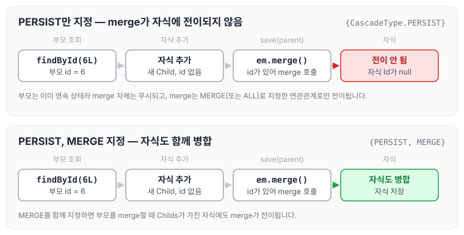

오늘은 기존 프로젝트에 서비스 로직이 너무 많아 [일급컬렉션](../first-class-collection/)을 적용하면서 발생한 문제에 대해 정리하려고 합니다. 자식 엔티티 목록을 일급 컬렉션으로 감싼 뒤 insert를 하자, 자식 엔티티의 Id 값이 null로 들어가는 현상이 발생하였습니다.

## 문제 발생

부모 엔티티 `Parent`가 일급 컬렉션 `Childs`를 `@Embedded`로 가지고, `Childs` 안에 자식 엔티티 목록이 `@OneToMany`로 매핑되어 있는 구조입니다.

### Parent 객체

```java
@Entity
@Table
@Getter
@NoArgsConstructor(access = AccessLevel.PROTECTED)
public class Parent {
		...
		@Embedded
    private Childs childs = new Childs();
}
```

### Childs 객체

```java
@Embeddable
@NoArgsConstructor
@Getter
public class Childs {
		@OneToMany(mappedBy = "parent", cascade = {CascadeType.PERSIST}, orphanRemoval = true)
    private List<Child> children = new ArrayList<>();
		...
}
```

### Child 객체

```java
@Entity
@NoArgsConstructor(access = AccessLevel.PROTECTED)
@Getter
public class Child {
		...

    @Id
    @GeneratedValue(strategy = GenerationType.AUTO)
    private Long id;

    @ManyToOne(fetch = FetchType.LAZY)
    @JoinColumn(name = "monitoring_id")
    private Parent parent;

...
}
```

### 테스트 코드

이미 저장된 부모(id 6)를 조회해 새 자식을 추가한 뒤, `parentRepository.save(parent)`로 저장하는 테스트입니다.

```java
@Test
@Transactional
public void 저장테스트_2() {
    Parent parent = parentRepository.findById(6L);
    Child child = new Child(parent, 12L);
    parent.getChilds().add(child);

    parentRepository.save(parent);
    Assertions.assertThat(parentRepository.findById(6L).getChilds().size()).isEqualTo(1);
}
```

## 문제 원인

원인은 `CascadeType.MERGE`를 선언하지 않았기 때문이었습니다.

테스트 코드의 부모는 이미 id를 가지고 있습니다. 스프링 데이터 JPA의 `save()`는 새로운 엔티티가 아니면 `merge`를 호출하는데, `merge`는 `cascade`에 `MERGE`(또는 `ALL`)로 지정한 연관관계로만 전이됩니다. `PERSIST`만 지정되어 있던 `Childs`의 자식 목록에는 merge가 전이되지 않았던 것입니다. `save()`가 `persist`와 `merge`를 나누는 기준은 [스프링 데이터 JPA는 어떻게 동작하는가](../data-jpa-internals/)에, 영속성 전이의 종류는 [영속성 전이와 고아 객체](../jpa-cascade/)에 정리하였습니다.

테스트 코드의 흐름을 cascade 설정에 따라 나누어 그리면 아래와 같습니다.



부모는 이미 영속 상태이기 때문에 merge 자체는 무시되고, 자식에게 전이되는지는 cascade 설정에 따라 달라집니다.

`CascadeType.MERGE`를 사용하는 경우는 아래와 같습니다.

1. 연관된 엔티티의 변경 전파: `CascadeType.MERGE`를 사용하면 부모 엔티티를 병합(merge)할 때, 부모와 연관된 자식 엔티티도 함께 병합됩니다. 부모를 처음 저장(persist)할 때 자식까지 저장하는 것은 `CascadeType.PERSIST`가 맡습니다. 이렇게 연관된 자식 엔티티의 변경 내용이 부모 엔티티와 함께 데이터베이스에 반영됩니다.
2. 엔티티 상태의 동기화: 영속성 컨텍스트에서 엔티티 상태의 변경을 관리하는 동안에도, 병합을 통해 변경 내용을 데이터베이스에 적용할 수 있습니다.
3. 예시: 주문(Order) 엔티티와 주문 상세 정보(OrderDetail) 엔티티가 있을 때 `CascadeType.MERGE`를 사용하면, 주문 엔티티를 병합할 때 관련된 주문 상세 정보도 함께 병합됩니다. 이렇게 주문과 주문 상세 정보의 관계를 유지하면서 업데이트할 수 있습니다.

`CascadeType.MERGE`를 사용하지 않는 경우는 아래와 같습니다.

1. 연관된 엔티티의 변경 전파가 일어나지 않음: 부모 엔티티를 병합해도 자식 엔티티로 전파되지 않습니다. 따라서 연관된 자식 엔티티는 자동으로 반영되지 않으며, 개발자가 따로 관리해야 합니다.
2. 부모와 자식 엔티티의 일관성을 유지하기 어려움: 부모와 자식 엔티티의 연관관계를 유지하려면 개발자가 자식 엔티티를 명시적으로 업데이트해야 합니다.

요약하면 `CascadeType.MERGE`를 사용하면 부모 엔티티를 병합할 때 연관된 자식 엔티티도 함께 병합되어 엔티티 간의 일관성을 유지할 수 있고, 사용하지 않으면 이러한 변경 내용을 직접 관리해야 합니다. 어떤 방식을 선택할지는 프로젝트의 요구사항과 상황에 따라 달라지므로, 일관성과 효율성을 함께 고려해서 결정해야 할 것 같습니다.

## 해결 방법

`Childs`의 cascade에 `CascadeType.MERGE`를 추가하였습니다.

```java
@Embeddable
@NoArgsConstructor
@Getter
public class Childs {
		@OneToMany(mappedBy = "parent", cascade = {CascadeType.PERSIST, CascadeType.MERGE}, orphanRemoval = true)
    private List<Child> children = new ArrayList<>();
		...
}
```

## 마무리

오늘은 일급 컬렉션에 Cascade를 적용하면서 insert 시 자식 엔티티의 Id가 null로 들어가는 문제와, `CascadeType.MERGE`를 추가해 해결한 방법에 대해 정리하였습니다. 이미 저장된 부모를 `save()`하면 `persist`가 아니라 `merge`가 호출된다는 점을 함께 기억해 두면 비슷한 문제를 빨리 찾을 수 있을 것 같습니다.
