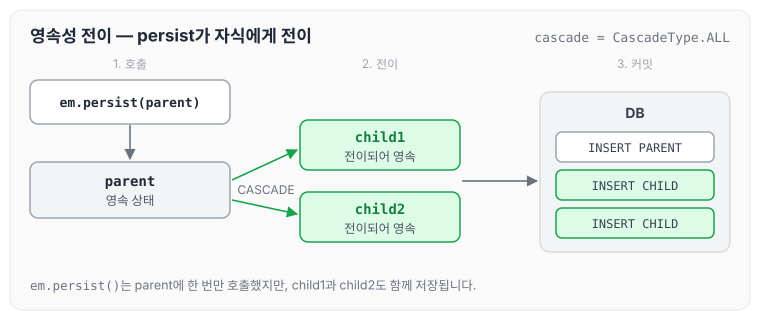
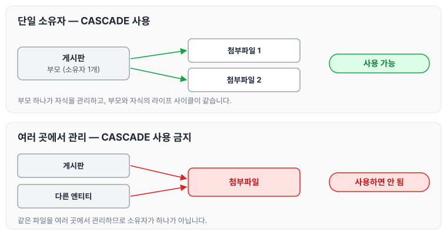
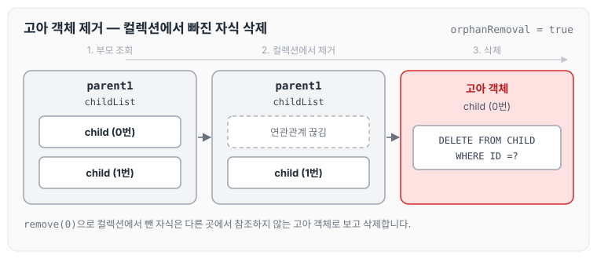
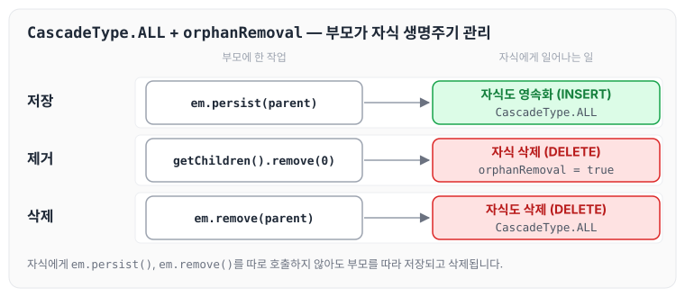

이전에 [즉시 로딩과 지연 로딩](../jpa-lazy-eager-loading/)에 대해 작성하였습니다. 이번 글에서는 부모 엔티티를 저장하거나 삭제할 때 연관된 자식 엔티티까지 함께 처리하는 영속성 전이(CASCADE)와, 부모와의 연관관계가 끊어진 자식을 삭제하는 고아 객체 제거에 대해 정리하도록 하겠습니다.

## 영속성 전이: CASCADE

- 특정 엔티티를 영속 상태로 만들 때 연관된 엔티티도 함께 영속 상태로 만들고 싶을 때 사용합니다.
- 예를 들어 부모 엔티티를 저장할 때 자식 엔티티도 함께 저장합니다.

## 영속성 전이: 저장

저장할 때 영속성을 전이하려면 아래와 같이 `cascade`를 지정합니다.

```java
@OneToMany(mappedBy="parent", cascade=CascadeType.PERSIST)
```

예제의 Child 엔티티는 아래와 같습니다.

```java
package helloJpa;

import javax.persistence.*;

@Entity
public class Child {

    @Id
    @GeneratedValue
    private Long id;
    private String name;

    @ManyToOne
    @JoinColumn(name = "parent_id")
    private Parent parent;
```

Parent 엔티티는 아래와 같습니다.

```java
import java.util.ArrayList;
import java.util.List;

@Entity
public class Parent {
    @Id
    @GeneratedValue
    private Long id;

    private String name;

    @OneToMany(mappedBy = "parent", cascade = CascadeType.ALL)
    private List<Child> childList = new ArrayList<>();
```

부모와 자식을 저장하는 코드는 아래와 같습니다.

```java
public class JpaMain {

    public static void main(String[] args) {
        EntityManagerFactory emf = Persistence.createEntityManagerFactory("hello");// 애플리케이션 에서 한개만 만들어 져야된다.

        EntityManager em = emf.createEntityManager();//하나의 단위를 만들때마다 만들어 줘야된다.

        EntityTransaction tx = em.getTransaction();
        tx.begin();

        try {

            Child child1 = new Child();
            Child child2 = new Child();

            Parent parent = new Parent();
            parent.addChild(child1);
            parent.addChild(child2);

            em.persist(parent);

            ...
```

- `Parent.addChild()`로 child 객체 2개를 넣고 `em.persist(parent)`를 호출합니다.
- 이 한 줄로 parent와 child 2개가 한 번에 insert됩니다.

흐름을 그리면 아래와 같습니다.



`em.persist()`는 parent에 한 번만 호출했지만, 영속화가 childList의 child1, child2까지 전이됩니다.

## 영속성 전이: CASCADE 주의

- 영속성 전이는 연관관계를 매핑하는 것과 아무 관련이 없습니다.
- 엔티티를 영속화할 때 연관된 엔티티도 함께 영속화하는 편리함을 제공할 뿐입니다.

## CASCADE의 종류

- ALL : 모두 적용
- PERSIST : 영속
- REMOVE : 삭제
- MERGE : 병합
- REFRESH : REFRESH
- DETACH : DETACH

이 중에서 ALL, PERSIST, REMOVE 세 가지를 주로 사용합니다.

## CASCADE를 사용하는 경우

CASCADE는 하나의 부모가 자식 엔티티를 관리할 때 의미가 있습니다. 게시판과 첨부파일 경로 같은 경우에 사용할 수 있습니다.

반대로 파일을 여러 곳에서 관리하는 경우에는 사용하면 안 됩니다.

정리하면 아래 두 조건을 만족할 때 사용합니다.

1. 하나의 부모에서만 자식들을 관리할 때 주로 사용합니다(소유자가 1개일 때, 즉 단일 소유자일 때).
2. 부모 객체와 자식 객체의 라이프 사이클이 같을 때 사용합니다.

두 경우를 비교하면 아래와 같습니다.



## 고아 객체

고아 객체 제거는 부모 엔티티와 연관관계가 끊어진 자식 엔티티를 자동으로 삭제하는 기능입니다. `orphanRemoval = true`로 설정합니다.

```java
Parent parent1 = em.find(Parent.class, id);
parent1.getChildren().remove(0); // 자식 엔티티를 컬렉션에서 제거
```

자식 엔티티를 컬렉션에서 제거하면 아래 SQL이 실행됩니다.

```sql
DELETE FROM CHILD WHERE ID =?
```



## 고아 객체 주의

- 참조가 제거된 엔티티는 다른 곳에서 참조하지 않는 고아 객체로 보고 삭제하는 기능입니다.
- 참조하는 곳이 하나일 때 사용해야 합니다.
- 특정 엔티티가 개인 소유할 때 사용합니다.
- `@OneToOne`, `@OneToMany`만 가능합니다.
- 참고: 개념적으로 부모를 제거하면 자식은 고아가 됩니다. 따라서 고아 객체 제거 기능을 활성화하면 부모를 제거할 때 자식도 함께 제거됩니다. 이것은 `CascadeType.REMOVE`처럼 동작합니다.

## 영속성 전이 + 고아 객체, 생명주기

- `CascadeType.ALL` + `orphanRemoval = true`
- 스스로 생명주기를 관리하는 엔티티는 `em.persist()`로 영속화하고, `em.remove()`로 제거합니다.
- 두 옵션을 모두 활성화하면 부모 엔티티를 통해서 자식의 생명주기를 관리할 수 있습니다.
- 도메인 주도 설계(DDD)의 Aggregate Root 개념을 구현할 때 유용합니다.

두 옵션을 함께 켰을 때 자식의 생명주기가 부모를 따라가는 모습은 아래와 같습니다.



## 글로벌 페치 전략 설정

- 모든 연관관계를 지연 로딩으로 설정합니다.
- `@ManyToOne`, `@OneToOne`은 기본이 즉시 로딩이므로 지연 로딩으로 변경합니다.

## 마무리

오늘은 부모 엔티티와 함께 자식 엔티티를 영속화하는 영속성 전이와, 연관관계가 끊어진 자식을 삭제하는 고아 객체 제거에 대해 정리하였습니다. 두 기능 모두 편리하지만, 자식을 소유하는 부모가 하나이고 라이프 사이클이 같을 때만 사용해야 한다는 점을 기억해야 할 것 같습니다.

다음 글에서는 [값 타입 기초 - 기본값 타입과 임베디드 타입](../jpa-value-types/)에 대해 정리하도록 하겠습니다.

> 이 글은 인프런 김영한 님의 [자바 ORM 표준 JPA 프로그래밍 — 기본편](https://www.inflearn.com/course/ORM-JPA-Basic)을 들으며 정리한 노트입니다.
