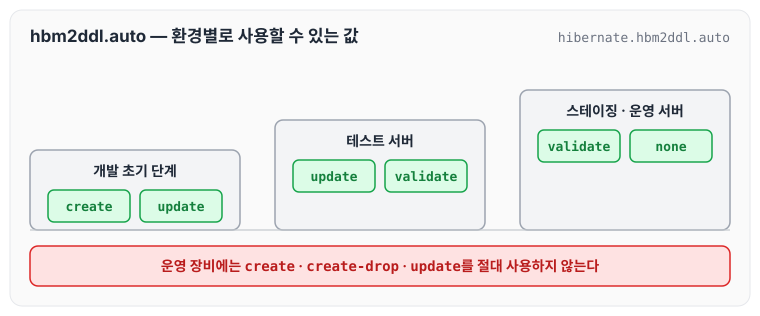
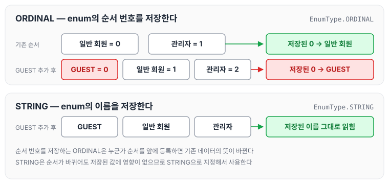
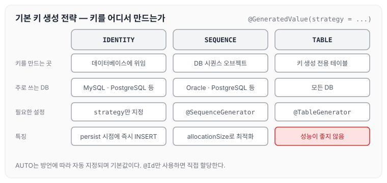
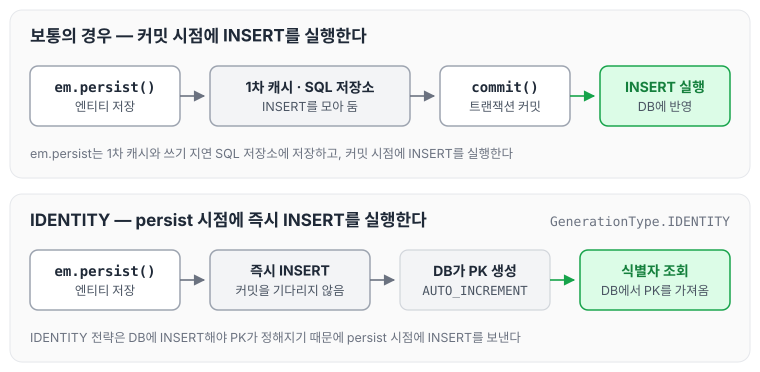
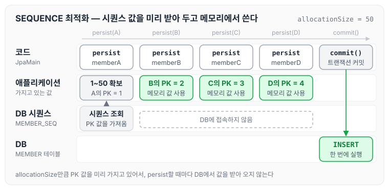

이전에 [영속성 컨텍스트](../jpa-persistence-context/)에 대해 작성하였습니다. 오늘은 객체와 테이블, 필드와 컬럼, 기본 키를 매핑하는 방법과 데이터베이스 스키마 자동 생성, 기본 키 생성 전략에 대해 정리하도록 하겠습니다.

## 엔티티 매핑 소개

엔티티 매핑에 사용하는 어노테이션은 아래와 같습니다.

- `@Entity`, `@Table` : 객체와 테이블 매핑
- `@Column` : 필드와 컬럼 매핑
- `@Id` : 기본 키 매핑
- `@ManyToOne`, `@JoinColumn` : 연관관계 매핑

## 객체와 테이블 매핑

### @Entity

- `@Entity`가 붙은 클래스는 JPA가 관리합니다.
- JPA를 사용해서 테이블과 매핑할 클래스는 `@Entity`가 필수입니다.
- 주의할 점은 아래와 같습니다.
    - 기본 생성자가 필수입니다.
    - final 클래스, enum, interface, inner 클래스는 사용할 수 없습니다.
    - 저장할 필드에 final을 사용할 수 없습니다.
- `@Entity`의 name 속성
    - JPA에서 사용할 엔티티 이름을 지정합니다.
    - 기본값은 클래스명과 동일한 값을 사용합니다.
    - 같은 클래스 이름이 없으면 가급적 기본값을 사용합니다.

### @Table

`@Table`은 엔티티와 매핑할 테이블을 지정합니다. 속성은 아래와 같습니다.

- name : 매핑할 테이블 이름, 기본값은 엔티티 이름을 사용
- catalog : 데이터베이스 catalog 매핑
- schema : 데이터베이스 schema 매핑
- uniqueConstraints : DDL 생성 시에 유니크 제약 조건 생성

```java
package helloJpa;

import javax.persistence.Entity;
import javax.persistence.Id;
import javax.persistence.Table;

@Entity
@Table(name = "MBR")
public class Member {

    ...
}
```

## 데이터베이스 스키마 자동 생성

- DDL을 애플리케이션 실행 시점에 자동 생성합니다.
- 테이블 중심에서 객체 중심으로 접근합니다.
- 데이터베이스 방언을 활용해서 데이터베이스에 맞는 적절한 DDL을 생성합니다.
- 이렇게 생성된 DDL은 개발 장비에서만 사용합니다.
- 생성된 DDL은 운영 서버에서 사용하지 않거나, 적절히 다듬은 후 사용합니다.

persistence.xml에 아래 옵션을 추가합니다.

```xml
<property name="hibernate.hbm2ddl.auto" value="create"/>
```

애플리케이션을 실행하면 DDL이 자동으로 생성되는 로그를 확인할 수 있습니다.

## 데이터베이스 스키마 자동 생성 - 속성

`hibernate.hbm2ddl.auto` 옵션의 값은 아래와 같습니다.

- create : 기존 테이블 삭제 후 다시 생성(DROP + CREATE)
- create-drop : create와 같으나 종료 시점에 테이블 DROP
- update : 변경분만 반영(운영 DB에는 사용하면 안 됨)
- validate : 엔티티와 테이블이 정상 매핑되었는지만 확인
- none : 사용하지 않음

생성되는 DDL은 데이터베이스 방언마다 달라집니다. 예를 들어 persistence.xml의 방언을 H2에서 Oracle로 변경하면 아래와 같습니다.

```xml
<!--<property name="hibernate.dialect" value="org.hibernate.dialect.H2Dialect"/>-->
<property name="hibernate.dialect" value="org.hibernate.dialect.Oracle12cDialect"/>
```

Oracle에 맞게 varchar2로 변경된 DDL을 볼 수 있습니다.

## 데이터베이스 스키마 자동 생성 - 주의

- **운영 장비에는 절대 create, create-drop, update를 사용하면 안 됩니다.**
- 개발 초기 단계는 create 또는 update
- 테스트 서버는 update 또는 validate
- 스테이징과 운영 서버는 validate 또는 none

환경별로 사용할 수 있는 값을 정리하면 아래와 같습니다.



사실 테스트 서버에서도 사용하지 않는 것을 권장합니다.

## DDL 생성 기능

- 제약조건 추가 : 회원 이름은 필수이고, 10자를 초과하면 안 됩니다.
    - `@Column(nullable = false, length = 10)`
- 유니크 제약조건 추가
    - `@Table(uniqueConstraints = {@UniqueConstraint(name = "NAME_AGE_UNIQUE", columnNames = {"NAME", "AGE"})})`
- DDL 생성 기능은 DDL을 자동 생성할 때만 사용되고 JPA의 실행 로직에는 영향을 주지 않습니다.

## 필드와 컬럼 매핑

요구사항이 아래와 같이 추가되었다고 가정합니다.

- 회원은 일반 회원과 관리자로 구분해야 합니다.
- 회원 가입일과 수정일이 있어야 합니다.
- 회원을 설명할 수 있는 필드가 있어야 합니다. 이 필드는 길이 제한이 없습니다.

## 매핑 어노테이션 정리

- `@Column` : 컬럼 매핑
- `@Temporal` : 날짜 타입 매핑
- `@Enumerated` : enum 타입 매핑
- `@Lob` : BLOB, CLOB 매핑
- `@Transient` : DB와 상관없이 메모리에서 사용

### @Enumerated

자바 enum 타입을 매핑할 때 사용합니다.

주의할 점은 ORDINAL을 사용하면 안 된다는 것입니다. ORDINAL은 enum의 순서를 저장하기 때문에, 추가 요청사항으로 GUEST를 추가할 때 누군가 순서를 앞에 등록하면 DB 데이터가 꼬일 수 있습니다.



그래서 **STRING으로 지정해서 사용**하면 됩니다.

### @Temporal

날짜 타입(`java.util.Date`, `java.util.Calendar`)을 매핑할 때 사용합니다.

참고로 LocalDate, LocalDateTime을 사용할 때는 생략할 수 있습니다(최신 하이버네이트 지원).

### @Lob

데이터베이스 BLOB, CLOB 타입과 매핑합니다.

- `@Lob`에는 지정할 수 있는 속성이 없습니다.
- 매핑하는 필드 타입이 문자면 CLOB, 나머지는 BLOB으로 매핑합니다.
    - CLOB : `String`, `char[]`, `java.sql.Clob`
    - BLOB : `byte[]`, `java.sql.Blob`

### @Transient

- 필드를 매핑하지 않습니다.
- 데이터베이스에 저장, 조회하지 않습니다.
- 주로 메모리상에서만 임시로 어떤 값을 보관하고 싶을 때 사용합니다.
- 예 : `@Transient private Integer temp;`

## 기본 키 매핑 방법

- 직접 할당 : `@Id`만 사용
- 자동 생성 : `@GeneratedValue`
    - IDENTITY : 데이터베이스에 위임, MySQL
    - SEQUENCE : 데이터베이스 시퀀스 오브젝트 사용, Oracle
        - `@SequenceGenerator` 필요
    - TABLE : 키 생성용 테이블 사용, 모든 DB에서 사용
        - `@TableGenerator` 필요
    - AUTO : 방언에 따라 자동 지정, 기본값

세 가지 생성 전략을 비교하면 아래와 같습니다.



### 1) IDENTITY 전략 - 특징

- 기본 키 생성을 데이터베이스에 위임합니다.
- 주로 MySQL, PostgreSQL, SQL Server, DB2에 사용합니다.
- JPA는 보통 트랜잭션 커밋 시점에 INSERT SQL을 실행합니다.
- AUTO_INCREMENT는 데이터베이스에 INSERT SQL을 실행한 이후에 식별자 값을 알 수 있습니다.
- 그래서 IDENTITY 전략은 `em.persist()` 시점에 즉시 INSERT SQL을 실행하고 DB에서 식별자를 조회합니다.

부연 설명을 하자면, `em.persist`는 1차 캐시와 쓰기 지연 SQL 저장소에 저장한 후 commit 시점에 insert를 실행하는데, IDENTITY 전략은 DB에 insert하는 시점에 PK가 정해지기 때문에 괴리가 발생합니다. 이를 해결하기 위해 JPA는 IDENTITY 전략을 사용할 때 `em.persist`를 하는 즉시 DB에 INSERT 문을 전달합니다.



### 1-1) IDENTITY - 매핑

```java
@Entity
public class Member {
	@Id
	@GeneratedValue(strategy = GenerationType.IDENTITY)
	private Long id;
```

### 2) SEQUENCE 전략

- 데이터베이스 시퀀스는 유일한 값을 순서대로 생성하는 특별한 데이터베이스 오브젝트입니다.
- Oracle, PostgreSQL, DB2, H2 데이터베이스에서 사용합니다.
- PK는 Long을 권장합니다.

### 2-1) SEQUENCE - 매핑

```java
@Entity
@SequenceGenerator(
        name = "MEMBER_SEQ_GENERATOR",
        sequenceName = "MEMBER_SEQ",
        initialValue = 1, allocationSize = 1
)
public class Member {

    @Id
    @GeneratedValue(strategy = GenerationType.SEQUENCE, generator = "MEMBER_SEQ_GENERATOR")
    private Long id;
```

### 2-2) SEQUENCE - @SequenceGenerator

- 주의 : allocationSize 기본값 = 50

### 3) TABLE 전략

- 키 생성 전용 테이블을 하나 만들어서 데이터베이스 시퀀스를 흉내 내는 전략입니다.
- 장점 : 모든 데이터베이스에 적용 가능
- 단점 : 성능이 좋지 않음

### 3-1) TABLE - 매핑

```java
@Entity
@TableGenerator(
        name = "MEMBER_SEQ_GENERATOR",
        table = "MY_SEQUENCES",
        pkColumnName = "MEMBER_SEQ", allocationSize = 1
)
public class Member {

    @Id
    @GeneratedValue(strategy = GenerationType.TABLE, generator = "MEMBER_SEQ_GENERATOR")
```

### 3-2) TABLE - @TableGenerator

- DB에서 보통 관례로 사용하는 것이 있기 때문에 운영에서는 보통 TABLE 전략을 사용하지 않습니다.

## 권장하는 식별자 전략

- 기본 키 제약 조건 : null이 아님, 유일함, 변하지 않아야 함
- 미래까지 이 조건을 만족하는 자연 키(주민등록번호처럼 유일한 값)는 찾기 어렵습니다. 그래서 대리 키(대체 키)를 사용하는 것이 좋습니다.
- 예를 들어 주민등록번호도 기본 키로 적절하지 않습니다. 회원 테이블의 PK를 주민등록번호로 저장했는데, 나라에서 주민등록번호를 저장하면 안 된다는 정책이 나왔다고 가정합니다. 이때 회원 테이블을 참조하는 나머지 테이블이 PK로 Join을 사용하고 있다면, 전부 수정하는 데 많은 노동력과 자원이 들어갑니다.
- **권장 : Long형 + 대체 키 + 키 생성 전략 사용**

## SEQUENCE 전략과 최적화

SEQUENCE 전략과 TABLE 전략은 PK 값을 받아 오기 위해 DB에 접속해야 합니다. persist할 때마다 DB에 접속한다면 그 횟수가 계속 늘어나는데, 최적화 전략을 사용하면 이를 줄일 수 있습니다.

```java
@SequenceGenerator(
        name = "MEMBER_SEQ_GENERATOR",
        sequenceName = "MEMBER_SEQ",
        initialValue = 1, allocationSize = 1
```

위 Generator에서 initialValue = 1, allocationSize = 50으로 변경하면, 시퀀스 값을 1부터 50까지 사용하겠다고 DB에서 받아 둔 뒤 애플리케이션이 그 값을 가지고 있다가 `em.persist()`를 할 때 PK를 부여합니다. 예시는 아래와 같습니다.

```java
package helloJpa;

import javax.persistence.EntityManager;
import javax.persistence.EntityManagerFactory;
import javax.persistence.EntityTransaction;
import javax.persistence.Persistence;
import java.util.List;

public class JpaMain {

    public static void main(String[] args) {
        EntityManagerFactory emf = Persistence.createEntityManagerFactory("hello");// 애플리케이션 에서 한개만 만들어 져야된다.

        EntityManager em = emf.createEntityManager();//하나의 단위를 만들때마다 만들어 줘야된다.

        EntityTransaction tx = em.getTransaction();
        tx.begin();

        try {
            System.out.println("================");
            Member memberA = new Member();
            memberA.setName("memberA");
            em.persist(memberA);
            System.out.println("MemberA : " + memberA.getId());

            Member memberB = new Member();
            memberB.setName("memberB");
            em.persist(memberB);
            System.out.println("memberB : " + memberB.getId());

            Member memberC = new Member();
            memberC.setName("memberC");
            em.persist(memberC);
            System.out.println("memberC : " + memberC.getId());

            Member memberD = new Member();
            memberD.setName("memberD");
            em.persist(memberD);
            System.out.println("memberD : " + memberD.getId());
            System.out.println("================");

            tx.commit();
        } catch (Exception e) {
            tx.rollback();
        } finally {
            em.close();
        }
        emf.close();
    }
}
```

실행 로그를 보면 아래 두 가지를 확인할 수 있습니다.

1. persist할 때 PK 값을 가져옵니다.
2. 이후 쓰기 지연 SQL을 통해서 commit 시점에 insert를 한 번에 실행합니다.

이 흐름을 그림으로 나타내면 아래와 같습니다.



## 마무리

오늘은 `@Entity`, `@Table`로 객체와 테이블을 매핑하는 방법과 데이터베이스 스키마 자동 생성, 필드와 컬럼 매핑 어노테이션, 그리고 IDENTITY·SEQUENCE·TABLE 기본 키 생성 전략과 SEQUENCE 최적화에 대해 정리하였습니다. 스키마 자동 생성은 편리하지만 운영 장비에서는 사용하지 않도록 주의해야 할 것 같습니다. 다음 글에서는 [연관관계 매핑 기초](../jpa-association-basics/)에 대해 정리하도록 하겠습니다.

> 이 글은 인프런 김영한 님의 [자바 ORM 표준 JPA 프로그래밍 — 기본편](https://www.inflearn.com/course/ORM-JPA-Basic)을 들으며 정리한 노트입니다.
