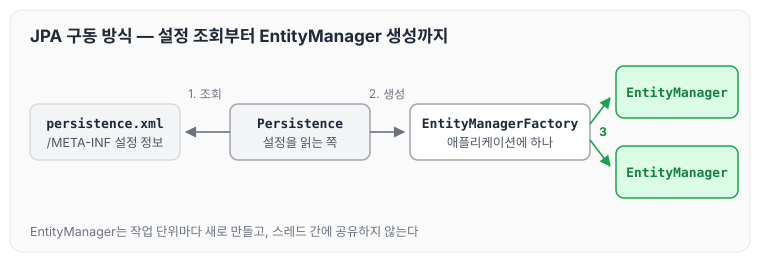
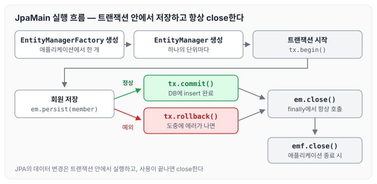
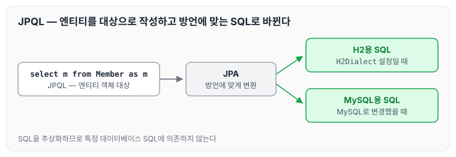

오늘은 JPA를 사용하기 위해 필요한 라이브러리와 `persistence.xml` 설정, JPA의 구동 방식, EntityManager로 회원을 저장하는 기본 동작 방식, 그리고 JPQL에 대해 정리하도록 하겠습니다.

## 1. 라이브러리 추가

먼저 pom.xml에 하이버네이트, H2 데이터베이스 라이브러리를 추가합니다.

```xml
<?xml version="1.0" encoding="UTF-8"?>
<project xmlns="http://maven.apache.org/POM/4.0.0"
         xmlns:xsi="http://www.w3.org/2001/XMLSchema-instance"
         xsi:schemaLocation="http://maven.apache.org/POM/4.0.0 http://maven.apache.org/xsd/maven-4.0.0.xsd">
    <modelVersion>4.0.0</modelVersion>

    <groupId>jpa-basic</groupId>
    <artifactId>ex1-hello-jpa</artifactId>
    <version>1.0.0</version>

    <dependencies>
<!-- JPA 하이버네이트 --><dependency>
            <groupId>org.hibernate</groupId>
            <artifactId>hibernate-entitymanager</artifactId>
            <version>5.3.10.Final</version>
        </dependency>
<!-- H2 데이터베이스 --><dependency>
            <groupId>com.h2database</groupId>
            <artifactId>h2</artifactId>
            <version>1.4.200</version>
        </dependency>

        <dependency>
            <groupId>javax.xml.bind</groupId>
            <artifactId>jaxb-api</artifactId>
            <version>2.3.0</version>
        </dependency>
    </dependencies>

    <properties>
        <maven.compiler.source>11</maven.compiler.source>
        <maven.compiler.target>11</maven.compiler.target>
    </properties>

</project>
```

## 2. JPA 설정하기

JPA 설정 파일은 `/META-INF/persistence.xml`에 위치합니다. 설정 파일의 특징은 아래와 같습니다.

- `persistence-unit name`으로 이름을 지정합니다.
- `javax.persistence`로 시작하는 속성은 JPA 표준 속성입니다.
- `hibernate`로 시작하는 속성은 하이버네이트 전용 속성입니다.

persistence.xml은 다음과 같이 작성합니다.

```xml
<?xml version="1.0" encoding="UTF-8"?>
<persistence version="2.2"
             xmlns="http://xmlns.jcp.org/xml/ns/persistence" xmlns:xsi="http://www.w3.org/2001/XMLSchema-instance"
             xsi:schemaLocation="http://xmlns.jcp.org/xml/ns/persistence http://xmlns.jcp.org/xml/ns/persistence/persistence_2_2.xsd">
    <persistence-unit name="hello">
        <properties>
<!-- 필수 속성 --><property name="javax.persistence.jdbc.driver" value="org.h2.Driver"/>
            <property name="javax.persistence.jdbc.user" value="sa"/>
            <property name="javax.persistence.jdbc.password" value=""/>
            <property name="javax.persistence.jdbc.url" value="jdbc:h2:tcp://localhost/~/test"/>
            <property name="hibernate.dialect" value="org.hibernate.dialect.H2Dialect"/>

<!-- 옵션 --><property name="hibernate.show_sql" value="true"/><!--쿼리가 로그에 보인다. --><property name="hibernate.format_sql" value="true"/><!--쿼리가 로그 정렬되서 보이게 해준다. --><property name="hibernate.use_sql_comments" value="true"/><!--쿼리가 왜 나오는지 알려준다. --><!--<property name="hibernate.hbm2ddl.auto" value="create" />--></properties>
    </persistence-unit>
</persistence>

```

## 3. JPA 구동 방식

JPA는 아래 순서로 구동됩니다.

1. Persistence에서 persistence.xml 설정 정보를 조회합니다.
2. Persistence에서 EntityManagerFactory를 생성합니다.
3. EntityManagerFactory에서 EntityManager를 생성합니다.

이 순서를 그림으로 나타내면 아래와 같습니다.



EntityManagerFactory는 하나만 만들고, EntityManager는 필요할 때마다 EntityManagerFactory에서 만들어 사용합니다.

## 4. 기본 동작 방식 구현

### 1) 객체와 테이블을 생성하고 매핑하기

- `@Entity` : JPA가 관리할 객체
- `@Id` : 데이터베이스 PK와 매핑

```java
package helloJpa;

import javax.persistence.Entity;
import javax.persistence.Id;

@Entity
public class Member {

    @Id
    private Long id;
    private String name;

    public void setId(Long id) {
        this.id = id;
    }

    public Long getId() {
        return id;
    }

    public String getName() {
        return name;
    }

    public void setName(String name) {
        this.name = name;
    }
}
```

### 2) 회원 저장, 등록, 수정, 삭제 구현하기

회원을 저장할 때 지켜야 할 점은 아래와 같습니다.

- EntityManagerFactory는 애플리케이션에서 한 개만 만들어야 합니다.
- EntityManager는 하나의 단위를 만들 때마다 만들어야 합니다. 그래서 EntityManager는 절대 스레드 간에 공유하면 안 됩니다.
- JPA는 트랜잭션 안에서 동작해야 하며, 저장이 잘 되었다면 커밋을 통해서 DB insert를 완료해야 합니다.
- insert 도중 에러가 발생하면 롤백해야 합니다.
- 사용한 뒤에는 항상 close를 해야 합니다.

```java
package helloJpa;

import javax.persistence.EntityManager;
import javax.persistence.EntityManagerFactory;
import javax.persistence.EntityTransaction;
import javax.persistence.Persistence;

public class JpaMain {

    public static void main(String[] args) {
        EntityManagerFactory emf = Persistence.createEntityManagerFactory("hello");// 애플리케이션 에서 한개만 만들어 져야된다.

        EntityManager em = emf.createEntityManager();//하나의 단위를 만들때마다 만들어 줘야된다.

        EntityTransaction tx = em.getTransaction();
        tx.begin();

        try {
            Member member = new Member();
            member.setId(1L);
            member.setName("HelloA");
            em.persist(member);
            tx.commit();
        } catch (Exception e) {
            tx.rollback();
        } finally {
            em.close();
        }
        emf.close();
    }
}

```

위 코드의 실행 흐름은 아래와 같습니다.



정상적으로 저장되면 `tx.commit()`으로 insert가 완료되고, 도중에 예외가 발생하면 `tx.rollback()`으로 되돌립니다. 어느 쪽이든 `finally`에서 `em.close()`가 호출되고, 마지막에 `emf.close()`로 EntityManagerFactory를 닫습니다.

## 5. JPQL 소개

JPA에서 가장 단순한 조회 방법은 아래와 같습니다.

- `EntityManager.find()`
- 객체 그래프 탐색(`a.getB().getC()`)

하지만 나이가 18살 이상인 회원을 모두 검색하는 것처럼 조건이 필요한 조회는 이 방법만으로 하기 어렵습니다. 이런 경우 JPQL을 사용합니다. 아래는 JPQL로 회원을 조회하는 예시입니다.

```java
package helloJpa;

import javax.persistence.EntityManager;
import javax.persistence.EntityManagerFactory;
import javax.persistence.EntityTransaction;
import javax.persistence.Persistence;
import java.util.List;

public class JpaMain {

    public static void main(String[] args) {
        EntityManagerFactory emf = Persistence.createEntityManagerFactory("hello");// 애플리케이션 에서 한개만 만들어 져야된다.
				EntityManager em = emf.createEntityManager();//하나의 단위를 만들때마다 만들어 줘야된다.
				EntityTransaction tx = em.getTransaction();
        tx.begin();

        try {
//            Member findMember = em.find(Member.class, 1L);
//            findMember.setName("HelloJpa");

            // JPQL 사용방법
            List<Member> resultList = em.createQuery("select m from Member as m", Member.class).
                    getResultList();

            for (Member member : resultList) {
                System.out.println("member.name = " + member.getName());
            }

            tx.commit();
        } catch (Exception e) {
            tx.rollback();
        } finally {
            em.close();
        }
        emf.close();
    }
}

```

JPA로 조회하기 어려운 쿼리가 있다면 JPQL을 통해서 조회하면 됩니다. 이때 중요한 점은 JPQL이 테이블이 아닌 엔티티 객체를 대상으로 조회한다는 것입니다. 그래서 환경설정에서 H2 데이터베이스를 MySQL로 변경하면, 같은 JPQL이 변경한 데이터베이스에 맞는 쿼리로 조회됩니다. SQL을 추상화하기 때문에 특정 데이터베이스 SQL에 의존하지 않습니다.



## 마무리

오늘은 JPA 라이브러리와 persistence.xml 설정, JPA 구동 방식, EntityManager로 회원을 저장하는 기본 동작, 그리고 JPQL에 대해 정리하였습니다. JPA와 JPQL은 모두 엔티티 객체를 기반으로 조회하기 때문에, 데이터베이스를 변경해도 JPA가 그에 맞게 쿼리를 바꿔 줍니다. 덕분에 데이터베이스 중심의 설계와 객체지향 사이에서 생기는 괴리에서 벗어날 수 있을 것 같습니다. 다음 글에서는 [영속성 컨텍스트](../jpa-persistence-context/)에 대해 정리하도록 하겠습니다.

> 이 글은 인프런 김영한 님의 [자바 ORM 표준 JPA 프로그래밍 — 기본편](https://www.inflearn.com/course/ORM-JPA-Basic)을 들으며 정리한 노트입니다.
