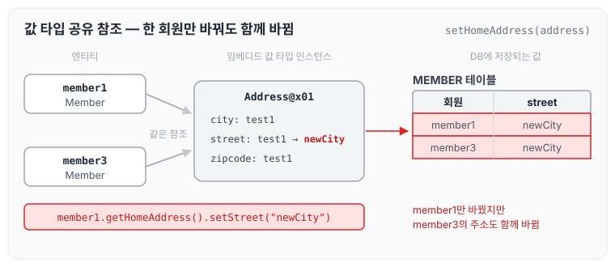
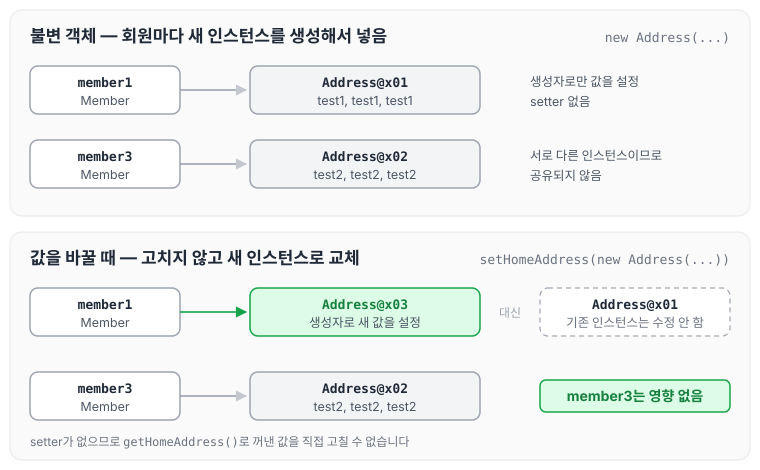
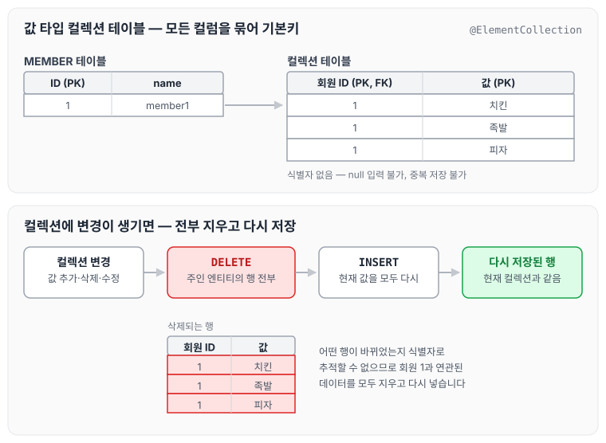
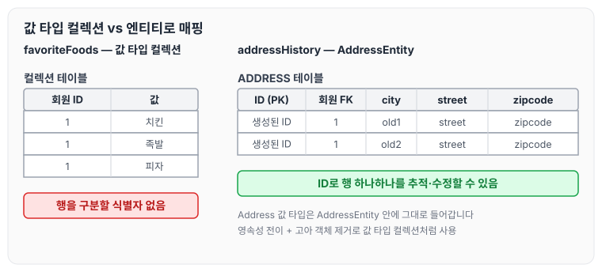

이전에 [값 타입 기초 - 기본값 타입과 임베디드 타입](../jpa-value-types/)에 대해 작성하였습니다. 이번에는 임베디드 타입 같은 값 타입을 여러 엔티티가 공유할 때 생기는 문제와 이를 막는 불변 객체, 그리고 값 타입을 여러 개 저장하는 값 타입 컬렉션에 대해 정리하도록 하겠습니다.

## 값 타입 공유 참조

- 임베디드 타입 같은 값 타입을 여러 엔티티에서 공유하면 위험합니다.
- 공유 때문에 생기는 부작용(side effect)은 원인을 찾기도 어렵습니다.

아래는 하나의 `Address` 인스턴스를 두 회원이 함께 사용하는 코드입니다.

```java
public class JpaMain {

    public static void main(String[] args) {
        EntityManagerFactory emf = Persistence.createEntityManagerFactory("hello");// 애플리케이션 에서 한개만 만들어 져야된다.

        EntityManager em = emf.createEntityManager();//하나의 단위를 만들때마다 만들어 줘야된다.

        EntityTransaction tx = em.getTransaction();
        tx.begin();

        try {
            Address address = new Address("test1", "test1", "test1");
            Member member1 = new Member();
            member1.setName("test...");
            member1.setHomeAddress(address);
            em.persist(member1);

            Member member3 = new Member();
            member3.setName("test...");
            member3.setHomeAddress(address);
            em.persist(member3);

            member1.getHomeAddress().setStreet("newCity");
```

위 코드는 address를 여러 엔티티가 공유하는 구조입니다. 이 상태에서 member1의 주소 값을 위와 같이 변경하면 member3의 주소도 함께 변경됩니다.



member1만 바꾸려고 했지만 두 회원이 같은 인스턴스를 가리키고 있으므로 member3의 주소도 함께 바뀝니다. 이때 예외가 발생하는 것도 아니고 DB에 들어가는 값만 의도와 다르게 저장되기 때문에, 부작용이 생겨도 원인을 찾기 어렵습니다.

### 해결 방법

- 객체 타입을 수정할 수 없게 만들면 부작용을 원천 차단할 수 있습니다.
- 값 타입은 불변 객체로 설계해야 합니다.
- 불변 객체는 생성 시점 이후 절대 값을 변경할 수 없는 객체입니다.
- 생성자로만 값을 설정하고 수정자(setter)를 만들지 않으면 됩니다.

생성자로만 값을 설정하는 `Period`는 아래와 같습니다.

```java
package helloJpa;

import javax.persistence.Embeddable;
import java.time.LocalDateTime;

@Embeddable
public class Period {

//기간 Period
    private LocalDateTime startDate;
    private LocalDateTime endDate;

    public Period(LocalDateTime startDate, LocalDateTime endDate) {
        this.startDate = startDate;
        this.endDate = endDate;
    }

    public Period() {

    }
}

```

회원마다 주소를 따로 쓰려면 아래와 같이 각각 새 인스턴스를 생성해서 넣습니다.

```java
Member member1 = new Member();
member1.setName("test...");
member1.setHomeAddress(new Address("test1", "test1", "test1"));
em.persist(member1);

Member member3 = new Member();
member3.setName("test...");
member3.setHomeAddress(new Address("test2", "test2", "test2"));
em.persist(member3);
```

값은 생성자로만 설정되게 하고, 변경할 것이 있으면 메인 프로세스에서 생성자로 새 값을 만들어 다시 넣어 주면 됩니다.



회원마다 다른 인스턴스를 가지고, 값을 바꿀 때도 기존 인스턴스를 고치는 대신 새 인스턴스로 교체하므로 다른 회원에게 영향이 가지 않습니다.

## 값 타입 컬렉션

- 관계형 데이터베이스는 기본적으로 객체의 컬렉션을 담을 수 있는 구조가 없습니다.
- 테이블의 컬럼에는 값만 넣을 수 있습니다.
- 값 타입 컬렉션을 저장하는 테이블은 엔티티와 달리 값들을 전부 묶어서 PK를 구성합니다.

### 값 타입 컬렉션 사용

- 값 타입을 하나 이상 저장할 때 사용합니다.
- `@ElementCollection`, `@CollectionTable`을 사용합니다.
- 데이터베이스는 컬렉션을 같은 테이블에 저장할 수 없습니다.
- 컬렉션을 저장하기 위한 별도의 테이블이 필요합니다.

### 저장, 조회, 수정

- 값 타입 저장
- 값 타입 조회
    - 값 타입 컬렉션도 지연 로딩 전략을 사용합니다.
- 값 타입 수정

참고로 값 타입 컬렉션은 영속성 전이(Cascade)와 고아 객체 제거 기능을 필수로 가진다고 볼 수 있습니다.

### 값 타입 컬렉션의 제약사항

- 값 타입은 엔티티와 다르게 식별자 개념이 없습니다.
- 값을 변경하면 추적이 어렵습니다.
- 값 타입 컬렉션에 변경 사항이 발생하면, 주인 엔티티와 연관된 모든 데이터를 삭제하고 값 타입 컬렉션에 있는 현재 값을 모두 다시 저장합니다.
- 값 타입 컬렉션을 매핑하는 테이블은 모든 컬럼을 묶어서 기본키를 구성해야 합니다. 그래서 null을 입력할 수 없고, 중복 저장도 할 수 없습니다.

제약사항 중 변경 시 동작을 그리면 아래와 같습니다.



식별자가 없으므로 어떤 행이 바뀌었는지 따로 추적하지 않고, 주인 엔티티 기준으로 전부 지운 다음 컬렉션의 현재 값을 다시 넣습니다.

### 값 타입 컬렉션 대안

- 실무에서는 상황에 따라 값 타입 컬렉션 대신 일대다 관계를 고려합니다.
- 일대다 관계를 위한 엔티티를 만들고, 여기에서 값 타입을 사용합니다.
- 영속성 전이(Cascade)와 고아 객체 제거를 사용해서 값 타입 컬렉션처럼 사용합니다.
- 예) AddressEntity

값 타입 `Address`를 감싸는 `AddressEntity`는 아래와 같습니다.

```java
package helloJpa;

import javax.persistence.Entity;
import javax.persistence.GeneratedValue;
import javax.persistence.Id;
import javax.persistence.Table;

@Entity
@Table(name = "ADDRESS")
public class AddressEntity {
    @Id
    @GeneratedValue
    private Long id;
    private Address address;

    public AddressEntity(String city, String street, String zipcode) {
        this.address = new Address(city, street, zipcode);
    }

    public AddressEntity() {

    }

    public Long getId() {
        return id;
    }

    public void setId(Long id) {
        this.id = id;
    }

    public Address getAddress() {
        return address;
    }

    public void setAddress(Address address) {
        this.address = address;
    }
}

```

`Address`는 생성자와 getter만 가진 값 타입입니다.

```java
package helloJpa;

import javax.persistence.Embeddable;

@Embeddable
public class Address {

//주소 Period
    private String city;
    private String street;
    private String zipcode;

    public Address(String city, String street, String zipcode) {
        this.city = city;
        this.street = street;
        this.zipcode = zipcode;
    }

    public Address() {
    }

    public String getCity() {
        return city;
    }

    public String getStreet() {
        return street;
    }

    public String getZipcode() {
        return zipcode;
    }
}

```

회원에 좋아하는 음식은 값 타입 컬렉션으로, 주소 이력은 `AddressEntity`로 저장하는 코드는 아래와 같습니다.

```java
public static void main(String[] args) {
    EntityManagerFactory emf = Persistence.createEntityManagerFactory("hello");// 애플리케이션 에서 한개만 만들어 져야된다.

    EntityManager em = emf.createEntityManager();//하나의 단위를 만들때마다 만들어 줘야된다.

    EntityTransaction tx = em.getTransaction();
    tx.begin();

    try {
        Member member1 = new Member();
        member1.setName("member1");
        member1.setHomeAddress(new Address("homeCity", "street", "zipcode"));
        member1.getFavoriteFoods().add("치킨");
        member1.getFavoriteFoods().add("족발");
        member1.getFavoriteFoods().add("피자");

        member1.getAddressHistory().add(new AddressEntity("old1", "street", "zipcode"));
        member1.getAddressHistory().add(new AddressEntity("old2", "street", "zipcode"));

```

실무에서는 값 타입 컬렉션보다 위와 같이 값 타입 컬렉션을 엔티티로 매핑해서 많이 사용합니다. 값 타입 컬렉션에 변경이 발생하면 연관된 모든 데이터가 삭제된 후 다시 저장되기 때문입니다.



`AddressEntity`는 자체 식별자를 가지므로 행 하나하나를 추적하고 수정할 수 있습니다.

값 타입 컬렉션은 추적할 필요 없이 조회만 할 때 사용하면 됩니다. 예를 들어 메뉴에서 체크박스로 "나는 [치킨, 피자]를 좋아한다"처럼 선택한 값을 조회하는 경우입니다.

## 정리

### 엔티티 타입의 특징

- 식별자가 있습니다.
- 생명주기를 관리합니다.
- 공유할 수 있습니다.

### 값 타입의 특징

- 식별자가 없습니다.
- 생명주기를 엔티티에 의존합니다.
- 공유하지 않는 것이 안전합니다.
- 불변 객체로 만드는 것이 안전합니다.

### 주의해야 할 점

값 타입은 정말 값 타입이라고 판단될 때만 사용합니다.

엔티티와 값 타입을 혼동해서 엔티티를 값 타입으로 만들면 안 됩니다.

식별자가 필요하고 지속해서 값을 추적, 변경해야 한다면 그것은 값 타입이 아닌 엔티티입니다.

## 마무리

오늘은 값 타입을 공유할 때 생기는 부작용과 불변 객체, 그리고 값 타입 컬렉션의 제약과 대안에 대해 정리하였습니다.

실무에서는 값 타입 컬렉션을 엔티티로 매핑해서 사용하고, 정말 간단한 조회 같은 경우에만 값 타입을 사용해서 객체지향적으로 설계합니다. 결국 컬렉션은 안전하게 엔티티로 매핑해서 사용하는 것이 중요하고, 값 타입을 쓸 때는 불변 객체로 만들어 두어야 공유 참조로 인한 부작용을 막을 수 있을 것 같습니다.

다음 글에서는 [JPQL 기본 문법](../jpa-jpql-basics/)에 대해 정리하도록 하겠습니다.

> 이 글은 인프런 김영한 님의 [자바 ORM 표준 JPA 프로그래밍 — 기본편](https://www.inflearn.com/course/ORM-JPA-Basic)을 들으며 정리한 노트입니다.
