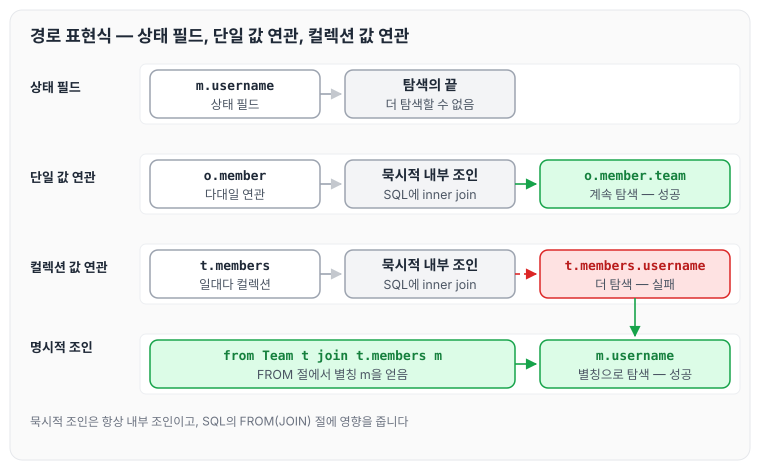
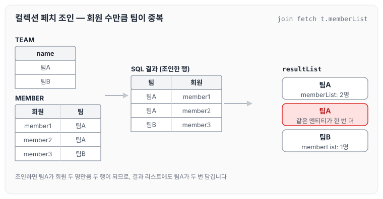
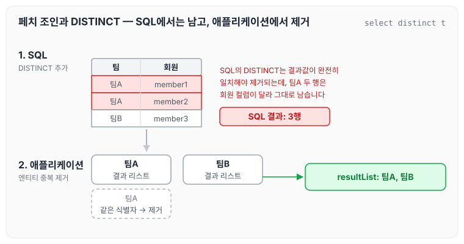
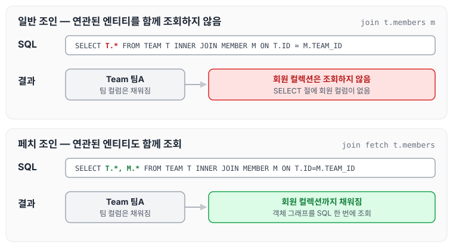
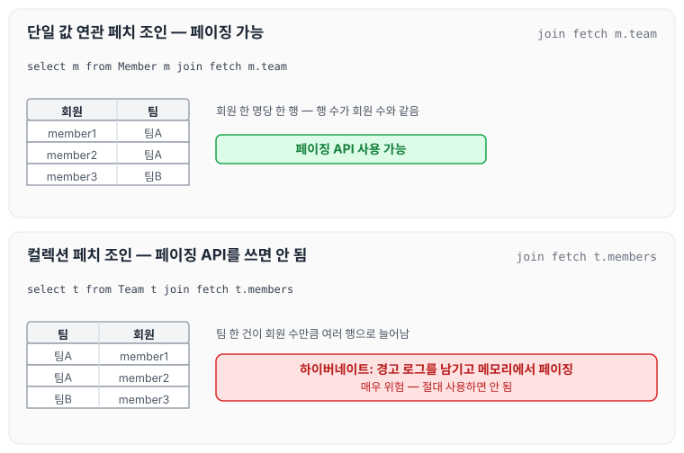

이전에 [JPQL 기본 문법](../jpa-jpql-basics/)에 대해 작성하였습니다. 이번에는 점(.)을 찍어 객체 그래프를 탐색하는 경로 표현식과, 연관된 엔티티를 SQL 한 번에 함께 조회하는 페치 조인에 대해 정리하도록 하겠습니다.

## 경로 표현식 특징

- 상태 필드(state field): 경로 탐색의 끝이며 더 탐색할 수 없습니다.
- 단일 값 연관 경로: 묵시적 내부 조인(inner join)이 발생하며, 탐색이 가능합니다.
- 컬렉션 값 연관 경로: 묵시적 내부 조인이 발생하며, 탐색은 불가능합니다.
    - FROM 절에서 명시적 조인을 통해 별칭을 얻으면 별칭을 통해 탐색할 수 있습니다.

세 경로를 예제로 나란히 놓으면 아래와 같습니다.



이처럼 연관 경로를 탐색하면 SQL에 조인이 따라붙습니다. 묵시적 조인은 유지보수하기 어렵기 때문에 실무에서는 쓰지 않는 것이 좋고, 항상 명시적 조인으로 작성해야 합니다.

## 상태 필드 경로 탐색

- JPQL: `select m.username, m.age from Member m`
- SQL: `select m.username, m.age from Member m`

## 단일 값 연관 경로 탐색

JPQL은 아래와 같습니다.

```sql
select o.member
  from Order o
```

SQL로는 아래와 같이 변환됩니다.

```sql
select m.*
  from Orders o
 inner join Member m on o.member_id = m.id
```

JPQL에는 조인이 보이지 않지만 SQL에는 내부 조인이 생깁니다. 이 때문에 묵시적 조인은 문제를 일으킬 가능성이 큽니다.

## 명시적 조인, 묵시적 조인

- 명시적 조인: join 키워드를 직접 사용합니다.
    - `select m from Member m join m.team t`
- 묵시적 조인: 경로 표현식에 의해 묵시적으로 SQL 조인이 발생합니다(내부 조인만 가능).
    - `select m.team from Member m`

## 경로 표현식 - 예제

- `select o.member.team from Order o` : 성공
- `select t.members from Team t` : 성공
- `select t.members.username from Team t` : 실패
- `select m.username from Team t join t.members m` : 성공

## 경로 탐색을 사용한 묵시적 조인 시 주의사항

- 항상 내부 조인입니다.
- 컬렉션은 경로 탐색의 끝이므로 명시적 조인을 통해 별칭을 얻어야 합니다.
- 경로 탐색은 주로 SELECT, WHERE 절에서 사용하지만 묵시적 조인으로 인해 SQL의 FROM(JOIN) 절에 영향을 줍니다.

## 실무 조언

- 가급적 묵시적 조인 대신 명시적 조인을 사용합니다.
- 조인은 SQL 튜닝의 중요한 포인트입니다.
- 묵시적 조인은 조인이 일어나는 상황을 한눈에 파악하기 어렵습니다.

## 페치 조인(fetch join)

- SQL 조인 종류가 아닙니다.
- JPQL에서 성능 최적화를 위해 제공하는 기능입니다.
- 연관된 엔티티나 컬렉션을 SQL 한 번에 함께 조회하는 기능입니다.
- join fetch 명령어를 사용합니다.
- 페치 조인 ::= `[ LEFT [OUTER] | INNER] JOIN FETCH 조인 경로`

회원을 조회하면서 연관된 팀도 함께 조회하는 예시는 아래와 같습니다.

```java
String jpql = "select m from Member m join fetch m.team";
List<Member> members = em.createQuery(jpql, Member.class)
 	.getResultList();
for (Member member : members) {
//페치 조인으로 회원과 팀을 함께 조회해서 지연 로딩X
 	System.out.println("username = " + member.getUsername() + ", " +
 	"teamName = " + member.getTeam().getName());
}
```

회원과 팀을 한 번에 조회했으므로 `member.getTeam()`으로 팀에 접근해도 지연 로딩이 일어나지 않습니다.

## 컬렉션 페치 조인

일대다 관계의 컬렉션을 페치 조인하는 예시입니다.

JPQL은 아래와 같습니다.

```sql
select t
  from Team t join fetch t.members
 where t.name = '팀A'
```

SQL로는 아래와 같이 변환됩니다.

```sql
SELECT  T.*, M.*
  FROM TEAM T
 INNER JOIN MEMBER M ON T.ID=M.TEAM_ID
 WHERE T.NAME = '팀A'
```

### 컬렉션 페치 조인 예제

팀A에 회원 두 명, 팀B에 회원 한 명을 저장한 뒤 팀과 회원 목록을 페치 조인으로 조회합니다.

```java
public class JpaMain {

    public static void main(String[] args) {
        EntityManagerFactory emf = Persistence.createEntityManagerFactory("hello");// 애플리케이션 에서 한개만 만들어 져야된다.

        EntityManager em = emf.createEntityManager();//하나의 단위를 만들때마다 만들어 줘야된다.

        EntityTransaction tx = em.getTransaction();
        tx.begin();

        try {
            Team teamA = new Team();
            teamA.setName("팀A");
            em.persist(teamA);

            Team teamB = new Team();
            teamB.setName("팀B");
            em.persist(teamB);

            Member member1 = new Member();
            member1.setUsername("TeamA");
            member1.setAge(10);
            member1.setTeam(teamA);
            em.persist(member1);

            Member member2 = new Member();
            member2.setUsername("TeamA");
            member2.setTeam(teamA);
            member2.setAge(10);
            em.persist(member2);

            Member member3 = new Member();
            member3.setUsername("TeamB");
            member3.setTeam(teamB);
            member3.setAge(10);
            em.persist(member3);

            em.flush();
            em.clear();

            String query = "select t FROM Team t join fetch t.memberList";
//String query = "select m FROM Member m";// From 절에서 명시적 조인을 통해서 별칭을 얻으면 별칭을 통해 탐색 가능.

            List<Team> resultList = em.createQuery(query, Team.class)
                    .getResultList();

            for (Team team : resultList) {
                System.out.println("Member = " + team.getName() + ", "+ team.getMemberList().size());
                for(Member member : team.getMemberList()) {
                    System.out.println("- member = " + member);
                }
            }
```

실행하면 결과 값이 중복으로 나옵니다. 팀과 회원을 조인하면 회원 수만큼 행이 만들어지므로, 회원이 두 명인 팀A가 결과 리스트에 두 번 담깁니다.



결과 리스트의 두 팀A는 같은 엔티티이므로 `getMemberList()`로 보면 둘 다 member1과 member2를 가지고 있습니다.

## 페치 조인과 DISTINCT

JPQL의 DISTINCT는 다음 두 가지 기능을 제공합니다.

1. SQL에 DISTINCT를 추가합니다.
2. 애플리케이션에서 엔티티 중복을 제거합니다.

### 페치 조인과 DISTINCT 동작

- SQL에 DISTINCT를 추가하지만 데이터가 다르므로 SQL 결과에서는 중복 제거에 실패합니다.
- SQL의 DISTINCT는 결과값이 완전히 일치해야 제거됩니다.
- 애플리케이션으로 올라온 결과 리스트에 같은 팀 엔티티가 중복으로 들어 있으므로, 이것을 JPA가 제거해 줍니다.



SQL 단계에서는 세 행이 그대로 오고, 엔티티로 만든 뒤에 같은 팀A가 하나로 합쳐집니다.

## 페치 조인과 일반 조인의 차이

일반 조인을 실행하면 연관된 엔티티를 함께 조회하지 않습니다.

JPQL은 아래와 같습니다.

```sql
select t
  from Team t join t.members m
 where t.name = '팀A'
```

SQL로는 아래와 같이 변환됩니다.

```sql
SELECT T.*
  FROM TEAM T
 INNER JOIN MEMBER M ON T.ID = M.TEAM_ID
 WHERE T.NAME = '팀A'
```

### 페치 조인은 연관된 엔티티도 함께 조회

- 페치 조인을 사용할 때만 연관된 엔티티도 함께 조회합니다.
- 페치 조인은 객체 그래프를 SQL 한 번에 조회하는 개념입니다.

두 조인의 SQL과 조회 결과를 비교하면 아래와 같습니다.



두 쿼리 모두 MEMBER 테이블과 조인하지만, 일반 조인은 SELECT 절에 팀만 있으므로 회원 컬렉션이 채워지지 않습니다. 페치 조인은 SELECT 절에 회원 컬럼까지 가져와 회원 컬렉션을 함께 채웁니다.

## 페치 조인의 특징과 한계

- 페치 조인 대상에는 별칭을 줄 수 없습니다.
    - 하이버네이트에서는 가능하지만 가급적 사용하지 않습니다.
- 둘 이상의 컬렉션은 페치 조인할 수 없습니다.
- 컬렉션을 페치 조인하면 페이징 API를 사용할 수 없습니다.
    - 일대일, 다대일 같은 단일 값 연관 필드는 페치 조인해도 페이징이 가능합니다.
    - 하이버네이트는 경고 로그를 남기고 메모리에서 페이징하는데(매우 위험), 절대 사용하면 안 됩니다.

컬렉션 페치 조인과 단일 값 연관 페치 조인에서 페이징이 어떻게 다른지 그리면 아래와 같습니다.



컬렉션을 페치 조인하면 팀 한 건이 여러 행으로 늘어나므로 행 기준으로 자르면 팀 단위 결과가 맞지 않게 됩니다. 그래서 하이버네이트는 데이터를 모두 가져와 메모리에서 페이징합니다.

### 페치 조인과 글로벌 로딩 전략

- 연관된 엔티티들을 SQL 한 번으로 조회하여 성능을 최적화합니다.
- 엔티티에 직접 적용하는 글로벌 로딩 전략보다 우선합니다.
- 실무에서 글로벌 로딩 전략은 모두 지연 로딩으로 설정합니다.
- 최적화가 필요한 곳에 페치 조인을 적용합니다.

글로벌 로딩 전략인 즉시 로딩과 지연 로딩은 [즉시 로딩과 지연 로딩](../jpa-lazy-eager-loading/)에 정리하였습니다.

## 페치 조인 - 정리

- 모든 것을 페치 조인으로 해결할 수는 없습니다.
- 페치 조인은 객체 그래프를 유지할 때 사용하면 효과적입니다.
- 여러 테이블을 조인해서 엔티티가 가진 모양이 아닌 전혀 다른 결과를 내야 한다면, 페치 조인보다는 일반 조인을 사용하고 필요한 데이터만 조회해서 DTO로 반환하는 것이 효과적입니다.

## 마무리

오늘은 JPQL 경로 표현식과 명시적 조인·묵시적 조인의 차이, 그리고 페치 조인의 동작 방식과 DISTINCT, 페이징 관련 한계에 대해 정리하였습니다.

실무에서는 글로벌 로딩 전략을 지연 로딩으로 두고, 객체 그래프를 함께 가져와야 하는 곳에만 페치 조인을 적용하는 것이 좋을 것 같습니다. 컬렉션을 페치 조인할 때는 결과 중복과 페이징 제약을 같이 확인해야 할 것 같습니다.

> 이 글은 인프런 김영한 님의 [자바 ORM 표준 JPA 프로그래밍 — 기본편](https://www.inflearn.com/course/ORM-JPA-Basic)을 들으며 정리한 노트입니다.
