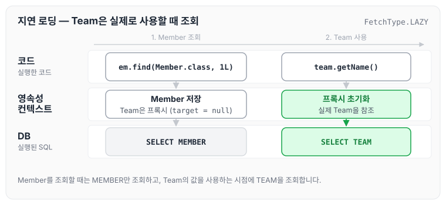
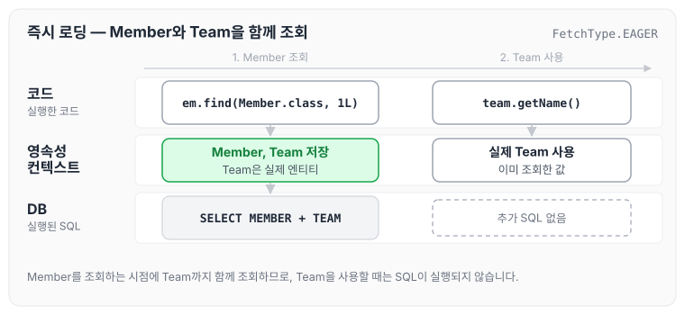
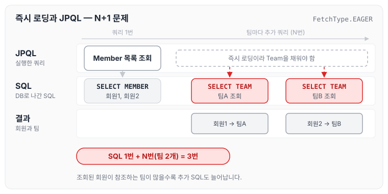

이전에 [프록시의 동작 원리](../jpa-proxy/)에 대해 작성하였습니다. 이번 글에서는 그 프록시를 이용해 연관된 엔티티를 언제 조회할지 정하는 지연 로딩과 즉시 로딩에 대해 정리하도록 하겠습니다.

## Member와 Team을 함께 조회하는 문제

Member를 조회할 때 Team도 함께 조회해야 하는지에 대해, JPA는 지연 로딩과 즉시 로딩이라는 두 가지 방법을 제공합니다.

## 지연 로딩(LAZY)을 사용해서 프록시로 조회

지연 로딩은 `fetch = FetchType.LAZY`로 설정합니다.

```java
@Entity
public class Member extends BaseEntity {

    @Id @GeneratedValue
    @Column(name = "MEMBER_ID")
    private Long id;

    @Column(name = "USERNAME")
    private String name;

    @ManyToOne(fetch = FetchType.LAZY)// 팀을 프록시로 조회한다.
    @JoinColumn
    private Team team;
```

- `em.find(Member.class, 1L)`로 조회하면 Member는 DB에서 조회한 뒤 영속성 컨텍스트에 저장됩니다. 이때 Team은 참조값이 null인 프록시(가짜 객체)로 들어갑니다.
- 이후 `team.getName()`을 호출하는 시점에 해당하는 값을 DB에서 조회(초기화)한 뒤, 참조값이 null이던 자리에 데이터를 채워 넣습니다.

SQL이 실행되는 시점을 따라가면 아래와 같습니다.



Member를 조회할 때는 MEMBER만 조회하고, Team의 값을 실제로 사용하는 시점에 TEAM을 조회합니다.

## 즉시 로딩(EAGER)을 사용해서 함께 조회

즉시 로딩은 `fetch = FetchType.EAGER`로 설정합니다.

```java
@Entity
public class Member extends BaseEntity {

    @Id @GeneratedValue
    @Column(name = "MEMBER_ID")
    private Long id;

    @Column(name = "USERNAME")
    private String name;

    @ManyToOne(fetch = FetchType.EAGER)// 팀을 프록시로 조회한다.
    @JoinColumn
    private Team team;
```

- 즉시 로딩으로 두면 Member를 조회할 때 Team도 항상 함께 조회됩니다.

같은 흐름을 즉시 로딩으로 따라가면 아래와 같습니다.



즉시 로딩에서는 Team 자리에 프록시가 아닌 실제 엔티티가 들어가므로, `team.getName()`을 호출할 때 추가로 조회하지 않습니다.

## 프록시와 즉시 로딩 주의

- 가급적 지연 로딩만 사용합니다(특히 실무에서).
- 즉시 로딩을 적용하면 예상하지 못한 SQL이 발생합니다.
- 즉시 로딩은 JPQL에서 N+1 문제를 일으킵니다.
- `@ManyToOne`, `@OneToOne`은 기본이 즉시 로딩입니다. LAZY로 바꿔 두어야 합니다.
- `@OneToMany`, `@ManyToMany`는 기본이 지연 로딩입니다.

N+1 문제는 처음 실행한 쿼리 1번에 더해, 조회한 결과의 연관 엔티티를 채우기 위한 쿼리가 N번 추가로 실행되는 문제를 말합니다. JPQL로 Member 목록을 조회할 때 Team이 즉시 로딩으로 설정되어 있으면 아래와 같이 실행됩니다.



JPQL은 작성한 쿼리대로 MEMBER만 조회하고, 그 뒤에 즉시 로딩으로 설정된 Team을 채우기 위해 TEAM을 조회하는 SQL이 추가로 실행됩니다.

## 지연 로딩 활용 - 실무

강의에서 실무 기준으로 정리한 내용은 아래와 같습니다.

- 모든 연관관계에 지연 로딩을 사용합니다.
- 실무에서 즉시 로딩을 사용하지 않습니다.
- JPQL 페치 조인이나 엔티티 그래프 기능을 사용합니다.
- 즉시 로딩은 상상하지 못한 쿼리가 나갑니다.

페치 조인은 [JPQL 경로 표현식과 페치 조인](../jpa-jpql-advanced/)에서 따로 정리하였습니다.

## 마무리

오늘은 지연 로딩과 즉시 로딩이 연관된 엔티티를 조회하는 시점의 차이와, 즉시 로딩을 사용할 때 생기는 N+1 문제에 대해 정리하였습니다. `@ManyToOne`, `@OneToOne`은 기본이 즉시 로딩이므로, 연관관계를 매핑할 때마다 LAZY로 바꿔 두는 습관을 들여야 할 것 같습니다.

다음 글에서는 [영속성 전이와 고아 객체](../jpa-cascade/)에 대해 정리하도록 하겠습니다.

> 이 글은 인프런 김영한 님의 [자바 ORM 표준 JPA 프로그래밍 — 기본편](https://www.inflearn.com/course/ORM-JPA-Basic)을 들으며 정리한 노트입니다.
