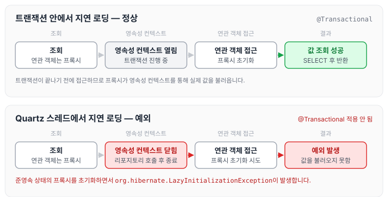
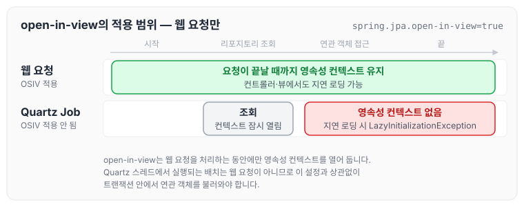

오늘은 작업을 하다가 동료가 물어본 예외에 대해 정리하려고 합니다.

배치에서 `FetchType.LAZY`를 통해 데이터를 불러오고 있는 상황이었는데, 테스트 코드에서는 잘 작동했지만 Quartz를 통해 실행될 때만 `FetchType.LAZY`로 설정한 객체 값을 불러오지 못하는 문제가 발생했습니다(`LazyInitializationException` 발생).

작업하면서 오래 걸렸던 이유는 '테스트 코드에서는 잘 작동되는데, 왜 Quartz에서만 안 되는 것인가?'였습니다.

## FetchType.LAZY

`FetchType.LAZY`는 프록시를 기반으로, 실제로 사용할 때 값을 불러오는 방식입니다. 사용하지 않는 객체까지 계속 불러온다면 메모리만 낭비하게 되므로, 지연 로딩을 사용하면 자원을 좀 더 효율적으로 사용할 수 있습니다. 프록시와 지연 로딩의 동작은 [프록시의 동작 원리](../jpa-proxy/)와 [즉시 로딩과 지연 로딩](../jpa-lazy-eager-loading/)에 정리하였습니다.

## 원인

현재 문제는 `@Transactional`이 동작하지 않는 상태에서 지연 로딩을 사용하다 보니, 영속성 컨텍스트가 관리하지 않는(준영속) 상태의 프록시를 초기화하려고 한 것이었습니다.

트랜잭션 안에서와 트랜잭션이 적용되지 않은 Quartz 스레드에서 지연 로딩이 어떻게 다르게 동작하는지 그리면 아래와 같습니다.

트랜잭션이 적용되지 않으면 리포지토리 호출이 끝날 때 영속성 컨텍스트가 닫히기 때문에, 그 뒤에 연관 객체에 접근하면 프록시가 값을 불러오지 못하고 예외가 발생합니다.

이를 확인하기 위해 현재 사용하는 위치가 `@Controller`인지 `@Service`인지 확인했고, Quartz에서 실행되는 `@Component`에 `@Transactional`이 선언되어 있었던 것을 발견했습니다. `@Service`에서 작동시키는 것이 어떤지 의견을 드려 해결하게 되었습니다.

## 해결 방법

영속성 컨텍스트가 관리하지 않는 상태의 값을 지연 로딩으로 불러올 때 발생하는 예외이며, 같은 문제가 발생한다면 다음과 같은 방법으로 해결할 수 있습니다.

1. 함수에 `@Transactional`을 선언
2. 즉시 로딩으로 변경(`FetchType.EAGER`)
    - 다만 즉시 로딩은 예상하지 못한 SQL과 N+1 문제를 일으킬 수 있어, [즉시 로딩과 지연 로딩](../jpa-lazy-eager-loading/)에 정리한 것처럼 실무에서는 지연 로딩을 기본으로 사용합니다.
3. Spring 환경 설정 확인 → `spring.jpa.open-in-view=true` (기본값: true)
    - 이 설정은 `@Transactional`이 종료되어도 영속성 컨텍스트를 웹 요청의 응답이 끝날 때까지 유지시키는 방법입니다. 영속성 컨텍스트와 데이터베이스 커넥션을 유지하는 시간이 길어지기 때문에 권장하지 않는 방법입니다. 자세한 내용은 [API 개발 성능 최적화 정리](../boot-jpa-advanced-optimization/)에 정리하였습니다.
    - 또한 스프링 부트에서는 이미 `true`가 기본값이고, 웹 요청을 처리하는 동안에만 적용됩니다. 이번처럼 Quartz 스레드에서 실행되는 배치에는 적용되지 않으므로 이 설정으로는 해결되지 않습니다.

웹 요청과 Quartz 배치에서 open-in-view가 적용되는 범위를 비교하면 아래와 같습니다.

## 마무리

오늘은 Quartz로 실행되는 배치에서 `LazyInitializationException`이 발생한 원인과 해결 방법에 대해 정리하였습니다. 테스트 코드에서 잘 동작하더라도, 실제로 실행되는 위치에 트랜잭션이 적용되는지 함께 확인해야 할 것 같습니다.
