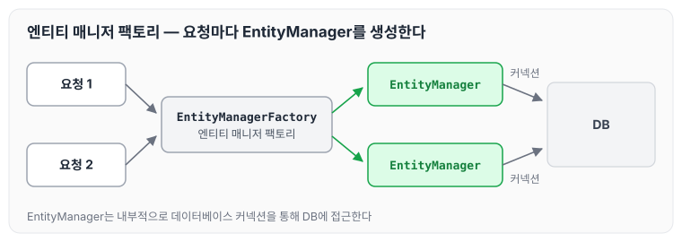
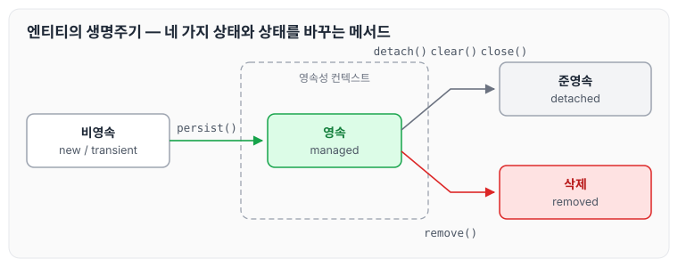
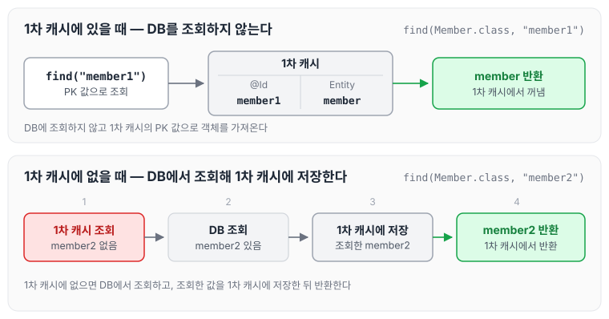
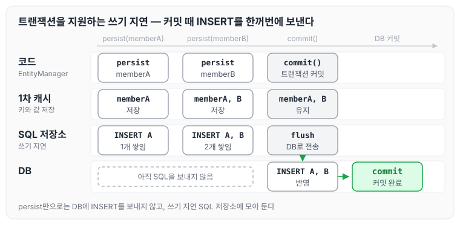
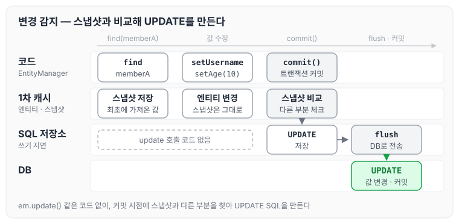
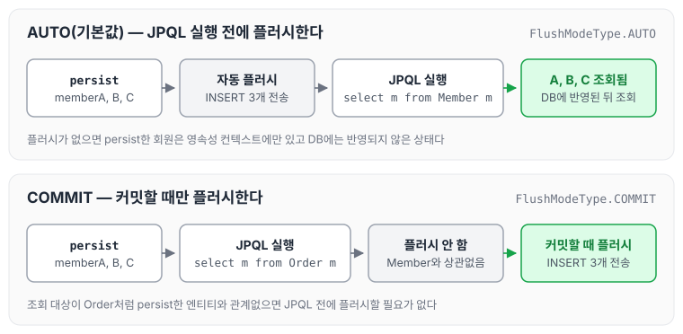

이전에 [JPA 시작하기](../jpa-getting-started/)에 대해 작성하였습니다. 오늘은 JPA를 이해하는 데 가장 중요한 영속성 컨텍스트에 대해, 엔티티의 생명주기와 1차 캐시, 쓰기 지연, 변경 감지, 플러시를 중심으로 정리하도록 하겠습니다.

## JPA에서 가장 중요한 두 가지

JPA를 공부할 때 가장 중요한 두 가지는 아래와 같습니다.

1. 객체와 관계형 데이터베이스를 매핑하는 것
2. 영속성 컨텍스트를 이해하는 것

## 엔티티 매니저 팩토리와 엔티티 매니저

- 엔티티 매니저 팩토리를 통해서 고객의 요청이 올 때마다 EntityManager를 생성합니다.
- EntityManager는 내부적으로 데이터베이스 커넥션을 통해서 DB에 접근합니다.



## 영속성 컨텍스트란

영속성 컨텍스트는 "엔티티를 영구 저장하는 환경"이라는 뜻입니다.

`EntityManager.persist(entity)`는 객체를 DB에 저장하는 것이라고 배웠지만, 실제로는 엔티티를 영속성 컨텍스트라는 곳에 저장하는 것입니다.

## 엔티티 매니저와 영속성 컨텍스트

영속성 컨텍스트는 눈에 보이지 않습니다. 엔티티 매니저를 생성하면 영속성 컨텍스트가 함께 만들어지고, 엔티티 매니저를 통해 저장한 엔티티가 이 영속성 컨텍스트에 담깁니다.

## 엔티티의 생명주기

엔티티는 영속성 컨텍스트와의 관계에 따라 네 가지 상태를 가집니다.

- 비영속(new/transient) : 영속성 컨텍스트와 전혀 관계가 없는 새로운 상태

```java
//엔티티를 생성한 상태(비영속)
Member member = new Member();
member.setId("member1");
member.setUsername("회원1");
```

- 영속(managed) : 영속성 컨텍스트에 관리되는 상태

```java
//엔티티를 생성한 상태(비영속)
Member member = new Member();
member.setId("member1");
member.setUsername("회원1");

EntityManager em = emf.createEntityManager();
em.getTransaction().begin();

//객체를 저장한 상태(영속)
em.persist(member);
```

- 준영속(detached) : 영속성 컨텍스트에 저장되었다가 분리된 상태

```java
//회원 엔티티를 영속성 컨텍스트에서 분리, 준영속 상태
em.detach(member);
```

- 삭제(removed) : 삭제된 상태

```java
//객체를 삭제한 상태(삭제)
em.remove(member);
```

네 가지 상태와 상태를 바꾸는 메서드를 그림으로 나타내면 아래와 같습니다.



## 영속성 컨텍스트의 이점

영속성 컨텍스트 내부에는 1차 캐시가 존재하며, 영속성 컨텍스트를 사용하면 아래와 같은 이점이 있습니다.

- 1차 캐시
- 동일성 보장
- 트랜잭션을 지원하는 쓰기 지연
- 변경 감지
- 지연 로딩

## 엔티티 조회와 1차 캐시

```java
//엔티티를 생성한 상태(비영속)
Member member = new Member();
member.setId("member1");
member.setUsername("회원1");
```

1차 캐시는 키와 값으로 엔티티를 보관합니다.

- key : DB에서 PK로 지정한 값
- value : 엔티티 객체 자체
- 현재 예시의 key는 "member1", value는 member입니다.

### 1차 캐시에 값이 존재할 때

```java
//엔티티를 생성한 상태(비영속)
Member member = new Member();
member.setId("member1");
member.setUsername("회원1");

//1차 캐시에 저장됨
em.persist(member);

//1차 캐시에서 조회
Member findMember = em.find(Member.class, "member1");
```

`em.find`로 조회하면 DB를 조회하지 않고, 영속성 컨텍스트의 1차 캐시에서 해당하는 PK 값으로 member 객체를 가져옵니다.

### 1차 캐시에는 없고 DB에는 값이 존재할 때

```java
//엔티티를 생성한 상태(비영속)
Member member = new Member();
member.setId("member1");
member.setUsername("회원1");

//1차 캐시에 저장됨
em.persist(member);

//DB에서 조회
Member findMember = em.find(Member.class, "member2");
```

이 경우는 다음 순서로 진행됩니다.

1. `find("member2")`로 1차 캐시에서 조회합니다. 결과는 없습니다.
2. DB에서 조회합니다. 결과는 있습니다.
3. 조회된 member2의 값을 1차 캐시에 저장합니다.
4. 1차 캐시에 저장된 member 객체를 반환합니다.

두 경우를 비교하면 아래와 같습니다.



## 영속 엔티티의 동일성 보장

영속성 컨텍스트는 영속 엔티티의 동일성을 보장합니다. 자바 컬렉션에서 같은 객체를 두 번 꺼내 비교하면 참조값이 같은 것과 같습니다.

- 이것이 가능한 이유는 1차 캐시가 존재하기 때문입니다.
- 1차 캐시로 반복 가능한 읽기(REPEATABLE READ) 등급의 트랜잭션 격리 수준을 데이터베이스가 아닌 애플리케이션 차원에서 제공합니다.

```java
Member a = em.find(Member.class, "member1");
Member b = em.find(Member.class, "member1");

System.out.println(a==b);// 동일성 비교 true
```

## 엔티티 등록 시 트랜잭션을 지원하는 쓰기 지연

```java
EntityManager em = emf.createEntityManager();
EntityTransaction transaction = em.getTransaction();
//엔티티 매니저는 데이터 변경시 트랜잭션을 시작해야 한다.
transaction.begin();// 트랜잭션 시작

em.persist(memberA);
em.persist(memberB);
//여기까지 Insert  sql을 데이터베이스에 보내지 않는다.//커밋하는 순간 데이터베이스에 insert sql을 보낸다.
transaction.commit();// 트랜잭션 커밋
```

내부 로직과 동작 순서는 다음과 같습니다.

1. `em.persist(memberA)`를 하는 순간 1차 캐시에 키와 값을 저장합니다.
2. insert SQL을 생성해서 쓰기 지연 SQL 저장소에 저장합니다.
3. `em.persist(memberB)`를 하는 순간 1차 캐시에 키와 값을 저장합니다.
4. insert SQL을 생성해서 쓰기 지연 SQL 저장소에 저장합니다. 쓰기 지연 SQL 저장소에는 2개의 insert문이 저장되어 있습니다.
5. 이후 `transaction.commit()`을 실행하는 순간 쓰기 지연 SQL 저장소의 쿼리를 flush를 통해 DB에 보낸 뒤 commit을 실행합니다.

이 과정을 단계별로 나타내면 아래와 같습니다.



### 쓰기 지연의 이점

쓰기 지연을 사용하면 persistence.xml에 추가 옵션을 줄 수 있습니다. 아래는 JDBC 일괄 처리 옵션으로, 커밋 직전까지 insert 쿼리를 버퍼에 모아서 한 번에 전송할 수 있습니다.

```xml
<property name="hibernate.jdbc.batch_size" value="10"/>
```

## 엔티티 수정과 변경 감지

```java
EntityManager em = emf.createEntityManager();
EntityTransaction transaction = em.getTransaction();
transaction.begin();// 트랜잭션 시작// 영속 엔티티 조회
Member memberA = em.find(Member.class, "memberA");

// 영속 엔티티 데이터 수정
memberA.setUsername("hi");
memberA.setAge(10);

//em.update(member) 이런 코드가 있어야 하지 않을까?

transaction.commit();
```

내부 로직은 다음과 같습니다.

1. `em.find`를 하는 순간 1차 캐시에 값이 저장되는데, 이때 스냅샷에는 최초에 가져온 값의 데이터가 저장됩니다.
2. setter를 통해서 객체의 값을 변경하고 `transaction.commit()`을 실행합니다.
3. JPA는 내부 로직을 통해서 변경된 객체 값과 스냅샷의 값을 비교해서 다른 부분을 체크합니다.
4. update 쿼리를 쓰기 지연 SQL 저장소에 저장합니다.
5. 이후 flush와 커밋을 통해서 DB의 데이터 값을 변경합니다.

`em.update(member)` 같은 코드를 호출하지 않아도, 커밋 시점에 스냅샷과 비교해서 변경된 값이 DB에 반영됩니다.



## 플러시

- 플러시는 영속성 컨텍스트의 변경사항을 데이터베이스에 맞추는 과정(동기화 과정)입니다.
- 플러시는 영속성 컨텍스트를 비우지 않습니다.
- 트랜잭션이라는 작업 단위가 중요합니다. 커밋 직전에만 동기화하면 됩니다.

## 플러시 발생

트랜잭션을 커밋할 때처럼 플러시가 발생하면 아래 작업이 실행됩니다.

- 변경 감지
- 수정된 엔티티를 쓰기 지연 SQL 저장소에 등록
- 쓰기 지연 SQL 저장소의 쿼리를 데이터베이스에 전송(등록, 수정, 삭제 쿼리)

## 영속성 컨텍스트를 플러시하는 방법

- `em.flush()` - 직접 호출
- 트랜잭션 커밋 - 플러시 자동 호출
- JPQL 쿼리 실행 - 플러시 자동 호출

플러시를 해도 1차 캐시는 유지되며, 영속성 컨텍스트의 쓰기 지연 SQL 저장소에 있는 쿼리문들만 데이터베이스에 반영됩니다.

## JPQL 쿼리 실행 시 플러시가 자동으로 호출되는 이유

```java
em.persist(memberA);
em.persist(memberB);
em.persist(memberC);

// 중간에 JPQL 실행
query = em.createQuery("select m from Member m", Member.class);
List<Member> members = query.getResultList();
```

위 예제에서 JPQL을 실행하면 앞에서 persist한 Member들도 조회됩니다. JPQL을 실행하기 전에 플러시가 자동으로 호출되기 때문입니다.

이 동작이 없다면 persist한 Member들은 영속성 컨텍스트에만 저장되어 있고 실제 DB에는 반영되지 않은 상태이기 때문에 조회되지 않습니다.

## 플러시 모드 옵션

```java
em.setFlushMode(FlushModeType.COMMIT);
```

- `FlushModeType.AUTO` : 커밋이나 쿼리를 실행할 때 플러시(기본값)
- `FlushModeType.COMMIT` : 커밋할 때만 플러시

### 플러시 모드 옵션이 필요한 경우

```java
em.persist(memberA);
em.persist(memberB);
em.persist(memberC);

// 중간에 JPQL 실행
query = em.createQuery("select m from Order m", Order.class);
List<Member> members = query.getResultList();
```

위 예제처럼 JPQL의 select 대상 테이블이 Order로 바뀌었다면, persist한 Member와 관계가 없으므로 굳이 플러시를 실행할 필요가 없습니다. 이럴 때 플러시 모드를 변경하면 됩니다.



## 준영속 상태

준영속 상태란 영속 상태의 엔티티가 영속성 컨텍스트에서 분리된 상태를 말합니다. 준영속 상태로 만드는 방법은 아래와 같습니다.

- `entityManager.detach(entity)` : 특정 엔티티만 준영속 상태로 전환
- `entityManager.clear()` : 영속성 컨텍스트를 완전히 초기화
- `entityManager.close()` : 영속성 컨텍스트를 종료

## 마무리

오늘은 엔티티의 생명주기와 영속성 컨텍스트가 제공하는 1차 캐시, 동일성 보장, 쓰기 지연, 변경 감지, 그리고 플러시와 준영속 상태에 대해 정리하였습니다. 영속성 컨텍스트가 내부에서 어떻게 동작하는지 알 수 있었고, 객체지향적으로 작성하면 자동으로 DB에 C/R/U/D가 된다는 점이 가장 놀라웠습니다. 앞으로 사용 방법을 더 익혀야 하지만, JPA를 확실하게 익혀 두면 큰 장점이 될 것 같습니다. 다음 글에서는 [엔티티 매핑](../jpa-entity-mapping/)에 대해 정리하도록 하겠습니다.

> 이 글은 인프런 김영한 님의 [자바 ORM 표준 JPA 프로그래밍 — 기본편](https://www.inflearn.com/course/ORM-JPA-Basic)을 들으며 정리한 노트입니다.
