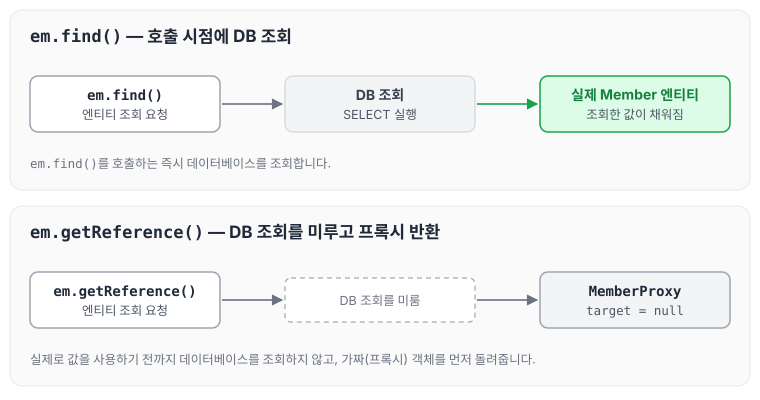
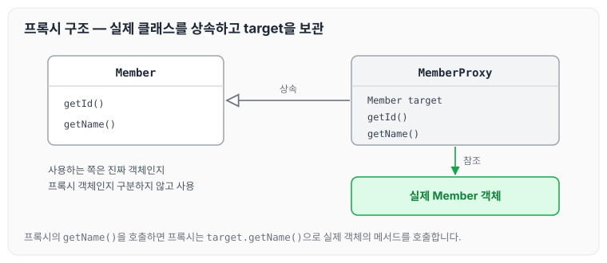
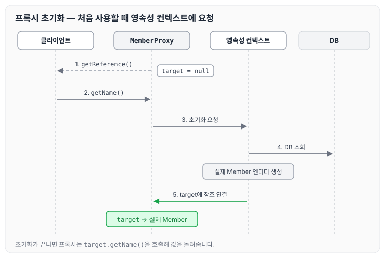
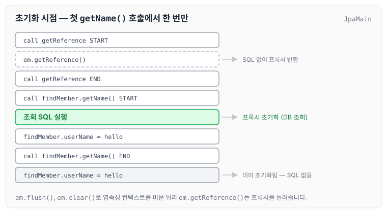
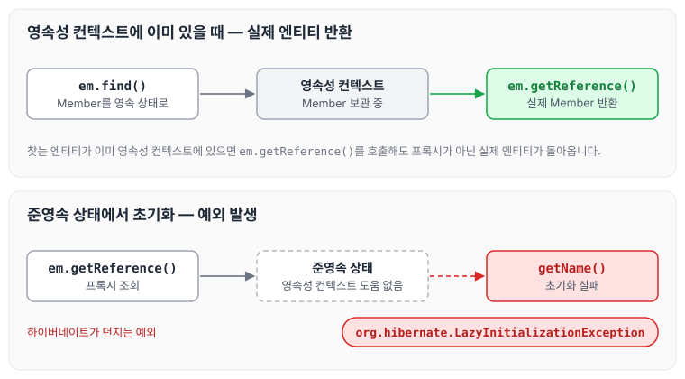

이전에 [상속관계 매핑과 @MappedSuperclass](../jpa-advanced-mapping/)에 대해 작성하였습니다. 이번 글에서는 연관된 엔티티의 조회를 실제로 사용할 때까지 미루기 위해 JPA가 사용하는 프록시가 어떻게 만들어지고 초기화되는지, 그리고 프록시를 사용할 때 주의할 점에 대해 정리하도록 하겠습니다.

## Member와 Team을 함께 조회하는 문제

연관관계를 맺어 두면 회원의 이름만 조회하고 싶을 때도 팀의 정보까지 함께 조회되어 자원이 낭비될 수 있습니다. 이 문제를 해결하기 위해 프록시를 사용합니다.

회원과 팀을 함께 출력하는 코드는 아래와 같습니다.

```java
public void printUserAndTeam(String memberId) {
    Member member = em.find(Member.class, memberId);
    Team team = member.getTeam();
    System.out.println("회원 이름: " + member.getUsername());
    System.out.println("소속팀: " + team.getName());
}
```

회원만 출력하는 코드는 아래와 같습니다.

```java
public void printUser(String memberId) {
    Member member = em.find(Member.class, memberId);
    Team team = member.getTeam();
    System.out.println("회원 이름: " + member.getUsername());
}
```

두 번째 코드는 팀의 정보를 사용하지 않으므로, 회원을 조회할 때 팀까지 함께 조회할 필요가 없습니다.

## 프록시 기초

엔티티를 조회하는 방법에는 `em.find()`와 `em.getReference()`가 있습니다.

- `em.find()` : 데이터베이스를 통해 실제 엔티티 객체를 조회합니다.
- `em.getReference()` : 데이터베이스 조회를 미루는 가짜(프록시) 엔티티 객체를 조회합니다.

두 메서드를 호출했을 때 무엇이 돌아오는지 비교하면 아래와 같습니다.



`em.find()`는 호출하는 시점에 DB를 조회하지만, `em.getReference()`는 DB 조회를 미루고 프록시 객체를 먼저 돌려줍니다.

## 프록시 특징

프록시 객체의 특징은 아래와 같습니다.

- 실제 클래스를 상속받아서 만들어집니다.
- 실제 클래스와 겉모양이 같습니다.
- 사용하는 입장에서는 진짜 객체인지 프록시 객체인지 구분하지 않고 사용하면 됩니다.
- 프록시 객체는 실제 객체의 참조(target)를 보관합니다.
- 프록시 객체를 호출하면 프록시 객체는 실제 객체의 메서드를 호출합니다.

프록시 클래스와 실제 클래스의 관계를 그리면 아래와 같습니다.



## 프록시 객체의 초기화

프록시 객체로 조회한 뒤 값을 꺼내는 코드는 아래와 같습니다.

```java
Member member = em.getReference(Member.class, "id1");
member.getName();
```

이 코드가 실행될 때 프록시 객체가 초기화되는 순서는 아래와 같습니다.

1. `em.getReference()`를 호출하면 target이 null인 Member 프록시 객체를 가져옵니다.
2. `member.getName()`을 호출하면 target에 값이 없으므로 초기화를 요청합니다.
3. JPA가 영속성 컨텍스트에 초기화를 요청합니다.
4. 영속성 컨텍스트가 DB를 조회해 실제 Member 엔티티를 만듭니다.
5. MemberProxy 객체의 target에 실제 Member 엔티티의 참조값을 넣어 줍니다.

순서대로 그리면 아래와 같습니다.



초기화가 끝나면 프록시는 target이 가리키는 실제 엔티티의 `getName()`을 호출해 값을 돌려줍니다.

### 초기화 시점 확인

`em.getReference()`와 `getName()` 호출 사이에 로그를 찍어 초기화 시점을 확인하는 예제는 아래와 같습니다.

```java
package helloJpa;
...

public class JpaMain {

    public static void main(String[] args) {
        ...

        try {
            Member member = new Member();
            member.setName("hello ");

            em.persist(member);

            em.flush();
            em.clear();

            System.out.println("============call getReference START ==========");
            Member findMember = em.getReference(Member.class, member.getId());
            System.out.println("============call getReference END ==========");
            System.out.println("============call findMember.getName() START ==========");
            System.out.println("findMember.userName = " + findMember.getName());
            System.out.println("============call findMember.getName() END ==========");
            System.out.println("findMember.userName = " + findMember.getName());

            tx.commit();
        } catch (Exception e) {
            tx.rollback();
        } finally {
            em.close();
        }
        emf.close();
    }
}
```

위 예제를 실행하면 `findMember.getName()`을 처음 호출하는 순간 프록시가 한 번 초기화되는 것을 확인할 수 있습니다.



`em.flush()`와 `em.clear()`로 영속성 컨텍스트를 비워 두었기 때문에 `em.getReference()`는 프록시를 돌려주고, 첫 번째 `getName()`에서 초기화가 일어납니다. 두 번째 `getName()`은 이미 초기화된 프록시를 사용합니다.

## 프록시 사용 시 주의할 점

- 프록시 객체는 처음 사용할 때 한 번만 초기화됩니다.
- 프록시 객체를 초기화한다고 해서 프록시 객체가 실제 엔티티로 바뀌는 것은 아닙니다. 초기화되면 프록시 객체를 통해 실제 엔티티에 접근할 수 있습니다.
- 프록시 객체는 원본 엔티티를 상속받으므로 타입을 체크할 때 주의해야 합니다. `==` 비교는 실패하므로 대신 `instanceof`를 사용합니다.
- 영속성 컨텍스트에 찾는 엔티티가 이미 있으면 `em.getReference()`를 호출해도 실제 엔티티를 반환합니다.
- 영속성 컨텍스트의 도움을 받을 수 없는 준영속 상태에서 프록시를 초기화하면 문제가 발생합니다. 하이버네이트는 `org.hibernate.LazyInitializationException` 예외를 던집니다.

마지막 두 경우를 그리면 아래와 같습니다.



`LazyInitializationException`을 실제 작업에서 만났던 경우는 [LazyInitializationException이 나는 이유](../jpa-lazy-init-exception/)에 따로 정리하였습니다.

## 프록시 확인

프록시와 관련해 확인할 때 사용하는 방법은 아래와 같습니다.

- 프록시 인스턴스의 초기화 여부 확인
    - `PersistenceUnitUtil.isLoaded(Object entity)`
- 프록시 클래스 확인 방법
    - `entity.getClass().getName()` 출력
- 프록시 강제 초기화
    - `Hibernate.initialize(Entity);`
- 참고: JPA 표준은 강제 초기화 없음
    - 강제 호출: `member.getName();`

## 마무리

오늘은 `em.find()`와 `em.getReference()`의 차이, 프록시 객체가 초기화되는 과정, 그리고 프록시를 사용할 때 주의할 점에 대해 정리하였습니다. 프록시는 처음 사용할 때 영속성 컨텍스트를 통해 한 번만 초기화되기 때문에, 준영속 상태에서 초기화하지 않도록 주의해야 할 것 같습니다.

다음 글에서는 이 프록시를 활용하는 [즉시 로딩과 지연 로딩](../jpa-lazy-eager-loading/)에 대해 정리하도록 하겠습니다.

> 이 글은 인프런 김영한 님의 [자바 ORM 표준 JPA 프로그래밍 — 기본편](https://www.inflearn.com/course/ORM-JPA-Basic)을 들으며 정리한 노트입니다.
