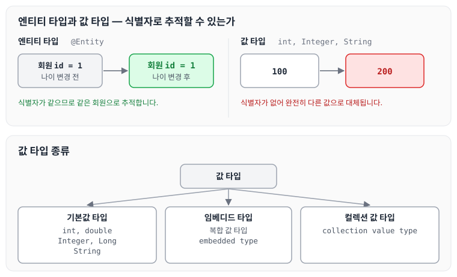
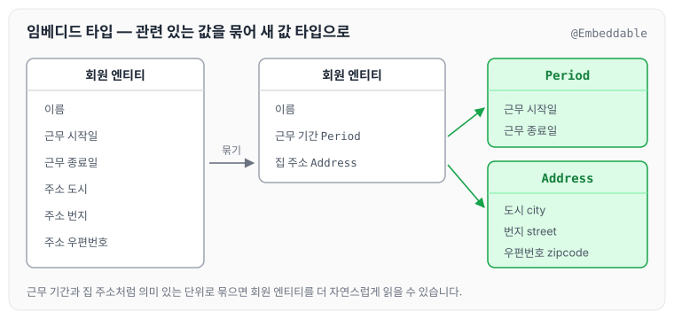
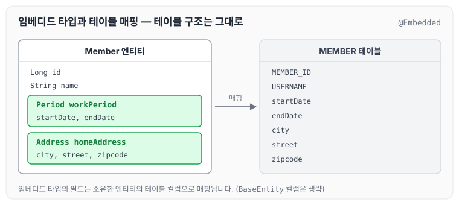
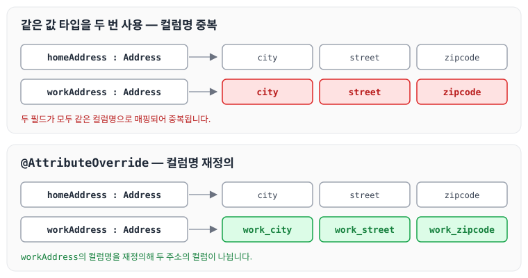

이전에 [영속성 전이와 고아 객체](../jpa-cascade/)에 대해 작성하였습니다. 이번 글에서는 JPA의 데이터 타입을 엔티티 타입과 값 타입으로 나누어 살펴보고, 값 타입 중에서 기본값 타입과 임베디드 타입에 대해 정리하도록 하겠습니다.

## JPA의 데이터 타입 분류

JPA의 데이터 타입은 엔티티 타입과 값 타입으로 나눌 수 있습니다.

- 엔티티 타입
    - `@Entity`로 정의하는 객체입니다.
    - 데이터가 변해도 식별자로 지속해서 추적할 수 있습니다.
    - 예) 회원 엔티티의 키나 나이 값을 변경해도 식별자로 인식할 수 있습니다.
- 값 타입
    - int, Integer, String처럼 단순히 값으로 사용하는 자바 기본 타입이나 객체입니다.
    - 식별자가 없고 값만 있으므로 변경 시 추적이 불가능합니다.
    - 예) 숫자 100을 200으로 변경하면 완전히 다른 값으로 대체됩니다.

### 값 타입 종류

- 기본값 타입
    - 자바 기본 타입(int, double)
    - 래퍼 클래스(Integer, Long)
    - String
- 임베디드 타입(embedded type, 복합 값 타입)
- 컬렉션 값 타입(collection value type)

엔티티 타입과 값 타입, 값 타입의 종류를 함께 그리면 아래와 같습니다.



## 기본값 타입

- 예) `String name`, `int age`
- 생명주기가 엔티티에 의존합니다.
    - 예) 회원을 삭제하면 이름, 나이 필드도 함께 삭제됩니다.
- 값 타입은 공유하면 안 됩니다.
    - 예) 회원 이름을 변경할 때 다른 회원의 이름도 함께 변경되면 안 됩니다.

### 참고: 자바의 기본 타입은 절대 공유되지 않는다

- int, double 같은 기본 타입(primitive type)은 절대 공유되지 않습니다.
- 기본 타입은 항상 값을 복사합니다.
- Integer 같은 래퍼 클래스나 String 같은 특수한 클래스는 공유 가능한 객체이지만 변경할 수 없습니다.

## 임베디드 타입

- 새로운 값 타입을 직접 정의할 수 있습니다.
- JPA는 이를 임베디드 타입(embedded type)이라고 합니다.
- 주로 기본값 타입을 모아서 만들기 때문에 복합 값 타입이라고도 합니다.
- int, String과 같은 값 타입입니다.

예를 들어 회원 엔티티가 이름, 근무 시작일, 근무 종료일, 주소 도시, 주소 번지, 주소 우편번호를 가진다고 하겠습니다.

이 중에서 근무 시작일과 근무 종료일을 근무 기간(Period)으로, 도시·번지·우편번호(city, street, zipcode)를 집 주소(Address)로 묶어 값 타입으로 만든 것이 임베디드 타입입니다. 이렇게 묶으면 실생활에서 이야기하는 흐름처럼 자연스럽게 이해할 수 있다는 장점이 있습니다.



### 임베디드 타입 사용법

- `@Embeddable` : 값 타입을 정의하는 곳에 표시합니다.
- `@Embedded` : 값 타입을 사용하는 곳에 표시합니다.
- 기본 생성자가 필수입니다.

### 임베디드 타입의 장점

- 재사용할 수 있습니다.
- 응집도가 높습니다.
- `Period.isWork()`처럼 해당 값 타입만 사용하는 의미 있는 메서드를 만들 수 있습니다.
- 임베디드 타입을 포함한 모든 값 타입은 값 타입을 소유한 엔티티에 생명주기를 의존합니다.

### 임베디드 타입과 테이블 매핑

임베디드 타입을 사용해도 테이블 구조는 변경되지 않습니다. 다만 객체지향적으로 보면 각각의 기능을 묶을 수 있어서, 사용하는 측면에서 더 직관적이고 편리하게 사용할 수 있습니다.

이렇게 매핑했을 때의 장점은 아래와 같습니다.

- 객체와 테이블을 아주 세밀하게 매핑할 수 있습니다.
- 잘 설계한 ORM 애플리케이션은 매핑한 테이블의 수보다 클래스의 수가 더 많습니다.

임베디드 타입을 사용하는 Member 엔티티는 아래와 같습니다.

```java
@Entity
public class Member extends BaseEntity {

    @Id @GeneratedValue
    @Column(name = "MEMBER_ID")
    private Long id;

    @Column(name = "USERNAME")
    private String name;

    @Embedded
    private Period workPeriod;
    @Embedded
    private Address homeAddress;
```

집 주소를 나타내는 Address는 아래와 같습니다.

```java
package helloJpa;

import javax.persistence.Embeddable;

@Embeddable
public class Address {

//주소 Period
    private String city;
    private String street;

    public String getZipcode() {
        return zipcode;
    }

    public void setZipcode(String zipcode) {
        this.zipcode = zipcode;
    }

    private String zipcode;

    public Address() {

    }

    public String getCity() {
        return city;
    }

    public void setCity(String city) {
        this.city = city;
    }

    public String getStreet() {
        return street;
    }

    public void setStreet(String street) {
        this.street = street;
    }

}

```

근무 기간을 나타내는 Period는 아래와 같습니다.

```java
package helloJpa;

import javax.persistence.Embeddable;
import java.time.LocalDateTime;

@Embeddable
public class Period {

//기간 Period
    private LocalDateTime startDate;
    private LocalDateTime endDate;

    public Period() {
    }

    public LocalDateTime getStartDate() {
        return startDate;
    }

    public void setStartDate(LocalDateTime startDate) {
        this.startDate = startDate;
    }

    public LocalDateTime getEndDate() {
        return endDate;
    }

    public void setEndDate(LocalDateTime endDate) {
        this.endDate = endDate;
    }
}

```

엔티티와 테이블을 나란히 놓으면 아래와 같습니다.



### @AttributeOverride 속성 재정의

- 한 엔티티에서 같은 값 타입을 사용하면 컬럼명이 중복됩니다.
- `@AttributeOverrides`, `@AttributeOverride`를 사용해서 컬럼명 속성을 재정의합니다.

homeAddress와 workAddress에 같은 Address를 사용하는 예제는 아래와 같습니다.

```java
@Entity
public class Member extends BaseEntity {

    @Id @GeneratedValue
    @Column(name = "MEMBER_ID")
    private Long id;

    @Column(name = "USERNAME")
    private String name;

    @Embedded
    private Period workPeriod;
    @Embedded
    private Address homeAddress;

    @Embedded
    @AttributeOverrides({
            @AttributeOverride(name = "city", column = @Column(name = "work_city")),
            @AttributeOverride(name = "street", column = @Column(name = "work_street")),
            @AttributeOverride(name = "zipcode", column = @Column(name = "work_zipcode")),
    })
    private Address workAddress;
```



## 마무리

오늘은 JPA의 엔티티 타입과 값 타입의 차이, 기본값 타입의 특징, 그리고 임베디드 타입을 정의하고 매핑하는 방법에 대해 정리하였습니다. 임베디드 타입을 사용하면 테이블에는 기존과 동일하게 값을 넣으면서도 객체는 좀 더 객체지향적으로 유지할 수 있어서, 코드를 이야기의 흐름처럼 작성할 수 있는 것 같습니다.

다음 글에서는 [값 타입 공유와 불변 객체](../jpa-immutable-value-types/)에 대해 정리하도록 하겠습니다.

> 이 글은 인프런 김영한 님의 [자바 ORM 표준 JPA 프로그래밍 — 기본편](https://www.inflearn.com/course/ORM-JPA-Basic)을 들으며 정리한 노트입니다.
