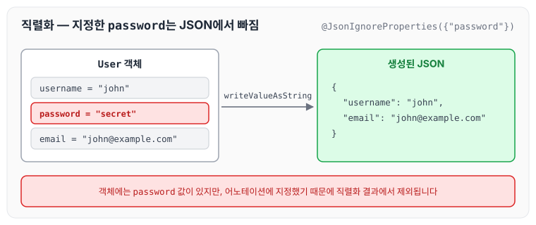
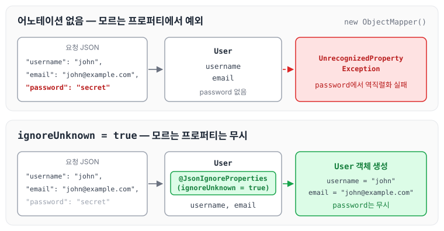

API를 연동하면서 연동 객체 안에 `@JsonIgnoreProperties`라는 처음 보는 어노테이션이 붙어 있는 것을 발견하였습니다. 오늘은 이 어노테이션에 대해 알게 된 내용을 정리하려고 합니다.

`@JsonIgnoreProperties`는 Jackson이 제공하는 어노테이션으로, 지정한 프로퍼티를 JSON 직렬화와 역직렬화에서 제외합니다. 특히 `ignoreUnknown = true`를 지정하면, REST API로 들어온 JSON body를 역직렬화해서 객체를 만들 때 클래스에 없는 데이터가 있어도 에러를 내지 않고 무시하게 해 줍니다.

어떻게 사용하는지 차례로 정리하겠습니다.

## @JsonIgnoreProperties 사용 방법

아래와 같은 클래스가 있다고 가정해 보겠습니다.

```java
import com.fasterxml.jackson.annotation.JsonIgnoreProperties;

@JsonIgnoreProperties({"password"})
public class User {
    private String username;
    private String password;
    private String email;

    // getters and setters
}
```

위 예제에서는 `password` 프로퍼티가 JSON으로 직렬화할 때 제외되고, JSON을 역직렬화할 때도 무시됩니다.

예를 들어 아래와 같이 `User` 객체를 JSON으로 직렬화하면

```java
User user = new User();
user.setUsername("john");
user.setPassword("secret");
user.setEmail("john@example.com");

ObjectMapper objectMapper = new ObjectMapper();
String jsonString = objectMapper.writeValueAsString(user);

System.out.println(jsonString);
```

아래와 같은 JSON 데이터가 생성됩니다.

```json
{
    "username": "john",
    "email": "john@example.com"
}
```

객체에는 `password` 값이 들어 있지만, 직렬화 결과에는 빠지는 것을 그림으로 보면 아래와 같습니다.



따라서 `@JsonIgnoreProperties`는 JSON 직렬화와 역직렬화에서 특정 프로퍼티를 제외하고 싶을 때 사용할 수 있는 어노테이션입니다.

## @JsonIgnoreProperties(ignoreUnknown = true) 사용 방법

`@JsonIgnoreProperties(ignoreUnknown = true)`는 JSON을 역직렬화할 때 클래스에 정의되지 않은 프로퍼티를 무시하도록 지정하는 Jackson 어노테이션입니다. JSON 문자열에 포함된 프로퍼티 이름이 클래스에 정의된 프로퍼티와 일치하지 않을 때 사용합니다.

예를 들어 아래와 같이 `User` 클래스가 `username`과 `email` 프로퍼티를 가지고 있다고 가정해 보겠습니다.

```java
public class User {
    private String username;
    private String email;

    // getters and setters
}
```

그런데 클라이언트에서 `password`를 추가해서 전송한다고 가정해 보겠습니다.

```json
{
    "username": "john",
    "email": "john@example.com",
    "password": "secret"
}
```

`ObjectMapper`는 기본 설정에서 클래스에 없는 프로퍼티를 만나면 `UnrecognizedPropertyException`을 발생시킵니다. `User` 클래스에는 `password`가 정의되어 있지 않기 때문에 원래대로라면 에러가 발생하지만, 클래스에 `@JsonIgnoreProperties(ignoreUnknown = true)`를 붙이면 `password`는 무시하고 클래스에 선언되어 있는 데이터만 가져올 수 있습니다.

어노테이션이 없을 때와 있을 때를 비교하면 아래와 같습니다.



참고로 Spring Boot가 자동으로 구성하는 `ObjectMapper`는 이 동작을 정하는 `DeserializationFeature.FAIL_ON_UNKNOWN_PROPERTIES`를 꺼 두기 때문에, Spring Boot의 기본 `ObjectMapper`로 역직렬화할 때는 어노테이션이 없어도 에러가 발생하지 않습니다. 반면 `new ObjectMapper()`로 직접 생성한 `ObjectMapper`는 이 설정이 켜져 있으므로, 어노테이션이나 설정으로 무시하도록 지정해야 합니다.

## 마무리

오늘은 `@JsonIgnoreProperties`에 대해 정리하였습니다. API는 클라이언트와 서버 모두 언제 어떻게 바뀔지 모르기 때문에 위와 같은 어노테이션을 사용하는 것도 좋지만, 다르게 생각해 보면 변경에 맞춰 객체를 최신화하는 것도 중요한 부분이기 때문에 서로 협의하여 잘 작성하는 것이 좋지 않을까 생각합니다.

참조 : [Jackson Annotation Examples | Baeldung](https://www.baeldung.com/jackson-annotations)
