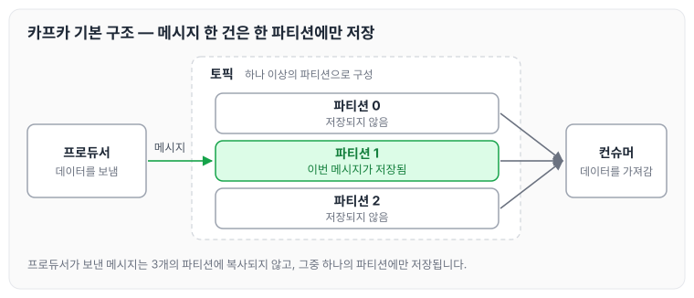
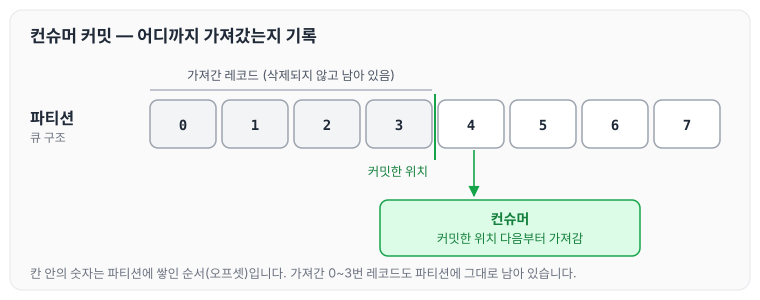

이전에 [카프카를 공부하게 된 계기](../kafka-why/)에 대해 작성하였습니다. 오늘은 아파치 카프카의 기본 구조인 프로듀서, 토픽, 파티션, 컨슈머에 대해 정리하도록 하겠습니다.

## 카프카의 기본 구조

카프카 내부에서 데이터가 저장되는 파티션은 FIFO 방식의 큐 구조와 유사하게 동작합니다. 구성 요소는 아래와 같습니다.

- 프로듀서: 카프카에 데이터를 보내는 역할입니다.
- 토픽
    - RDBMS의 테이블 같은 개념입니다.
    - 구분하고자 하는 데이터의 단위입니다.
    - 하나 이상의 파티션으로 구성되어 있습니다.
- 파티션
    - 토픽에 속한 레코드를 실제 저장소에 저장하는 가장 작은 단위입니다.
    - 큐 구조로 되어 있습니다.
- 컨슈머: 카프카 큐에서 데이터를 가져가는 역할입니다.

파티션이 3개인 토픽에 프로듀서가 메시지를 보내는 경우를 그리면 다음과 같습니다.

프로듀서가 토픽에 메시지를 보내면, 메시지는 3개의 파티션 중 **하나의 파티션에만** 저장됩니다. 메시지가 모든 파티션에 복사되는 것이 아닙니다.

## 파티션의 데이터와 커밋

컨슈머가 파티션의 데이터를 가져가더라도, 파티션의 데이터는 삭제되지 않고 그대로 유지됩니다. 데이터가 남아 있는데도 컨슈머가 파티션의 데이터를 순서대로 가져갈 수 있는 것은 커밋 때문입니다.

컨슈머는 커밋을 통해 파티션의 데이터를 어디까지 가져갔는지 기록해 둡니다. 다음에 데이터를 가져갈 때는 기록해 둔 위치 다음부터 가져갑니다.

그림에서 컨슈머가 가져간 레코드도 파티션에 그대로 남아 있고, 컨슈머는 커밋한 위치를 기준으로 이어서 가져가는 것을 확인할 수 있습니다. 컨슈머가 커밋한 오프셋을 누가 저장하는지는 다음 글의 브로커의 역할에서 다시 정리합니다.

## 마무리

오늘은 카프카의 기본 구조에 대해 정리하였습니다. 각각의 구조와 기능이 어떻게 되는지 알고 있어야 다음 강의에서 헷갈리지 않을 것 같아, 정리한 내용은 숙지해 두려고 합니다.

다음 글에서는 [아파치 카프카의 생태계](../kafka-ecosystem/)에 대해 정리하도록 하겠습니다.

> 이 글은 인프런 최원영 님의 「아파치 카프카 애플리케이션 프로그래밍」을 들으며 정리한 노트입니다.
