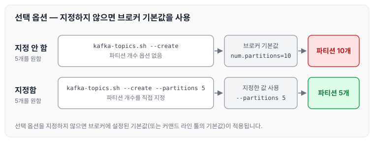
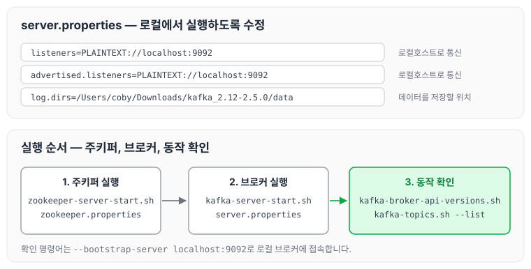

이전에 [카프카 로컬 환경 설정](../kafka-local-setup/)에 대해 작성하였습니다. 오늘은 카프카 커맨드 라인 툴의 옵션과, `server.properties`를 수정해 로컬에서 카프카 브로커를 실행하는 절차를 정리하도록 하겠습니다.

## 카프카 커맨드 라인 툴(command-line tool)

카프카 브로커 운영에 필요한 다양한 명령은 커맨드 라인 툴을 통해 내립니다.

운영하다 보면 토픽을 만들거나 파티션 개수를 변경하는 것과 같은 명령을 실행해야 하는 경우도 발생합니다. 그래서 카프카 커맨드 라인 툴과 툴별 옵션에 대해 알고 있어야 합니다.

커맨드 라인 툴로 토픽 관련 명령을 실행할 때는 필수 옵션과 선택 옵션이 있습니다. 선택 옵션을 지정하지 않으면 브로커에 설정된 기본 설정값 또는 커맨드 라인 툴의 기본값으로 대체되어 설정됩니다.

예를 들어 브로커에 설정된 기본 파티션 값이 10이라면, 5개의 파티션을 가진 토픽을 만들고 싶을 때는 토픽을 생성하면서 커맨드 라인 툴로 파티션 개수를 5개로 지정해 줘야 합니다.

파티션 개수를 지정하지 않으면 브로커의 기본값인 10개로 만들어지고, 지정하면 지정한 5개로 만들어지는 것을 확인할 수 있습니다.

## 로컬 카프카 설치 및 실행

로컬에서 카프카를 설치하고 실행하는 순서는 아래와 같습니다.

- 카프카 바이너리 파일 다운로드
    - [https://kafka.apache.org/downloads](https://kafka.apache.org/downloads)
- 카프카 바이너리 압축 해제
- 주키퍼 실행
- 카프카 바이너리 실행

## 압축 해제한 바이너리의 구성

카프카 바이너리의 압축을 해제하면 아래 디렉토리가 있습니다.

- bin: 실행할 바이너리와 쉘 스크립트가 들어 있습니다.
- config: 설정에 필요한 `server.properties` 및 여러 설정 파일이 있습니다.
- libs: 브로커를 실행할 때 필요한 라이브러리가 있습니다.

## server.properties 주요 설정

`server.properties`의 주요 설정값은 다음과 같습니다.

- `log.dirs`: 데이터를 저장할 파일 시스템 위치를 지정합니다. 프로듀서가 카프카 브로커로 데이터를 보내면 데이터는 이 위치의 파일 시스템에 저장됩니다.
- `num.partitions`: 토픽을 만들 때 기본으로 만들어지는 파티션의 개수입니다.
- `log.retention.hours`: 데이터를 보관하는 시간입니다. 168시간이 지나면 삭제됩니다.
- `listeners`: 카프카 브로커가 통신을 받을 IP를 뜻합니다.
- `advertised.listeners`

## 로컬에서 카프카 브로커 실행

로컬에서 브로커를 실행하려면 `server.properties`의 환경설정 값을 수정해야 합니다.

- 브로커가 로컬호스트로 통신할 수 있게 설정해야 합니다.
    - `listeners=PLAINTEXT://localhost:9092`
    - `advertised.listeners=PLAINTEXT://localhost:9092`
- 데이터를 원하는 위치의 파일 시스템에 저장할 수 있게 설정해야 합니다.
    - `log.dirs=/Users/coby/Downloads/kafka_2.12-2.5.0/data`

설정을 마친 뒤 로컬에서 카프카 브로커를 실행하는 순서는 다음과 같습니다.

1. 주키퍼를 실행합니다.
    - `bin/zookeeper-server-start.sh config/zookeeper.properties`
2. 브로커를 실행합니다.
    - `bin/kafka-server-start.sh config/server.properties`
3. 잘 동작하는지 확인합니다.
    - `bin/kafka-broker-api-versions.sh --bootstrap-server localhost:9092`
    - `bin/kafka-topics.sh --bootstrap-server localhost:9092 --list`

수정한 설정과 실행 순서를 함께 그리면 다음과 같습니다.

브로커가 `localhost:9092`로 통신하도록 설정했기 때문에, 확인 명령어도 `--bootstrap-server localhost:9092`로 접속합니다.

## 마무리

오늘은 카프카 커맨드 라인 툴의 필수 옵션과 선택 옵션, 압축 해제한 바이너리의 구성과 `server.properties`의 주요 설정, 그리고 설정을 수정해 로컬에서 브로커를 실행하는 순서에 대해 정리하였습니다. 선택 옵션을 지정하지 않으면 브로커의 기본값이 적용되기 때문에, 토픽을 만들 때 어떤 값이 들어가는지 확인하는 습관을 들여야 할 것 같습니다.

> 이 글은 인프런 최원영 님의 「아파치 카프카 애플리케이션 프로그래밍」을 들으며 정리한 노트입니다.
