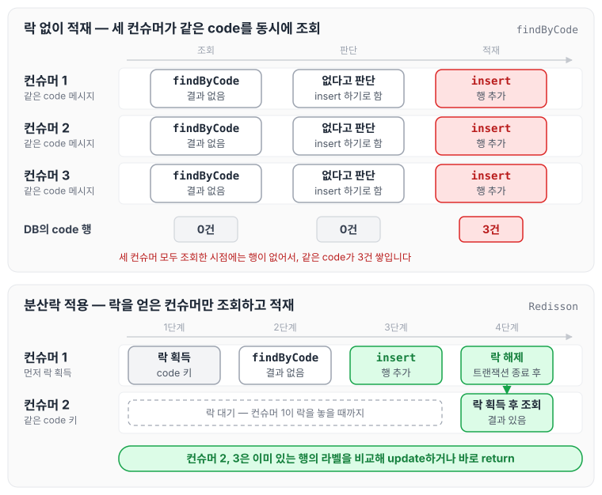
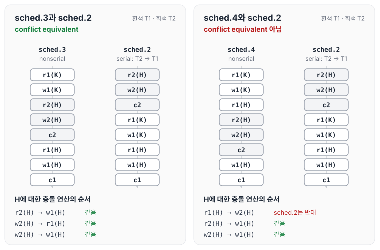
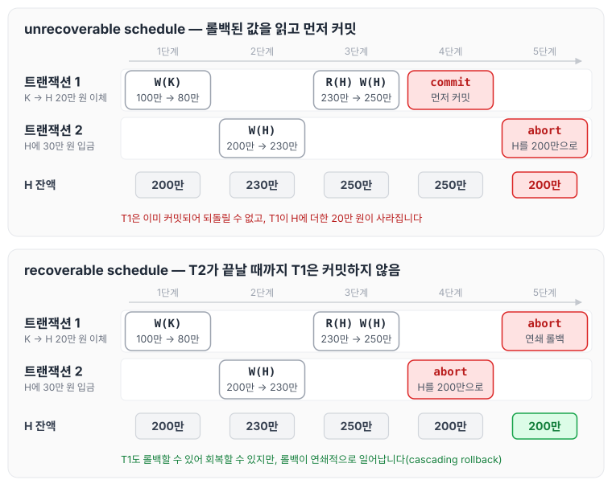
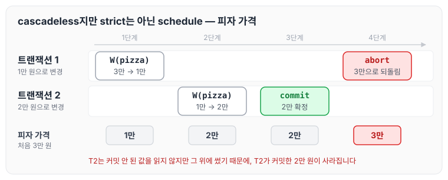

오늘은 카프카 컨슈머로 데이터를 MySQL에 적재하면서 발생한 동시성 문제와 해결 방법, 그리고 이를 찾아보면서 공부한 트랜잭션의 ACID와 동시성 제어 이론에 대해 정리하도록 하겠습니다.

## 문제 발생

카프카에서 3개의 컨슈머를 사용해서 데이터를 MySQL에 적재하고 있었습니다. 이때 적재를 하면서 주문 Id에 대한 주문 상태 값을 최신 상태로 유지해야 하는 요구가 있었습니다.

이를 해결하기 위해 아래와 같이 구현하였습니다.

1. 적재하기 전에 findByCode로 주문 상태의 코드를 조회하고, 조회한 값이 있으면 주문 상태의 라벨 값을 비교하여 다르면 업데이트, 같으면 얼리 리턴으로 동작
2. findByCode의 값이 없으면 insert

기대한 결과는 각 주문 상태의 코드값과 라벨 값이 없을 때는 insert되고, 이미 있을 때는 최신 값으로 update되는 것이었습니다.

## 결과와 원인

결과는 동일한 code의 값이 2~3개씩 쌓여 중복 데이터가 발생하였습니다.

원인은 3개의 컨슈머가 거의 동시에 DB를 조회하고, 모두 데이터가 없다고 판단하여 insert를 진행했기 때문입니다. 웹에서 더블 클릭으로 발생하는 이슈와 같은 종류라고 생각됩니다. 여러 스레드가 같은 자원에 동시에 접근하면서 생기는 경쟁 상태는 [Java 기준 멀티스레드와 레이스 컨디션](../multithread-race-condition/)에서 정리하였습니다.

## 해결 방법

생각해 볼 수 있는 해결 방법은 아래와 같습니다.

1. 더블 클릭 때문에 발생했다면, 프론트에서 한 번만 클릭할 수 있도록 JavaScript 수정
2. 좋아요를 두 번 클릭한 경우라고 가정하면, 데이터마다 '게시글id'_'username'으로 unique key를 지정하여 DB에 insert
3. 분산락을 사용하여, 트랜잭션이 진행 중이면 다른 처리는 대기하도록 처리

락 없이 적재할 때와 분산락을 적용했을 때의 흐름을 나란히 그리면 다음과 같습니다.

락이 없으면 세 컨슈머가 모두 행이 없는 시점에 조회하기 때문에 같은 code가 3건 쌓입니다. 분산락을 적용하면 같은 code 키로 락을 얻은 컨슈머만 조회와 적재를 진행하고, 나머지 컨슈머는 락이 풀린 뒤 이미 적재된 행을 조회하게 됩니다.

## 분산락

분산락은 여러 서버(프로세스)나 스레드가 공유 자원에 접근할 때, 데이터의 정합성을 지키기 위해 사용하는 락입니다. MySQL에서도 분산락을 사용할 수 있지만, 현재 Redis를 사용 중이므로 Redisson을 사용해 해결하는 방법을 찾아보았습니다. 분산락의 락 획득 방식은 [DB 분산락](../distributed-lock/)에서 자세히 정리하였습니다.

1. 어노테이션 기반의 Redisson을 구현하여 사용하는 방법
    - [https://helloworld.kurly.com/blog/distributed-redisson-lock/](https://helloworld.kurly.com/blog/distributed-redisson-lock/)
    - 커스텀 어노테이션 사용 방법: [Spring Annotation 그리고 Custom Annotation](../spring-custom-annotation/)
    - 트랜잭션 Isolation: [@Transactional 이란? 트랜잭션 성질 (1)](../transactional-basics/)
2. 직접 접근해서 사용하는 방법
    - [https://kko.to/zuunlha](https://kko.to/zuunlha)

글을 읽으면서 Spin Lock이라는 단어가 나왔는데, 이것도 궁금해서 알아보았습니다.

정리하면 스핀락은 Race Condition(경쟁 상태) 상황에서 Lock이 반환될 때까지, 즉 Critical Section(임계 구역)에 진입할 수 있을 때까지 프로세스가 재시도하며 대기하는 방식입니다. 스핀락의 동작은 [스핀락, 뮤텍스, 세마포](../spinlock-mutex-semaphore/)에서 따로 정리하였습니다.

- [https://kko.to/zuunlhb](https://kko.to/zuunlhb)

## 트랜잭션 ACID

분산락을 찾아보면서 트랜잭션도 좀 더 살펴보았습니다. 아래 영상을 참고하였습니다.

[데이터베이스 트랜잭션(transaction)을 아십니까? 그리고 트랜잭션의 매우 중요한 속성들인 ACID를 아십니까? 모르신다면 들렀다 가시지요](https://youtu.be/sLJ8ypeHGlM?si=PZGSfKF3OU08bxii)

### Atomicity: 원자성

- All or Nothing
- transaction은 논리적으로 쪼갤 수 없는 작업 단위이기 때문에, 내부의 SQL문들이 모두 성공해야 합니다.
- 중간에 SQL문이 실패하면 지금까지의 작업을 모두 취소하여, 아무 일도 없었던 것처럼 롤백해야 합니다.

commit과 rollback은 트랜잭션이 걸리면 DBMS가 알아서 해 주지만, 개발자는 트랜잭션의 Commit과 Rollback을 언제 처리해야 할지 잘 정해야 합니다.

### Consistency: 일관성

- transaction이 DB에 정의된 rule을 위반했는지 DBMS가 commit 전에 확인하고 알려 줍니다. 룰을 위반하면 에러 메시지를 반환합니다.

개발자는 애플리케이션 관점에서 해당 트랜잭션이 룰을 어기지 않도록 동작하게 해야 합니다.

### Isolation: 격리

- 여러 Transaction들이 동시에 실행될 때도 혼자 실행되는 것처럼 동작하게 만듭니다.
- DBMS에는 여러 종류의 Isolation Level이 있습니다. 격리 수준을 높이면 제한이 많아져 성능이 많이 떨어지고, 격리 수준을 낮추면 성능은 올라가지만 트랜잭션 결과 값이 올바르지 않을 수 있습니다.

개발자는 상황에 맞게 Isolation Level을 지정할 수 있어야 합니다.

### Durability: 영속성

- commit된 Transaction은 DB에 영구적으로 저장됩니다.

기본적으로 Transaction의 Durability는 DBMS가 보장합니다.

### 정리

1. Transaction을 어떻게 정의해서 쓸지는 개발자가 정하는 것입니다.
    - 구현하려는 기능과 ACID 속성을 이해해야 transaction을 잘 정의할 수 있습니다.
2. Transaction의 ACID와 관련해서 개발자가 챙겨야 하는 부분들이 있습니다.
    - 모든 것을 DBMS가 해 주는 것은 아닙니다.

## 동시성 제어: Serializability

아래 영상을 참고하였습니다. 스케줄과 격리 수준은 [트랜잭션 스케줄과 격리 수준](../transaction-schedule-isolation/)에서도 예제 흐름도와 함께 정리하였습니다.

[(1부) concurrency control 기초 : schedule과 serializability. 트랜잭션들이 동시에 실행될 때 isolation을 보장하는 기초 이론](https://youtu.be/DwRN24nWbEc?si=WtetJCQFjQ5Qu_lR)

### Schedule

- 여러 Transaction들이 동시에 실행될 때, 각 Transaction에 속한 Operation들의 실행 순서를 Schedule이라고 합니다.
- 각 Transaction 안의 Operation들의 순서는 바뀌지 않습니다.

### Serial schedule

- Transaction들이 겹치지 않고 한 번에 하나씩 실행되는 schedule입니다.

한 번에 하나의 트랜잭션만 실행하므로 이상한 데이터를 만들지 않지만, 그만큼 좋은 성능을 낼 수 없어 현실적으로 사용하기 어려운 방식입니다.

### Non-serial schedule

- Transaction들이 겹쳐서 실행되는 schedule입니다.

Transaction들이 겹쳐서 실행되기 때문에 동시성이 높아져, 같은 시간 동안 더 많은 Transaction들을 처리할 수 있습니다. 다만 트랜잭션이 겹쳐서 실행되기 때문에 경우에 따라 이상한 결과를 초래할 수 있습니다.

두 방식 모두 단점이 있어 그대로 사용하기 어렵습니다. 그래서 nonserial schedule로 실행하면서도 이상한 결과가 나오지 않는 방법이 필요한데, serial schedule과 동일한 nonserial schedule을 실행하면 됩니다. 여기서 "동일한 schedule"이 무엇인지 정하기 위해 conflict라는 개념을 사용합니다.

### Conflict

아래 3가지 조건을 모두 만족하면 두 operation이 Conflict하다고 합니다.

1. 서로 다른 Transaction 소속
2. 같은 데이터에 접근
3. 최소 하나는 write operation

Conflict가 중요한 이유는 conflict operation은 순서가 바뀌면 결과도 바뀌기 때문입니다.

### Conflict equivalent

아래 두 조건을 모두 만족하면 두 schedule은 conflict equivalent입니다.

1. 두 schedule은 같은 transaction들을 가진다.
2. 어떤(any) conflicting operation의 순서도 양쪽 schedule 모두 동일하다.

영상의 예시를 그대로 가져와 비교하면 다음과 같습니다. sched.2는 T2가 끝난 뒤 T1을 실행하는 serial schedule입니다.

sched.3은 H에 대한 충돌 연산의 순서가 sched.2와 모두 같으므로 conflict equivalent입니다. 반면 sched.4는 r1(H)가 w2(H)보다 먼저 실행되어 sched.2와 순서가 반대이므로 conflict equivalent가 아닙니다.

### Conflict serializable

- Serial schedule과 Conflict equivalent인 schedule을 말합니다.
- 위의 sched.3처럼 serial schedule과 conflict equivalent인 nonserial schedule은 conflict serializable입니다.

정리하면 성능 때문에 Transaction들을 겹쳐서 실행하고 싶지만, 이상한 결과가 나오는 것은 피해야 합니다. 이를 위해 conflict serializable한 nonserial schedule을 허용하면 됩니다.

하지만 현실적으로 여러 Transaction이 실행될 때마다 해당 schedule이 conflict serializable인지 확인하기는 어렵습니다. 그래서 구현에서는 여러 Transaction을 동시에 실행해도 schedule이 conflict serializable하도록 보장하는 프로토콜을 적용합니다.

## 동시성 제어: Recoverability

### Unrecoverable schedule

- Schedule 내에서 commit된 Transaction이, rollback된 Transaction이 write했던 데이터를 읽은 경우입니다.
- rollback을 해도 이전 상태로 회복할 수 없을 수 있기 때문에, 이런 Schedule은 DBMS가 허용하면 안 됩니다.

### Recoverable schedule

- Schedule 내에서 그 어떤 Transaction도, 자신이 읽은 데이터를 write한 Transaction이 먼저 commit/rollback하기 전까지는 commit하지 않는 경우입니다.

영상의 예시는 K의 잔액에서 20만 원을 빼 H에게 더하는 트랜잭션 1과, H의 잔액에 30만 원을 더하는 트랜잭션 2입니다. K의 잔액은 100만 원, H의 잔액은 200만 원에서 시작합니다. 두 schedule을 단계별로 그리면 다음과 같습니다.

위쪽은 트랜잭션 1이 이미 커밋되어 되돌릴 수 없으므로 회복할 수 없는 schedule입니다. 아래쪽은 트랜잭션 1이 커밋하지 않고 기다리기 때문에 함께 롤백할 수 있지만, 롤백이 연쇄적으로 일어납니다.

### Cascading rollback

- 여러 Transaction의 rollback이 연쇄적으로 일어나는 것을 말합니다.
- 여러 Transaction의 rollback이 연쇄적으로 일어나면 처리하는 비용이 많이 듭니다.

비용을 줄이고 효과적으로 처리하려면, commit된 데이터만 읽는 schedule만 허용하면 됩니다.

### Cascadeless schedule

- Schedule 내에서 어떤 Transaction도 commit되지 않은 transaction들이 write한 데이터는 읽지 않는 경우입니다.

### Strict schedule

- Schedule 내에서 어떤 Transaction도 commit되지 않은 Transaction들이 write한 데이터는 쓰지도 읽지도 않는 경우입니다.

영상에서는 피자 가격 예시로 두 schedule의 차이를 설명합니다. 피자 가격은 처음에 3만 원입니다.

트랜잭션 2는 커밋되지 않은 데이터를 읽지 않으므로 cascadeless schedule입니다. 하지만 트랜잭션 1이 쓰고 아직 커밋하지 않은 피자 가격 위에 트랜잭션 2가 다시 썼기 때문에, 트랜잭션 1이 abort되면서 트랜잭션 2가 커밋한 결과가 사라집니다. strict schedule은 커밋되지 않은 데이터를 쓰지도 않으므로 이런 상황을 막을 수 있습니다.

## Isolation level

격리 수준은 아래 글을 참고하였습니다.

- [https://mangkyu.tistory.com/299](https://mangkyu.tistory.com/299)

## 마무리

오늘은 카프카 컨슈머 3개가 같은 데이터를 동시에 적재하면서 생긴 중복 적재 문제와 해결 방법, 그리고 이를 찾아보면서 공부한 트랜잭션 ACID와 동시성 제어 이론에 대해 정리하였습니다. 이 글을 쓰면서 찾아본 락은 [DB 낙관적 락](../optimistic-lock/), [DB 비관적 락](../pessimistic-lock/), [DB 분산락](../distributed-lock/)에서 이어서 정리하였습니다.
