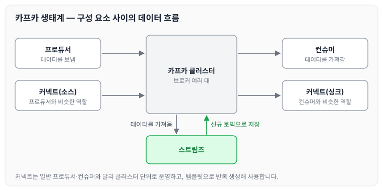
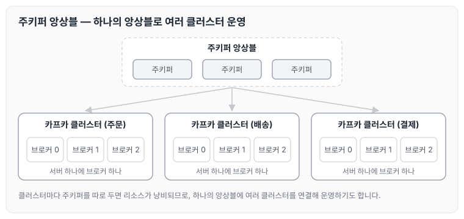
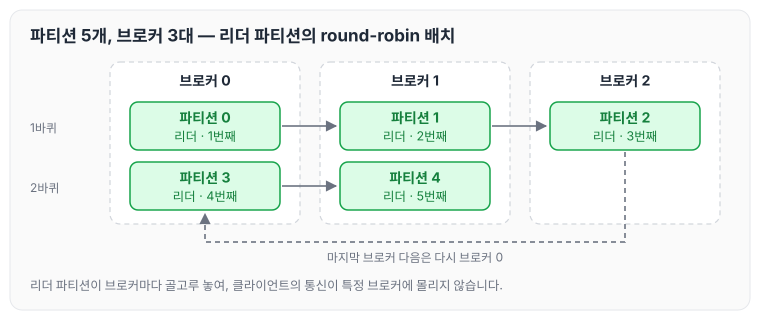

이전에 [아파치 카프카의 기본 구조](../kafka-basics/)에 대해 작성하였습니다. 오늘은 카프카 생태계와 카프카 클러스터를 이루는 브로커의 역할, 로그 세그먼트와 삭제·압축 정책, 복제, 토픽과 파티션, 레코드에 대해 정리하도록 하겠습니다.

## 카프카 생태계

카프카 생태계를 이루는 구성 요소는 아래와 같습니다.

- 기본 동작
    - 프로듀서 → 카프카 클러스터 → 컨슈머 순으로 데이터가 흐릅니다.
- 프로듀서에서 카프카 클러스터로 들어온 값을 신규 토픽으로 만들려면 스트림즈를 사용합니다.
    - 이때는 프로듀서 → 카프카 클러스터 → 스트림즈 → 토픽 순으로 흐름이 바뀝니다.
- 커넥트(소스)와 커넥트(싱크)는 각각 프로듀서, 컨슈머와 비슷한 역할을 합니다.
    - 일반 프로듀서, 컨슈머와 다른 가장 큰 차이점은 클러스터 단위로 운영한다는 점과, 템플릿 단위로 반복해서 여러 번 생성해 사용할 수 있다는 점입니다.

구성 요소 사이의 데이터 흐름을 그리면 다음과 같습니다.

## 카프카 브로커와 클러스터

- 주키퍼: 카프카 클러스터를 운영하기 위해 반드시 필요합니다.
- 클러스터: 여러 대의 브로커를 의미합니다.
- 브로커: 하나의 서버에는 한 개의 브로커 프로세스가 실행됩니다.
    - 한 대로도 운영이 가능하지만, 데이터를 안전하게 보관하고 처리하기 위해 기본적으로 3대 이상으로 운영합니다.
    - 3개의 브로커로 운영할 때 프로듀서가 데이터를 전송하면, 브로커 0, 1, 2 모두 데이터를 저장하게 됩니다.
    - 1개의 클러스터에는 여러 개의 브로커가 존재할 수 있습니다.
    - 일반적으로 3개로 운영하고, 데이터가 많다면 50~100개까지 늘리는 경우도 있습니다.

## 여러 개의 카프카 클러스터가 연결된 주키퍼

- 주키퍼 앙상블: 하나의 주키퍼 앙상블에 여러 개의 주키퍼를 설정해 두고, 여러 개의 클러스터를 운영할 수 있습니다.
    - 예) 카프카 클러스터 0: 주문, 카프카 클러스터 1: 배송, 카프카 클러스터 3: 결제
    - 클러스터를 운영하려면 주키퍼가 필수로 필요한데, 클러스터마다 별도의 주키퍼를 두면 리소스 낭비가 발생합니다. 그래서 위와 같은 형태로도 운영합니다.

하나의 주키퍼 앙상블에 주문, 배송, 결제 클러스터가 연결된 모습은 다음과 같습니다.

## 브로커의 역할

- 컨트롤러
    - 클러스터 안에 있는 다수의 브로커 중 한 대가 컨트롤러 역할을 합니다.
    - 컨트롤러는 다른 브로커들의 상태를 체크하며, 문제가 발생하면 해당 브로커의 리더 파티션을 다른 브로커로 재분배합니다.
        - 실시간 데이터 처리를 끊김 없이 이어 가기 위해서입니다.
    - 컨트롤러에 장애가 발생하면 다른 브로커가 컨트롤러 역할을 이어받습니다.
- 데이터 삭제
    - 카프카는 컨슈머가 데이터를 가져가도 삭제되지 않으며, 오직 브로커만 데이터를 삭제할 수 있습니다.
    - 데이터 삭제는 파일 단위로 이루어지는데, 이 단위를 로그 세그먼트라고 부릅니다.
    - 데이터 삭제의 기준은 다음과 같습니다.
        - 용량: 로그 세그먼트 단위로 지정 용량에 도달했을 때 삭제합니다.
        - 시간: 로그 세그먼트 단위로 지정 시간에 도달했을 때 삭제합니다.
        - 특수한 상황: 메시지 키별로 최신 레코드만 남기고 나머지 데이터를 삭제하고 싶다면 `compact` 옵션을 사용합니다.
- 컨슈머 오프셋 저장
    - 컨슈머 그룹은 파티션의 어느 레코드까지 가져갔는지 확인하기 위해 오프셋을 커밋합니다. 브로커는 이렇게 커밋된 오프셋을 저장합니다.
- 그룹 코디네이터
    - 컨슈머가 컨슈머 그룹에서 빠지면, 매칭되지 않은 파티션을 정상 동작하는 컨슈머에 할당해서 데이터가 끊임없이 처리되도록 돕습니다.

## 브로커의 데이터 저장

브로커는 `config/server.properties`의 `log.dir` 옵션에 지정한 디렉토리에 데이터를 저장합니다.

## 로그와 세그먼트

- `log.segment.bytes`: 바이트 단위의 최대 세그먼트 크기를 지정합니다. 기본값은 1GB입니다.
- `log.roll.ms`(`log.roll.hours`): 세그먼트가 신규 생성된 이후 다음 파일로 넘어가는 시간 주기입니다. 기본값은 7일입니다.
- 세그먼트 파일의 이름은 그 파일에 저장된 최초의 오프셋 번호가 됩니다. 이 덕분에 로그 파일이 몇 번 오프셋까지 데이터를 저장했는지 유추할 수 있습니다.
- 현재 쓰이고 있는 세그먼트를 액티브 세그먼트라고 합니다.

## 세그먼트와 삭제 주기 (cleanup.policy = delete)

- 데이터 삭제는 `.log` 파일 단위로 이루어집니다. 레코드별로 오프셋을 지정해 삭제할 수는 없기 때문에, **프로듀서와 컨슈머 각각에서 정말 유효한 데이터가 맞는지 확인하는 절차**가 필요합니다.
- `retention.ms`(minutes, hours): 세그먼트를 보유할 최대 기간입니다. 기본값은 7일입니다.
    - 기간을 너무 길게 설정하면 디스크 용량을 체크하면서 운영해야 합니다.
    - 일반적으로 최대 기간을 3일로 지정합니다(토요일, 일요일이 보통 휴무이기 때문입니다).
- `retention.bytes`: 파티션에 적재할 수 있는 로그의 바이트 값으로, 기본값은 -1입니다.
- `log.retention.check.interval.ms`: 세그먼트가 삭제 영역에 들어왔는지 확인하는 간격입니다. 기본값은 5분입니다.

## cleanup.policy=compact

- key-value 형태에서 중복된 키의 값을 삭제하고, 키별로 최신 데이터만 남겨 사용합니다.

## 테일/헤드 영역, 클린/더티 로그

- 테일 영역: 압축 정책에 의해 압축이 완료된 레코드들로, 클린(clean) 로그라고 부릅니다. 중복된 메시지 키가 없습니다.
- 헤드 영역: 압축 정책이 적용되기 전의 레코드들로, 더티(dirty) 로그라고도 부릅니다. 중복된 메시지 키가 있습니다.

## min.cleanable.dirty.ratio

- 데이터의 압축 시작 시점은 `min.cleanable.dirty.ratio` 옵션값을 따릅니다.
    - 전체 로그(테일 영역 + 헤드 영역) 중 헤드 영역(더티 로그)이 차지하는 비율을 뜻합니다. 0.5로 설정한다면 테일 영역의 레코드 개수와 헤드 영역의 레코드 개수가 같아졌을 때 압축이 진행됩니다.

## 브로커의 데이터 복제(Replication)

- 데이터 복제는 카프카를 장애 허용 시스템으로 동작하게 하는 원동력입니다.
- 데이터 복제는 파티션 단위로 이루어집니다.
- 토픽을 생성할 때 파티션 개수도 설정합니다. 이때 파티션 개수 옵션을 설정하지 않으면 브로커 설정을 기반으로 결정됩니다.
- 복제 개수의 최솟값은 1(복제 없음)이고, 최댓값은 브로커 개수만큼 설정할 수 있습니다.
- 팔로워 파티션은 리더 파티션의 오프셋을 확인하여 자신이 가지고 있는 오프셋과 비교하고, 없는 데이터를 복제해서 가져옵니다.
- 보통 복제 개수는 2~3으로 설정하여 운영합니다.

## ISR(In-Sync Replicas)

- 리더 파티션과 팔로워 파티션이 모두 싱크된 상태를 말합니다.
- 팔로워 파티션이 리더 파티션의 데이터를 다 복제하지 못한 상태에서 리더 파티션에 장애가 발생하면 데이터가 유실될 수 있습니다. 이때 유실된 데이터를 무시하고 계속 진행할지는 옵션으로 정합니다.
    - `unclean.leader.election.enable = true`: 유실을 감수하고, 복제가 안 된 팔로워 파티션을 리더로 승급합니다.
    - `unclean.leader.election.enable = false`: 유실을 감수하지 않고, 해당 브로커가 복구될 때까지 중단합니다.

## 토픽과 파티션

- 토픽: 카프카에서 데이터를 구분하기 위해 사용하는 단위입니다.
- 파티션: 프로듀서가 보낸 데이터들이 들어가 저장되는 곳으로, 이 데이터를 레코드라고 부릅니다.

파티션의 레코드는 컨슈머가 가져가는 것과 별개로 관리됩니다. 이러한 특징 때문에 다양한 목적을 가진 여러 컨슈머 그룹이 토픽의 데이터를 여러 번 가져갈 수 있습니다.

## 토픽 생성 시 파티션이 배치되는 방법

- 파티션이 5개라고 가정하면, 0번 브로커부터 시작하여 round-robin 방식으로 리더 파티션들이 생성됩니다.
- 카프카 클라이언트는 리더 파티션이 있는 브로커와 통신하여 데이터를 주고받으므로, 여러 브로커에 골고루 네트워크 통신을 하게 됩니다. 이를 통해 데이터가 특정 브로커에 집중되는 hot spot 현상을 방지합니다.
- 리더 파티션이 만들어지면 순차적으로 팔로워 파티션이 만들어집니다.

브로커가 3대이고 파티션이 5개인 토픽을 만들 때 리더 파티션이 배치되는 순서는 다음과 같습니다.

0번 브로커부터 차례로 리더 파티션이 하나씩 놓이고, 마지막 브로커 다음에는 다시 0번 브로커로 돌아옵니다.

## 특정 브로커에 파티션이 쏠린 현상

- 특정 브로커에 파티션이 몰리는 경우 `kafka-reassign-partitions.sh` 명령으로 파티션을 재분배합니다.

## 파티션 개수와 컨슈머 개수의 처리량

- 파티션은 카프카 병렬 처리의 핵심으로, 그룹으로 묶인 컨슈머들이 레코드를 병렬로 처리할 수 있도록 매칭됩니다.
- 컨슈머의 처리량이 한정된 상황에서 많은 레코드를 병렬로 처리하는 가장 좋은 방법은 컨슈머의 개수를 늘려 스케일 아웃하는 것입니다.
- 컨슈머 개수를 늘림과 동시에 파티션 개수도 늘리면 처리량이 증가하는 효과를 볼 수 있습니다.
- 프로듀서가 초당 10개의 데이터를 보내고 컨슈머는 초당 1개의 데이터를 처리한다고 가정하면, 컨슈머 렉이 발생하면서 지연이 생깁니다.
- 이를 방지하려면 파티션 개수와 컨슈머 개수를 함께 늘려서 병목이 발생하는 부분을 풀어 줘야 합니다.

다만 파티션 개수는 한 번 늘리면 다시 줄일 수 없습니다. 그러므로 **파티션을 늘릴 때는 신중할 필요**가 있습니다.

## 레코드

레코드는 아래와 같이 구성됩니다.

- 타임스탬프
- 헤더
- 메시지 키
- 메시지 값
- 오프셋

프로듀서가 생성한 레코드가 브로커로 전송되면 오프셋과 타임스탬프가 저장됩니다. 브로커에 한번 적재된 레코드는 수정할 수 없으며, 로그 리텐션 기간이나 용량에 의해서만 삭제됩니다.

## 토픽 작명의 템플릿과 예시

토픽 이름은 아래와 같은 템플릿으로 지을 수 있습니다.

`<환경>.<팀-명>.<애플리케이션-명>.<메시지-타입>`

예시) prd.marketing-team.sms-platform.json

`<프로젝트-명>.<서비스-명>.<환경>.<이벤트-명>`

예시) commerce.payment.prd.notification

`<환경>.<서비스-명>.<JIRA-번호>.<메시지-타입>`

예시) dev.email-sender.jira-1234.email-vo-custom

`<카프카-클러스터-명>.<환경>.<서비스-명>.<메시지-타입>`

예시) aws-kafka.live.marketing-platform.json

## 마무리

오늘은 카프카 생태계를 이루는 구성 요소와 브로커의 역할, 로그 세그먼트의 삭제·압축 정책, 복제와 ISR, 파티션 배치와 처리량, 레코드 구성과 토픽 작명 방법에 대해 정리하였습니다. 특히 파티션 개수는 늘리면 다시 줄일 수 없기 때문에, 토픽을 만들 때 처리량을 먼저 고려해 두어야 할 것 같습니다.

다음 글에서는 [카프카 로컬 환경 설정](../kafka-local-setup/)에 대해 정리하도록 하겠습니다.

> 이 글은 인프런 최원영 님의 「아파치 카프카 애플리케이션 프로그래밍」을 들으며 정리한 노트입니다.
