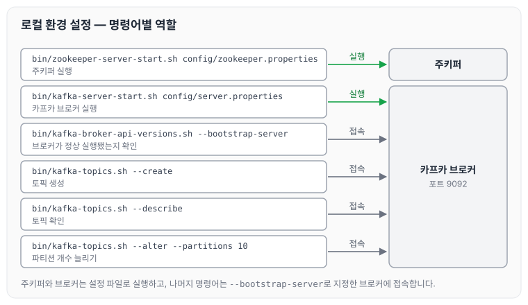

이전에 [아파치 카프카의 생태계](../kafka-ecosystem/)에 대해 작성하였습니다. 오늘은 카프카를 실행하는 환경을 설정하고, 주키퍼와 브로커를 실행한 뒤 토픽을 생성·확인·수정하는 명령어를 정리하도록 하겠습니다.

## 주키퍼와 브로커 실행

먼저 카프카 설치 위치로 이동합니다.

- `/Users/coby/Downloads/kafka_2.12-2.5.0`

주키퍼를 실행하는 명령어는 아래와 같습니다.

```bash
bin/zookeeper-server-start.sh config/zookeeper.properties
```

카프카 브로커를 실행하는 명령어는 아래와 같습니다.

```bash
bin/kafka-server-start.sh config/server.properties
```

카프카가 정상 실행됐는지 확인하는 명령어는 아래와 같습니다.

```bash
bin/kafka-broker-api-versions.sh --bootstrap-server {AWS 인스턴스 IP}:9092
```

## 토픽 생성과 확인

토픽을 생성하는 명령어는 아래와 같습니다.

```bash
bin/kafka-topics.sh --create --bootstrap-server my-kafka:9092 --topic hello.kafka(토픽명)
```

생성한 토픽을 확인하는 명령어는 아래와 같습니다.

```bash
bin/kafka-topics.sh --bootstrap-server my-kafka:9092 --topic hello.kafka --describe
```

## 토픽 옵션 지정과 파티션 개수 변경

토픽을 만들면서 파티션 개수와 추가 옵션을 함께 주는 방법은 아래와 같습니다.

```bash
bin/kafka-topics.sh --create --bootstrap-server my-kafka:9092 --partitions 10 --replication-factor 1 --topic hello.kafka2 --config retention.ms=172800000
```

토픽의 파티션 개수를 늘리는 방법은 아래와 같습니다.

```bash
bin/kafka-topics.sh --bootstrap-server my-kafka:9092 --topic hello.kafka(토픽명) --alter --partitions 10
```

파티션 개수는 늘릴 수만 있고 다시 줄일 수 없다는 점은 [아파치 카프카의 생태계](../kafka-ecosystem/)에서 정리하였습니다.

지금까지의 명령어가 각각 무엇을 실행하고 어디에 접속하는지 정리하면 다음과 같습니다.



주키퍼와 브로커는 각자의 설정 파일로 실행하고, 나머지 명령어는 `--bootstrap-server`로 지정한 브로커에 접속해서 동작합니다.

## 마무리

오늘은 주키퍼와 카프카 브로커를 실행하고, 토픽을 생성·확인하고 파티션 개수를 늘리는 명령어에 대해 정리하였습니다.

다음 글에서는 [카프카 CLI 다루기](../kafka-cli/)에 대해 정리하도록 하겠습니다.

> 이 글은 인프런 최원영 님의 「아파치 카프카 애플리케이션 프로그래밍」을 들으며 정리한 노트입니다.
