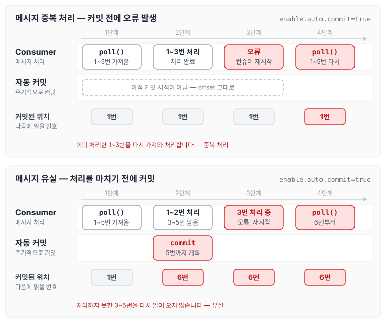
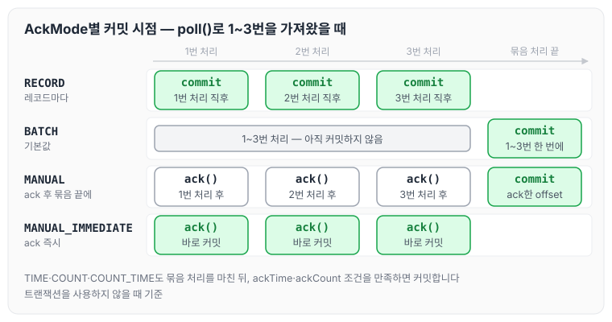
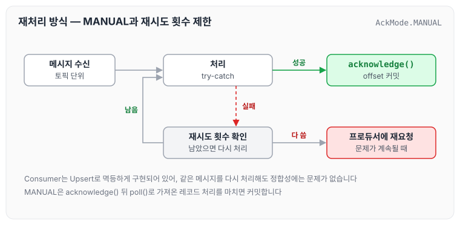

2024년 11월에 Kafka를 신규로 도입하여 약 1년간 운영하였습니다.

운영 기간 동안 다양한 신규 개발 건이 계속 발생하면서, 데이터 재처리는 Consumer가 아닌 Producer 측에 재요청을 보내는 방식으로 처리해 왔습니다. Consumer는 Upsert 방식으로 멱등성을 보장하도록 구현되어 있었기 때문에, 같은 메시지가 다시 전송되더라도 데이터 정합성에는 문제가 없다는 전제로 이 방식을 선택하였습니다.

그러나 운영해 보니 예상보다 API 구간에서 약 4개월 주기로 Connection Timeout이 발생하였고, 이로 인해 재처리 작업이 주기적으로 필요한 상황이 반복되었습니다. 단발성 이슈가 아니라 운영 관점에서 관리가 필요한 문제라고 판단하였습니다.

오늘은 이 문제를 계기로 살펴본 offset commit의 동작 방식과 Spring Kafka AckMode의 종류별 특징에 대해 정리하도록 하겠습니다. 컨슈머가 오프셋을 커밋해 진행 상황을 기록하는 기본 구조는 [아파치 카프카의 기본 구조](../kafka-basics/)에서 정리하였습니다.

## Offset Commit의 기본 개념

Kafka Consumer가 메시지를 처리한 후 offset을 commit한다는 것은, Kafka의 내부 토픽인 `__consumer_offsets`에 처리 위치를 저장하는 것을 말합니다. Consumer는 이 offset 값을 참조해서 다음에 읽어 올 메시지의 위치를 파악합니다.

Commit 방식은 크게 자동 커밋과 수동 커밋 두 가지가 있으며, `enable.auto.commit` 설정으로 제어할 수 있습니다.

### Kafka 클라이언트의 자동 커밋 설정: enable.auto.commit

> Setting enable.auto.commit means that offsets are committed automatically with a frequency controlled by the config auto.commit.interval.ms.
>
> 출처: [Kafka Official Documentation](https://kafka.apache.org/23/javadoc/org/apache/kafka/clients/consumer/KafkaConsumer.html)

- `enable.auto.commit=true` (기본값): 자동 커밋 활성화
- `enable.auto.commit=false`: 수동 커밋 모드

자동 커밋을 사용하면 `auto.commit.interval.ms`에 설정한 시간 간격마다 offset이 자동으로 commit됩니다. 자동 커밋을 끄려면 아래와 같이 설정합니다.

```java
private Map<String, Object> consumerConfigs() {
    Map<String, Object> props = new HashMap<>();
    props.put(ConsumerConfig.ENABLE_AUTO_COMMIT_CONFIG, "false");
    return props;
}
```

## 자동 커밋의 문제점

`enable.auto.commit=true`로 설정하면 메시지 처리 여부와 상관없이, 일정 시간이 지나면 offset이 자동으로 갱신됩니다. 이 때문에 아래 두 가지 문제가 발생할 수 있습니다.

### 메시지 중복 처리

poll로 가져온 메시지를 아직 다 처리하지 못했고 commit 시점도 되지 않은 상황에서 오류가 발생하면, Consumer는 같은 메시지를 다시 가져와서 처리하게 됩니다.

### 메시지 유실

poll로 가져온 메시지를 아직 다 처리하지 못한 상황에서 commit 시점이 되어 commit이 실행되고, 이후 메시지 처리 중 오류가 발생하면 처리하지 못한 메시지를 다시 읽어 오지 않아 유실됩니다.

poll로 1~5번 메시지를 가져왔을 때 두 경우를 단계별로 그리면 다음과 같습니다.



위쪽은 커밋된 위치가 그대로 1번이라 이미 처리한 1~3번을 다시 처리하고, 아래쪽은 커밋된 위치가 처리하지 못한 메시지보다 앞서 6번이 되어 3~5번을 건너뜁니다.

## Spring Kafka의 AckMode

이런 문제를 막기 위해 `enable.auto.commit=false`로 설정하면 Kafka 클라이언트의 자동 커밋이 비활성화됩니다.

### enable.auto.commit=false만으로는 부족한 이유

다만 `enable.auto.commit=false`로 설정해도 offset commit은 정상적으로 일어나고 lag도 쌓이지 않습니다. Kafka 클라이언트의 자동 커밋은 비활성화되지만, Spring Kafka의 리스너 컨테이너가 자체적으로 offset을 commit하기 때문입니다. 참고로 Spring Kafka 2.3부터는 `enable.auto.commit`을 직접 설정하지 않으면 프레임워크가 `false`로 설정합니다.

Spring Kafka는 AckMode 설정으로 commit 방식을 제어하며, 기본값은 `BATCH`입니다.

- Kafka 클라이언트의 자동 커밋과 달리 `auto.commit.interval.ms`의 영향을 받지 않음
- Listener가 `poll()`로 가져온 레코드를 모두 처리하면 배치 단위로 자동 commit 실행

### 수동 커밋을 위한 설정

결론적으로 `enable.auto.commit=false`만으로는 충분하지 않습니다. 완전한 수동 커밋을 원한다면 아래 두 가지를 함께 설정해야 합니다.

1. `enable.auto.commit=false` 설정
2. AckMode 설정을 함께 사용하여 Spring Kafka의 자동 commit까지 제어

이렇게 해야 수동 커밋을 제대로 구현할 수 있고, 메시지 처리 로직에 맞춰 원하는 시점에 offset을 commit할 수 있습니다.

## Kafka 클라이언트가 자동 커밋을 기본값으로 두는 이유

Kafka 클라이언트의 `enable.auto.commit` 기본값이 `true`인 이유는, "일단 동작하게"라는 Kafka의 설계 철학과 사용자 경험을 생각해 보면 이해할 수 있습니다.

### 진입 장벽을 낮추기 위한 선택

Kafka를 처음 사용하는 개발자도 쉽게 시작할 수 있도록 설계된 것입니다. 기본값이 false였다면 아래와 같이 작성했을 때 offset이 커밋되지 않습니다.

```java
// 이렇게 작성하면
while (true) {
    ConsumerRecords<String, String> records = consumer.poll(Duration.ofMillis(100));
    for (ConsumerRecord<String, String> record : records) {
        System.out.println(record.value());
    }
    // 커밋을 안 함 → 무한 반복으로 같은 메시지 재처리!
    // "왜 같은 메시지가 계속 나와요?" 질문 폭주
}
```

이 경우 offset commit의 개념을 모르는 개발자는 "왜 제대로 동작하지 않지?"라고 생각할 수 있습니다. 다만 컨슈머가 계속 실행되는 동안에는 `poll()`을 호출할 때마다 읽을 위치(position)가 앞으로 이동하므로, 커밋하지 않은 메시지를 다시 받게 되는 것은 컨슈머가 재시작되거나 리밸런싱으로 파티션을 다시 할당받아 커밋된 위치부터 읽을 때입니다.

결국 상황에 맞는 선택이 중요합니다. 두 방식을 비교하면 아래와 같습니다.

| 기준 | 자동 커밋(true) | 수동 커밋(false) |
| --- | --- | --- |
| 적합한 경우 | 로그 수집, 모니터링, 통계 | 금융, 결제, 재고, 알림 |
| 중복 처리 | 허용 가능 | 절대 불가 |
| 구현 난이도 | 쉬움 | 복잡함 |
| 성능 | 빠름 | 약간 느림 (수동 제어) |

## AckMode 종류와 특징

Spring Kafka가 제공하는 AckMode는 아래와 같습니다. 커밋 시점은 트랜잭션을 사용하지 않을 때 기준입니다.

### RECORD

- 커밋 시점: 리스너가 각 레코드를 처리하고 반환한 직후
- 특징: 가장 안전하지만 성능이 가장 느림
- 사용 케이스: 메시지 손실이 절대 허용되지 않는 중요한 트랜잭션

단점은 아래와 같습니다.

- 최저 처리량: 레코드마다 네트워크 I/O 발생
- 높은 브로커 부하: 커밋 요청이 메시지 수만큼 증가
- 레이턴시 증가: 커밋 대기 시간 누적
- 비효율적 리소스 사용: CPU, 네트워크 대역폭 낭비

### BATCH (기본값)

- 커밋 시점: `poll()`로 가져온 전체 배치를 처리한 후
- 특징: RECORD보다 성능이 좋고, 안전성도 양호
- 사용 케이스: 일반적인 배치 처리 시나리오

단점은 아래와 같습니다.

- 배치 전체 재처리: 중간에 실패하면 이미 처리한 메시지도 재처리됨
- 메모리 사용량: 배치 크기만큼 메모리 필요
- 제한적인 제어: 세밀한 커밋 제어 불가
- 중복 처리 가능성: 배치 사이즈가 클수록 증가

### TIME

- 커밋 시점: `poll()`로 가져온 레코드를 모두 처리한 뒤, 마지막 커밋 이후 `ackTime`이 지났을 때
- 특징: 주기적 커밋으로 성능과 안전성의 균형
- 사용 케이스: 대용량 스트림 처리

### COUNT

- 커밋 시점: `poll()`로 가져온 레코드를 모두 처리한 뒤, 마지막 커밋 이후 받은 레코드가 `ackCount`개 이상일 때
- 특징: 처리량 기반 커밋
- 사용 케이스: 균일한 메시지 크기의 대량 처리

### COUNT_TIME

- 커밋 시점: COUNT와 TIME 중 먼저 만족하는 조건
- 특징: COUNT와 TIME의 조합
- 사용 케이스: 메시지 유입량이 불규칙한 경우

### MANUAL

- 커밋 시점: 리스너가 `acknowledge()`를 호출한 뒤, BATCH와 같이 `poll()`로 가져온 레코드를 모두 처리했을 때
- 특징: 커밋할 시점을 개발자가 완전히 제어 가능
- 사용 케이스: 복잡한 비즈니스 로직, 조건부 커밋

### MANUAL_IMMEDIATE

- 커밋 시점: `acknowledge()`를 호출하는 즉시 카프카로 커밋
- 특징: MANUAL과 달리 배치 처리가 끝나기를 기다리지 않고 즉시 커밋
- 사용 케이스: 실시간성이 중요한 경우

`poll()`로 레코드 1~3번을 가져왔을 때, 대표적인 네 가지 AckMode가 언제 커밋하는지 나란히 놓으면 다음과 같습니다.



MANUAL과 MANUAL_IMMEDIATE는 모두 `acknowledge()`를 호출해야 커밋되지만, MANUAL은 커밋 자체를 배치 처리가 끝날 때까지 모아 두었다가 실행한다는 차이가 있습니다.

## 재처리 방식 결정

성능과 안정성을 종합적으로 고려하여, 재처리 방식은 아래와 같이 결정하였습니다.

안정성을 최우선으로 한다면 RECORD 방식이 가장 적합합니다. 다만 현재 상황에서는 토픽 단위로 메시지를 수신하여 재처리하는 방식으로도 충분하다고 판단하였습니다.

재처리 과정에서 문제가 계속될 경우에는 프로듀서 측에 해당 데이터를 재요청하여 처리할 수 있습니다. 또한 현재 로직이 멱등하게 설계되어 있기 때문에, 전체적인 유연성과 운영 편의성을 고려했을 때 MANUAL 방식이 가장 적합하다고 판단하였습니다.

재처리 로직은 try-catch 블록을 활용해 재시도 횟수를 제한하는 방식으로 구현할 예정입니다. 결정한 흐름을 그리면 다음과 같습니다.



처리에 성공한 메시지만 `acknowledge()`로 커밋하고, 재시도로도 해결되지 않는 데이터는 기존처럼 프로듀서에 재요청합니다. Consumer가 멱등하게 구현되어 있으므로 같은 메시지를 다시 처리하더라도 정합성에는 문제가 없습니다.

## 마무리

오늘은 Kafka 운영 중 주기적으로 반복된 재처리 문제를 계기로 offset commit의 동작 방식과 자동 커밋의 문제점, Spring Kafka AckMode의 종류별 커밋 시점에 대해 정리하였습니다. `enable.auto.commit=false`만 설정해도 Spring Kafka가 커밋을 대신 하고 있다는 점을 모르면 의도와 다르게 동작할 수 있으므로, AckMode를 함께 확인해야 할 것 같습니다.

참조 : [Spring for Apache Kafka — Committing Offsets](https://docs.spring.io/spring-kafka/reference/kafka/receiving-messages/message-listener-container.html)
