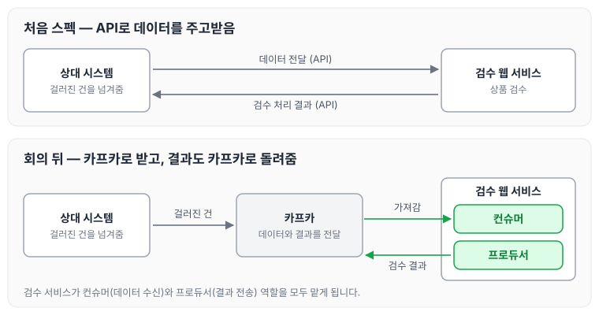

오늘은 카프카를 공부하게 된 계기에 대해 정리하도록 하겠습니다. 앞으로 이어지는 카프카 글은 이때 들은 강의를 정리한 노트입니다.

## 검수 웹 서비스와 카프카 연동

2024년에 대량 거래 데이터에서 걸러진 건을 넘겨받아, 상품을 검수하는 웹 서비스를 새로 만들게 되었습니다.

처음 잡았던 스펙은 API로 데이터를 주고받는 것이었습니다. 하지만 실무자들과 회의를 해 보니, 카프카로 데이터를 전달받고 검수 처리 결과도 카프카로 돌려주는 방식으로 진행하기로 결정되었습니다. 이 때문에 **컨슈머와 프로듀서 두 가지 역할을 모두 개발해야 하는 상황**이 되었습니다.

처음 스펙과 회의 뒤에 바뀐 방식을 비교하면 아래와 같습니다.

바뀐 방식에서는 검수 서비스가 카프카에서 데이터를 가져가는 컨슈머이면서, 검수 처리 결과를 카프카로 보내는 프로듀서이기도 합니다.

## 강의를 먼저 듣기로 한 이유

카프카 사용법을 검색해서 필요한 부분만 가져다 쓸 수도 있었을 것입니다. 실제로 그렇게 해도 동작은 했을 것입니다.

다만 개인적인 성향이 그렇지 못했습니다. 카프카가 어떤 식으로 동작하는지는 알고 쓰고 싶었기 때문에 강의부터 듣기로 했습니다. 강의를 들으면서 내용을 정리하고, 개발을 진행하면서 참고하려고 합니다.

## 참고한 자료

- [\[아파치 카프카 애플리케이션 프로그래밍\] 개념부터 컨슈머, 프로듀서, 커넥트, 스트림즈까지! — 인프런](https://www.inflearn.com/course/아파치-카프카-애플리케이션-프로그래밍/dashboard)
- [아파치 카프카 애플리케이션 프로그래밍 with 자바](https://www.aladin.co.kr/shop/wproduct.aspx?ItemId=269151889)

## 마무리

오늘은 카프카를 공부하게 된 계기에 대해 정리하였습니다. 컨슈머와 프로듀서를 모두 개발해야 하는 만큼, 강의를 들으면서 기본 개념부터 차근차근 정리해 두려고 합니다.

다음 글에서는 [아파치 카프카의 기본 구조](../kafka-basics/)에 대해 정리하도록 하겠습니다.

> 이 글은 인프런 최원영 님의 「아파치 카프카 애플리케이션 프로그래밍」을 들으며 정리한 노트입니다.
