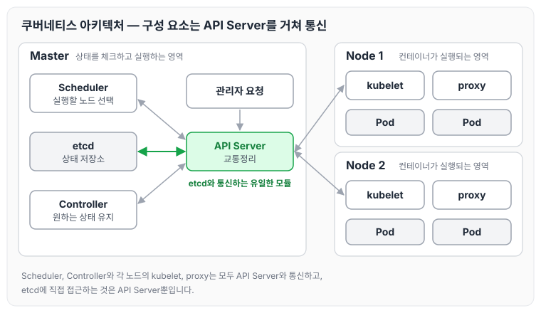
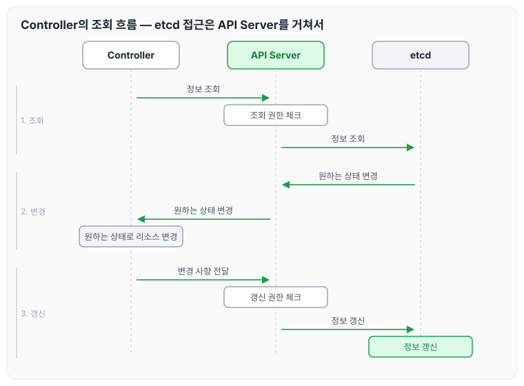
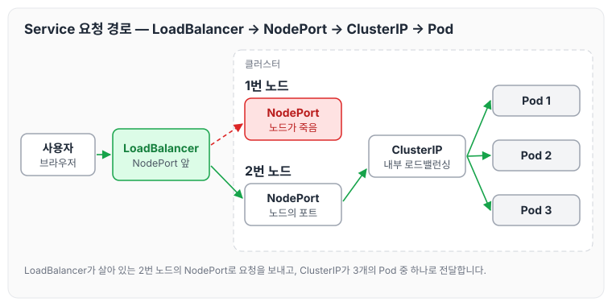

이전에 [컨테이너 오케스트레이션](../container-orchestration/)에 대해 작성하였습니다. 그 글에서는 컨테이너가 많아지면서 생기는 문제와, 이를 해결하는 컨테이너 오케스트레이션의 기능, 쿠버네티스를 사용하는 이유를 정리하였습니다. 오늘은 쿠버네티스가 어떻게 구성되어 있는지와 Pod, ReplicaSet, Deployment, Service, Ingress 같은 핵심 개념에 대해 정리하도록 하겠습니다.

## 쿠버네티스 소개

- 컨테이너화된 애플리케이션을 자동으로 배포, 스케일링 및 관리합니다.
- 컨테이너를 쉽게 관리하고 연결하기 위해 논리적인 단위로 그룹화했습니다.
- Google에서 15년간의 경험을 토대로 최상의 아이디어와 방법들을 결합했습니다.

## 쿠버네티스 아키텍처

### Desired State

Desired State(원하는 상태)는 쿠버네티스의 근간을 이루는 시스템입니다.

### 아키텍처 구성

쿠버네티스는 크게 아래와 같이 구성되어 있습니다.

- Master: 상태를 체크하고 실행하는 영역입니다.
- Node: 실제 컨테이너가 실행되는 영역입니다.
- API Server: 중간에서 교통정리하는 역할을 합니다.
- etcd: 상태를 저장하고 조회하는 저장소입니다.

각 구성 요소의 관계를 그림으로 나타내면 아래와 같습니다.

모든 구성 요소가 API Server를 거쳐 통신하고, etcd에 직접 접근하는 것은 API Server뿐입니다.

## Master 상세

### etcd

- 모든 상태와 데이터를 저장합니다.
- 분산 시스템으로 구성하여 안정성을 높입니다(고가용성).
- 가볍고 빠르면서 정확하게 설계되었습니다(일관성).
- Key(directory)-Value 형태로 데이터를 저장합니다.
- TTL(time to live), watch 같은 부가 기능을 제공합니다.
- 백업은 필수입니다.

### API Server

- 상태를 바꾸거나 조회합니다.
- etcd와 유일하게 통신하는 모듈입니다.
- REST API 형태로 제공됩니다.
- 권한을 체크하여 적절한 권한이 없으면 요청을 차단합니다.
- 관리자 요청뿐 아니라 다양한 내부 모듈과 통신합니다.
- 수평으로 확장되도록 설계되었습니다.

### Scheduler

- 새로 생성된 Pod을 감지하고 실행할 노드를 선택합니다.
- 노드의 현재 상태와 Pod의 요구사항을 체크합니다.
    - 노드에는 라벨을 부여할 수 있습니다.
    - 예: a-zone, b-zone, 또는 gpu-enabled 등

### Controller

- 논리적으로 다양한 컨트롤러가 존재합니다.
    - 복제 컨트롤러
    - 노드 컨트롤러
    - 엔드포인트 컨트롤러 등
- 끊임없이 상태를 체크하고 원하는 상태를 유지합니다.
- 복잡성을 낮추기 위해 하나의 프로세스로 실행합니다.

### 조회 흐름

Controller가 상태를 조회하고 원하는 상태로 리소스를 바꾸는 흐름은 아래와 같습니다.

1. Controller → (정보 조회) → API Server: 정보 조회 권한 체크 → (정보 조회) → etcd
2. etcd → (원하는 상태 변경) → API Server → (원하는 상태 변경) → Controller: 원하는 상태로 리소스 변경
3. Controller → (변경 사항 전달) → API Server: 정보 갱신 권한 체크 → (정보 갱신) → etcd: 정보 갱신

이처럼 스케줄러와 수많은 컨트롤러는 etcd와 직접 통신하지 않고 API Server를 통해 호출합니다.

## Node

- 노드에서는 proxy와 kubelet이 API Server와 통신합니다.
- 설계가 마이크로서비스 아키텍처로 잘 되어 있는 것을 알 수 있습니다.

### kubelet

- 각 노드에서 실행됩니다.
- Pod을 실행·중지하고 상태를 체크합니다.
- CRI(Container Runtime Interface)
    - Docker
    - Containerd
    - CRI-O
    - 등
- kubelet이 컨테이너를 사용할 수 있도록 Pod으로 한 번 더 감쌉니다.

### proxy

- 네트워크 프록시와 부하 분산 역할을 합니다.
- 성능상의 이유로 별도의 프록시 프로그램 대신 iptables 또는 IPVS를 사용합니다.
- proxy는 iptables 또는 IPVS에 설정만 하는 역할을 합니다.

## 쿠버네티스의 관리

### Pod

- 쿠버네티스의 가장 작은 단위입니다.
    - 컨테이너를 배포하는 것이 아니라 Pod을 배포하는 것입니다.
- 각 Pod마다 고유 IP를 할당합니다.
- 여러 개의 컨테이너가 하나의 Pod에 속할 수 있습니다.
- 포트를 로컬호스트에서 공유할 수 있습니다.

### ReplicaSet

- 여러 개의 Pod을 관리합니다.
- 신규 Pod을 생성하거나 기존 Pod을 제거하여 원하는 수(Replicas)를 유지합니다.

### Deployment

- 배포 버전을 관리합니다.
- 내부적으로 ReplicaSet을 이용해서 버전업을 자연스럽게 처리합니다.
- 배포할 때 새 버전의 ReplicaSet을 한 개 더 만들어서 version1과 version2를 함께 둡니다.
- 이후 새 ReplicaSet의 Pod을 한 개씩 늘리고 기존 ReplicaSet의 Pod을 한 개씩 줄이면서 버전을 올립니다.

## 다양한 Workload

- DaemonSet: 모든 노드에 꼭 1개씩 뜨기를 원할 때 사용합니다.
- StatefulSet: 순서대로 Pod을 실행시키거나, 같은 볼륨을 계속 재활용하고 싶을 때 사용합니다.
- Job: 한 번 실행하고 종료되는 Pod입니다.

## 네트워크 — Service

### ClusterIP

- ClusterIP는 Pod을 로드밸런싱하는 서비스입니다.
- 클러스터 내부에서 사용하는 프록시입니다.
- ClusterIP에 요청하면 자동으로 3개의 Pod 중 하나로 접근하게 됩니다.
    - 사용하는 이유
        - Deployment나 ReplicaSet은 Pod이 업데이트될 때 IP를 유지하면서 업데이트하지 않기 때문입니다.
        - Pod이 죽고 새로운 Pod이 뜨는 방식이라, IP가 언제든지 사라지고 바뀌는 것이 자연스럽습니다.
        - 그래서 요청을 보낼 때 Pod으로 바로 보내지 않고 ClusterIP를 거쳐서 보냅니다.

### NodePort

- ClusterIP는 내부에서만 통신이 가능합니다.
- 외부 브라우저에서는 접근이 불가능합니다.
- 따라서 외부에서 접근하기 위해 NodePort를 사용합니다.
    - 노드에 포트가 생기고, 해당 포트로 접근하면 요청이 ClusterIP를 거쳐 Pod으로 전달됩니다.

### LoadBalancer

NodePort만 사용할 때는 아래와 같은 문제가 발생합니다.

- 1번 노드에 도메인을 연결해 놨는데 해당 노드가 죽으면 2번 노드로 접근해야 하지만, 설정을 1번 노드로 해 두었기 때문에 브라우저로 접근 자체가 되지 않습니다.

이를 방지하기 위해 NodePort 앞에 LoadBalancer를 설정해 둡니다.

- 사용자가 LoadBalancer에 요청하면 LoadBalancer → NodePort → ClusterIP → Pod 순서로 전달됩니다.

외부 사용자의 요청이 Pod까지 전달되는 경로를 그림으로 정리하면 아래와 같습니다.

LoadBalancer가 살아 있는 노드의 NodePort로 요청을 보내기 때문에, 1번 노드가 죽어도 사용자는 같은 주소로 접근할 수 있습니다.

## Ingress

- 도메인 이름과 도메인 뒤에 붙는 Path에 따라서 내부에 있는 ClusterIP로 이동할 수 있습니다.
- 3개의 URL로 접근할 때 전부 NodePort를 만들거나 전부 LoadBalancer를 만들면 자원 낭비가 심합니다.
    - 그래서 Ingress를 한 개만 만들고, Ingress가 내부적으로 서비스를 분기 처리하도록 할 수 있습니다.

## 쿠버네티스 API 호출

### Pod 생성

Pod을 생성하고 싶을 때는 Object Spec을 YAML로 작성합니다.

### API 호출하기 정리

원하는 상태(Desired State)를 다양한 오브젝트(Object)로 정의(spec)하고, API 서버에 YAML 형식으로 전달합니다.

## 마무리

오늘은 쿠버네티스의 아키텍처를 Master와 Node로 나누어 etcd, API Server, Scheduler, Controller, kubelet, proxy의 역할과 원하는 상태를 유지하는 흐름을 정리하고, Pod, ReplicaSet, Deployment 같은 워크로드와 Service, Ingress 같은 네트워크 개념에 대해 정리하였습니다. 모든 구성 요소가 API Server를 거쳐 원하는 상태를 맞춰 간다는 점이 쿠버네티스를 이해하는 출발점인 것 같습니다.

> 이 글은 인프런의 [초보를 위한 쿠버네티스 안내서](https://www.inflearn.com/course/쿠버네티스-입문)을 들으며 정리한 노트입니다.
