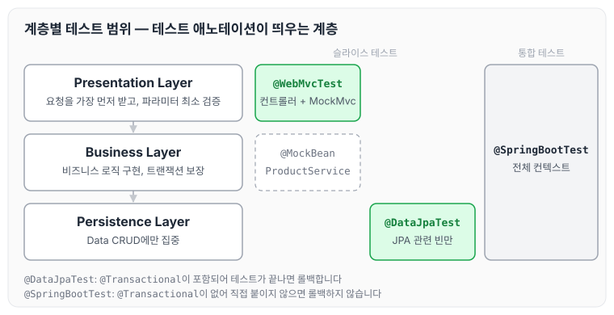
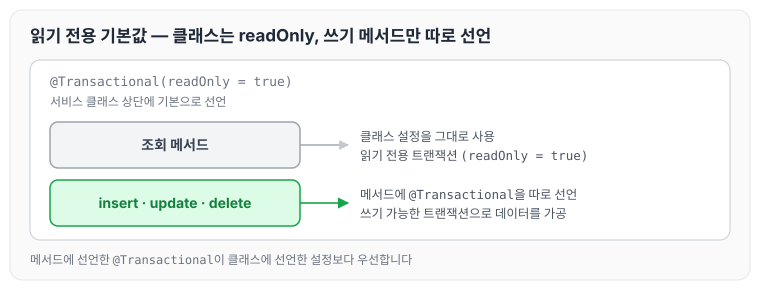

오늘은 Layered Architecture의 각 계층이 맡는 역할과, 계층별로 테스트를 작성하면서 알게 된 내용을 정리하도록 하겠습니다. 계층마다 어떤 테스트 애노테이션을 사용하는지와 함께, 테스트 코드를 작성하면서 들었던 개인적인 생각도 함께 기록하겠습니다.

## 계층별 역할

### Persistence Layer

- Data Access의 역할을 합니다. 비즈니스 가공 로직이 포함되어서는 안 됩니다.
- Data에 대한 CRUD에만 집중한 레이어

### Business Layer

- 비즈니스 로직을 구현하는 역할
- Persistence Layer와의 상호작용(Data를 읽고 쓰는 행위)을 통해 비즈니스 로직을 전개합니다.
- 트랜잭션을 보장해야 합니다.

### Presentation Layer

- 외부 세계의 요청을 가장 먼저 받는 계층
- 파라미터에 대한 최소한의 검증을 수행합니다.

같은 역할 구분을 육각형 아키텍처의 관점에서 본 내용은 만들면서 배우는 클린 아키텍처의 [유스케이스 구현하기](../clean-arch-04-usecase/), [웹 어댑터 구현하기](../clean-arch-05-web-adapter/), [영속성 어댑터 구현하기](../clean-arch-06-persistence-adapter/)에 정리하였습니다.

계층별로 어떤 테스트 애노테이션을 사용하고, 각 애노테이션이 어디까지 스프링 컨텍스트를 띄우는지 정리하면 아래와 같습니다.



Presentation Layer는 `@WebMvcTest`로 컨트롤러만 띄우고, 의존하는 서비스는 `@MockBean`으로 대체합니다. Persistence Layer는 `@DataJpaTest`로 JPA 관련 빈만 띄워 테스트하고, 계층 전체를 함께 확인할 때는 `@SpringBootTest`로 전체 컨텍스트를 띄웁니다.

## Persistence Layer 테스트에 대한 생각

글을 작성하면서 개인적인 생각을 정리해 보도록 하겠습니다.

코드를 작성하면서 가장 자주 마주하는 문제 중 하나는 Persistence Layer에서 발생하는 예외입니다. 객체 초기화 시 누락된 값으로 인한 예외나, null 값을 Enum으로 변환할 때 생기는 예외 등 생각보다 많은 예외가 이 레이어에서 발생하곤 합니다.

많은 사람들이 Business Layer가 중요하다고 생각하지만, 개인적으로는 Persistence Layer의 비중이 더 크다고 봅니다. 비즈니스 로직의 핵심은 검증된 데이터를 가공하는 것이며, 모든 데이터가 정확하고 필요한 위치에 잘 들어가 있다면 비즈니스 로직을 구현하는 것이 오히려 수월해질 수 있습니다. 그러나 데이터가 예상과 다르거나 올바르게 저장되지 않으면, 비즈니스를 구현하기 전에 항상 값의 유효성을 확인하고 검증하는 번거로움이 발생합니다. 이로 인해 데이터에 대한 신뢰가 떨어지고, 코드의 복잡성이 증가하게 됩니다.

따라서 각 레이어의 테스트 코드가 모두 중요하지만, 개인적으로 Persistence Layer에 대한 테스트의 비중을 더 높게 두는 편입니다. 이 레이어의 안정성이 확보되면 나머지 비즈니스 로직 구현이 훨씬 수월해지기 때문입니다.

## 인상 깊었던 내용

강의를 들으면서 중요한 부분들을 꼼꼼하게 짚어 준다는 느낌을 받았습니다. 특히 아래와 같은 내용들이 인상 깊었습니다.

- @SpringBootTest, @DataJpaTest, @WebMvcTest의 차이점
    - @SpringBootTest : @Transactional이 없음
    - @DataJpaTest : @Transactional이 존재
- 클래스 상단의 @Transactional 선언과 테스트 코드 일관성: 테스트 클래스에 @Transactional을 선언하면 더티 체킹(Dirty Checking)으로 인해 테스트 결과가 달라질 수 있습니다. 테스트의 일관성을 유지하려면 이 부분을 신중하게 처리해야 합니다.
- CQRS와 @Transactional, @Transactional(readOnly = true)의 사용법, 그리고 master와 slave를 나눠서 사용하는 방법
- serviceRequest 객체와 response 객체가 왜 필요한지, 의존성을 두 개로 나눠서 사용하면 차후 확장성 면에서 좋다는 점

@SpringBootTest와 @Transactional을 함께 사용해 테스트가 끝나면 데이터를 롤백하는 예제는 [스프링 통합 테스트](../spring-intro-integration-test/)에 정리하였습니다.

### CQRS와 @Transactional(readOnly = true)

CQRS 자체는 도메인 주도 개발 시작하기의 [CQRS](../ddd-cqrs/)에 정리하였습니다. 사용법은 클래스 상단에 기본으로 @Transactional(readOnly = true)를 선언하고, update, insert, delete 메서드에는 @Transactional을 선언해서 데이터를 가공하는 방식입니다.



조회 메서드는 클래스에 선언한 읽기 전용 설정을 그대로 사용하고, 쓰기 메서드만 메서드 단위로 @Transactional을 다시 선언합니다.

이 부분을 보면서 면접에서 받은 질문 하나가 생각났습니다. 함수에서 각각의 데이터를 조회할 때 트랜잭션이 걸려 있지 않으면 매번 새로운 DB 커넥션을 생성하게 되어 비효율적이라는 것이었습니다. 이 문제를 해결하기 위해 @Transactional(readOnly = true)를 사용하면, 조회 작업 시 커넥션 풀을 통해 이미 사용 중인 커넥션을 계속 재사용할 수 있어 훨씬 효율적이라는 내용이었습니다.

## 새로 알게 된 테스트 코드 작성법

몰랐던 테스트 코드 작성법은 정리해 두고 적용하려고 합니다.

`extracting()`으로 검증하고자 하는 필드를 뽑고, `containsExactlyInAnyOrder()`와 `tuple()`로 순서와 상관없이 값을 비교하는 방법은 아래와 같습니다.

```java
    		List<Item> itemList = new ArrayList<>();
        Item item1 = Item.builder()
                .id(1L)
                .name("자전거")
                .price(new BigDecimal(100000))
                .build();

        Item item2 = Item.builder()
                .id(2L)
                .name("킥보드")
                .price(new BigDecimal(200000))
                .build();

        itemList.add(item1);
        itemList.add(item2);

        Items items = new Items(itemList);

        //when
        //then
        Assertions.assertThat(items.getItemList())
                .hasSize(2)
                .extracting("id", "name", "price") // 검증하고자 하는 필드
                .containsExactlyInAnyOrder(
                        tuple(1L, "자전거", new BigDecimal(100000)),
                        tuple(2L, "킥보드", new BigDecimal(200000))
                ); // 순서 상관없이 확인 해준다.
```

`@WebMvcTest`로 컨트롤러만 띄우고, `ProductService`는 `@MockBean`으로 대체해서 상품 등록 API를 테스트하는 방법은 아래와 같습니다. `MockMvc`로 요청을 보내고, 요청 본문은 `ObjectMapper`로 직렬화합니다.

```java
@WebMvcTest(controllers = ProductController.class)
class ProductControllerTest {
		@Autowired
		private MockMvc mockMvc;
		
		@Autowired
		private ObjectMapper objectMapper; // 직렬화 역직렬화
		
		@MockBean
		private ProductService productService;
		
		@DisplayName("신규 상품을 등록한다.")
		@Test
		void createProduct() throws Exception {
				// given
				ProductCreateRequest request = ProductCreateRequest.builder()
						.type(ProductType.HANDMADE)
						.sellingStatus(ProductSellingStatus.SELLING)
						.name("아메리카노")
						.price(4000)
						.build();
						
				mockMvc.perform(MockMvcRequestBuilders.post("/api/v1/products/new")
							  .content(objectMapper.writeValueAsString(request))
							  .contentType(MediaType.APPLICATION_JSON)
			  ).andExpect(MockMvcResultMatchers.status().isOk());
		}

}
```

## 마무리

오늘은 Layered Architecture의 계층별 역할과 계층별 테스트 범위, @SpringBootTest·@DataJpaTest·@WebMvcTest의 차이, 그리고 @Transactional(readOnly = true)를 기본으로 두는 방법에 대해 정리하였습니다. 개인적으로 비중을 더 두는 Persistence Layer 테스트부터 탄탄하게 작성해 두면, 나머지 계층의 테스트와 비즈니스 로직 구현도 한결 수월해질 것 같습니다.
