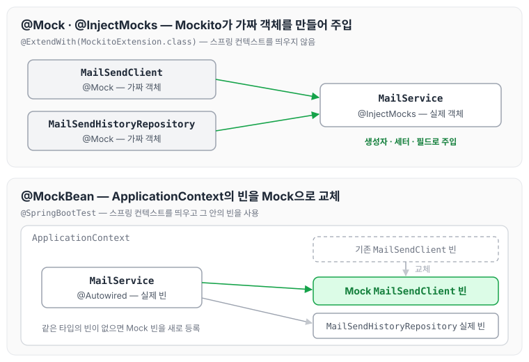
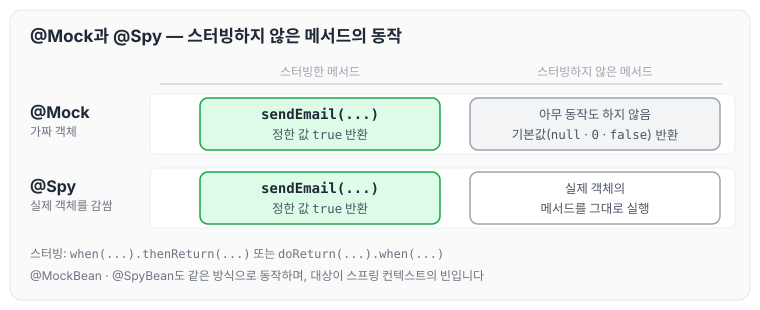
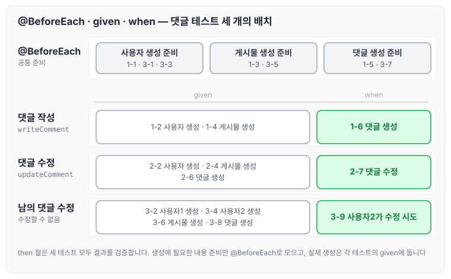

이전에 [\[인프런 워밍업 클럽 백엔드 스터디 2기\] 4주차 발자국](../infearn-week4/)에서 Dummy, Fake, Stub, Spy, Mock 같은 테스트 더블에 대해 작성하였습니다. 오늘은 테스트 더블을 만들 때 사용하는 Mockito의 @Mock, @Spy, @InjectMocks와 스프링 부트의 @MockBean, @SpyBean 애노테이션에 대해 정리하도록 하겠습니다. 예제는 메일을 보내는 `MailService`와, 이 서비스가 의존하는 `MailSendClient`, `MailSendHistoryRepository`를 대상으로 합니다.

## @Mock

@Mock은 단위 테스트를 위한 가짜(Mock) 객체를 생성합니다. 실제 객체 없이도 테스트를 진행할 수 있습니다.

특징은 아래와 같습니다.

- 모든 메서드는 기본적으로 아무 동작도 하지 않고, 반환값이 있는 메서드는 null, 0, false, 빈 컬렉션 같은 기본값을 반환합니다.
- `when().thenReturn()` 등으로 원하는 동작을 정의해야 합니다.
- 단위 테스트에서 주로 사용합니다.

아래는 `MailSendClient`와 `MailSendHistoryRepository`를 @Mock으로 만들고, `sendEmail()`이 true를 반환하도록 정의한 예제입니다.

```java
@ExtendWith(MockitoExtension.class)
class MailServiceTest {
    @Mock
    private MailSendClient mailSendClient;
    
    @Mock 
    private MailSendHistoryRepository mailSendHistoryRepository;
    
    @InjectMocks
    private MailService mailService;
    
    @DisplayName("메일 전송 테스트 - Mock 사용")
    @Test
    void sendMailTest() {
        // given
        String to = "test@test.com";
        String subject = "테스트";
        String content = "테스트 내용";
        String fromEmail = "from@test.com";
        
        //동작 정의
        when(mailSendClient.sendEmail(anyString(), anyString(), anyString(), anyString()))
            .thenReturn(true);
            
        // when
        boolean result = mailService.sendEmail(to, subject, content, fromEmail);
        
        // then
        assertThat(result).isTrue();
        verify(mailSendClient, times(1))
            .sendEmail(to, subject, content, fromEmail);
    }
}
```

## @MockBean

@MockBean은 스프링 컨텍스트에서 특정 빈을 가짜 객체로 대체합니다. 스프링 컨텍스트를 띄우는 통합 테스트에서 사용합니다.

특징은 아래와 같습니다.

- 스프링 부트 테스트에서 사용합니다.
- ApplicationContext에 Mock 객체를 등록합니다.
- 기존에 등록된 같은 타입의 빈을 Mock으로 교체하고, 같은 타입의 빈이 없으면 새로 등록합니다.

아래 예제는 `@SpringBootTest`로 컨텍스트를 띄운 뒤 `MailSendClient` 빈만 Mock으로 바꾸고, `MailService`는 `@Autowired`로 실제 빈을 주입받습니다.

```java
@SpringBootTest
class MailServiceIntegrationTest {
    @MockBean
    private MailSendClient mailSendClient;
    
    @Autowired
    private MailService mailService;
    
    @DisplayName("메일 전송 테스트 - MockBean 사용")
    @Test
    void sendMailTest() {
        // given
        String to = "test@test.com";
        String subject = "테스트";
        String content = "테스트 내용";
        String fromEmail = "from@test.com";
        
        //동작 정의
        when(mailSendClient.sendEmail(anyString(), anyString(), anyString(), anyString()))
            .thenReturn(true);
            
        // when
        boolean result = mailService.sendEmail(to, subject, content, fromEmail);
        
        // then
        assertThat(result).isTrue();
    }
}
```

@Mock과 @MockBean이 각각 무엇을 가짜 객체로 대체하는지 그림으로 보면 아래와 같습니다.



@Mock은 스프링 컨텍스트 없이 Mockito가 가짜 객체를 만들고 @InjectMocks 대상에 주입합니다. 반면 @MockBean은 ApplicationContext 안의 `MailSendClient` 빈을 Mock으로 바꾸기 때문에, Mock으로 바꾸지 않은 `MailSendHistoryRepository`는 실제 빈이 그대로 주입됩니다.

## @InjectMocks

@InjectMocks는 @Mock(또는 @Spy)으로 생성한 객체들을 테스트 대상 객체에 자동으로 주입합니다. 테스트에서 의존성 주입(DI)을 대신 해 주는 역할입니다.

특징은 아래와 같습니다.

- @Mock 객체들을 자동으로 주입받습니다.
- 생성자, 세터, 필드 주입을 지원합니다.
- 여러 Mock 객체와의 의존 관계를 설정할 때 유용합니다.

앞의 @Mock 예제에서 `MailService`에 붙은 @InjectMocks가 이 역할을 합니다.

## @Spy

@Spy는 실제 객체의 일부 메서드만 Mock으로 지정하고, 나머지 메서드는 실제 객체의 메서드를 그대로 사용합니다.

특징은 아래와 같습니다.

- 실제 객체의 메서드를 선택적으로 오버라이드합니다.
- 특정 메서드만 스터빙하고 싶을 때 유용합니다.
- 부분적인 Mock이 필요할 때 사용합니다.

아래 예제는 `MailSendClient`를 @Spy로 만들고, `doReturn()`으로 `sendEmail()`만 스터빙한 뒤 실제 호출 여부를 확인합니다.

```java
@ExtendWith(MockitoExtension.class)
class MailServiceTest {
    @Spy
    private MailSendClient mailSendClient;
    
    @Mock
    private MailSendHistoryRepository mailSendHistoryRepository;
    
    @InjectMocks
    private MailService mailService;
    
    @DisplayName("메일 전송 테스트 - Spy 사용")
    @Test
    void sendMailTest() {
        // given
        String to = "test@test.com";
        String subject = "테스트";
        String content = "테스트 내용";
        String fromEmail = "from@test.com";
        
        // 특정 메소드만 스터빙
        doReturn(true)
            .when(mailSendClient)
            .sendEmail(anyString(), anyString(), anyString(), anyString());
            
        // when
        boolean result = mailService.sendEmail(to, subject, content, fromEmail);
        
        // then
        assertThat(result).isTrue();
        // 실제 호출 여부 확인
        verify(mailSendClient, times(1))
            .sendEmail(to, subject, content, fromEmail);
    }
}
```

@Mock과 @Spy는 스터빙한 메서드에서는 똑같이 정한 값을 반환하지만, 스터빙하지 않은 메서드를 호출했을 때 동작이 다릅니다.



@Mock은 스터빙하지 않은 메서드에서 기본값을 반환하고, @Spy는 실제 객체의 메서드를 실행합니다. @MockBean과 @SpyBean의 관계도 같으며, 대상이 스프링 컨텍스트의 빈이라는 점만 다릅니다.

## @SpyBean

@SpyBean은 스프링 빈의 일부 메서드만 Mock으로 교체하고, 나머지는 실제 빈의 동작을 유지합니다.

특징은 아래와 같습니다.

- 스프링 컨텍스트에서 동작합니다.
- 실제 빈의 일부 동작만 수정할 수 있습니다.
- 통합 테스트에서 부분적인 Mock이 필요할 때 사용합니다.

```java
@SpringBootTest
class MailServiceIntegrationTest {
    @SpyBean
    private MailSendClient mailSendClient;
    
    @Autowired
    private MailService mailService;
    
    @DisplayName("메일 전송 테스트 - SpyBean 사용")
    @Test
    void sendMailTest() {
        // given
        String to = "test@test.com";
        String subject = "테스트";
        String content = "테스트 내용";
        String fromEmail = "from@test.com";
        
        // 특정 메소드만 스터빙하고 나머지는 실제 동작 수행
        doReturn(true)
            .when(mailSendClient)
            .sendEmail(anyString(), anyString(), anyString(), anyString());
            
        // when
        boolean result = mailService.sendEmail(to, subject, content, fromEmail);
        
        // then
        assertThat(result).isTrue();
    }
}
```

## 문제 — @BeforeEach, given, when 배치

아래 3개의 테스트가 있습니다. 내용을 살펴보고 각 항목을 @BeforeEach, given절, when절 중 어디에 배치할지 정하는 문제입니다. @BeforeEach에 올라간 내용은 공통 항목으로 합칠 수 있습니다(예: 1-1과 2-1을 하나로 합쳐서 @BeforeEach에 배치).

```java
@BeforeEach 
void setUp() {
    ❓
} 

@DisplayName("사용자가 댓글을 작성할 수 있다.")
@Test
void writeComment() {
    1-1. 사용자 생성에 필요한 내용 준비
    1-2. 사용자 생성
    1-3. 게시물 생성에 필요한 내용 준비
    1-4. 게시물 생성
    1-5. 댓글 생성에 필요한 내용 준비
    1-6. 댓글 생성

    // given
    ❓

    // when
    ❓

    // then
    검증
}

@DisplayName("사용자가 댓글을 수정할 수 있다.")
@Test
void updateComment() {
    2-1. 사용자 생성에 필요한 내용 준비
    2-2. 사용자 생성
    2-3. 게시물 생성에 필요한 내용 준비
    2-4. 게시물 생성
    2-5. 댓글 생성에 필요한 내용 준비
    2-6. 댓글 생성
    2-7. 댓글 수정

    // given
    ❓

    // when
    ❓

    // then
    검증
}

@DisplayName("자신이 작성한 댓글이 아니면 수정할 수 없다.")
@Test
void cannotUpdateCommentWhenUserIsNotWriter() {
    3-1. 사용자1 생성에 필요한 내용 준비
    3-2. 사용자1 생성
    3-3. 사용자2 생성에 필요한 내용 준비
    3-4. 사용자2 생성
    3-5. 사용자1의 게시물 생성에 필요한 내용 준비
    3-6. 사용자1의 게시물 생성
    3-7. 사용자1의 댓글 생성에 필요한 내용 준비
    3-8. 사용자1의 댓글 생성
    3-9. 사용자2가 사용자1의 댓글 수정 시도

    // given
    ❓

    // when
    ❓

    // then
    검증        
}
```

각 항목을 배치해 보면 아래와 같습니다.

```java
@BeforeEach
void setUp() {
		(1-1. 사용자 생성에 필요한 내용 준비 ,3-1. 사용자1 생성에 필요한 내용 준비, 3-3. 사용자2 생성에 필요한 내용 준비)
		(1-3. 게시물 생성에 필요한 내용 준비 ,	3-5. 사용자1의 게시물 생성에 필요한 내용 준비)
		(1-5. 댓글 생성에 필요한 내용 준비, 3-7. 사용자1의 댓글 생성에 필요한 내용 준비)
}

@DisplayName("사용자가 댓글을 작성할 수 있다.")
@Test
void writeComment() {
		// given
		1-2. 사용자 생성
		1-4. 게시물 생성
		

		// when
		1-6. 댓글 생성
		
		// then
		검증
}

@DisplayName("사용자가 댓글을 수정할 수 있다.")
@Test
void updateComment() {
		// given
		2-2. 사용자 생성
		2-4. 게시물 생성
		2-6. 댓글 생성
		

		// when
		2-7. 댓글 수정
		
		// then
		검증
}

@DisplayName("자신이 작성한 댓글이 아니면 수정할 수 없다.")
@Test
void cannotUpdateCommentWhenUserIsNotWriter() {
    // given
    3-2. 사용자1 생성
    3-4. 사용자2 생성

    3-6. 사용자1의 게시물 생성
    3-8. 사용자1의 댓글 생성

    // when
    3-9. 사용자2가 사용자1의 댓글 수정 시도

    // then
    검증        
}
```

배치한 결과를 테스트별로 나란히 놓으면 아래와 같습니다.



생성에 필요한 내용을 준비하는 항목은 @BeforeEach로 모으고, 사용자·게시물·댓글을 실제로 생성하는 항목은 각 테스트의 given에, 테스트하려는 행위(댓글 생성, 댓글 수정, 수정 시도)는 when에 두었습니다.

## 마무리

오늘은 Mockito의 @Mock, @Spy, @InjectMocks와 스프링 부트의 @MockBean, @SpyBean이 각각 무엇을 가짜 객체로 대체하는지, 그리고 테스트 준비 코드를 @BeforeEach와 given, when에 나누는 방법에 대해 정리하였습니다. 스프링 컨텍스트가 필요 없는 테스트는 @Mock으로, 컨텍스트 안의 빈을 바꿔야 하는 테스트는 @MockBean으로 나눠서 사용하면 테스트의 범위를 더 분명하게 가져갈 수 있을 것 같습니다.
