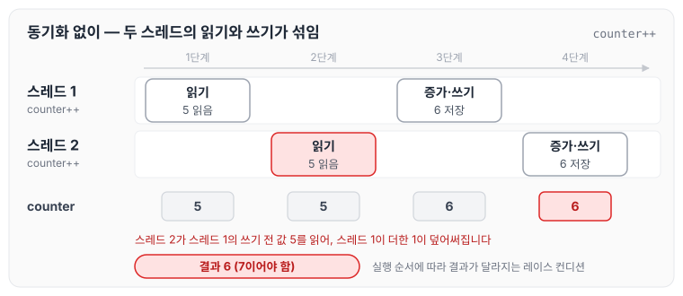
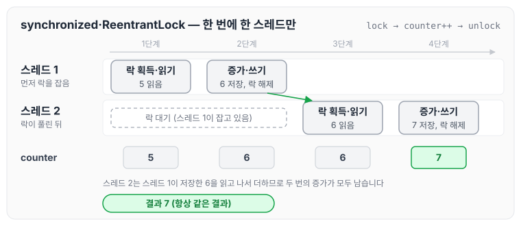
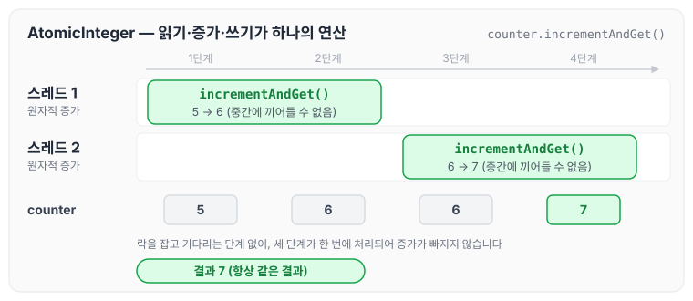
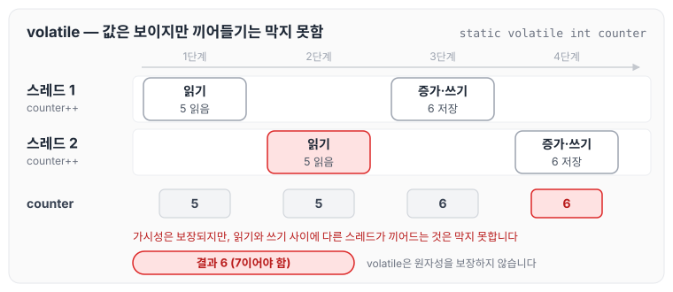

멀티스레드와 레이스 컨디션(race condition)은 Java로 병렬 프로그래밍을 할 때 꼭 마주치게 되는 개념입니다. 오늘은 Java를 기준으로 멀티스레드와 레이스 컨디션이 무엇인지 예제 코드로 살펴보고, 해결 방법에 대해 정리하도록 하겠습니다.

## 멀티스레드란

멀티스레드(multithreading)는 하나의 프로세스 안에서 여러 스레드가 동시에 작업을 수행하는 것을 의미합니다. Java에서는 Thread 클래스나 Runnable 인터페이스를 사용해 스레드를 생성하고 관리할 수 있습니다. 멀티스레드를 사용하면 CPU 코어를 효율적으로 활용하고 작업을 병렬로 처리해 성능을 높일 수 있습니다.

### Java에서 스레드 생성 예제

Thread 클래스를 상속하는 방법과 Runnable 인터페이스를 구현하는 방법은 아래와 같습니다.

```java
public class ThreadExample {
    public static void main(String[] args) {
        // 방법 1: Thread 클래스 상속
        class MyThread extends Thread {
            @Override
            public void run() {
                System.out.println("Thread 상속: " + Thread.currentThread().getName());
            }
        }

        // 방법 2: Runnable 인터페이스 구현
        class MyRunnable implements Runnable {
            @Override
            public void run() {
                System.out.println("Runnable 구현: " + Thread.currentThread().getName());
            }
        }

        MyThread thread1 = new MyThread();
        Thread thread2 = new Thread(new MyRunnable());

        thread1.start(); // 스레드 시작
        thread2.start();
    }
}
```

### 멀티스레드의 장점

- 효율성: 파일 읽기·쓰기나 네트워크 요청 같은 I/O 작업으로 대기 시간이 생길 때 다른 작업을 처리할 수 있습니다.
- 성능 향상: 다중 코어 CPU에서 작업을 나누어 처리합니다.
- 응답성: GUI 애플리케이션에서 사용자 입력을 처리하면서 백그라운드 작업을 수행할 수 있습니다.

### 멀티스레드의 단점

- 복잡성 증가: 스레드 사이의 동기화와 데이터 공유 문제가 생깁니다.
- 레이스 컨디션: 여러 스레드가 같은 자원에 접근할 때 오류가 발생할 수 있습니다.

## 레이스 컨디션이란

레이스 컨디션(race condition)은 여러 스레드가 변수나 객체 같은 공유 자원에 동시에 접근해 수정할 때, 실행 순서에 따라 결과가 달라지는 상황을 말합니다. 의도하지 않은 동작이나 버그의 원인이 됩니다.

### 레이스 컨디션 발생 예제

아래는 두 스레드가 공유 변수를 증가시키는 코드입니다.

```java
public class RaceConditionExample {
    static int counter = 0;

    public static void main(String[] args) throws InterruptedException {
        Runnable task = () -> {
            for (int i = 0; i < 10000; i++) {
                counter++; // 공유 변수 증가
            }
        };

        Thread thread1 = new Thread(task);
        Thread thread2 = new Thread(task);

        thread1.start();
        thread2.start();

        thread1.join(); // 스레드가 끝날 때까지 대기
        thread2.join();

        System.out.println("최종 값: " + counter);
    }
}

```

두 스레드가 `counter++`를 각각 10,000번 실행하므로 20,000이 나올 것으로 예상할 수 있습니다. 하지만 실제로 실행하면 19,xxx처럼 20,000보다 작은 값이 출력될 수 있습니다.

### 왜 이런 일이 발생하는지

`counter++`는 하나의 연산처럼 보이지만, 실제로는 세 단계로 나뉩니다.

1. 읽기(Read): 현재 counter 값을 가져옵니다.
2. 수정(Modify): 값을 1 증가시킵니다.
3. 쓰기(Write): 증가된 값을 다시 counter에 저장합니다.

두 스레드가 이 작업을 동시에 수행하면 다음과 같은 상황이 생길 수 있습니다.

- 스레드 1: counter를 읽음 (값: 5)
- 스레드 2: counter를 읽음 (값: 5)
- 스레드 1: 값을 6으로 증가시켜 저장
- 스레드 2: 값을 6으로 증가시켜 저장

두 스레드가 각각 1씩 증가시켰으니 7이 되어야 하지만, counter는 6이 됩니다. 위 순서를 시간 축에 펼치면 다음과 같습니다.



스레드 2가 스레드 1의 쓰기보다 먼저 5를 읽었기 때문에, 스레드 1이 더한 1이 스레드 2의 쓰기에 덮어써집니다. 이처럼 스레드의 실행 순서에 따라 결과가 달라지는 것이 **레이스 컨디션**입니다.

## 레이스 컨디션 해결 방법

Java에서는 동기화(synchronization) 같은 방법으로 레이스 컨디션을 막을 수 있습니다. 주요 방법은 다음과 같습니다.

### synchronized 키워드 사용

synchronized 블록이나 메서드를 사용하면 해당 코드에 한 번에 하나의 스레드만 들어갈 수 있습니다.

```java
public class SynchronizedExample {
    static int counter = 0;

    public static synchronized void increment() { // 메서드 수준 동기화
        counter++;
    }

    public static void main(String[] args) throws InterruptedException {
        Runnable task = () -> {
            for (int i = 0; i < 10000; i++) {
                increment();
            }
        };

        Thread thread1 = new Thread(task);
        Thread thread2 = new Thread(task);

        thread1.start();
        thread2.start();

        thread1.join();
        thread2.join();

        System.out.println("최종 값: " + counter); // 항상 20,000 출력
    }
}
```

### Lock 인터페이스 사용

java.util.concurrent.locks 패키지의 ReentrantLock을 사용하면 더 유연하게 동기화할 수 있습니다.

```java
import java.util.concurrent.locks.ReentrantLock;

public class LockExample {
    static int counter = 0;
    static ReentrantLock lock = new ReentrantLock();

    public static void main(String[] args) throws InterruptedException {
        Runnable task = () -> {
            for (int i = 0; i < 10000; i++) {
                lock.lock(); // 락 획득
                try {
                    counter++;
                } finally {
                    lock.unlock(); // 락 해제
                }
            }
        };

        Thread thread1 = new Thread(task);
        Thread thread2 = new Thread(task);

        thread1.start();
        thread2.start();

        thread1.join();
        thread2.join();

        System.out.println("최종 값: " + counter); // 항상 20,000 출력
    }
}
```

synchronized와 ReentrantLock은 모두 락을 잡은 스레드만 `counter++`를 실행하게 합니다. 앞의 예제와 같은 상황에 락을 적용하면 다음과 같이 실행됩니다.



스레드 2는 스레드 1이 락을 해제할 때까지 기다렸다가 6을 읽기 때문에, 두 번의 증가가 모두 반영되어 7이 됩니다. 락을 기다리는 방식과 소유권의 차이는 [스핀락, 뮤텍스, 세마포](../spinlock-mutex-semaphore/)에서 자세히 정리하였습니다.

### Atomic 클래스 사용

java.util.concurrent.atomic 패키지의 AtomicInteger 같은 클래스는 락 없이도 원자적 연산을 보장합니다.

```java
import java.util.concurrent.atomic.AtomicInteger;

public class AtomicExample {
    static AtomicInteger counter = new AtomicInteger(0);

    public static void main(String[] args) throws InterruptedException {
        Runnable task = () -> {
            for (int i = 0; i < 10000; i++) {
                counter.incrementAndGet(); // 원자적 증가
            }
        };

        Thread thread1 = new Thread(task);
        Thread thread2 = new Thread(task);

        thread1.start();
        thread2.start();

        thread1.join();
        thread2.join();

        System.out.println("최종 값: " + counter.get()); // 항상 20,000 출력
    }
}
```

`incrementAndGet()`은 읽기, 증가, 쓰기를 나눌 수 없는 하나의 연산으로 처리합니다. 같은 상황을 그리면 다음과 같습니다.



세 단계 사이에 다른 스레드가 끼어들 수 없기 때문에, 락을 잡고 기다리는 과정 없이도 증가가 빠지지 않습니다.

### 기타 방법

- volatile 키워드: 변수의 가시성을 보장하지만 원자성은 보장하지 않으므로, 레이스 컨디션을 해결하는 데에는 한계가 있습니다.
- ThreadLocal: 스레드마다 독립적인 변수 사본을 제공해 공유 자체를 피합니다.

volatile이 왜 한계가 있는지는 앞의 예제에 그대로 적용해 보면 알 수 있습니다.



volatile은 다른 스레드가 쓴 값을 볼 수 있게 해 줄 뿐, 읽기와 쓰기 사이에 다른 스레드가 끼어드는 것은 막지 못합니다. 이 때문에 `counter++` 같은 연산에는 synchronized, Lock, Atomic 클래스가 필요합니다.

## 멀티스레드와 레이스 컨디션의 주의점

- 데드락(Deadlock): synchronized나 Lock을 사용할 때 스레드들이 서로 필요한 자원을 기다리며 교착 상태에 빠질 수 있습니다. 발생 조건과 해결 전략은 [데드락의 네 가지 조건과 해결 전략](../deadlock/)에서 정리하였습니다.
- 성능 저하: 동기화를 과하게 사용하면 스레드의 대기 시간이 늘어나 멀티스레드의 이점이 줄어들 수 있습니다.
- 테스트의 어려움: 레이스 컨디션은 실행 환경에 따라 재현되지 않을 수 있어 디버깅이 까다롭습니다.

## 마무리

Java에서 멀티스레드는 유용한 기능이지만, 공유 자원에 대한 접근을 신중하게 관리해야 합니다. 레이스 컨디션은 synchronized, Lock, Atomic 같은 동기화 방법으로 해결할 수 있으며, 상황에 맞는 방법을 고르는 것이 중요합니다. 간단한 경우에는 Atomic 클래스를, 복잡한 경우에는 Lock이나 synchronized를 사용하는 식으로 설계하면 됩니다.

오늘은 Java 기준으로 멀티스레드와 레이스 컨디션, 그리고 이를 해결하는 방법에 대해 정리하였습니다.
