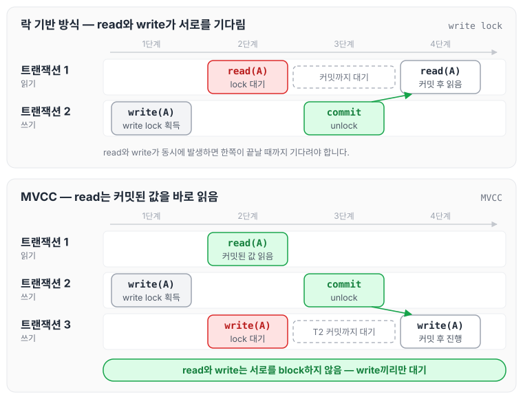
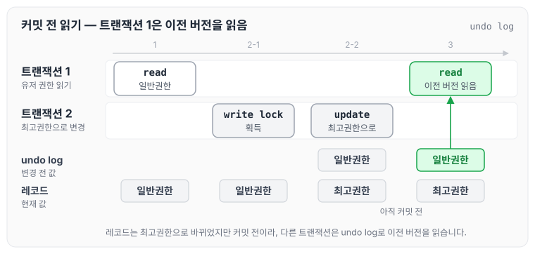
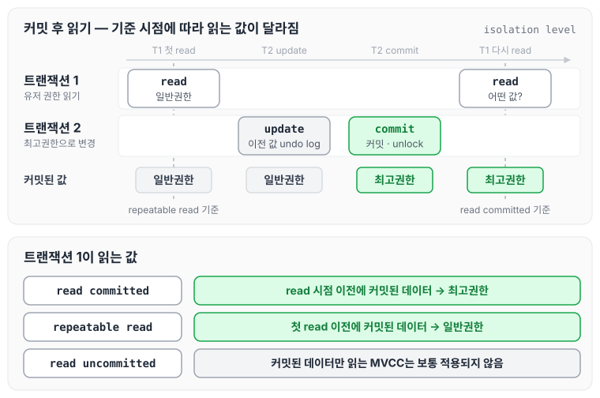

이전에 [낙관적 락](../optimistic-lock/)과 [비관적 락](../pessimistic-lock/)에 대해 작성하였습니다. 두 글에서는 락으로 동시성 문제를 해결하는 방법을 다뤘는데, 락 기반 방식은 read와 write가 동시에 발생하면 한쪽이 기다려야 한다는 한계가 있습니다. 오늘은 이 한계를 해결하기 위해 등장한 MVCC(multiversion concurrency control)에 대해 정리하겠습니다.

## 기존 Lock 기반 방식

기존 Lock 기반 방식에서 같은 데이터에 대해 동시에 동작할 수 있는 조합은 아래와 같습니다.

|  | read | write |
| --- | --- | --- |
| read | O | X |
| write | X | X |

기존 컨커런시 컨트롤러는 위와 같이 read끼리만 동시에 동작할 수 있습니다. 따라서 read와 write가 동시에 발생하면 한쪽은 대기해야 하고, 이 때문에 동시에 처리할 때 성능이 떨어집니다. 이를 해결하기 위해 MVCC가 등장하게 되었습니다.

## MVCC

MVCC에서는 같은 데이터에 대해 아래와 같이 동작합니다.

|  | read | write |
| --- | --- | --- |
| read | O | O |
| write | O | X |

양쪽 트랜잭션에서 모두 write가 발생하는 경우에만 block되고, 그 외의 경우에는 함께 동작합니다. 이를 통해 동시에 처리하는 성능이 올라가게 됩니다.

두 방식에서 read와 write가 같은 데이터에 동시에 접근할 때를 비교하면 다음과 같습니다.

락 기반 방식에서는 트랜잭션 1의 read가 트랜잭션 2의 커밋을 기다리고, MVCC에서는 기다리지 않고 바로 읽습니다. 다만 MVCC에서도 write끼리는 여전히 대기합니다.

## MVCC 동작 예제

트랜잭션 1은 유저의 권한을 읽고, 트랜잭션 2는 같은 유저의 권한을 최고권한으로 변경하는 상황으로 MVCC의 동작을 살펴보겠습니다. 유저의 원래 권한은 일반권한입니다.

### 커밋하기 전에 읽는 경우

1. 트랜잭션 1은 유저의 권한을 읽습니다.
2. 트랜잭션 2는 유저의 권한을 최고권한으로 변경합니다.
    1. 트랜잭션이 동작할 때, 값을 변경하기 전에 write lock을 부여받습니다.
    2. write lock을 부여받으면 레코드를 최고권한으로 변경하고, 변경 전 값(일반권한)은 undo log에 남겨 둡니다. (InnoDB 기준)
3. 트랜잭션 2가 write를 했지만 아직 커밋하지 않은 상태에서 트랜잭션 1이 해당 유저의 데이터를 읽으면, 커밋되지 않은 최고권한 대신 undo log에 남아 있는 이전 버전, 즉 최종 커밋된 일반권한을 읽습니다.

이 과정을 순서대로 그리면 다음과 같습니다.

레코드는 이미 최고권한으로 바뀌었지만 아직 커밋 전이기 때문에, 트랜잭션 1은 undo log로 이전 버전을 만들어 일반권한을 읽는 것을 확인할 수 있습니다.

> 💡 즉 MVCC는 커밋된 데이터만 읽습니다.

### 커밋한 뒤에 읽는 경우

4. 이제 트랜잭션 2가 커밋합니다.
    1. 최고권한으로 바꾼 값이 커밋된 값이 됩니다.
    2. 2-1에서 부여받은 write lock은 unlock으로 회수됩니다.
        - DB가 커밋할 때 write lock을 직접 회수하는 이유는, 트랜잭션이 동작하다 문제가 발생하면 롤백할 수 있게 하기 위해서입니다. 즉 recoverability를 위해 커밋할 때 write lock을 unlock합니다.
5. 이 상태에서 트랜잭션 1이 해당 유저의 값을 읽으면, 트랜잭션의 isolation level에 따라 읽는 값이 달라집니다.
    1. isolation level이 read committed라면 read하는 시간을 기준으로, 그 전에 commit된 데이터를 읽습니다. 즉 최고권한을 읽습니다.
    2. isolation level이 repeatable read라면 트랜잭션에서 처음 read한 시점(InnoDB 기준)을 기준으로, 그 전에 commit된 데이터를 읽습니다. 트랜잭션 1은 1단계에서 처음 읽었으므로 일반권한을 읽습니다.
    3. isolation level이 read uncommitted라면, MVCC는 commit된 데이터를 읽기 때문에 이 레벨에서는 보통 MVCC가 적용되지 않습니다.

트랜잭션 1이 처음 read한 시점과 다시 read한 시점을 함께 표시하면 다음과 같습니다.

read committed는 read할 때마다 그 시점을, repeatable read는 트랜잭션에서 처음 read한 시점을 기준으로 그 전에 커밋된 값을 읽습니다. 같은 데이터를 읽더라도 기준 시점이 다르기 때문에 결과가 달라집니다. 격리 수준의 각 단계와 허용하는 현상은 [트랜잭션 스케줄과 격리 수준](../transaction-schedule-isolation/)에서 따로 정리하였습니다.

## 정리

MVCC를 정리하면 아래와 같습니다.

- 데이터를 읽을 때 특정 시점을 기준으로 가장 최근에 commit된 데이터를 읽습니다. 이를 **Consistent read**라고 합니다.
- 데이터 변화(write) 이력을 관리합니다. 추가적인 저장 공간을 더 사용한다는 단점이 있지만, 동시성 측면에서는 장점이 있습니다. 이 때문에 MySQL(InnoDB), PostgreSQL, Oracle 등 대부분의 RDBMS가 MVCC를 사용합니다.
- read와 write는 서로를 block하지 않습니다.

오늘은 락 기반 방식의 한계와 MVCC가 커밋된 데이터를 읽는 방식, 그리고 isolation level에 따라 읽는 데이터가 달라지는 원리에 대해 정리하였습니다.
