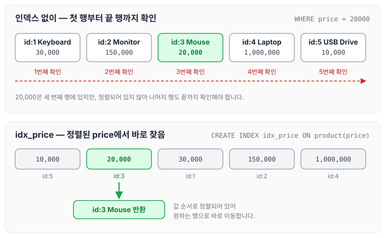
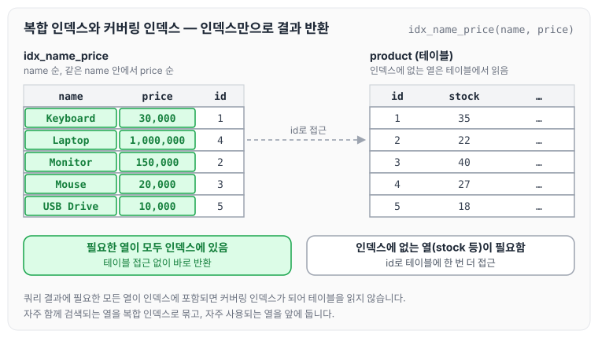
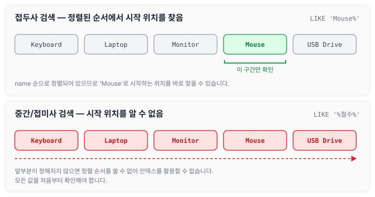
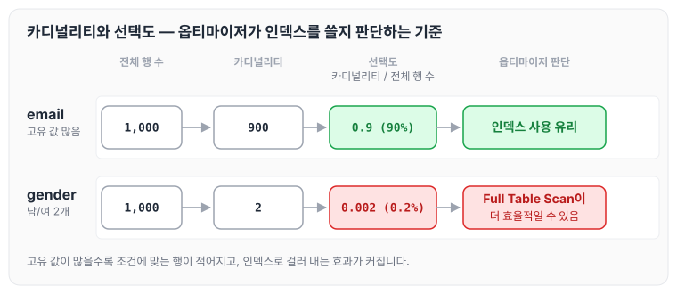

이전에 [DB 인덱스](../db-index/)에 대해 작성하였습니다. 그 글에서는 인덱스로 B-Tree를 사용하는 이유와 복합 인덱스로 단일 인덱스의 낭비를 줄이는 방법을 다뤘습니다. 오늘은 MySQL 인덱스의 장단점과 카디널리티·선택도를 기준으로 인덱스를 효율적으로 선언하는 방법을 정리하도록 하겠습니다.

## 인덱스란?

인덱스는 데이터베이스 테이블의 검색 속도를 향상시키기 위한 자료 구조로, 책의 '찾아보기'와 유사한 역할을 합니다.

- 역할: 검색, 정렬, 병합 작업을 빠르게 수행합니다.
- 구조: 주로 **B-Tree**를 사용해 데이터를 정렬된 형태로 저장합니다.

인덱스가 없으면 책의 첫 페이지부터 끝까지 확인하는 것처럼 시간이 오래 걸리고, 인덱스를 사용하면 '찾아보기'로 원하는 단어의 페이지로 바로 이동할 수 있습니다.

### 예시: 원본 테이블과 인덱스

**원본 테이블 (product)**

| id | name | price | stock | created_date | sales |
| --- | --- | --- | --- | --- | --- |
| 1 | Keyboard | 30,000 | 35 | 2024-02-01 | 4,000 |
| 2 | Monitor | 150,000 | 22 | 2024-01-15 | 5,500 |
| 3 | Mouse | 20,000 | 40 | 2024-03-10 | 3,800 |
| 4 | Laptop | 1,000,000 | 27 | 2024-01-10 | 6,200 |
| 5 | USB Drive | 10,000 | 18 | 2024-02-15 | 4,700 |

price 기준으로 B-Tree 인덱스를 생성합니다.

```sql
CREATE INDEX idx_price ON product(price);
```

생성된 인덱스 구조(B-Tree)는 아래와 같습니다.

| 순서 | price | 참조 |
| --- | --- | --- |
| 1 | 10,000 | id:5 (USB Drive) |
| 2 | 20,000 | id:3 (Mouse) |
| 3 | 30,000 | id:1 (Keyboard) |
| 4 | 150,000 | id:2 (Monitor) |
| 5 | 1,000,000 | id:4 (Laptop) |

쿼리 실행 예시입니다.

```sql
SELECT * FROM product WHERE price = 20000;
```

B-Tree에서 price = 20,000인 행(id:3)을 빠르게 찾아 반환합니다. 인덱스가 없을 때와 비교하면 다음과 같습니다.



원본 테이블은 price 순서가 뒤섞여 있지만, 인덱스는 price 순으로 정렬되어 있고 각 값이 원본 행(id)을 가리키고 있습니다.

## 인덱스의 장단점

### 장점

1. 검색 속도 향상: WHERE 절, JOIN 조건에서 특정 값을 빠르게 조회합니다.
2. 정렬 성능 개선: ORDER BY 작업에서 인덱스를 활용하면 정렬 비용이 감소합니다.
3. 병합 성능 개선: GROUP BY 작업에서 데이터를 빠르게 그룹화합니다.

2번 정렬 성능 개선의 예시는 아래와 같습니다.

```sql
SELECT * FROM product ORDER BY price ASC;
```

### 단점

1. 추가 저장 공간: 인덱스는 별도 저장 공간을 차지합니다.
2. 쓰기 성능 저하: INSERT, UPDATE, DELETE 시 인덱스 갱신으로 오버헤드가 발생합니다.
3. 관리 비용 증가: 인덱스가 많아질수록 유지보수 부담이 증가합니다.

## 인덱스 효율적으로 선언하는 방법

### 1. 카디널리티 높은 열 선택

- 카디널리티는 열에 존재하는 고유 값의 개수입니다.
- 예: email(고유 값 많음, 카디널리티 높음) → 인덱스 효과적.
- 예: gender(남/여 2개, 카디널리티 낮음) → 인덱스 효과 미미.
- 카디널리티가 높을수록 쿼리 결과 행이 적어 인덱스 효율이 증가합니다.

### 2. 복합 인덱스 활용

자주 함께 검색되는 열은 복합 인덱스로 생성합니다.

```sql
CREATE INDEX idx_name_price ON product(name, price);
```

- 주의: 자주 사용되는 열을 앞에 배치합니다.
- **커버링 인덱스**: 쿼리 결과에 필요한 모든 열이 인덱스에 포함되면 테이블 접근 없이 데이터를 반환합니다.

위 `idx_name_price`를 그리면 다음과 같습니다.



필요한 열이 모두 인덱스에 있으면 왼쪽 인덱스만 읽고 끝나고, 인덱스에 없는 열이 필요하면 id로 오른쪽 테이블에 한 번 더 접근합니다.

### 3. ORDER BY와 함께 사용

정렬 기준 열에 인덱스를 생성하면 ORDER BY 성능이 개선됩니다.

### 4. LIKE 검색 최적화

- 접두사 검색(LIKE '김%')은 인덱스를 사용합니다.
- 중간/접미사 검색(LIKE '%철수%')은 인덱스를 활용할 수 없습니다.

```sql
SELECT * FROM product WHERE name LIKE 'Mouse%'; -- 인덱스 사용
```

name으로 정렬된 인덱스에서 두 검색을 비교하면 다음과 같습니다.



인덱스는 값의 앞부분부터 정렬되어 있기 때문에, 앞부분이 정해진 접두사 검색만 시작 위치를 찾을 수 있습니다.

## 카디널리티와 선택도

### 카디널리티 (Cardinality)

- 정의: 열에 존재하는 고유한 값의 개수입니다.
- 예시: email 열에 1,000개 행, 고유 값 900개 → 카디널리티 = 900.
- 확인 방법은 아래와 같습니다.

```sql
SHOW INDEX FROM product;
```

### 선택도 (Selectivity)

- 정의: 카디널리티를 전체 행 수로 나눈 값입니다.
- 수식: 선택도 = 카디널리티 / 전체 행 수.
- 예시:
    - email 열(카디널리티 900, 행 1,000) → 선택도 = 0.9 (90%).
    - gender 열(카디널리티 2, 행 1,000) → 선택도 = 0.002 (0.2%).
- 선택도가 높을수록 인덱스 사용 시 쿼리 성능이 향상됩니다.

### MySQL 옵티마이저의 판단

- MySQL 쿼리 옵티마이저는 카디널리티와 선택도를 분석해 인덱스 사용 여부를 결정합니다.
- 카디널리티가 높으면 인덱스 사용이 유리합니다.
- 카디널리티가 낮으면 Full Table Scan이 더 효율적일 수 있습니다.

위 email과 gender 예시를 옵티마이저 판단까지 이어서 그리면 다음과 같습니다.



## B-Tree 인덱스 알고리즘

MySQL은 주로 B-Tree 구조를 사용하며, 시간 복잡도는 O(log N)입니다. B-Tree를 사용하는 이유는 아래와 같습니다.

- 균형 유지: 데이터가 많아져도 자동으로 균형을 맞춰 성능을 보장합니다.
- 디스크 I/O 최소화: 한 노드에 여러 키를 저장해 디스크 접근 횟수를 줄입니다.
- 범위 검색 지원: BETWEEN, <, > 같은 쿼리에 효율적입니다.
- 정렬 최적화: ORDER BY 작업을 가속화합니다.

B-Tree의 구조와 동작은 [B-tree](../b-tree/) 글에 정리하였습니다.

### B-Tree vs 다른 구조

- Hash 인덱스: 등치 검색(=)에 빠르지만, 범위 검색/정렬에는 부적합합니다.
- AVL/Red-Black Tree: 이진 트리 기반으로 O(log N)이지만, 디스크 I/O가 많아 부적합합니다.
- Bitmap 인덱스: 카디널리티 낮은 열에 유용하지만, 범용성이 떨어집니다.

## 인덱스 사용 시 주의점

1. 과도한 인덱스 생성 금지: 쓰기 성능 저하, 저장 공간 낭비로 이어집니다.
2. 카디널리티 낮은 열 피하기: 중복 값이 많은 열(예: gender)은 인덱스 효과가 미미합니다.
3. 복합 인덱스 순서 고려: 자주 검색되는 열을 앞에 배치합니다.
4. 쿼리 최적화 확인: 아래와 같이 실행 계획을 확인합니다.

```sql
EXPLAIN SELECT * FROM product WHERE name = 'Mouse';
```

실행 계획으로 실제 느린 쿼리를 분석한 과정은 [슬로우 쿼리 개선](../slow-query/) 글에 정리하였습니다.

## 다양한 인덱스 유형

- B-Tree 인덱스: 범위 검색, 정렬에 적합합니다(가장 일반적).
- Hash 인덱스: 등치 검색에 최적화되어 있으나, 범위 검색은 불가능합니다.
- 복합 인덱스: 여러 열을 조합합니다.
- 클러스터드 인덱스: 데이터가 인덱스 순서대로 물리적으로 저장됩니다(InnoDB 기본 키).
- 커버링 인덱스: 쿼리 결과에 필요한 모든 데이터를 인덱스에서 제공합니다.

클러스터드 인덱스와 커버링 인덱스의 구조는 [데이터베이스 인덱스와 페이지네이션 최적화](../index-pagination/) 글에서 자세히 다뤘습니다.

## 마무리

정리한 내용을 요약하자면 아래와 같습니다.

- 인덱스는 MySQL 성능 최적화의 핵심 도구입니다.
- 카디널리티와 선택도를 고려해 적절한 열에 인덱스를 생성합니다.
- 복합 인덱스와 커버링 인덱스를 활용해 검색, 정렬, 병합 작업의 효율성을 높입니다.
- 과도한 인덱스는 쓰기 성능 저하와 저장 공간 낭비를 초래하므로, 쿼리 패턴과 데이터 특성을 분석해 균형 있게 설계해야 합니다.

오늘은 MySQL 인덱스의 장단점과 카디널리티·선택도, 그리고 인덱스를 효율적으로 선언하는 방법에 대해 정리하였습니다.
