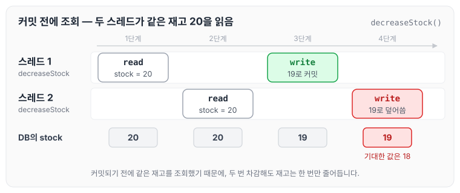
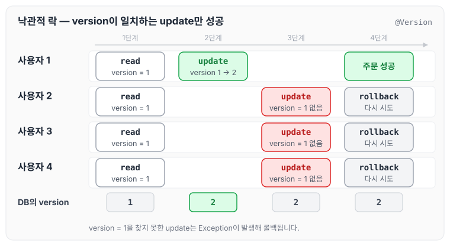
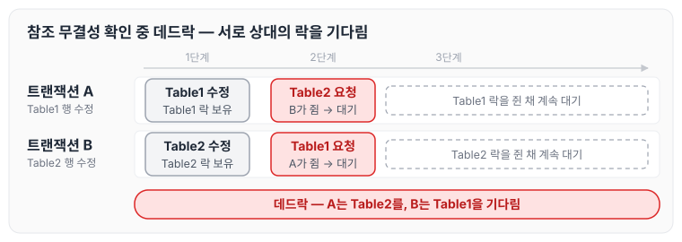

이전에 [Kafka 동시성 발생](../kafka-concurrency/)에 대해 작성하였습니다. 오늘은 그 글을 작성하면서 찾아보았던 낙관적 락, 비관적 락, 분산락 중 낙관적 락에 대해 정리하겠습니다.

## 동시성 테스트

아래 코드는 동시성 테스트를 위한 코드입니다. 큰 특징은 다음과 같습니다.

1. newFixedThreadPool
    - Java의 스레드를 생성하는 함수로, 10개의 스레드를 생성하였습니다.
2. CountDownLatch
    - new CountDownLatch(THREAD_COUNT) : 스레드 작업 카운트를 명시하여, 차후 함수에서 사용합니다.
    - latch.await(10, TimeUnit.SECONDS) : 위에 명시한 스레드 카운트가 0이 될 때까지 기다리고 이후에 작업을 진행합니다.

```java
package com.webtoonrank.demo.core.domain.product.service;

@SpringBootTest
public class ProductServiceTest {

    @Autowired
    private ProductService productService;

    @Autowired
    private ProductRepository productRepository;

    private static final int THREAD_COUNT = 10;

    @BeforeEach
    public void setup() {
        ProductEntity product = new ProductEntity("Test Product", 20);
        productRepository.save(product);
    }

    @Test
    public void testConcurrentStockDecrease() throws InterruptedException {
        ExecutorService executorService = Executors.newFixedThreadPool(THREAD_COUNT);
        CountDownLatch latch = new CountDownLatch(THREAD_COUNT);

        ProductEntity productEntity = productRepository.findAll().get(0);
        Long productId = productEntity.getId();

        for (int i = 0; i < THREAD_COUNT; i++) {
            executorService.submit(() -> {
                try {
                    boolean success = productService.decreaseStock(productId, 1);
                    System.out.println("Stock decreased: " + success);
                } catch (RuntimeException runtimeException) {
                    System.out.println(runtimeException.getMessage());
                } finally {
                    latch.countDown();
                }
            });
        }

        latch.await(10, TimeUnit.SECONDS);

        ProductEntity product = productRepository.findById(productId).orElseThrow();
        System.out.println("Final stock: " + product.getStock());
        assertThat(product.getStock()).isEqualTo(20 - THREAD_COUNT);
    }
}
```

상품 ProductEntity로 상품의 재고를 세팅한 후, decreaseStock을 통해 재고를 줄이는 로직입니다.

```java
package com.webtoonrank.demo.storage;

import jakarta.persistence.*;
import lombok.Getter;

@Entity
@Getter
public class ProductEntity {

    @Id
    @GeneratedValue(strategy = GenerationType.IDENTITY)
    private Long id;

    private String name;
    private int stock;

    public ProductEntity(String name, int stock) {
        this.name = name;
        this.stock = stock;
    }

    public ProductEntity() {

    }

    public boolean decreaseStock(int quantity) {
        if (this.stock >= quantity) {
            this.stock -= quantity;
            return true;
        } else {
            return false;
        }
    }
}
```

일반적으로 생각하면 스레드 개수만큼 `productService.decreaseStock(productId, 1);`로 차감하여 `[초기 재고 수량 20 - 스레드 카운트]`만큼 나올 것이라고 기대합니다. 하지만 실제로 실행해 보면 기대한 값이 나오지 않습니다.

<!-- 이미지 누락: Untitled.png (원본 내보내기에 미포함 — 동시성 테스트 실행 결과 캡처) -->

이렇게 나오는 이유는 데이터가 커밋되기 전에 조회되어, 재고 카운트를 20으로 인지하기 때문입니다. 스레드 두 개로 순서를 그리면 다음과 같습니다.



두 스레드가 모두 재고 20을 읽고 각자 19로 저장하기 때문에, 두 번 차감했는데도 재고는 한 번만 줄어듭니다. 이렇게 동시성 이슈가 발생합니다.

## 낙관적 락을 사용한 동시성 문제 해결

낙관적 락(Optimistic Lock)은 데이터 충돌 가능성이 낮다고 가정하고, 트랜잭션이 완료될 때까지 잠금을 걸지 않고 데이터를 처리하는 방법입니다. 대신 데이터에 version을 두고, update하는 시점에 version이 그대로인지 확인합니다.

사용자 네 명이 같은 상품을 동시에 주문할 때의 흐름은 다음과 같습니다.



사용자 1은 update 시점에 version = 1을 찾고, 업데이트를 통해 version = 2로 올립니다. 나머지 사용자들도 version = 1을 찾아 2로 업데이트하려고 하지만, 사용자 1이 이미 version을 2로 올렸기 때문에 Exception이 발생하고 롤백이 진행됩니다.

정리하자면 아래와 같습니다.

1. 사용자 1 : update 성공, version = 2로 업데이트
2. 사용자 2 : update 실패, version = 1을 사용자 1이 업데이트했기 때문에 찾을 수 없어서 Exception 발생
3. 사용자 3 : update 실패, version = 1을 사용자 1이 업데이트했기 때문에 찾을 수 없어서 Exception 발생
4. 사용자 4 : update 실패, version = 1을 사용자 1이 업데이트했기 때문에 찾을 수 없어서 Exception 발생

이제 사용자 1은 원하는 주문에 성공하였고, 나머지 사용자들은 다시 시도하면서 데이터의 일관성을 유지한 채로 주문을 진행할 수 있습니다.

### 낙관적 락을 사용하는 이유

버전을 통해 동시성을 해결하고, 트랜잭션이 완료될 때까지 락을 걸지 않습니다. 이 때문에 데이터베이스의 **락 경합이 줄어들어** 전체 시스템의 성능이 향상됩니다.

### 낙관적 락을 사용하면 좋은 경우

읽기 로직이 많고 쓰기 로직이 적을 때 사용하는 것이 좋습니다. 위에서 언급한 것처럼 애플리케이션 레벨에서 version으로 관리하고, update하는 시점에 version을 갱신하여 일치하는 트랜잭션만 처리되고 나머지는 Exception을 통해 롤백되기 때문입니다.

## 실습

JPA에서 낙관적 락을 사용하려면 아래와 같이 선언하기만 하면 됩니다. 업데이트할 때 JPA가 자동으로 version 값을 수정해 줍니다.

```java
@Version
private Integer version;
```

엔티티에 적용하면 다음과 같습니다.

```java
@Entity
@Getter
public class ProductEntity {

    @Id
    @GeneratedValue(strategy = GenerationType.IDENTITY)
    private Long id;

    private String name;
    private int stock;

    @Version
    private Integer version;

    ....

    public boolean decreaseStock(int quantity) {
        if (this.stock >= quantity) {
            this.stock -= quantity;
            return true;
        } else {
            return false;
        }
    }
}
```

테스트를 실행하면 아래 예외를 통해 트랜잭션이 실패하고, 롤백되는 것을 확인할 수 있습니다.

```text
org.springframework.orm.ObjectOptimisticLockingFailureException: Row was updated or deleted by another transaction (or unsaved-value mapping was incorrect) : [com.webtoonrank.demo.storage.ProductEntity#1]
```

<!-- 이미지 누락: Untitled 3.png (원본 내보내기에 미포함 — 낙관적 락 적용 후 테스트 실행 결과 캡처) -->

## 주의할 점

한 가지 주의해야 할 점은 아래와 같이 데드락 상황이 발생할 수 있다는 것입니다.

1. 트랜잭션 A가 `Table1`의 행을 수정하면서 `Table2`의 참조 무결성을 확인하기 위해 `Table2`의 잠금을 요청합니다.
2. 트랜잭션 B가 동시에 `Table2`의 행을 수정하면서 `Table1`의 참조 무결성을 확인하기 위해 `Table1`의 잠금을 요청합니다.
3. 이때 트랜잭션 A와 트랜잭션 B는 각각 상대방이 보유한 락을 기다리게 되어 데드락 상태에 빠질 수 있습니다.



두 트랜잭션 모두 자기가 쥔 락은 놓지 않은 채 상대의 락을 기다리기 때문에 어느 쪽도 진행하지 못합니다. 데드락이 생기는 조건과 해결 전략은 [데드락의 네 가지 조건과 해결 전략](../deadlock/)에서 따로 정리하였습니다.

## 마무리

오늘은 낙관적 락에 대해 아래 내용을 정리하였습니다.

- 언제 사용하면 좋을지
- 왜 사용하는지
- 주의해야 할 점
- 사용 방법

직접 테스트 코드를 작성하면서 확인해 보니, 낙관적 락을 언제 사용하면 좋을지 알 수 있었습니다. 다음에는 [비관적 락](../pessimistic-lock/)과 [분산락](../distributed-lock/)에 대해서도 정리하도록 하겠습니다.
