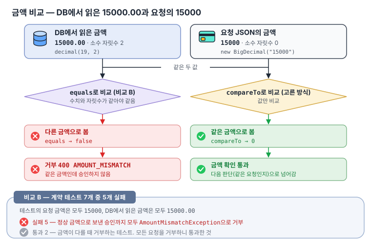
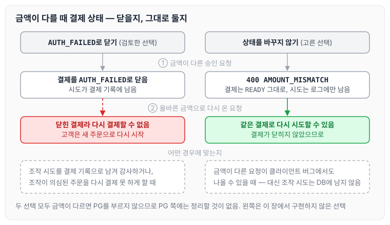
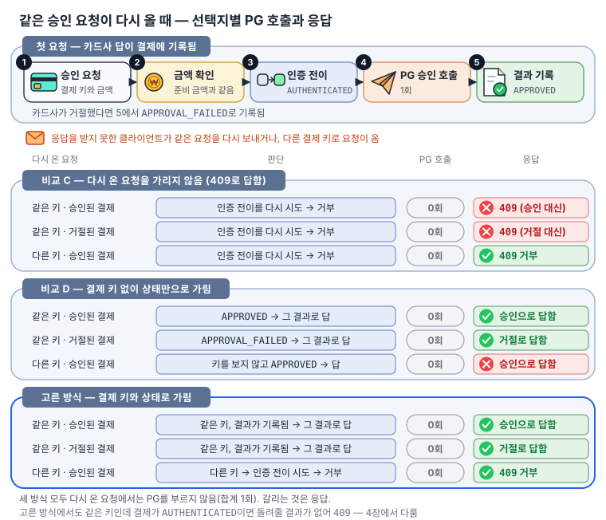
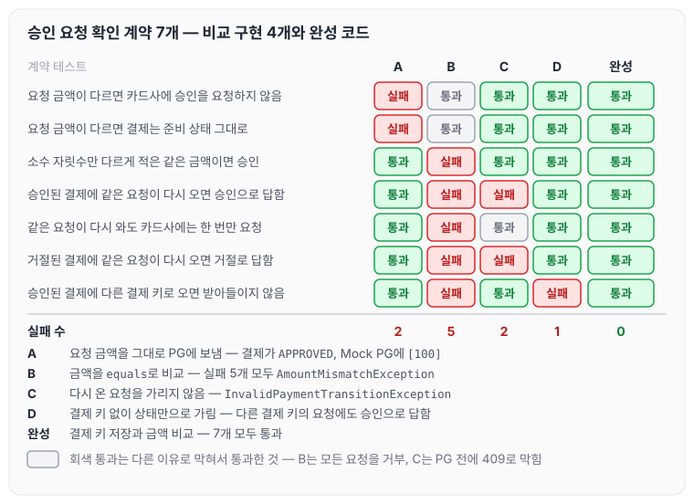

이전에 [가장 단순한 결제 구현과 트랜잭션 경계](../payment-transaction-boundary/)에 대해 작성하였습니다. 그 글에서는 PG 승인 요청을 트랜잭션 밖으로 빼고, 거절도 결과로 기록하도록 바꿨습니다. 그리고 남은 한계로 승인 요청 금액을 검증하지 않는다는 점과, 같은 주문번호로 다시 준비하면 500으로 끝난다는 점을 적어 두었습니다. 2장에서 4장으로 미뤄 두었던 `paymentKey` 저장은, 같은 요청을 가리는 기준으로 필요해져 이번 장에서 먼저 합니다.

오늘은 연재의 세 번째 글로, 승인 요청에 담긴 금액을 믿어도 되는지, 그리고 같은 요청이 다시 들어왔을 때 어떻게 답할지를 정리하도록 하겠습니다.

이 글에서 다루는 "다시 들어온 요청"은 앞 요청이 끝난 뒤에 같은 요청이 한 번 더 오는 경우입니다. 클라이언트가 응답을 받지 못해 재시도하는 경우가 대표적입니다. 두 요청이 동시에 들어오는 경우는 7장 동시성 제어에서 다룹니다.

## 현재 구조: 받은 금액을 그대로 보내는 승인 API

2장까지 승인 요청은 `paymentKey`만 받고, PG에는 준비할 때 저장한 금액을 보냈습니다. 실제 결제 흐름에서는 결제창에서 인증을 마친 고객이 성공 주소로 돌아올 때 `paymentKey`, `orderId`, `amount`를 함께 받습니다. 토스페이먼츠 문서에도 이 세 값이 항상 돌아오고, 승인 API에 이 세 값을 요청 데이터로 쓰라고 안내되어 있습니다.

그래서 3장 출발 코드는 승인 요청에 금액을 더하고, 받은 금액을 그대로 PG에 보내도록 바꿨습니다. 출발 코드의 요청과 승인 서비스는 아래와 같습니다.

```java
public record ConfirmPaymentRequest(String paymentKey, BigDecimal amount) {
}
```

```java
public PaymentResult confirm(ConfirmPaymentCommand command) {
    Payment payment = paymentRecorder.authenticate(command.orderId());
    PaymentApproval approval = paymentGateway.approve(command.paymentKey(), payment.getOrderId(), command.amount());
    return paymentRecorder.recordApproval(command.orderId(), approval);
}
```

Mock PG도 조금 바꿨습니다. 승인할 때 받은 금액을 주문별로 기록해서, 테스트에서 PG에 어떤 금액으로 승인이 남았는지 볼 수 있게 했습니다. Mock PG는 받은 금액을 그대로 승인합니다. 고객이 결제창에서 인증한 금액이 곧 승인 요청으로 오는 금액이라고 가정하였습니다.

```java
// 결제 서버가 이미 기다리기를 그만뒀어도 PG 쪽 승인은 남는다.
// 받은 금액을 그대로 승인한다 — 고객이 결제창에서 인증한 금액이 곧 이 요청의 금액이라고 본다
scenarioStore.recordApproval(request.orderId(), request.amount());
```

결제 준비(`POST /api/v1/payments`)는 2장과 같습니다. 주문번호와 금액을 받아 `READY` 결제를 저장하고, 금액은 검사하지 않습니다.

## 현재 구조의 문제: 테스트로 재현하기

출발 코드에 아래 테스트를 먼저 작성했습니다. 승인 요청을 확인하는 규칙 7개는 금액을 어떻게 비교하고 다시 온 요청을 어떻게 가리는지와 상관없이 지켜야 하는 계약이라, 2장처럼 추상 클래스(`ConfirmRequestCheckContract`)에 두고 구현마다 상속해 같은 테스트를 돌립니다.

준비 금액은 15000이고, DB 컬럼이 `decimal(19, 2)`라서 다시 읽으면 `15000.00`이 됩니다. 요청 금액은 `new BigDecimal("15000")`(소수 자릿수 0)으로 보냅니다.

- 요청 금액이 준비한 금액과 다르면 카드사에 승인을 요청하지 않는다
- 요청 금액이 준비한 금액과 다르면 결제는 준비 상태 그대로다
- 소수 자릿수만 다르게 적은 같은 금액이면 승인한다
- 승인된 결제에 같은 승인 요청이 다시 오면 승인으로 답한다
- 승인된 결제에 같은 승인 요청이 다시 와도 카드사에는 한 번만 승인을 요청한다
- 승인이 거절된 결제에 같은 승인 요청이 다시 오면 카드사에 묻지 않고 거절로 답한다
- 승인된 결제에 다른 결제 키로 승인 요청이 오면 받아들이지 않는다

거절된 결제에 같은 요청이 다시 오는 테스트는 아래와 같습니다. 첫 요청은 Mock PG가 거절하게 하고, 다시 보내기 전에 Mock PG를 승인으로 되돌립니다. 지금 다시 물으면 카드사가 승인하는 상황에서도 처음 결과로 답하는지 확인하기 위해서입니다.

```java
@Test
@DisplayName("승인이 거절된 결제에 같은 승인 요청이 다시 오면 카드사에 묻지 않고 거절로 답한다")
void repeatedRequestForDeclinedPaymentIsAnsweredAsDeclined() {
    String orderId = prepare();
    mockPg.decline();
    catchThrowable(() -> confirm(request(orderId, "key-" + orderId, PREPARED)));
    // 지금 다시 물으면 카드사는 승인한다. 그래도 처음 결과로 답해야 한다
    mockPg.reset();

    PaymentResult again = confirm(request(orderId, "key-" + orderId, PREPARED));

    assertThat(again.status()).isEqualTo(PaymentStatus.APPROVAL_FAILED);
}
```

결제 API 테스트도 바꿨습니다. 2장에서 "이미 승인된 결제를 다시 승인하려 하면 409"와 "같은 주문번호로 다시 준비하면 지금은 500"으로 적어 두었던 두 테스트를, 이번 장에서 기대하는 동작으로 고쳐 썼습니다. 그리고 다른 결제 키로 다시 승인, 금액이 다른 승인, 금액 없는 승인, 0원 준비, 같은 주문번호로 다른 금액 준비를 더했습니다.

3장 출발 코드에서 3장 테스트 두 묶음(승인 요청 확인 계약 7개, 결제 API 16개)만 모아 돌린 결과는 아래와 같습니다. 출발 코드 전체로는 253개 중 10개가 실패했습니다.

```text
tests=23 failures=10 errors=0 time=16.627s
## 승인 요청 확인 — 운영 구현
PASS 승인된 결제에 다른 결제 키로 승인 요청이 오면 받아들이지 않는다 (0.033s)
FAIL 승인이 거절된 결제에 같은 승인 요청이 다시 오면 카드사에 묻지 않고 거절로 답한다 (0.031s) | com.example.payment.global.error.exception.InvalidPaymentTransitionException: Cannot AUTHENTICATE a payment in APPROVAL_FAILED status.
PASS 소수 자릿수만 다르게 적은 같은 금액이면 승인한다 (0.037s)
FAIL 요청 금액이 준비한 금액과 다르면 결제는 준비 상태 그대로다 (0.036s) | org.opentest4j.AssertionFailedError: expected: READY but was: APPROVED
FAIL 요청 금액이 준비한 금액과 다르면 카드사에 승인을 요청하지 않는다 (0.027s) | java.lang.AssertionError: Expecting empty but was: [100]
PASS 승인된 결제에 같은 승인 요청이 다시 와도 카드사에는 한 번만 승인을 요청한다 (0.025s)
FAIL 승인된 결제에 같은 승인 요청이 다시 오면 승인으로 답한다 (0.027s) | com.example.payment.global.error.exception.InvalidPaymentTransitionException: Cannot AUTHENTICATE a payment in APPROVED status.
## 결제 API
FAIL 같은 주문번호와 금액으로 다시 준비하면 처음과 같은 준비 응답을 받는다 (0.045s) | org.opentest4j.AssertionFailedError: expected: 201 but was: 500
FAIL 금액이 0원인 결제는 준비하지 않는다 (0.01s) | org.opentest4j.AssertionFailedError: expected: 400 but was: 201
FAIL 승인 요청 금액이 준비한 금액과 다르면 금액이 맞지 않는다고 답한다 (0.037s) | org.opentest4j.AssertionFailedError: expected: 400 but was: 200
FAIL 금액 없이 승인을 요청하면 금액이 올바르지 않다고 답한다 (0.025s) | org.opentest4j.AssertionFailedError: expected: 400 but was: 200
FAIL 같은 주문번호로 다른 금액을 준비하면 이미 있는 주문이라고 답한다 (0.015s) | org.opentest4j.AssertionFailedError: expected: 409 but was: 500
FAIL 같은 승인 요청을 다시 보내면 처음과 같은 승인 응답을 받는다 (0.029s) | org.opentest4j.AssertionFailedError: expected: 200 but was: 409
(통과한 API 테스트 10개 생략)
```

23개 중 10개가 실패했고, 원인은 세 가지입니다.

첫째, 금액을 바꾼 승인이 그대로 통과합니다. 15000원으로 준비한 결제에 100원으로 승인을 요청하자, 결제는 `APPROVED`가 되었고 Mock PG에는 100원 승인이 남았습니다(`Expecting empty but was: [100]`). 금액 없이 승인을 요청한 API 테스트도 200으로 승인되었습니다. 우리 기록으로는 15000원 결제가 승인된 것처럼 보이지만, 실제로 카드사에 승인된 금액은 100원이거나 비어 있습니다.

둘째, 같은 승인 요청을 다시 보내면 실패합니다. 첫 요청에서 이미 `APPROVED`가 된 결제에 인증 전이를 다시 시도하므로, 상태 머신이 `Cannot AUTHENTICATE a payment in APPROVED status.`로 거부하고 API는 409로 답했습니다. 첫 요청의 응답을 받지 못해 다시 보낸 클라이언트는 이 409만 보고는 결제가 승인됐는지 알 수 없습니다. 거절된 결제도 같은 이유로 거절 결과 대신 409를 받았습니다.

셋째, 같은 주문번호로 다시 준비하면 500으로 끝납니다. `order_id`의 고유 키에 걸려 저장이 실패하고, 이 오류를 처리하는 곳이 없어서 서버 오류가 됩니다. 금액이 같든 다르든 똑같이 500입니다.

통과한 테스트 중에도 살펴볼 것이 있습니다. "카드사에는 한 번만 승인을 요청한다"는 출발 코드에서도 통과했는데, 다시 온 요청이 PG를 부르기 전에 상태 전이에서 409로 막혔기 때문입니다. PG를 두 번 부르지 않는 것과 같은 결과로 답하는 것은 다른 규칙이라, 같은 결과로 답하는 테스트는 따로 실패했습니다.

## 선택지와 트레이드오프

이 문제를 해결하면서 내린 결정은 여섯 가지입니다.

### 결정 1. 승인 금액을 어디서 확인할까

이 장에서는 승인 요청으로 받은 금액을 저장한 금액과 비교하고, 다르면 PG를 부르지 않고 거부하기로 했습니다.

검토한 선택지는 세 가지입니다.

- 금액을 받지 않고 저장한 금액만 PG에 보내기(2장 방식)
- 금액을 받아 저장한 금액과 비교하고, 다르면 PG를 부르지 않고 거부하기
- 받은 금액을 그대로 PG에 보내기(3장 출발 코드)

15000원으로 준비한 결제에 100원으로 승인을 요청했을 때, 받은 금액을 그대로 보내는 출발 코드와 저장한 금액과 비교하는 완성 코드의 흐름을 비교하면 아래와 같습니다.



비교하는 방식을 고른 이유는, 결제창에서 인증된 금액이 준비한 금액과 다르다는 사실을 우리 서버가 알 수 있는 곳이 돌아온 요청의 `amount`뿐이기 때문입니다.

2장 방식은 이 값을 받지 않으므로, 결제창에서 다른 금액이 인증됐어도 우리 서버는 그 사실을 모른 채 저장한 금액으로 승인을 요청하고, 그 뒤의 처리는 PG가 두 금액의 차이를 어떻게 다루는지에 달립니다. 비교하는 방식은 그림의 아래 패널처럼 금액이 다르면 PG를 부르기 전에 멈추므로, 테스트에서 Mock PG 승인 0건으로 확인할 수 있습니다.

토스페이먼츠 문서도 요청 때 저장해 둔 정보와 인증 결과로 돌아온 정보가 같은지 검증하라고 하고, 그 이유로 클라이언트에서 결제 금액을 조작해 승인하는 행위를 막을 수 있다고 적고 있습니다.

비교한 뒤에 PG에 보내는 금액은 요청 금액이 아니라 저장한 금액입니다. 비교를 통과했다면 두 값은 같은 금액이지만, 소수 자릿수까지 같다는 보장은 없어서 우리가 저장한 값을 보내는 쪽을 택했습니다.

이 선택으로 치르는 비용은 요청 항목이 하나 늘고, 금액이 없는 요청이나 다른 요청에 어떻게 답할지 정해야 한다는 점입니다(결정 3).

다른 선택이 맞는 경우도 있습니다. 결제창을 서버가 열고 금액도 서버가 PG에 직접 넘기는 연동이라 클라이언트가 금액을 바꿀 길이 없다면, 금액을 받지 않는 2장 방식으로도 충분합니다. 받은 금액을 그대로 보내는 방식이 맞는 경우는 이 장의 범위에서는 찾지 못했습니다.

### 결정 2. 금액을 어떻게 비교할까

이 장에서는 금액을 값만 비교하는 `compareTo`로 비교하기로 했습니다.

`BigDecimal`을 비교하는 방법은 `equals`와 `compareTo` 두 가지입니다. Java 문서에는 `equals`가 수치와 표현(소수 자릿수)이 모두 같아야 같다고 본다고 적혀 있습니다. 그래서 DB에서 읽은 `15000.00`과 JSON으로 받은 `15000`은 `equals`로는 다른 금액입니다.

DB에서 읽은 `15000.00`과 요청 JSON의 `15000`을 두 방법으로 비교하면 아래와 같습니다.



`equals`로 비교하는 구현도 만들어 같은 계약 테스트로 돌렸더니, 계약 7개 중 5개가 실패했습니다(아래 비교 B). 테스트의 요청 금액이 모두 `15000`이고 DB에서 읽은 금액은 모두 `15000.00`이라, 정상 금액으로 보낸 승인까지 전부 금액 불일치로 거부되었기 때문입니다. 실패하지 않은 2개는 금액이 다를 때 거부하는 테스트였는데, 모든 요청을 거부하니 당연히 통과한 것입니다.

이 선택으로 치르는 비용은 거의 없습니다. 굳이 꼽자면 `compareTo(...) != 0`이 `equals`보다 한눈에 덜 읽혀서, 금액 비교를 `Payment` 안의 이름 있는 메서드(`isDifferentAmount`)로 감쌌습니다.

다른 선택이 맞는 경우도 있습니다. 원화만 다루는 서비스라면 금액을 원 단위 `long`으로 저장하는 설계도 가능하고, 그러면 소수 자릿수 문제가 처음부터 생기지 않습니다. 이 저장소는 1장부터 `BigDecimal`과 `decimal(19, 2)`를 써 왔고, 이번 장에서는 저장 방식을 바꾸지 않았습니다.

### 결정 3. 금액이 다를 때 결제 상태를 바꿀까

이 장에서는 금액이 다르면 결제 상태를 바꾸지 않고 400으로 거부하기로 했습니다.

검토한 선택지는 두 가지입니다.

- 상태를 바꾸지 않고 400으로 거부하기
- 인증 실패(`AUTH_FAILED`)로 닫기

상태를 바꾸지 않은 이유는 두 가지입니다. 금액이 다르면 PG에 승인을 요청하지 않으므로 PG 쪽에는 정리할 것이 없습니다. 또 금액이 다른 요청이 꼭 조작에서만 나오는 것은 아니라서(클라이언트 버그로 잘못된 금액을 보내는 경우), 결제를 닫지 않으면 올바른 금액으로 다시 시도할 수 있습니다.

두 선택에서 금액이 다른 요청이 온 뒤 올바른 금액의 요청이 다시 오면 어떻게 되는지 나란히 놓으면 아래와 같습니다. `AUTH_FAILED`로 닫는 쪽은 이 장에서 구현하지 않았으므로, 이 절에 적은 이유와 결과만 그렸습니다.



응답은 400과 `AMOUNT_MISMATCH`입니다. 2장에서 카드사 거절을 200으로 답한 이유는 거절이 요청 오류가 아니라 결제가 정상 처리된 결과이기 때문이었습니다. 금액이 다른 것은 결제를 처리하기 전에 요청 자체가 틀린 것이므로 요청 오류로 답했습니다. 금액이 아예 없으면 `INVALID_AMOUNT`로 구분합니다. 0원이나 음수는 준비한 금액과 다르므로 `AMOUNT_MISMATCH`입니다.

이 선택으로 치르는 비용은 조작 시도가 DB에 남지 않고 로그(`Request refused with AMOUNT_MISMATCH: AmountMismatchException.`)에만 남는다는 점입니다.

다른 선택이 맞는 경우도 있습니다. 금액 조작 시도를 결제 기록으로 남겨 감사하거나, 한 번 조작이 의심된 주문은 다시 결제하지 못하게 해야 한다면 `AUTH_FAILED`로 닫는 쪽이 맞습니다. 그때는 결제를 닫은 뒤 고객이 새 주문으로 다시 시작하는 흐름까지 함께 만들어야 합니다.

### 결정 4. 같은 승인 요청이 다시 오면 어떻게 답할까

이 장에서는 결제에 `paymentKey`를 저장해, 같은 키로 다시 온 요청에는 PG를 다시 부르지 않고 기록된 결과로 답하기로 했습니다.

검토한 선택지는 세 가지입니다.

- 지금처럼 409로 답하고, 클라이언트가 조회 API로 상태를 확인하게 하기
- 결제에 `paymentKey`를 저장해 두고, 같은 키의 요청이 결과가 기록된 결제에 다시 오면 PG를 다시 부르지 않고 그 결과로 답하기
- `Idempotency-Key` 헤더와 응답을 저장하는 테이블을 두기

이 API에는 이미 주문번호라는 자연 키가 있고, 응답에 담기는 값(주문번호, 금액, 상태)은 결제 한 행에서 언제든 다시 만들 수 있습니다. 그래서 "같은 요청인가"만 가릴 수 있으면 별도 저장소 없이 처음과 같은 응답을 줄 수 있고, 그 기준으로 PG가 결제창 인증 때 준 `paymentKey`를 썼습니다. 같은 키의 요청이 `APPROVED`인 결제에 다시 오면 승인으로, `APPROVAL_FAILED`인 결제에 다시 오면 거절로 답합니다. 다른 키로 오면 2장처럼 상태 전이를 시도하고, 이미 결과가 있는 결제라 409로 거부됩니다.

첫 요청이 끝난 뒤 요청이 다시 왔을 때, 409로 답하는 방식(아래 비교 C)과 결제 키 없이 상태만으로 가리는 방식(비교 D), 그리고 이 장에서 고른 방식에서 PG 호출과 응답이 어떻게 갈리는지 그리면 아래와 같습니다.



세 방식 모두 다시 온 요청에서는 PG를 부르지 않아서, PG 호출은 첫 요청의 한 번뿐입니다. 갈리는 것은 응답으로, 비교 C는 같은 요청에도 승인이나 거절 대신 409로 답하고, 비교 D는 다른 결제 키로 온 요청까지 승인으로 답합니다.

같은 키로 다시 왔더라도 결제가 아직 `AUTHENTICATED`이면 결과로 답하지 않습니다. 이 상태는 앞 요청이 PG 답을 기다리는 중이거나, 2장에서 본 것처럼 시간 제한으로 결과를 모르는 상태이거나, PG가 승인도 거절도 아닌 오류로 답해 502로 끝난 경우라서 돌려줄 결과가 없습니다. 이 경우는 지금처럼 409로 답하고, 결과를 모르는 결제를 어떻게 처리할지는 4장에서 다룹니다.

결과가 기록됐는지는 결제가 `AUTHENTICATED`가 아닌지로 판단합니다. 그래서 아직 운영 코드에서 부르는 곳이 없는 만료(`EXPIRED`)도 결과가 있는 상태로 봅니다. 만료를 실제로 쓰게 되면 이 판단을 다시 봐야 합니다.

이 선택으로 치르는 비용은 세 가지입니다.

- `payment` 테이블에 `payment_key` 컬럼이 생기고, 인증 메서드가 `authenticate(paymentKey)`로 바뀌었습니다. 그래서 1장의 상태 전이 테스트와 2장의 비교 구현 호출부도 함께 고쳤습니다.
- 응답을 결제의 지금 상태로 다시 만들기 때문에, 첫 응답 뒤에 결제가 매입이나 취소로 바뀌었다면 다시 온 요청은 처음 응답이 아니라 지금 상태를 받습니다. 저장한 응답을 그대로 돌려주는 방식과 다른 점입니다.
- 2장 남은 한계에 "`paymentKey`를 저장하지 않아 PG에 이 결제를 조회할 방법이 없다, 4장에서 바꾼다"고 적었는데, 이 결정으로 저장은 3장에서 먼저 하게 되었습니다. 저장한 키로 PG에 결제를 조회하는 것은 4장에서 다룹니다.

409로 답하는 방식과, 결제 키를 보지 않고 상태만으로 가리는 방식은 비교 구현으로 만들어 같은 테스트로 돌렸습니다(아래 비교 C, D).

`Idempotency-Key`는 구현하지 않았습니다. 이 방식에서는 클라이언트가 요청마다 고유한 키를 헤더에 담아 보내고, 서버는 그 키로 처음 응답을 저장해 두었다가 같은 키로 다시 오면 저장한 응답을 돌려줍니다. Stripe 문서는 키별로 첫 요청의 상태 코드와 본문을 저장해 재시도에 같은 결과를 돌려주고, 같은 키로 다른 파라미터가 오면 오류로 답한다고 설명합니다. 토스페이먼츠도 POST API에 `Idempotency-Key` 헤더를 받으며, 키는 처음 요청한 날부터 15일간 유효하다고 안내합니다. 이 방식은 헤더가 필수가 되어 API의 약속 자체가 바뀌므로, 같은 테스트로 비교할 수 있는 대상이 아니라서 이 장에서는 제외했습니다.

`Idempotency-Key`가 맞는 경우도 있습니다. 자연 키가 없는 작업이나 응답을 상태에서 다시 만들 수 없는 작업이 그렇습니다. 5장에서 다룰 부분 취소가 그런 예입니다. 결제 하나에 취소가 여러 번 있을 수 있어서, "같은 취소 요청이 다시 온 것"인지 "새 취소"인지를 주문번호만으로는 가릴 수 없습니다. 그래서 5장에서 이 방식을 구현해 보려고 합니다.

### 결정 5. 같은 주문번호로 다시 준비하면 어떻게 할까

이 장에서는 같은 주문번호가 같은 금액으로 다시 오면 이미 있는 결제를 지금 상태로 돌려주고, 금액이 다르면 409로 거부하기로 했습니다.

검토한 선택지는 세 가지입니다.

- 항상 409로 답하기
- 금액까지 같으면 이미 있는 결제를 지금 상태로 돌려주고, 금액이 다르면 409로 답하기
- 조회 없이 저장을 시도하고, 고유 키 위반을 잡아 409로 바꾸기

이렇게 하면 준비 요청을 재시도한 클라이언트는 처음 요청이 저장됐는지와 상관없이 같은 응답(201, `READY`)을 받습니다. 금액이 다르면 같은 주문번호로 다른 주문을 만들려는 것이므로 409와 `DUPLICATE_ORDER`로 거부합니다. 금액이 없거나 0 이하이면 새로 준비할 때와 같이 400과 `INVALID_AMOUNT`로 답합니다.

같은 주문번호로 준비 요청이 왔을 때 나뉘는 갈래를 그리면 아래와 같습니다.



금액이 없거나 0 이하인 요청은 결제가 있든 없든 같은 400으로 답하고, 409는 이미 있는 주문번호에 다른 금액이 왔을 때만 나옵니다.

이 선택으로 치르는 비용은 두 가지입니다.

- 금액이 같기만 하면, 실수로 두 번 보낸 준비 요청도 성공으로 처리됩니다. 이 API에서 주문번호와 금액이 같으면 같은 준비로 보는 것이 이 결정의 전제입니다.
- 준비 요청 두 개가 동시에 들어오면, 둘 다 조회에서 결제를 못 찾고 저장하러 가서 하나는 고유 키에 걸립니다. 이 경우는 여전히 500이 될 수 있고, 7장에서 다룹니다.

다른 선택이 맞는 경우도 있습니다. 주문번호를 결제 서버가 아니라 주문 서비스가 한 번만 발급하고, 같은 번호로 준비가 다시 오는 것 자체가 버그라면 항상 409로 답해 문제를 빨리 드러내는 편이 낫습니다. 동시에 오는 준비 요청이 흔한 환경이라면 고유 키 위반을 잡는 방식이 조회와 저장 사이의 틈을 DB에 맡긴다는 점에서 더 맞습니다. 다만 위반이 나면 그 트랜잭션은 롤백할 수밖에 없어서, 이미 있는 결제를 다시 읽으려면 새 트랜잭션이 필요해 처리가 복잡해지므로, 동시성 제어를 다루는 7장에서 함께 보겠습니다.

### 결정 6. 금액이 0 이하인 준비를 어디서 막을까

이 장에서는 금액이 0 이하인 준비를 `Payment.create`에서 막기로 했습니다.

검토한 선택지는 두 가지입니다.

- 요청 DTO에 Bean Validation(`@NotNull`, `@Positive`)을 붙이고 컨트롤러에서 `@Valid`로 검사하기
- `Payment.create`에서 검사하기

Bean Validation으로 요청 값을 검사하는 방법은 이전에 [Bean Validation으로 요청 값 검증하기](../java-validation/)에 정리하였습니다.

[1장](../payment-state-machine/)에서 상태 전이 규칙을 `Payment` 안에 둔 것과 같은 이유로, "금액이 양수인 결제만 존재한다"는 규칙을 결제가 직접 지키게 하면 API가 아닌 경로(테스트, 나중에 생길 배치나 메시지 처리)로 결제를 만들어도 같은 규칙이 적용됩니다. 빌드에는 1장부터 `spring-boot-starter-validation`이 들어 있지만, 지금까지 요청 DTO에 검사 애노테이션을 쓴 곳은 없어서 이번에도 도메인 쪽에 맞췄습니다.

이 선택으로 치르는 비용은 웹 계층에서 요청 단위로 필드 오류를 모아 알려 주는 Bean Validation의 기능을 쓰지 않는다는 점입니다. 지금은 금액 하나만 검사해서 차이가 없지만, 검사할 항목이 많아지면 첫 오류 하나만 알리는 지금 방식이 불편해집니다.

다른 선택이 맞는 경우도 있습니다. 요청에 필드가 많고 클라이언트에게 잘못된 필드를 한 번에 알려 줘야 하는 API라면, 형식 검사는 Bean Validation으로 하고 업무 규칙만 도메인에 두는 식으로 나누는 편이 맞습니다.

## 구현

결정을 모아 바꾼 3장 완성 코드에서 클라이언트, 결제 서버, DB, Mock PG 사이에 오가는 요청과 응답을 결제 준비와 승인 요청으로 나눠 그리면 아래와 같습니다. 초록으로 표시한 것이 이번 장에서 더한 부분입니다. 먼저 결제 준비입니다.



준비한 결제에 결제창 인증을 마친 고객이 돌아오면 승인 요청이 이어집니다.


승인 요청에는 `paymentKey`와 `amount`가 함께 오고, 결제 서버는 금액을 비교한 뒤에 `paymentKey`를 저장하며 인증합니다. Mock PG에 보내는 금액은 요청 금액이 아니라 저장한 금액입니다. 같은 키로 다시 온 승인 요청은 DB에 기록된 결과로 답하고 Mock PG까지 가지 않습니다. 결제 서버 안에서 이 판단을 어떤 순서로 하는지는 아래 코드 뒤에 따로 그렸습니다.

이 결정들을 모아 바꾼 결제 엔티티는 아래와 같습니다. 결제 키를 저장하는 컬럼과, 금액을 확인하고 같은 요청인지 가리는 메서드를 더했습니다.

```java
// 결제창 인증 때 PG 가 준 키. 다시 온 승인 요청이 같은 요청인지 이것으로 가린다
@Column(name = "payment_key", length = 200)
private String paymentKey;

public static Payment create(String orderId, BigDecimal amount) {
    if (isNotPositive(amount)) {
        throw new InvalidAmountException(orderId);
    }
    return Payment.builder()
            .orderId(orderId)
            .amount(amount)
            .status(PaymentStatus.READY)
            .build();
}

public void authenticate(String paymentKey) {
    changeStatus(PaymentAction.AUTHENTICATE);
    this.paymentKey = paymentKey;
}

// 금액은 값만 비교한다. DB 에서 읽은 15000.00 과 요청의 15000 은 같은 금액이다
public void verifyAmount(BigDecimal requested) {
    if (Objects.isNull(requested)) {
        throw new InvalidAmountException(orderId);
    }
    if (isDifferentAmount(requested)) {
        throw new AmountMismatchException(orderId);
    }
}

// 같은 주문번호로 다시 온 준비 요청. 금액 자체가 틀리면 새 결제를 만들 때와 같이 거부한다
public void verifyPreparedAmount(BigDecimal requested) {
    if (isNotPositive(requested)) {
        throw new InvalidAmountException(orderId);
    }
    if (isDifferentAmount(requested)) {
        throw new DuplicateOrderException(orderId);
    }
}

// 이 결제 키로 승인을 요청해 카드사 답까지 기록한 결제인가. 답을 기록하기 전(AUTHENTICATED)은 아니다
public boolean isConfirmedWith(String requestedKey) {
    return Objects.nonNull(paymentKey)
            && paymentKey.equals(requestedKey)
            && status != PaymentStatus.AUTHENTICATED;
}

private boolean isDifferentAmount(BigDecimal requested) {
    return amount.compareTo(requested) != 0;
}

private static boolean isNotPositive(BigDecimal amount) {
    return Objects.isNull(amount) || amount.signum() <= 0;
}
```

인증 기록 트랜잭션에서는 금액을 먼저 확인하고, 같은 요청이 다시 왔으면 아무것도 바꾸지 않고 결제를 돌려줍니다.

```java
// 금액이 다르면 상태를 바꾸지 않고 거부한다. 같은 요청이 다시 왔으면 아무것도 바꾸지 않고 돌려준다
@Transactional
public Payment authenticate(ConfirmPaymentCommand command) {
    Payment payment = find(command.orderId());
    payment.verifyAmount(command.amount());
    if (payment.isConfirmedWith(command.paymentKey())) {
        return payment;
    }
    payment.authenticate(command.paymentKey());
    return payment;
}
```

승인 서비스는 돌려받은 결제가 이미 결과가 기록된 같은 요청이면 PG를 부르지 않고 답합니다. PG에는 저장한 금액을 보냅니다.

```java
public PaymentResult confirm(ConfirmPaymentCommand command) {
    Payment payment = paymentRecorder.authenticate(command);
    if (payment.isConfirmedWith(command.paymentKey())) {
        return PaymentResult.from(payment);
    }
    PaymentApproval approval = paymentGateway.approve(command.paymentKey(), payment.getOrderId(), payment.getAmount());
    return paymentRecorder.recordApproval(command.orderId(), approval);
}
```

승인 요청 하나가 들어왔을 때 위 두 코드가 판단하는 순서를 그리면 아래와 같습니다.



결제를 찾은 뒤에는 금액 확인이 가장 앞에 있어서, 같은 결제 키로 다시 온 요청이라도 금액이 다르면 저장된 결과로 답하지 않고 거부됩니다. PG를 부르는 것은 인증 전이까지 통과한 요청뿐입니다.

준비 서비스는 결정 5의 그림처럼 주문번호로 먼저 찾고, 있으면 금액을 확인해 있는 결제를 돌려줍니다.

```java
// 같은 주문번호가 같은 금액으로 다시 오면 이미 있는 결제를 지금 상태 그대로 돌려준다. 금액이 다르면 거부한다
@Transactional
public PaymentResult prepare(PreparePaymentCommand command) {
    return paymentRepository.findByOrderId(command.orderId())
            .map(existing -> repeat(existing, command))
            .orElseGet(() -> PaymentResult.from(
                    paymentRepository.save(Payment.create(command.orderId(), command.amount()))));
}

private static PaymentResult repeat(Payment existing, PreparePaymentCommand command) {
    existing.verifyPreparedAmount(command.amount());
    return PaymentResult.from(existing);
}
```

오류 코드는 세 개를 더했습니다. 응답 상태는 2장에서 만든 오류 종류(`ErrorType`)를 그대로 따릅니다.

```java
// 금액이 없거나 0 이하
INVALID_AMOUNT(ErrorType.INVALID_INPUT, "The amount must be a positive number."),
// 승인 요청 금액이 준비한 금액과 다름. 결제 상태는 바꾸지 않는다
AMOUNT_MISMATCH(ErrorType.INVALID_INPUT, "The amount does not match the prepared payment."),
// 같은 주문번호가 다른 금액으로 이미 준비됨
DUPLICATE_ORDER(ErrorType.CONFLICT, "This order was already prepared with a different amount."),
```

테이블에는 `payment_key` 컬럼을 더했습니다. 인증 전에는 값이 없으므로 `null`을 허용합니다.

```sql
create table if not exists payment (
    id          bigint         not null auto_increment,
    order_id    varchar(64)    not null,
    amount      decimal(19, 2) not null,
    status      varchar(30)    not null,
    payment_key varchar(200),
    primary key (id),
    unique key uk_payment_order_id (order_id)
);
```

도메인 규칙은 `Payment`만으로 확인하는 테스트 16개(`결제 금액과 승인 요청 확인`)를 따로 두었습니다. 금액이 없거나 0원 이하인 결제를 만들 수 없다는 테스트, 소수 자릿수만 다른 금액을 받아들인다는 테스트, 답을 기록하기 전(`AUTHENTICATED`)에는 같은 결제 키라도 결과가 남은 요청으로 보지 않는다는 테스트 등입니다.

하나 더 생긴 변화가 있습니다. 2장에서는 "같은 주문번호로 다시 준비하면 500" 테스트가 전역 예외 처리기의 서버 오류 응답을 지나는 유일한 API 테스트였는데, 이 요청이 정상 응답이 되면서 그 경로를 지나는 테스트가 없어졌습니다. 커버리지 보고서에서 이를 확인하고, 예상하지 못한 문제를 내부 사정을 감춘 500으로 답하는지 보는 처리기 단위 테스트를 더했습니다.

## 테스트 결과

3장 완성 코드에서 전체 테스트(`./gradlew check`)를 돌린 결과는 아래와 같습니다.

```text
승인 요청 확인 — 운영 구현: tests=7 failures=0 errors=0
결제 금액과 승인 요청 확인: tests=16 failures=0 errors=0
결제 API: tests=16 failures=0 errors=0
오류 응답: tests=1 failures=0 errors=0
결제 승인 — 운영 구현: tests=4 failures=0 errors=0
(그 밖의 1·2장 테스트 모두 통과)
tests=270 failures=0 errors=0
coverage INSTRUCTION 99.9%, BRANCH 97.6%, LINE 99.5%, COMPLEXITY 99.0%, METHOD 100.0%, CLASS 100.0%
```

- 출발 코드에서 실패하던 10개가 모두 통과하였습니다.
- 결제 API 테스트는 2장의 11개에서 두 개를 고쳐 쓰고 다섯 개를 더해 16개입니다.
- 전체 270개(2장까지 241개 + 3장 29개)가 통과했습니다. 2장의 승인 계약 테스트 4개도 바뀐 운영 구현에서 그대로 통과했습니다.
- JaCoCo로 잰 라인 커버리지는 99.5%(214줄 중 213줄)였습니다(애플리케이션 시작 클래스 제외). 지나가지 않은 1줄과 분기 1개는 2장에서 설명한 전역 예외 처리기 `statusOf`의 `INTERNAL` 분기입니다. 구현에서 더한 처리기 테스트는 예상하지 못한 예외를 받는 메서드(`handleOthers`)를 직접 확인하는 것이고, `statusOf`의 `INTERNAL` 분기는 그 종류의 오류 코드를 던지는 업무 예외가 없어서 지나갈 길이 없습니다.

계약을 지키지 못하는 비교 구현을 같은 승인 요청 확인 테스트로 돌렸습니다. 비교 구현 4개와 완성 코드의 통과·실패를 계약 7개에 맞춰 모으면 아래와 같습니다.



비교 B의 통과 2개는 모든 요청을 거부해서, 비교 C의 "카드사에는 한 번만 승인을 요청한다"는 PG를 부르기 전에 상태 전이에서 막혀서 통과한 것입니다. 비교 구현마다 실패한 테스트는 아래와 같습니다.

### 비교 A: 요청 금액을 그대로 PG에 보냄

3장 출발 코드의 금액 처리를 그대로 두고, 다시 온 요청은 운영 구현처럼 결제 키로 가리도록 만든 비교 구현입니다. 금액 문제만 따로 보기 위해서입니다.

```text
FAIL 요청 금액이 준비한 금액과 다르면 결제는 준비 상태 그대로다 (0.022s) | org.opentest4j.AssertionFailedError: expected: READY but was: APPROVED
FAIL 요청 금액이 준비한 금액과 다르면 카드사에 승인을 요청하지 않는다 (0.022s) | java.lang.AssertionError: Expecting empty but was: [100]
(나머지 5개 통과)
```

### 비교 B: 금액을 equals로 비교

```text
FAIL 승인된 결제에 다른 결제 키로 승인 요청이 오면 받아들이지 않는다 (0.709s) | com.example.payment.global.error.exception.AmountMismatchException: Requested amount does not match the prepared amount of order order-….
FAIL 승인이 거절된 결제에 같은 승인 요청이 다시 오면 카드사에 묻지 않고 거절로 답한다 (0.057s) | com.example.payment.global.error.exception.AmountMismatchException: ...
FAIL 소수 자릿수만 다르게 적은 같은 금액이면 승인한다 (0.012s) | com.example.payment.global.error.exception.AmountMismatchException: ...
PASS 요청 금액이 준비한 금액과 다르면 결제는 준비 상태 그대로다 (0.03s)
PASS 요청 금액이 준비한 금액과 다르면 카드사에 승인을 요청하지 않는다 (0.017s)
FAIL 승인된 결제에 같은 승인 요청이 다시 와도 카드사에는 한 번만 승인을 요청한다 (0.01s) | com.example.payment.global.error.exception.AmountMismatchException: ...
FAIL 승인된 결제에 같은 승인 요청이 다시 오면 승인으로 답한다 (0.01s) | com.example.payment.global.error.exception.AmountMismatchException: ...
```

결정 2에서 설명한 것처럼, 정상 금액으로 보낸 승인까지 모두 금액 불일치로 거부되었습니다. 통과한 2개는 모든 요청을 거부하는 구현이라 통과한 것입니다.

### 비교 C: 다시 온 요청을 가리지 않음

금액은 운영 구현처럼 확인하지만, 다시 온 요청을 가리지 않고 매번 인증 전이를 시도합니다. 2장까지의 동작과 같습니다.

```text
FAIL 승인이 거절된 결제에 같은 승인 요청이 다시 오면 카드사에 묻지 않고 거절로 답한다 (0.023s) | com.example.payment.global.error.exception.InvalidPaymentTransitionException: Cannot AUTHENTICATE a payment in APPROVAL_FAILED status.
FAIL 승인된 결제에 같은 승인 요청이 다시 오면 승인으로 답한다 (0.023s) | com.example.payment.global.error.exception.InvalidPaymentTransitionException: Cannot AUTHENTICATE a payment in APPROVED status.
(나머지 5개 통과)
```

"카드사에는 한 번만 승인을 요청한다"는 출발 코드에서처럼 통과했습니다.

### 비교 D: 결제 키 없이 상태만으로 가림

결제가 `APPROVED`나 `APPROVAL_FAILED`이면 누가 보냈든 그 결과로 답합니다.

```text
FAIL 승인된 결제에 다른 결제 키로 승인 요청이 오면 받아들이지 않는다 (0.031s) | java.lang.AssertionError: Expecting actual not to be null
(나머지 6개 통과)
```

다른 결제 키로 온 요청에도 승인으로 답했습니다. 결제 키를 보지 않아도 재시도에 대한 테스트는 모두 통과하지만, 다른 결제창에서 인증한 요청까지 PG에 승인을 요청하지 않은 채 "승인됨"으로 답하게 됩니다. 그 요청을 보낸 쪽은 자기 결제창의 결제가 승인됐다고 받아들이지만, PG에는 그 결제 키로 승인된 것이 없습니다.

2장의 비교 구현 4개도 `./gradlew knownFailingTest`로 함께 돌렸고, 2장과 같은 6개가 같은 이유로 실패했습니다. 전체 결과는 41개 중 16개 실패입니다.

이번 장에는 처리량·지연·경합에 대한 주장이 없어서 k6는 돌리지 않았습니다.

## 남은 한계

이 장의 구조로도 아래 문제들은 아직 해결하지 못합니다.

- 같은 결제 키로 다시 왔는데 결제가 `AUTHENTICATED`이면 409로 답합니다. 앞 요청이 PG 답을 기다리는 중인지, 시간 제한으로 결과를 모르는 상태인지, PG가 승인도 거절도 아닌 오류로 답해 502로 끝났는지 구분하지 못합니다. 4장에서 다룹니다.
- PG가 승인한 뒤 우리 쪽 결과 기록이 실패하면 둘이 어긋나는 문제는 2장과 같이 남아 있습니다. 4장에서 다룹니다.
- 같은 승인 요청이나 준비 요청이 동시에 들어오는 경우는 확인하지 않았습니다. 준비 요청 두 개가 동시에 오면 고유 키 위반으로 500이 될 수 있고, 승인 요청 두 개가 동시에 오면 둘 다 인증 전이를 시도합니다. 7장에서 다룹니다.
- 다시 온 승인 요청에 처음 응답이 아니라 결제의 지금 상태로 답합니다. 응답이 상태에서 다시 만들어지지 않는 작업, 예를 들어 부분 취소에는 이 방식을 쓸 수 없어서 5장에서 `Idempotency-Key`를 다룹니다.
- 금액 조작 시도는 로그에만 남고 결제 기록에는 남지 않습니다.

## 요약

오늘은 승인 요청에 담긴 금액을 확인하는 방법과, 같은 요청이 다시 왔을 때 처음과 같은 결과로 답하는 방법을 정리하였습니다. 요약하자면 아래와 같습니다.

- 받은 금액을 그대로 PG에 보내는 출발 코드에서는 3장 테스트 23개 중 10개가 실패했습니다. 15000원 결제가 100원으로 승인되었고, 같은 승인 요청을 다시 보내면 409, 같은 주문번호로 다시 준비하면 500으로 끝났습니다.
- 요청 금액을 저장한 금액과 `compareTo`로 비교하고, 다르면 PG를 부르지 않고 상태도 바꾸지 않은 채 400으로 거부했습니다. PG에는 저장한 금액을 보냅니다.
- `equals`로 비교하면 DB에서 읽은 `15000.00`과 요청의 `15000`이 달라서, 계약 테스트 7개 중 5개가 실패할 만큼 정상 승인까지 거부되었습니다.
- 결제에 `paymentKey`를 저장하고, 같은 키의 요청이 결과가 기록된 결제에 다시 오면 PG를 다시 부르지 않고 그 결과로 답했습니다. 상태만으로 가리면 다른 결제 키의 요청까지 승인으로 답했습니다.
- 같은 주문번호로 다시 준비하면 금액이 같을 때는 있는 결제를 돌려주고, 다를 때는 409로 거부했습니다.

정리하면서 같은 요청에 같은 결과를 돌려주려면 먼저 "같은 요청"이 무엇인지 정해야 한다는 것을 알 수 있었습니다. 이 장에서는 주문번호와 결제 키가 그 기준이 되었고, 그래서 별도 저장소 없이 결제 한 행으로 답할 수 있었습니다. 다만 기준이 될 자연 키가 없는 작업에서는 이 방법을 쓸 수 없어서, 그런 작업은 5장에서 `Idempotency-Key`로 좀 더 살펴보려고 합니다.

## 다음 글 예고

다음 글에서는 PG 응답을 받지 못했을 때의 처리를 다룹니다. 2장과 이번 장에서 계속 남겨 둔, 시간 제한으로 결과를 모르게 된 결제와 PG 승인 뒤 우리 기록이 실패한 결제를 PG 조회로 보정할지, 망취소로 되돌릴지 테스트로 비교해 보겠습니다.

참조 :

- [결제위젯 연동하기(successUrl의 amount 확인) — 토스페이먼츠 개발자센터](https://docs.tosspayments.com/guides/v2/payment-widget/integration)
- [결제 흐름 이해하기(요청 정보와 인증 결과 검증) — 토스페이먼츠 개발자센터](https://docs.tosspayments.com/guides/v2/get-started/payment-flow)
- [API 인증과 멱등키 헤더 — 토스페이먼츠 개발자센터](https://docs.tosspayments.com/reference/using-api/authorization)
- [Idempotent requests — Stripe API Reference](https://docs.stripe.com/api/idempotent_requests)
- [BigDecimal — Java SE 17 API](https://docs.oracle.com/en/java/javase/17/docs/api/java.base/java/math/BigDecimal.html)
