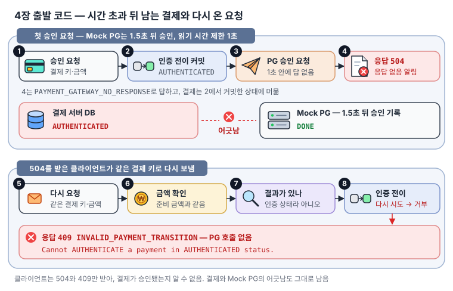
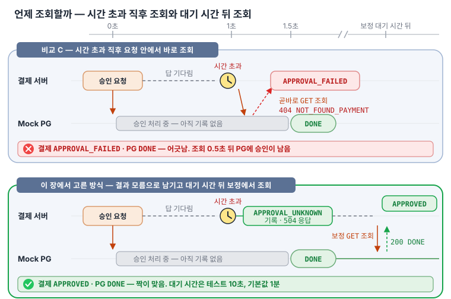
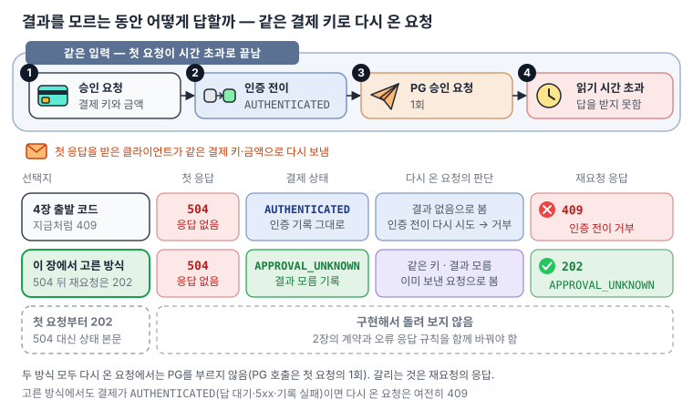
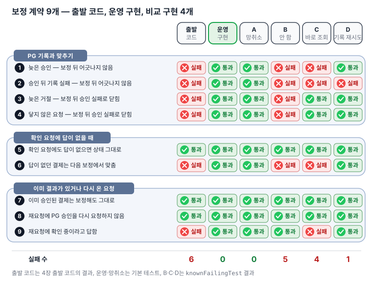
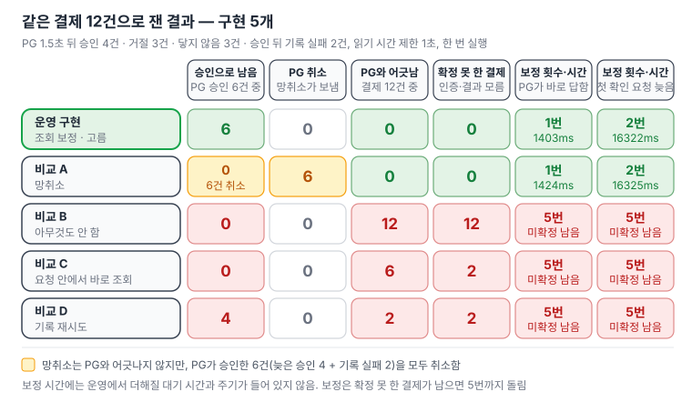

이전에 [결제 금액 검증과 멱등성](../payment-amount-idempotency/)에 대해 작성하였습니다. 그 글에서는 승인 요청 금액을 저장한 금액과 비교하고, 결제에 `paymentKey`를 저장해 같은 요청이 다시 오면 기록된 결과로 답하도록 바꿨습니다. 그리고 남은 한계로 두 가지를 4장으로 넘겼습니다. 같은 결제 키로 다시 왔는데 결제가 `AUTHENTICATED`이면 409로 답해서, 앞 요청이 PG 답을 기다리는 중인지, 시간 제한으로 결과를 모르는 상태인지, PG 오류(502)로 끝났는지 구분하지 못한다는 점과, PG가 승인한 뒤 우리 쪽 결과 기록이 실패하면 둘이 어긋난다는 점입니다.

오늘은 연재의 네 번째 글로, PG 응답을 받지 못한 결제를 어떻게 표시하고, 언제 어떤 방법으로 PG 기록에 맞출지 정리하도록 하겠습니다. PG에 조회해 맞추는 방법과 망취소(응답을 받지 못한 승인을 PG에 취소 요청하는 것)를 같은 테스트와 같은 결제 묶음으로 비교합니다.

이 글은 결제 서버가 한 대라고 보고 진행합니다. 서버가 여러 대일 때 보정 작업이 겹치는 문제는 남은 한계에 적고 7장 동시성 제어에서 다룹니다.

## 현재 구조: 결과를 모르는 결제를 인증 상태로 두는 승인 API

4장 출발 코드의 승인 서비스는 3장 완성 코드와 같습니다. 인증을 기록한 뒤 PG에 승인을 요청하고, 답을 받으면 결과를 기록합니다.

```java
public PaymentResult confirm(ConfirmPaymentCommand command) {
    Payment payment = paymentRecorder.authenticate(command);
    if (payment.isConfirmedWith(command.paymentKey())) {
        return PaymentResult.from(payment);
    }
    PaymentApproval approval = paymentGateway.approve(command.paymentKey(), payment.getOrderId(), payment.getAmount());
    return paymentRecorder.recordApproval(command.orderId(), approval);
}
```

PG 답이 읽기 시간 제한(2장에서 정한 연결 1초, 읽기 5초) 안에 오지 않으면 `PaymentGatewayNoResponseException`이 그대로 올라가 504와 `PAYMENT_GATEWAY_NO_RESPONSE`로 답하고, 결제는 인증 기록 트랜잭션이 남긴 `AUTHENTICATED`에 머뭅니다. PG가 승인도 거절도 아닌 서버 오류로 답하면 502로 답하고, 이때도 결제는 `AUTHENTICATED`입니다. [2장](../payment-transaction-boundary/)에서 확인한 것처럼, 결과 기록이 실패해도 결제는 `AUTHENTICATED`로 남습니다.

출발 코드에는 결제 상태 `APPROVAL_UNKNOWN`과 행위 `MARK_APPROVAL_UNKNOWN`의 이름만 더했습니다. 이 장의 테스트가 컴파일되게 하려는 것이고, 이 상태로 가는 전이는 아직 없습니다.

```java
APPROVAL_UNKNOWN,   // 승인을 요청했지만 카드사 답을 받지 못해 결과를 모름(4장부터)
```

Mock PG에는 PG 기록에 맞추는 데 필요한 API 두 개를 더했습니다. 경로와 상태값, 오류 코드는 토스페이먼츠 코어 API 문서와 에러 코드 문서에서 확인한 것만 썼습니다.

- `GET /v1/payments/orders/{orderId}`: 주문번호로 결제를 조회합니다. 승인이면 `DONE`, 거절이면 `ABORTED`, 취소되면 `CANCELED`를 돌려주고, 기록이 없으면 404와 `NOT_FOUND_PAYMENT`로 답합니다. 응답 필드는 `paymentKey`, `orderId`, `status`, `totalAmount`만 둡니다.
- `POST /v1/payments/{paymentKey}/cancel`(본문 `cancelReason`): 승인된 결제를 취소합니다. 이미 취소된 결제면 400 `ALREADY_CANCELED_PAYMENT`, 승인되지 않은 결제면 403 `NOT_CANCELABLE_PAYMENT`, 없으면 404 `NOT_FOUND_PAYMENT`로 답합니다.

토스페이먼츠 문서는 주문번호 조회 API를 "승인된 결제를 orderId로 조회합니다."라고 설명하고, `Payment` 객체의 `status` 값으로 `DONE`("인증된 결제수단으로 요청한 결제가 승인된 상태"), `ABORTED`("결제 승인이 실패한 상태"), `CANCELED`, `PARTIAL_CANCELED`, `EXPIRED`, `READY`, `IN_PROGRESS`, `WAITING_FOR_DEPOSIT`를 적고 있습니다. 문서가 승인된 결제의 조회로 설명하므로, Mock PG가 거절한 결제도 조회에서 `ABORTED`로 돌려주는 것은 이 연재의 가정입니다.

Mock PG의 시나리오도 넓혔습니다. 조회·취소 응답을 늦추는 `followUpDelayMillis`를 두었고, 승인 결과에 승인 요청이 승인 처리까지 닿지 않은 경우(`LOST`)를 더했습니다.

```java
// 승인도 거절도 아닌 서버 오류(500)
FAIL,
// 요청이 승인 처리까지 닿지 않음. 기다리게 한 뒤 아무것도 기록하지 않고 오류로 끝낸다(4장부터)
LOST;
```

`FAIL`과 `LOST`는 둘 다 500으로 답하고 승인도 거절도 기록하지 않습니다. 실제 PG가 500으로 답하면서 승인을 남기는지는 확인하지 못했고, Mock PG는 남기지 않는다고 가정했습니다. 또 Mock PG는 승인이나 거절을 처리가 끝나는 때에 기록합니다. 그래서 처리가 끝나기 전에 조회하면 404 `NOT_FOUND_PAYMENT`를 받습니다. 결정 3에서 이 동작이 중요해집니다.

## 현재 구조의 문제: 테스트로 재현하기

출발 코드에 아래 테스트를 먼저 작성했습니다. PG 답을 받지 못한 결제를 PG 기록에 맞추는 규칙 9개는 맞추는 방법(조회, 망취소, 아무것도 하지 않음)과 때(주기 보정, 요청 안에서 바로)와 상관없이 지켜야 하는 계약이라, 2·3장처럼 추상 클래스(`ReconciliationContract`)에 두고 구현마다 상속해 같은 테스트를 돌립니다.

- 카드사가 승인했지만 답이 시간 제한을 넘기면, 보정 뒤 결제 기록이 카드사와 어긋나지 않는다
- 카드사 승인 뒤 결과 기록이 실패해도, 보정 뒤 결제 기록이 카드사와 어긋나지 않는다
- 카드사가 거절했지만 답을 받지 못하면, 보정 뒤 승인 실패로 닫힌다
- 승인 요청이 카드사에 닿지 않았으면, 보정 뒤 승인 실패로 닫힌다
- 보정 중 카드사에 보낸 확인 요청에도 답이 없으면 결제 상태를 바꾸지 않는다
- 확인 요청에 답이 없던 결제는 다음 보정에서 다시 확인해 카드사와 맞춘다
- 이미 승인된 결제는 보정해도 승인 상태 그대로다
- 결과를 모르는 결제에 같은 결제 키로 다시 오면 카드사에 다시 승인을 요청하지 않는다
- 결과를 모르는 결제에 같은 결제 키로 다시 오면 확인 중이라고 답한다

이 계약은 PG 읽기 시간 제한을 1초로 줄이고, Mock PG가 1.5초 뒤에 답하게 해서 돌립니다. 보정은 Mock PG가 처리를 마칠 때까지 기다린 뒤 한 번 돌리고, 보정에 넘기는 시각은 보정 대기 시간(10초)이 지난 때로 줍니다. 기록 실패는 2장과 같이 승인 상태로 바꾸는 저장을 MySQL 트리거로 막아서 만듭니다.

"어긋나지 않는다"는 PG에 남은 최종 상태와 결제 상태가 짝이 맞는지로 봅니다. PG 쪽이 승인(`DONE`)이면 결제는 승인, 취소·거절·기록 없음이면 승인 실패여야 합니다.

```java
// 카드사 쪽 최종 상태가 승인이면 승인, 취소·거절·기록 없음이면 승인 실패여야 짝이 맞는다
void assertMatchesCardCompany(String orderId) {
    PaymentStatus expected = "DONE".equals(mockPg.paymentState(orderId))
            ? PaymentStatus.APPROVED
            : PaymentStatus.APPROVAL_FAILED;
    assertThat(statusOf(orderId)).as("카드사 상태 %s 와 짝", mockPg.paymentState(orderId)).isEqualTo(expected);
}
```

늦은 승인 테스트는 아래와 같습니다. 출발 코드의 운영 구현에는 보정이 없어서, `reconcile()`은 아무것도 하지 않습니다.

```java
@Test
@DisplayName("카드사가 승인했지만 답이 시간 제한을 넘기면, 보정 뒤 결제 기록이 카드사와 어긋나지 않는다")
void lateApprovalMatchesCardCompanyAfterReconciliation() {
    String orderId = prepare();
    mockPg.respondAfter(LATE);
    catchThrowable(() -> confirm(request(orderId)));
    awaitCardCompany(orderId);

    reconcile();

    assertMatchesCardCompany(orderId);
}
```

결제 API 테스트에는 "카드사 답을 받지 못한 결제는 다시 조회하면 결과 모름 상태다"와 "결과를 모르는 결제에 같은 승인 요청을 다시 보내면 확인 중이라고 답한다"를 더했습니다. 결제 도메인 테스트에는 결과 모름으로 가는 전이와 닫는 전이, 결과 모름 결제는 만료나 매입으로 닫지 않는다는 테스트를 더했습니다.

4장 출발 코드에서 4장 테스트(보정 계약, 전이 규칙 세 구현, 결제 금액과 승인 요청 확인, 결제 API)를 돌린 결과는 아래와 같습니다. 출발 코드 전체로는 348개 중 51개가 실패했습니다.

```text
tests=320 failures=51 errors=0 time=35.594s
## 결과 모름 보정 — 운영 구현
PASS 이미 승인된 결제는 보정해도 승인 상태 그대로다 (1.088s)
FAIL 카드사 승인 뒤 결과 기록이 실패해도, 보정 뒤 결제 기록이 카드사와 어긋나지 않는다 (0.097s) | org.opentest4j.AssertionFailedError: [카드사 상태 DONE 와 짝] expected: APPROVED but was: AUTHENTICATED
FAIL 카드사가 거절했지만 답을 받지 못하면, 보정 뒤 승인 실패로 닫힌다 (1.57s) | org.opentest4j.AssertionFailedError: expected: APPROVAL_FAILED but was: AUTHENTICATED
FAIL 카드사가 승인했지만 답이 시간 제한을 넘기면, 보정 뒤 결제 기록이 카드사와 어긋나지 않는다 (1.563s) | org.opentest4j.AssertionFailedError: [카드사 상태 DONE 와 짝] expected: APPROVED but was: AUTHENTICATED
FAIL 결과를 모르는 결제에 같은 결제 키로 다시 오면 확인 중이라고 답한다 (1.034s) | com.example.payment.global.error.exception.InvalidPaymentTransitionException: Cannot AUTHENTICATE a payment in AUTHENTICATED status.
PASS 결과를 모르는 결제에 같은 결제 키로 다시 오면 카드사에 다시 승인을 요청하지 않는다 (1.04s)
PASS 보정 중 카드사에 보낸 확인 요청에도 답이 없으면 결제 상태를 바꾸지 않는다 (1.552s)
FAIL 확인 요청에 답이 없던 결제는 다음 보정에서 다시 확인해 카드사와 맞춘다 (1.559s) | org.opentest4j.AssertionFailedError: [카드사 상태 DONE 와 짝] expected: APPROVED but was: AUTHENTICATED
FAIL 승인 요청이 카드사에 닿지 않았으면, 보정 뒤 승인 실패로 닫힌다 (1.561s) | org.opentest4j.AssertionFailedError: expected: APPROVAL_FAILED but was: AUTHENTICATED
## 결제 금액과 승인 요청 확인
FAIL 결과를 모르는 결제는 같은 결제 키의 요청을 이미 카드사에 보낸 요청으로 본다 (0.0s) | com.example.payment.global.error.exception.InvalidPaymentTransitionException: Cannot MARK_APPROVAL_UNKNOWN a payment in AUTHENTICATED status.
## 결제 상태 바꾸기 — 허용 전이 표
FAIL 승인을 요청했지만 카드사 답을 받지 못한 결제는 결과 모름 상태가 된다 (0.001s) | com.example.payment.global.error.exception.InvalidPaymentTransitionException: Cannot MARK_APPROVAL_UNKNOWN a payment in AUTHENTICATED status.
(같은 이유로 14개 실패. State 패턴, Spring Statemachine 비교 구현도 각 14개 실패)
## 결제 API
FAIL 카드사 답을 받지 못한 결제는 다시 조회하면 결과 모름 상태다 (0.536s) | org.opentest4j.AssertionFailedError: expected: "APPROVAL_UNKNOWN" but was: "AUTHENTICATED"
FAIL 결과를 모르는 결제에 같은 승인 요청을 다시 보내면 확인 중이라고 답한다 (0.538s) | org.opentest4j.AssertionFailedError: expected: 202 but was: 409
(통과한 API 테스트 16개 생략)
```

320개 중 51개가 실패했습니다. 전이 규칙 테스트 42개(세 구현 각 14개)와 도메인 테스트 1개는 결과 모름으로 가는 전이가 없어서 실패한 것이고, 나머지 8개에서 원인이 세 가지 드러납니다.

첫째, 결과를 모르는 결제가 PG와 어긋난 채 남습니다. PG는 1.5초 뒤 승인했는데 결제는 `AUTHENTICATED`에 머물렀고(`[카드사 상태 DONE 와 짝] expected: APPROVED but was: AUTHENTICATED`), 결과 기록이 실패한 결제도 같았습니다. PG가 거절했거나 승인 요청이 닿지 않은 결제도 승인 실패로 닫히지 않고 `AUTHENTICATED`로 남았습니다. 이 결제들을 PG 기록에 맞추는 곳이 서버에 없습니다.

둘째, 상태만 봐서는 이 결제들을 가려낼 수 없습니다. 위 실패에서 남은 상태는 모두 `AUTHENTICATED`인데, 이 상태는 승인 요청을 보내기 직전의 결제와 지금 PG 답을 기다리는 결제도 똑같이 가집니다.

셋째, 같은 결제 키로 다시 온 요청에 409로 답합니다. 3장의 `isConfirmedWith`는 `AUTHENTICATED`가 아닌 결제만 결과가 남은 것으로 보므로, 다시 온 요청은 인증 전이를 시도하다 `Cannot AUTHENTICATE a payment in AUTHENTICATED status.`로 거부되었습니다. 첫 응답으로 504를 받고 다시 보낸 클라이언트는 이 409만 보고는 결제가 어떻게 됐는지 알 수 없습니다.

출발 코드에서 첫 요청이 시간 초과로 끝나고, 같은 결제 키로 다시 보낸 경우를 그리면 아래와 같습니다.



첫 요청 뒤 결제는 `AUTHENTICATED`, Mock PG는 `DONE`으로 어긋난 채 남고, 다시 온 요청은 PG에 닿기 전에 409로 끝납니다.

통과한 테스트 중에도 살펴볼 것이 있습니다. "카드사에 다시 승인을 요청하지 않는다"는 출발 코드에서도 통과했는데, 3장에서 본 것처럼 다시 온 요청이 PG를 부르기 전에 인증 전이에서 409로 막혔기 때문입니다. "확인 요청에도 답이 없으면 결제 상태를 바꾸지 않는다"도 보정이 없어서 상태가 바뀌지 않았을 뿐입니다.

## 선택지와 트레이드오프

이 문제를 해결하면서 내린 결정은 다섯 가지입니다.

### 결정 1. 결과를 모르는 결제를 어떻게 표시할까

이 장에서는 PG 답을 받지 못한 결제를 새 상태 `APPROVAL_UNKNOWN`(결과 모름)으로 남기기로 했습니다.

검토한 선택지는 세 가지입니다.

- 지금처럼 `AUTHENTICATED`로 두기(4장 출발 코드)
- 결제에 새 상태 `APPROVAL_UNKNOWN`을 두기
- 결제 상태는 그대로 두고, 승인 시도마다 행을 남기는 별도 테이블을 두기

새 상태를 둘 때 바뀌는 전이와 세 선택지를 그리면 아래와 같습니다.



그림은 시간 초과로 결과 모름이 된 결제가 PG 조회로 승인되는 길을 따라갑니다. `AUTHENTICATED`에 남은 결제도 대기 시간 뒤 보정 조회로 같은 행위(`APPROVE`, `FAIL_APPROVAL`)를 거쳐 닫힙니다(결정 4). 결과 모름에서는 만료와 매입으로 가는 전이를 허용하지 않습니다.

새 상태를 둔 이유는, 앞의 둘째 원인처럼 `AUTHENTICATED`만으로는 재요청에도 보정에도 결과 모름 결제를 가려낼 수 없었기 때문입니다. 또 새 상태로 두면 1장부터 쌓은 전이 표 하나로 결과 모름까지 막을 수 있습니다. 결과 모름을 따로 표시하면, 3장의 `isConfirmedWith`(결과가 `AUTHENTICATED`가 아니면 같은 키의 요청을 이미 보낸 요청으로 봄)를 고치지 않고도 다시 온 요청에서 PG를 다시 부르지 않게 됩니다. 결과 모름 결제는 승인이 남았을 수 있으므로 PG에 확인한 결과로만 닫고, 만료나 매입으로는 닫지 않습니다.

```java
allow(AUTHENTICATED, MARK_APPROVAL_UNKNOWN, APPROVAL_UNKNOWN);
allow(AUTHENTICATED, EXPIRE, EXPIRED);

// 결과 모름은 카드사에 확인한 결과로만 닫는다. 승인이 남았을 수 있어 만료로 닫지 않는다
allow(APPROVAL_UNKNOWN, APPROVE, APPROVED);
allow(APPROVAL_UNKNOWN, FAIL_APPROVAL, APPROVAL_FAILED);
```

닫는 행위는 기존 `APPROVE`와 `FAIL_APPROVAL`을 그대로 씁니다. PG가 승인했다고 확인되면 시간 안에 답을 받은 승인과 같은 `APPROVED`가 되어야 하고, 이후 매입·취소도 같은 전이를 따라야 하기 때문입니다.

이 선택으로 치르는 비용은 두 가지입니다.

- 상태가 하나 늘어 [1장](../payment-state-machine/)의 전이 조합 테스트가 상태 9개 × 행위 7개에서 10개 × 8개로 커졌고, 같은 계약(`PaymentTransitionContract`)을 쓰는 State 패턴과 Spring Statemachine 비교 구현에도 같은 전이를 넣어야 했습니다. 넣지 않으면 그 계약이 실패합니다. 출발 코드에서 세 구현이 같은 14개씩 실패한 것이 그 결과입니다.
- 결과 모름으로 표시하는 것은 시간 제한으로 답을 받지 못한 경우뿐입니다. PG가 5xx로 답한 결제와 결과 기록에 실패한 결제는 여전히 `AUTHENTICATED`로 남고, 이 결제들은 결정 4에서 따로 다룹니다.

별도 승인 시도 테이블은 구현해서 돌려 보지 않았습니다. 이 저장소에서는 3장부터 결제 하나에 결제 키 하나를 저장하고 있고, 결과 모름을 결제 한 행의 상태로 두면 1장부터 쌓은 전이 표 하나로 막을 수 있어서 테이블을 따로 두지 않았습니다. 결제 하나에 여러 결제 키로 승인을 여러 번 시도할 수 있거나, 시도마다 PG에 보낸 요청과 받은 응답을 남겨 대조해야 한다면 시도 테이블이 맞습니다.

### 결정 2. 결과를 모르는 결제를 어떻게 맞출까

이 장에서는 결과 모름 결제를 PG에 주문번호로 조회해, 조회 결과대로 승인이나 승인 실패로 닫기로 했습니다.

검토한 선택지는 세 가지입니다.

- PG에 주문번호로 결제를 조회하고 그 결과대로 닫기(조회 보정)
- 결과를 묻지 않고 PG에 취소를 보낸 뒤 승인 실패로 닫기(망취소, 비교 A)
- 결과 모름으로 남긴 뒤 아무것도 하지 않기(비교 B). 고객 문의가 오면 사람이 PG 관리 화면을 보고 고친다고 가정합니다.

PG 조회는 결제 키로도 주문번호로도 할 수 있습니다. 이 장에서는 주문번호로 조회했습니다. 주문번호는 결제 서버가 만들어 준비 때부터 결제 행에 늘 있는 키이고, 결제 키는 PG가 결제창 인증 때 주는 값이라, 우리 쪽에서 정한 키로 묻는 쪽을 택했습니다. 3장에서 저장하기 시작한 결제 키는 이 장에서는 망취소 비교에서 PG에 취소를 보낼 때 씁니다.

조회 보정은 PG 응답의 `status`를 세 가지 답(`PaymentInquiry`)으로 읽습니다.

- 승인이 남음: `DONE`, `PARTIAL_CANCELED`(부분 취소된 결제도 승인은 남아 있음)
- 승인이 없음: `ABORTED`, `CANCELED`, `EXPIRED`, 그리고 404 `NOT_FOUND_PAYMENT`
- 아직 정할 수 없음: `READY`, `IN_PROGRESS`, `WAITING_FOR_DEPOSIT`, 목록에 없는 값. 결제를 그대로 둡니다.

404는 본문의 코드가 `NOT_FOUND_PAYMENT`일 때만 "승인 요청이 닿지 않음 = 승인 없음"으로 읽습니다. 주소를 잘못 부른 404를 승인 없음으로 읽으면 승인된 결제를 실패로 닫게 되기 때문입니다. 그 밖의 404와 5xx, 조회 무응답은 PG 실패로 보고 결제를 그대로 둔 채 다음 보정에서 다시 봅니다. 토스페이먼츠 에러 코드 문서에도 `NOT_FOUND_PAYMENT`(404, "존재하지 않는 결제 정보 입니다.")가 결제 승인·조회·취소에 공통으로 나옵니다.

같은 네 가지 경우(늦은 승인, 늦은 거절, 닿지 않은 요청, 승인 뒤 기록 실패)를 세 방법으로 맞춘 결과를 나란히 놓으면 아래와 같습니다.


조회 보정과 망취소는 네 경우 모두 PG와 짝이 맞고, 아무것도 하지 않으면 네 경우 모두 어긋난 채 남습니다. 망취소에서는 PG가 승인한 두 경우가 취소로 끝납니다.

조회 보정을 고른 이유는, 망취소와 똑같이 계약을 모두 지키면서 PG에서 이미 끝난 승인을 그대로 살리기 때문입니다. 망취소도 보정 계약 9개를 모두 통과했습니다. 계약의 "어긋나지 않는다"는 PG 취소와 우리 쪽 승인 실패를 짝이 맞는 것으로 보기 때문입니다. 두 방법의 차이는 계약이 아니라 같은 결제 묶음으로 잰 결과에서 드러났습니다. 늦은 승인 4건, 늦은 거절 3건, 닿지 않은 요청 3건, 기록 실패 2건으로 이루어진 같은 결제 12건을 두 구현으로 보정하자, PG가 승인한 6건을 조회 보정은 모두 `APPROVED`로 남겼고, 망취소는 6건 모두 PG에 취소를 보내 승인으로 남은 결제가 0건이었습니다(아래 측정). 망취소에서는 고객이 결제창에서 인증하고 PG가 승인까지 마친 결제가, 우리 서버가 답을 받지 못했다는 이유로 취소됩니다.

아무것도 하지 않는 비교 B는 계약 9개 중 5개가 실패했고, 측정에서도 12건 모두 결과 모름이나 인증 상태로 남았습니다.

이 선택으로 치르는 비용은 두 가지입니다.

- PG의 조회 API에 기댑니다. 조회 응답의 상태값을 위의 세 답으로 읽는 대응을 PG 문서에 맞게 계속 유지해야 하고, 이 대응은 `PgPaymentStatus`와 그 테스트 9개(`카드사 결제 조회 답 읽기`)로 지킵니다.
- 처리 중인 결제를 조회했을 때 실제 PG가 무엇을 돌려주는지는 확인하지 못했습니다. Mock PG는 처리가 끝나기 전에는 404를 돌려주므로, 바로 조회하면 승인될 결제를 실패로 닫을 수 있습니다. 그래서 조회하기 전에 기다리는 시간을 둡니다(결정 3).

다른 선택이 맞는 경우도 있습니다. PG에 조회 API가 없거나, 조회 답을 믿기 어려운 연동이라면 망취소가 맞습니다. 망취소는 조회 응답을 해석할 필요 없이, 취소했다는 답(2xx)이나 4xx를 받으면 승인 실패로 닫고(Mock PG가 주는 4xx는 404 결제 없음, 400 이미 취소, 403 취소할 수 없는 결제), 취소에도 답이 없거나 5xx면 다음 보정에서 다시 보냅니다. 조회 보정이 404의 본문 코드까지 확인하는 것과 달리, 망취소 비교 구현은 4xx의 종류를 가리지 않습니다.

대신 PG에 승인이 남은 결제도 모두 되돌리므로, 그 주문은 결제가 끝나지 않은 것으로 남습니다.

또 Mock PG의 취소는 처리 중인 승인을 막지 못해서, 승인이 끝나기 전에 취소를 보내면 404를 받고 승인 실패로 닫은 뒤에 PG에 승인이 남는 순서가 코드상 가능합니다. 이 경우는 따로 측정하지 않았고, 조회 보정과 같은 대기 시간에 기댑니다.

### 결정 3. 언제 맞출까

이 장에서는 승인을 요청한 지 정한 시간(`wait-after-request`)이 지난 결제만, 따로 도는 주기 보정에서 조회하기로 했습니다.

검토한 선택지는 두 가지입니다.

- 시간 초과 직후 같은 요청 안에서 바로 조회해 닫고 답하기(비교 C)
- 결과 모름으로 남기고 응답한 뒤, 승인을 요청한 지 정한 시간이 지난 결제를 주기 보정(`@Scheduled`)에서 조회하기

바로 조회하는 비교 C는 계약 9개 중 4개가 실패했습니다. 대표적인 실패는 아래와 같습니다.

```text
FAIL 카드사가 승인했지만 답이 시간 제한을 넘기면, 보정 뒤 결제 기록이 카드사와 어긋나지 않는다 (1.604s) | org.opentest4j.AssertionFailedError: [카드사 상태 DONE 와 짝] expected: APPROVED but was: APPROVAL_FAILED
```

Mock PG가 1.5초 뒤 승인하는 결제를 1초 시간 초과 직후에 조회하면, Mock PG에는 아직 기록이 없어 404 `NOT_FOUND_PAYMENT`를 받고 승인 실패로 닫습니다. 그 뒤 0.5초 만에 PG에는 승인이 남습니다.

바로 조회하는 비교 C와 대기 시간 뒤에 조회하는 방식을 시간 순서로 그리면 아래와 같습니다.



비교 C는 PG가 승인을 기록하기 0.5초 전에 조회해 404를 받습니다. 대기 시간 뒤에 조회하면 PG가 처리를 마친 뒤라 `DONE`을 받고 승인으로 닫습니다.

대기 시간을 둔 이유는 두 가지입니다. PG가 처리를 마치기 전에 조회하면 "기록 없음"을 "승인 없음"과 구분할 수 없고, 시간 제한으로 끊은 요청을 요청 안의 조회로 다시 늘리지 않기 위해서입니다. 운영 구현에만 있는 테스트 "승인을 요청한 지 보정 대기 시간이 지나지 않은 결과 모름 결제는 카드사가 아직 처리 중일 수 있어 보정하지 않는다"가 이 규칙을 확인합니다. 지금 시각으로 보정을 부르면 결제는 결과 모름 그대로 남습니다. 측정에서도 비교 C는 PG가 승인한 결제를 승인 실패로 닫았습니다(아래 측정).

대기 시간을 재려면 승인을 요청한 때가 필요해서, 결제에 `authenticated_at`(인증한 때, 곧 승인을 요청하기 직전) 컬럼을 더했습니다. 보정은 대상 상태 가운데 `now - wait-after-request`보다 먼저 인증한 결제를 오래된 것부터 100건씩 고르고, 앞 보정이 끝난 뒤 `interval`만큼 쉬고 다시 돕니다(`fixedDelayString`). 기본값은 둘 다 1분입니다.

시각은 `Clock` 빈(UTC)에서 얻어 넘겨서, 테스트는 보정 대기 시간이 지난 시각을 넘겨 보정을 직접 부를 수 있습니다. 테스트 태스크에서는 주기 보정을 끄고, `결과 모름 주기 보정` 테스트 하나만 0.2초 주기·대기 2초로 켜서 따로 부르지 않아도 승인으로 맞춰지는 것을 확인했습니다.

이 선택으로 치르는 비용은 두 가지입니다.

- 결과 모름이 확정되기까지 적어도 대기 시간만큼, 길게는 대기 시간과 보정 주기를 더한 만큼 걸립니다. 기본값이면 1분에서 2분 사이이고, 그동안 고객은 "확인 중"을 봅니다.
- 조회도 승인과 같은 PG 클라이언트를 쓰므로 읽기 시간 제한(5초)이 그대로 걸립니다. PG가 조회에 답하지 않으면 한 회차에 100건 × 5초를 기다릴 수 있습니다. 측정에서 첫 보정의 조회에만 늦게 답하게 하자, 확정까지 보정 2번, 16322ms가 걸렸습니다.

다른 선택이 맞는 경우도 있습니다. PG의 조회가 승인 처리를 마친 뒤에만 답한다는 보장이 있다면, 요청 안에서 바로 조회해 고객에게 결과를 곧바로 줄 수 있습니다. 이번 Mock PG에는 그런 보장이 없고, 테스트로 확인한 것은 "보장이 없으면 승인된 결제를 실패로 닫는다"까지입니다.

### 결정 4. 결과 기록에 실패한 결제는 어떻게 할까

이 장에서는 결과를 기록하지 못해 `AUTHENTICATED`에 남은 결제도, 대기 시간이 지나면 결과 모름과 같은 보정 대상에 넣기로 했습니다.

PG가 승인한 뒤 결과 기록이 실패하면 결과 모름조차 남지 않습니다. 결정 1의 `recordApprovalUnknown`은 시간 초과에서만 불리고, 결과 기록 트랜잭션이 실패하면 결제는 인증 기록 트랜잭션이 남긴 `AUTHENTICATED`에 머뭅니다.

검토한 선택지는 두 가지입니다.

- 기록이 실패하면 요청 안에서 0.1초씩 쉬며 세 번까지 기록해 보고, 보정은 결과 모름만 보기(비교 D)
- 오래된 `AUTHENTICATED`도 보정 대상에 넣기

비교 D는 계약 9개 중 1개, 기록 실패 테스트만 실패했습니다(`[카드사 상태 DONE 와 짝] expected: APPROVED but was: AUTHENTICATED`). 트리거가 다시 시도하는 동안 풀리지 않아 세 번 모두 실패했고, 결제는 인증 상태로 남았지만 보정 대상이 아니라서 그대로였습니다. 측정에서도 같은 결과였습니다(아래 측정).

비교 D와 이 장에서 고른 방식에서 결과 기록에 실패한 결제가 어떻게 되는지 그리면 아래와 같습니다.


비교 D에서는 재시도가 모두 실패한 결제가 보정 대상에 들지 않아 그대로 남고, 고른 방식에서는 대기 시간 뒤 조회로 승인이 됩니다. 아래 갈래는 PG가 5xx로 답한 결제이고, 바로 뒤에서 설명합니다.

`AUTHENTICATED`를 보정 대상에 넣은 이유는, 기록을 막는 DB 실패가 일어난 순간에는 결과 모름조차 기록할 수 없기 때문입니다.

```java
// 보정 대상 상태. 카드사 승인 뒤 결과 기록이 실패하면 결과 모름조차 남지 않고 인증 상태에 머무르므로 함께 본다.
// 비교 구현(망취소)도 같은 대상을 본다
public static final Set<PaymentStatus> TARGETS = Set.of(PaymentStatus.APPROVAL_UNKNOWN, PaymentStatus.AUTHENTICATED);
```

이 대상에는 PG가 5xx로 답해 502로 끝난 결제도 들어갑니다. 결제 API 테스트 "카드사가 서버 오류로 답하면 처리하지 못했다고 답하고, 결제는 승인 결과 없이 인증 상태로 남는다"에서 첫 응답은 502, 다시 조회한 상태는 `AUTHENTICATED`였습니다. 보정 테스트 "카드사가 서버 오류로 답하고 승인을 남기지 않은 결제는 보정 대기 시간이 지난 뒤 보정에서 승인 실패로 닫힌다"에서는 Mock PG에 이 주문의 기록이 없어(`NONE`) 조회가 404를 받았고, 결제는 `APPROVAL_FAILED`로 닫혔습니다. 5xx 결제를 결과 모름으로 따로 표시하는 방법은 구현하지 않았습니다.

이 선택으로 치르는 비용은, 보정 대상에 지금 PG 답을 기다리는 승인도 들어갈 수 있다는 점입니다. 인증한 지 대기 시간이 지나지 않은 결제는 고르지 않으므로, 대기 시간이 PG 시간 제한(연결 1초 + 읽기 5초)보다 길면 기다리는 중인 승인은 대상이 되지 않습니다. 지금은 이 조건을 설정값 설명 주석으로만 적어 두었고, 서버를 시작할 때 막는 검사는 넣지 않았습니다.

다른 선택이 맞는 경우도 있습니다. 기록 실패가 재시도 간격 안에 풀리는 짧은 장애가 대부분이라면, 요청 안에서 다시 기록하는 쪽이 고객에게 결과를 바로 줄 수 있습니다. 이번에는 트리거가 재시도 동안 풀리지 않는 경우만 확인했고, 중간에 풀리는 경우는 측정하지 않았습니다. 두 방법을 함께 쓸 수도 있지만, 그때도 재시도가 모두 실패한 결제를 맡을 보정은 필요합니다.

### 결정 5. 결과를 모르는 동안 어떻게 답할까

이 장에서는 첫 요청의 시간 초과는 지금처럼 504로 답하고, 결과 모름 결제에 같은 결제 키로 다시 온 요청에는 PG를 부르지 않고 202와 `APPROVAL_UNKNOWN`으로 답하기로 했습니다.

검토한 선택지는 세 가지입니다.

- 지금처럼 재요청에 409로 답하기(4장 출발 코드)
- 첫 시간 초과는 504로 두고, 재요청에는 202와 상태 본문으로 답하기
- 첫 시간 초과부터 504 대신 202와 상태 본문으로 답하기

첫 요청이 시간 초과로 끝난 뒤 같은 결제 키로 다시 보낼 때, 선택지마다 응답이 어떻게 갈리는지 그리면 아래와 같습니다.



출발 코드와 고른 방식 모두 다시 온 요청에서는 PG를 부르지 않고, 갈리는 것은 재요청의 응답입니다. 첫 요청부터 202로 답하는 방식은 구현하지 않아서 응답을 채우지 않았습니다.

첫 응답을 504로 둔 이유는 두 가지입니다. 그 요청은 실제로 PG 답을 받지 못했고, 오류 응답의 모양(`{code, message}`)과 상태 코드 대응을 2장부터 전역 예외 처리기 한 곳에서 정해 왔기 때문입니다. 결과 모름은 결제 조회(`GET`)와 재요청의 202로 보입니다.

재요청에는 카드사에 다시 묻지 않고 확인 중이라는 뜻으로 202를 줍니다.

이 선택으로 치르는 비용은 두 가지입니다.

- 클라이언트는 202를 받으면 결제 조회 API로 상태가 바뀌었는지 다시 확인해야 합니다. 202 응답에는 언제 다시 확인하라는 정보를 담지 않았습니다.
- 같은 결제 키로 다시 왔는데 결제가 `AUTHENTICATED`이면 여전히 409입니다. 앞 요청이 PG 답을 기다리는 중인지, 5xx나 기록 실패로 남은 결제인지 요청 시점에는 구분하지 못합니다.

첫 시간 초과부터 202로 답하는 방식은 구현해서 돌려 보지 않았습니다. 클라이언트가 5xx를 받으면 재시도하지 않고 바로 실패 화면으로 넘기는 구조라면, 첫 응답부터 "확인 중"을 알리는 이 방식이 맞을 수 있습니다. 그때는 2장의 계약과 오류 응답 규칙을 함께 바꿔야 합니다.

## 구현

결정을 모아 바꾼 4장 완성 코드에서 클라이언트, 결제 서버, DB, Mock PG 사이에 오가는 요청과 응답을 승인 요청과 보정으로 나눠 그리면 아래와 같습니다. 먼저 첫 요청이 시간 초과로 끝나고 같은 결제 키로 다시 오는 경우입니다.


다시 온 요청도 3장과 같은 길로 결제를 찾고 금액을 확인합니다. 그 뒤 `isConfirmedWith`에서 결과 모름 결제를 이미 보낸 요청으로 보아, PG를 부르지 않고 202로 끝납니다.

결과 모름으로 남은 결제는 보정 작업이 PG에 조회해 닫습니다.


보정은 대상을 DB에서 먼저 고른 뒤 결제마다 PG에 조회하고, 그 결과를 결제 하나씩 별도 트랜잭션으로 기록합니다. 기록할 때 이미 결과가 남은 결제는 건드리지 않습니다.

승인 서비스는 PG 답을 받지 못하면 결과 모름을 기록하고, 받은 예외를 그대로 다시 던집니다. 그래서 첫 응답은 2장과 같은 504입니다.

```java
public PaymentResult confirm(ConfirmPaymentCommand command) {
    Payment payment = paymentRecorder.authenticate(command);
    if (payment.isConfirmedWith(command.paymentKey())) {
        return PaymentResult.from(payment);
    }
    PaymentApproval approval = requestApproval(command.paymentKey(), payment);
    return paymentRecorder.recordApproval(command.orderId(), approval);
}

// 답을 받지 못했어도 카드사에는 승인이 남았을 수 있다. 인증 상태로 두지 않고 결과 모름으로 남긴다
private PaymentApproval requestApproval(String paymentKey, Payment payment) {
    try {
        return paymentGateway.approve(paymentKey, payment.getOrderId(), payment.getAmount());
    } catch (PaymentGatewayNoResponseException noResponse) {
        paymentRecorder.recordApprovalUnknown(payment.getOrderId());
        throw noResponse;
    }
}
```

기록은 결제 기록기(`PaymentRecorder`)의 별도 트랜잭션에서 합니다. 인증할 때 시각을 함께 남기고, 조회 결과를 남길 때는 그 사이 다른 길로 결과가 남은 결제를 건드리지 않습니다.

```java
payment.authenticate(command.paymentKey(), clock.instant());
```

```java
// 카드사 답을 받지 못했다. 승인됐는지 모른다는 것을 남겨 두고 나중에 카드사에 확인한다
@Transactional
public void recordApprovalUnknown(String orderId) {
    find(orderId).markApprovalUnknown();
}

// 카드사에 확인한 결과를 남긴다. 그 사이 다른 길로 결과가 남은 결제는 건드리지 않는다
@Transactional
public void recordInquiry(String orderId, PaymentInquiry inquiry) {
    Payment payment = find(orderId);
    if (payment.isAwaitingApprovalResult()) {
        payment.settle(inquiry);
    }
}
```

결제는 조회 결과로 스스로 닫습니다. PG도 아직 처리 중이면 그대로 둡니다.

```java
// 카드사에 확인한 결과로 결제를 닫는다. 카드사도 아직 처리 중이면 그대로 둔다
public void settle(PaymentInquiry inquiry) {
    if (inquiry.isApproved()) {
        approve();
        return;
    }
    if (inquiry.isNotApproved()) {
        failApproval();
    }
}
```

보정은 대기 시간이 지난 대상 결제를 하나씩 조회합니다. 결제 하나를 조회하다 PG가 답하지 않거나 오류로 답해도, 나머지 결제는 이어서 맞춥니다.

```java
public void reconcile(Instant now) {
    Instant requestedBefore = now.minus(reconciliationProperties.getWaitAfterRequest());
    paymentRepository.findApprovalRequestedBefore(TARGETS, requestedBefore)
            .forEach(payment -> reconcile(payment.getOrderId()));
}

// 결제 하나를 맞추다 실패해도 나머지 결제는 이어서 맞춘다
private void reconcile(String orderId) {
    try {
        paymentRecorder.recordInquiry(orderId, paymentGateway.inquire(orderId));
    } catch (PaymentGatewayNoResponseException | PaymentGatewayFailedException unanswered) {
        log.warn("Could not confirm a payment result with the gateway ({}). It will be checked again next time.",
                unanswered.getClass().getSimpleName());
    }
}
```

대상은 Spring Data 메서드 이름으로 고릅니다. 한 번에 100건, 승인을 요청한 때가 오래된 것부터입니다.

```java
List<Payment> findTop100ByStatusInAndAuthenticatedAtBeforeOrderByAuthenticatedAtAsc(
        Collection<PaymentStatus> statuses, Instant requestedBefore);
```

주기 실행은 스케줄러가 맡습니다. 테스트에서는 `payment.reconciliation.enabled=false`로 끕니다.

```java
@Scheduled(fixedDelayString = "${payment.reconciliation.interval}")
public void reconcile() {
    paymentReconciler.reconcile(clock.instant());
}
```

PG 조회는 `PaymentGateway`에 `inquire`를 더해 구현했습니다. 404는 결제가 없다는 답일 때만 승인 없음으로 읽습니다.

```java
private static PaymentInquiry toInquiry(String orderId, RestClient.RequestHeadersSpec.ConvertibleClientHttpResponse response)
        throws IOException {
    if (response.getStatusCode().is2xxSuccessful()) {
        return PgPaymentStatus.inquiryOf(response.bodyTo(PgPaymentResponse.class).status());
    }
    if (isPaymentNotFound(response)) {
        return PaymentInquiry.NOT_APPROVED;
    }
    throw new PaymentGatewayFailedException(orderId, response.getStatusCode().value());
}

// 404 라도 결제가 없다는 답일 때만 기록 없음으로 읽는다. 주소를 잘못 부른 404 를 승인 없음으로 읽으면 안 된다
private static boolean isPaymentNotFound(RestClient.RequestHeadersSpec.ConvertibleClientHttpResponse response)
        throws IOException {
    return response.getStatusCode().value() == 404
            && PAYMENT_NOT_FOUND.equals(response.bodyTo(PgErrorResponse.class).code());
}
```

조회 응답의 상태값은 결정 2의 세 답으로 바꿉니다.

```java
enum PgPaymentStatus {
    READY(PaymentInquiry.UNDECIDED),
    IN_PROGRESS(PaymentInquiry.UNDECIDED),
    WAITING_FOR_DEPOSIT(PaymentInquiry.UNDECIDED),
    DONE(PaymentInquiry.APPROVED),
    PARTIAL_CANCELED(PaymentInquiry.APPROVED),
    CANCELED(PaymentInquiry.NOT_APPROVED),
    ABORTED(PaymentInquiry.NOT_APPROVED),
    EXPIRED(PaymentInquiry.NOT_APPROVED);
```

컨트롤러는 결과 모름 결제에 다시 온 요청에 202로 답합니다.

```java
// 결과를 모르는 결제에 다시 온 승인 요청: 카드사에 다시 묻지 않고 확인 중이라는 뜻으로 202 를 준다(4장).
// 처음 요청이 시간 초과로 끝날 때는 504(PAYMENT_GATEWAY_NO_RESPONSE)를 그대로 준다
private static HttpStatus statusOf(PaymentResult result) {
    if (result.status().isApprovalUnknown()) {
        return HttpStatus.ACCEPTED;
    }
    return HttpStatus.OK;
}
```

설정과 테이블은 아래와 같습니다.

```properties
# 결과 모름 보정(4장). 승인을 요청한 지 wait-after-request 가 지난 결과 모름 결제를 interval 마다 카드사에 조회해 맞춘다.
# wait-after-request 는 PG 연결·읽기 시간 제한(1s + 5s)보다 길게, 카드사가 늦게라도 처리를 마쳤을 만큼으로 둔다.
payment.reconciliation.wait-after-request=1m
payment.reconciliation.interval=1m
```

```sql
    payment_key varchar(200),
    -- 4장: 승인을 요청하려고 인증한 때. 보정은 상태와 이 시각으로 대상을 고른다
    authenticated_at datetime(6),
    primary key (id),
    unique key uk_payment_order_id (order_id),
    key idx_payment_status_authenticated_at (status, authenticated_at)
```

`wait-after-request`의 기본값 1분은 Mock PG를 기준으로 고른 값이고 근거가 있는 운영 값이 아닙니다. 토스페이먼츠 문서는 일부 API(자동결제 승인, 거래 조회)에 대해 최대 60초가 걸릴 수 있으니 시간 제한을 60초 이상으로 두라고 안내하고 있어서, 실제 연동에서는 PG가 안내하는 처리 시간을 보고 시간 제한과 대기 시간을 함께 정해야 합니다.

2장에서 시간 초과와 기록 실패를 재현했던 테스트도 바꿨습니다. 시간 초과 테스트는 기대 상태를 `AUTHENTICATED`에서 `APPROVAL_UNKNOWN`으로 바꾸고, 이름을 "결제는 결과 모름으로 남고 카드사에는 나중에 승인이 남는다"로 고쳤습니다. 기록 실패 테스트는 실패 직후의 상태가 4장에서도 같아서 기대값을 그대로 두고, 설명에 인증 상태 결제는 대기 시간 뒤 보정 대상이 된다고 적었습니다.

## 테스트 결과

4장 완성 코드에서 전체 테스트(`./gradlew clean check`)를 돌린 결과는 아래와 같습니다.

```text
결과 모름 보정 — 운영 구현: tests=11 failures=0 errors=0
결과 모름 보정 — 비교 A: 망취소(카드사에 취소를 보내고 승인 실패로 닫음): tests=9 failures=0 errors=0
결과 모름 주기 보정: tests=1 failures=0 errors=0
카드사에 확인한 결과로 결제 닫기: tests=3 failures=0 errors=0
카드사 결제 조회 답 읽기: tests=9 failures=0 errors=0
카드사 답을 기다리다 그만두면: tests=1 failures=0 errors=0
결제 금액과 승인 요청 확인: tests=17 failures=0 errors=0
결제 상태 바꾸기 — 허용 전이 표 / State 패턴 / Spring Statemachine: 각 tests=92 failures=0 errors=0
결제 API: tests=19 failures=0 errors=0
(그 밖의 1~3장 테스트 모두 통과)
tests=373 failures=0 errors=0
coverage INSTRUCTION 99.2%, BRANCH 91.2%, LINE 99.3%, COMPLEXITY 95.7%, METHOD 100.0%, CLASS 100.0%
```

- 출발 코드에서 실패하던 51개가 모두 통과하였습니다.
- 운영 구현의 보정 테스트는 계약 9개에 운영 구현에만 있는 2개(보정 대기 시간, PG 서버 오류)를 더해 11개입니다.
- 결제 API 테스트는 3장의 16개에 결과 모름 조회, 결과 모름 재요청 202, PG 서버 오류 뒤 인증 상태를 더해 19개입니다.
- 전체는 3장의 270개에서 373개가 되었습니다. 전이 조합이 커진 것(세 구현 각 92개)이 가장 많이 늘어난 부분입니다.
- JaCoCo로 잰 라인 커버리지는 99.3%(295줄 중 293줄)였습니다(애플리케이션 시작 클래스 제외). 지나가지 않은 2줄 중 하나는 3장에서 설명한 전역 예외 처리기 `statusOf`의 `INTERNAL` 분기이고, 다른 하나는 PG 조회가 `NOT_FOUND_PAYMENT`가 아닌 오류로 답할 때 `PaymentGatewayFailedException`을 던지는 줄입니다. 조회가 5xx나 다른 404로 답하는 경로를 지나는 테스트는 없습니다. 분기 커버리지가 3장의 97.6%에서 91.2%로 내려간 것도 대부분 이 조회 응답 해석과, 조회 결과를 남길 때 이미 결과가 남은 결제를 건너뛰는 분기(`PaymentRecorder`·`PaymentStatus`)를 지나지 않았기 때문입니다.

계약을 지키지 못하는 비교 구현은 `./gradlew knownFailingTest`로 같은 보정 계약을 돌렸습니다. 망취소는 계약을 모두 지켜서 기본 테스트에서 돕니다. 출발 코드, 운영 구현, 비교 구현 4개의 통과·실패를 계약 9개에 맞춰 모으면 아래와 같습니다.



비교 B와 C의 "확인 요청에도 답이 없으면 결제 상태를 바꾸지 않는다"도 출발 코드와 같은 이유로 통과했습니다. 비교 구현마다 결과는 아래와 같습니다.

### 비교 A: 망취소

결과를 묻지 않고 PG에 취소를 보내고 승인 실패로 닫습니다. 대상을 고르는 방법은 운영 구현과 같습니다.

```text
## 결과 모름 보정 — 비교 A: 망취소(카드사에 취소를 보내고 승인 실패로 닫음)
(9개 모두 통과)
```

### 비교 B: 아무것도 하지 않음

```text
FAIL 카드사 승인 뒤 결과 기록이 실패해도, 보정 뒤 결제 기록이 카드사와 어긋나지 않는다 (0.037s) | org.opentest4j.AssertionFailedError: [카드사 상태 DONE 와 짝] expected: APPROVED but was: AUTHENTICATED
FAIL 카드사가 거절했지만 답을 받지 못하면, 보정 뒤 승인 실패로 닫힌다 (1.603s) | org.opentest4j.AssertionFailedError: expected: APPROVAL_FAILED but was: APPROVAL_UNKNOWN
FAIL 카드사가 승인했지만 답이 시간 제한을 넘기면, 보정 뒤 결제 기록이 카드사와 어긋나지 않는다 (1.586s) | org.opentest4j.AssertionFailedError: [카드사 상태 DONE 와 짝] expected: APPROVED but was: APPROVAL_UNKNOWN
FAIL 확인 요청에 답이 없던 결제는 다음 보정에서 다시 확인해 카드사와 맞춘다 (1.578s) | org.opentest4j.AssertionFailedError: [카드사 상태 DONE 와 짝] expected: APPROVED but was: APPROVAL_UNKNOWN
FAIL 승인 요청이 카드사에 닿지 않았으면, 보정 뒤 승인 실패로 닫힌다 (1.6s) | org.opentest4j.AssertionFailedError: expected: APPROVAL_FAILED but was: APPROVAL_UNKNOWN
(나머지 4개 통과)
```

결정 1의 결과 모름 표시는 들어 있어서, 재요청 두 테스트는 운영 구현처럼 통과했습니다. 결과 모름으로 표시하는 것만으로는 PG 기록과 맞춰지지 않습니다.

### 비교 C: 시간 초과 직후 요청 안에서 바로 조회

```text
FAIL 카드사 승인 뒤 결과 기록이 실패해도, 보정 뒤 결제 기록이 카드사와 어긋나지 않는다 (0.037s) | org.opentest4j.AssertionFailedError: [카드사 상태 DONE 와 짝] expected: APPROVED but was: AUTHENTICATED
FAIL 카드사가 승인했지만 답이 시간 제한을 넘기면, 보정 뒤 결제 기록이 카드사와 어긋나지 않는다 (1.604s) | org.opentest4j.AssertionFailedError: [카드사 상태 DONE 와 짝] expected: APPROVED but was: APPROVAL_FAILED
FAIL 결과를 모르는 결제에 같은 결제 키로 다시 오면 확인 중이라고 답한다 (1.07s) | org.opentest4j.AssertionFailedError: expected: APPROVAL_UNKNOWN but was: APPROVAL_FAILED
FAIL 확인 요청에 답이 없던 결제는 다음 보정에서 다시 확인해 카드사와 맞춘다 (2.165s) | org.opentest4j.AssertionFailedError: [카드사 상태 DONE 와 짝] expected: APPROVED but was: APPROVAL_UNKNOWN
(나머지 5개 통과)
```

결정 3에서 설명한 것처럼, 1.5초 뒤 승인될 결제를 1초 직후에 조회해 승인 실패로 닫았습니다. 재요청이 "확인 중" 대신 승인 실패를 받은 것도 같은 이유입니다. 늦은 거절과 닿지 않은 요청은 통과했는데, 두 경우 모두 PG의 최종 결과가 승인이 아니어서 이른 조회로 닫은 승인 실패와 결과가 같았습니다.

### 비교 D: 기록 실패를 요청 안에서 다시 시도하고 결과 모름만 보정

```text
FAIL 카드사 승인 뒤 결과 기록이 실패해도, 보정 뒤 결제 기록이 카드사와 어긋나지 않는다 (0.325s) | org.opentest4j.AssertionFailedError: [카드사 상태 DONE 와 짝] expected: APPROVED but was: AUTHENTICATED
(나머지 8개 통과)
```

시간 초과로 생긴 결과 모름은 운영 구현과 같은 조회로 맞췄고, 기록 실패만 인증 상태로 남았습니다.

2·3장의 비교 구현도 함께 돌렸고, 전과 같은 16개가 같은 이유로 실패했습니다. 전체 결과는 68개 중 26개 실패(2·3장 16개 + 4장 비교 B 5개, C 4개, D 1개)입니다.

### 같은 결제 묶음으로 잰 결과

계약 테스트는 경우마다 결제 하나를 보므로, 망취소처럼 계약을 모두 지키는 구현끼리의 차이가 드러나지 않습니다. 그래서 구현마다 같은 결제 12건을 보내고 보정한 뒤 PG 쪽과 결제 쪽을 세는 측정(`./gradlew reconciliationMeasurement`)을 따로 두었습니다. 묶음은 PG가 1.5초 뒤 승인하는 4건, 1.5초 뒤 거절하는 3건, 승인 요청이 닿지 않는 3건, PG 승인 뒤 결과 기록이 실패하는 2건이고, 읽기 시간 제한은 1초입니다. 보정은 확정하지 못한 결제가 남아 있으면 5번까지 돌립니다. 보정에 넘기는 시각을 대기 시간이 지난 때로 주므로, 아래 시간에는 운영에서 더해질 대기 시간과 주기가 들어 있지 않습니다. 한 번 실행한 값입니다.

운영 구현과 망취소의 결과는 아래와 같습니다.

```text
## 운영 구현(조회 보정) / 보정 때 카드사가 바로 답함
결제 12건
카드사 승인 처리 6건, 카드사 취소 0건
카드사 최종 상태 {ABORTED=3, DONE=6, NONE=3}
승인 응답 직후 결제 상태 {APPROVAL_UNKNOWN=10, AUTHENTICATED=2}
보정 뒤 결제 상태 {APPROVAL_FAILED=6, APPROVED=6}
보정 뒤에도 승인 결과를 남기지 못한 결제(인증·결과 모름) 0건
카드사와 어긋난 결제 0건
카드사 승인이 남고 결제도 승인인 건(매출로 남는 결제) 6건
보정 횟수 1번, 첫 보정부터 끝까지 1403ms

## 비교 A 망취소 / 보정 때 카드사가 바로 답함
결제 12건
카드사 승인 처리 6건, 카드사 취소 6건
카드사 최종 상태 {ABORTED=3, CANCELED=6, NONE=3}
승인 응답 직후 결제 상태 {APPROVAL_UNKNOWN=10, AUTHENTICATED=2}
보정 뒤 결제 상태 {APPROVAL_FAILED=12}
보정 뒤에도 승인 결과를 남기지 못한 결제(인증·결과 모름) 0건
카드사와 어긋난 결제 0건
카드사 승인이 남고 결제도 승인인 건(매출로 남는 결제) 0건
보정 횟수 1번, 첫 보정부터 끝까지 1424ms
```

두 구현 모두 PG와 어긋난 결제는 0건이고 보정 한 번에 끝났습니다. 다른 것은 승인으로 남은 결제입니다. 조회 보정은 PG가 승인한 6건(늦은 승인 4건, 기록 실패 2건)을 모두 승인으로 남겼고, 망취소는 같은 6건에 취소를 보내 0건이 되었습니다.

나머지 구현과 PG가 첫 보정의 확인 요청에 늦게 답한 경우까지 모으면 아래와 같습니다.

- 비교 B 아무것도 하지 않음: 보정 뒤 결제 상태 {APPROVAL_UNKNOWN=10, AUTHENTICATED=2}, 카드사와 어긋난 결제 12건, 매출로 남는 결제 0건. 5번 돌고도 12건이 남았습니다.
- 비교 C 요청 안에서 바로 조회: 승인 응답 직후 이미 {APPROVAL_FAILED=10, AUTHENTICATED=2}, 카드사와 어긋난 결제 6건, 매출로 남는 결제 0건.
- 비교 D 기록 재시도 + 결과 모름만 보정: 보정 뒤 결제 상태 {APPROVAL_FAILED=6, APPROVED=4, AUTHENTICATED=2}, 카드사와 어긋난 결제 2건, 매출로 남는 결제 4건.
- 첫 보정의 확인 요청에만 PG가 1.5초 뒤 답하게 하면(읽기 시간 제한 1초를 넘김), 운영 구현은 보정 2번·16322ms, 망취소는 2번·16325ms 만에 위와 같은 결과로 끝났습니다. 측정 코드는 첫 보정에서 12건의 조회(망취소는 취소)가 각각 1초 시간 제한에 걸리고, 그 뒤 1.5초를 더 기다린 다음 둘째 보정을 돌립니다.

다섯 구현의 측정 결과를 모으면 아래와 같습니다.



이번 장에는 처리량·지연·경합에 대한 주장이 없어서 k6는 돌리지 않았습니다.

## 남은 한계

이 장의 구조로도 아래 문제들은 아직 해결하지 못합니다.

- 결제 서버가 여러 대면 보정 작업이 서버마다 돌아서, 같은 결과 모름 결제를 여러 서버가 동시에 조회하고 기록합니다. 망취소라면 같은 결제에 취소를 두 번 보낼 수 있습니다. 보정과 같은 결제 키의 재요청이 겹치는 경우도 확인하지 않았습니다. 이 장은 서버 한 대를 범위로 두었고, 7장 동시성 제어에서 다룹니다.
- 같은 결제 키로 다시 왔는데 결제가 아직 `AUTHENTICATED`이면 여전히 409로 답합니다. 앞 요청이 PG 답을 기다리는 중인지, 5xx나 기록 실패로 남은 결제인지 요청 시점에는 구분하지 못합니다. 5xx와 기록 실패 결제는 대기 시간 뒤 보정에서 닫힙니다.
- 보정 대기 시간을 PG 시간 제한(연결 + 읽기)보다 짧게 설정해도 서버를 시작할 때 막는 검사가 없습니다. 그렇게 설정하면 아직 PG 답을 기다리는 승인까지 조회합니다. 그 승인이 늦게 답을 받아 결과를 기록하려 할 때 보정이 이미 결제를 닫았다면, 전이 표에 없는 전이라 409로 답하게 됩니다(실행해 확인하지는 않았습니다).
- 보정은 승인을 요청한 때가 오래된 것부터 100건씩 고르는데, 조회에 계속 답이 없거나 PG도 아직 처리 중으로 답해 닫히지 않는 결제가 100건 넘게 쌓이면 그 뒤 결제는 보정되지 않습니다.
- 실제 PG가 5xx로 답하면서 승인을 남기는지는 확인하지 못했습니다. Mock PG는 남기지 않는다고 가정했고, 그래서 테스트에서 보정은 승인 실패로 닫았습니다. 실제 PG가 승인을 남긴다면 조회가 `DONE`을 돌려주므로 같은 보정이 승인으로 닫습니다.
- `schema.sql`이 `create table if not exists`라서, 이미 테이블이 있는 DB에는 `authenticated_at` 컬럼과 인덱스가 추가되지 않습니다. 테스트는 매번 새 컨테이너라 영향이 없었고, 마이그레이션 도구는 이 연재에서 다루지 않습니다.
- PG 조회가 `NOT_FOUND_PAYMENT`가 아닌 오류(5xx, 다른 404)로 답하는 경로는 테스트하지 않았습니다.

3장에서 넘긴 두 항목은 이렇게 되었습니다. 시간 제한으로 결과를 모르게 된 결제는 `APPROVAL_UNKNOWN`으로 표시되어 같은 결제 키의 재요청에 202로 답하고 보정으로 닫히지만, `AUTHENTICATED`에 남은 결제의 재요청은 위처럼 여전히 409입니다. PG 승인 뒤 결과 기록이 실패한 결제는 대기 시간 뒤 보정 대상이 되어 PG 기록에 맞춰집니다.

## 요약

오늘은 PG 응답을 받지 못한 결제를 표시하는 방법과, 그 결제를 언제 어떤 방법으로 PG 기록에 맞출지를 정리하였습니다. 요약하자면 아래와 같습니다.

- 결과를 모르는 결제를 `AUTHENTICATED`로 두는 출발 코드에서는 4장 테스트 320개 중 51개가 실패했습니다. PG는 승인했는데 결제는 인증 상태로 남았고, 같은 결제 키로 다시 보내면 409로 끝났습니다.
- PG 답을 받지 못한 결제는 새 상태 `APPROVAL_UNKNOWN`으로 남기고, PG에 확인한 결과로만 승인이나 승인 실패로 닫습니다.
- 결과 모름 결제와 오래된 `AUTHENTICATED` 결제는, 승인을 요청한 지 대기 시간이 지난 뒤 주기 보정에서 주문번호로 PG에 조회해 맞춥니다. 시간 초과 직후 바로 조회하면 1.5초 뒤 승인될 결제를 승인 실패로 닫았습니다.
- 망취소도 보정 계약 9개를 모두 통과했지만, 같은 12건에서 PG가 승인한 6건을 모두 취소해 승인으로 남은 결제가 0건이었습니다. 조회 보정은 6건을 승인으로 남겼습니다.
- 첫 시간 초과에는 504로 답하고, 결과 모름 결제에 같은 결제 키로 다시 오면 PG를 부르지 않고 202와 `APPROVAL_UNKNOWN`으로 답합니다.

정리하면서 계약 테스트만으로는 고를 수 없는 선택지가 있다는 것을 알 수 있었습니다. 조회 보정과 망취소는 "PG와 어긋나지 않는다"는 같은 기준을 지켰고, 차이는 같은 결제 묶음에서 승인으로 남은 결제 수로만 드러났습니다.

## 다음 글 예고

다음 글에서는 승인된 결제의 취소와 부분 취소를 다룹니다. 이번 장에서 망취소 비교를 위해 Mock PG에 만든 취소 API를 운영 코드에서 쓰게 되고, 3장에서 예고한 대로 결제 하나에 취소가 여러 번 있을 수 있는 부분 취소에서 같은 요청을 가리기 위해 `Idempotency-Key`를 구현해 보겠습니다.

참조 :

- [코어 API(결제 조회 — orderId로 결제 조회, 결제 취소, Payment 객체의 status) — 토스페이먼츠 개발자센터](https://docs.tosspayments.com/reference)
- [에러 코드(NOT_FOUND_PAYMENT, ALREADY_CANCELED_PAYMENT, NOT_CANCELABLE_PAYMENT) — 토스페이먼츠 개발자센터](https://docs.tosspayments.com/reference/error-codes)
- [Task Execution and Scheduling(@Scheduled fixedDelay) — Spring Framework Reference](https://docs.spring.io/spring-framework/reference/integration/scheduling.html)
