이전에 [PG 웹훅 처리](../payment-webhook/)에 대해 작성하였습니다. 그 글에서는 PG가 보내는 결제 상태 알림을 신호로만 쓰고, PG 결제 조회로 다시 읽은 상태를 따라가며, 받은 알림은 남겨 두고 바로 200으로 답한 뒤 주기 처리기가 맞추도록 바꿨습니다. 그리고 다음 글 예고에 "이번 글로 1부 단일 서버를 마칩니다. 다음 글부터는 2부 ‘서버가 여러 대가 되면’으로 넘어가 7장 동시성 제어를 다룹니다."라고 적었습니다.

이 장에서 다루는 것은 [1장](../payment-state-machine/)의 남은 한계에 "두 요청이 같은 결제를 동시에 읽어 각각 전이하면, 객체 안의 검사만으로는 막을 수 없습니다."라고 적은 문제입니다. 그 뒤 2장부터 6장까지 같은 결제에 동시에 들어오는 준비·승인·취소, 처리기와 API가 같은 결제를 함께 바꾸는 경우, 서버마다 도는 보정과 알림 처리를 모두 이 장으로 넘겨 두었습니다.

오늘은 연재의 일곱 번째 글로, 같은 결제와 같은 주문에 요청이 겹쳐 올 때와 결제 서버가 여러 대일 때 결제를 지키는 방법을 정리하도록 하겠습니다. 같은 결제를 바꾸는 기록을 무엇으로 가릴지, PG 답을 기다리는 결제에 같은 승인이 다시 오면 어떻게 답할지, 같은 주문의 준비가 동시에 오면 어떻게 할지, 같은 키의 취소가 동시에 오면 어떻게 할지, 주기 작업을 서버끼리 어떻게 나눌지를 차례로 정하고, 다른 선택지를 같은 계약 테스트와 같은 측정으로 비교합니다.

2부의 첫 글이라 범위를 먼저 밝히겠습니다. 이 장에서 "서버가 여러 대"는 시험 JVM 안에 결제 서버를 한 대 더 띄워 재현합니다. 두 서버는 같은 MySQL과 같은 Mock PG를 씁니다. 실제로 서버를 여러 대 띄우거나 네트워크가 끊기는 경우는 다루지 않습니다. 겹치는 순간은 시간에 맡기지 않고 MySQL 트리거와 Mock PG 지연·승인 답 붙잡기로 고정했습니다(아래 "현재 구조의 문제"에서 설명합니다).

이 장의 코드는 [payment-challenge](https://github.com/qkrxodud/payment-challenge/tree/chapter-07)의 `chapter-07` 브랜치에 있고, 출발 코드는 `ch07-start`, 완성 코드는 `ch07` 태그입니다.

## 현재 구조: 잠그지 않고 읽어 바꾸는 기록과 서버마다 도는 주기 작업

7장 출발 코드는 6장 완성 코드 그대로입니다. [2장](../payment-transaction-boundary/)에서 PG 호출을 트랜잭션 밖으로 빼고, 그 앞뒤의 기록만 짧은 트랜잭션으로 남기는 구조로 바꿨습니다. 승인 기록(`PaymentRecorder`), 취소 기록(`PaymentCancelRecorder`), 알림 반영(`PaymentWebhookRecorder`)이 그 트랜잭션들이고, 셋 모두 결제를 주문번호로 그냥 읽어서 바꿉니다.

```java
// src/main/java/com/example/payment/application/payment/PaymentRecorder.java (ch07-start)
private Payment find(String orderId) {
    return paymentRepository.findByOrderId(orderId)
            .orElseThrow(() -> new PaymentNotFoundException(orderId));
}
```

승인 앞 기록은 [3장](../payment-amount-idempotency/)에서 만든 그대로입니다. 같은 결제 키로 결과를 남긴 결제면 그대로 돌려주고, 아니면 인증 전이를 합니다.

```java
// src/main/java/com/example/payment/application/payment/PaymentRecorder.java (ch07-start)
// 금액이 다르면 상태를 바꾸지 않고 거부한다. 같은 요청이 다시 왔으면 아무것도 바꾸지 않고 돌려준다
@Transactional
public Payment authenticate(ConfirmPaymentCommand command) {
    Payment payment = find(command.orderId());
    payment.verifyAmount(command.amount());
    if (payment.isConfirmedWith(command.paymentKey())) {
        return payment;
    }
    payment.authenticate(command.paymentKey(), clock.instant());
    return payment;
}
```

`isConfirmedWith`는 PG 답을 기록하기 전(`AUTHENTICATED`)인 결제를 결과가 남은 결제로 보지 않습니다. 그래서 PG 답을 기다리는 결제에 같은 결제 키로 승인이 다시 오면 인증 전이를 시도하다 409로 끝납니다.

```java
// src/main/java/com/example/payment/domain/payment/Payment.java
// 이 결제 키로 승인을 요청해 결과를 남긴 결제인가. 답을 받지 못한 결과 모름(APPROVAL_UNKNOWN)도 남긴 결과로 본다.
// 답을 기록하기 전(AUTHENTICATED)은 아니다
public boolean isConfirmedWith(String requestedKey) {
    return Objects.nonNull(paymentKey)
            && paymentKey.equals(requestedKey)
            && status != PaymentStatus.AUTHENTICATED;
}
```

취소는 [5장](../payment-partial-cancel/)에서 정한 대로 받을 수 있는 금액을 결제가 가진 취소 줄들의 합으로 계산합니다. 남은 금액에서 PG 답을 기다리는 취소까지 뺀 값입니다.

```java
// src/main/java/com/example/payment/domain/payment/Payment.java
// 카드사가 취소한 뒤 남은 금액: 결제 금액에서 끝난 취소를 뺀 값
public BigDecimal balanceAmount() {
    return amount.subtract(sumOf(PaymentCancel::isDone));
}

// 새 취소로 받을 수 있는 금액: 남은 금액에서 카드사 답을 기다리는 취소까지 뺀 값
private BigDecimal cancelableAmount() {
    return balanceAmount().subtract(sumOf(PaymentCancel::isAwaitingResult));
}
```

준비는 3장 그대로 한 트랜잭션에서 주문번호로 찾고, 없으면 새로 남깁니다. 주문번호에는 `uk_payment_order_id` unique 키가 있습니다.

```java
// src/main/java/com/example/payment/application/payment/PaymentPrepareService.java (ch07-start)
// 같은 주문번호가 같은 금액으로 다시 오면 이미 있는 결제를 지금 상태 그대로 돌려준다. 금액이 다르면 거부한다
@Transactional
public PaymentResult prepare(PreparePaymentCommand command) {
    return paymentRepository.findByOrderId(command.orderId())
            .map(existing -> repeat(existing, command))
            .orElseGet(() -> PaymentResult.from(
                    paymentRepository.save(Payment.create(command.orderId(), command.amount()))));
}
```

주기 작업은 [4장](../payment-approval-unknown/)의 승인 보정, 5장의 취소 보정, 6장의 받은 알림 처리입니다. 서버마다 `@Scheduled`로 돌고, 서버끼리 나누는 장치는 없습니다.

```java
// src/main/java/com/example/payment/application/payment/PaymentReconciliationScheduler.java (ch07-start)
@Scheduled(fixedDelayString = "${payment.reconciliation.interval}")
public void reconcile() {
    paymentReconciler.reconcile(clock.instant());
    paymentCancelReconciler.reconcile(clock.instant());
}
```

앞 장들과 같은 방식으로, 이 장의 문제만 가장 먼저 떠오르는 구현으로 남겼습니다. 잠그지 않고 읽고, 준비는 찾아서 없으면 남기고, 인증 상태 결제에 같은 키는 409로 답하고, 주기 작업은 서버마다 돕니다.

남은 금액을 함께 넘는 10000원 취소 두 건이 출발 코드에서 겹칠 때, 요청과 응답이 지나는 순서는 아래와 같습니다. 청록 봉투가 취소 A, 주황 봉투가 취소 B입니다.


B는 ⑤에서 A의 요청 줄을 보지 못해 "남은 금액보다 큼"을 받지 않고 PG까지 갑니다. 결제 금액을 넘는 취소를 막은 것은 ⑩의 Mock PG 잔액 검사입니다. 완성 코드에서 같은 장면은 아래 "구현"의 그림 08입니다.

## 현재 구조의 문제: 테스트로 재현하기

출발 코드에 아래 테스트를 먼저 작성했습니다. 겹친 요청을 무엇으로 가리는지는 구현마다 다르지만 지켜야 하는 규칙은 같아서, 앞 장들처럼 추상 클래스에 두고 구현마다 상속해 같은 테스트를 돌립니다. 계약은 네 묶음입니다.

- 같은 결제를 바꾸는 동시 기록(`PaymentLockContract`, 11개): 같은 결제 키·다른 결제 키로 승인 두 건이 동시에 올 때, 남은 금액을 함께 넘는 취소 두 건이 동시에 올 때, 같은 `Idempotency-Key`로 취소 두 건이 동시에 올 때, 부분 취소 두 건의 기록이 겹칠 때, 알림 반영과 승인 답 기록이 겹칠 때입니다.
- PG 답을 기다리는 결제에 다시 온 승인(`InProgressConfirmContract`, 4개): 같은 결제 키로 다시 오면 PG에 다시 요청하지 않고 할 수 없다고 답하지도 않는다, 다른 결제 키로 오면 PG에 요청하지 않고 할 수 없다고 답한다.
- 같은 주문의 동시 준비(`PrepareConcurrencyContract`, 4개): 결제는 하나만 생기고 금액은 먼저 준비한 금액이다, 같은 금액이면 나중 준비도 준비된 결제로 답을 받고, 다른 금액이면 이미 있는 주문이라고 받지 않는다.
- 서버 여러 대의 주기 작업(`MultiServerContract`, 6개): 서버 두 대가 같은 때 보정·알림 처리·망취소를 돌려도 결제마다 PG 조회와 취소는 한 번이고, 결과는 PG와 같다.

여기에 결제 API 상태 코드 테스트 2개(같은 주문 동시 준비의 나중 준비가 201, PG 답을 기다리는 결제에 다시 보낸 같은 승인이 202)를 함께 넣었습니다.

동시 요청 테스트는 실행할 때마다 같은 순서로 겹쳐야 합니다. 겹치는 순간을 시간에 맡기지 않으려고, MySQL 트리거로 먼저 보낸 요청의 기록 한 건을 1초 붙잡았습니다. 트리거는 그 줄의 잠금을 쥔 채 `do sleep(1)`로 잠들고, 테스트는 `information_schema.processlist`에서 잠든 것을 확인한 뒤에 두 번째 요청을 보냅니다. 두 번째 요청은 앞 요청이 커밋하기 전에 결제를 읽게 됩니다. 2·4·5장에서 기록 실패를 트리거로 만든 것과 같은 방법입니다.

```java
// src/test/java/com/example/payment/SlowWrites.java
// 카드사에 보내기 전에 남기는 새 취소(요청 상태)를 붙잡는다
public void holdNewCancel() {
    jdbcTemplate.execute("create trigger hold_cancel_insert after insert on payment_cancel for each row\n"
            + "begin\n"
            + "    if new.status = 'REQUESTED' then\n"
            + "        do sleep(" + HOLD.toSeconds() + ");\n"
            + "    end if;\n"
            + "end");
}

// 붙잡힌 기록이 잠들 때까지 기다린다
public void awaitHeld() {
    await().atMost(Duration.ofSeconds(5)).pollInterval(Duration.ofMillis(10)).until(this::isHolding);
}
```

계약은 결제 금액 15000원으로 돌립니다. 남은 금액을 함께 넘는 취소는 10000원 두 건이고, 먼저 보낸 취소가 요청 줄을 남기다 붙잡힌 동안 두 번째 취소를 보냅니다.

```java
// src/test/java/com/example/payment/application/payment/PaymentLockContract.java
@Test
@DisplayName("남은 금액을 함께 넘는 취소 두 건이 동시에 오면 나중 취소는 남은 금액보다 크다고 받지 않는다")
void laterCancelOverBalanceIsRefused() {
    String orderId = approvedOrder();

    Attempt<CancelResult> later = cancelTogether(orderId, "cancel-1", "cancel-2");

    assertThat(later.errorCode()).isEqualTo(ErrorCode.CANCEL_AMOUNT_EXCEEDS_BALANCE);
}

// 먼저 보낸 10000원 취소가 요청을 남기다 붙잡힌 동안 두 번째 10000원 취소를 보낸다. 두 번째 취소의 결과를 돌려준다
Attempt<CancelResult> cancelTogether(String orderId, String firstKey, String laterKey) {
    slowWrites.holdNewCancel();
    CompletableFuture<Attempt<CancelResult>> first = Attempt.start(
            () -> paymentCancelService.cancel(cancelRequest(orderId, firstKey)));
    slowWrites.awaitHeld();
    Attempt<CancelResult> later = Attempt.of(() -> paymentCancelService.cancel(cancelRequest(orderId, laterKey)));
    assertThat(first.join().isAnswered()).as("먼저 보낸 취소의 답: %s", first.join().failure()).isTrue();
    return later;
}
```

PG 쪽 겹침은 Mock PG로 고정했습니다. 승인은 0.8초 뒤에 답하게 하고 PG가 처리 중인 것을 확인한 뒤 다시 보내며, 6장에서 만든 "승인 답 붙잡기"도 씁니다. 서버 두 대는 같은 MySQL과 Mock PG를 쓰는 결제 서버(`OtherPaymentServer`)를 시험 JVM에 하나 더 띄워 만듭니다. 이 서버는 웹 서버를 띄우지 않고, 주기 실행도 끈 채 테스트가 직접 부릅니다. 두 서버는 래치로 같은 때 주기 작업을 시작하고, PG는 조회와 취소에 0.5초 늦게 답해서 한 서버가 끝나기 전에 다른 서버도 시작하게 했습니다. Mock PG에는 주문번호 결제 조회를 받은 횟수를 세는 기능(`inquiryCount`)을 더했습니다.

다른 서버를 처음 띄울 때 설정 값을 `SpringApplicationBuilder.properties`로 넘겼더니, 이 값이 `application.properties`보다 약한 기본 속성이라 PG 주소가 8090으로 남았습니다. 그 탓에 첫 실행에서 서버 두 대 테스트가 모두 통과로 보였고, 실행 인자로 넘기도록 고친 뒤에 아래 결과가 나왔습니다.

7장 출발 코드에서 7장 테스트를 돌린 결과는 아래와 같습니다. 부분 취소 두 건이 겹치는 계약 하나는 결정 1을 비교하면서 나중에 더했고, 출발 코드에 얹어 다시 돌린 값입니다.

테스트 이름의 '카드사'는 이 연재에서 PG(Mock PG)를 가리킵니다.

```text
tests=27 failures=15 errors=0 time=73.712s
## 서버 여러 대의 주기 작업 — 운영 구현
FAIL 서버 두 대가 같은 때 망취소 보정을 돌려도 결과 모름 결제마다 카드사에 취소는 한 번만 보낸다 (4.718s) | java.lang.AssertionError: [결제마다 카드사에 보낸 취소 횟수] Expecting ArrayList: [2, 2, 2] to contain only: [1] element(s) not found: [1] and element(s) not expected: [2, 2, 2]
PASS 서버 두 대가 같은 때 받은 알림을 처리해도 남은 금액은 카드사 잔액과 같다 (1.765s)
FAIL 서버 두 대가 같은 때 보정을 돌려도 결과 모름 취소가 있는 결제마다 카드사 조회는 한 번이다 (3.43s) | java.lang.AssertionError: [결제마다 카드사 조회 횟수] Expecting ArrayList: [2, 2, 2] to contain only: [1] element(s) not found: [1] and element(s) not expected: [2, 2, 2]
PASS 서버 두 대가 같은 때 보정을 돌려도 결과 모름 결제는 카드사와 같은 승인으로 맞춰진다 (3.385s)
FAIL 서버 두 대가 같은 때 받은 알림을 처리해도 알림이 온 결제마다 카드사 조회는 한 번이다 (1.681s) | java.lang.AssertionError: [결제마다 카드사 조회 횟수] Expecting ArrayList: [2, 1, 1] to contain only: [1] but the following element(s) were unexpected: [2]
FAIL 서버 두 대가 같은 때 보정을 돌려도 결과 모름 결제마다 카드사 조회는 한 번이다 (3.362s) | java.lang.AssertionError: [결제마다 카드사 조회 횟수] Expecting ArrayList: [2, 2, 2] to contain only: [1] element(s) not found: [1] and element(s) not expected: [2, 2, 2]
## 카드사 답을 기다리는 결제에 다시 온 승인 — 운영 구현
PASS 카드사 답을 기다리는 결제에 다른 결제 키로 승인이 오면 지금 상태에서는 할 수 없다고 답한다 (0.846s)
PASS 카드사 답을 기다리는 결제에 다른 결제 키로 승인이 와도 카드사에 요청하지 않는다 (0.844s)
PASS 카드사 답을 기다리는 결제에 같은 결제 키로 승인이 다시 오면 카드사에 다시 요청하지 않는다 (0.836s)
FAIL 카드사 답을 기다리는 결제에 같은 결제 키로 승인이 다시 와도 할 수 없다고 답하지 않는다 (0.836s) | org.opentest4j.AssertionFailedError: [다시 온 승인의 답: com.example.payment.global.error.exception.InvalidPaymentTransitionException: Cannot AUTHENTICATE a payment in AUTHENTICATED status.] expected: null but was: INVALID_PAYMENT_TRANSITION
## 같은 결제를 바꾸는 동시 기록 — 운영 구현
FAIL 다른 결제 키로 승인 두 건이 동시에 오면 카드사에는 한 건만 승인된다 (1.055s) | org.opentest4j.AssertionFailedError: expected: 1 but was: 2
FAIL 남은 금액을 함께 넘는 취소 두 건이 동시에 오면 나중 취소는 남은 금액보다 크다고 받지 않는다 (1.083s) | org.opentest4j.AssertionFailedError: expected: CANCEL_AMOUNT_EXCEEDS_BALANCE but was: null
PASS 부분 취소 두 건의 기록이 겹쳐도 보정 없이 우리 남은 금액이 카드사 잔액과 같다 (2.405s)
FAIL 같은 결제 키로 승인 두 건이 동시에 와도 카드사에는 승인을 한 번만 요청한다 (1.048s) | org.opentest4j.AssertionFailedError: expected: 1 but was: 2
PASS 같은 Idempotency-Key 로 취소 두 건이 동시에 와도 카드사에서는 한 번만 취소된다 (1.065s)
PASS 같은 Idempotency-Key 로 취소 두 건이 동시에 와도 취소 기록은 하나만 남는다 (1.075s)
FAIL 알림 반영이 끝나기 전에 승인 답 기록이 겹쳐도 결제는 카드사와 같다 (1.175s) | java.lang.AssertionError: [카드사 상태 CANCELED 와 짝] Expecting Set12: [CAPTURE_CANCELED, APPROVAL_CANCELED] to contain: [APPROVED] but could not find the following element(s): [APPROVED]
PASS 같은 결제 키로 승인 두 건이 동시에 와도 서버 오류로 답하지 않는다 (1.053s)
FAIL 남은 금액을 함께 넘는 취소 두 건이 동시에 오면 카드사에는 한 건만 보낸다 (1.071s) | org.opentest4j.AssertionFailedError: expected: 1 but was: 2
PASS 남은 금액을 함께 넘는 취소 두 건이 동시에 와도 카드사에서 취소된 금액은 결제 금액을 넘지 않는다 (1.074s)
## 같은 주문의 동시 준비 — 운영 구현
PASS 같은 주문을 다른 금액으로 동시에 준비해도 결제 금액은 먼저 준비한 금액이다 (1.039s)
PASS 같은 주문을 같은 금액으로 동시에 두 번 준비해도 결제는 하나만 생긴다 (1.034s)
FAIL 같은 주문을 다른 금액으로 동시에 준비하면 나중 준비는 이미 있는 주문이라고 받지 않는다 (1.023s) | org.opentest4j.AssertionFailedError: expected: DUPLICATE_ORDER but was: INTERNAL_ERROR
## 겹쳐 온 요청 — 결제 API
FAIL 같은 주문을 같은 금액으로 동시에 두 번 준비하면 나중 준비도 준비 응답을 받는다 (1.059s) | org.opentest4j.AssertionFailedError: expected: 201 but was: 500
FAIL 카드사 답을 기다리는 결제에 같은 승인 요청을 다시 보내면 확인 중이라고 답한다 (0.857s) | org.opentest4j.AssertionFailedError: expected: 202 but was: 409
```

27개 중 15개가 실패했습니다. 위 목록에서 두 줄은 실패 메시지에 주문번호가 들어 있어 뺐습니다. "같은 Idempotency-Key 로 취소 두 건이 동시에 와도 서버 오류로 답하지 않는다"는 나중 취소가 `payment_cancel.uk_payment_cancel_idempotency_key` 중복으로 `DataIntegrityViolationException`을 받아 실패했고, "같은 주문을 같은 금액으로 동시에 두 번 준비하면 나중 준비도 준비된 결제로 답을 받는다"는 나중 준비가 `payment.uk_payment_order_id` 중복으로 실패했습니다. 원인은 네 가지로 나눌 수 있습니다.

첫째, 같은 결제를 바꾸는 기록이 서로를 보지 못합니다. 같은 결제 키로 승인 두 건이 겹치면 PG 승인 요청이 2번 갔고, 다른 결제 키 둘이면 PG에 승인이 2건 남았습니다. 남은 금액을 함께 넘는 10000원 취소 두 건은 둘 다 PG로 갔고, 나중 취소도 "남은 금액보다 큼" 대신 답을 받았습니다. 승인 답을 붙잡은 사이 가맹점 관리 화면의 전액 취소 알림을 반영하던 기록이 있었는데, 그 반영이 커밋되기 전에 읽은 승인 답 기록이 뒤에 커밋되면서 결제를 승인으로 덮어썼습니다. PG는 `CANCELED`인데 결제는 `APPROVED`로 남았습니다.

여기서 하나 밝혀 둘 것이 있습니다. "카드사에서 취소된 금액은 결제 금액을 넘지 않는다"는 출발 코드에서도 통과했습니다. Mock PG가 잔액을 넘는 두 번째 취소를 `NOT_CANCELABLE_AMOUNT`로 거절했고, 우리는 그 취소를 실패로 기록했기 때문입니다. 돈이 결제 금액보다 더 나가는 일은 PG가 막아 주었습니다. 그래서 이 장에서 문제로 보는 것은 "남은 금액을 넘는 취소가 PG까지 간다"는 점입니다. 5장에서 받을 수 있는 금액을 넘는 취소는 PG에 보내기 전에 거부하기로 정했는데, 동시에 오면 그 검사를 지나갑니다. 실제 PG가 같은 경우에 같은 답을 주는지는 이 장에서 확인하지 않았습니다.

둘째, PG 답을 기다리는 결제에 같은 결제 키로 다시 온 승인을 409로 답합니다. PG에는 다시 보내지 않았지만, 다시 보낸 클라이언트는 `Cannot AUTHENTICATE a payment in AUTHENTICATED status.`만 받습니다.

셋째, 같은 주문의 준비가 동시에 오면 나중 준비가 주문번호 중복 거부를 그대로 받아 500으로 끝납니다. 금액이 달라도 409 `DUPLICATE_ORDER`가 아니라 내부 오류였습니다. 결제가 하나만 생기고 금액이 먼저 준비한 금액인 두 테스트는 unique 키가 막아 주어 통과했습니다.

넷째, 서버 두 대가 같은 주기 작업을 함께 돕니다. 결과 모름 결제 세 건의 승인 보정과 결과 모름 취소 세 건의 취소 보정에서 결제마다 PG 조회가 2번씩([2, 2, 2]) 갔고, 4장 비교 구현 망취소는 결제마다 PG 취소를 2번 보냈습니다. 알림 처리는 [2, 1, 1]이었습니다. 한 서버가 같은 PG 취소를 두 번째로 들여오다 `(payment_id, transaction_key)` 중복으로 처리 도중 멈춰서 나머지 주문을 보지 못한 결과라, 이 값은 실행마다 달라질 수 있습니다. 결과(승인, 남은 금액)는 모두 PG와 맞았습니다.

첫째와 넷째 원인을 장면별로 모으면 아래와 같습니다.

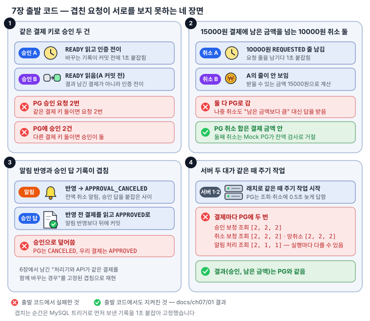

①~③은 같은 결제를 바꾸는 기록끼리, ④는 서버끼리 서로를 보지 못한 경우입니다.

통과한 12개 가운데 "부분 취소 두 건의 기록이 겹쳐도 보정 없이 우리 남은 금액이 카드사 잔액과 같다"는 잠그지 않아도 지켜지는 계약이고, 결정 1에서 다시 설명합니다.

## 선택지와 트레이드오프

이 문제를 해결하면서 내린 결정은 다섯 가지입니다.

### 결정 1. 같은 결제를 바꾸는 기록을 무엇으로 가릴까

이 장에서는 같은 결제를 바꾸는 기록(승인 앞뒤, 취소, 보정, 알림 반영)이 결제 줄을 `select … for update`로 잠그고 읽기로 했습니다.

검토한 선택지는 여섯 가지입니다.

- 결제 줄을 잠그고 읽기(비관적 잠금)
- 잠그지 않음(6장까지)
- 변경 번호 비교: 커밋 직전에 `update … where version = 읽은 번호`, 취소 줄만 더하는 기록에도 번호를 올림
- 상태 조건 UPDATE: 커밋 직전에 `update … where status = 읽은 상태`
- 결제에 JPA `@Version`을 그대로 둠
- Redis 분산 잠금(구현하지 않음)

비교 구현은 운영 서비스(승인·취소·알림 반영·보정)를 그대로 쓰고, 결제를 바꾸려고 읽는 저장소 메서드 하나(`findByOrderIdForUpdate`)만 우선 빈으로 바꿔 끼웠습니다. 잠그지 않음은 그냥 읽습니다.

```java
// src/test/java/com/example/payment/infrastructure/persistence/payment/comparison/NoLockPaymentRepository.java
@Override
public Optional<Payment> findByOrderIdForUpdate(String orderId) {
    return delegate.findByOrderId(orderId);
}
```

잠그지 않음은 같은 결제 기록 계약 11개 중 6개가 실패했습니다. 출발 코드와 같은 6개입니다.

변경 번호 비교는 운영 결제를 바꾸지 않고, 시험 DB에만 `version` 칸을 더해 같은 SQL로 흉내 냈습니다. 결제를 읽을 때 번호를 함께 읽어 두고, 커밋 직전에 읽은 번호와 같을 때만 번호를 올립니다. 어긋나면 409 `INVALID_PAYMENT_TRANSITION`으로 답하고 다시 시도하지 않습니다. 코드 주석에 적은 대로, 충돌을 그대로 드러내야 잠금 방식마다 실패 수를 잴 수 있어서 재시도를 넣지 않았습니다. 결제 줄이 바뀌지 않는 기록(취소 줄만 더하는 취소 요청)에서도 번호를 올리므로, JPA의 `OPTIMISTIC_FORCE_INCREMENT`와 같은 동작입니다.

```java
// src/test/java/com/example/payment/infrastructure/persistence/payment/comparison/VersionCheckPaymentRepository.java
private void checkVersionBeforeCommit(Payment payment) {
    Long readVersion = jdbcTemplate.queryForObject("select version from payment where id = ?", Long.class, payment.getId());
    TransactionSynchronizationManager.registerSynchronization(new TransactionSynchronization() {
        @Override
        public void beforeCommit(boolean readOnly) {
            int changed = jdbcTemplate.update("update payment set version = version + 1 where id = ? and version = ?",
                    payment.getId(), readVersion);
            if (changed == 0) {
                throw new InvalidPaymentTransitionException(payment.getStatus().name(), "CHANGE_CONCURRENTLY");
            }
        }
    });
}
```

변경 번호 비교는 11개 중 2개가 실패했습니다. 남은 금액을 함께 넘는 나중 취소가 "남은 금액보다 큼" 대신 409를 받았습니다. 그리고 부분 취소 두 건의 기록이 겹치는 계약에서 우리 남은 금액이 10000원, PG 잔액이 5000원으로 어긋났습니다. 이 계약은 측정에서 본 어긋남을 고정된 겹침으로 다시 만든 것입니다. 첫 5000원 취소가 PG 답(0.3초 뒤)을 기다리는 동안 두 번째 5000원 취소가 요청 줄을 남기다 1초 붙잡히고, 그사이 온 첫 취소의 답 기록이 번호 충돌로 409가 되어 되돌려졌습니다. PG는 취소했는데 첫 취소를 보낸 클라이언트는 409를 받고, 우리 취소는 요청 상태로 남았습니다. 보정이 돌면 맞춰지겠지만, 보정 전에는 남은 금액이 PG와 다릅니다.

상태 조건 UPDATE는 커밋 직전에 읽은 상태 그대로일 때만 상태를 바꿉니다.

```java
// src/test/java/com/example/payment/infrastructure/persistence/payment/comparison/StatusCheckPaymentRepository.java
public void beforeCommit(boolean readOnly) {
    int changed = jdbcTemplate.update("update payment set status = ? where id = ? and status = ?",
            payment.getStatus().name(), payment.getId(), readStatus.name());
    if (changed == 0) {
        throw new InvalidPaymentTransitionException(readStatus.name(), "CHANGE_CONCURRENTLY");
    }
}
```

상태 조건 UPDATE는 11개 중 3개가 실패했습니다. 결제 상태가 그대로인 취소 요청은 조건이 늘 맞아서, 남은 금액을 함께 넘는 취소 둘이 모두 PG로 갔고 나중 취소도 답을 받았습니다. 같은 키 동시 취소는 키 중복으로 내부 오류였습니다.

`@Version`을 그대로 둔 비교는 운영 결제를 바꾸지 않으려고 빌드에서 만들었습니다. 빌드가 운영 `Payment.java`를 복사하면서 변경 번호 칸 하나만 더한 시험용 결제를 만들고, 이 비교 시험(`jpaVersionTest`)만 그 결제를 클래스 경로 맨 앞에 올립니다. 처음에는 `orm.xml`로 운영 결제에 칸만 덧붙이려 했는데, Hibernate 7.4가 클래스에 없는 칸을 받지 않았습니다(`MemberResolutionException: Could not locate attribute member - version`).

```groovy
// build.gradle
tasks.register('generateVersionedPayment', Copy) {
	from('src/main/java') {
		include 'com/example/payment/domain/payment/Payment.java'
	}
	into versionedPaymentSource
	filter { String line ->
		if (line.trim() == 'private Instant authenticatedAt;') {
			return line + '\n\n    // 7장 비교: 시험에서만 더한 변경 번호(JPA @Version)\n    @jakarta.persistence.Version\n    @Column(name = "version")\n    private Long version;'
		}
		return line
	}
}
```

이 비교는 잠그지 않고 읽고, 버전이 어긋나면 Hibernate가 낸 오류를 그대로 둡니다. 운영 결제에 `@Version`만 붙였을 때와 같습니다. 결과는 11개 중 4개가 실패했습니다.

```text
FAIL 남은 금액을 함께 넘는 취소 두 건이 동시에 오면 나중 취소는 남은 금액보다 크다고 받지 않는다 (1.122s) | org.opentest4j.AssertionFailedError: expected: CANCEL_AMOUNT_EXCEEDS_BALANCE but was: null
FAIL 남은 금액을 함께 넘는 취소 두 건이 동시에 오면 카드사에는 한 건만 보낸다 (1.084s) | org.opentest4j.AssertionFailedError: expected: 1 but was: 2
FAIL 같은 결제 키로 승인 두 건이 동시에 와도 서버 오류로 답하지 않는다 (1.051s) | org.opentest4j.AssertionFailedError: [나중 승인의 답: org.springframework.orm.ObjectOptimisticLockingFailureException: Unexpected row count (expected row count 1 but was 0) [update payment set authenticated_at=?,payment_key=?,status=?,version=? where id=? and version=?] for entity [com.example.payment.domain.payment.Payment with id '9']] Expecting value to be false but
(나머지 7개 통과)
```

위 목록에서 한 줄은 실패 메시지에 주문번호가 들어 있어 뺐습니다. "같은 Idempotency-Key 로 취소 두 건이 동시에 와도 서버 오류로 답하지 않는다"도 나중 취소가 키 중복으로 실패했습니다.

취소 요청은 `payment_cancel`에 줄을 더할 뿐 결제 줄을 바꾸지 않아서 버전이 오르지 않습니다. Hibernate 문서도 버전이 "automatically incremented or updated each time the entity is updated"라고 적고 있습니다. 그래서 남은 금액을 함께 넘는 취소 둘이 모두 PG로 갔습니다. 같은 결제 키 승인 둘은 PG 요청은 한 번이었지만, 나중 승인이 `ObjectOptimisticLockingFailureException`으로 500을 받았습니다. 남은 금액을 넘는 취소에서 변경 번호 비교(강제 증가)와 결과가 갈린 것은 이 차이 때문이고, 같은 키 승인이 500과 409로 갈린 것은 충돌을 409로 바꿔 답했느냐의 차이입니다. 변경 번호 비교는 충돌을 `InvalidPaymentTransitionException`(409)으로 바꾸고, `@Version` 그대로는 `ObjectOptimisticLockingFailureException`을 그대로 둡니다.

결제 줄 잠금은 Spring Data JPA의 `@Lock(PESSIMISTIC_WRITE)`로 둡니다. Hibernate 문서는 `PESSIMISTIC_WRITE`를 "A pessimistic for update lock"으로 설명하고, MySQL에서는 `select … for update`로 나갑니다.

```java
// src/main/java/com/example/payment/infrastructure/persistence/payment/SpringDataPaymentRepository.java
// 7장: MySQL 에서는 select … for update 로 읽는다
@Lock(LockModeType.PESSIMISTIC_WRITE)
@Query("select p from Payment p where p.orderId = :orderId")
Optional<Payment> findLockedByOrderId(@Param("orderId") String orderId);
```

결제 줄 잠금은 11개 모두 통과했습니다.

다섯 방식에 같은 두 입력을 넣었을 때의 결과를 모으면 아래와 같습니다.

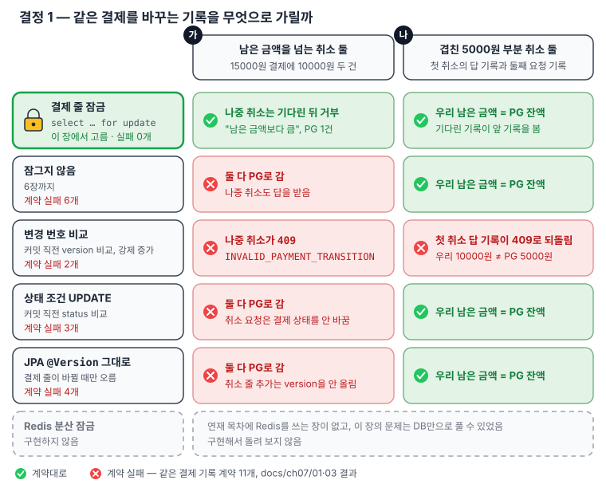

(가)에서는 결제 줄 잠금만 나중 취소를 "남은 금액보다 큼"으로 거부하고, (나)에서는 변경 번호 비교만 PG와 어긋납니다.

결제 줄 잠금을 고른 이유는 두 가지입니다. 첫째, PG 호출이 이미 2장에서 트랜잭션 밖으로 나가 있어서 잠금은 기록하는 짧은 트랜잭션 동안만 쥡니다. PG를 기다리는 동안 다른 요청이 결제 줄에서 기다리지 않습니다. 둘째, 취소 금액 검사는 취소 줄들의 합으로 합니다. 결제 버전만 보면 동시에 더해진 취소 줄을 잡지 못할 수 있는데, 실제로 `@Version` 비교가 그랬습니다. 결제 줄 하나를 잠그면 그 결제에 취소 줄을 더하려는 다른 기록도 그 줄에서 기다리므로, 취소 줄까지 함께 가려집니다.

MySQL 문서는 `select … for update`를 "For index records the search encounters, locks the rows and any associated index entries, the same as if you issued an UPDATE statement for those rows. Other transactions are blocked from updating those rows, from doing SELECT ... FOR SHARE, or from reading the data in certain transaction isolation levels."라고 설명하고, 잠금은 "released when the transaction is committed or rolled back"이라고 적고 있습니다. 기다린 기록이 앞 기록이 남긴 취소 줄을 보는지도 확인해야 했습니다. 격리 수준이 기본값 REPEATABLE READ이고, 문서에는 "all consistent reads within the same transaction read the snapshot established by the first such read in that transaction."라고 적혀 있습니다. 우리 기록 트랜잭션의 첫 문장은 잠금 읽기이고, 취소 목록은 잠금을 얻은 뒤에 읽힙니다. 계약 테스트에서 나중 취소가 앞 취소의 요청 줄까지 빼고 계산해 "남은 금액보다 큼"으로 답한 것으로 이 순서를 확인했습니다.

Redis 분산 잠금은 구현하지 않았습니다. 연재 목차에 Redis를 쓰는 장이 없고, 이 장의 문제는 DB만으로 풀 수 있었기 때문입니다.

이 선택으로 치르는 비용은 같은 결제에 겹친 요청이 순서대로 기다린다는 점입니다. 같은 결제에 1000원 부분 취소 30개를 한꺼번에 보낸 측정에서 결제 줄 잠금의 응답 시간이 잠그지 않음보다 길었습니다. 수치는 아래 "테스트 결과"의 측정에 모았습니다.

다른 선택이 맞는 경우도 있습니다. 같은 결제에 겹치는 요청이 드물고, 기다리게 하기보다 바로 실패로 답하는 편이 낫다면 변경 번호 비교 쪽이 맞을 수 있습니다. 다만 그때도 취소 줄만 더하는 기록에서 번호를 올려야 하고(`@Version` 그대로는 취소 줄을 잡지 못했습니다), PG에 보낸 뒤의 답 기록이 충돌로 되돌려지는 경우를 다시 시도로 처리해야 합니다. 충돌이 실제로 드물다는 것은 측정으로 확인한 다음에 고를 일입니다. 이 장에서는 그 측정을 하지 않았습니다.

### 결정 2. PG 답을 기다리는 결제에 같은 승인이 다시 오면 어떻게 답할까

이 장에서는 PG 답을 기다리는 결제(인증 상태 `AUTHENTICATED`)에 같은 결제 키로 승인이 다시 오면, PG를 부르지 않고 4장의 결과 모름처럼 202 확인 중으로 답하기로 했습니다. 다른 결제 키는 지금처럼 409입니다.

3장에서 "같은 키로 다시 왔더라도 결제가 아직 `AUTHENTICATED`이면 결과로 답하지 않습니다."라고 정했고, 4장의 남은 한계에 "같은 결제 키로 다시 왔는데 결제가 아직 `AUTHENTICATED`이면 여전히 409로 답합니다."라고 적어 넘긴 항목입니다. 결정 1로 겹친 승인이 순서대로 지나가게 되면서, 나중 승인은 앞 승인이 남긴 인증 상태를 보게 됩니다. 그때 무엇으로 답할지를 정해야 했습니다.

검토한 선택지는 세 가지입니다.

- PG를 부르지 않고 202 확인 중으로 답하기
- 지금처럼 할 수 없다고 409로 답하기(비교)
- 첫 요청이 끝날 때까지 기다렸다가 같은 결과로 답하기(비교)

`InProgressConfirmContract`는 첫 승인에 PG가 0.8초 뒤에 답하게 하고, PG가 처리 중인 것을 확인한 뒤 두 번째 승인을 보냅니다. 409 비교는 운영 결과가 `AUTHENTICATED`면 409로 바꿔 답합니다.

```java
// src/test/java/com/example/payment/application/payment/comparison/RejectInProgressConfirmService.java
public PaymentResult confirm(ConfirmPaymentCommand command) {
    PaymentResult result = paymentConfirmService.confirm(command);
    if (result.status() == PaymentStatus.AUTHENTICATED) {
        throw new InvalidPaymentTransitionException(result.status().name(), PaymentAction.AUTHENTICATE.name());
    }
    return result;
}
```

409 비교는 계약 4개 중 1개("같은 결제 키로 승인이 다시 와도 할 수 없다고 답하지 않는다")가 실패했습니다.

기다리기 비교는 결제가 `AUTHENTICATED`를 벗어날 때까지 0.05초마다 다시 읽고, 첫 요청이 PG를 기다릴 수 있는 시간(PG 연결 + 읽기 시간 제한)이 지나면 그 상태 그대로 답합니다.

```java
// src/test/java/com/example/payment/application/payment/comparison/WaitForFirstConfirmService.java
public PaymentResult confirm(ConfirmPaymentCommand command) {
    PaymentResult result = paymentConfirmService.confirm(command);
    Instant deadline = Instant.now().plus(pgProperties.getConnectTimeout()).plus(pgProperties.getReadTimeout());
    while (result.status() == PaymentStatus.AUTHENTICATED && Instant.now().isBefore(deadline)) {
        pause();
        result = paymentQueryService.find(command.orderId());
    }
    return result;
}
```

기다리기 비교는 계약 4개를 모두 통과했습니다. 그래서 계약을 지키지 못하는 비교만 모아 따로 돌리는 known-failing 묶음이 아니라 기본 테스트에 두었습니다.

세 방식에서 다시 온 승인이 지나는 길과 받는 답은 아래와 같습니다.

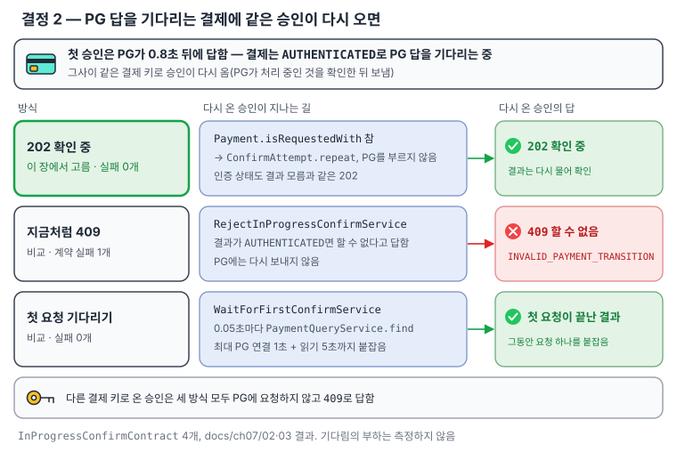

운영 구현은 "이 결제 키로 이미 승인을 요청한 결제인가"를 새로 둡니다. 결과를 남긴 결제뿐 아니라 PG 답을 기다리는 결제도 포함합니다.

```java
// src/main/java/com/example/payment/domain/payment/Payment.java
// 7장: 이 결제 키로 이미 승인을 요청한 결제인가. 결과를 남긴 결제뿐 아니라 카드사 답을 기다리는 결제(인증 상태)도 포함한다 —
// 같은 결제 키로 다시 온 승인은 카드사에 다시 보내지 않는다(isConfirmedWith 는 4장까지의 판단으로 인증 상태를 빼며, 비교 구현이 쓴다)
public boolean isRequestedWith(String requestedKey) {
    return Objects.nonNull(paymentKey) && paymentKey.equals(requestedKey);
}
```

API는 PG 답을 기다리는 결제도 결과 모름과 같은 202로 답합니다.

```java
// src/main/java/com/example/payment/presentation/payment/PaymentController.java
// 결과를 모르는 결제에 다시 온 승인 요청: 카드사에 다시 묻지 않고 확인 중이라는 뜻으로 202 를 준다(4장).
// 7장부터 카드사 답을 기다리는(인증 상태) 결제에 같은 결제 키로 다시 온 요청도 같은 뜻으로 202 를 준다.
// 처음 요청이 시간 초과로 끝날 때는 504(PAYMENT_GATEWAY_NO_RESPONSE)를 그대로 준다
private static HttpStatus statusOf(PaymentResult result) {
    if (result.status().isAwaitingApprovalResult()) {
        return HttpStatus.ACCEPTED;
    }
    return HttpStatus.OK;
}
```

202를 고른 이유는, 같은 결제 키는 이미 PG에 보낸 요청이라 결과를 모르는 결제와 클라이언트에게 같은 뜻이기 때문입니다. 4장에서 결과 모름 결제에 다시 온 같은 승인에 202로 답하기로 했으므로, PG 답을 기다리는 결제도 같은 답으로 맞췄습니다.

이 선택으로 치르는 비용은, 202 응답에는 승인 결과가 없고 지금 상태만 담겨 있어서 클라이언트가 결제 조회(`GET /api/v1/payments/{orderId}`)로 다시 확인해야 한다는 점입니다. 기다리기 비교라면 첫 요청이 끝난 뒤의 결과를 한 번에 받습니다. 대신 기다리는 동안 요청 하나가 PG 연결과 읽기 시간 제한(2장에서 정한 연결 1초, 읽기 5초)까지 붙잡혀 있고, 그동안 0.05초마다 결제를 다시 읽습니다. 이 기다림의 부하는 측정하지 않았습니다.

다른 선택이 맞는 경우도 있습니다. 클라이언트가 202를 받고 다시 묻는 흐름을 갖추기 어렵고, 같은 승인이 다시 오는 일이 드물어 요청을 몇 초 붙잡아도 괜찮다면 기다리기가 맞습니다. 같은 결제 키의 재요청 자체를 클라이언트 버그로 보고 드러내고 싶다면 409가 맞지만, 그때는 첫 요청이 PG를 기다리는 동안 다시 보낸 클라이언트가 409를 받습니다.

### 결정 3. 같은 주문의 준비가 동시에 오면 어떻게 할까

이 장에서는 같은 주문의 준비가 동시에 오면 주문번호 중복 거부(`uk_payment_order_id`)를 잡아, 새 트랜잭션에서 먼저 남은 결제를 다시 읽고 3장 규칙대로 답하기로 했습니다. 금액이 같으면 그 결제(201), 다르면 이미 있는 주문(409)입니다.

결정 1의 잠금으로는 이 경우를 막을 수 없습니다. 준비가 동시에 올 때는 잠글 결제 줄이 아직 없기 때문입니다. 3장에서 "동시에 오는 준비 요청이 흔한 환경이라면 고유 키 위반을 잡는 방식이 조회와 저장 사이의 틈을 DB에 맡긴다는 점에서 더 맞습니다. 다만 위반이 나면 그 트랜잭션은 롤백할 수밖에 없어서, 이미 있는 결제를 다시 읽으려면 새 트랜잭션이 필요해 처리가 복잡해지므로, 동시성 제어를 다루는 7장에서 함께 보겠습니다."라고 적어 둔 부분입니다.

검토한 선택지는 세 가지입니다.

- 주문번호 중복 거부를 잡아 새 트랜잭션에서 다시 읽기
- 잡지 않음(6장까지, 비교)
- MySQL 이름 잠금(`GET_LOCK`)으로 주문번호마다 차례로 준비(비교)

`PrepareConcurrencyContract`는 먼저 보낸 준비의 결제 기록을 1초 붙잡아 두고, 그동안 같은 주문번호의 두 번째 준비를 보냅니다. 두 번째 준비는 첫 결제가 아직 보이지 않을 때 주문번호로 결제를 찾습니다. 잡지 않음은 출발 코드와 같은 한 트랜잭션 구현이고, 계약 4개 중 2개가 실패했습니다. 같은 금액이든 다른 금액이든 나중 준비가 내부 오류였습니다.

이름 잠금 비교는 주문번호마다 이름 잠금을 잡은 뒤 3장 그대로 찾고 없으면 남기고, 커밋한 뒤에 풉니다.

```java
// src/test/java/com/example/payment/application/payment/comparison/NamedLockPrepareService.java
public PaymentResult prepare(PreparePaymentCommand command) {
    String lockName = "payment-prepare:" + command.orderId();
    try (Connection lockConnection = dataSource.getConnection()) {
        acquire(lockConnection, lockName);
        try {
            return paymentPrepareRecorder.prepare(command);
        } finally {
            release(lockConnection, lockName);
        }
    } catch (SQLException failure) {
        throw new IllegalStateException("Could not use a named lock for a preparation.", failure);
    }
}
```

준비 트랜잭션과 다른 연결을 하나 더 쓰는 데는 이유가 있습니다. MySQL 문서에 "Locks obtained with GET_LOCK() are not released when transactions commit or roll back."라고 적혀 있듯이, 이름 잠금은 트랜잭션이 아니라 연결(세션)에 붙습니다. 같은 연결에서 커밋 전에 풀면 다음 준비가 아직 보이지 않는 결제를 찾다가 다시 중복 거부를 받습니다(실행하지는 않았습니다). 그래서 잠금을 쥔 연결을 커밋 뒤 풀 때까지 따로 둡니다. 준비 한 건에 연결이 둘 듭니다. 잠금을 5초 안에 못 잡으면 내부 오류로 알립니다. 이름 잠금 비교는 계약 4개를 모두 통과해서 기본 테스트에 두었습니다.

운영 구현은 준비 기록을 `PaymentPrepareRecorder`라는 다른 빈으로 옮기고, `PaymentPrepareService`는 트랜잭션 없이 중복 거부를 잡습니다.

```java
// src/main/java/com/example/payment/application/payment/PaymentPrepareService.java
public PaymentResult prepare(PreparePaymentCommand command) {
    try {
        return paymentPrepareRecorder.prepare(command);
    } catch (DataIntegrityViolationException duplicated) {
        return paymentPrepareRecorder.prepareAgain(command)
                .orElseThrow(() -> duplicated);
    }
}
```

```java
// src/main/java/com/example/payment/application/payment/PaymentPrepareRecorder.java
// 먼저 남긴 같은 주문번호의 결제를 다시 읽어 3장 규칙대로 답한다. 없으면 비어 있다
@Transactional(readOnly = true)
public Optional<PaymentResult> prepareAgain(PreparePaymentCommand command) {
    return paymentRepository.findByOrderId(command.orderId())
            .map(existing -> repeat(existing, command));
}
```

빈을 나눈 이유는 코드 주석에 적은 대로, 중복 거부가 난 트랜잭션은 이미 되돌리기로 표시되어 그 안에서는 다시 읽어 답할 수 없기 때문입니다. 3장 글에서 "새 트랜잭션이 필요해"라고 적은 부분이 이것입니다. 다시 읽어도 결제가 없으면 주문번호 중복이 아닌 거부이므로 원래 예외를 그대로 알립니다. 이 경로는 운영 전용 테스트 "주문번호가 겹친 것이 아닌 이유로 남기지 못한 준비는 다시 읽어도 결제가 없어 그 이유를 그대로 알린다"가 확인합니다.

겹친 두 준비가 지나는 순서를 그림으로 보면 아래와 같습니다.

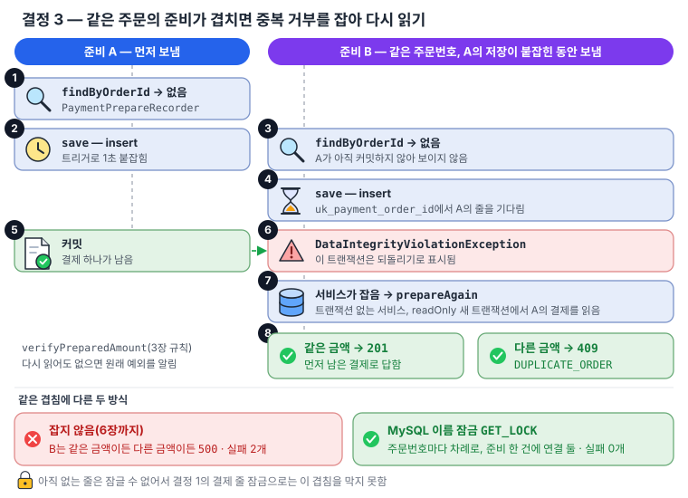

잡아 다시 읽기를 고른 이유는, 3장에서 둔 주문번호 unique 키가 이미 조회와 저장 사이의 틈을 막고 있어서 그 거부를 받아 답만 바꾸면 되기 때문입니다. 이름 잠금처럼 준비마다 연결을 하나 더 쓰지 않고, MySQL 전용 함수에 기대지도 않습니다.

이 선택으로 치르는 비용은, 겹친 나중 준비가 저장에 실패하고 되돌린 뒤 새 트랜잭션에서 한 번 더 읽는다는 점입니다. 또 `DataIntegrityViolationException`은 주문번호 중복만이 아니라 다른 제약 위반에도 나므로, 다시 읽어서 결제가 있는지로 둘을 가릅니다.

다른 선택이 맞는 경우도 있습니다. 가려야 할 동시 작업에 기댈 unique 키가 없다면, 이름 잠금처럼 시작 전에 차례를 정하는 쪽이 맞습니다. 그때는 준비 한 건에 연결 둘이 드는 것과 잠금 대기 시간을 함께 정해야 합니다.

### 결정 4. 같은 키의 취소가 동시에 오면 어떻게 할까

이 장에서는 같은 `Idempotency-Key`로 동시에 온 취소를 결정 1의 잠금 뒤 5장 규칙(같은 키로 다시 온 요청)대로 처리하기로 했습니다. 코드는 바꾸지 않았고, 테스트로 확인했습니다.

5장의 남은 한계에 "코드로 보면 `unique(payment_id, idempotency_key)`가 두 번째 줄을 막아 500으로 답할 것으로 보이지만, 실행해서 확인하지는 않았습니다."라고 적었는데, 출발 코드에서 실행해 보니 실제로 나중 취소가 `uk_payment_cancel_idempotency_key` 중복으로 내부 오류를 받았습니다. 취소 줄이 하나만 남고 PG에서 한 번만 취소된 것은 unique 키와 PG의 멱등키 덕분이었습니다.

검토한 선택지는 두 가지입니다.

- 결정 1의 잠금 뒤 5장 규칙대로 답하기
- unique 키에 맡겨 나중 취소는 중복 거부로 끝내기(출발 코드, 잠그지 않음·상태 조건·`@Version` 비교가 같은 결과)

변경 번호 비교는 나중 취소가 커밋 직전 번호 검사에서 409를 받아 이 계약을 통과했습니다(코드와 실행 결과로 판단했고, 로그로 확인하지는 않았습니다).

결정 1의 잠금이 들어가면 나중 취소는 결제 줄에서 기다렸다가, 앞 취소가 남긴 요청 줄을 찾습니다. 5장에서 정한 대로 아직 PG 답을 남기지 못한 취소면 같은 키로 PG에 다시 보내고, 결과를 남긴 취소면 그 결과로 답합니다.

```java
// src/main/java/com/example/payment/application/payment/PaymentCancelRecorder.java
// 같은 Idempotency-Key 로 이미 받은 취소가 결과를 남겼으면 그 결과를 돌려준다.
// 아직 카드사 답을 남기지 못한 취소면 같은 키로 카드사에 다시 보낸다(5장 결정 5 — 카드사도 같은 키에는 다시 취소하지 않는다).
// 새 취소면 받을 수 있는지 보고 카드사 답을 기다리는 취소로 남긴다
@Transactional
public CancelAttempt request(CancelPaymentCommand command) {
    Payment payment = find(command.orderId());
    CancelRequest request = requestOf(command);
    PaymentCancel repeated = payment.findRepeatedCancel(request).orElse(null);
    if (Objects.isNull(repeated)) {
        PaymentCancel cancel = payment.requestCancel(request, clock.instant());
        return CancelAttempt.send(payment.getPaymentKey(), cancel.getAmount());
    }
    if (repeated.isAwaitingResult()) {
        return CancelAttempt.send(payment.getPaymentKey(), repeated.getAmount());
    }
    return CancelAttempt.repeat(CancelResults.of(payment, repeated));
}
```

잠그지 않을 때와 결정 1의 잠금 뒤를 나란히 놓으면 아래와 같습니다.

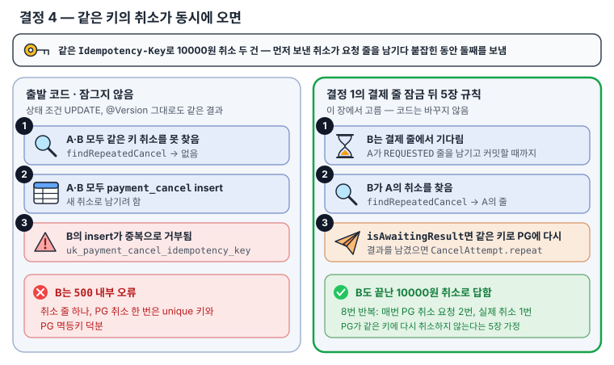

같은 키 동시 취소 테스트 3개는 결정 1 커밋에서 모두 통과했습니다. 출발 코드에서 실패하던 것은 "서버 오류로 답하지 않는다" 하나였습니다. 이 시험을 8번 반복했을 때 매번 PG 취소 요청은 2번, 실제 취소는 1번이었고, 나중 취소의 답은 끝난 10000원 취소였습니다.

고른 이유는 5장에서 이미 같은 키로 다시 온 요청의 규칙을 정해 두었고, 동시에 온 경우도 잠금 뒤에는 "다시 온 요청"과 같아지기 때문입니다. 새 규칙을 만들 필요가 없었습니다.

이 선택으로 치르는 비용은, 앞 취소가 PG 답을 기다리는 사이에 나중 취소가 오면 나중 취소도 같은 키로 PG에 한 번 더 간다는 점입니다. 8번 반복에서 매번 PG 취소 요청은 2번, 실제 취소는 1번이었습니다. PG가 같은 키에 다시 취소하지 않는다는 5장의 가정에 기댑니다.

다른 선택이 맞는 경우도 있습니다. PG가 멱등키를 받지 않는다면 같은 키로 다시 보내는 규칙 자체를 쓸 수 없으니, 앞 취소가 PG 답을 기다리는 중이면 다시 보내지 않고 기다리는 중이라고 답해야 합니다. 이번에는 그 구현을 비교로 돌리지 않았습니다.

### 결정 5. 주기 작업을 서버끼리 어떻게 나눌까

이 장에서는 주기 작업(승인·취소 보정, 받은 알림 처리)을 작업 잠금 테이블(`job_lock`)로 한 번에 서버 한 대만 돌리기로 했습니다. 작업마다 한 줄을 두고, 그 줄을 맡은 서버만 돕니다.

검토한 선택지는 세 가지입니다.

- 작업 잠금 테이블로 작업마다 서버 한 대만 돌리기
- 나누지 않음(6장까지, 서버마다 모든 대상을 돎, 비교)
- 결제·알림마다 점유 시각을 두고 서버끼리 나눠 갖기(비교)

나누지 않음은 서버 여러 대 계약 6개 중 4개가 실패했습니다. 결제마다 PG 조회가 승인 보정·취소 보정·알림 처리 모두 [2, 2, 2]였고, 망취소도 [2, 2, 2]였습니다. 출발 코드에서 [2, 1, 1]이던 알림 처리는, 결정 1의 잠금 뒤에는 한 서버가 처리 도중 멈추지 않게 되어 [2, 2, 2]가 되었습니다. 결과(승인, 남은 금액)는 결정 1의 잠금 덕분에 맞았습니다.

점유 비교는 시험 DB의 `payment`와 `payment_webhook`에만 `claimed_by`, `claimed_until`을 더하고, 주기마다 대상 줄에 "이 서버가 언제까지 맡는다"를 조건부 UPDATE로 먼저 적은 뒤 자기가 맡은 줄만 처리합니다.

```java
// src/test/java/com/example/payment/application/payment/comparison/RowClaimJobs.java
private List<String> claimApprovalTargets(Instant requestedBefore) {
    String claim = newClaim();
    Instant now = clock.instant();
    jdbcTemplate.update("update payment set claimed_by = ?, claimed_until = ? where " + APPROVAL_TARGETS
            + " and (claimed_until is null or claimed_until <= ?) order by authenticated_at limit 100",
            claim, Timestamp.from(now.plus(CLAIM)), Timestamp.from(requestedBefore), Timestamp.from(now));
    return claimedOrders(claim);
}
```

점유 비교는 계약 6개를 모두 통과해서 기본 테스트에 두었습니다.

운영 구현은 작업마다 한 줄을 둔 `job_lock` 테이블입니다.

```sql
-- src/main/resources/schema.sql
-- 7장: 주기 작업(승인·취소 보정, 받은 알림 처리)마다 한 줄. 서버 여러 대 가운데 한 번에 한 대만 그 작업을 돌린다.
-- 작업을 맡은 서버(locked_by)가 locked_until 까지 맡는다. 다 돌면 locked_until 을 그때로 당겨 다음 주기에 아무 서버나 맡게 하고,
-- 맡은 서버가 죽으면 locked_until 이 지난 뒤에 다른 서버가 맡는다
create table if not exists job_lock (
    name         varchar(64)  not null,
    locked_until datetime(6)  not null,
    locked_by    varchar(100),
    primary key (name)
);

insert ignore into job_lock (name, locked_until) values ('payment-reconciliation', '1970-01-01 00:00:00');
insert ignore into job_lock (name, locked_until) values ('payment-webhook', '1970-01-01 00:00:00');
```

맡기는 "맡은 시간이 지났을 때만 바꾼다"는 UPDATE 한 문장입니다. 두 서버가 같은 때 맡으려 해도 MySQL이 같은 줄을 한 번에 하나씩 바꾸고, 나중 문장은 이미 바뀐 줄을 다시 보고 0줄을 바꿉니다. 어느 트랜잭션에도 끼지 않아서, 작업을 도는 동안 DB 연결을 쥐지 않습니다.

```java
// src/main/java/com/example/payment/infrastructure/persistence/job/JobLockRepositoryAdapter.java
@Override
public boolean tryLock(String job, String owner, Instant now, Instant lockedUntil) {
    int locked = jdbcTemplate.update(
            "update job_lock set locked_by = ?, locked_until = ? where name = ? and locked_until <= ?",
            owner, Timestamp.from(lockedUntil), job, Timestamp.from(now));
    return locked == 1;
}

@Override
public void unlock(String job, String owner, Instant now) {
    jdbcTemplate.update("update job_lock set locked_until = ? where name = ? and locked_by = ?",
            Timestamp.from(now), job, owner);
}
```

못 맡은 서버는 기다리지 않고 이번 주기를 넘깁니다. 다 돌면, 도중에 실패해도 `locked_until`을 그때로 당겨 다음 주기에 아무 서버나 맡게 합니다. ShedLock 같은 라이브러리는 쓰지 않고 직접 두었습니다.

```java
// src/main/java/com/example/payment/application/payment/ExclusiveJobRunner.java
public void run(String job, Runnable work) {
    Instant now = clock.instant();
    if (jobLockRepository.tryLock(job, owner, now, now.plus(jobLockProperties.getLease()))) {
        runLocked(job, work);
        return;
    }
    log.debug("Another server is running {}. Skipping this round.", job);
}

private void runLocked(String job, Runnable work) {
    try {
        work.run();
    } finally {
        jobLockRepository.unlock(job, owner, clock.instant());
    }
}
```

서버 세 대가 같은 때 주기 작업을 시작하면 아래 순서로 지나갑니다. 청록 봉투는 작업을 맡은 서버 1, 주황 봉투는 맡지 못한 서버 2·3의 시도입니다.


작업 잠금을 고른 이유는 두 가지입니다. 이 장의 시험 규모(결과 모름 20건)에서는 서버 한 대가 돌아도 충분했고, 작업 단위로 잠그면 결제·취소·알림 세 테이블에 칸을 더하지 않아도 됩니다. 점유 비교는 `payment`와 `payment_webhook`에 칸 둘씩을 더했고, 취소 보정은 결제 줄을 점유하는 식으로 돌렸습니다. 같은 결제를 두 서버가 함께 바꾸는 것은 결정 1의 잠금이 이미 막고 있어서, 이 잠금은 같은 PG 조회와 취소를 서버마다 되풀이하지 않게 하는 데만 씁니다.

측정에서도 서버 수를 늘렸을 때 점유 비교가 더 빠르지 않았습니다. 결과 모름 결제 20건을 서버 1·2·3대가 같은 때 보정한 측정(한 번 실행)에서 PG 조회 횟수는 작업 잠금 20/20/20, 나누지 않음 20/40/60, 결제마다 점유 20/20/20이었고, 주기 한 번에 걸린 시간은 구현과 서버 수에 상관없이 2263~2584ms였습니다. 점유 비교는 첫 서버가 한 번에 100건까지 맡아 20건을 모두 가져갔을 것입니다(서버별로 맡은 건수는 기록하지 않았습니다). 나눠 갖는 효과는 대상이 맡는 단위보다 많아야 나옵니다.

세 방식의 계약 결과와 서버 수에 따른 PG 조회 횟수를 모으면 아래와 같습니다.

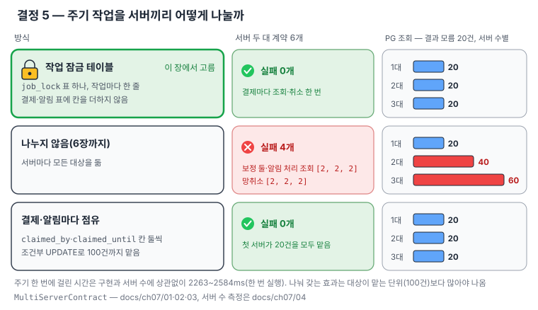

이 선택으로 치르는 비용은 두 가지입니다.

- 한 작업을 서버끼리 나눠 돌릴 수 없습니다. 대상이 많아져도 한 주기는 서버 한 대가 끝까지 돕니다.
- 작업을 맡은 서버가 죽으면 `locked_until`까지 그 작업이 멈춥니다. 맡는 시간(`payment.job-lock.lease`)은 15분으로 두었습니다. 설정 주석에는 보정 한 주기가 결제 100건 × (PG 연결 1초 + 읽기 5초)까지 걸릴 수 있어서 그보다 길게 두었다고 적었지만, 승인 보정과 취소 보정이 한 작업이라 최악이면 각 100건 × 6초로 20분이 걸립니다(결제 줄 잠금 대기는 뺀 값). 15분은 이보다 짧아서, 그때는 앞 서버가 아직 도는 중에 다른 서버도 작업을 맡을 수 있습니다.

다른 선택이 맞는 경우도 있습니다. 보정이나 알림 처리 대상이 많아서 한 대로는 주기 안에 끝나지 않는다면, 결제·알림마다 점유해 나눠 갖는 쪽이 맞습니다.

## 구현

결정을 모아 바꾼 7장 완성 코드에서, 같은 결제에 겹친 두 기록은 결제 줄에서 순서대로 지나갑니다. 남은 금액을 함께 넘는 취소 둘을 예로 들면 메서드가 부르는 순서는 아래와 같습니다.

1. 취소 A: `PaymentCancelService.cancel` → `PaymentCancelRecorder.request`(트랜잭션 시작) → `PaymentRepository.findByOrderIdForUpdate`로 결제 줄 잠금 → `Payment.requestCancel`이 받을 수 있는 금액(15000원)을 확인하고 10000원 요청 줄을 남김
2. 취소 B: 같은 순서로 들어와 `findByOrderIdForUpdate`에서 A의 커밋을 기다림
3. 취소 A: 커밋해 잠금이 풀리고, 트랜잭션 밖에서 PG에 취소를 보냄
4. 취소 B: 잠금을 얻고 취소 목록을 읽음 → 받을 수 있는 금액은 15000 − 10000(A의 요청) = 5000원 → `CancelAmountExceedsBalanceException`
5. 취소 A: PG 답을 받아 `PaymentCancelRecorder.recordOutcome`에서 다시 결제 줄을 잠그고 끝난 취소로 기록

같은 순서를 요청과 응답으로 그리면 아래와 같습니다. 청록 봉투가 취소 A, 주황 봉투가 취소 B입니다.


노란 막대는 A가, 주황 막대는 B가 결제 줄을 쥐고 있는 구간입니다. B는 A가 커밋한 뒤에야 잠금을 얻고, 409로 답하며 롤백할 때 놓습니다. A는 PG에 취소를 보내고 답을 기다리는 그림의 ⑦~⑩ 동안에는 결제 줄을 쥐지 않습니다.

결제를 바꾸려고 읽는 곳은 모두 같은 메서드를 씁니다. 승인 기록(`PaymentRecorder`: 인증, 승인 답, 결과 모름, 보정), 취소 기록(`PaymentCancelRecorder`: 요청, 답, 결과 모름, 보정), 알림 반영(`PaymentWebhookRecorder.follow`)입니다. 조회 전용(`PaymentQueryService`)과 준비, 알림 처리기의 "결제가 있나" 확인은 그냥 읽습니다.

```java
// src/main/java/com/example/payment/domain/payment/PaymentRepository.java
// 7장: 결제를 바꾸려고 읽는다. 결제 줄을 잠그고 읽어(select … for update), 같은 결제를 바꾸려는 다른 기록은 이 기록이 끝날 때까지
// 기다렸다가 이 기록이 남긴 결제를 읽는다
Optional<Payment> findByOrderIdForUpdate(String orderId);
```

```java
// src/main/java/com/example/payment/application/payment/PaymentWebhookRecorder.java
@Transactional
public void follow(String orderId, GatewayPayment gatewayPayment) {
    paymentRepository.findByOrderIdForUpdate(orderId)
            .ifPresent(payment -> payment.follow(gatewayPayment, clock.instant()));
}
```

알림 반영과 승인 답 기록이 겹치는 경우도 같은 길을 지납니다. 알림 반영이 결제 줄을 잠그고 승인 취소를 남기는 사이 승인 답이 오면, 승인 답 기록은 잠금에서 기다렸다가 승인 취소가 된 결제를 읽습니다. 6장에서 만든 대로 승인 결과를 기다리는 결제가 아니면 건드리지 않으므로, 결제는 PG와 같은 승인 취소로 남습니다.

승인 앞 기록은 PG에 보낼 주문번호·금액이나, 같은 결제 키로 다시 온 요청의 지금 결과를 `ConfirmAttempt`로 돌려줍니다. 5장의 `CancelAttempt`와 같은 모양입니다.

```java
// src/main/java/com/example/payment/application/payment/PaymentRecorder.java
@Transactional
public ConfirmAttempt authenticate(ConfirmPaymentCommand command) {
    Payment payment = find(command.orderId());
    payment.verifyAmount(command.amount());
    if (payment.isRequestedWith(command.paymentKey())) {
        return ConfirmAttempt.repeat(PaymentResult.from(payment));
    }
    payment.authenticate(command.paymentKey(), clock.instant());
    return ConfirmAttempt.send(payment.getOrderId(), payment.getAmount());
}
```

```java
// src/main/java/com/example/payment/application/payment/PaymentConfirmService.java
public PaymentResult confirm(ConfirmPaymentCommand command) {
    ConfirmAttempt attempt = paymentRecorder.authenticate(command);
    if (attempt.isRepeated()) {
        return attempt.repeated();
    }
    PaymentApproval approval = requestApproval(command.paymentKey(), attempt);
    return paymentRecorder.recordApproval(command.orderId(), approval);
}
```

주기 작업 둘은 작업 잠금 안에서 돕니다.

```java
// src/main/java/com/example/payment/application/payment/PaymentReconciliationScheduler.java
@Scheduled(fixedDelayString = "${payment.reconciliation.interval}")
public void reconcile() {
    exclusiveJobRunner.run(ExclusiveJobRunner.RECONCILIATION, () -> {
        paymentReconciler.reconcile(clock.instant());
        paymentCancelReconciler.reconcile(clock.instant());
    });
}
```

```java
// src/main/java/com/example/payment/application/payment/PaymentWebhookScheduler.java
@Scheduled(fixedDelayString = "${payment.webhook.interval}")
public void process() {
    exclusiveJobRunner.run(ExclusiveJobRunner.WEBHOOK, paymentWebhookProcessor::process);
}
```

서버 이름(`locked_by`)은 서버가 뜰 때마다 `"server-" + UUID`로 새로 정합니다.

### 앞 장 코드에서 바뀐 것

- 2·4·5·6장의 기록 트랜잭션이 결제를 잠그고 읽습니다(결정 1). 바뀐 줄은 각 기록 클래스의 `find` 한 줄씩입니다.
- 3장의 준비는 `PaymentPrepareRecorder`로 옮기고, 서비스가 중복 거부를 잡습니다(결정 3).
- 3·4장의 `isConfirmedWith`는 남겨 두었습니다. 4장 비교 구현들이 PG 답을 기다리는 결제를 뺀 이 판단을 쓰기 때문입니다. 운영 코드는 `isRequestedWith`를 씁니다(결정 2).
- `PaymentRecorder.authenticate`의 반환형이 바뀌어서, 이 기록을 쓰던 4장 비교 구현 둘(요청 안에서 바로 조회, 기록 재시도)도 `ConfirmAttempt`를 읽게 고쳤습니다. 두 비교의 known-failing 결과는 6장 기록과 같습니다.
- 4장 비교 구현 망취소(`NetCancelReconciler`)의 결제 하나 망취소 메서드를 점유 비교가 부를 수 있게 `public`으로 열었습니다. 4장 계약 결과는 6장 기록과 같은 3개 실패입니다.
- 7장 서버 여러 대 계약의 망취소 시험은 운영 코드에 없는 4장 비교 구현 망취소를 시험 안에서 같은 작업 잠금(`payment-reconciliation`)으로 감싸 돌렸습니다. 망취소를 운영에 둔다면 이 잠금 안에서 돌려야 한다는 확인입니다.

## 테스트 결과

7장 완성 코드에서 전체 테스트(`./gradlew clean check`)를 돌린 결과는 아래와 같습니다. 7장 테스트만 남기고 나머지 통과 목록은 생략했습니다.

```text
tests=561 failures=0 errors=0 time=308.858s
## 주기 작업 잠금
PASS 이미 맡은 작업은 맡은 시간이 지나기 전에 다른 서버가 맡지 못한다 (0.014s)
PASS 작업이 도중에 실패해도 다음 주기에 다른 서버가 바로 맡을 수 있다 (0.013s)
PASS 다른 서버가 맡고 있는 작업은 이 서버에서 돌리지 않고 이번 주기를 넘긴다 (0.008s)
PASS 다른 서버가 맡은 시간이 지난 작업은 이 서버가 맡아 돌린다 (0.012s)
PASS 작업을 다 돌면 다음 주기에 다른 서버가 바로 맡을 수 있다 (0.014s)
## 서버 여러 대의 주기 작업 — 운영 구현
PASS 서버 두 대가 같은 때 망취소 보정을 돌려도 결과 모름 결제마다 카드사에 취소는 한 번만 보낸다 (3.72s)
PASS 서버 두 대가 같은 때 받은 알림을 처리해도 남은 금액은 카드사 잔액과 같다 (1.756s)
PASS 서버 두 대가 같은 때 보정을 돌려도 결과 모름 취소가 있는 결제마다 카드사 조회는 한 번이다 (3.416s)
PASS 서버 두 대가 같은 때 보정을 돌려도 결과 모름 결제는 카드사와 같은 승인으로 맞춰진다 (3.395s)
PASS 서버 두 대가 같은 때 받은 알림을 처리해도 알림이 온 결제마다 카드사 조회는 한 번이다 (1.67s)
PASS 서버 두 대가 같은 때 보정을 돌려도 결과 모름 결제마다 카드사 조회는 한 번이다 (3.368s)
## 카드사 답을 기다리는 결제에 다시 온 승인 — 운영 구현
PASS 카드사 답을 기다리는 결제에 다른 결제 키로 승인이 오면 지금 상태에서는 할 수 없다고 답한다 (0.837s)
PASS 카드사 답을 기다리는 결제에 다른 결제 키로 승인이 와도 카드사에 요청하지 않는다 (0.843s)
PASS 카드사 답을 기다리는 결제에 같은 결제 키로 승인이 다시 오면 카드사에 다시 요청하지 않는다 (0.828s)
PASS 카드사 답을 기다리는 결제에 같은 결제 키로 승인이 다시 와도 할 수 없다고 답하지 않는다 (0.837s)
## 같은 결제를 바꾸는 동시 기록 — 운영 구현
PASS 다른 결제 키로 승인 두 건이 동시에 오면 카드사에는 한 건만 승인된다 (1.045s)
PASS 남은 금액을 함께 넘는 취소 두 건이 동시에 오면 나중 취소는 남은 금액보다 크다고 받지 않는다 (1.072s)
PASS 부분 취소 두 건의 기록이 겹쳐도 보정 없이 우리 남은 금액이 카드사 잔액과 같다 (2.395s)
PASS 같은 결제 키로 승인 두 건이 동시에 와도 카드사에는 승인을 한 번만 요청한다 (1.043s)
PASS 같은 Idempotency-Key 로 취소 두 건이 동시에 와도 서버 오류로 답하지 않는다 (1.059s)
PASS 같은 Idempotency-Key 로 취소 두 건이 동시에 와도 카드사에서는 한 번만 취소된다 (1.059s)
PASS 같은 Idempotency-Key 로 취소 두 건이 동시에 와도 취소 기록은 하나만 남는다 (1.069s)
PASS 알림 반영이 끝나기 전에 승인 답 기록이 겹쳐도 결제는 카드사와 같다 (1.169s)
PASS 같은 결제 키로 승인 두 건이 동시에 와도 서버 오류로 답하지 않는다 (1.045s)
PASS 남은 금액을 함께 넘는 취소 두 건이 동시에 오면 카드사에는 한 건만 보낸다 (1.062s)
PASS 남은 금액을 함께 넘는 취소 두 건이 동시에 와도 카드사에서 취소된 금액은 결제 금액을 넘지 않는다 (1.067s)
## 같은 주문의 동시 준비 — 운영 구현
PASS 같은 주문을 다른 금액으로 동시에 준비해도 결제 금액은 먼저 준비한 금액이다 (1.035s)
PASS 같은 주문을 같은 금액으로 동시에 두 번 준비해도 결제는 하나만 생긴다 (1.039s)
PASS 같은 주문을 다른 금액으로 동시에 준비하면 나중 준비는 이미 있는 주문이라고 받지 않는다 (1.028s)
PASS 같은 주문을 같은 금액으로 동시에 두 번 준비하면 나중 준비도 준비된 결제로 답을 받는다 (1.035s)
## 결제 준비 — 남기지 못한 준비
PASS 주문번호가 겹친 것이 아닌 이유로 남기지 못한 준비는 다시 읽어도 결제가 없어 그 이유를 그대로 알린다 (0.001s)
## 겹쳐 온 요청 — 결제 API
PASS 같은 주문을 같은 금액으로 동시에 두 번 준비하면 나중 준비도 준비 응답을 받는다 (1.057s)
PASS 카드사 답을 기다리는 결제에 같은 승인 요청을 다시 보내면 확인 중이라고 답한다 (0.853s)
(나머지 통과한 테스트 목록 생략)
coverage (JaCoCo, PaymentChallengeApplication 제외)
INSTRUCTION 3286/3321 98.9%
BRANCH 177/187 94.7%
LINE 734/739 99.3%
COMPLEXITY 353/365 96.7%
METHOD 266/269 98.9%
CLASS 73/73 100.0%
```

- 출발 코드에서 실패하던 15개가 모두 통과하였습니다.
- 기본 테스트에 둔 비교 구현 셋(첫 요청이 끝날 때까지 기다리기, MySQL 이름 잠금, 결제·알림마다 점유)도 각각 계약 4·4·6개를 모두 통과했습니다.
- 전체는 6장의 511개에서 561개가 되었습니다. 애플리케이션 시작 클래스를 빼고 잰 라인 커버리지는 99.3%(739줄 중 734줄)였습니다.
- 반복 실행으로 흔들리는지 확인했습니다. 7장 기본 테스트 45개(운영, 통과한 비교, 작업 잠금)를 5번 돌려 5번 모두 통과했고, 7장 known-failing 비교 44개를 3번 돌려 3번 모두 같은 17개가 실패했습니다. 이 반복은 부분 취소 겹침 계약을 더하기 전(커밋 a65d0bb)에 한 것이라 아래 18개와 수가 다릅니다. 그 계약을 더한 뒤에는 같은 결제 기록 계약을 다섯 구현으로 3번 돌려 매번 같은 결과를 얻었습니다.

계약을 지키지 못하는 비교 구현은 `./gradlew knownFailingTest`로 돌렸습니다. 310개 중 76개가 실패했고, 2~6장 비교 구현의 58개는 6장 기록과 같습니다. 7장의 18개는 잠그지 않음 6, 변경 번호 비교 2, 상태 조건 UPDATE 3, 다시 온 승인 409 1, 준비 중복 잡지 않음 2, 주기 작업 나누지 않음 4입니다. `@Version` 그대로는 클래스 경로가 달라 뒤이어 도는 `jpaVersionTest`에서 11개 중 4개가 실패했습니다.

계약 결과를 격자로 모으면 아래와 같습니다.

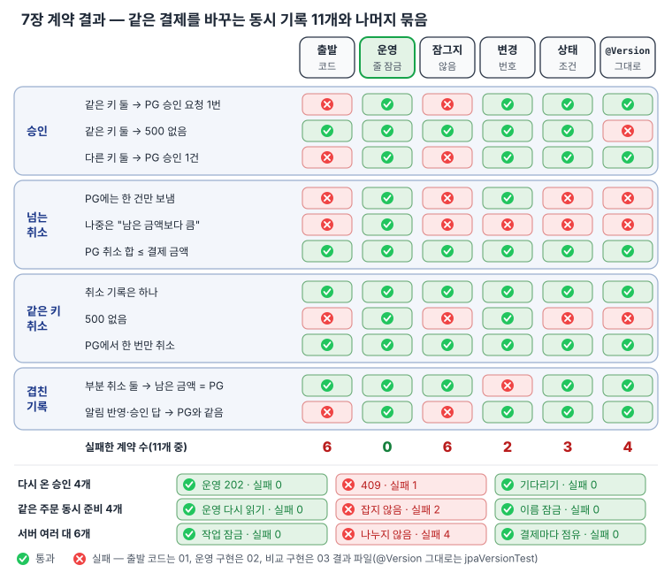

같은 결제 기록 계약 11개를 구현마다 모으면 아래와 같습니다.

- 결제 줄 잠금(운영): 0개 실패
- 잠그지 않음: 6개 실패(같은 키 승인의 PG 요청 2, 다른 키 승인 2건, 남은 금액을 넘는 취소가 PG로 2건, 나중 취소가 답을 받음, 같은 키 취소 500, 알림 반영 뒤 승인으로 덮어씀)
- 변경 번호 비교: 2개 실패(나중 취소가 "남은 금액보다 큼" 대신 409, 겹친 부분 취소 뒤 우리 10000원 ≠ PG 5000원)
- 상태 조건 UPDATE: 3개 실패(남은 금액을 넘는 취소가 PG로 2건, 나중 취소가 답을 받음, 같은 키 취소 500)
- `@Version` 그대로: 4개 실패(남은 금액을 넘는 취소가 PG로 2건, 나중 취소가 답을 받음, 같은 키 취소 500, 같은 키 승인 500)

"카드사에서 취소된 금액은 결제 금액을 넘지 않는다", "같은 Idempotency-Key 로 취소 두 건이 동시에 와도 취소 기록은 하나만 남는다", "카드사에서는 한 번만 취소된다"는 모든 구현이 통과했습니다. 앞의 것은 Mock PG의 잔액 검사가, 뒤의 둘은 unique 키와 PG 멱등키가 지켜 준 것입니다.

나머지 계약은 아래와 같습니다.

- 다시 온 승인(4개): 운영(202) 0개 실패, 409 1개 실패, 기다리기 0개 실패
- 같은 주문 동시 준비(4개): 운영(잡아 다시 읽기) 0개, 잡지 않음 2개, 이름 잠금 0개 실패
- 서버 여러 대(6개): 작업 잠금(운영) 0개, 나누지 않음 4개, 결제마다 점유 0개 실패

### 같은 결제에 동시 요청 N개를 보낸 측정

계약 테스트는 두 요청의 겹침을 고정합니다. 실제로 여러 요청이 한꺼번에 오면 어떻게 되는지 보려고, `./gradlew concurrencyMeasurement`로 같은 결제에 동시 요청 N개(10, 30)를 스레드 N개에서 래치로 한꺼번에 보냈습니다. 이 측정은 트리거로 겹침을 고정하지 않고, PG는 바로 답합니다. 결정 1·2·3·5가 모두 들어간 코드에서 결제를 바꾸려고 읽는 저장소만 구현마다 바꿨습니다. 묶음마다 결제 3건으로 돌렸고, 전체를 한 번 실행한 값입니다.

연결 풀은 기본값 10개라, N=30이어도 한 번에 기록하는 요청은 10개까지입니다. 잠그지 않음의 PG 승인 요청 10은 이 수와 같습니다. 풀 크기를 바꿔 돌리지는 않았습니다.

취소는 승인된 15000원 결제에 1000원 부분 취소 N개(`Idempotency-Key`는 모두 다름)를 보냅니다. 15개까지만 남은 금액 안입니다. N=30의 결과는 아래와 같습니다.

```text
운영 구현(결제 줄 잠금) | 취소 N=30 #1 | {CANCEL_AMOUNT_EXCEEDS_BALANCE=15, DONE=15} | 응답 ms 중앙 90, 최대 145 | 카드사 취소 요청 15, 취소 15, 카드사 잔액 0, 우리 남은 금액 0
운영 구현(결제 줄 잠금) | 취소 N=30 #2 | {CANCEL_AMOUNT_EXCEEDS_BALANCE=15, DONE=15} | 응답 ms 중앙 90, 최대 146 | 카드사 취소 요청 15, 취소 15, 카드사 잔액 0, 우리 남은 금액 0
운영 구현(결제 줄 잠금) | 취소 N=30 #3 | {CANCEL_AMOUNT_EXCEEDS_BALANCE=15, DONE=15} | 응답 ms 중앙 88, 최대 138 | 카드사 취소 요청 15, 취소 15, 카드사 잔액 0, 우리 남은 금액 0
잠그지 않음 | 취소 N=30 #1 | {CANCEL_AMOUNT_EXCEEDS_BALANCE=9, DONE=15, FAILED=6} | 응답 ms 중앙 65, 최대 77 | 카드사 취소 요청 21, 취소 15, 카드사 잔액 0, 우리 남은 금액 0
잠그지 않음 | 취소 N=30 #2 | {CANCEL_AMOUNT_EXCEEDS_BALANCE=10, DONE=15, FAILED=5} | 응답 ms 중앙 42, 최대 52 | 카드사 취소 요청 20, 취소 15, 카드사 잔액 0, 우리 남은 금액 0
잠그지 않음 | 취소 N=30 #3 | {CANCEL_AMOUNT_EXCEEDS_BALANCE=9, DONE=15, FAILED=6} | 응답 ms 중앙 51, 최대 63 | 카드사 취소 요청 21, 취소 15, 카드사 잔액 0, 우리 남은 금액 0
상태 조건 UPDATE, 어긋나면 409 | 취소 N=30 #1 | {CANCEL_AMOUNT_EXCEEDS_BALANCE=6, DONE=15, FAILED=9} | 응답 ms 중앙 118, 최대 162 | 카드사 취소 요청 24, 취소 15, 카드사 잔액 0, 우리 남은 금액 0
상태 조건 UPDATE, 어긋나면 409 | 취소 N=30 #2 | {CANCEL_AMOUNT_EXCEEDS_BALANCE=6, DONE=15, FAILED=9} | 응답 ms 중앙 105, 최대 136 | 카드사 취소 요청 24, 취소 15, 카드사 잔액 0, 우리 남은 금액 0
상태 조건 UPDATE, 어긋나면 409 | 취소 N=30 #3 | {CANCEL_AMOUNT_EXCEEDS_BALANCE=6, DONE=15, FAILED=9} | 응답 ms 중앙 106, 최대 139 | 카드사 취소 요청 24, 취소 15, 카드사 잔액 0, 우리 남은 금액 0
변경 번호 비교, 어긋나면 409 | 취소 N=30 #1 | {DONE=1, INVALID_PAYMENT_TRANSITION=29} | 응답 ms 중앙 77, 최대 103 | 카드사 취소 요청 3, 취소 3, 카드사 잔액 12000, 우리 남은 금액 14000
변경 번호 비교, 어긋나면 409 | 취소 N=30 #2 | {DONE=1, INVALID_PAYMENT_TRANSITION=29} | 응답 ms 중앙 39, 최대 55 | 카드사 취소 요청 3, 취소 3, 카드사 잔액 12000, 우리 남은 금액 14000
변경 번호 비교, 어긋나면 409 | 취소 N=30 #3 | {DONE=2, INVALID_PAYMENT_TRANSITION=28} | 응답 ms 중앙 24, 최대 50 | 카드사 취소 요청 3, 취소 3, 카드사 잔액 12000, 우리 남은 금액 13000
@Version 그대로, 어긋나면 그대로 오류 | 취소 N=30 #1 | {CANCEL_AMOUNT_EXCEEDS_BALANCE=7, DONE=15, FAILED=8} | 응답 ms 중앙 97, 최대 136 | 카드사 취소 요청 23, 취소 15, 카드사 잔액 0, 우리 남은 금액 0
@Version 그대로, 어긋나면 그대로 오류 | 취소 N=30 #2 | {CANCEL_AMOUNT_EXCEEDS_BALANCE=10, DONE=15, FAILED=5} | 응답 ms 중앙 96, 최대 113 | 카드사 취소 요청 20, 취소 15, 카드사 잔액 0, 우리 남은 금액 0
@Version 그대로, 어긋나면 그대로 오류 | 취소 N=30 #3 | {CANCEL_AMOUNT_EXCEEDS_BALANCE=10, DONE=15, FAILED=5} | 응답 ms 중앙 65, 최대 81 | 카드사 취소 요청 20, 취소 15, 카드사 잔액 0, 우리 남은 금액 0
```

`DONE`은 끝난 취소, `FAILED`는 PG가 거절한 취소, `CANCEL_AMOUNT_EXCEEDS_BALANCE`는 우리가 PG에 보내기 전에 거부한 취소입니다. "우리 남은 금액"은 결제 금액에서 끝난 취소를 뺀 값(보정 전)입니다.

N=30 결과를 구현마다 그리면 아래와 같습니다.

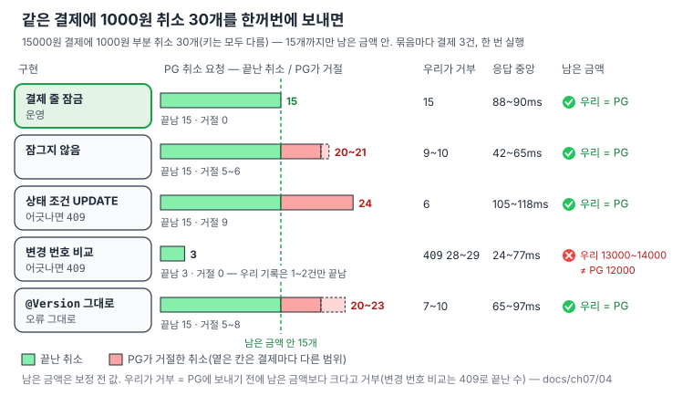

- 결제 줄 잠금만 PG 취소 요청이 정확히 15였습니다. 남은 금액 안의 15개만 PG로 가고, 나머지 15개는 보내기 전에 거부했습니다. 응답 중앙값은 88~90ms, 최대 138~146ms입니다.
- 잠그지 않음과 `@Version` 그대로는 PG 취소 요청이 20~23이었고, 넘친 5~8개는 PG가 거절했습니다. 끝난 취소는 15개라 남은 금액은 PG와 같았지만, 남은 금액을 넘는 취소가 PG까지 갔습니다. 응답 중앙값은 잠그지 않음 42~65ms, `@Version` 그대로 65~97ms입니다.
- 상태 조건 UPDATE는 PG 취소 요청이 24, PG 거절이 9였습니다. 응답 중앙값은 105~118ms였습니다.
- 변경 번호 비교는 끝난 취소가 1~2건이고 나머지는 409였습니다. PG 취소 요청은 3이었는데 우리 남은 금액은 13000~14000원, PG 잔액은 12000원으로 어긋났습니다. PG에 보낸 뒤의 답 기록이 409로 되돌려져 요청 상태로 남은 것으로 보입니다(측정에서는 DB를 읽지 않았고, 계약 시험에서는 DB로 확인했습니다). 결정 1에서 설명한 계약 실패가 여러 요청에서도 나타난 것입니다.

N=10은 모두 남은 금액 안이라 결제 줄 잠금·잠그지 않음·상태 조건·`@Version` 그대로 모두 10개가 끝났습니다. 응답 중앙값은 아래와 같습니다.

- 결제 줄 잠금: 56~71ms
- 잠그지 않음: 24~35ms
- 상태 조건 UPDATE: 54~76ms
- `@Version` 그대로: 34~47ms

변경 번호 비교는 끝난 취소 1, 409가 9였고, 첫 결제에서는 PG 취소 요청 2에 우리 14000원·PG 13000원으로 어긋났습니다.

같은 결제 키 승인 N개도 보냈습니다. 결정 2가 들어간 코드라 PG 답을 기다리는 결제에 다시 온 같은 키는 `AUTHENTICATED`(API 202)로 답합니다.

- 결제 줄 잠금: PG 승인 요청 1, N=30에서 승인 1·확인 중 29, 응답 중앙값 14ms(N=10은 승인 1·확인 중 9, 8~9ms)
- 잠그지 않음: PG 승인 요청 10(N=10·30 모두), N=30은 승인 10·확인 중 20
- 상태 조건 UPDATE: PG 승인 요청 1, N=30에서 승인 1·확인 중 20·409가 9
- 변경 번호 비교: PG 승인 요청 1, N=30에서 승인 1·확인 중 2·409가 27
- `@Version` 그대로: PG 승인 요청 1, N=30에서 승인 1·확인 중 20·내부 오류 9

서버 수에 따른 측정은 결정 5에 적은 그대로입니다.

이번 장에는 처리량에 대한 주장이 없어서 k6는 돌리지 않았습니다.

## 남은 한계

이 장의 구조로도 아래 문제들은 아직 해결하지 못합니다.

- 잠금 대기 시간을 정하지 않았습니다. MySQL `innodb_lock_wait_timeout`은 기본값 50초이고, 문서는 "The length of time in seconds an InnoDB transaction waits for a row lock before giving up."라고 설명합니다. 같은 결제에 겹친 기록은 최대 50초까지 기다린 뒤 오류를 받을 수 있습니다. JPA 잠금 시간 제한도 두지 않았습니다. 기록 트랜잭션이 짧아서 이번 측정에서는 최대 146ms였지만, 잠금을 쥔 기록이 느려지는 경우는 실행하지 않았습니다.
- 같은 결제에 요청이 몰리면 모두 순서대로 기다립니다. 이번에는 같은 결제에 30개까지만 보냈고, 그보다 많을 때의 대기는 측정하지 않았습니다.
- 교착 상태는 시험하지 않았습니다. 지금 기록은 트랜잭션마다 결제 줄 하나만 잠그지만, 여러 결제를 한 트랜잭션에서 잠그는 기록이 생기면 다시 봐야 합니다.
- 작업을 맡은 서버가 죽으면 맡는 시간(15분)이 지날 때까지 보정과 알림 처리가 멈춥니다. 맡은 시간이 지나면 다른 서버가 맡는 것은 단위 테스트로 확인했지만, 실제로 서버를 죽여 보지는 않았습니다.
- 승인·취소 보정 한 주기는 최악이면 20분(각 100건 × 6초, 결제 줄 잠금 대기 제외)으로 맡는 시간 15분보다 길어, 그때는 두 서버가 같은 작업을 함께 돌 수 있습니다. 맡는 시간은 이번 장에서 고치지 않았고, 이 경우를 실행하지도 않았습니다.
- 작업 잠금은 각 서버의 시계로 "지금"을 정해 `locked_until`과 비교합니다. 서버끼리 시계가 어긋나면 맡는 시간이 그만큼 짧거나 길어집니다. 이 장의 서버 두 대는 같은 JVM이라 시계가 같았고, 어긋난 경우는 실행하지 않았습니다.
- 한 작업을 한 서버가 돌므로, 4장에서 적은 한계(닫히지 않는 결제가 100건 넘게 쌓이면 그 뒤 결제는 보정되지 않음)도 그대로입니다.
- 남은 금액을 넘는 취소가 PG에서 거절된 것은 Mock PG가 잔액 검사를 하기 때문입니다. 실제 PG의 같은 동작은 이 장에서 확인하지 않았습니다. 이 장의 잠금 뒤에는 그런 취소가 PG로 가지 않습니다.
- 같은 키로 동시에 온 취소는 PG에 같은 키로 한 번 더 갑니다(PG 요청 2, 실제 취소 1). PG가 같은 키에 다시 취소하지 않는다는 5장의 가정에 기댑니다.
- 서버 여러 대는 한 JVM 안의 두 앱으로만 재현했습니다. 서버 사이 네트워크나 DB 연결이 끊기는 경우는 다루지 않았습니다.
- 다시 온 승인을 기다리는 비교와 이름 잠금 비교의 부하(다시 읽기, 연결 둘)는 측정하지 않았습니다.

1장부터 6장까지 7장으로 넘긴 항목은 이렇게 되었습니다.

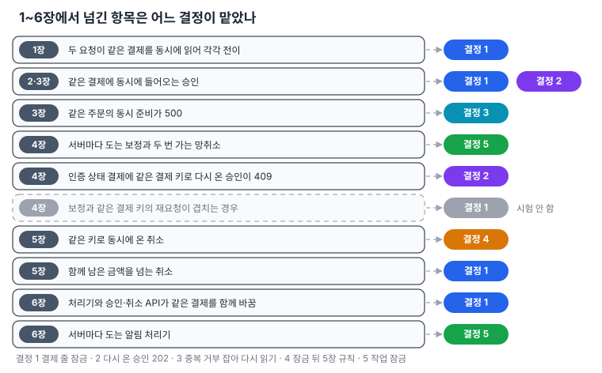

- 1장 "두 요청이 같은 결제를 동시에 읽어 각각 전이하면": 결제를 바꾸는 기록이 결제 줄을 잠그고 읽어, 나중 기록이 앞 기록이 남긴 결제를 보고 전이합니다(결정 1).
- 2·3장 같은 결제에 동시에 들어오는 승인: 같은 결제 키는 PG에 한 번만 가고 나머지는 202, 다른 결제 키는 409입니다(결정 1·2).
- 3장 같은 주문의 동시 준비가 500: 중복 거부를 잡아 다시 읽고 201 또는 409로 답합니다(결정 3).
- 4장 서버마다 도는 보정과 두 번 가는 망취소: 보정은 작업 잠금으로 한 대만 돌아 결제마다 조회가 한 번이고, 망취소를 같은 작업 잠금으로 감싸 돌리면 결제마다 취소도 한 번입니다(결정 5). PG 답을 기다리는 결제에 같은 결제 키로 다시 온 요청은 409 대신 202입니다(결정 2). "보정과 같은 결제 키의 재요청이 겹치는 경우"는 둘 다 결정 1의 잠금을 지나지만, 이 장에서도 따로 시험하지 않았습니다.
- 5장 같은 키 동시 취소와 함께 남은 금액을 넘는 취소: 같은 키는 잠금 뒤 5장 규칙으로 풀렸고(결정 4), 남은 금액을 넘는 나중 취소는 PG에 보내기 전에 거부합니다(결정 1).
- 6장 처리기와 승인·취소 API가 같은 결제를 동시에 바꾸는 경우: 알림 반영도 같은 잠금을 써서, 승인 답 기록이 알림 반영을 덮어쓰지 않습니다(결정 1). 서버마다 도는 처리기는 작업 잠금으로 한 대만 돕니다(결정 5).

## 요약

오늘은 같은 결제와 같은 주문에 요청이 겹쳐 올 때와 결제 서버가 여러 대일 때 결제를 지키는 방법을 정리하였습니다. 요약하자면 아래와 같습니다.

- 잠그지 않고 읽어 바꾸고 주기 작업이 서버마다 도는 출발 코드에서는 7장 테스트 27개 중 15개가 실패했습니다. 같은 승인이 PG에 두 번 갔고, 남은 금액을 넘는 취소가 PG까지 갔고, 승인 답 기록이 알림 반영을 덮어썼고, 동시 준비는 500이었고, 서버 두 대는 결제마다 PG에 두 번 조회했습니다.
- 같은 결제를 바꾸는 기록은 결제 줄을 `select … for update`로 잠급니다. 취소 줄을 더하는 기록은 결제 버전을 올리지 않아 `@Version` 그대로는 남은 금액을 넘는 취소를 막지 못했고, 강제로 번호를 올린 비교는 PG에 보낸 뒤의 답 기록을 409로 되돌려 남은 금액이 PG와 어긋났습니다. 대신 겹친 요청은 기다리고, 1000원 취소 30개의 응답 중앙값은 잠그지 않을 때의 약 두 배가 되었습니다.
- PG 답을 기다리는 결제에 같은 결제 키로 다시 온 승인은 PG를 부르지 않고 202 확인 중으로 답합니다. 4장의 결과 모름과 같은 답입니다.
- 같은 주문의 동시 준비는 주문번호 중복 거부를 잡아 새 트랜잭션에서 다시 읽고 201 또는 409로 답합니다. 아직 없는 줄은 잠글 수 없어서 결정 1로는 막을 수 없었습니다.
- 같은 키 동시 취소는 코드를 바꾸지 않고 결정 1의 잠금 뒤 5장 규칙으로 풀렸습니다.
- 주기 작업은 작업 잠금 테이블로 한 번에 서버 한 대만 돕니다. 서버 3대에서 나누지 않으면 PG 조회가 60번이었고, 작업 잠금은 20번이었습니다.

정리하면서 "버전 비교"라는 같은 이름 아래에서도 무엇이 버전을 올리느냐에 따라 결과가 달라진다는 것을 알 수 있었습니다. 결제 줄이 바뀔 때만 오르는 `@Version`은 취소 줄을 더하는 기록을 보지 못했고, 모든 기록에서 번호를 올리자 이번에는 PG에 이미 보낸 취소의 답 기록까지 충돌로 되돌렸습니다. 결제 하나의 상태가 결제 줄과 취소 줄들에 나뉘어 있어서, 결제 줄 하나를 잠가 그 묶음 전체를 가리는 쪽이 이 구조에 맞았습니다.

## 다음 글 예고

다음 글은 2부의 두 번째 글로, 8장 결제와 재고·포인트·쿠폰을 다룹니다. 지금까지는 결제 하나만 지켰는데, 결제와 함께 재고를 줄이고 포인트와 쿠폰을 쓰는 경우에는 결제 밖의 데이터도 같은 결과로 맞춰야 합니다.

참조 :

- [Locking Reads — MySQL 8.4 Reference Manual](https://dev.mysql.com/doc/refman/8.4/en/innodb-locking-reads.html)
- [Consistent Nonlocking Reads — MySQL 8.4 Reference Manual](https://dev.mysql.com/doc/refman/8.4/en/innodb-consistent-read.html)
- [InnoDB Startup Options and System Variables(innodb_lock_wait_timeout) — MySQL 8.4 Reference Manual](https://dev.mysql.com/doc/refman/8.4/en/innodb-parameters.html#sysvar_innodb_lock_wait_timeout)
- [Locking Functions(GET_LOCK) — MySQL 8.4 Reference Manual](https://dev.mysql.com/doc/refman/8.4/en/locking-functions.html)
- [An Introduction to Hibernate 7(Lock modes, Version attributes) — Hibernate ORM 7.0](https://docs.hibernate.org/orm/7.0/introduction/html_single/Hibernate_Introduction.html)
