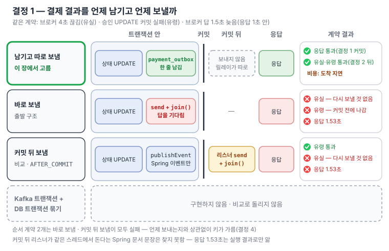
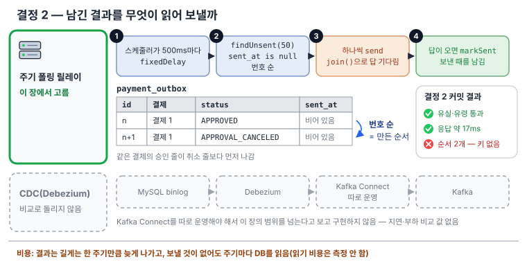
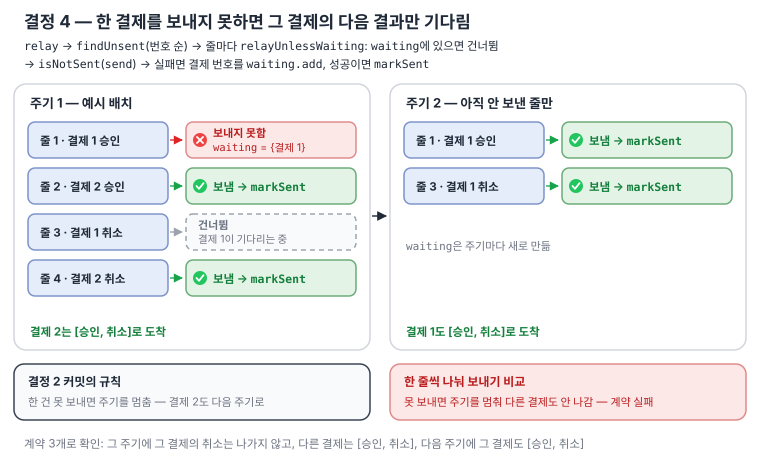
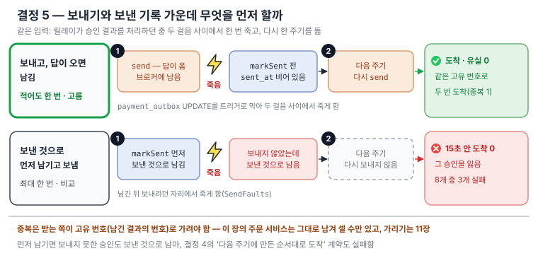
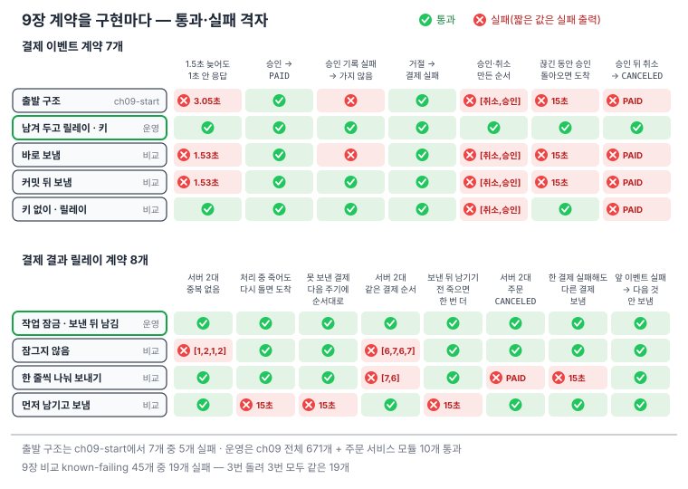
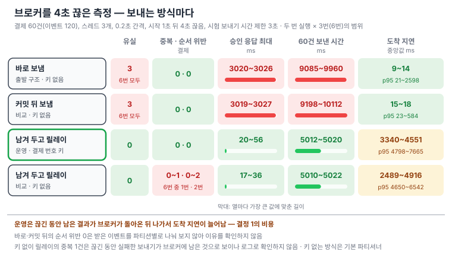
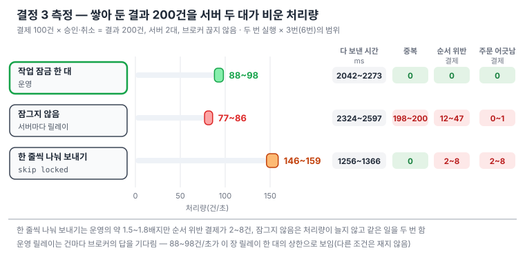

이전에 [결제와 재고·포인트·쿠폰](../payment-stock-point-coupon/)에 대해 작성하였습니다. 그 글에서는 재고·포인트·쿠폰을 결제와 같은 MySQL에 두고, 승인 요청 전에 잡았다가 결제 상태가 승인 없이 끝나거나 전액 취소되는 그 트랜잭션에서 한 번 돌려주도록 바꿨습니다. 그리고 다음 글 예고에 "이 데이터가 다른 서비스로 나뉘면 결제의 상태 전이와 같은 트랜잭션에서 돌려준다는 이 장의 방법을 그대로 쓸 수 없습니다."라고 적었습니다.

서비스가 나뉘면 결제 서버는 다른 서비스의 DB를 트랜잭션에 넣을 수 없습니다. 결제 결과를 메시지로 알리고, 받는 쪽이 그 결과로 자기 데이터를 바꿔야 합니다. 이때 결제는 승인으로 커밋됐는데 알림이 가지 않거나, 반대로 결제 기록은 실패했는데 알림만 가면 두 서비스의 데이터가 서로 다른 결과를 말하게 됩니다.

오늘은 연재의 아홉 번째 글이자 3부 "서비스를 분리하면"의 첫 글로, 결제 결과를 다른 서비스에 Kafka로 알리는 방법을 정리하도록 하겠습니다. 결제 결과를 언제 남기고 언제 보낼지, 남긴 결과를 무엇이 읽어 보낼지, 서버가 여러 대일 때 누가 보낼지, 같은 결제의 이벤트 순서를 어떻게 지킬지, 보내기와 보낸 기록 가운데 무엇을 먼저 할지를 차례로 정하고, 다른 선택지를 같은 계약 테스트와 같은 측정으로 비교합니다.

범위를 먼저 밝히겠습니다. 이 장에서 새로 나눈 서비스는 주문 서비스(`order-service` 모듈) 하나입니다. 주문 서비스는 결제 결과를 받아 주문 상태를 바꿉니다. 재고·포인트·쿠폰은 8장 그대로 결제 서버 안에 있고, 재고를 다른 서비스로 나누는 일은 10장에서 다룹니다. 받는 쪽의 중복 가리기·재시도·실패 모음(DLQ)은 11장 몫이라, 이 장의 주문 서비스는 받은 이벤트를 그대로 남기고 받은 순서대로 주문 상태를 바꾸기만 합니다. Redis는 쓰지 않았습니다.

이 장의 코드는 [payment-challenge](https://github.com/qkrxodud/payment-challenge/tree/chapter-09)의 `chapter-09` 브랜치에 있고, 출발 코드는 `ch09-start`, 완성 코드는 `ch09` 태그입니다.

## 현재 구조: 상태를 바꾼 자리에서 바로 보내는 결제 이벤트

이 장의 문제를 재현하려면 결제 결과를 보내는 코드와 받는 서비스가 먼저 있어야 합니다. 그래서 출발 코드(`ch09-start`)에 가장 먼저 떠오르는 방법으로 넣었습니다. 결제가 결과 상태로 바뀐 바로 그 자리, 같은 트랜잭션 안에서 Kafka에 키 없이 보내고 브로커가 받았다는 답을 기다립니다. 보내지 못하면 로그만 남기고, 이벤트 때문에 결제 기록을 롤백하지는 않습니다.

```java
// src/main/java/com/example/payment/application/payment/PaymentEvents.java (ch09-start)
public void publishIfChanged(Payment payment, PaymentStatus before) {
    if (payment.announcesFrom(before)) {
        publish(PaymentEvent.of(UUID.randomUUID().toString(), payment, clock.instant()));
    }
}

private void publish(PaymentEvent event) {
    try {
        paymentEventSender.send(event);
    } catch (PaymentEventNotSentException notSent) {
        log.warn("Could not send payment event {} for order {}.", event.getEventId(), event.getOrderId());
    }
}
```

이 메서드는 결제를 바꾸는 기록 다섯 곳이 부릅니다. 승인 답 기록(`PaymentRecorder.recordApproval`), 결과 모름 보정(`recordInquiry`), 취소 답 기록(`PaymentCancelRecorder.recordOutcome`), 취소 보정(`recordInquiry`), 알림 반영(`PaymentWebhookRecorder.follow`)입니다. 모두 8장에서 잡아 둔 것을 돌려주던 `releaseIfClosed` 바로 뒤에서 부릅니다.

알리는 때는 결제가 결과 상태로 바뀔 때뿐입니다. 결과 상태는 승인, 매입, 승인 실패, 만료, 승인 취소, 매입 취소 여섯 가지입니다. 준비·인증·결과 모름은 결과가 아니라 알리지 않고, 웹훅과 보정이 이미 지난 상태를 다시 보거나 부분 취소처럼 상태가 그대로인 기록도 알리지 않습니다.

```java
// src/main/java/com/example/payment/domain/payment/Payment.java
// 9장: 이 상태(before)에서 지금 상태로 오며 결제 결과가 새로 정해졌는가. 상태가 바뀌었고 바뀐 상태가 결과일 때만 맞다 —
// 이미 지난 상태를 다시 보거나(웹훅·보정이 같은 결과를 다시 봄) 부분 취소처럼 상태가 그대로면 아니다
public boolean announcesFrom(PaymentStatus before) {
    return status != before && status.isOutcome();
}
```

보내는 쪽은 이벤트를 JSON으로 결제 이벤트 토픽(`payment-events`, 파티션 2개)에 싣고 `join()`으로 답을 기다립니다. 출발 코드는 키를 주지 않아 어느 파티션에 실을지 프로듀서가 정합니다. 토픽과 파티션의 구조는 [아파치 카프카의 기본 구조](../kafka-basics/)에서 정리하였습니다.

```java
// src/main/java/com/example/payment/infrastructure/kafka/KafkaPaymentEventSender.java (ch09-start)
@Override
public void send(PaymentEvent event) {
    String body = jsonMapper.writeValueAsString(PaymentEventMessage.from(event));
    try {
        kafkaTemplate.send(paymentEventProperties.getTopic(), body).join();
    } catch (CompletionException notConfirmed) {
        throw new PaymentEventNotSentException(event.getEventId(), notConfirmed.getCause().getClass().getSimpleName());
    } catch (KafkaException notSent) {
        // 토픽 정보를 정한 시간(max.block.ms) 안에 받지 못하면 보내기 전에 실패한다
        throw new PaymentEventNotSentException(event.getEventId(), notSent.getClass().getSimpleName());
    }
}
```

`KafkaException`을 따로 잡는 부분은 처음 돌려 보고 더했습니다. 브로커가 늦거나 끊겨 토픽 정보를 `max.block.ms` 안에 받지 못하면 `send`가 보내기 전에 예외를 던집니다. 첫 실행에서는 이 예외가 잡히지 않고 밖으로 나가, 응답 시험이 `KafkaException: Send failed`로 실패했습니다. 출발 구조는 "보내지 못하면 로그만 남긴다"였으므로 두 경우를 모두 같은 예외로 바꾼 뒤에 커밋했습니다.

받는 쪽인 주문 서비스는 새 모듈입니다. 웹 API는 없고, 결제 이벤트 토픽을 파티션마다 따로 읽습니다(`spring.kafka.listener.concurrency=2`). 받은 이벤트를 먼저 그대로 남기고(같은 이벤트가 다시 오면 한 줄 더), 주문 상태를 그 이벤트의 결제 결과대로 바꿉니다. 주문을 만드는 API도 이 장의 범위가 아니라서, 결제 이벤트가 처음 오면 주문을 만듭니다.

```java
// order-service/src/main/java/com/example/order/application/order/OrderPaymentService.java
@Transactional
public void apply(PaymentEventCommand command) {
    Instant now = clock.instant();
    receivedPaymentEventRepository.save(ReceivedPaymentEvent.of(command.eventId(), command.orderId(),
            command.paymentStatus(), command.occurredAt(), command.partition(), command.offset(), now));
    PaymentOutcome outcome = PaymentOutcome.valueOf(command.paymentStatus());
    orderRepository.findByOrderId(command.orderId())
            .ifPresentOrElse(order -> order.follow(outcome, now),
                    () -> orderRepository.save(Order.paidWith(command.orderId(), outcome, now)));
}
```

승인·매입은 결제 완료(`PAID`), 승인 실패·만료는 결제 실패(`PAYMENT_FAILED`), 승인 취소·매입 취소는 취소(`CANCELED`)가 됩니다. `Order.follow`는 앞서 받은 결과보다 오래된 결과인지 보지 않습니다. 그래서 결제 서버가 같은 결제의 이벤트를 만든 순서대로 보내야 주문 상태가 결제와 맞습니다.

출발 코드에서 승인된 결제 하나의 결과가 주문 서비스에 닿기까지를 요청과 응답으로 그리면 아래와 같습니다.


그림에서 이벤트가 브로커에 닿는 단계(5번)가 커밋(7번)보다 위에 있습니다. 5번에서 보낸 뒤 6번 답이 올 때까지 트랜잭션은 결제 줄 잠금을 쥐고 있습니다.

주문 서비스의 DB는 결제 서버와 같은 MySQL 컨테이너의 다른 스키마(`order_service`)를 다른 계정으로 씁니다. 8장에서 본 것처럼 시험 컨텍스트마다 MySQL 컨테이너가 하나씩 뜨기 때문에, 컨테이너를 늘리지 않으려고 같은 컨테이너에 두었고 계정을 나눠 결제 서버와 주문 서비스가 서로의 표를 읽지 못하게 했습니다.

더한 것은 Spring Kafka 4.1.2(kafka-clients 4.2.2)와 브로커 `apache/kafka:4.2.0` 한 대(KRaft, 복제본 1)입니다. KRaft는 ZooKeeper 없이 Kafka 서버 가운데 컨트롤러 역할을 맡은 서버가 클러스터 정보를 갖고 관리하는 방식이고, 이 장의 한 대는 브로커와 컨트롤러를 겸합니다. 시험에서는 브로커를 시험 JVM에 하나만 띄우고, 결제 서버와 주문 서비스가 모두 시험 JVM 안의 TCP 중계(`BrokerLink`)를 거쳐 브로커에 닿게 했습니다. 중계로 두 가지를 합니다.

- 끊기: 열린 연결을 모두 닫고, 되돌릴 때까지 새 연결도 받자마자 닫습니다. 요청이 브로커에 닿지 않습니다.
- 늦추기: 브로커가 보낸 답을 정한 시간만큼 붙잡았다가 넘깁니다.

컨테이너를 멈추는 `docker pause`는 쓰지 않았습니다. 멈춘 브로커도 운영체제가 요청 바이트를 받아 두었다가 다시 살아나면 처리할 수 있어서, 보낸 쪽은 실패로 알고 있는 이벤트가 나중에 도착할 수 있다고 보았기 때문입니다. 이 동작은 실행해 보지 않은 가정입니다. 확인용 시험에서는 중계를 끊고 보내면 3009ms 뒤 `TimeoutException`으로 실패했고, 되돌린 뒤 토픽을 처음부터 읽어도 그 레코드는 없었습니다. 답을 1.5초 붙잡으면 보내기가 1511ms 걸렸습니다.

시험의 프로듀서 시간 제한은 `delivery.timeout.ms=3000`, `request.timeout.ms=2000`, `max.block.ms=3000`으로 줄였습니다(Kafka 기본은 2분·30초·1분). 브로커가 3초보다 오래 끊기면 보내기가 실패로 끝나므로, 운영에서 그보다 오래 끊긴 것과 같은 결과를 3초 만에 볼 수 있습니다.

## 현재 구조의 문제: 테스트로 재현하기

출발 코드에 아래 테스트를 먼저 작성했습니다. 앞 장들처럼 지켜야 하는 규칙은 추상 클래스(`PaymentEventContract`, 7개)에 두고, 구현마다 상속해 같은 테스트를 돌립니다. 계약은 주문 서비스에 무엇이 도착했는지로 봅니다.

- 승인된 결제의 주문은 결제 완료, 거절된 결제의 주문은 결제 실패가 되는지
- 유실: 결제 직전에 브로커를 끊고, 끊은 때부터 4초(보내기 시간 제한 3초 + 1초) 뒤에 되돌린 다음 15초 안에 승인이 도착하는지
- 유령: 결제를 승인 상태로 바꾸는 UPDATE를 2장 [가장 단순한 결제 구현과 트랜잭션 경계](../payment-transaction-boundary/)와 같이 트리거로 막았을 때(커밋 때 실패) 그 결제의 승인이 가지 않는지
- 순서: 승인 뒤 전액 취소한 결제의 두 이벤트가 만든 순서대로 도착하고, 주문이 취소 상태로 끝나는지
- 응답 지연: 브로커가 답을 1.5초 늦게 줘도 결제 승인이 1초 안에 답하는지

순서는 주문 서비스 쪽을 붙잡아 고정했습니다. 주문 서비스가 승인 이벤트를 받아 남기는 기록(`received_payment_event` insert)을 트리거로 1초 붙잡고, 그 소비자가 잠든 것을 확인한 뒤 결제를 전액 취소합니다. 취소 이벤트가 같은 파티션이면 승인 처리가 끝날 때까지 기다리고, 다른 파티션이면 다른 소비자가 먼저 처리합니다.

```java
// src/test/java/com/example/payment/application/payment/PaymentEventContract.java
// 승인 이벤트를 받은 주문 서비스가 그 이벤트를 남기다 1초 붙잡힌 동안 전액 취소한다. 두 이벤트가 모두 도착할 때까지 기다린다
String approvedThenCanceledWhileApprovalIsBeingReceived() {
    orderServer.holdReceiving("APPROVED");
    String orderId = approvedOrder();
    orderServer.awaitHeld();

    paymentCancelService.cancel(new CancelPaymentCommand(orderId, "cancel-" + orderId, null, "Customer changed their mind"));

    await().atMost(ARRIVAL).until(() -> orderServer.receivedStatuses(orderId).size() >= 2);
    return orderId;
}
```

여기서 밝혀 둘 것이 있습니다. 키 없이 보내는 구현의 시험(출발 구조와 키 없는 비교 셋)에서는 프로듀서 파티셔너를 돌아가며 고르는 `RoundRobinPartitioner`로 바꿨습니다. Kafka 4.2 프로듀서 설정 문서의 `partitioner.class` 설명에는 "If no partition or key is present, choose the sticky partition that changes when at least batch.size bytes are produced to the partition."라고 적혀 있습니다. 키가 없으면 batch.size(16KB)를 채울 때까지 한 파티션에 붙어 보낸다는 뜻입니다.

실제로 확인용 시험에서 300ms 간격으로 4건을 보내면 기본 파티셔너는 세 번 모두 한 파티션([0,0,0,0], [0,0,0,0], [1,1,1,1])으로 보냈고, `RoundRobinPartitioner`는 세 번 모두 [1,0,1,0]으로 보냈습니다. 이벤트가 많아 파티션이 바뀌는 경우를 이벤트 두 건으로 보려고 이렇게 했습니다. 이 파티셔너는 키를 보지 않기 때문에 키를 쓰는 운영 구현(결정 4부터)의 시험에는 쓰지 않았고, 뒤의 측정은 키 없는 방식도 기본 파티셔너를 그대로 썼습니다.

토픽에서도 한 번 걸렸습니다. 처음 돌렸을 때 출발 코드의 순서 계약 2개가 통과했는데, 로그를 보니 파티션이 `payment-events-0` 하나뿐이었습니다. 결제 서버보다 먼저 뜬 주문 서비스가 구독하면서 브로커가 파티션 하나짜리 토픽을 자동으로 만든 것이었습니다. 그래서 시험에서는 브로커의 토픽 자동 생성을 끄고, 브로커를 띄우며 파티션 2개짜리 토픽을 먼저 만들게 했습니다.

확인용 시험과 토픽에서 걸린 일을 함께 그리면 아래와 같습니다.

![키 없이 300ms 간격으로 4건을 세 번 보냈을 때 기본 파티셔너는 [0,0,0,0], [0,0,0,0], [1,1,1,1]로 한 파티션에 붙고 RoundRobinPartitioner는 세 번 모두 [1,0,1,0]으로 번갈아 보낸 결과와, 주문 서비스가 먼저 구독해 파티션 1개 토픽이 만들어져 순서 계약이 잘못 통과한 일](images/01_partitioner-check.svg)

출발 코드에서 9장 테스트를 돌린 결과는 아래와 같습니다. 같은 실행(`./gradlew clean test`)에서 앞 장 648개는 모두 통과했습니다.

```text
tests=7 failures=5 errors=0 time=38.310s
## 결제 이벤트 — 운영 구현
FAIL 브로커가 1.5초 늦게 답해도 결제 승인은 1초 안에 답한다 (3.184s) | java.lang.AssertionError: java.lang.AssertionError: Expecting actual: 3.045216292S to be less than: 1S
PASS 승인된 결제의 주문은 주문 서비스에서 결제 완료가 된다 (2.065s)
FAIL 승인 기록이 실패한 결제의 승인은 주문 서비스에 가지 않는다 (2.356s) | org.awaitility.core.ConditionTimeoutException: org.awaitility.core.ConditionTimeoutException: Condition with Lambda expression in com.example.payment.application.payment.PaymentEventContract was not fulfilled within 2 seconds.
PASS 승인이 거절된 결제의 주문은 주문 서비스에서 결제 실패가 된다 (0.23s)
FAIL 같은 결제의 승인과 취소는 만든 순서대로 주문 서비스에 도착한다 (1.274s) | org.opentest4j.AssertionFailedError: org.opentest4j.AssertionFailedError: Expecting actual: ["APPROVAL_CANCELED", "APPROVED"] to contain exactly (and in same order): ["APPROVED", "APPROVAL_CANCELED"] but there were differences at these indexes: - element at index 0: expected "APPROVED" but was "APPROVAL_CANCELED" - element at index 1: 
FAIL 브로커가 끊긴 동안 승인된 결제도 브로커가 돌아오면 주문 서비스에 승인이 도착한다 (19.187s) | org.awaitility.core.ConditionTimeoutException: org.awaitility.core.ConditionTimeoutException: Condition with Lambda expression in com.example.payment.OrderServer was not fulfilled within 15 seconds.
FAIL 승인 뒤 전액 취소된 결제의 주문은 주문 서비스에서 취소 상태다 (1.283s) | org.opentest4j.AssertionFailedError: org.opentest4j.AssertionFailedError: expected: "CANCELED" but was: "PAID"
```

7개 중 5개가 실패했습니다(순서 계약 2개 포함). 여기서 드러난 문제 넷에 결정 3에서 재현한 하나를 더해, 문제는 다섯 가지로 나눌 수 있습니다.

첫째, 브로커가 끊긴 동안 승인한 결제의 이벤트를 잃습니다. 트랜잭션 안의 보내기가 3초 뒤 실패하자 로그만 남기고 결제는 승인으로 커밋됐습니다. 브로커를 되돌린 뒤 15초를 기다려도 승인은 오지 않았습니다. 다시 보낼 곳에 아무것도 남지 않았기 때문입니다.

둘째, 없는 승인이 갑니다. 결제를 승인 상태로 바꾸는 UPDATE를 트리거로 막아 커밋이 실패했고 결제는 인증 상태로 남았는데, 승인 이벤트는 주문 서비스에 도착했습니다. 커밋 전에 이미 보냈기 때문입니다. 이 결제는 4장 [PG 응답을 받지 못한 결제와 보정](../payment-approval-unknown/)의 보정이 나중에 PG 기록대로 승인으로 맞출 수 있지만, 이벤트가 도착한 때에는 결제 서버에 없는 승인이었습니다.

셋째, 같은 결제의 이벤트 순서가 바뀝니다. 승인 이벤트를 받은 소비자가 붙잡힌 사이 취소 이벤트가 다른 파티션으로 가서 먼저 처리됐습니다. 받은 순서는 [취소, 승인]이었고, 결제는 승인 취소인데 주문은 결제 완료(`PAID`)로 남았습니다.

넷째, 브로커가 느리면 결제 응답이 느려집니다. 브로커 답을 1.5초 붙잡자 결제 승인이 3.05초 걸렸고, 그동안 트랜잭션은 7장 [결제 동시성 제어](../payment-concurrency/)의 결제 줄 잠금을 쥐고 있었습니다. 이 값은 컨텍스트가 뜬 뒤 첫 승인을 잰 것이라, 결정 1에서 시험을 한 번 승인해 둔 뒤 재게 고쳤습니다. 고친 시험에서 출발 구조는 1.53초였고, 어느 쪽이든 1초 계약을 넘었습니다.

다섯째, 서버 여러 대가 같은 이벤트를 보낼 수 있습니다. 출발 코드에는 따로 보내는 일이 없어서 이 문제는 재현할 대상이 아니었습니다. 결정 2에서 남긴 결과를 읽어 브로커에 보내는 릴레이를 만든 뒤, 결정 3의 비교 구현 "잠그지 않음"으로 재현했습니다.

재현한 문제를 한 장에 모으면 아래와 같습니다.

![9장 출발 코드에서 재현한 다섯 문제 — 브로커가 끊긴 동안 승인한 결제의 승인 유실, 커밋이 실패한 결제의 승인 도착, 승인과 취소가 [취소, 승인]으로 도착해 주문 PAID, 브로커 답 1.5초에 결제 승인 3.05초, 출발 코드에는 릴레이가 없어 결정 3 비교에서 재현한 릴레이 중복](images/02_start-problems.svg)

## 선택지와 트레이드오프

이 문제를 해결하면서 내린 결정은 다섯 가지입니다.

### 결정 1. 결제 결과를 언제 남기고 언제 보낼까

이 장에서는 결제 결과를 결제 상태를 바꾼 그 트랜잭션에서 `payment_outbox`에 한 줄 남기고, 브로커에 보내는 일은 그 자리에서 하지 않기로 했습니다. 이렇게 상태를 바꾼 트랜잭션에서 보낼 것을 표(outbox)에 함께 남기고 보내는 일은 따로 하는 방식을 Transactional Outbox라고 부릅니다.

검토한 선택지는 네 가지입니다.

- 상태를 바꾼 트랜잭션에서 `payment_outbox`에 남기고 따로 보냄
- 상태를 바꾼 트랜잭션 안에서 바로 보냄(출발 구조)
- 커밋 뒤에 보냄(`@TransactionalEventListener(AFTER_COMMIT)`)
- Kafka 트랜잭션과 DB 트랜잭션을 함께 묶음

마지막 선택지는 구현하지 않았고, 비교로 돌리지 않았습니다.

운영 `PaymentEvents`는 이제 보내지 않고 남기기만 합니다.

```java
// src/main/java/com/example/payment/application/payment/PaymentEvents.java
public void publishIfChanged(Payment payment, PaymentStatus before) {
    if (payment.announcesFrom(before)) {
        paymentOutboxRepository.save(PaymentOutbox.of(payment, clock.instant()));
    }
}
```

남기는 줄에는 결제 번호, 주문번호, 결과 상태, 만든 때를 두고, 보낸 때(`sent_at`)는 비워 둡니다. 번호(`id`)는 남긴 순서대로 커지므로 이벤트의 고유 번호로 쓰고, 같은 결제의 이벤트는 번호 순이 곧 만든 순서입니다.

```sql
-- src/main/resources/schema.sql
-- 9장 결정 1: 주문 서비스에 알릴 결제 결과. 결제 상태를 바꾼 그 트랜잭션에서 한 줄 남긴다 — 상태가 커밋되면 이 줄도 남고,
-- 커밋이 실패하면 함께 남지 않는다. 보내는 일은 따로 한다. 번호(id)가 이벤트의 고유 번호이고, 같은 결제의 이벤트는 번호 순이 만든 순서다.
-- 결제를 가리키는 외래 키는 두지 않는다(결제 기록과 따로 보내고 지우는 기록이다)
create table if not exists payment_outbox (
    id          bigint      not null auto_increment,
    payment_id  bigint      not null,
    order_id    varchar(64) not null,
    status      varchar(30) not null,
    occurred_at datetime(6) not null,
    -- 브로커가 받았다고 답한 때. 아직 보내지 않았으면 비어 있다
    sent_at     datetime(6),
    primary key (id),
    key idx_payment_outbox_sent_at_id (sent_at, id)
);
```

비교 구현 둘은 운영 `PaymentEvents`를 `@Primary` 하위 클래스로 바꿔 끼웁니다. 둘 다 남겨 두는 것이 없습니다. 커밋 뒤 보내기는 트랜잭션 안에서 Spring 이벤트만 내고, 커밋이 끝난 뒤 리스너가 브로커에 보내고 답을 기다립니다.

```java
// src/test/java/com/example/payment/application/payment/comparison/AfterCommitPaymentEvents.java
@Override
public void publishIfChanged(Payment payment, PaymentStatus before) {
    if (payment.announcesFrom(before)) {
        applicationEventPublisher.publishEvent(PaymentEvent.of(UUID.randomUUID().toString(), payment, clock.instant()));
    }
}

@TransactionalEventListener(phase = TransactionPhase.AFTER_COMMIT)
public void sendAfterCommit(PaymentEvent event) {
    InTransactionPaymentEvents.send(paymentEventSender, event);
}
```

커밋 뒤 보내기는 계약 7개 중 4개가 실패했습니다.

```text
## 결제 이벤트 — 비교: 커밋 뒤에 보냄
FAIL 브로커가 1.5초 늦게 답해도 결제 승인은 1초 안에 답한다 (2.618s) | java.lang.AssertionError: java.lang.AssertionError: Expecting actual: 1.528339125S to be less than: 1S
PASS 승인된 결제의 주문은 주문 서비스에서 결제 완료가 된다 (0.429s)
PASS 승인 기록이 실패한 결제의 승인은 주문 서비스에 가지 않는다 (2.258s)
PASS 승인이 거절된 결제의 주문은 주문 서비스에서 결제 실패가 된다 (0.23s)
FAIL 같은 결제의 승인과 취소는 만든 순서대로 주문 서비스에 도착한다 (1.297s) | org.opentest4j.AssertionFailedError: org.opentest4j.AssertionFailedError: Expecting actual: ["APPROVAL_CANCELED", "APPROVED"] to contain exactly (and in same order): ["APPROVED", "APPROVAL_CANCELED"] but there were differences at these indexes: - element at index 0: expected "APPROVED" but was "APPROVAL_CANCELED" - element at index 1: 
FAIL 브로커가 끊긴 동안 승인된 결제도 브로커가 돌아오면 주문 서비스에 승인이 도착한다 (19.135s) | org.awaitility.core.ConditionTimeoutException: org.awaitility.core.ConditionTimeoutException: Condition with Lambda expression in com.example.payment.OrderServer was not fulfilled within 15 seconds.
FAIL 승인 뒤 전액 취소된 결제의 주문은 주문 서비스에서 취소 상태다 (1.267s) | org.opentest4j.AssertionFailedError: org.opentest4j.AssertionFailedError: expected: "CANCELED" but was: "PAID"
```

커밋 뒤 보내기는 유령 계약을 통과했습니다. 커밋이 실패하면 보내지 않았습니다. 대신 유실은 그대로였습니다. 커밋 뒤 보내기가 3초 뒤 실패하면 다시 보낼 것이 남아 있지 않습니다. 응답도 1.53초로 늘었습니다. 커밋 뒤에도 같은 요청 스레드에서 답을 기다린 것으로 보입니다. Spring 문서의 트랜잭션 이벤트 절에서는 "The valid phases are `BEFORE_COMMIT`, `AFTER_COMMIT` (default), `AFTER_ROLLBACK`, as well as `AFTER_COMPLETION` …"이라는 문장은 확인했지만, 커밋 뒤 리스너가 같은 스레드에서 돈다는 문장은 찾지 못했습니다. 이 부분은 실행 결과로만 압니다. 순서 계약 2개는 키가 없어서 실패한 것이라 결정 4의 몫입니다.

트랜잭션 안에서 바로 보내는 출발 구조는 같은 기록에서 5개가 실패했습니다(응답 1.53초).

네 선택지가 트랜잭션 안과 커밋 뒤에서 무엇을 하는지, 같은 계약에서 어떻게 갈리는지 그리면 아래와 같습니다.



같은 트랜잭션에 남기는 이유는 결제 상태와 알릴 결과가 한꺼번에 반영되기 때문입니다. 상태가 커밋되면 알릴 결과도 반드시 남고, 커밋이 실패하면 함께 남지 않습니다. 또 브로커에 보내는 일을 이 자리에서 하지 않으므로, 브로커가 끊기거나 느려도 결제 기록과 결제 API 응답이 기다리지 않습니다. 결정 1을 넣은 커밋에서 운영 구현은 보내는 일이 아직 없어 도착을 보는 계약 6개가 모두 실패했고, 응답 지연 계약만 통과했습니다. `PaymentOutboxTest` 4개로 남기는 규칙을 따로 확인했습니다. 승인하면 승인 결과가 하나 남고, 승인 기록이 실패하면 남지 않고, 부분 취소는 남기지 않고, 승인과 전액 취소는 만든 순서대로 남습니다.

이 선택으로 치르는 비용은 두 가지입니다.

- 표가 하나(`payment_outbox`) 늘고, 남긴 결과를 따로 보내는 일이 있어야 합니다. 보내는 일은 결정 2에서 만듭니다.
- 결과가 바로 나가지 않습니다. 뒤의 측정에서 브로커가 4초 끊긴 동안의 도착 지연 중앙값이 바로 보내는 방식은 9~14ms, 남겨 두고 보내는 방식은 3340~4551ms였습니다. 끊긴 동안 남은 결과가 브로커가 돌아온 뒤에 나가기 때문입니다.

다른 선택이 맞는 경우도 있습니다. 알림을 잃어도 받는 쪽이 다른 방법으로 다시 맞출 수 있고, 결제 응답이 브로커를 기다려도 괜찮다면 커밋 뒤 보내기로도 유령은 막을 수 있습니다. 이 장의 주문 서비스는 결제 결과를 이벤트로만 받으므로 그 조건에 맞지 않습니다.

### 결정 2. 남긴 결과를 무엇이 읽어 보낼까

이 장에서는 남긴 결제 결과를 주기 폴링 릴레이가 번호 순으로 읽어 보내고, 브로커가 받았다고 답하면 보낸 때를 남기기로 했습니다.

검토한 선택지는 두 가지입니다.

- 주기마다 `payment_outbox`에서 아직 보내지 않은 줄을 읽어 보내는 릴레이
- MySQL binlog를 읽어 바뀐 줄을 그대로 내보내는 CDC(변경 데이터 캡처, Debezium)

CDC는 Kafka Connect를 따로 운영해야 해서 이 장의 범위를 넘는다고 보고 구현하지 않았습니다. 비교로 돌리지 않았습니다.

릴레이는 `PaymentOutboxScheduler`가 `payment.outbox.interval`(500ms)마다 돌립니다. 앞 주기가 끝난 뒤 그만큼 쉬고 다시 돕니다. 한 주기에는 `sent_at`이 비어 있는 줄을 번호 순으로 `batch-size`(50)건까지 읽어 하나씩 보냅니다.

```java
// src/main/java/com/example/payment/application/payment/PaymentOutboxRelay.java
public void relay() {
    // 이번 주기에 결과를 보내지 못해 다음 결과를 기다리게 한 결제
    Set<Long> waiting = new HashSet<>();
    for (PaymentOutbox outbox : paymentOutboxRepository.findUnsent(outboxProperties.getBatchSize())) {
        relayUnlessWaiting(outbox, waiting);
    }
}
```

결정 2를 넣은 커밋에서는 한 건이라도 보내지 못하면 그 주기를 거기서 멈췄습니다. 뒤의 결과를 먼저 보내지 않고, 다음 주기에 그 결과부터 다시 보내려는 것이었습니다. 위 코드의 `waiting`은 결정 4에서 이 규칙을 결제 단위로 바꾼 모습입니다.

두 선택지를 나란히 그리면 아래와 같습니다. CDC는 돌려 보지 않아 결과 칸이 없습니다.



번호 순으로 읽는 이유는 같은 결제의 이벤트를 만든 순서대로 내보내기 위해서입니다. 번호는 남긴 순서대로 커지므로, 한 릴레이가 번호 순으로 하나씩 보내면 같은 결제의 승인이 취소보다 먼저 나갑니다. 결정 2를 넣은 커밋에서 운영 계약 7개 중 5개가 통과했습니다. 브로커가 4초 끊긴 동안 승인한 결제의 승인이 돌아온 뒤 도착했고, 유령도 가지 않았고, 브로커가 1.5초 늦어도 승인은 약 17ms(같은 시험 안에서 따로 재 본 값)에 답했습니다. 남은 2개는 순서 계약으로, 아직 키 없이 보내 승인과 취소가 다른 파티션으로 간 결과였습니다. `PaymentOutboxRelayTest` 4개로 릴레이 규칙도 확인했습니다. 릴레이가 돌기 전에는 보내지 않고, 받았다는 답이 오면 보낸 것으로 남고, 브로커가 끊긴 주기에는 남기지 않고, 다음 주기에 다시 보냅니다.

이 선택으로 치르는 비용은 두 가지입니다.

- 결과는 길게는 한 주기만큼 늦게 나갑니다.
- 보낼 것이 없어도 주기마다 DB를 읽습니다. 이 읽기 비용은 측정하지 않았습니다.

다른 선택이 맞는 경우도 있습니다. 이미 Kafka Connect를 운영하고 있거나, 주기마다 DB를 읽는 비용과 한 주기만큼의 지연을 줄여야 한다면 binlog를 읽는 CDC가 맞을 수 있습니다. 이 장에서는 돌려 보지 않아서 두 방식의 지연과 부하를 비교한 값은 없습니다.

### 결정 3. 서버가 여러 대일 때 누가 보낼까

이 장에서는 서버가 여러 대여도 결제 결과 릴레이는 7장 작업 잠금(`job_lock`)을 맡은 한 대만 돌기로 했습니다.

검토한 선택지는 세 가지입니다.

- 작업 잠금으로 한 대만 돎
- 잠그지 않음(서버마다 릴레이)
- 한 줄씩 `select … for update skip locked`로 잠가 맡아 나눠 보냄

운영은 스케줄러가 7장 결제 동시성 제어에서 만든 `ExclusiveJobRunner`로 릴레이를 감쌉니다. 작업 이름은 `payment-outbox-relay`이고, `job_lock`에 줄을 하나 더했습니다. 맡지 못한 서버는 기다리지 않고 이번 주기를 넘깁니다.

```java
// src/main/java/com/example/payment/application/payment/PaymentOutboxScheduler.java
@Scheduled(fixedDelayString = "${payment.outbox.interval}")
public void relay() {
    exclusiveJobRunner.run(ExclusiveJobRunner.OUTBOX, paymentOutboxRelay::relay);
}
```

한 줄씩 나눠 보내는 비교는 작업 잠금 없이 서버마다 돌고, 아직 보내지 않은 줄 하나를 잠가 맡습니다. 다른 서버가 잠근 줄은 건너뛰고 그다음 줄을 맡습니다. 맡은 줄을 보내고 받았다는 답이 오면 보낸 때를 남기고 커밋해 잠금을 풉니다.

```java
// src/test/java/com/example/payment/application/payment/comparison/SkipLockedOutboxRelay.java
List<PaymentEvent> claimed = jdbcTemplate.query("select id, payment_id, order_id, status, occurred_at from payment_outbox "
                + "where sent_at is null order by id limit 1 for update skip locked",
```

계약(`OutboxRelayContract`)은 7장의 `OtherPaymentServer`로 결제 서버를 한 대 더 띄워 확인합니다. 승인 뒤 전액 취소한 결제의 두 결과를 두 서버가 래치로 같은 때 릴레이하게 하고, 승인 이벤트의 첫 보내기 한 번만 1초 붙잡습니다(`SendFaults`). 두 서버가 같이 쓰는 정적 상태라 어느 서버든 먼저 보내는 쪽이 붙잡힙니다. 이 계약은 결정 4·5에서 늘어 8개가 되었고, 비교 둘의 실패는 아래와 같습니다.

```text
## 결제 결과 릴레이 — 비교: 잠그지 않음(서버마다 릴레이)
FAIL 서버 두 대가 함께 릴레이를 돌아도 같은 이벤트를 두 번 보내지 않는다 (2.529s) | java.lang.AssertionError: java.lang.AssertionError: Found duplicate(s): [1L, 2L] in: [1L, 2L, 1L, 2L]
FAIL 서버 두 대가 함께 릴레이를 돌아도 같은 결제의 이벤트는 만든 순서대로 도착한다 (2.198s) | java.lang.AssertionError: java.lang.AssertionError: group is not sorted because element 1: 7L is not less or equal than element 2: 6L group was: [6L, 7L, 6L, 7L]
## 결제 결과 릴레이 — 비교: 한 줄씩 잠가 나눠 보내기(select … for update skip locked)
FAIL 서버 두 대가 함께 릴레이를 돌아도 같은 결제의 이벤트는 만든 순서대로 도착한다 (2.202s) | java.lang.AssertionError: java.lang.AssertionError: group is not sorted because element 0: 7L is not less or equal than element 1: 6L group was: [7L, 6L]
FAIL 서버 두 대가 함께 릴레이를 돌아도 승인 뒤 취소된 결제의 주문은 취소 상태다 (2.206s) | org.opentest4j.AssertionFailedError: org.opentest4j.AssertionFailedError: expected: "CANCELED" but was: "PAID"
FAIL 한 결제의 이벤트를 보내지 못해도 그 주기에 다른 결제의 이벤트는 보낸다 (15.074s) | org.awaitility.core.ConditionTimeoutException: org.awaitility.core.ConditionTimeoutException: Condition with Lambda expression in com.example.payment.OrderServer was not fulfilled within 15 seconds.
```

잠그지 않으면 두 서버가 아직 보내지 않은 같은 두 결과를 읽어 저마다 보냈습니다. 받은 번호는 [6, 7, 6, 7]로 중복이 2건이고 순서도 어긋났습니다. 주문 상태는 마지막에 온 이벤트가 취소라서 취소 상태로 끝났고, 그 계약은 통과했습니다.

한 줄씩 나눠 보내면 중복은 없었습니다. 대신 한 서버가 승인 줄을 잠가 보내는 사이 다른 서버가 다음 줄인 취소를 맡아 먼저 보냈습니다. 받은 번호는 [7, 6]이었고 주문은 결제 완료로 남았습니다. 이 비교는 보내지 못하면 주기를 멈추게 만들어서, 한 결제를 보내지 못한 주기에 다른 결제도 나가지 않았습니다(8개 중 3개 실패).

같은 결제의 두 결과를 두 서버가 같은 때 릴레이할 때 세 방식이 어떻게 갈리는지 그리면 아래와 같습니다.

![결정 3 선택지 비교 — 작업 잠금으로 한 대만은 서버 A만 n, n+1을 번호 순으로 보내 [n, n+1]·주문 CANCELED·중복 0, 잠그지 않음은 두 서버가 저마다 보내 [6, 7, 6, 7]·중복 2, 한 줄씩 skip locked는 A가 승인을 보내는 1초 사이 B가 취소를 먼저 보내 [7, 6]·주문 PAID](images/05_relay-server-options.svg)

처리량은 뒤의 측정에서 쟀습니다. 쌓아 둔 결과 200건을 서버 두 대가 비우는 데 작업 잠금은 88~98건/초, 잠그지 않음은 77~86건/초, 한 줄씩 나눠 보내기는 146~159건/초였습니다. 잠그지 않으면 처리량은 늘지 않고 같은 일을 두 번 했고(중복 198~200), 한 줄씩 나눠 보내면 처리량은 늘었지만 순서가 어긋난 결제가 2~8건 나왔습니다.

한 대만 돌게 한 이유는 한 대가 번호 순으로 보내야 같은 결제의 이벤트가 만든 순서대로 나가고, 같은 결과를 서버마다 한 번씩 보내지 않기 때문입니다. 7장의 보정·알림 처리와 같은 주기 작업 방식을 이어 쓸 수 있다는 점도 있었습니다.

이 선택으로 치르는 비용은 두 가지입니다.

- 보내는 양을 서버 수만큼 늘릴 수 없습니다. 한 주기에 보내는 서버는 언제나 한 대입니다. 측정에서 한 줄씩 나눠 보내기보다 처리량이 낮았습니다.
- 7장 작업 잠금과 같이, 맡은 서버가 죽으면 맡은 시간(`payment.job-lock.lease`, 15분)이 지날 때까지 릴레이가 멈춥니다. 이 경우는 이 장에서 따로 시험하지 않았습니다.

다른 선택이 맞는 경우도 있습니다. 보내야 할 결과가 한 대의 처리량을 넘고 받는 쪽이 늦게 온 옛 이벤트를 걸러 낼 수 있다면, 한 줄씩 나눠 보내는 방식이 맞을 수 있습니다. 이 장의 주문 서비스는 옛 이벤트를 거르지 않으므로(11장) 나눠 보낸 만큼 주문 상태가 틀렸습니다.

### 결정 4. 같은 결제의 이벤트 순서를 어떻게 지킬까

이 장에서는 메시지 키를 결제 번호로 하고, 프로듀서를 `acks=all`, `enable.idempotence=true`로 두고, 한 결제의 이벤트를 보내지 못하면 그 결제의 다음 이벤트는 보내지 않고 기다리기로 했습니다.

검토한 선택지는 두 가지입니다.

- 결제 번호를 키로 보냄
- 키 없이 보냄(결정 3까지의 운영 보내기)

결정 3까지는 같은 결제의 승인과 취소가 다른 파티션에 실릴 수 있었습니다. 주문 서비스는 파티션마다 따로 읽기 때문에, 승인을 읽은 소비자가 늦는 사이 다른 파티션의 취소가 먼저 처리됐습니다. 키를 주면 같은 결제의 이벤트는 같은 파티션에 실립니다.

```java
// src/main/java/com/example/payment/infrastructure/kafka/KafkaPaymentEventSender.java
kafkaTemplate.send(paymentEventProperties.getTopic(), String.valueOf(event.getPaymentId()), body).join();
```

Kafka 4.2 프로듀서 설정 문서에서 확인한 문장은 아래와 같습니다.

- `partitioner.class`: "If no partition is specified but a key is present, choose a partition based on a hash of the key." 키가 있으면 키의 해시로 파티션을 고른다는 뜻입니다.
- `acks`(기본 `all`): "This means the leader will wait for the full set of in-sync replicas to acknowledge the record." 리더가 동기화된 복제본 모두가 받았다고 답할 때까지 기다린다는 뜻입니다.
- `enable.idempotence`(기본 `true`): "When set to 'true', the producer will ensure that exactly one copy of each message is written in the stream." / "Idempotence is enabled by default if no conflicting configurations are set." 켜면 프로듀서가 메시지를 한 벌만 쓰도록 하고, 어긋나는 설정이 없으면 기본으로 켜진다는 뜻입니다.
- `max.in.flight.requests.per.connection`: "if retries are disabled or if `enable.idempotence` is set to true, ordering will be preserved." 재시도를 끄거나 멱등을 켜면 순서가 지켜진다는 뜻입니다.

`acks=all`은 모든 동기화된(in-sync) 복제본이 받았다고 답해야 보낸 것으로 보려고, `enable.idempotence=true`는 프로듀서가 다시 보내도 두 번 쓰이거나 순서가 바뀌지 않게 하려고 두었습니다(설정 주석). 두 값은 문서상 기본값이고, 이 장의 결정이라 설정에 적어 두었습니다. 다른 값과는 비교로 돌리지 않았습니다.

멱등 프로듀서가 막는 것은 프로듀서가 안에서 다시 보내는 재시도의 중복입니다. 같은 문서에 "If 'false', producer retries due to broker failures, etc., may write duplicates of the retried message in the stream."이라고 적혀 있습니다. 릴레이가 보낸 것을 남기지 못하고(답을 받지 못했거나, 답을 받고 남기기 전에 죽어서) 다음 주기에 같은 줄을 다시 보내는 것은 새로 보내는 레코드라 막지 못합니다. 결정 5의 중복이 이 경우입니다.

```properties
# src/main/resources/application.properties
# 결제 이벤트 프로듀서(9장 결정 4). 모든 복제본이 받았다고 답해야 보낸 것으로 보고(acks=all), 다시 보내도 두 번 쓰이거나 순서가 바뀌지 않게 한다.
# Kafka 3.0 부터 둘 다 기본값이지만 이 장의 결정이라 적어 둔다
spring.kafka.producer.acks=all
spring.kafka.producer.properties.enable.idempotence=true
# 릴레이 한 주기(batch-size 50건)는 한 건마다 받았다는 답을 기다린다. 기본 2분(delivery.timeout.ms)이면 브로커가 끊겼을 때 한 주기가
# 50 × 2분이 되어 작업 잠금 lease(15분)를 넘고, 다른 서버도 릴레이를 맡게 된다. 한 건을 10초(요청 하나 5초)까지만 기다린다 — 한 주기 최대 약 8분
spring.kafka.producer.properties.delivery.timeout.ms=10000
spring.kafka.producer.properties.request.timeout.ms=5000
spring.kafka.producer.properties.max.block.ms=10000
```

시간 제한 세 값(10초·5초·10초)과 한 주기 50건은 위 주석의 계산으로 정했습니다. 한 주기가 작업 잠금의 맡은 시간 안에 끝나게 하려는 계산이고, 이 값으로 브로커를 오래 끊어 한 주기가 실제로 얼마나 걸리는지는 실행해 확인하지 않았습니다.

릴레이는 보내지 못한 결제를 그 주기 동안 모아 두고, 그 결제의 다음 결과는 건너뜁니다. 다른 결제의 결과는 이어서 보냅니다. 다음 주기에 앞 결과부터 다시 보냅니다.

```java
// src/main/java/com/example/payment/application/payment/PaymentOutboxRelay.java
private void relayUnlessWaiting(PaymentOutbox outbox, Set<Long> waiting) {
    if (waiting.contains(outbox.getPaymentId())) {
        return;
    }
    if (isNotSent(outbox)) {
        waiting.add(outbox.getPaymentId());
    }
}
```

이 규칙은 계약 3개로 확인했습니다. 한 결제의 첫 보내기를 실패시키면, 그 주기에 그 결제의 취소는 나가지 않고, 다른 결제는 [승인, 취소]로 나가고, 다음 주기에 그 결제도 [승인, 취소]로 도착합니다.

한 주기 안에서 이 규칙이 어떻게 도는지 그리면 아래와 같습니다.



키 없이 보내는 비교(`UnkeyedEventSender`, 남겨 두고 릴레이로)는 계약 7개 중 2개가 실패했습니다.

```text
## 결제 이벤트 — 비교: 키 없이 보냄(남겨 두고 릴레이로)
FAIL 같은 결제의 승인과 취소는 만든 순서대로 주문 서비스에 도착한다 (1.375s) | org.opentest4j.AssertionFailedError: org.opentest4j.AssertionFailedError: Expecting actual: ["APPROVAL_CANCELED", "APPROVED"] to contain exactly (and in same order): ["APPROVED", "APPROVAL_CANCELED"] but there were differences at these indexes: - element at index 0: expected "APPROVED" but was "APPROVAL_CANCELED" - element at index 1: 
FAIL 승인 뒤 전액 취소된 결제의 주문은 주문 서비스에서 취소 상태다 (1.285s) | org.opentest4j.AssertionFailedError: org.opentest4j.AssertionFailedError: expected: "CANCELED" but was: "PAID"
```

이 시험은 앞에서 밝힌 대로 `RoundRobinPartitioner`로 돌린 결과입니다. 기본 파티셔너로 돌린 측정에서도 남겨 두고 릴레이로 키 없이 보내면 6번 중 2번 순서가 어긋난 결제가 나왔습니다(1건, 2건). 받은 이벤트를 파티션별로 나눠 보지 않아 이유는 확인하지 않았습니다. 키를 쓴 운영은 6번 모두 0건이었습니다.

키가 있을 때와 없을 때 같은 결제의 두 이벤트가 어디에 실리는지 그리면 아래와 같습니다.

![결정 4 선택지 비교 — 결제 번호를 키로 보내면 승인과 취소가 같은 파티션에 실려 취소는 승인 처리가 끝날 때까지 기다리고 [승인, 취소]·주문 CANCELED, 키 없이 보내면 승인은 파티션 0, 취소는 파티션 1로 가 다른 소비자가 취소를 먼저 처리해 [취소, 승인]·주문 PAID](images/07_key-options.svg)

키를 결제 번호로 한 이유는 같은 결제의 이벤트가 같은 파티션에 실려 받는 쪽이 보낸 순서대로 읽기 때문입니다. 보내지 못한 결제의 다음 이벤트를 기다리게 한 이유는 같은 결제의 이벤트가 만든 순서대로 나가게 하기 위해서입니다. 키가 같아도 앞 이벤트를 다음 주기에 다시 보내는 동안 뒤 이벤트가 먼저 나가 있으면 순서가 바뀝니다. 다른 결제의 결과는 이어서 보내므로, 결정 2처럼 한 건 때문에 주기 전체가 멈추지는 않습니다.

이 선택으로 치르는 비용은 세 가지입니다.

- 한 결제의 이벤트를 보내지 못하면 그 결제의 다음 이벤트도 다음 주기까지 늦게 나갑니다.
- 한 결제의 이벤트는 한 파티션, 즉 받는 쪽의 소비자 하나가 처리합니다. 특정 결제에 이벤트가 몰려도 나눠 읽을 수 없습니다. 이 장에서는 측정하지 않았습니다.
- 이 장의 브로커는 한 대·복제본 1이라, `acks=all`이 여러 복제본을 기다리는 경우는 시험하지 못했습니다.

다른 선택이 맞는 경우도 있습니다. 받는 쪽이 이벤트마다 결제의 상태 순번 같은 값을 보고 옛 이벤트를 스스로 거를 수 있다면, 키 없이 보내 파티션에 고르게 나눠도 주문 상태가 틀리지 않습니다. 이 장의 주문 서비스는 그런 값을 보지 않습니다.

### 결정 5. 보내기와 보낸 기록 가운데 무엇을 먼저 할까

이 장에서는 릴레이의 보장을 적어도 한 번으로 하기로 했습니다. 먼저 보내고 받았다는 답이 온 뒤에 보낸 것을 남기며, 이벤트의 고유 번호(남긴 결과의 번호)로 받는 쪽이 같은 이벤트를 가릴 수 있게 합니다.

검토한 선택지는 두 가지입니다.

- 보내고, 답이 오면 남김(적어도 한 번)
- 보낸 것으로 먼저 남기고 보냄(최대 한 번)

결정 2부터 릴레이는 보낸 뒤 남겼지만, 보낸 뒤 남기기 전에 죽는 때의 규칙이 계약에 없었습니다. 결정 5에서는 코드 동작은 그대로 두고 이 규칙을 주석과 계약으로 적었습니다.

```java
// src/main/java/com/example/payment/application/payment/PaymentOutboxRelay.java
private boolean isNotSent(PaymentOutbox outbox) {
    try {
        paymentEventSender.send(outbox.toEvent());
    } catch (PaymentEventNotSentException notSent) {
        log.warn("Could not send payment event {}. It will be sent again next time.", outbox.getId());
        return true;
    }
    // 결정 5: 받았다는 답이 온 뒤에만 남긴다. 이 기록이 실패하면 주기가 거기서 끝나고, 다음 주기에 다시 보낸다
    paymentOutboxRepository.markSent(outbox.getId(), clock.instant());
    return false;
}
```

먼저 남기는 비교는 번호 순, 보내지 못한 결제의 다음 결과 기다리기, 작업 잠금이 모두 운영과 같고 차례만 다릅니다.

```java
// src/test/java/com/example/payment/application/payment/comparison/RecordFirstOutboxRelay.java
private void relayUnlessWaiting(PaymentOutbox outbox, Set<Long> waiting) {
    if (waiting.contains(outbox.getPaymentId())) {
        return;
    }
    paymentOutboxRepository.markSent(outbox.getId(), clock.instant());
    try {
        paymentEventSender.send(outbox.toEvent());
    } catch (PaymentEventNotSentException notSent) {
        log.warn("Could not send payment event {}. It is already recorded as sent.", outbox.getId());
        waiting.add(outbox.getPaymentId());
    }
}
```

계약에는 릴레이가 승인 결과를 처리하던 중 한 번 죽고 다시 한 주기를 도는 경우 2개를 더했습니다. 보낸 뒤 남기는 운영은 보낸 것을 남기는 UPDATE를 트리거로 막아 두 걸음 사이에서 죽게 하고, 먼저 남기는 비교는 남긴 뒤 보내려던 자리에서 죽게 합니다(`SendFaults`).

운영은 2개 모두 통과했습니다. 승인이 도착했고, 같은 고유 번호로 두 번 도착했습니다(중복 1). 먼저 남기는 비교는 8개 중 3개가 실패했습니다.

```text
## 결제 결과 릴레이 — 비교: 보낸 것을 먼저 남기고 보냄(최대 한 번)
FAIL 릴레이가 이벤트 하나를 처리하던 중 죽어도 다시 돌면 그 이벤트는 주문 서비스에 도착한다 (15.087s) | org.awaitility.core.ConditionTimeoutException: org.awaitility.core.ConditionTimeoutException: Condition with Lambda expression in com.example.payment.OrderServer was not fulfilled within 15 seconds.
FAIL 보내지 못한 결제의 이벤트는 다음 주기에 만든 순서대로 도착한다 (15.095s) | org.awaitility.core.ConditionTimeoutException: org.awaitility.core.ConditionTimeoutException: Condition with Lambda expression in com.example.payment.application.payment.OutboxRelayContract was not fulfilled within 15 seconds.
FAIL 릴레이가 보낸 뒤 보낸 것을 남기기 전에 죽으면 다시 돌 때 같은 이벤트가 한 번 더 간다 (15.098s) | org.awaitility.core.ConditionTimeoutException: org.awaitility.core.ConditionTimeoutException: Condition with Lambda expression in com.example.payment.application.payment.OutboxRelayContract was not fulfilled within 15 seconds.
```

남긴 뒤 죽으면 그 승인은 이미 보낸 것으로 남아 있어 다시 보내지 않았고, 15초 안에 도착하지 않았습니다. 결정 4의 계약 "보내지 못한 결제의 이벤트는 다음 주기에 만든 순서대로 도착한다"도 같은 이유로 실패했습니다. 보내지 못한 승인을 보낸 것으로 남겨 두었기 때문입니다.

두 걸음 사이에서 죽을 때 두 방식이 어떻게 갈리는지 그리면 아래와 같습니다.



적어도 한 번으로 둔 이유는 남긴 결과를 잃지 않기 때문입니다. 받았다는 답이 오기 전에 죽거나 남기기가 실패하면 다음 주기에 같은 결과를 다시 보내 같은 이벤트가 두 번 갈 수 있지만, 결정 1로 남긴 결과가 브로커에 닿지 않은 채 끝나는 일은 없습니다.

이 선택으로 치르는 비용은 두 가지입니다.

- 같은 이벤트가 두 번 갈 수 있습니다. 받았다는 답을 못 받았어도 브로커에는 남았을 수 있어서 그때 다시 보내도 중복이 생긴다고 보았지만, 이 경우는 확인하지 않았습니다. 측정에서도 키 없는 릴레이의 한 번에서 중복 1건을 보았습니다(원인은 로그로 확인하지 않았습니다).
- 받는 쪽이 중복을 가려야 합니다. 이 장의 주문 서비스는 받은 이벤트를 고유 번호와 함께 그대로 한 줄씩 남겨 몇 번 왔는지 셀 수만 있고, 가리는 일은 11장에서 합니다.

다른 선택이 맞는 경우도 있습니다. 이벤트를 잃어도 다른 경로로 다시 맞출 수 있고 같은 이벤트가 두 번 가는 쪽이 더 곤란하다면, 먼저 남기는 최대 한 번이 맞을 수 있습니다. 결제 결과는 주문 서비스가 이벤트로만 받으므로 이 장에는 맞지 않았습니다.

## 구현

결정을 모아 바꾼 9장 완성 코드에서, 승인된 결제 하나의 결과가 주문 서비스에 닿기까지 지나는 메서드 순서는 아래와 같습니다.

1. 승인 답 기록: `PaymentConfirmService.confirm` → (PG 승인) → `PaymentRecorder.recordApproval`(트랜잭션 시작) → `findByOrderIdForUpdate`로 결제 줄 잠금(7장) → 바꾸기 전 상태를 들고 `settleWith`로 승인 → `PaymentHoldings.releaseIfClosed`(8장) → `PaymentEvents.publishIfChanged` → `Payment.announcesFrom(before)`가 참이면 `PaymentOutbox.of`로 `payment_outbox`에 한 줄 → 커밋
2. 릴레이: `PaymentOutboxScheduler.relay`(500ms) → `ExclusiveJobRunner.run(OUTBOX)`에서 `job_lock` 줄을 맡은 서버만 → `PaymentOutboxRelay.relay` → `findUnsent(50)`(`sent_at is null`, 번호 순) → 줄마다 `relayUnlessWaiting` → `isNotSent` → `PaymentOutbox.toEvent`(고유 번호 = 줄 번호) → `KafkaPaymentEventSender.send`(키 = 결제 번호, `join()`으로 답을 기다림) → 답이 오면 `markSent` / 못 보내면 그 결제를 `waiting`에 넣음 → 다 돌면 `job_lock`을 풂
3. 받기: 토픽 `payment-events`(파티션 2개) → 주문 서비스 `PaymentEventListener.receive`(파티션마다 소비자 하나) → `OrderPaymentService.apply`(트랜잭션 시작) → `received_payment_event`에 그대로 한 줄 → `PaymentOutcome.valueOf` → 주문이 있으면 `Order.follow`, 없으면 `Order.paidWith` → 커밋

결과 상태로 바꾸는 나머지 네 기록(결과 모름 보정, 취소 답 기록, 취소 보정, 알림 반영)도 1과 같이 `releaseIfClosed` 바로 뒤에서 `publishIfChanged`를 부릅니다.

같은 순서를 요청과 응답으로 그리면 아래와 같습니다. 그림의 두 봉투는 같은 결제의 승인(n)과 취소(n+1)입니다.


출발 구조 그림과 달리, 릴레이는 커밋(4번)이 끝난 줄만 읽습니다. 커밋이 실패한 결제는 남긴 줄도 없어서 보낼 것이 없습니다.

```java
// src/main/java/com/example/payment/application/payment/PaymentRecorder.java
@Transactional
public PaymentResult recordApproval(String orderId, PaymentApproval approval) {
    Payment payment = find(orderId);
    PaymentStatus before = payment.getStatus();
    if (payment.isAwaitingApprovalResult()) {
        settleWith(payment, approval);
    }
    paymentHoldings.releaseIfClosed(payment, before);
    paymentEvents.publishIfChanged(payment, before);
    return PaymentResult.from(payment);
}
```

`markSent`는 어느 트랜잭션에도 끼지 않고 `JdbcTemplate`으로 바로 반영됩니다. 한 줄을 보내고 남길 때마다 반영되므로, 주기 중간에 멈춰도 그때까지 보낸 줄은 다시 보내지 않습니다.

### 앞 장 코드에서 바뀐 것

- 4·5·6장([결제 취소와 부분 취소](../payment-partial-cancel/), [PG 웹훅 처리](../payment-webhook/))의 기록 다섯 곳(승인 답, 결과 모름 보정, 취소 답, 취소 보정, 알림 반영)이 8장 `releaseIfClosed` 바로 뒤에서 `publishIfChanged`를 부릅니다. 모든 결과 상태 전이가 `payment_outbox`에 남지만, 기본 시험은 릴레이 주기를 꺼 두어(`payment.outbox.enabled=false`) 보내지 않습니다. 결제 이벤트 계약만 켜고 0.1초마다 돌립니다.
- 7장 `ExclusiveJobRunner`에 작업 이름 `payment-outbox-relay`를 더하고, `schema.sql`의 `job_lock`에 줄을 하나 더했습니다.
- 시험 설정 두 곳을 고쳤습니다. `TestcontainersConfiguration`에 Kafka 설정을 등록하고, 7장 `OtherPaymentServer`가 띄우는 두 번째 서버에 Kafka 설정을 넘깁니다. 앞 장 시험 코드는 바꾸지 않았습니다.

## 테스트 결과

9장 완성 코드에서 전체 테스트(`./gradlew clean check`)를 돌린 결과는 아래와 같습니다. 9장 테스트와 주문 서비스 모듈 테스트만 남기고 나머지 통과 목록은 생략했습니다.

```text
tests=671 failures=0 errors=0 time=439.571s
## 결제 결과 릴레이 — 운영 구현
PASS 서버 두 대가 함께 릴레이를 돌아도 같은 이벤트를 두 번 보내지 않는다 (2.795s)
PASS 릴레이가 이벤트 하나를 처리하던 중 죽어도 다시 돌면 그 이벤트는 주문 서비스에 도착한다 (0.16s)
PASS 보내지 못한 결제의 이벤트는 다음 주기에 만든 순서대로 도착한다 (0.203s)
PASS 서버 두 대가 함께 릴레이를 돌아도 같은 결제의 이벤트는 만든 순서대로 도착한다 (2.226s)
PASS 릴레이가 보낸 뒤 보낸 것을 남기기 전에 죽으면 다시 돌 때 같은 이벤트가 한 번 더 간다 (1.114s)
PASS 서버 두 대가 함께 릴레이를 돌아도 승인 뒤 취소된 결제의 주문은 취소 상태다 (2.229s)
PASS 한 결제의 이벤트를 보내지 못해도 그 주기에 다른 결제의 이벤트는 보낸다 (0.18s)
PASS 한 결제의 앞 이벤트를 보내지 못하면 그 주기에는 그 결제의 다음 이벤트도 보내지 않는다 (1.2s)
## 결제 이벤트 — 운영 구현
PASS 브로커가 1.5초 늦게 답해도 결제 승인은 1초 안에 답한다 (0.166s)
PASS 승인된 결제의 주문은 주문 서비스에서 결제 완료가 된다 (0.436s)
PASS 승인 기록이 실패한 결제의 승인은 주문 서비스에 가지 않는다 (1.442s)
PASS 승인이 거절된 결제의 주문은 주문 서비스에서 결제 실패가 된다 (0.276s)
PASS 같은 결제의 승인과 취소는 만든 순서대로 주문 서비스에 도착한다 (1.383s)
PASS 브로커가 끊긴 동안 승인된 결제도 브로커가 돌아오면 주문 서비스에 승인이 도착한다 (7.647s)
PASS 승인 뒤 전액 취소된 결제의 주문은 주문 서비스에서 취소 상태다 (1.332s)
## 남긴 결제 결과를 보내는 릴레이
PASS 릴레이가 돌기 전에는 승인 결과를 보내지 않는다 (0.031s)
PASS 브로커가 받았다고 답한 결과는 보낸 것으로 남는다 (0.044s)
PASS 브로커가 끊겨 보내지 못한 결과는 보내지 않은 것으로 남아 다음 주기에 다시 보낸다 (3.949s)
PASS 브로커가 끊긴 주기에는 보낸 것으로 남기지 않는다 (3.041s)
## 주문 서비스에 알릴 결제 결과
PASS 승인 기록이 실패한 결제는 알릴 결과를 남기지 않는다 (0.032s)
PASS 부분 취소처럼 결제 상태가 그대로인 기록은 알릴 결과를 남기지 않는다 (0.036s)
PASS 승인된 결제는 알릴 승인 결과 하나를 남긴다 (0.019s)
PASS 승인 뒤 전액 취소된 결제는 승인과 취소를 만든 순서대로 남긴다 (0.033s)
(나머지 통과한 테스트 목록 생략)
coverage (JaCoCo, PaymentChallengeApplication 제외)
INSTRUCTION 4493/4599 97.7%
BRANCH 260/273 95.2%
LINE 978/1007 97.1%
COMPLEXITY 467/489 95.5%
METHOD 340/350 97.1%
CLASS 100/101 99.0%

# order-service 모듈 테스트(커버리지 검사 없음)
tests=10 failures=0 errors=0 time=0.091s
## 주문은 나중에 받은 결제 결과를 따른다
PASS 주문은 마지막으로 받은 결제 결과를 기억한다 (0.035s)
PASS 결제 완료 주문에 취소가 오면 주문은 취소 상태가 된다 (0.003s)
PASS 취소된 주문에 늦게 온 승인이 오면 주문은 다시 결제 완료가 된다 — 옛 결과인지 가리지 않는다 (0.001s)
## 결제 결과가 오면 주문 상태가 정해진다
PASS 결제가 "APPROVED" 이면 주문은 "PAID" 이다 (0.008s)
PASS 결제가 "CAPTURED" 이면 주문은 "PAID" 이다 (0.0s)
PASS 결제가 "APPROVAL_FAILED" 이면 주문은 "PAYMENT_FAILED" 이다 (0.001s)
PASS 결제가 "EXPIRED" 이면 주문은 "PAYMENT_FAILED" 이다 (0.001s)
PASS 결제가 "APPROVAL_CANCELED" 이면 주문은 "CANCELED" 이다 (0.0s)
PASS 결제가 "CAPTURE_CANCELED" 이면 주문은 "CANCELED" 이다 (0.0s)
PASS 모르는 결제 상태는 결제 결과로 받지 않는다 (0.002s)
```

- 출발 코드에서 실패하던 5개가 모두 통과하였습니다.
- 전체는 8장의 648개에서 671개가 되었습니다. 9장 운영 계약(결제 이벤트 7, 릴레이 8)과 릴레이 4·남기기 4로 23개가 늘었습니다. 라인 커버리지는 97.1%(1007줄 중 978줄)였습니다(애플리케이션 시작 클래스 제외). 주문 서비스 모듈 10개도 통과했고, 이 모듈에는 커버리지 검사를 걸지 않았습니다.
- 반복 실행으로 흔들리는지 확인했습니다. 9장 기본 테스트 23개를 5번 돌려 5번 모두 통과했고, 9장 known-failing 비교 45개를 3번 돌려 3번 모두 같은 19개가 실패했습니다.

계약을 지키지 못하는 비교 구현은 `./gradlew knownFailingTest`로 돌렸습니다. 402개 중 111개가 실패했고, 2~8장 비교 구현의 92개는 8장 기록과 실패한 테스트 이름까지 같습니다. 9장 비교는 45개 중 19개가 실패했습니다. 뒤이어 도는 7장 `jpaVersionTest`는 11개 중 4개가 실패해 7·8장과 같았습니다.

9장 계약을 구현마다 모으면 아래와 같습니다.

- 결제 이벤트(7개): 남겨 두고 릴레이·키(운영) 0개, 상태를 바꾼 자리에서 바로 보냄(출발 구조) 5개, 커밋 뒤 보냄 4개, 키 없이(남겨 두고 릴레이) 2개 실패
- 결제 결과 릴레이(8개): 작업 잠금·보낸 뒤 남김(운영) 0개, 잠그지 않음 2개(중복·순서), 한 줄씩 잠가 나눠 보내기 3개(순서·주문 결제 완료·보내지 못하면 다른 결제도 멈춤), 먼저 남기고 보냄 3개(죽으면 잃음 2·보내지 못한 결과를 다시 보내지 않음 1) 실패

결제 이벤트 계약 가운데 승인 → 결제 완료, 거절 → 결제 실패 두 개는 네 구현 모두 통과했습니다. 브로커가 멀쩡하고 이벤트가 하나뿐이면 언제 어떻게 보내도 결과가 같았습니다. 순서 계약 2개는 키 없이 보내는 셋이 모두 실패해, 언제 보내는지와 상관없이 키가 갈랐습니다.

구현마다 계약 하나하나의 결과를 격자로 그리면 아래와 같습니다. 칸은 저장소 docs/ch09의 결과 파일과 맞췄습니다.



### 브로커를 4초 끊은 동안과 쌓인 200건을 보낸 측정

`./gradlew outboxMeasurement`로 두 가지를 쟀습니다. 서비스를 시험 JVM 안에서 바로 불러 쟀고, k6는 돌리지 않았습니다.

- 보내는 방식마다(`EventDeliveryMeasurement`): 결제 60건을 스레드 3개에서 0.2초 간격으로 승인하고 바로 전액 취소합니다. 결제마다 승인·취소 두 이벤트라 모두 120건입니다. 시작 1초 뒤부터 4초 동안 브로커를 끊습니다(시험 보내기 시간 제한 3초). 끝난 뒤 보낼 것이 남지 않고 주문 서비스가 받은 수가 3초 동안 그대로일 때까지 기다려 셉니다. 키 없는 방식도 기본 파티셔너를 그대로 쓰고, 릴레이는 0.1초마다 돕니다.
- 릴레이를 나누는 방식마다(`RelayThroughputMeasurement`): 결제 100건을 승인 뒤 전액 취소해 보낼 결과 200건을 쌓아 두고(릴레이 꺼 둠), 서버 두 대가 같은 때 릴레이를 쉬지 않고 돌려 보낼 것이 없어질 때까지 잽니다. 브로커는 끊지 않습니다. 주기 하나는 50건까지이고, 한 줄씩 나눠 보내기는 한 줄씩입니다.

방식마다 3번(#1~#3) 돌렸고, 앞에 작은 묶음을 한 번 돌려 버렸습니다. 전체를 두 번 실행했습니다. 첫 실행은 결정 5까지 들어간 코드(1b3201a)에 측정 코드를 더해 돌렸습니다. 첫 실행에서 한 줄씩 나눠 보내기의 도착 지연이 3240만 ms대로 나왔는데, 그 비교 구현이 만든 때를 JDBC 시각으로 읽어 JVM 시간대(+9시간)만큼 어긋난 값이었습니다. UTC로 읽게 고친 뒤 두 번째 실행을 했습니다. 본문의 범위는 두 실행 6번을 합친 값이고, 한 줄씩 나눠 보내기의 도착 지연만 두 번째 실행 값입니다. 아래는 두 번째 실행입니다.

```text
커밋 뒤 보냄(키 없이) | #1 | 이벤트 120 | 유실 3 | 중복 0 | 순서 위반 결제 0 | 주문 상태 어긋남 0 | 도착 지연 ms 중앙 16 · p95 30 · 최대 1833 | 승인 응답 ms 중앙 26 · p95 35 · 최대 3025 | 취소 응답 ms 중앙 29 · p95 38 · 최대 1841 | 결제를 보낸 시간 10026ms
커밋 뒤 보냄(키 없이) | #2 | 이벤트 120 | 유실 3 | 중복 0 | 순서 위반 결제 0 | 주문 상태 어긋남 0 | 도착 지연 ms 중앙 15 · p95 33 · 최대 2075 | 승인 응답 ms 중앙 22 · p95 30 · 최대 3021 | 취소 응답 ms 중앙 27 · p95 35 · 최대 1732 | 결제를 보낸 시간 9814ms
커밋 뒤 보냄(키 없이) | #3 | 이벤트 120 | 유실 3 | 중복 0 | 순서 위반 결제 0 | 주문 상태 어긋남 0 | 도착 지연 ms 중앙 15 · p95 584 · 최대 1972 | 승인 응답 ms 중앙 22 · p95 26 · 최대 3019 | 취소 응답 ms 중앙 25 · p95 50 · 최대 1153 | 결제를 보낸 시간 9198ms
상태를 바꾼 자리에서 바로 보냄(출발 구조, 키 없이) | #1 | 이벤트 120 | 유실 3 | 중복 0 | 순서 위반 결제 0 | 주문 상태 어긋남 0 | 도착 지연 ms 중앙 14 · p95 1840 · 최대 4058 | 승인 응답 ms 중앙 24 · p95 39 · 최대 3023 | 취소 응답 ms 중앙 27 · p95 34 · 최대 1850 | 결제를 보낸 시간 9960ms
상태를 바꾼 자리에서 바로 보냄(출발 구조, 키 없이) | #2 | 이벤트 120 | 유실 3 | 중복 0 | 순서 위반 결제 0 | 주문 상태 어긋남 0 | 도착 지연 ms 중앙 12 · p95 2598 · 최대 4610 | 승인 응답 ms 중앙 21 · p95 29 · 최대 3020 | 취소 응답 ms 중앙 26 · p95 48 · 최대 1567 | 결제를 보낸 시간 9642ms
상태를 바꾼 자리에서 바로 보냄(출발 구조, 키 없이) | #3 | 이벤트 120 | 유실 3 | 중복 0 | 순서 위반 결제 0 | 주문 상태 어긋남 0 | 도착 지연 ms 중앙 9 · p95 21 · 최대 1909 | 승인 응답 ms 중앙 21 · p95 30 · 최대 3024 | 취소 응답 ms 중앙 23 · p95 35 · 최대 1923 | 결제를 보낸 시간 9921ms
남겨 두고 릴레이(운영, 결제 번호 키) | #1 | 이벤트 120 | 유실 0 | 중복 0 | 순서 위반 결제 0 | 주문 상태 어긋남 0 | 도착 지연 ms 중앙 4335 · p95 6840 · 최대 7270 | 승인 응답 ms 중앙 13 · p95 18 · 최대 26 | 취소 응답 ms 중앙 13 · p95 16 · 최대 19 | 결제를 보낸 시간 5020ms
남겨 두고 릴레이(운영, 결제 번호 키) | #2 | 이벤트 120 | 유실 0 | 중복 0 | 순서 위반 결제 0 | 주문 상태 어긋남 0 | 도착 지연 ms 중앙 4025 · p95 7407 · 최대 7631 | 승인 응답 ms 중앙 12 · p95 17 · 최대 33 | 취소 응답 ms 중앙 13 · p95 17 · 최대 17 | 결제를 보낸 시간 5017ms
남겨 두고 릴레이(운영, 결제 번호 키) | #3 | 이벤트 120 | 유실 0 | 중복 0 | 순서 위반 결제 0 | 주문 상태 어긋남 0 | 도착 지연 ms 중앙 3340 · p95 4798 · 최대 4987 | 승인 응답 ms 중앙 13 · p95 18 · 최대 20 | 취소 응답 ms 중앙 14 · p95 18 · 최대 21 | 결제를 보낸 시간 5017ms
남겨 두고 릴레이, 키 없이(기본 파티셔너) | #1 | 이벤트 120 | 유실 0 | 중복 0 | 순서 위반 결제 1 | 주문 상태 어긋남 1 | 도착 지연 ms 중앙 4916 · p95 6542 · 최대 6730 | 승인 응답 ms 중앙 11 · p95 15 · 최대 19 | 취소 응답 ms 중앙 12 · p95 15 · 최대 21 | 결제를 보낸 시간 5022ms
남겨 두고 릴레이, 키 없이(기본 파티셔너) | #2 | 이벤트 120 | 유실 0 | 중복 0 | 순서 위반 결제 0 | 주문 상태 어긋남 0 | 도착 지연 ms 중앙 3813 · p95 5059 · 최대 5235 | 승인 응답 ms 중앙 13 · p95 21 · 최대 24 | 취소 응답 ms 중앙 12 · p95 18 · 최대 21 | 결제를 보낸 시간 5020ms
남겨 두고 릴레이, 키 없이(기본 파티셔너) | #3 | 이벤트 120 | 유실 0 | 중복 1 | 순서 위반 결제 0 | 주문 상태 어긋남 0 | 도착 지연 ms 중앙 3262 · p95 4919 · 최대 5112 | 승인 응답 ms 중앙 11 · p95 15 · 최대 17 | 취소 응답 ms 중앙 11 · p95 14 · 최대 21 | 결제를 보낸 시간 5011ms
```

유실은 결제마다 가야 할 두 결과 가운데 한 번도 오지 않은 수, 중복은 받은 수에서 받은 서로 다른 결과 수를 뺀 값, 순서 위반 결제는 취소를 받은 뒤에 승인을 받은 결제 수입니다. 도착 지연은 결과마다 처음 받은 것을 기준으로 주문 서비스가 받은 때에서 결제 서버가 이벤트를 만든 때를 뺀 값입니다.

- 바로 보냄과 커밋 뒤 보냄은 두 실행 6번 모두 3건을 잃었습니다. 끊긴 동안 승인 응답 최대는 바로 보냄 3020~3026ms, 커밋 뒤 보냄 3019~3027ms로 시험 보내기 시간 제한(3초)만큼 늘었고, 결제 60건을 보내는 데 각각 9085~9960ms와 9198~10112ms가 걸렸습니다. 보내는 스레드가 끊긴 동안 답을 기다렸기 때문입니다.
- 남겨 두고 릴레이(운영)는 6번 모두 유실·중복·순서 위반이 0이었습니다. 승인 응답 최대는 20~56ms, 결제 60건을 보낸 시간은 5012~5020ms였습니다.
- 대신 운영의 도착 지연은 중앙값 3340~4551ms, p95 4798~7665ms였습니다. 바로 보냄은 중앙값 9~14ms, 커밋 뒤 보냄은 15~18ms였습니다. 끊긴 동안 남은 결과가 브로커가 돌아온 뒤 나가기 때문입니다.
- 키 없이 릴레이로 보내면 유실은 0이었지만, 6번 중 2번 순서가 어긋난 결제가 나왔고(0~2건), 6번 중 1번 중복이 1건 있었습니다. 이 중복은 끊긴 동안 실패로 끝난 보내기 하나가 브로커에는 남았던 것으로 보이지만, 원인을 로그로 확인하지는 않았습니다.
- 바로 보냄과 커밋 뒤 보냄은 같은 키 없는 보내기인데도 순서 위반이 6번 모두 0이었습니다. 받은 이벤트를 파티션별로 나눠 보지 않아 이유는 확인하지 않았습니다.

네 방식의 두 실행 6번을 한 장에 놓으면 아래와 같습니다.



```text
릴레이 작업 잠금으로 한 대만(운영) | #1 | 서버 2대 | 보낼 결과 200 | 다 보낸 시간 2273ms · 처리량 88건/초 | 이벤트 200 | 유실 0 | 중복 0 | 순서 위반 결제 0 | 주문 상태 어긋남 0 | 도착 지연 ms 중앙 2361 · p95 2415 · 최대 2434
릴레이 작업 잠금으로 한 대만(운영) | #2 | 서버 2대 | 보낼 결과 200 | 다 보낸 시간 2042ms · 처리량 98건/초 | 이벤트 200 | 유실 0 | 중복 0 | 순서 위반 결제 0 | 주문 상태 어긋남 0 | 도착 지연 ms 중앙 2081 · p95 2091 · 최대 2097
릴레이 작업 잠금으로 한 대만(운영) | #3 | 서버 2대 | 보낼 결과 200 | 다 보낸 시간 2171ms · 처리량 92건/초 | 이벤트 200 | 유실 0 | 중복 0 | 순서 위반 결제 0 | 주문 상태 어긋남 0 | 도착 지연 ms 중앙 2169 · p95 2215 · 최대 2219
릴레이 잠그지 않음(서버마다 릴레이) | #1 | 서버 2대 | 보낼 결과 200 | 다 보낸 시간 2597ms · 처리량 77건/초 | 이벤트 200 | 유실 0 | 중복 200 | 순서 위반 결제 12 | 주문 상태 어긋남 0 | 도착 지연 ms 중앙 2402 · p95 2566 · 최대 2594
릴레이 잠그지 않음(서버마다 릴레이) | #2 | 서버 2대 | 보낼 결과 200 | 다 보낸 시간 2324ms · 처리량 86건/초 | 이벤트 200 | 유실 0 | 중복 199 | 순서 위반 결제 38 | 주문 상태 어긋남 0 | 도착 지연 ms 중앙 2192 · p95 2294 · 최대 2345
릴레이 잠그지 않음(서버마다 릴레이) | #3 | 서버 2대 | 보낼 결과 200 | 다 보낸 시간 2399ms · 처리량 83건/초 | 이벤트 200 | 유실 0 | 중복 198 | 순서 위반 결제 47 | 주문 상태 어긋남 1 | 도착 지연 ms 중앙 2186 · p95 2329 · 최대 2410
릴레이 한 줄씩 잠가 나눠 보내기(skip locked) | #1 | 서버 2대 | 보낼 결과 200 | 다 보낸 시간 1318ms · 처리량 152건/초 | 이벤트 200 | 유실 0 | 중복 0 | 순서 위반 결제 2 | 주문 상태 어긋남 2 | 도착 지연 ms 중앙 1738 · p95 2059 · 최대 2172
릴레이 한 줄씩 잠가 나눠 보내기(skip locked) | #2 | 서버 2대 | 보낼 결과 200 | 다 보낸 시간 1256ms · 처리량 159건/초 | 이벤트 200 | 유실 0 | 중복 0 | 순서 위반 결제 2 | 주문 상태 어긋남 2 | 도착 지연 ms 중앙 1730 · p95 2057 · 최대 2102
릴레이 한 줄씩 잠가 나눠 보내기(skip locked) | #3 | 서버 2대 | 보낼 결과 200 | 다 보낸 시간 1259ms · 처리량 159건/초 | 이벤트 200 | 유실 0 | 중복 0 | 순서 위반 결제 3 | 주문 상태 어긋남 3 | 도착 지연 ms 중앙 1665 · p95 2016 · 최대 2047
```

다 보낸 시간은 두 서버가 릴레이를 시작한 때부터 둘 다 보낼 것이 없다고 멈춘 때까지이고, 처리량은 200을 그 시간(초)으로 나눈 값입니다. 주문 상태 어긋남은 주문 상태가 취소가 아닌 결제 수입니다. 이 측정의 도착 지연에는 쌓아 두는 동안 기다린 시간이 들어 있어 방식끼리만 견줍니다.

- 작업 잠금(운영)은 200건에 2042~2273ms, 88~98건/초였고 중복·순서 위반은 0이었습니다.
- 잠그지 않음은 2324~2597ms, 77~86건/초로 처리량이 늘지 않았고, 중복이 198~200건, 순서 위반 결제가 12~47건, 주문 상태 어긋남이 0~1건이었습니다.
- 한 줄씩 나눠 보내기는 1256~1366ms, 146~159건/초로 운영의 약 1.5~1.8배였고 중복은 0이었습니다. 순서 위반 결제는 2~8건이었고, 주문 상태 어긋남도 같은 수였습니다.
- 운영 릴레이는 건마다 브로커의 답을 기다리고 보냅니다. 88~98건/초는 브로커 한 대를 끊지 않은 채 쌓아 둔 200건을 보낸 이 장 릴레이 한 대의 처리량이며, 다른 브로커·네트워크 조건에서는 재지 않았습니다.

릴레이를 나누는 세 방식의 처리량과 결과를 함께 그리면 아래와 같습니다.



## 남은 한계

이 장의 구조로도 아래 문제들은 아직 해결하지 못합니다.

- 받는 쪽은 중복과 늦게 온 옛 이벤트를 가리지 않습니다. 적어도 한 번이라 같은 이벤트가 두 번 올 수 있고, 주문 서비스는 받은 순서대로 마지막 이벤트를 따릅니다. 처리에 실패한 이벤트도 Spring Kafka 기본 처리(바로 다시 시도, 10번째에 로그를 남기고 넘어감) 그대로입니다. 중복 가리기·재시도·실패 모음은 11장에서 다룹니다.
- 알리는 결제 상태는 결과 상태로 바뀔 때뿐입니다. 부분 취소는 결제 상태가 그대로라 알리지 않고, 결과 모름도 알리지 않습니다. 주문 서비스는 부분 취소로 남은 금액이 줄어든 것을 모릅니다.
- 보낸 `payment_outbox` 줄을 지우지 않습니다. 결과 상태 전이마다 줄이 계속 쌓입니다. 정리하는 일은 뒤로 미뤘습니다.
- 릴레이 한 대가 처리량의 상한입니다. 측정에서 88~98건/초였고, 건마다 받았다는 답을 기다립니다.
- 운영 프로듀서 시간 제한(10초·5초·10초)과 한 주기 50건은 작업 잠금의 맡은 시간 안에 한 주기가 끝나게 하려는 계산으로만 정했고, 실행으로 확인하지 않았습니다.
- 브로커가 한 대·복제본 1이라 `acks=all`이 여러 복제본을 기다리는 경우와 브로커 장애 조치는 시험하지 않았습니다.
- 토픽은 결제 서버가 뜰 때 파티션 2개로 만들지만, 소비자가 먼저 뜨면 브로커가 파티션 하나짜리 토픽을 만들 수 있었습니다. 시험에서는 브로커의 자동 생성을 껐고, 운영 브로커 설정은 이 장에서 정하지 않았습니다.
- 키 없는 구현의 계약은 `RoundRobinPartitioner`로 돌렸습니다. 기본 파티셔너에서의 순서 위반은 측정(6번 중 2번)으로만 보았습니다.
- `docker pause`한 브로커가 받아 둔 요청을 깨어난 뒤 처리할 수 있다는 것은 가정이고, 그래서 중계로 끊었습니다.
- Kafka 트랜잭션과 DB 트랜잭션을 함께 묶는 방법과 CDC는 비교로 돌리지 않았습니다.
- 주문을 만드는 API가 없어 결제 이벤트가 처음 오면 주문을 만듭니다.

앞 글에서 9장으로 넘긴 항목은 이렇게 되었습니다.

- 1장 [결제 기초: 인증, 승인, 매입, 취소와 상태 머신](../payment-state-machine/) 연재 목차의 "9장 Transactional Outbox와 Kafka": 결제 결과를 상태 전이 트랜잭션에서 `payment_outbox`에 남기고, 작업 잠금을 맡은 릴레이 한 대가 결제 번호 키로 Kafka에 보내 주문 서비스가 받도록 했습니다.
- 8장 도입의 "재고나 포인트가 다른 서비스로 나뉘는 경우는 9장"과 8장 넘겨받은 항목의 "서비스가 나뉘는 경우는 9장으로 넘깁니다": 이 장에서 나눈 서비스는 결제 결과를 받는 주문 서비스뿐입니다. 재고·포인트·쿠폰은 8장 그대로 결제 서버와 같은 MySQL에 있고, 재고를 다른 서비스로 나누는 일은 10장으로 넘깁니다.
- 8장 다음 글 예고의 "이 데이터가 다른 서비스로 나뉘면 결제의 상태 전이와 같은 트랜잭션에서 돌려준다는 이 장의 방법을 그대로 쓸 수 없습니다": 이 장에서는 서비스 사이에 결제 결과를 잃지 않고 순서대로 보내는 길까지 만들었습니다. 다른 서비스의 데이터를 그 결과로 돌려주는 일은 재고를 나누는 10장에서 다룹니다.

## 요약

오늘은 결제 결과를 다른 서비스에 Kafka로 알리는 방법을 정리하였습니다. 요약하자면 아래와 같습니다.

- 상태를 바꾼 트랜잭션 안에서 키 없이 바로 보내는 출발 코드에서는 9장 테스트 7개 중 5개가 실패했습니다. 브로커가 끊긴 동안 승인한 결제의 승인을 잃었고, 승인 기록이 실패한 결제의 승인이 갔고, 승인과 취소가 [취소, 승인]으로 도착해 주문이 결제 완료로 남았고, 브로커가 1.5초 늦자 결제 승인이 3.05초 걸렸습니다.
- 결제 결과는 상태를 바꾼 그 트랜잭션에서 `payment_outbox`에 한 줄 남기고, 그 자리에서 보내지 않습니다. 커밋 뒤에 보내면 유령은 막았지만 유실과 응답 지연(1.53초)은 남았습니다.
- 남긴 결과는 주기 폴링 릴레이가 번호 순으로 읽어 보내고, 브로커가 받았다고 답하면 보낸 때를 남깁니다. CDC는 Kafka Connect를 따로 운영해야 해서 범위 밖으로 두었습니다.
- 릴레이는 7장 작업 잠금을 맡은 서버 한 대만 돕니다. 잠그지 않으면 200건에 중복이 198~200건이었고, 한 줄씩 나눠 보내면 처리량은 146~159건/초로 늘었지만 순서가 어긋난 결제가 2~8건 나왔습니다. 운영은 88~98건/초였습니다.
- 메시지 키는 결제 번호, 프로듀서는 `acks=all`·`enable.idempotence=true`이고, 한 결제의 이벤트를 보내지 못하면 그 결제의 다음 이벤트는 기다립니다. 키 없이 보내면 계약 2개가 실패했고, 릴레이로 키 없이 보낸 측정(기본 파티셔너)에서도 6번 중 2번 순서가 어긋났습니다.
- 릴레이의 보장은 적어도 한 번입니다. 보낸 뒤 남기기 전에 죽으면 같은 고유 번호의 이벤트가 두 번 가고, 먼저 남기는 방식은 남긴 뒤 죽으면 그 승인을 잃었습니다.
- 브로커를 4초 끊은 측정에서 운영은 유실·중복·순서 위반이 0이었고 승인 응답 최대가 20~56ms였습니다. 대신 도착 지연 중앙값이 3340~4551ms로 늘었습니다.

정리하면서 결제 결과를 "잃지 않는 것"과 "결제 응답을 기다리게 하지 않는 것"은 결과를 결제와 같은 트랜잭션에 남기는 한 가지로 함께 풀리고, 그 대가가 도착 지연과 중복으로 받는 쪽에 넘어간다는 것을 알 수 있었습니다. 순서도 보내는 쪽에서는 키와 릴레이 한 대로 지켰지만, 받는 쪽이 옛 이벤트를 거르지 못하면 나눠 보내는 순간 다시 틀어졌습니다. 중복과 옛 이벤트를 받는 쪽에서 어떻게 가릴지는 11장에서 다시 재 볼 필요가 있을 것 같습니다.

## 다음 글 예고

다음 글에서는 10장 Saga와 보상 트랜잭션을 다룹니다. 이 장에서는 결제 서버가 결제 결과를 잃지 않고 순서대로 다른 서비스에 알리는 길을 만들었지만, 재고·포인트·쿠폰은 아직 결제와 같은 MySQL에 있어 8장처럼 한 트랜잭션으로 잡고 돌려줍니다. 재고가 다른 서비스로 나뉘면 결제가 승인 없이 끝나거나 취소됐을 때 그 서비스의 재고를 무엇으로 돌려줄지를 정해야 합니다.

참조 :

- [Producer Configs — Apache Kafka 4.2 Documentation](https://kafka.apache.org/42/configuration/producer-configs/)
- [Transaction-bound Events — Spring Framework Reference](https://docs.spring.io/spring-framework/reference/data-access/transaction/event.html)
