이전에 [PG 응답을 받지 못한 결제와 보정](../payment-approval-unknown/)에 대해 작성하였습니다. 그 글에서는 PG 답을 받지 못한 결제를 결과 모름(`APPROVAL_UNKNOWN`)으로 남기고, 승인을 요청한 지 정한 시간이 지난 결제를 주기 보정에서 PG에 조회해 맞추도록 바꿨습니다. 그리고 다음 글 예고로 두 가지를 적었습니다. 망취소 비교를 위해 Mock PG에 만든 취소 API를 운영 코드에서 쓰게 된다는 것과, 3장에서 예고한 대로 결제 하나에 취소가 여러 번 있을 수 있는 부분 취소에서 같은 요청을 가리기 위해 `Idempotency-Key`를 구현한다는 것입니다. 1장의 남은 한계에도 "취소는 전액만 가능합니다. 부분 취소는 5장에서 다룹니다."라고 적어 두었습니다.

오늘은 연재의 다섯 번째 글로, 승인된 결제의 취소와 부분 취소를 정리하도록 하겠습니다. 취소를 어떻게 기록할지, 부분 취소된 결제를 어떤 상태로 둘지, 같은 취소 요청을 무엇으로 가릴지, 기록과 PG 호출을 어떤 순서로 할지, PG에도 멱등키를 넘길지를 차례로 정하고, 다른 선택지를 같은 취소 계약 테스트와 같은 취소 묶음으로 비교합니다.

이 글도 결제 서버가 한 대라고 보고 진행합니다. 같은 결제에 취소가 동시에 들어오는 경우는 남은 한계에 적고 7장 동시성 제어에서 다룹니다.

## 현재 구조: 받은 금액으로 PG에 취소를 보내고 상태만 바꾸는 취소 API

5장 출발 코드에는 결제 취소 API `POST /api/v1/payments/{orderId}/cancel`을 두었습니다. 본문은 `cancelAmount`(없으면 전액)와 `cancelReason`이고, `Idempotency-Key` 헤더도 받지만 쓰지는 않습니다. 취소 서비스는 결제를 읽고, 받은 금액으로 PG에 취소를 보내고, PG가 취소하면 결제를 취소 상태로 바꿉니다. 2장처럼 PG 호출은 트랜잭션 밖에서 합니다.

```java
public CancelResult cancel(CancelPaymentCommand command) {
    Payment payment = paymentCancelRecorder.find(command.orderId());
    BigDecimal amount = Optional.ofNullable(command.cancelAmount()).orElse(payment.getAmount());
    paymentGateway.cancel(payment.getPaymentKey(), payment.getOrderId(), amount, command.cancelReason());
    return paymentCancelRecorder.recordCanceled(command.orderId(), amount);
}
```

결과를 남기는 쪽은 1장부터 있던 `cancel()` 전이를 그대로 부르고, 남은 금액은 이번 요청 금액만 빼서 답합니다.

```java
// 카드사가 취소했으니 결제를 취소 상태로 바꾼다. 남은 금액은 이번 요청 금액만 빼서 계산한다
@Transactional
public CancelResult recordCanceled(String orderId, BigDecimal amount) {
    Payment payment = find(orderId);
    payment.cancel();
    return new CancelResult(orderId, amount, CancelStatus.DONE, payment.getAmount().subtract(amount));
}
```

취소 이력과 남은 금액은 어디에도 남기지 않고, 같은 취소 요청이 다시 왔는지도 가리지 않습니다. PG가 4xx나 5xx로 답하면 502 `PAYMENT_GATEWAY_FAILED`로 답합니다. 앞 장들과 같은 방식으로, 2장에서 정리한 트랜잭션 밖 PG 호출은 그대로 두고 이 장의 문제만 남겨 둔 출발 코드입니다.

출발 코드에는 이 장의 테스트가 컴파일되도록 이름만 미리 더했습니다. 취소 한 건의 상태 `CancelStatus`(`REQUESTED`, `DONE`, `FAILED`, `UNKNOWN`), 오류 코드 5개, 422로 답할 오류 종류 `ErrorType.UNPROCESSABLE`, 취소를 찾는 조회 메서드입니다. 오류 코드 가운데 `CANCEL_NOT_FOUND`는 완성 코드에서 지웠습니다. PG 호출 앞에서 이미 기록한 취소를 찾지 못하는 것은 기록이 어긋난 것이라, 그 경로를 500 내부 오류로 두었습니다.

```java
/** 취소 요청 한 건의 상태(5장) */
public enum CancelStatus {
    REQUESTED,  // 취소를 요청하려고 기록함, 카드사 답 전
    DONE,       // 카드사가 취소함
    FAILED,     // 카드사가 취소를 거절함
    UNKNOWN     // 카드사에 취소를 요청했지만 답을 받지 못해 결과를 모름
}
```

### Mock PG

4장에서 만든 Mock PG의 취소 API는 본문에 `cancelReason`만 받고 결제를 통째로 취소했습니다. 이번 장에서는 토스페이먼츠 개발자센터의 코어 API(결제 취소, Payment 객체), 인증 및 기타 헤더(멱등키), 에러 코드 문서에서 확인한 동작을 더했습니다.

- `POST /v1/payments/{paymentKey}/cancel`: 본문에 `cancelAmount`를 받아 부분 취소합니다. 토스페이먼츠 문서는 이 필드를 "취소할 금액입니다. 값이 없으면 전액 취소됩니다."라고 설명합니다. 응답은 `balanceAmount`와 `cancels`(`transactionKey`, `cancelAmount`, `cancelReason`, `canceledAt`, `cancelStatus=DONE`)를 담은 Payment 객체입니다. 잔액이 0원이 되면 `CANCELED`, 남으면 `PARTIAL_CANCELED`가 됩니다.
- 오류: 잔액을 넘거나 0원 이하면 403 `NOT_CANCELABLE_AMOUNT`, 이미 전액 취소된 결제면 400 `ALREADY_CANCELED_PAYMENT`, 승인 실패 결제면 403 `NOT_CANCELABLE_PAYMENT`입니다.
- `Idempotency-Key` 헤더: 같은 키(결제마다)로 다시 오면 다시 처리하지 않고 첫 응답을 그대로 줍니다. 같은 키의 앞 요청이 아직 처리 중이면 409 `IDEMPOTENT_REQUEST_PROCESSING`으로 답합니다.
- `GET /v1/payments/orders/{orderId}`: 응답에 `balanceAmount`와 `cancels`를 더했습니다.
- 취소는 시나리오에서 정한 시간만큼 기다린 뒤 처리하므로, 결제 서버가 기다리기를 그만둬도 취소는 남습니다.
- 조회·취소를 처리하지 않고 500 `FAILED_INTERNAL_SYSTEM_PROCESSING`으로 답하는 시나리오도 두었습니다. 토스페이먼츠 에러 코드 문서의 결제 취소 500 코드("내부 시스템 처리 작업이 실패했습니다. 잠시 후 다시 시도해주세요.")입니다.

Mock PG가 취소 요청을 처리하는 순서를 그리면 아래와 같습니다.


1단계에서 결제를 찾지 못한 요청은 취소 요청 수에 세지 않습니다.

토스페이먼츠 문서는 Payment 객체의 `transactionKey`를 "여러 건의 취소 거래를 구분하는 데 사용됩니다.", `cancelStatus`를 "DONE이면 결제가 성공적으로 취소된 상태입니다.", `balanceAmount`를 "결제 취소나 부분 취소가 되고 나서 남은 값"으로, `PARTIAL_CANCELED`를 "승인된 결제가 부분 취소된 상태입니다."로 설명합니다. 멱등키 문서에는 처음 요청에 사용한 날부터 15일간 유효하다는 것, 최대 길이가 300자라는 것, 같은 요청인지는 멱등키·API 키·API 주소·HTTP 메서드의 조합으로 본다는 것이 적혀 있습니다.

문서에서 확인하지 못해 Mock PG의 가정으로 둔 것도 있습니다.

- 같은 멱등키에 다른 본문이 오면 어떻게 답하는지는 문서에 없습니다. Mock PG는 본문을 보지 않고 첫 응답을 준다고 가정했습니다.
- 에러 코드 문서의 `NOT_CANCELABLE_AMOUNT` 설명은 "취소 할 수 없는 금액 입니다."뿐입니다. Mock PG는 이 코드를 잔액을 넘는 금액에 쓴다고 가정했습니다.
- 멱등키 유효 기간(15일)은 흉내 내지 않았습니다. Mock PG는 떠 있는 동안 계속 기억합니다.
- 실제 PG가 500으로 답하면서 취소를 남기는지는 확인하지 못했습니다. Mock PG는 500으로 답할 때 취소를 남기지 않는다고 가정했습니다. 4장에서 승인 500에 둔 가정과 같습니다.

## 현재 구조의 문제: 테스트로 재현하기

출발 코드에 아래 테스트를 먼저 작성했습니다. 취소를 어떻게 기록하는지, 같은 요청을 무엇으로 가리는지, PG를 언제 부르는지는 구현마다 다르지만 지켜야 하는 규칙은 같아서, 앞 장들처럼 추상 클래스(`CancelContract`)에 두고 구현마다 상속해 같은 테스트를 돌립니다. 일반 테스트 18개와, 승인 전·승인 거절·승인 결과 모름 세 경우로 도는 파라미터 테스트 2개를 합쳐 24개입니다.

- 취소와 상태: 승인된 결제를 전액 취소하면 승인 취소, 매입된 결제를 전액 취소하면 매입 취소가 되고, 전액 취소한 결제는 카드사에도 취소로 남는다. 부분 취소 뒤 남은 금액이 있으면 승인 상태 그대로이고, 부분 취소로 남은 금액이 0원이 되면 승인 취소가 된다.
- 남은 금액: 부분 취소를 두 번 하면 남은 금액이 카드사 잔액과 같다. 남은 금액보다 큰 취소는 받지 않고, 카드사에 보내지도 않는다.
- 받지 않는 취소: 승인이 남지 않은 결제(승인 전, 승인 거절, 승인 결과 모름)의 취소는 받지 않고 카드사에 보내지 않는다. 이미 전액 취소된 결제의 새 취소도 받지 않는다.
- 같은 요청: 같은 Idempotency-Key 로 다시 온 취소는 카드사에 한 번만 보내고 처음과 같은 답을 받는다. 같은 키에 다른 금액이 오면 받지 않는다. 키가 다르면 같은 금액의 부분 취소도 두 번 모두 카드사에서 취소된다.
- 답을 못 받은 취소: 카드사 취소 답이 시간 제한을 넘기면 그 취소는 결과 모름으로 남고, 보정 뒤 남은 금액이 카드사 잔액과 같다. 카드사 취소 뒤 결과 기록이 실패해도 보정 뒤 남은 금액이 카드사 잔액과 같다.
- 시간 초과 뒤 재요청: 시간 제한을 넘긴 취소가 같은 Idempotency-Key 로 다시 와도 카드사에서 두 번 취소되지 않고, 카드사 잔액과 같은 남은 금액으로 답한다.

계약은 결제 금액 15000원, 부분 취소 5000원으로 돌립니다. PG 읽기 시간 제한은 1초로 줄이고, 늦은 취소는 Mock PG가 1.5초 뒤에 답하게 둡니다. 보정은 PG가 취소 처리를 마칠 때까지 기다린 뒤 한 번 돌리고, 보정에 넘기는 시각은 보정 대기 시간(10초)이 지난 때로 줍니다. 결과 기록 실패는 2·4장과 같이 취소 완료로 바꾸는 저장을 MySQL 트리거로 막아서 만듭니다. 매입 API는 아직 없어서, 매입된 결제의 취소 테스트는 승인된 결제의 상태를 `CAPTURED`로 바꿔 두고 시작합니다.

"카드사와 같다"는 우리가 답한(또는 기록한) 남은 금액이 Mock PG의 잔액(`balanceAmount`)과 같은지로 봅니다. 시간 초과 뒤 재요청 테스트는 아래와 같습니다.

```java
@Test
@DisplayName("시간 제한을 넘긴 취소가 같은 Idempotency-Key 로 다시 와도 카드사에서 두 번 취소되지 않는다")
void retryAfterTimeoutIsNotCanceledTwice() {
    String orderId = approvedOrder();
    mockPg.answerFollowUpsAfter(LATE);
    catchThrowable(() -> cancel(request(orderId, "cancel-1", PART)));
    awaitCardCompany(orderId);
    mockPg.reset();

    catchThrowable(() -> cancel(request(orderId, "cancel-1", PART)));

    assertThat(mockPg.cancelCount(orderId)).isEqualTo(1);
}
```

결제 취소 API 테스트 13개도 함께 넣었습니다. Idempotency-Key가 없거나 300자를 넘으면 400, 취소 사유가 없으면 400, 0원 이하의 금액은 400, 같은 키에 다른 금액이면 422, 남은 금액보다 큰 취소와 승인 전 결제의 취소는 409, PG 시간 초과는 504, PG가 앞 취소를 처리하는 중에 같은 키로 다시 오면 202로 답한다는 테스트입니다. 4장과 달리 도메인 테스트는 출발 코드가 아니라 각 결정의 코드와 함께 넣었습니다.

5장 출발 코드에서 5장 테스트(취소 계약 운영 구현, 결제 취소 API)를 돌린 결과는 아래와 같습니다.

```text
tests=37 failures=29 errors=0 time=36.572s
## 결제 취소 — 운영 구현
PASS 승인된 결제를 전액 취소하면 결제는 승인 취소 상태가 된다 (1.161s)
FAIL 부분 취소를 두 번 하면 남은 금액이 카드사 잔액과 같다 (0.058s) | com.example.payment.global.error.exception.InvalidPaymentTransitionException: Cannot CANCEL a payment in APPROVAL_CANCELED status.
FAIL 시간 제한을 넘긴 취소가 같은 Idempotency-Key 로 다시 와도 카드사에서 두 번 취소되지 않는다 (1.649s) | org.opentest4j.AssertionFailedError: expected: 1 but was: 2
FAIL 남은 금액보다 큰 취소는 받지 않는다 (0.056s) | org.opentest4j.AssertionFailedError: expected: CANCEL_AMOUNT_EXCEEDS_BALANCE but was: PAYMENT_GATEWAY_FAILED
PASS 전액 취소한 결제는 카드사에도 취소로 남는다 (0.046s)
PASS 매입된 결제를 전액 취소하면 결제는 매입 취소 상태가 된다 (0.053s)
FAIL 같은 Idempotency-Key 로 다시 온 취소는 카드사에 한 번만 보낸다 (0.049s) | org.opentest4j.AssertionFailedError: expected: 1 but was: 2
FAIL 부분 취소 뒤 남은 금액이 있으면 결제는 승인 상태 그대로다 (0.041s) | org.opentest4j.AssertionFailedError: expected: APPROVED but was: APPROVAL_CANCELED
FAIL 승인 전 결제 (0.043s) | org.opentest4j.AssertionFailedError: expected: INVALID_PAYMENT_TRANSITION but was: PAYMENT_GATEWAY_FAILED
FAIL 승인이 거절된 결제 (0.042s) | org.opentest4j.AssertionFailedError: expected: INVALID_PAYMENT_TRANSITION but was: PAYMENT_GATEWAY_FAILED
PASS 승인 결과를 모르는 결제 (1.621s)
FAIL Idempotency-Key 가 다르면 같은 금액의 부분 취소도 두 번 모두 카드사에서 취소된다 (0.046s) | com.example.payment.global.error.exception.InvalidPaymentTransitionException: Cannot CANCEL a payment in APPROVAL_CANCELED status.
FAIL 시간 제한을 넘긴 취소가 같은 Idempotency-Key 로 다시 오면 카드사 잔액과 같은 남은 금액으로 답한다 (1.62s) | org.opentest4j.AssertionFailedError: expected: 5000.00 but was: 10000.00
PASS 승인 전 결제 (0.021s)
FAIL 승인이 거절된 결제 (0.035s) | org.opentest4j.AssertionFailedError: expected: 0 but was: 1
FAIL 승인 결과를 모르는 결제 (1.627s) | org.opentest4j.AssertionFailedError: expected: 0 but was: 1
FAIL 카드사 취소 뒤 결과 기록이 실패해도, 보정 뒤 남은 금액이 카드사 잔액과 같다 (0.053s) | org.springframework.jdbc.BadSqlGrammarException: StatementCallback; bad SQL grammar [create trigger block_cancel_record_update before update on payment_cancel for each row begin     if new.status = 'D
FAIL 같은 Idempotency-Key 에 다른 금액이 오면 받지 않는다 (0.045s) | org.opentest4j.AssertionFailedError: expected: IDEMPOTENCY_KEY_REUSED but was: INVALID_PAYMENT_TRANSITION
(그 밖의 계약 실패 6개 생략)
## 결제 취소 API
FAIL Idempotency-Key 없이 온 취소는 받지 않는다 (0.042s) | org.opentest4j.AssertionFailedError: expected: 400 but was: 200
FAIL 300자를 넘는 Idempotency-Key 로 온 취소는 받지 않는다 (0.039s) | org.opentest4j.AssertionFailedError: expected: 400 but was: 200
FAIL 남은 금액보다 큰 취소는 지금 남은 금액으로는 할 수 없다고 답한다 (0.051s) | org.opentest4j.AssertionFailedError: expected: 409 but was: 502
FAIL 취소 사유 없이 온 취소는 받지 않는다 (0.042s) | org.opentest4j.AssertionFailedError: expected: 400 but was: 200
FAIL 같은 Idempotency-Key 에 다른 금액이 오면 처리할 수 없는 요청이라고 답한다 (0.052s) | org.opentest4j.AssertionFailedError: expected: 422 but was: 409
FAIL 카드사가 아직 앞 취소를 처리하는 중에 같은 Idempotency-Key 로 다시 오면 확인 중이라고 답한다 (1.06s) | org.opentest4j.AssertionFailedError: expected: 202 but was: 504
(그 밖의 API 실패 4개, 통과 3개 생략)
```

37개 중 29개(계약 19개, API 10개)가 실패했고, 원인은 네 가지로 나눌 수 있습니다.

출발 코드에서 생긴 세 장면을 그리면 아래와 같습니다.

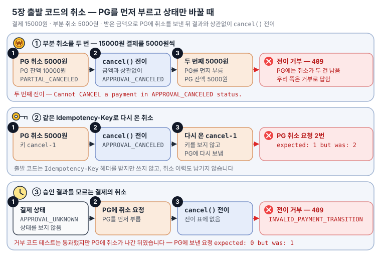

①은 아래 첫째 원인, ②는 셋째 원인, ③은 둘째 원인을 그린 장면입니다.

첫째, 부분 취소 한 번에 결제가 닫힙니다. 출발 코드는 금액과 상관없이 `cancel()` 전이를 부르므로, 5000원만 취소해도 결제는 `APPROVAL_CANCELED`가 됩니다(`expected: APPROVED but was: APPROVAL_CANCELED`). 두 번째 부분 취소는 PG를 먼저 부르고 나서 결과를 남기므로, PG에서는 취소된 뒤 우리 쪽 전이가 `Cannot CANCEL a payment in APPROVAL_CANCELED status.`로 막힙니다. 이 경우 PG에는 취소가 두 건 남았는데 우리 쪽은 409로 답합니다.

둘째, 남은 금액을 모르니 PG에 보내기 전에 막을 수 없습니다. 남은 금액보다 큰 취소는 PG가 거절한 뒤에야 502로 끝났고(`expected: CANCEL_AMOUNT_EXCEEDS_BALANCE but was: PAYMENT_GATEWAY_FAILED`), PG에는 취소 요청이 두 번 갔습니다. 승인 거절 결제도 같은 이유로 PG에 보낸 뒤 PG의 오류 응답을 받아 502로 끝났고, 승인 전 결제는 잘못된 주소로 보낸 요청이 404로 돌아와 502로 끝났습니다(아래 통과한 테스트에서 설명합니다). 승인 결과를 모르는 결제는 거절 코드 테스트를 통과했지만, PG에 이미 취소가 나간 뒤 우리 쪽 전이에서 막힌 것입니다(PG에 보낸 요청 `expected: 0 but was: 1`).

셋째, 같은 취소 요청을 가리지 못합니다. 같은 Idempotency-Key로 다시 온 취소가 PG에 두 번 갔고, 시간 제한을 넘긴 취소를 같은 키로 다시 보내면 PG에서 두 번 취소되어 PG 잔액은 5000원인데 우리는 10000원으로 답했습니다. API 쪽에서는 키가 없거나 300자를 넘어도 200으로 받았습니다.

넷째, 결과를 모르는 취소와 기록에 실패한 취소가 남을 곳이 없습니다. 결과 모름 테스트 두 개는 남은 취소 기록을 찾지 못해 실패했고, 기록 실패 테스트는 `payment_cancel` 테이블이 없어 트리거를 만드는 단계에서 실패했습니다.

통과한 8개 중에도 살펴볼 것이 있습니다. 전액 취소 세 테스트는 출발 코드가 원래 하던 일이라 통과했습니다. "승인 전 결제의 취소는 카드사에 보내지 않는다"는 Mock PG가 센 취소 요청이 0건이어서 통과했습니다. 승인 전 결제에는 결제 키가 없어서 출발 코드는 `/v1/payments//cancel`로 요청을 보냈고, 이 주소는 Mock PG의 취소 API에 닿지 못해 404로 돌아왔습니다. 요청 수는 취소 API 안에서 세므로 0건이었고, 결제 서버는 이 404를 받아 502로 답했습니다. PG에 보내지 않아서가 아니라 잘못된 주소로 보내서 통과한 것입니다.

## 선택지와 트레이드오프

이 문제를 해결하면서 내린 결정은 다섯 가지입니다.

### 결정 1. 취소를 어떻게 기록할까

이 장에서는 취소마다 한 줄을 남기는 `payment_cancel` 테이블에 PG 취소를 기록하고, 남은 금액은 끝난 취소의 합으로 계산하기로 했습니다.

검토한 선택지는 세 가지입니다.

- 지금처럼 결제 상태만 바꾸기(5장 출발 코드). 전액 취소만 할 수 있습니다.
- 결제 행에 취소한 금액의 합계(또는 남은 금액) 칸만 두기
- 취소 요청 한 건마다 한 줄을 남기는 `payment_cancel` 테이블을 두기

세 선택지를 나란히 놓으면 아래와 같습니다.

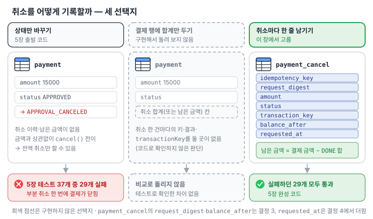

취소마다 한 줄을 둔 이유는, 뒤의 결정들이 모두 취소 한 건 단위로 값을 들고 있어야 하기 때문입니다. 같은 요청을 가리려면 취소마다 고객이 보낸 키와 요청 내용을(결정 3), 결과를 모르는 취소를 맞추려면 취소마다 PG 답 전인지·결과 모름인지·끝났는지를(결정 4), PG 취소 건과 짝을 지으려면 PG가 준 `transactionKey`를 남겨야 합니다. 결제 행에 합계만 두면 이 값들을 둘 곳이 없어서, 결정 3·4를 같은 구조 위에 올릴 수 없다고 보았습니다. 이것은 코드로 확인한 사실이 아니라 판단이고, 합계만 두는 방식은 구현하지 않아 비교로 돌리지 않았습니다.

완성 코드의 테이블은 아래와 같습니다. 칸은 결정마다 하나씩 늘었고, `request_digest`·`balance_after`·unique 키는 결정 3, `requested_at`과 인덱스는 결정 4에서 더했습니다.

```sql
-- 5장: 취소 요청 한 건마다 한 줄. 결제의 남은 금액은 끝난 취소의 합으로 계산한다
create table if not exists payment_cancel (
    id              bigint         not null auto_increment,
    payment_id      bigint         not null,
    idempotency_key varchar(300)   not null,
    -- 같은 키로 다시 온 요청이 처음과 같은 내용인지 비교할 값(요청 금액·사유의 SHA-256)
    request_digest  char(64)       not null,
    amount          decimal(19, 2) not null,
    reason          varchar(200)   not null,
    status          varchar(20)    not null,
    -- 카드사가 취소 건마다 주는 키(토스페이먼츠 transactionKey)
    transaction_key varchar(200),
    -- 이 취소가 끝난 뒤 남은 금액. 같은 키로 다시 온 요청에 처음과 같은 답을 주려고 남긴다
    balance_after   decimal(19, 2),
    -- 카드사에 취소를 요청하려고 기록한 때. 보정은 상태와 이 시각으로 대상을 고른다
    requested_at    datetime(6)    not null,
    primary key (id),
    unique key uk_payment_cancel_idempotency_key (payment_id, idempotency_key),
    key idx_payment_cancel_status_requested_at (status, requested_at),
    constraint fk_payment_cancel_payment foreign key (payment_id) references payment (id)
);
```

취소(`PaymentCancel`)는 결제(`Payment`)에 딸린 기록이라 결제를 거쳐서만 만들고 바꿉니다. JPA 연관은 결제에서 취소로 가는 `@OneToMany` 하나만 두었고, 남은 금액은 결제 행에 따로 두지 않고 끝난(`DONE`) 취소의 합을 빼서 계산합니다.

```java
// 5장: 이 결제의 취소. 취소마다 한 줄을 남기고, 남은 금액은 끝난 취소의 합으로 계산한다
@Getter(AccessLevel.NONE)
@OneToMany(mappedBy = "payment", cascade = CascadeType.ALL)
private List<PaymentCancel> cancels = new ArrayList<>();
```

```java
// 카드사가 취소한 뒤 남은 금액: 결제 금액에서 끝난 취소를 뺀 값
public BigDecimal balanceAmount() {
    return amount.subtract(sumOf(PaymentCancel::isDone));
}
```

이 선택으로 치르는 비용은 두 가지입니다.

- `payment_cancel`이 `payment`를 외래 키로 가리켜서, 4장 보정 테스트가 같은 DB에서 `delete from payment`로 지우던 정리가 실패했습니다. `ReconciliationContract`와 `ReconciliationMeasurement`에서 `payment_cancel`을 먼저 지우도록 고쳤습니다.
- 결제의 남은 금액을 알려면 매번 취소 목록을 읽어야 합니다. 결제 조회 결과(`PaymentResult`)에는 남은 금액을 넣지 않아서, 결제 조회 API(`GET /api/v1/payments/{orderId}`)로는 남은 금액을 볼 수 없습니다.

다른 선택이 맞는 경우도 있습니다. 같은 요청 가리기와 결과 모름 보정을 취소 한 건 단위로 하지 않아도 되는 연동이라면, 취소마다의 키와 결과를 둘 필요가 없으므로 결제 행의 합계 한 칸으로 남은 금액을 계산할 수 있습니다. 이번에는 그 방식을 돌려 보지 않았기 때문에 테스트로 확인한 차이는 없습니다.

### 결정 2. 부분 취소된 결제는 어떤 상태로 둘까

이 장에서는 결제 상태는 그대로 두고 남은 금액 안에서 취소를 받으며, 남은 금액이 0원이 되면 기존 `CANCEL` 전이로 닫기로 했습니다.

검토한 선택지는 두 가지입니다.

- 결제 상태는 그대로(`APPROVED`, `CAPTURED`) 두고, 남은 금액으로 부분 취소를 판단하기
- 부분 취소 상태를 새로 두기(매입 전과 매입 후로 두 개)

고른 방식에서 15000원 결제를 두 번에 나눠 취소하면 상태는 아래처럼 바뀝니다.


결제 상태는 두 번째 취소가 끝날 때까지 `APPROVED`로 남고, 남은 금액이 0원이 된 뒤에만 전이가 일어납니다.

상태를 늘리지 않은 이유는, 1장에서 결제 상태를 매입 전과 매입 후로 나눠 두어서, 새 상태를 두면 부분 취소 상태도 승인 후와 매입 후 두 개로 늘어나기 때문입니다. 4장의 조회 보정도 PG의 `PARTIAL_CANCELED`를 "승인이 남음"으로 읽고 있습니다. 상태가 늘지 않아서 1장의 허용 전이 표와 같은 계약을 쓰는 State 패턴, Spring Statemachine 비교 구현은 바꿀 필요가 없었고, 세 구현의 전이 테스트는 완성 코드에서도 그대로 통과했습니다. 상태 쪽에는 허용 전이 표에 없는 행위인지 묻는 메서드 하나만 더했습니다.

```java
// 허용 전이 표에 없는 행위인가(5장: 취소를 카드사에 보내기 전에 묻는다)
public boolean refuses(PaymentAction action) {
    return Objects.isNull(TRANSITIONS.getOrDefault(this, Collections.emptyMap()).get(action));
}
```

취소를 받을지는 PG에 보내기 전에 결제가 판단합니다. 전이 표에 `CANCEL`이 없는 상태(승인 전, 인증, 인증 실패, 승인 실패, 결과 모름, 만료, 이미 취소)면 409 `INVALID_PAYMENT_TRANSITION`, 금액이 0원 이하면 400 `INVALID_AMOUNT`, 받을 수 있는 금액을 넘으면 409 `CANCEL_AMOUNT_EXCEEDS_BALANCE`입니다.

```java
private BigDecimal checkCancel(CancelRequest request) {
    if (status.refuses(PaymentAction.CANCEL)) {
        throw new InvalidPaymentTransitionException(status.name(), PaymentAction.CANCEL.name());
    }
    BigDecimal cancelAmount = Objects.requireNonNullElse(request.getRequestedAmount(), cancelableAmount());
    if (isNotPositive(cancelAmount)) {
        throw new InvalidAmountException(orderId);
    }
    if (cancelAmount.compareTo(cancelableAmount()) > 0) {
        throw new CancelAmountExceedsBalanceException(orderId);
    }
    return cancelAmount;
}
```

금액 없이 온 취소는 받을 수 있는 금액 전부를 취소합니다. 토스페이먼츠 문서의 "값이 없으면 전액 취소됩니다."를 따르되, 금액은 우리가 정해서 PG에는 언제나 `cancelAmount`를 적어 보냅니다. API 테스트 "금액 없이 취소하면 남은 금액을 모두 취소한다"에서 5000원을 취소한 뒤 금액 없이 보내면 PG에 10000원으로 갑니다. 받을 수 있는 금액은 남은 금액에서 PG 답을 기다리는 취소 금액까지 뺀 값인데, 이 부분은 결정 4에서 설명합니다.

남은 금액이 0원이 되면 1장부터 있던 `cancel()` 전이를 부릅니다. 승인된 결제는 `APPROVAL_CANCELED`, 매입된 결제는 `CAPTURE_CANCELED`가 됩니다.

```java
private void complete(PaymentCancel cancel, String transactionKey) {
    cancel.complete(transactionKey);
    cancel.keepBalance(balanceAmount());
    cancelIfNothingLeft();
}

private void cancelIfNothingLeft() {
    if (balanceAmount().signum() == 0) {
        cancel();
    }
}
```

이 선택으로 치르는 비용은, 부분 취소된 결제를 상태만으로는 구별할 수 없다는 점입니다. 부분 취소된 결제도 `APPROVED`로 보이고, 남은 금액을 보려면 취소 기록을 읽어야 합니다.

새 부분 취소 상태는 구현하지 않아 비교로 돌리지 않았습니다. 상태만으로 부분 취소된 결제를 가려야 하는 곳이 있다면 새 상태가 맞습니다. 그때는 1장의 전이 표와 비교 구현 둘에 같은 상태와 전이를 더해야 하고, 4장에서 상태 하나를 더했을 때처럼 전이 조합 테스트도 함께 커집니다.

### 결정 3. 같은 취소 요청을 무엇으로 가릴까

이 장에서는 취소 요청에 `Idempotency-Key`를 반드시 받고, 같은 키로 같은 내용이 다시 오면 PG를 부르지 않고 남긴 결과로 답하며, 같은 키에 다른 내용이 오면 422로 답하기로 했습니다.

검토한 선택지는 다섯 가지입니다.

- `Idempotency-Key`를 필수로 받고, 취소 행에 키·요청 비교값·응답 값을 남기기
- 같은 결제에 같은 금액·사유로 온 취소를 같은 요청으로 보기(자연 키, 비교 A)
- 고객의 키를 기록에 쓰지 않고, 결제가 이미 취소 상태면 다시 온 요청으로 보고 지금 상태로 답하기(3장 승인 재요청 방식, 비교 B)
- 응답의 HTTP 본문을 그대로 저장하는 별도 멱등 테이블을 두기
- 토스페이먼츠·Stripe처럼 키를 선택으로 받기

비교 A와 B는 운영 구현을 그대로 부르되 키 자리에 다른 값을 넣는 방식으로 만들었습니다. 비교 A는 금액·사유로 만든 값을, 비교 B는 요청마다 새로 만든 값을 넣습니다. 기록과 PG 호출 순서, 보정은 운영 구현과 같습니다.

```java
public CancelResult cancel(CancelPaymentCommand command) {
    String naturalKey = "natural-" + Objects.toString(command.cancelAmount(), "all") + "-" + command.cancelReason();
    return paymentCancelService.cancel(new CancelPaymentCommand(
            command.orderId(), naturalKey, command.cancelAmount(), command.cancelReason()));
}
```

```java
public CancelResult cancel(CancelPaymentCommand command) {
    if (CANCELED.contains(paymentQueryService.find(command.orderId()).status())) {
        return new CancelResult(command.orderId(), command.cancelAmount(), CancelStatus.DONE, BigDecimal.ZERO);
    }
    return paymentCancelService.cancel(new CancelPaymentCommand(
            command.orderId(), "state-" + UUID.randomUUID(), command.cancelAmount(), command.cancelReason()));
}
```

비교 A는 계약 24개 중 2개, 비교 B는 6개가 실패했습니다. 어떤 테스트가 왜 실패했는지는 테스트 결과 절에 모았습니다.

같은 네 입력에 세 방식이 어떻게 답하는지 모으면 아래와 같습니다.

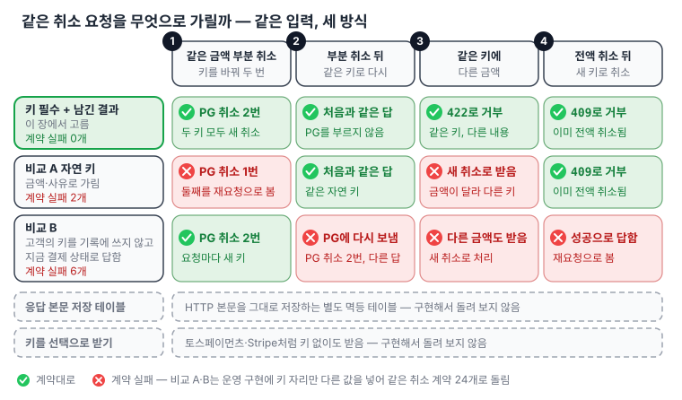

응답 본문 저장 테이블과 키를 선택으로 받는 방식은 구현하지 않아 회색 점선으로 두었습니다.

키를 필수로 받기로 한 이유는, 결제 하나에 같은 금액의 정상 부분 취소가 여러 번 있을 수 있어서 키가 없으면 재시도와 새 취소를 가릴 방법이 없기 때문입니다. 비교 A가 금액·사유로 가리려다 고객이 뜻한 두 번째 취소를 버린 것이 그 결과입니다.

토스페이먼츠와 Stripe는 키를 선택으로 받으므로, 이 결정은 "취소 API는 키를 반드시 받는다"로 그들과 다른 약속을 정한 것입니다. 3장에서 `Idempotency-Key`를 다른 선택지와 같은 테스트로 비교하지 않은 이유로 "헤더가 필수가 되어 API의 약속 자체가 바뀐다"는 점을 들었는데, 이 장에서는 그 약속을 바꾸기로 한 것입니다. IETF의 Idempotency-Key 헤더 초안(draft-ietf-httpapi-idempotency-key-header-08)도 키가 필요한 작업에 키 없이 오면 400으로 답하는 것을 SHOULD로 적고 있습니다.

키가 없거나 비어 있거나 300자를 넘으면 400 `INVALID_IDEMPOTENCY_KEY`로 답합니다. 300자는 토스페이먼츠 멱등키의 최대 길이이고, 이 키를 PG에도 그대로 넘기기 때문에(결정 5) 맞췄습니다. 컨트롤러에서는 헤더를 선택으로 받고, 없을 때도 같은 오류 응답 모양으로 답하도록 서비스 쪽에서 막습니다.

```java
// 5장: 승인된 결제를 취소한다. 금액이 없으면 남은 금액을 모두 취소한다.
// Idempotency-Key 가 없으면 서비스가 400 으로 거부한다(헤더가 없을 때도 같은 오류 응답 모양으로 답하려고 여기서 막지 않는다)
@PostMapping("/{orderId}/cancel")
public ResponseEntity<CancelResponse> cancel(@PathVariable String orderId,
                                             @RequestHeader(name = "Idempotency-Key", required = false) String idempotencyKey,
                                             @RequestBody CancelPaymentRequest request) {
    CancelResult result = paymentCancelService.cancel(
            new CancelPaymentCommand(orderId, idempotencyKey, request.cancelAmount(), request.cancelReason()));
    return ResponseEntity.status(statusOf(result)).body(CancelResponse.from(result));
}
```

같은 키에 다른 금액이나 사유가 오면 422 `IDEMPOTENCY_KEY_REUSED`로 답합니다. 토스페이먼츠 문서에는 같은 멱등키에 다른 본문이 왔을 때의 동작과 코드가 없어서, IETF 초안 draft-08이 같은 키에 다른 본문이면 422로 답하라고 SHOULD로 적은 것을 따랐습니다. 상태 코드 대응은 출발 코드에서 2장부터 써 온 전역 예외 처리기에 한 줄로 더해 두었습니다.

```java
case UNPROCESSABLE -> HttpStatus.UNPROCESSABLE_CONTENT;
```

같은 내용인지는 요청에 적힌 금액과 사유를 SHA-256으로 줄인 값으로 비교합니다. 금액은 소수 자릿수를 정규화해서 15000과 15000.00을 같게 보고, 금액 없이 온 요청은 빈 칸으로 둡니다.

```java
// 요청 내용(금액, 사유)을 한 값으로 줄인다. 15000 과 15000.00 은 같은 금액으로 본다
public String requestDigest() {
    String amount = Objects.isNull(requestedAmount) ? "" : requestedAmount.stripTrailingZeros().toPlainString();
    return sha256(amount + "\n" + reason);
}
```

금액 없는 요청을 "그때의 남은 금액"으로 바꿔 비교하지 않은 이유는, 그러면 다시 온 같은 요청이 그사이 줄어든 남은 금액 때문에 다른 요청이 되기 때문입니다. 도메인 테스트 "금액 없이 온 취소는 그사이 남은 금액이 줄었어도 같은 키로 금액 없이 다시 오면 같은 내용으로 본다"가 이 규칙을 확인합니다.

다시 온 요청에 돌려줄 답은 HTTP 본문을 통째로 두지 않고, 응답에 담는 값(취소 금액, 상태, 그 취소가 끝났을 때 남은 금액 `balance_after`)을 취소 행에 남겨 다시 만듭니다. 3장 승인 재요청처럼 결제의 지금 상태로 다시 만들면, 뒤에 다른 부분 취소가 있었을 때 답이 달라지기 때문입니다.

```java
static CancelResult of(Payment payment, PaymentCancel cancel) {
    return new CancelResult(payment.getOrderId(), cancel.getAmount(), cancel.getStatus(), cancel.getBalanceAfter());
}
```

다시 온 요청에 어떤 남은 금액을 돌려주는지 그리면 아래와 같습니다.

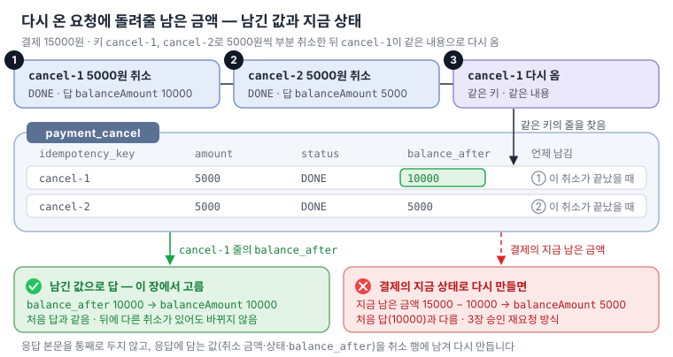

도메인 테스트 "이미 받은 취소에는 그 취소가 끝났을 때 남은 금액이 남아 있어, 뒤에 다른 취소가 있어도 바뀌지 않는다"가 이것을 확인합니다. 키의 범위는 결제마다(`unique(payment_id, idempotency_key)`)입니다. 토스페이먼츠가 멱등키와 API 주소의 조합으로 같은 요청을 보는 것과 같은 범위이고, 취소 API 주소에 결제가 들어 있기 때문입니다.

응답 본문을 저장하는 별도 테이블은 구현하지 않아 비교로 돌리지 않았습니다. 응답에 담는 값을 취소 행에 남겨 다시 만들 수 있어서 따로 둘 필요가 없었습니다. 응답에 취소 행에 없는 값이 담기거나, 취소 말고도 여러 API에 같은 멱등 처리를 붙여야 한다면 본문을 그대로 저장하는 테이블이 맞을 것 같습니다. 키를 선택으로 받는 방식도 구현하지 않았습니다.

이 선택으로 치르는 비용은 세 가지입니다.

- 클라이언트가 취소마다 키를 꼭 만들어 보내고, 다시 보낼 때를 위해 보관해야 합니다. 키 없는 취소는 400으로 막히므로, 키를 보내지 않던 기존 클라이언트가 있다면 깨집니다. 이 연재에는 아직 클라이언트가 없습니다.
- 취소 행에 `request_digest`와 `balance_after` 두 칸이 늘었습니다.
- 토스페이먼츠·Stripe와 약속이 달라서, 두 곳의 문서를 보고 온 사용자에게는 우리 API 문서에 키가 필수라는 점을 따로 알려야 합니다.

다른 선택이 맞는 경우도 있습니다. 같은 금액·사유의 정상 취소가 두 번 오지 않는다는 보장이 있다면 자연 키로도 가릴 수 있고, 그 보장이 없으면 위의 2개가 실패합니다. 결제 하나에 한 번만 있는 작업, 예를 들어 3장의 승인처럼 응답을 지금 상태에서 다시 만들 수 있는 작업이라면 비교 B 방식으로 충분합니다. 키를 보내지 않는 기존 클라이언트가 많아 약속을 바꿀 수 없다면 키를 선택으로 받아야 하는데, 그때 키 없이 온 취소는 재시도인지 새 취소인지 가릴 수 없습니다.

### 결정 4. 기록과 PG 호출을 어떤 순서로 할까

이 장에서는 취소 요청을 먼저 기록하고(`REQUESTED`), PG 호출은 트랜잭션 밖에서 한 뒤 결과를 따로 기록하며, PG 답을 받지 못한 취소는 결과 모름(`UNKNOWN`)으로 남겨 4장 보정을 넓혀 맞추기로 했습니다.

검토한 선택지는 두 가지입니다. PG 호출을 트랜잭션 안에 두는 방식은 2장에서 이미 정리해서 다시 검토하지 않았습니다.

- 취소 요청을 먼저 기록하고 커밋 → 트랜잭션 밖에서 PG 호출 → 결과 기록
- 받을 수 있는 취소인지 확인만 하고 아무것도 남기지 않은 채 PG를 부르고, 답을 받은 뒤에 한 번에 기록하기(비교 C)

비교 C는 같은 키 확인과 받을 수 있는 취소인지 확인하는 규칙, PG에 멱등키를 넘기는 것(결정 5)은 운영 구현과 같고, 확인에 쓴 기록을 되돌리는 것만 다릅니다.

```java
public CancelResult cancel(CancelPaymentCommand command) {
    CancelAttempt attempt = transactionTemplate.execute(status -> check(command, status));
    if (attempt.isRepeated()) {
        return attempt.repeated();
    }
    CancelOutcome outcome = paymentGateway.cancel(attempt.paymentKey(), command.orderId(), command.idempotencyKey(),
            attempt.amount(), command.cancelReason());
    return transactionTemplate.execute(status -> record(command, outcome));
}
```

비교 C는 계약 24개 중 3개가 실패했습니다. 시간 초과로 끝난 취소가 결과 모름으로 남지 않았고, 보정을 돌려도 맞출 기록이 없어 남은 금액이 PG와 달랐고, 결과 기록이 실패한 취소도 보정 뒤 PG와 달랐습니다. 세 실패의 메시지는 모두 `[결제에 남은 취소] Expecting actual not to be empty`였습니다. 시간 초과 뒤 같은 키로 다시 온 두 테스트는 통과했는데, PG가 멱등키로 첫 응답을 돌려줘서 재요청이 결과를 받았기 때문입니다.

시간 초과된 취소가 두 순서에서 보정까지 어떻게 가는지 그리면 아래와 같습니다.

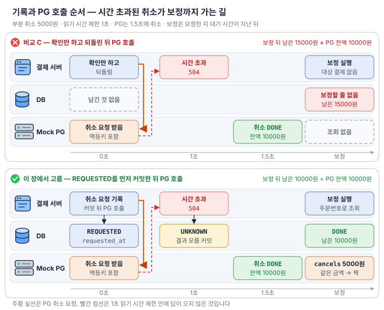

비교 C에서는 PG에 취소가 남았는데 우리 쪽에는 결과를 기다리는 취소가 없어서, 보정이 그 결제를 대상으로 고르지 않습니다.

요청을 먼저 기록한 이유는, PG를 부르기 전에 남긴 줄이 있어야 PG 답을 받지 못하거나 결과 기록이 실패해도 보정이 맞출 대상이 생기기 때문입니다. 4장의 승인은 인증 기록이 그 역할을 했고, 취소에서는 `REQUESTED` 줄이 그 역할을 합니다.

PG 답에 따라 취소 한 건은 아래처럼 닫힙니다.

- PG가 취소함(2xx): `DONE`으로 바꾸고 PG가 준 `transactionKey`와 그때 남은 금액을 남깁니다. 남은 금액이 0원이면 결제를 취소 상태로 바꿉니다.
- PG가 거절함(4xx): `FAILED`로 남기고 200과 `cancelStatus: FAILED`로 답합니다. 남은 금액은 그대로입니다. 2장에서 승인 거절을 오류가 아니라 결과로 기록한 것과 같은 방식입니다. 운영 구현 테스트에서는 PG 쪽에서 먼저 전액 취소된 결제(`ALREADY_CANCELED_PAYMENT`)로 확인했습니다.
- 시간 초과: `UNKNOWN`으로 남기고 504 `PAYMENT_GATEWAY_NO_RESPONSE`로 답합니다. 4장 승인과 같은 응답입니다.
- PG 5xx: 502 `PAYMENT_GATEWAY_FAILED`로 답하고 취소는 결과를 기다리는 상태 그대로 남아 보정 대상이 됩니다. 첫 요청이면 `REQUESTED`, 결과 모름 취소를 같은 키로 다시 보낸 경우면 `UNKNOWN`입니다. 5xx를 결과 모름으로 따로 표시하는 방법은 구현하지 않았습니다.

Mock PG가 500으로 답하게 한 테스트에서 API는 502로 답했고, 취소는 `REQUESTED`로 남았습니다. Mock PG는 500일 때 취소를 남기지 않으므로(가정), 대기 시간 뒤 보정에서 PG 취소 0건을 확인하고 `FAILED`로 닫았고, 남은 금액은 15000원으로 PG 잔액과 같았습니다.

결과를 기다리는(`REQUESTED`, `UNKNOWN`) 취소는 아직 남은 금액을 줄이지 않지만, 새 취소로 받을 수 있는 금액에서는 뺍니다. PG가 그 취소를 했을 수도 있어서, 빼지 않으면 남은 금액을 넘는 취소를 받을 수 있기 때문입니다.

```java
// 새 취소로 받을 수 있는 금액: 남은 금액에서 카드사 답을 기다리는 취소까지 뺀 값
private BigDecimal cancelableAmount() {
    return balanceAmount().subtract(sumOf(PaymentCancel::isAwaitingResult));
}
```

결과 모름과 `REQUESTED`에 남은 취소는 4장의 주기 보정을 넓혀 맞춥니다. 취소를 요청한 지 대기 시간(`wait-after-request`)이 지난 취소가 있는 결제를 골라, 주문번호로 PG에 결제를 조회하고 응답의 `cancels` 가운데 `cancelStatus`가 `DONE`인 취소로 닫습니다. 우리 기록에 없는 `transactionKey` 가운데 같은 금액이 있으면 그 취소로 끝난 것(`DONE`)으로, 없으면 PG가 취소하지 않은 것(`FAILED`)으로 봅니다. 금액으로 짝을 짓는 이유는, 토스페이먼츠 Payment 객체의 `cancels` 필드에 우리가 보낸 멱등키가 없기 때문입니다.

이 선택으로 치르는 비용은 두 가지입니다.

- 취소마다 트랜잭션이 두 번(요청 기록, 결과 기록) 돌고, 결과 모름을 맞출 보정이 필요합니다. 결과 모름이 확정되기까지 적어도 대기 시간만큼, 길게는 대기 시간과 보정 주기를 더한 만큼 걸립니다. 기본값은 4장과 같은 1분, 1분입니다.
- 금액으로 짝을 짓기 때문에, 같은 결제에 같은 금액의 결과 모름 취소가 여럿이면 어느 키가 `DONE`이 되는지는 실제와 바뀔 수 있습니다. 남은 한계에 적었습니다.

다른 선택이 맞는 경우도 있습니다. 고객이 시간 초과 뒤 반드시 같은 키로 다시 보내고, PG가 멱등키를 지킨다는 보장이 있다면 PG를 먼저 불러도 재요청이 결과를 채웁니다. 비교 C에서 재요청 테스트가 통과한 것이 그 범위이고, 보정만 기다리는 경우에는 위의 3개가 실패했습니다.

### 결정 5. PG에도 멱등키를 넘길까

이 장에서는 고객이 보낸 `Idempotency-Key`를 PG 취소 요청 헤더에도 그대로 넘기고, 결과를 남기지 못한 취소에 같은 키로 다시 오면 PG에 같은 키로 다시 보내 PG의 첫 응답으로 닫기로 했습니다.

검토한 선택지는 세 가지입니다.

- 고객의 키를 PG에도 넘기고, 결과를 남기지 못한 취소의 재요청은 PG에 같은 키로 다시 보내기
- PG에는 멱등키를 넘기지 않기(비교 D)
- 결과를 남기지 못한 취소의 재요청에는 PG를 다시 부르지 않고, 상태만 답한 채 보정을 기다리기

토스페이먼츠 결제 취소 문서에는 "멱등키를 요청 헤더에 추가하면 중복 취소 없이 안전하게 처리됩니다."라고 적혀 있습니다. 멱등키 문서는 첫 요청이 처리 중일 때 같은 요청을 다시 보내면 409 `IDEMPOTENT_REQUEST_PROCESSING`이 돌아오고, 오류가 난 뒤 키를 바꿔 다시 시도하는 것은 위험하다고 안내합니다.

비교 D는 운영 서비스에 멱등키 헤더를 붙이지 않는 PG 클라이언트만 바꿔 끼웠습니다.

```java
// 받은 멱등키를 버리고 보낸다
@Override
public CancelOutcome cancel(String paymentKey, String orderId, String idempotencyKey, BigDecimal amount, String reason) {
    try {
        return pgRestClient.post()
                .uri("/v1/payments/{paymentKey}/cancel", paymentKey)
                .body(new PgCancelRequest(reason, amount))
                .exchange((request, response) -> PgPaymentGateway.toCancelOutcome(orderId, response));
    } catch (ResourceAccessException noResponse) {
        throw new PaymentGatewayNoResponseException(orderId);
    }
}
```

비교 D는 계약 24개 중 2개가 실패했습니다. 시간 초과 뒤 같은 키로 다시 온 취소를 PG가 새 취소로 받아 두 번 취소했고(`expected: 1 but was: 2`), 그 재요청에 우리는 10000원으로 답했지만 PG 잔액은 5000원이었습니다. 두 번째 PG 취소는 우리 기록 어디에도 남지 않습니다.

시간 초과 뒤 같은 키로 다시 온 취소를 두 방식으로 그리면 아래와 같습니다.

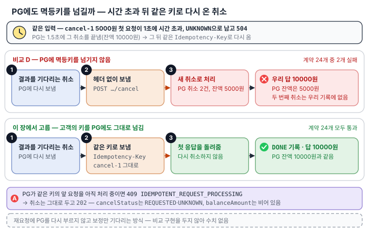

PG에 키를 넘긴 이유는, 우리 쪽이 결과를 남기지 못한 취소를 다시 보내야 할 때 PG가 그것을 새 취소로 받지 않게 하려면 PG도 같은 요청을 알아볼 수 있어야 하기 때문입니다. PG가 409 `IDEMPOTENT_REQUEST_PROCESSING`으로 답하면 취소를 그대로 두고 202로 답합니다. 이때 `cancelStatus`는 `REQUESTED`나 `UNKNOWN`이고 `balanceAmount`는 비어 있습니다. API 테스트 "카드사가 아직 앞 취소를 처리하는 중에 같은 Idempotency-Key 로 다시 오면 확인 중이라고 답한다"가 이것을 확인합니다. 202는 4장의 결과 모름 승인 재요청과 같은 뜻으로 씁니다.

재요청에 PG를 다시 부르지 않고 보정을 기다리는 방식은 따로 비교 구현을 두지 않았습니다. 결정 4까지의 운영 구현이 이 동작이었는데, 그 시점의 실행 결과는 기록 파일로 남기지 않아서 이 글에서는 수치를 적지 않습니다. 코드로 보면 이 방식에서 재요청은 결과 모름 그대로 답하므로, 계약 "시간 제한을 넘긴 취소가 같은 Idempotency-Key 로 다시 오면 카드사 잔액과 같은 남은 금액으로 답한다"를 지킬 수 없습니다.

이 선택으로 치르는 비용은 세 가지입니다.

- 고객의 키가 그대로 PG로 나갑니다. Stripe 문서는 이메일 주소 같은 개인 식별 정보를 키로 쓰지 말라고 안내하는데, 우리 API 문서에도 같은 안내가 필요합니다.
- 키 길이 상한을 PG(300자)와 맞춰야 합니다. PG가 상한을 바꾸면 우리 검사도 바꿔야 합니다.
- 토스페이먼츠 멱등키는 15일간 유효합니다. 그 뒤에 같은 키로 다시 보내면 PG가 다시 취소할 수 있는데, Mock PG는 기간을 흉내 내지 않아 확인하지 못했습니다.

다른 선택이 맞는 경우도 있습니다. 결과를 남기지 못한 취소에 PG를 다시 부르지 않는 구조라면, PG에 키를 넘기지 않아도 두 번 취소되지 않습니다. 대신 그때 재요청은 보정이 끝날 때까지 남은 금액을 알려 주지 못합니다. 다시 부르는 구조에서 키를 넘기지 않으면 위의 2개가 실패합니다.

## 구현

결정을 모아 바꾼 5장 완성 코드에서 클라이언트, 결제 서버, DB, Mock PG 사이에 오가는 요청과 응답을 그리면 아래와 같습니다. 먼저 새 취소가 PG에서 끝나는 경우입니다.


2~6은 짧은 트랜잭션 하나에서 하고, PG 호출(7·8)은 트랜잭션 밖에서, 결과 기록(9)은 다른 짧은 트랜잭션에서 합니다. 그림 아래 A~E는 실패 갈래입니다.

첫 요청이 시간 초과로 끝나고 같은 키로 다시 오는 경우는 아래와 같습니다.


두 번째 요청도 입구에서 결제를 다시 조회하고 같은 내용인지 확인한 뒤 PG에 같은 키로 보냅니다.

취소 서비스는 요청을 기록하고, 같은 키로 이미 결과를 남긴 취소면 그 결과로 답합니다. 아니면 PG를 부르고, 답을 받지 못하면 결과 모름을 기록한 뒤 받은 예외를 다시 던집니다. 그래서 첫 시간 초과의 응답은 4장 승인과 같은 504입니다.

```java
public CancelResult cancel(CancelPaymentCommand command) {
    CancelAttempt attempt = paymentCancelRecorder.request(command);
    if (attempt.isRepeated()) {
        return attempt.repeated();
    }
    CancelOutcome outcome = requestCancel(command, attempt);
    return paymentCancelRecorder.recordOutcome(command.orderId(), command.idempotencyKey(), outcome);
}

private CancelOutcome requestCancel(CancelPaymentCommand command, CancelAttempt attempt) {
    try {
        return paymentGateway.cancel(attempt.paymentKey(), command.orderId(), command.idempotencyKey(), attempt.amount(),
                command.cancelReason());
    } catch (PaymentGatewayNoResponseException noResponse) {
        paymentCancelRecorder.recordUnknown(command.orderId(), command.idempotencyKey());
        throw noResponse;
    }
}
```

기록은 취소 기록기(`PaymentCancelRecorder`)의 짧은 트랜잭션에서 합니다. 2장의 `PaymentRecorder`와 같은 이유로 서비스와 다른 빈으로 두었습니다. 요청 기록에서는 같은 키의 취소가 있는지 먼저 보고, 결과를 기다리는 취소면 PG에 같은 키로 다시 보내도록 돌려줍니다.

```java
@Transactional
public CancelAttempt request(CancelPaymentCommand command) {
    Payment payment = find(command.orderId());
    CancelRequest request = requestOf(command);
    PaymentCancel repeated = payment.findRepeatedCancel(request).orElse(null);
    if (Objects.isNull(repeated)) {
        PaymentCancel cancel = payment.requestCancel(request, clock.instant());
        return CancelAttempt.send(payment.getPaymentKey(), cancel.getAmount());
    }
    if (repeated.isAwaitingResult()) {
        return CancelAttempt.send(payment.getPaymentKey(), repeated.getAmount());
    }
    return CancelAttempt.repeat(CancelResults.of(payment, repeated));
}
```

같은 키의 취소를 찾는 것과 내용 비교는 결제가 합니다.

```java
// 같은 Idempotency-Key 로 이미 받은 취소(5장 결정 3). 키가 같은데 내용이 다르면 받지 않는다
public Optional<PaymentCancel> findRepeatedCancel(CancelRequest request) {
    PaymentCancel repeated = findCancel(request.getIdempotencyKey()).orElse(null);
    if (Objects.isNull(repeated)) {
        return Optional.empty();
    }
    if (repeated.isSameRequest(request)) {
        return Optional.of(repeated);
    }
    throw new IdempotencyKeyReusedException(orderId);
}
```

PG 답을 남길 때는 그 사이 보정이 먼저 결과를 남긴 취소를 건드리지 않습니다. PG가 앞 요청을 처리 중이라고 답하면 취소를 그대로 둡니다.

```java
private static PaymentCancel closeWith(Payment payment, String idempotencyKey, CancelOutcome outcome) {
    if (outcome.isInProgress()) {
        return payment.findCancel(idempotencyKey).orElseThrow();
    }
    if (outcome.isCanceled()) {
        return payment.completeCancel(idempotencyKey, outcome.getCanceled());
    }
    return payment.failCancel(idempotencyKey);
}
```

```java
// 카드사가 취소했다. 결제 상태는 그대로 두고, 남은 금액이 0원이 되면 취소 상태로 바꾼다.
// 그 사이 보정이 먼저 결과를 남겼으면 건드리지 않는다
public PaymentCancel completeCancel(String idempotencyKey, GatewayCancel canceled) {
    PaymentCancel cancel = awaitingCancel(idempotencyKey);
    if (cancel.isAwaitingResult()) {
        complete(cancel, canceled.getTransactionKey());
    }
    return cancel;
}
```

PG 취소는 `PaymentGateway`의 `cancel`에 멱등키를 더해 구현했습니다. 응답은 취소 이력을 담은 Payment 객체라서, 마지막 취소를 방금 요청한 취소로 읽습니다. 4xx는 거절로 읽되, 같은 키의 앞 요청을 처리 중이라는 409는 아직 답이 없는 것으로 읽습니다.

```java
@Override
public CancelOutcome cancel(String paymentKey, String orderId, String idempotencyKey, BigDecimal amount, String reason) {
    try {
        return pgRestClient.post()
                .uri("/v1/payments/{paymentKey}/cancel", paymentKey)
                .header(IDEMPOTENCY_KEY, idempotencyKey)
                .body(new PgCancelRequest(reason, amount))
                .exchange((request, response) -> toCancelOutcome(orderId, response));
    } catch (ResourceAccessException noResponse) {
        throw new PaymentGatewayNoResponseException(orderId);
    }
}
```

```java
// 취소 응답은 취소 이력을 담은 결제다. 마지막 취소가 방금 요청한 취소다.
// 4xx 는 거절로 읽되, 같은 멱등키의 앞 요청을 아직 처리 중이라는 409(IDEMPOTENT_REQUEST_PROCESSING)는 답이 아직 없는 것으로 읽는다
static CancelOutcome toCancelOutcome(String orderId, RestClient.RequestHeadersSpec.ConvertibleClientHttpResponse response)
        throws IOException {
    if (response.getStatusCode().is2xxSuccessful()) {
        PgCancel canceled = response.bodyTo(PgPaymentResponse.class).lastCancel();
        return CancelOutcome.canceled(GatewayCancel.of(canceled.transactionKey(), canceled.cancelAmount()));
    }
    if (response.getStatusCode().is4xxClientError()) {
        return rejectedOrInProgress(response.bodyTo(PgErrorResponse.class).code());
    }
    throw new PaymentGatewayFailedException(orderId, response.getStatusCode().value());
}
```

컨트롤러는 결과를 기다리는 취소에 202로 답합니다.

```java
// 결과를 모르는 취소에 같은 키로 다시 온 요청: 확인 중이라는 뜻으로 202 를 준다(5장). 처음 요청의 시간 초과는 504 그대로
private static HttpStatus statusOf(CancelResult result) {
    if (result.cancelStatus().isAwaitingResult()) {
        return HttpStatus.ACCEPTED;
    }
    return HttpStatus.OK;
}
```

결과를 기다리는 취소는 보정이 PG 기록으로 닫습니다.


보정은 대기 시간이 지난 취소가 있는 결제를 하나씩 조회합니다. 결제 하나를 조회하다 PG가 답하지 않거나 오류로 답해도 나머지 결제는 이어서 맞춥니다. 운영 구현 테스트 "보정 중 카드사에 보낸 확인 요청에도 답이 없으면 결과를 모르는 취소를 그대로 둔다"가 조회 무응답을, "보정 중 카드사 조회가 서버 오류로 끝나면 결과를 모르는 취소를 그대로 둔다"가 조회 500을 확인합니다. 조회 500으로 남은 취소는 다음 보정에서 다시 조회해 `DONE`으로 닫혔고, 남은 금액은 PG 잔액(10000원)과 같았습니다.

```java
public void reconcile(Instant now) {
    Instant requestedBefore = now.minus(reconciliationProperties.getWaitAfterRequest());
    paymentRepository.findCancelRequestedBefore(TARGETS, requestedBefore)
            .forEach(payment -> reconcile(payment.getOrderId(), requestedBefore));
}

// 결제 하나를 맞추다 실패해도 나머지 결제는 이어서 맞춘다
private void reconcile(String orderId, Instant requestedBefore) {
    try {
        paymentCancelRecorder.recordInquiry(orderId, paymentGateway.findCancels(orderId), requestedBefore);
    } catch (PaymentGatewayNoResponseException | PaymentGatewayFailedException unanswered) {
        log.warn("Could not confirm cancels with the gateway ({}). They will be checked again next time.",
                unanswered.getClass().getSimpleName());
    }
}
```

대상은 결과를 기다리는 취소가 대기 시간보다 먼저 요청된 결제이고, 결제 번호 순으로 한 번에 100건을 고릅니다.

```java
@Query("""
        select p from Payment p
        where exists (select c.id from PaymentCancel c
                      where c.payment = p and c.status in :statuses and c.requestedAt < :requestedBefore)
        order by p.id""")
List<Payment> findCancelRequestedBefore(@Param("statuses") Collection<CancelStatus> statuses,
                                        @Param("requestedBefore") Instant requestedBefore, Pageable page);
```

PG에서 받은 취소로 닫는 것은 결제가 합니다. 이미 우리 기록에 있는 PG 취소는 빼고, 남은 PG 취소 가운데 같은 금액을 하나씩 짝지어 씁니다.

```java
public void settleCancels(List<GatewayCancel> gatewayCancels, Instant requestedBefore) {
    List<GatewayCancel> unmatched = new ArrayList<>(gatewayCancels.stream()
            .filter(this::isUnknownTransaction)
            .toList());
    cancels.stream()
            .filter(cancel -> cancel.isAwaitingResultBefore(requestedBefore))
            .forEach(cancel -> settle(cancel, unmatched));
}

private void settle(PaymentCancel cancel, List<GatewayCancel> unmatched) {
    GatewayCancel matched = unmatched.stream()
            .filter(gatewayCancel -> cancel.hasAmount(gatewayCancel.getAmount()))
            .findFirst()
            .orElse(null);
    if (Objects.isNull(matched)) {
        cancel.fail(balanceAmount());
        return;
    }
    unmatched.remove(matched);
    complete(cancel, matched.getTransactionKey());
}
```

주기 실행은 4장의 스케줄러가 승인 보정 뒤에 함께 부릅니다.

```java
@Scheduled(fixedDelayString = "${payment.reconciliation.interval}")
public void reconcile() {
    paymentReconciler.reconcile(clock.instant());
    paymentCancelReconciler.reconcile(clock.instant());
}
```

완성 코드의 취소 API를 정리하면 아래와 같습니다.

- `POST /api/v1/payments/{orderId}/cancel`, 헤더 `Idempotency-Key`(필수, 300자 이하), 본문 `{cancelAmount?, cancelReason}`
- 200 `{orderId, cancelAmount, cancelStatus: "DONE", balanceAmount}`: PG가 취소함. 남은 금액이 0원이면 결제는 `APPROVAL_CANCELED` 또는 `CAPTURE_CANCELED`, 남으면 상태 그대로
- 200 `cancelStatus: "FAILED"`: PG가 거절함. `balanceAmount`는 그대로
- 같은 키·같은 내용: 결과가 있으면 처음과 같은 200(PG를 부르지 않음), 결과를 못 남겼으면 PG에 같은 키로 다시 보내 그 답으로 200, PG가 앞 요청을 처리 중이면 202
- 422 `IDEMPOTENCY_KEY_REUSED`: 같은 키에 다른 금액·사유
- 400 `INVALID_IDEMPOTENCY_KEY`, `INVALID_CANCEL_REASON`, `INVALID_AMOUNT`
- 409 `INVALID_PAYMENT_TRANSITION`, `CANCEL_AMOUNT_EXCEEDS_BALANCE`(모두 PG를 부르지 않음)
- 504 `PAYMENT_GATEWAY_NO_RESPONSE`(취소는 `UNKNOWN`), 502 `PAYMENT_GATEWAY_FAILED`(취소는 결과를 기다리는 상태 그대로), 404 `PAYMENT_NOT_FOUND`

## 테스트 결과

5장 완성 코드에서 전체 테스트(`./gradlew clean check`)를 돌린 결과는 아래와 같습니다.

```text
tests=460 failures=0 errors=0 time=177.626s
(통과한 테스트 목록 생략)
coverage (JaCoCo, PaymentChallengeApplication 제외)
INSTRUCTION 2549/2578 98.9%
BRANCH 130/139 93.5%
LINE 563/567 99.3%
COMPLEXITY 264/275 96.0%
METHOD 201/203 99.0%
CLASS 58/58 100.0%
```

- 출발 코드에서 실패하던 29개가 모두 통과하였습니다.
- 운영 구현의 취소 테스트는 계약 24개에 운영 구현에만 있는 8개를 더해 32개입니다. PG가 거절한 취소 2개(취소 실패로 남는다, 남은 금액을 줄이지 않는다), 보정 중 조회에 답이 없을 때 1개, PG 500 경로 5개(취소에 500이면 `REQUESTED`로 남는다, 보정에서 취소 실패로 닫힌다, 보정 뒤 남은 금액이 PG 잔액과 같다, 조회가 500이면 결과 모름 그대로 둔다, 다음 보정에서 다시 확인해 맞춘다)입니다.
- 도메인 테스트는 결제 취소와 남은 금액 3개, 결제 취소 받기와 취소 상태 13개, 같은 취소 요청 가리기 14개, 카드사 답을 기다리는 취소와 카드사에 확인한 결과로 취소 닫기 11개입니다. 결제 취소 API 테스트는 출발 코드의 13개에 "카드사가 취소에 서버 오류로 답하면 처리하지 못했다고 답한다"(502)를 더해 14개입니다.
- 전체는 4장의 373개에 5장 87개가 더해져 460개가 되었습니다. 상태를 늘리지 않아서 전이 조합 테스트는 4장과 같습니다.
- 라인 커버리지는 99.3%(567줄 중 563줄)였습니다(애플리케이션 시작 클래스 제외). 지나가지 않은 4줄 가운데 5장 코드는 SHA-256을 쓸 수 없을 때 던지는 두 줄이고, 나머지 두 줄은 4장에서 설명한 전역 예외 처리기의 `INTERNAL` 분기와 PG 승인 조회가 `NOT_FOUND_PAYMENT`가 아닌 오류로 답할 때 던지는 줄입니다. PG 취소가 5xx로 답하는 줄과 취소 조회가 오류로 답하는 줄은 위의 500 테스트로 지나갑니다.

계약을 지키지 못하는 비교 구현은 `./gradlew knownFailingTest`로 같은 취소 계약을 돌렸습니다. 출발 코드, 운영 구현, 비교 구현 4개의 통과·실패를 계약에 맞춰 모으면 아래와 같습니다.

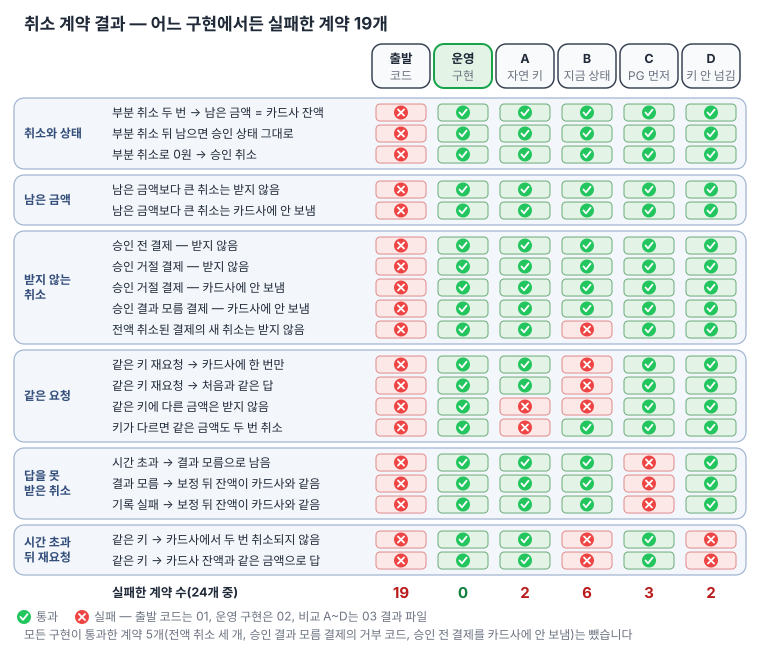

그림에는 어느 구현에서든 한 번이라도 실패한 계약 19개만 두었고, 모든 구현이 통과한 5개는 뺐습니다.

비교 구현마다 결과는 아래와 같습니다.

### 비교 A: 같은 금액·사유를 같은 요청으로 봄(자연 키)

```text
FAIL Idempotency-Key 가 다르면 같은 금액의 부분 취소도 두 번 모두 카드사에서 취소된다 (0.061s) | org.opentest4j.AssertionFailedError: expected: 2 but was: 1
FAIL 같은 Idempotency-Key 에 다른 금액이 오면 받지 않는다 (0.046s) | java.lang.AssertionError: Expecting actual not to be null
(나머지 22개 통과)
```

같은 금액의 두 번째 부분 취소를 첫 취소의 재요청으로 보고 처음 답을 돌려줘서, PG에는 취소가 한 건만 남았습니다. 같은 키에 다른 금액이 온 경우는 금액이 다르니 다른 자연 키가 되어 새 취소로 받았고, 오류가 나지 않았습니다. 시간 초과 뒤 재요청은 같은 자연 키로 PG에 다시 보내져 통과했습니다.

### 비교 B: 고객의 키를 기록에 쓰지 않고 지금 결제 상태로 답함

```text
FAIL 시간 제한을 넘긴 취소가 같은 Idempotency-Key 로 다시 와도 카드사에서 두 번 취소되지 않는다 (1.647s) | org.opentest4j.AssertionFailedError: expected: 1 but was: 2
FAIL 같은 Idempotency-Key 로 다시 온 취소는 카드사에 한 번만 보낸다 (0.062s) | org.opentest4j.AssertionFailedError: expected: 1 but was: 2
FAIL 시간 제한을 넘긴 취소가 같은 Idempotency-Key 로 다시 오면 카드사 잔액과 같은 남은 금액으로 답한다 (1.608s) | org.opentest4j.AssertionFailedError: expected: 5000.00 but was: 10000.00
FAIL 같은 Idempotency-Key 에 다른 금액이 오면 받지 않는다 (0.059s) | java.lang.AssertionError: Expecting actual not to be null
FAIL 이미 전액 취소된 결제의 새 취소는 받지 않는다 (0.043s) | java.lang.AssertionError: Expecting actual not to be null
(나머지 18개 통과)
```

위 5개에 더해 "같은 Idempotency-Key 로 다시 온 취소는 처음과 같은 답을 받는다"도 실패했습니다(실패 메시지에 주문번호가 들어 있어 줄은 옮기지 않았습니다). 부분 취소 뒤에는 결제가 아직 승인 상태라 재요청을 새 취소로 보내고, 전액 취소 뒤에는 결제가 취소 상태라 새 취소까지 재요청으로 봤습니다. 3장에서 승인에 쓴 방식은 결제 하나에 승인이 한 번뿐이라 지금 상태로 답할 수 있었지만, 부분 취소에서는 상태로 재요청과 새 취소를 가릴 수 없었습니다.

### 비교 C: PG 먼저 부르고 답을 받은 뒤에 기록함

```text
FAIL 결과를 모르는 취소는 보정 뒤 남은 금액이 카드사 잔액과 같다 (1.606s) | java.lang.AssertionError: [결제에 남은 취소] Expecting actual not to be empty
FAIL 카드사 취소 답이 시간 제한을 넘기면 그 취소는 결과 모름으로 남는다 (1.067s) | java.lang.AssertionError: [결제에 남은 취소] Expecting actual not to be empty
FAIL 카드사 취소 뒤 결과 기록이 실패해도, 보정 뒤 남은 금액이 카드사 잔액과 같다 (0.066s) | java.lang.AssertionError: [결제에 남은 취소] Expecting actual not to be empty
(나머지 21개 통과)
```

결정 4에서 설명한 것처럼, PG 답을 받지 못하거나 기록에 실패한 취소는 우리 쪽에 아무것도 남지 않아 보정할 대상이 없었습니다.

### 비교 D: PG에 멱등키를 넘기지 않음

```text
FAIL 시간 제한을 넘긴 취소가 같은 Idempotency-Key 로 다시 와도 카드사에서 두 번 취소되지 않는다 (1.604s) | org.opentest4j.AssertionFailedError: expected: 1 but was: 2
FAIL 시간 제한을 넘긴 취소가 같은 Idempotency-Key 로 다시 오면 카드사 잔액과 같은 남은 금액으로 답한다 (1.614s) | org.opentest4j.AssertionFailedError: expected: 5000.00 but was: 10000.00
(나머지 22개 통과)
```

시간 초과 뒤 재요청만 실패했습니다. 우리 쪽은 같은 키를 알아보고 PG에 다시 보냈지만, PG는 키가 없어 새 취소로 처리했습니다.

2·3·4장의 비교 구현도 함께 돌렸고, 전과 같은 26개가 같은 이유로 실패했습니다. 전체 결과는 164개 중 39개 실패(2·3·4장 26개 + 5장 비교 A 2개, B 6개, C 3개, D 2개)입니다.

### 같은 취소 묶음으로 잰 결과

계약 테스트는 경우마다 결제 하나를 보므로, 어긋남이 몇 건 쌓이는지는 드러나지 않습니다. 그래서 구현마다 같은 취소 묶음을 보내고 보정한 뒤 PG 쪽과 결제 쪽을 세는 측정(`./gradlew cancelMeasurement`)을 따로 두었습니다. 결제는 12건(모두 15000원 승인, 부분 취소는 5000원)이고, 고객이 뜻한 PG 취소는 14건입니다.

- 같은 금액 부분 취소를 키를 바꿔 두 번: 2건(뜻한 취소 4)
- 부분 취소 뒤 같은 키로 다시: 2건(2)
- PG 취소 답이 늦어 시간 초과, 그 뒤 보정만: 2건(2)
- 시간 초과, PG가 처리를 마친 뒤 같은 키로 다시: 2건(2)
- PG 취소 뒤 결과 기록 실패(MySQL 트리거), 그 뒤 보정만: 2건(2)
- 전액 취소 뒤 같은 키로 다시: 2건(2)

읽기 시간 제한은 1초, 늦은 취소는 1.5초 뒤에 답합니다. 묶음을 다 보낸 뒤 보정을 한 번 돌리고, 보정에 넘기는 시각은 보정 대기 시간(10초)이 지난 때로 줍니다. "우리 남은 금액"은 결제 금액에서 끝난 취소의 합을 뺀 값이고, "카드사 잔액"은 Mock PG의 `balanceAmount`입니다. 한 번 실행한 값입니다.

운영 구현과 비교 B의 결과는 아래와 같습니다.

```text
## 운영 구현
결제 12건, 고객이 뜻한 카드사 취소 14건
카드사가 받은 취소 요청 16건(같은 멱등키로 다시 와 처음 응답을 돌려준 요청 포함), 카드사가 실제로 취소한 건 14건
뜻한 것보다 더 취소된 결제 0건, 덜 취소된 결제 0건
우리 남은 금액과 카드사 잔액이 다른 결제 0건
보정 뒤에도 결과를 남기지 못한 취소(요청·결과 모름) 0건
결제 상태 {APPROVAL_CANCELED=2, APPROVED=10} / 카드사 상태 {CANCELED=2, PARTIAL_CANCELED=10}
묶음을 보내고 보정까지 6726ms

## 비교 B 지금 상태로 답함
결제 12건, 고객이 뜻한 카드사 취소 14건
카드사가 받은 취소 요청 18건(같은 멱등키로 다시 와 처음 응답을 돌려준 요청 포함), 카드사가 실제로 취소한 건 18건
뜻한 것보다 더 취소된 결제 4건, 덜 취소된 결제 0건
우리 남은 금액과 카드사 잔액이 다른 결제 0건
보정 뒤에도 결과를 남기지 못한 취소(요청·결과 모름) 0건
결제 상태 {APPROVAL_CANCELED=2, APPROVED=10} / 카드사 상태 {CANCELED=2, PARTIAL_CANCELED=10}
묶음을 보내고 보정까지 6845ms
```

운영 구현은 PG가 14건을 취소해 고객이 뜻한 수와 같았고, 받은 요청 16건 가운데 2건은 시간 초과 뒤 같은 키로 다시 보내 PG가 첫 응답을 돌려준 요청입니다.

다섯 구현의 측정값을 한 그림에 모으면 아래와 같습니다.

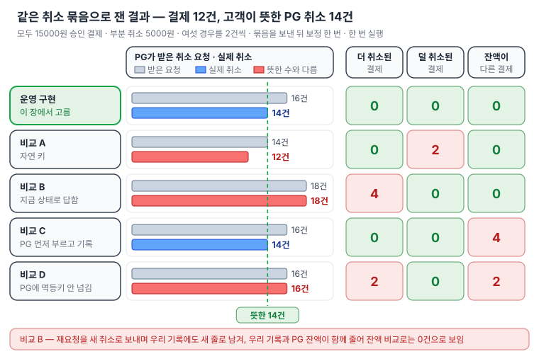

비교 B는 "우리 남은 금액과 카드사 잔액이 다른 결제"가 운영 구현과 같은 0건입니다. 다만 PG가 실제로 취소한 건은 18건으로 뜻한 14건보다 4건 많고, 더 취소된 결제가 4건입니다. 재요청을 새 취소로 보내면서 우리 쪽에도 그 취소를 새 줄로 기록했기 때문에, 우리 기록과 PG 잔액이 함께 더 줄어서 둘을 비교하면 같아 보입니다.

나머지 구현은 아래와 같습니다.

- 비교 A 자연 키: 받은 요청 14건, 실제 취소 12건, 덜 취소된 결제 2건, 잔액이 다른 결제 0건. 키를 바꾼 같은 금액의 두 번째 취소가 PG에 가지 않았습니다.
- 비교 C PG 먼저 부르고 기록: 받은 요청 16건, 실제 취소 14건, 더·덜 취소된 결제 0건, 잔액이 다른 결제 4건. PG는 뜻한 만큼 취소했지만 우리 기록이 그것을 따라가지 못했습니다. 측정 파일은 결제별 내역을 남기지 않았고, 계약 결과로 보면 보정만 기다린 시간 초과와 기록 실패가 그 자리입니다.
- 비교 D PG에 멱등키 안 넘김: 받은 요청 16건, 실제 취소 16건, 더 취소된 결제 2건, 잔액이 다른 결제 2건. 시간 초과 뒤 재요청이 PG에서 한 번 더 취소되었고, 그 취소는 우리 기록에 없습니다.
- 모든 구현에서 결제 상태는 `{APPROVAL_CANCELED=2, APPROVED=10}`, PG 상태는 `{CANCELED=2, PARTIAL_CANCELED=10}`이었습니다. 묶음을 보내고 보정까지 6712ms에서 7405ms가 걸렸습니다.

이번 장에는 처리량·지연·경합에 대한 주장이 없어서 k6는 돌리지 않았습니다.

## 남은 한계

이 장의 구조로도 아래 문제들은 아직 해결하지 못합니다.

- 같은 결제에 같은 금액의 결과 모름 취소가 여럿이면, 보정이 금액으로 짝을 짓기 때문에 어느 키가 `DONE`이 되고 어느 키가 `FAILED`가 될지는 실제와 바뀔 수 있습니다. 끝난 취소의 금액 합은 맞습니다. 테스트는 결과 모름 취소가 하나씩인 경우만 봤습니다.
- 보정은 대기 시간보다 먼저 요청한 취소만 닫지만, PG 쪽의 짝이 없는 취소 목록에는 그 뒤에 요청해 아직 처리 중인 취소가 섞일 수 있습니다. 이 경우는 실행해 보지 않았습니다.
- PG 취소 응답의 `cancels` 마지막 칸을 이번 취소로 읽습니다. 토스페이먼츠 문서에서 `cancels`의 순서를 보장한다는 문구를 찾지 못했습니다. 마지막 칸이 이번 취소가 아니라면 `transactionKey`가 틀리게 남고, 보정의 짝짓기도 꼬일 수 있습니다.
- Mock PG의 가정 위에서 확인한 결과입니다. 같은 멱등키에 다른 본문이 오면 첫 응답을 준다는 것, 잔액을 넘는 금액에 `NOT_CANCELABLE_AMOUNT`로 답한다는 것은 문서로 확인하지 못했고, 멱등키 유효 기간 15일은 흉내 내지 않았습니다.
- PG가 500으로 답하면서 취소를 남기지 않는다는 것도 가정이라, 실제 PG가 취소를 남긴다면 이 장의 500 테스트 결과(보정에서 `FAILED`로 닫힘)와 달리 보정이 그 취소를 `DONE`으로 닫아야 합니다. 첫 요청이 500이었을 때 같은 키 재요청에 PG가 무엇을 돌려주는지도 다루지 않았습니다(Mock PG는 500 응답을 멱등 응답으로 기억하지 않습니다).
- 같은 키의 취소가 동시에 들어오는 경우는 다루지 않았습니다. 코드로 보면 `unique(payment_id, idempotency_key)`가 두 번째 줄을 막아 500으로 답할 것으로 보이지만, 실행해서 확인하지는 않았습니다. 같은 결제의 서로 다른 취소가 동시에 와서 함께 남은 금액을 넘는 경우도 잠금이 없어 막지 못합니다(실행하지 않았습니다). 이 장은 서버 한 대를 범위로 두었고, 둘 다 7장 동시성 제어에서 다룹니다.
- 결제 조회 API에 남은 금액이 없고, 취소 목록을 조회하는 API도 없습니다. 클라이언트는 취소 응답의 `balanceAmount`로만 남은 금액을 압니다.
- 고객이 다른 결제에 쓴 키를 다시 써도, 우리는 결제마다 키를 보고 토스페이먼츠도 API 주소(`paymentKey`)가 달라 다른 요청으로 봅니다(문서 기준). 키에 개인정보를 넣지 말라는 안내는 아직 API 문서에 없습니다.
- `schema.sql`이 `create table if not exists`라서, 이미 테이블이 있는 DB에는 `payment_cancel`의 칸 추가가 반영되지 않습니다. 4장과 같은 한계입니다.

1장과 3·4장에서 넘긴 항목은 이렇게 되었습니다. 취소는 남은 금액 안에서 여러 번 할 수 있게 되었고, 결제 하나에 여러 번 있는 부분 취소의 같은 요청은 `Idempotency-Key`로 가립니다. 4장에서 망취소 비교용으로 만든 Mock PG 취소 API는 부분 취소와 멱등키를 더해 운영 코드의 취소에서 씁니다.

## 요약

오늘은 승인된 결제의 취소와 부분 취소를 기록하는 방법과, 같은 취소 요청을 가리고 PG 답을 받지 못한 취소를 맞추는 방법을 정리하였습니다. 요약하자면 아래와 같습니다.

- 받은 금액으로 PG에 취소를 보내고 상태만 바꾸는 출발 코드에서는 5장 테스트 37개 중 29개가 실패했습니다. 부분 취소 한 번에 결제가 취소 상태가 되었고, 두 번째 부분 취소는 PG에서 취소된 뒤 우리 쪽에서 409로 끝났습니다.
- 취소는 한 건마다 `payment_cancel`에 한 줄로 남기고, 남은 금액은 결제 금액에서 끝난 취소의 합을 빼서 계산합니다. 결제 상태는 그대로 두고, 남은 금액이 0원이 되면 기존 취소 전이로 닫습니다.
- 취소 요청에는 `Idempotency-Key`를 반드시 받습니다. 같은 키·같은 내용이면 남긴 결과로, 다른 내용이면 422로 답합니다. 자연 키는 같은 금액의 두 번째 취소를 버렸고, 지금 상태로 답하는 방식은 같은 12건에서 4건을 더 취소했습니다.
- 취소 요청을 먼저 기록한 뒤 PG를 부르고, 답을 받지 못한 취소는 결과 모름으로 남겨 4장 보정을 넓혀 맞춥니다. PG를 먼저 부르면 답을 받지 못한 취소가 남지 않아 4건이 PG와 어긋났습니다.
- 고객의 키를 PG에도 넘겨, 결과를 남기지 못한 취소의 재요청이 PG에서 다시 취소되지 않게 합니다. 넘기지 않으면 2건이 더 취소되었습니다.

정리하면서 우리 기록이 PG와 맞는지만 봐서는 부족한 경우가 있다는 것을 알 수 있었습니다. 지금 상태로 답하는 방식은 우리 기록과 PG 잔액이 모두 같았지만, 둘 다 고객이 뜻한 것보다 더 취소된 것이었습니다.

## 다음 글 예고

다음 글에서는 6장 웹훅 처리를 다룹니다. 1장에서 "PG의 웹훅이 순서가 바뀌어 들어오면(예: 매입 알림이 승인 알림보다 먼저) 지금의 전이 표는 그 알림을 거부합니다. 6장에서 다룹니다."라고 예고한 내용입니다. 이 장의 보정은 PG에 조회한 `cancels`를 금액으로 짝짓고, 취소 응답의 마지막 칸을 이번 취소로 읽는 가정에 기대고 있어서, PG가 보내는 알림을 받을 때 이 부분도 함께 살펴보려고 합니다.

참조 :

- [코어 API(결제 취소 — cancelAmount·cancelReason·멱등키, Payment 객체의 cancels·balanceAmount·status) — 토스페이먼츠 개발자센터](https://docs.tosspayments.com/reference)
- [API 인증과 멱등키 헤더 — 토스페이먼츠 개발자센터](https://docs.tosspayments.com/reference/using-api/authorization)
- [에러 코드(ALREADY_CANCELED_PAYMENT, NOT_CANCELABLE_AMOUNT, NOT_CANCELABLE_PAYMENT) — 토스페이먼츠 개발자센터](https://docs.tosspayments.com/reference/error-codes)
- [The Idempotency-Key HTTP Header Field(draft-ietf-httpapi-idempotency-key-header-08) — IETF](https://datatracker.ietf.org/doc/html/draft-ietf-httpapi-idempotency-key-header-08)
- [Idempotent requests — Stripe API Reference](https://docs.stripe.com/api/idempotent_requests)
