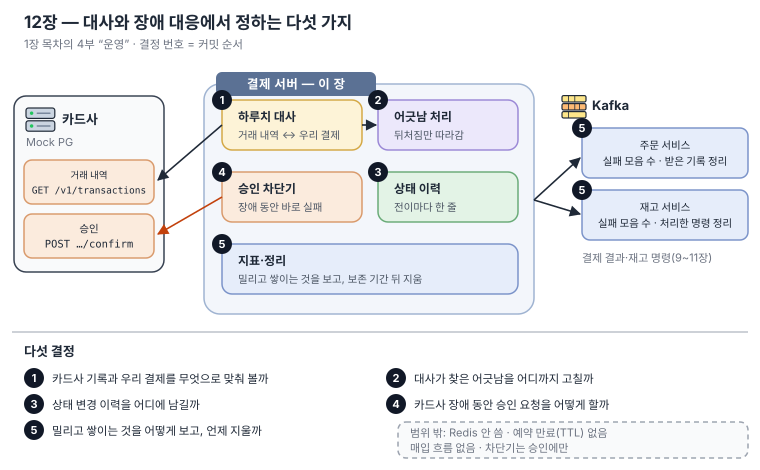
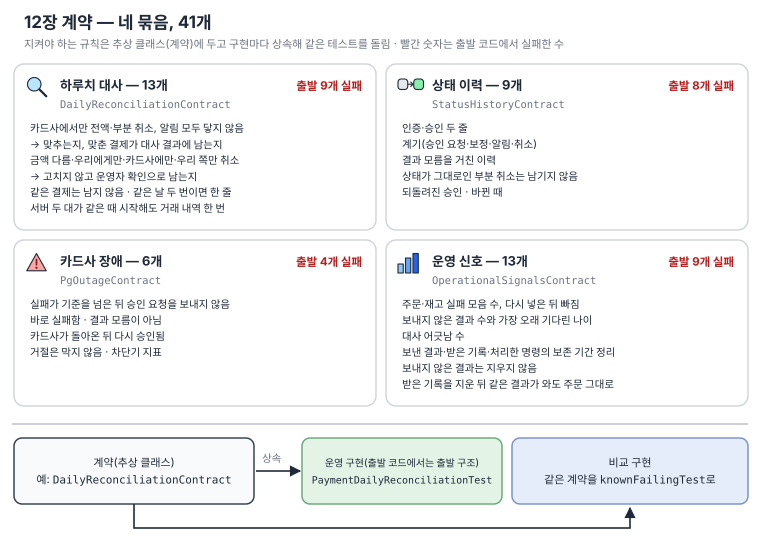
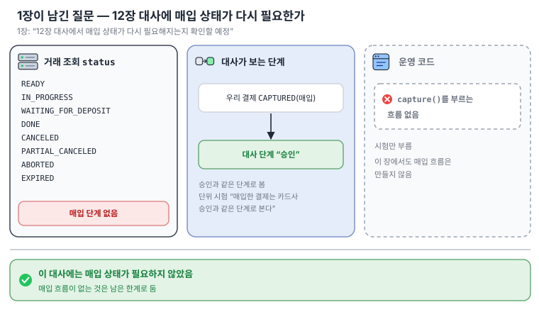
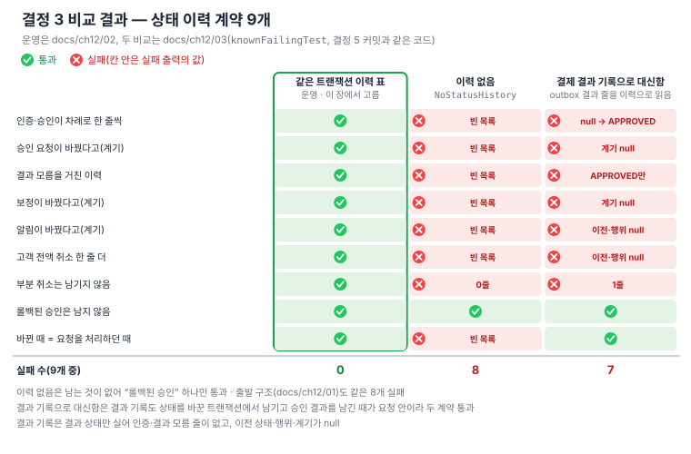
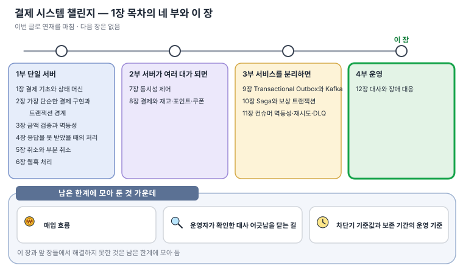

이전에 [컨슈머 멱등성·재시도·DLQ](../payment-consumer-idempotency/)에 대해 작성하였습니다. 그 글에서는 주문 서비스와 재고 서비스가 같은 메시지와 늦게 온 옛 메시지를 가리고, 처리에 실패한 메시지를 같은 자리에서 다시 시도한 뒤 실패 모음(`<토픽>.DLT`)에 모으도록 했습니다. 그리고 다음 글 예고에 "이 장의 실패 모음은 운영자가 명령을 돌려야 원래 토픽으로 돌아가고, 다시 시도 15초의 여유는 운영 기준 없이 둔 가정이며, 보낸 `payment_outbox` 줄과 받은 기록은 지우지 않고 쌓입니다."라고 적었습니다.

11장까지 결제 서버가 카드사와 결제를 맞추는 길은 세 가지였습니다. 결과 모름·인증 상태로 남은 결제는 4장 [PG 응답을 받지 못한 결제와 보정](../payment-approval-unknown/)에서 만든 작업이 카드사에 조회해 닫고, 결과를 기다리는 취소는 5장 [결제 취소와 부분 취소](../payment-partial-cancel/)의 취소 보정이 맞추고, 받은 알림은 6장 [PG 웹훅 처리](../payment-webhook/)가 신호로 삼아 카드사 결제를 다시 읽어 따라갑니다. 승인 요청에는 2장 [가장 단순한 결제 구현과 트랜잭션 경계](../payment-transaction-boundary/)의 시간 제한만 있었고, 실패 모음에 메시지가 쌓이거나 릴레이가 밀려도 밖에서 볼 수단이 없었습니다.

오늘은 연재의 열두 번째이자 마지막 글로, 1장 [결제 기초: 인증, 승인, 매입, 취소와 상태 머신](../payment-state-machine/) 목차의 4부 "운영"에 해당하는 대사와 장애 대응을 정리하도록 하겠습니다. 카드사 기록과 우리 결제를 무엇으로 맞춰 볼지, 찾은 어긋남을 어디까지 고칠지, 상태 변경 이력을 어디에 남길지, 카드사 장애 동안 승인 요청을 어떻게 할지, 운영 중 밀리고 쌓이는 것을 어떻게 보고 언제 지울지를 차례로 정하고, 다른 선택지를 같은 계약 테스트와 같은 측정으로 비교합니다.



범위를 먼저 밝히겠습니다. 결정 다섯 가지를 모두 구현했습니다. Redis는 쓰지 않았고, 예약 만료(TTL)는 하지 않았습니다. 대사가 스스로 고치는 것은 우리 기록이 카드사보다 뒤처진 결제뿐이고, 차단기는 승인 요청에만 둡니다. 매입 흐름은 만들지 않았습니다. 테스트 이름과 이 글의 '카드사'는 이 연재에서 PG(Mock PG)를 가리킵니다.

이 장의 코드는 [payment-challenge](https://github.com/qkrxodud/payment-challenge/tree/chapter-12)의 `chapter-12` 브랜치에 있고, 출발 코드는 `ch12-start`, 완성 코드는 `ch12` 태그입니다.

## 현재 구조: 보정·알림 처리만 있고, 승인은 시간 제한만 두는 결제 서버

출발 코드(`ch12-start`)의 운영 코드는 11장 그대로입니다. 결제 서버가 가진 맞추기는 4장 보정, 5장 취소 보정, 6장 받은 알림 처리뿐입니다. 상태 이력, 대사 결과, 운영 지표는 없고, 보낸 결과와 받은 기록을 지우는 일도 없습니다.


카드사 승인 요청은 2장의 시간 제한(운영 값 연결 1초·읽기 5초)만 거칩니다. 답을 받지 못하면 `PaymentGatewayNoResponseException`이 되고, 4장부터 그 결제는 결과 모름(`APPROVAL_UNKNOWN`)으로 남습니다. 아래는 완성 코드의 승인 요청 본문이고, 출발 코드에서는 이 본문이 그대로 `approve`였습니다.

```java
// src/main/java/com/example/payment/infrastructure/pg/PgPaymentGateway.java
private PaymentApproval requestApproval(String paymentKey, String orderId, BigDecimal amount) {
    try {
        return pgRestClient.post()
                .uri("/v1/payments/confirm")
                .body(new PgConfirmRequest(paymentKey, orderId, amount))
                .exchange((request, response) -> toApproval(orderId, response));
    } catch (ResourceAccessException noResponse) {
        throw new PaymentGatewayNoResponseException(orderId);
    }
}
```

출발 코드에 12장 계약을 먼저 작성하였습니다. 앞 장들처럼 지켜야 하는 규칙은 추상 클래스에 두고 구현마다 상속해 같은 테스트를 돌립니다. 계약은 네 묶음, 41개이고 다음을 봅니다.

- 하루치 대사(`DailyReconciliationContract`, 13개): 카드사에서만 전액·부분 취소되고 알림이 모두 닿지 않은 결제를 맞추는지, 맞춘 결제가 대사 결과에 남는지, 금액이 다른 결제·우리에게만 있는 결제·카드사에만 있는 결제·우리 쪽만 취소된 결제는 고치지 않고 운영자 확인으로 남는지, 같은 결제는 남지 않는지, 같은 날을 두 번 돌려도 한 줄인지, 서버 두 대가 같은 때 시작해도 거래 내역을 한 번만 읽는지
- 상태 이력(`StatusHistoryContract`, 9개): 인증·승인 두 줄, 계기(승인 요청·보정·알림·취소), 결과 모름을 거친 이력, 상태가 그대로인 부분 취소는 남기지 않음, 롤백된 승인, 바뀐 때
- 카드사 장애(`PgOutageContract`, 6개): 실패가 기준을 넘은 뒤 승인 요청을 보내지 않음, 바로 실패함, 결과 모름이 아님, 카드사가 돌아온 뒤 다시 승인됨, 거절은 막지 않음, 차단기 지표
- 운영 신호(`OperationalSignalsContract`, 13개): 주문·재고 실패 모음 수, 다시 넣은 뒤 빠짐, 보내지 않은 결과 수와 가장 오래 기다린 나이, 대사 어긋남 수, 보낸 결과·받은 기록·처리한 명령의 보존 기간 정리, 보내지 않은 결과는 지우지 않음, 받은 기록을 지운 뒤 같은 결과가 다시 와도 주문은 그대로



출발 구조의 시험 구현은 운영 코드에 없는 것을 부르지 않습니다. 대사 자리에서는 지금 있는 4장 보정·5장 취소 보정·6장 알림 처리를 보정 대기 시간이 지난 때로 한 번씩 돌리고, 대사 결과·이력·지표는 비어 있고, 정리는 하지 않습니다.

시험 도구는 아래와 같이 만들었습니다.

- Mock PG에 거래 조회(`GET /v1/transactions`)를 더했습니다. `startDate`·`endDate`·`startingAfter`·`limit`을 받고, 승인·취소마다 거래 한 건을 남깁니다. 토스페이먼츠 거래 조회 문서를 본떴고, 확인하지 못한 동작은 가정으로 주석에 적었습니다(결정 1에서 다룹니다).
- 카드사 쪽 어긋남은 Mock PG로 만듭니다. 가맹점 관리 화면 취소(`cancelAtCardCompany`)와 카드사에만 남는 승인(`approveAtCardCompany`)입니다. 알림은 받는 곳이 없는 주소(`http://localhost:1/…`)로 보내고, 7번 재전송(시험 간격 0.1초)이 모두 끝날 때까지 기다립니다.
- 우리 쪽 어긋남은 시험이 결제 줄을 직접 고쳐 만듭니다(금액·상태 update, 카드사가 모르는 승인 결제 insert).
- 서버 두 대는 7장 [결제 동시성 제어](../payment-concurrency/)의 `OtherPaymentServer`로 띄우고, 거래 조회 답을 붙잡아(래치) 한 서버가 조회하는 동안 다른 서버가 대사를 부르게 고정했습니다.
- 카드사 장애는 Mock PG가 승인 요청을 받고 3초 동안 답하지 않다가 아무것도 남기지 않는 방식(LOST)으로 만들고, 읽기 시간 제한은 1초로 줄였습니다. 차단기 계약 값은 최근 4번 중 50%(최소 4번), 열린 시간 2초, 시험 삼아 1번입니다.
- 실패 모음은 받는 쪽 기록을 트리거로 실패시키고 다시 시도를 0.1초 한 번으로 줄여 만듭니다. 지표는 각 서비스 컨텍스트의 `MeterRegistry`에서 읽습니다.


## 현재 구조의 문제: 테스트로 재현하기

아래는 카드사에서만 전액 취소되고 알림이 모두 닿지 않은 결제의 계약입니다.

```java
// src/test/java/com/example/payment/application/payment/DailyReconciliationContract.java
@Test
@DisplayName("카드사에서만 전액 취소되고 알림이 모두 닿지 않은 승인 결제는 대사 뒤 승인 취소가 된다")
void paymentCanceledOnlyAtCardCompanyBecomesCanceled() {
    String orderId = approved();
    cancelAtCardCompanyUnnoticed(orderId, null);

    reconcile(today());

    assertThat(statusOf(orderId)).isEqualTo(PaymentStatus.APPROVAL_CANCELED);
}

// 카드사 쪽에서 취소하고(금액이 없으면 남은 금액 전부), 그 알림이 재전송까지 모두 닿지 않을 때까지 기다린다
void cancelAtCardCompanyUnnoticed(String orderId, BigDecimal amount) {
    mockPg.cancelAtCardCompany(orderId, amount);
    await().atMost(Duration.ofSeconds(10)).until(mockPg::isWebhookSettled);
}
```

출발 코드에서 `./gradlew clean test`(별도 worktree)를 돌린 결과는 아래와 같습니다. 같은 실행에서 앞 장 시험 761개는 모두 통과했습니다.

```text
# 태그 ch12-start 의 코드(운영 코드는 11장 그대로)에서 ./gradlew clean test(별도 worktree) — 전체 tests=802 failures=30 errors=0 time=1071.1s, 빌드 18분 3초 (2026-11-22)
## 하루치 대사 — 운영 구현
PASS 우리에게만 있는 승인 결제는 대사가 상태를 바꾸지 않는다 (0.062s)
FAIL 우리 쪽만 취소된 결제는 카드사 승인으로 되돌리지 않고 운영자가 확인할 어긋남으로 남는다 (0.063s) | java.lang.AssertionError: java.lang.AssertionError: Expected size: 1 but was: 0 in: []
PASS 카드사에만 있는 결제는 대사가 우리 쪽에 결제를 만들지 않는다 (0.849s)
FAIL 카드사에서만 전액 취소되고 알림이 모두 닿지 않은 승인 결제는 대사 뒤 승인 취소가 된다 (0.9s) | org.opentest4j.AssertionFailedError: org.opentest4j.AssertionFailedError: expected: APPROVAL_CANCELED but was: APPROVED
FAIL 대사가 카드사를 따라 맞춘 결제는 맞춘 것으로 대사 결과에 남는다 (0.903s) | org.opentest4j.AssertionFailedError: org.opentest4j.AssertionFailedError: Expecting actual: [] to contain exactly (and in same order): ["FOLLOWED"] but could not find the following elements: ["FOLLOWED"]
FAIL 카드사와 금액이 다른 결제는 운영자가 확인할 어긋남으로 대사 결과에 남는다 (0.045s) | java.lang.AssertionError: java.lang.AssertionError: Expected size: 1 but was: 0 in: []
PASS 우리 기록과 카드사가 같은 결제는 대사 결과에 남지 않는다 (0.072s)
FAIL 같은 날을 두 번 대사해도 같은 어긋남은 대사 결과에 한 번만 남는다 (0.038s) | java.lang.AssertionError: java.lang.AssertionError: Expected size: 1 but was: 0 in: []
FAIL 우리에게만 있는 승인 결제는 운영자가 확인할 어긋남으로 대사 결과에 남는다 (0.02s) | java.lang.AssertionError: java.lang.AssertionError: Expected size: 1 but was: 0 in: []
PASS 카드사와 금액이 다른 결제는 대사가 우리 금액을 바꾸지 않는다 (0.045s)
FAIL 카드사에서만 부분 취소되고 알림이 모두 닿지 않은 승인 결제는 대사 뒤 남은 금액이 카드사 잔액과 같다 (0.882s) | org.opentest4j.AssertionFailedError: org.opentest4j.AssertionFailedError: expected: 10000.00 but was: 15000
FAIL 두 서버가 같은 때 대사를 시작해도 카드사 거래 내역은 한 번만 읽는다 (5.46s) | org.awaitility.core.ConditionTimeoutException: org.awaitility.core.ConditionTimeoutException: Condition with Lambda expression in com.example.payment.application.payment.DailyReconciliationContract was not fulfilled within 5 seconds.
FAIL 카드사에만 있는 결제는 운영자가 확인할 어긋남으로 대사 결과에 남는다 (0.847s) | java.lang.AssertionError: java.lang.AssertionError: Expected size: 1 but was: 0 in: []
## 운영 지표와 정리 — 운영 구현
FAIL 보존 기간이 지난 주문 서비스의 받은 결제 결과는 정리에서 지워진다 (0.245s) | org.opentest4j.AssertionFailedError: org.opentest4j.AssertionFailedError: expected: 0 but was: 1
PASS 받은 결제 결과가 정리된 뒤 같은 결과가 다시 와도 주문은 다시 바뀌지 않는다 (0.288s)
FAIL 운영자가 확인할 대사 어긋남 수가 운영 지표에 보인다 (0.059s) | java.lang.AssertionError: java.lang.AssertionError: Expecting Optional to contain a value but it was empty.
FAIL 보존 기간이 지난 보낸 결제 결과는 정리에서 지워진다 (0.174s) | org.opentest4j.AssertionFailedError: org.opentest4j.AssertionFailedError: expected: 0 but was: 1
FAIL 재고 서비스 실패 모음에 재고 명령이 하나 더 쌓이면 운영 지표도 하나 는다 (1.705s) | java.lang.AssertionError: java.lang.AssertionError: Expecting Optional to contain a value but it was empty.
FAIL 보존 기간이 지난 재고 서비스의 처리한 재고 명령은 정리에서 지워진다 (0.205s) | java.lang.AssertionError: java.lang.AssertionError: Expecting empty but was: [{"command"="CONFIRM", "command_id"="1369309008", "id"=3L, "processed_at"=2026-11-07T13:06:43.272250 (java.time.LocalDateTime), "reservation_id"=1369309006L}]
FAIL 보내지 않은 결제 결과 수가 운영 지표에 보인다 (0.166s) | java.lang.AssertionError: java.lang.AssertionError: Expecting Optional to contain: 1.0 but was empty.
FAIL 주문 서비스 실패 모음에 결제 결과가 하나 더 쌓이면 운영 지표도 하나 는다 (1.763s) | java.lang.AssertionError: java.lang.AssertionError: Expecting Optional to contain a value but it was empty.
PASS 보존 기간이 지나지 않은 보낸 결제 결과는 정리에서 남는다 (0.064s)
PASS 보내지 않은 결제 결과는 오래돼도 정리에서 지우지 않는다 (0.057s)
FAIL 실패 모음에서 다시 넣은 결제 결과는 운영 지표에서 빠진다 (3.123s) | java.lang.AssertionError: java.lang.AssertionError: Expecting Optional to contain: 0.0 but was empty.
PASS 보존 기간이 지나지 않은 주문 서비스의 받은 결제 결과는 정리에서 남는다 (0.185s)
FAIL 보내지 않은 결제 결과 가운데 가장 오래 기다린 결과의 나이가 운영 지표에 초로 보인다 (0.054s) | java.lang.AssertionError: java.lang.AssertionError: Expecting Optional to contain a value but it was empty.
## 카드사 장애 동안의 승인 — 운영 구현
PASS 카드사가 돌아오고 열린 시간이 지나면 새 결제는 다시 승인된다 (6.375s)
FAIL 차단기가 열린 동안 실패한 결제는 결과 모름으로 남지 않는다 (5.221s) | java.lang.AssertionError: java.lang.AssertionError: Expecting actual: APPROVAL_UNKNOWN not to be equal to: APPROVAL_UNKNOWN
FAIL 차단기가 열리면 운영 지표에 열림으로 보인다 (4.123s) | java.lang.AssertionError: java.lang.AssertionError: Expecting Optional to contain: 1.0 but was empty.
FAIL 카드사가 답하지 않는 승인이 기준만큼 쌓이면 그 뒤 승인 요청은 카드사에 보내지 않는다 (5.162s) | org.opentest4j.AssertionFailedError: org.opentest4j.AssertionFailedError: expected: 0 but was: 1
FAIL 차단기가 열린 동안 승인 요청은 읽기 시간 제한을 기다리지 않고 바로 실패한다 (5.165s) | java.lang.AssertionError: java.lang.AssertionError: Expecting actual: 1.021767375S to be less than: 0.3S
PASS 카드사가 거절한 승인은 여러 번 쌓여도 그 뒤 승인 요청을 막지 않는다 (0.115s)
## 결제 상태 이력 — 운영 구현
FAIL 카드사 알림으로 따라간 취소는 알림이 바꿨다고 이력에 남는다 (0.126s) | java.lang.AssertionError: java.lang.AssertionError: Expecting actual not to be empty
FAIL 상태가 그대로인 부분 취소는 이력을 남기지 않는다 (0.166s) | java.lang.AssertionError: java.lang.AssertionError: Expected size: 2 but was: 0 in: []
FAIL 승인된 결제에는 인증과 승인이 차례로 한 줄씩 이력에 남는다 (0.071s) | org.opentest4j.AssertionFailedError: org.opentest4j.AssertionFailedError: Expecting actual: [] to contain exactly (and in same order): ["READY -> AUTHENTICATED (AUTHENTICATE)", "AUTHENTICATED -> APPROVED (APPROVE)"] but could not find the following elements: ["READY -> AUTHENTICATED (AUTHENTICATE)", "AUTHENTICATED -> APPROVED (APPROVE)"]
FAIL 카드사 답을 받지 못한 결제가 보정으로 승인되면 결과 모름을 거친 이력이 남는다 (1.661s) | org.opentest4j.AssertionFailedError: org.opentest4j.AssertionFailedError: Expecting actual: [] to contain exactly (and in same order): ["AUTHENTICATED", "APPROVAL_UNKNOWN", "APPROVED"] but could not find the following elements: ["AUTHENTICATED", "APPROVAL_UNKNOWN", "APPROVED"]
PASS 승인 기록이 되돌려지면 승인 이력도 남지 않는다 (0.085s)
FAIL 보정이 바꾼 상태는 보정이 바꿨다고 이력에 남는다 (1.66s) | java.lang.AssertionError: java.lang.AssertionError: Expecting actual not to be empty
FAIL 이력에는 상태를 바꾼 요청을 처리하던 때가 바뀐 때로 남는다 (0.04s) | java.lang.AssertionError: java.lang.AssertionError: Expecting actual not to be empty
FAIL 승인을 요청한 결제의 이력은 승인 요청이 바꿨다고 남는다 (0.062s) | java.lang.AssertionError: java.lang.AssertionError: Expecting ArrayList: [] to contain only: ["CONFIRM"] but could not find the following element(s): ["CONFIRM"]
FAIL 고객이 전액 취소한 결제에는 승인에서 승인 취소로 바뀐 한 줄이 더 남는다 (0.121s) | java.lang.AssertionError: java.lang.AssertionError: Expecting actual not to be empty
```

802개 중 30개가 실패했고, 모두 12장 계약입니다. 대사 13개 중 9개, 상태 이력 9개 중 8개, 카드사 장애 6개 중 4개, 운영 신호 13개 중 9개입니다. 통과한 11개는 고치지 않음·남지 않음·지우지 않음·막지 않음 쪽 계약이라, 아무것도 하지 않는 출발 코드에서도 맞았습니다. 이 장에서 다룰 문제는 다섯 가지로 나눌 수 있습니다.

첫째, 카드사에서만 취소된 승인 결제가 우리 기록에는 승인으로 남습니다. 4장 보정, 5장 취소 보정, 6장 알림 처리를 모두 돌려도 전액 취소된 결제는 `APPROVED`였고(기대 `APPROVAL_CANCELED`), 부분 취소된 결제의 남은 금액은 15000원이었습니다(카드사 10000원). 4장 보정은 결과 모름·인증 상태만 보고 6장은 받은 알림만 보는데, 이 결제는 승인 상태이고 알림이 하나도 닿지 않았습니다.


둘째, 상태·금액이 다르거나 한쪽에만 있는 결제를 찾을 수단이 없습니다. 금액이 다른 결제, 우리에게만 있는 결제, 카드사에만 있는 결제, 우리 쪽만 취소된 결제 모두 대사 결과가 0줄이었습니다. 남길 곳이 없기 때문입니다. 같은 날 두 번 계약도 같은 이유로 실패했고, 서버 두 대 계약은 출발 코드가 카드사 거래 내역을 읽지 않아 5초 안에 조회가 일어나지 않았습니다.

셋째, 이력이 없습니다. 이력 계약 9개 중 8개가 실패했고, 롤백된 승인 계약만 남는 것이 없어 통과했습니다. 첫째 문제 같은 결제를 찾더라도 그 결제가 언제 어떤 길로 지금 상태가 됐는지 되짚을 곳이 없습니다.

넷째, 카드사 장애 동안 승인이 읽기 시간 제한까지 기다리고 결과 모름이 됩니다. 카드사가 답하지 않는 승인이 기준 횟수만큼 쌓인 뒤에도 다음 승인을 카드사에 보냈고(기대 0번, 실제 1번), 그 승인은 계약의 읽기 시간 제한 1초를 기다린 뒤(1.02초) 결과 모름으로 남았습니다. 장애 동안 승인 요청이 DB 연결도 붙잡는지 봤는데, 재현되지 않았습니다. 2장에서 승인 요청을 트랜잭션 밖으로 뺐기 때문입니다. 뒤의 측정(시간 제한만, 운영 읽기 시간 제한 5초)에서 쓰는 중인 연결은 평균 0.14\~0.17개였고, 승인 응답은 중앙 5036\~5040ms, 60건이 모두 결과 모름이었습니다.

다섯째, 운영 중 밀리고 쌓이는 것을 밖에서 알 수 없고, 지우지도 않습니다. 운영 신호 계약 가운데 지표 6개가 값이 없어 실패했고(장애 묶음의 차단기 지표도 같음), 보존 기간이 지난 보낸 결과·받은 기록·처리한 명령을 지우는 계약 3개가 실패했습니다.

![출발 코드에서 재현한 다섯 가지 문제 — 1 카드사에서만 취소된 결제가 4·5·6장 맞추기 뒤에도 APPROVED(부분 취소는 남은 금액 15000원, 카드사 10000원)로 남음, 2 금액 다름·우리에게만·카드사에만·우리 쪽만 취소된 결제와 같은 날 두 번 계약은 대사 결과 0줄, 서버 두 대 계약은 5초 안에 조회가 없음, 3 이력 계약 9개 중 8개 실패, 4 장애 중 기준 뒤에도 승인을 카드사에 1번 보내 계약(읽기 시간 제한 1초)에서 1.02초를 기다린 뒤 결과 모름(결정 5와 같은 결제 서버 코드의 시간 제한만 비교를 운영 읽기 5초로 잰 측정에서는 중앙 5036~5040ms, 60건 모두 결과 모름), DB 연결 붙잡힘은 2장 덕에 재현되지 않음(같은 측정의 평균 0.14~0.17개), 5 지표 6개 값 없음과 정리 계약 3개 실패. 802개 중 30개가 모두 12장 계약에서 실패하고 앞 장 761개는 통과했고, 통과한 11개는 고치지 않음·남지 않음·지우지 않음·막지 않음 쪽 계약인 결과](images/05_start-problems.svg)

## 선택지와 트레이드오프

이 문제를 해결하면서 내린 결정은 다섯 가지이고, 커밋도 결정 번호 순서대로 했습니다. 비교 구현은 결정 5 커밋과 같은 코드에서 `./gradlew knownFailingTest`로 함께 돌렸습니다.

### 결정 1. 카드사 기록과 우리 결제를 무엇으로 맞춰 볼까

이 장에서는 하루치 카드사 거래 내역을 모두 읽어 결제 키로 묶고, 우리 결제와 결제 키로 맞춰 본 뒤 어긋난 결제를 대사 결과 표(`reconciliation_result`)에 남기기로 했습니다.

검토한 선택지는 세 가지입니다.

- 하루치 거래 내역을 쪽 단위로 읽어 결제 키로 맞춤
- 결제마다 카드사 단건 조회(4장 보정을 그날 인증한 모든 결제로 넓힘)
- 닿지 않은 웹훅을 카드사에 다시 보내 달라고 요청

웹훅을 다시 요청하는 쪽은 계획에 없어 구현하지 않았고, 비교로 돌리지 않았습니다.


Mock PG 거래 조회는 토스페이먼츠 거래 조회 문서를 본떴습니다. 문서에서 확인한 것은 아래와 같습니다.

- `GET /v1/transactions`이고, `startDate`·`endDate`가 필수이며 형식은 `yyyy-MM-dd'T'HH:mm:ss`입니다. "거래 기록은 거래가 처리된 시점(`transactionAt`)을 기준으로 조회합니다."
- `startingAfter`(거래 키)를 주면 그 뒤부터 받고, `limit`은 기본 100이며 "최대값은 `5000`입니다." 많은 기록을 쪽으로 나눠 처리할 때 씁니다.
- 요청이 60초까지 걸릴 수 있어 시간 제한을 60초 이상으로 두라고 합니다.
- 거래의 `status`는 READY, IN_PROGRESS, WAITING_FOR_DEPOSIT, DONE, CANCELED, PARTIAL_CANCELED, ABORTED, EXPIRED입니다.
- "결제 승인, 취소, 부분 취소가 이루어질 때마다 각각의 거래 정보를 담은 Transaction 객체가 만들어지고 개별 `transactionKey`를 가지게 됩니다."

문서로 확인하지 못해 가정한 것도 있습니다. 거래의 `status`는 그 거래가 끝난 뒤의 결제 상태이고(승인 거래 DONE, 취소 거래는 잔액이 남으면 PARTIAL_CANCELED), 취소 거래의 `amount`는 그 취소 금액이며(문서는 "결제 금액"이라고만 적음), 거절·만료는 거래로 나오지 않는다고 보았습니다. 날짜에 시간대가 없어 한국 시각으로 읽고, `endDate`는 그 초까지 넣는다고 보았습니다(문서 예 23:59:59). Mock PG와 대사 코드는 이 가정 위에 있습니다.


거래 조회는 그날 0시부터 23:59:59까지를 5000건씩 묻고, 받은 쪽이 5000건보다 적으면 마지막 쪽으로 봅니다. 읽기 시간 제한은 문서 권고대로 60초를 따로 둡니다.

```java
// src/main/java/com/example/payment/infrastructure/pg/PgTransactionSource.java
@Override
public List<GatewayTransaction> findTransactions(LocalDate day) {
    List<GatewayTransaction> transactions = new ArrayList<>();
    String startingAfter = null;
    List<PgTransaction> page;
    do {
        page = page(day, startingAfter);
        page.stream().map(PgTransactionSource::toTransaction).forEach(transactions::add);
        startingAfter = lastKeyOf(page, startingAfter);
    } while (page.size() >= dailyReconciliationProperties.getPageSize());
    return transactions;
}
```

대사는 7장 작업 잠금(`payment-daily-reconciliation`)을 맡은 서버 한 대만 돌고, 매일 4시(Asia/Seoul)에 어제를 돕니다. 카드사가 어제 거래를 언제 모두 내놓는지는 확인하지 못해 4시는 가정입니다. 거래 내역을 결제 키마다 묶은 뒤, 그날 인증한 우리 결제와 그날 카드사 거래가 있는 앞날 결제를 함께 읽어 견줍니다. 우리 결제는 엔티티로 읽지 않고 JDBC 한 문장(결제 + 끝난 취소의 합)으로 읽으며, 잠그지 않습니다.

```java
// src/main/java/com/example/payment/application/payment/DailyReconciler.java
public void reconcile(LocalDate day) {
    exclusiveJobRunner.run(ExclusiveJobRunner.DAILY_RECONCILIATION, () -> reconcileLocked(day));
}

private void reconcileLocked(LocalDate day) {
    try {
        reconciliationRepository.record(day, mismatchesOf(day), clock.instant());
    } catch (PaymentGatewayNoResponseException | PaymentGatewayFailedException unanswered) {
        log.warn("Could not read the gateway transactions for {} ({}). The day will be reconciled again next time.",
                day, unanswered.getClass().getSimpleName());
    }
}

private List<Mismatch> mismatchesOf(LocalDate day) {
    Map<String, GatewayPaymentDay> gateway = GatewayPaymentDay.byPaymentKey(gatewayTransactionSource.findTransactions(day));
    Map<String, OurPayment> ours = oursOf(day, gateway.keySet());
    Set<String> paymentKeys = new LinkedHashSet<>(ours.keySet());
    paymentKeys.addAll(gateway.keySet());
    return paymentKeys.stream()
            .map(paymentKey -> Mismatch.between(ours.get(paymentKey), gateway.get(paymentKey)))
            .flatMap(Optional::stream)
            .map(mismatchResolver::resolve)
            .toList();
}
```

카드사가 답하지 않으면 아무것도 남기지 않고 끝내고, 다음에 같은 날을 다시 돌립니다.

![결정 1 하루치 대사 순서 — 일정이 매일 4시(Asia/Seoul)에 reconcileYesterday로 어제의 reconcile을 부르면 결제 서버가 run(payment-daily-reconciliation)으로 작업 잠금을 맡고, findTransactions가 그날 0시~23:59:59 거래를 page로 5000건씩 쪽마다 되풀이해 읽은 뒤 GatewayPaymentDay.byPaymentKey로 결제 키마다 묶고, oursOf가 findAuthenticatedBetween(그날 인증한 결제)과 findByPaymentKeys(그날 거래가 있는 앞날 결제, 1000개씩)로 우리 결제를 JDBC 한 문장으로 잠그지 않고 읽고, 결제 키마다 Mismatch.between으로 견준 뒤 mismatchResolver.resolve(결정 2)를 거쳐 record가 대사 결과에 insert … on duplicate key update로 (날짜, 결제 키, 종류)마다 한 줄 남기고, 카드사가 답하지 않으면 아무것도 남기지 않고 끝나 다음에 같은 날을 다시 돌리며, 잠금을 맡지 못한 다른 서버는 이번 주기를 넘기는 순서](images/08_reconciliation-sequence.svg)

두 쪽에 모두 있는 결제는 금액, 단계, 남은 금액 순서로 견줍니다. 단계는 결과를 기다림 → 승인 → 부분 취소 → 취소 순으로 나아가고, 승인 없이 끝난 결제(준비, 인증 실패, 승인 실패, 만료)는 이 줄에 서지 않습니다. 금액과 남은 금액은 그날 승인 거래가 있을 때만 압니다.

```java
// src/main/java/com/example/payment/domain/reconciliation/Mismatch.java
// 금액 → 단계 → (같은 단계면) 남은 금액 순으로 견준다
private static MismatchType typeOf(OurPayment ours, GatewayPaymentDay gateway) {
    if (gateway.hasApprovalThatDay() && ours.getAmount().compareTo(gateway.getApprovedAmount()) != 0) {
        return MismatchType.AMOUNT_MISMATCH;
    }
    MismatchType byStage = typeByStage(ours.stage(), gateway.stage());
    if (Objects.nonNull(byStage) || cannotCompareBalance(ours, gateway)) {
        return byStage;
    }
    return typeByBalance(ours.balance(), gateway.balance().orElseThrow());
}
```

어긋남은 다섯 종류입니다. 우리 단계가 뒤이거나 같은 단계에서 우리 남은 금액이 더 많으면 `STATUS_BEHIND`, 우리가 앞서거나, 우리는 승인 없이 끝났는데 카드사는 승인이거나, 같은 단계에서 우리 남은 금액이 더 적으면 `STATUS_MISMATCH`, 승인 금액이 다르면 `AMOUNT_MISMATCH`입니다. 카드사 거래가 없는 우리 결제는 승인이 있었던 결제만 `OURS_ONLY`로 봅니다. 결과 모름·인증 상태는 4장 보정의 몫이기 때문입니다. 우리에게 같은 결제 키가 없으면 `PG_ONLY`입니다.


대사 결과는 (날짜, 결제 키, 종류) 고유 키에 `insert … on duplicate key update`로 남겨, 같은 날을 다시 돌려도 한 줄입니다. 우리 쪽과 카드사 쪽 값을 찾은 그대로 함께 남기고, 결제를 가리키는 외래 키는 두지 않습니다. 카드사에만 있는 결제도 남기기 위해서입니다.

1장에서 "12장 대사에서 매입 상태가 다시 필요해지는지 확인할 예정"이라고 적었습니다. 이 대사에는 매입 상태가 필요하지 않았습니다. 거래 조회의 `status` 목록에 매입 단계가 없고, 운영 코드에는 `capture()`를 부르는 흐름이 없습니다(시험만 부릅니다). 대사는 매입(`CAPTURED`)을 승인과 같은 단계로 봅니다(단위 시험 "매입한 결제는 카드사 승인과 같은 단계로 본다").



거래 내역으로 맞춰 보는 이유는 4장 보정과 6장 따라가기가 결과 모름·인증 상태와 받은 알림만 보기 때문입니다. 알림이 모두 닿지 않은 카드사 쪽 변화와 한쪽에만 있는 결제는 찾을 수단이 없었습니다. 거래 내역을 쪽 단위로 읽으면 결제 수만큼 조회하지 않고, 카드사에만 있는 결제도 찾습니다.

결제마다 단건 조회하는 비교는 13개 중 4개가 실패했습니다.

```text
## 하루치 대사 — 비교(결정 1): 결제마다 카드사 단건 조회
FAIL 우리 쪽만 취소된 결제는 카드사 승인으로 되돌리지 않고 운영자가 확인할 어긋남으로 남는다 (0.117s) | java.lang.AssertionError: java.lang.AssertionError: Expected size: 1 but was: 0 in: []
FAIL 카드사와 금액이 다른 결제는 운영자가 확인할 어긋남으로 대사 결과에 남는다 (0.119s) | java.lang.AssertionError: java.lang.AssertionError: Expected size: 1 but was: 0 in: []
FAIL 두 서버가 같은 때 대사를 시작해도 카드사 거래 내역은 한 번만 읽는다 (5.488s) | org.awaitility.core.ConditionTimeoutException: org.awaitility.core.ConditionTimeoutException: Condition with Lambda expression in com.example.payment.application.payment.DailyReconciliationContract was no…
FAIL 카드사에만 있는 결제는 운영자가 확인할 어긋남으로 대사 결과에 남는다 (0.996s) | java.lang.AssertionError: java.lang.AssertionError: Expected size: 1 but was: 0 in: []
```

이 비교는 그날 인증한 우리 결제마다 카드사 결제를 조회해 6장 따라가기를 돌리고, 카드사에 없는 승인 결제는 `OURS_ONLY`로 남깁니다. 카드사에서만 전액·부분 취소된 결제는 운영 구현과 같이 맞췄지만, 금액이 다른 결제, 카드사에만 있는 결제, 우리가 앞선 결제는 찾지 못했습니다. 서버 두 대 계약은 같은 작업 잠금을 쓰는데도 실패했는데, 잠금 때문이 아니라 거래 내역을 읽지 않아 계약이 기다리는 조회가 일어나지 않았기 때문입니다. 측정에서는 결제 1만 건에 카드사 결제 조회가 1만 번 생겼고 35263\~36130ms가 걸렸습니다. 운영 구현은 거래 조회 3번, 995\~1033ms였습니다.


이 선택으로 치르는 비용은 아래와 같습니다.

- 거래 조회의 동작 가운데 문서로 확인하지 못한 것(거래 상태의 뜻, 취소 거래의 금액, 거절·만료 거래, 날짜의 시간대와 끝 초)은 가정이고, Mock PG와 대사 코드가 이 가정 위에 있습니다.
- 카드사가 어제 거래를 언제 모두 내놓는지 확인하지 못했습니다. 늦게 들어온 거래는 그날을 다시 대사해야 찾습니다.
- 대사는 하루에 한 번이라, 알림이 모두 닿지 않은 카드사 쪽 취소는 다음 날 4시 대사 전까지 우리 기록에 승인으로 남습니다.

다른 선택이 맞는 경우도 있습니다. 찾아야 할 것이 카드사에서만 바뀐 결제뿐이고 결제 수가 적다면, 결제마다 단건 조회도 측정에서 카드사에서만 취소된 결제를 모두 맞췄습니다(1천 건 중 10건, 1만 건 중 100건).

### 결정 2. 대사가 찾은 어긋남을 어디까지 고칠까

이 장에서는 우리 기록이 카드사보다 뒤처진 결제만 6장 따라가기로 고치고, 금액이 다르거나 한쪽에만 있거나 우리가 앞선 결제는 고치지 않고 운영자 확인으로 남기기로 했습니다.

검토한 선택지는 세 가지입니다.

- 뒤처진 결제만 따라가고 나머지는 운영자 확인
- 기록만 하고 고치지 않음(결정 1 커밋의 운영 코드와 같음)
- 모두 카드사에 맞춤(금액·상태를 결제 줄에 직접 고치고, 카드사에만 있는 결제를 새로 남김)


뒤처진 결제는 우리는 승인인데 카드사는 취소이거나, 우리는 결과 모름인데 카드사는 승인인 경우처럼 카드사 쪽이 더 나아간 결제입니다. 이 결제는 거래 내역의 값을 그대로 쓰지 않고 카드사에 결제를 다시 조회해, 6장 웹훅과 같은 `PaymentWebhookRecorder.follow`로 따라갑니다. 계기는 `DAILY_RECONCILIATION`으로 남기고(결정 3), 대사 결과는 `FOLLOWED`가 됩니다.

```java
// src/main/java/com/example/payment/application/payment/FollowBehindResolver.java
@Override
public Mismatch resolve(Mismatch mismatch) {
    if (mismatch.isFollowable()) {
        return follow(mismatch);
    }
    return mismatch;
}

private Mismatch follow(Mismatch mismatch) {
    try {
        paymentWebhookRecorder.follow(mismatch.getOrderId(), paymentGateway.findPayment(mismatch.getOrderId()),
                StatusTrigger.DAILY_RECONCILIATION);
        return mismatch.followed();
    } catch (PaymentGatewayNoResponseException | PaymentGatewayFailedException unanswered) {
        log.warn("Could not look up a payment behind the gateway ({}). It is left for review.",
                unanswered.getClass().getSimpleName());
        return mismatch;
    }
}
```

조회에 답이 없으면 운영자 확인(`NEEDS_REVIEW`)으로 남기고, 다음에 같은 날을 다시 대사하면 같은 줄을 고쳐 쓰며 다시 맞춥니다.


뒤처진 결제만 고치는 이유는 세 가지입니다. 우리 금액은 바꿀 수 없는 값이고(1장), 따라가기는 허용 전이 표로 갈 수 있는 방향만 가며 지난 상태로 되돌아가지 않습니다(6장). 그리고 한쪽에만 있는 결제는 기록만으로 어느 쪽이 맞는지 알 수 없습니다. 뒤처진 결제를 맞추는 길을 웹훅과 같게 둔 것은 맞추는 규칙을 한 곳에 두기 위해서입니다.

```text
## 하루치 대사 — 비교(결정 2): 기록만 하고 고치지 않음
FAIL 카드사에서만 전액 취소되고 알림이 모두 닿지 않은 승인 결제는 대사 뒤 승인 취소가 된다 (0.879s) | org.opentest4j.AssertionFailedError: org.opentest4j.AssertionFailedError: expected: APPROVAL_CANCELED but was: APPROVED
FAIL 대사가 카드사를 따라 맞춘 결제는 맞춘 것으로 대사 결과에 남는다 (0.917s) | org.opentest4j.AssertionFailedError: org.opentest4j.AssertionFailedError: Expecting actual: ["NEEDS_REVIEW"] to contain exactly (and in same order): ["FOLLOWED"] but some elements were not found: ["FOLLOWED"…
FAIL 카드사에서만 부분 취소되고 알림이 모두 닿지 않은 승인 결제는 대사 뒤 남은 금액이 카드사 잔액과 같다 (0.887s) | org.opentest4j.AssertionFailedError: org.opentest4j.AssertionFailedError: expected: 10000.00 but was: 15000
## 하루치 대사 — 비교(결정 2): 모두 카드사에 맞춤
FAIL 우리에게만 있는 승인 결제는 대사가 상태를 바꾸지 않는다 (0.033s) | org.opentest4j.AssertionFailedError: org.opentest4j.AssertionFailedError: expected: APPROVED but was: APPROVAL_FAILED
FAIL 카드사에만 있는 결제는 대사가 우리 쪽에 결제를 만들지 않는다 (0.866s) | org.opentest4j.AssertionFailedError: org.opentest4j.AssertionFailedError: expected: 0 but was: 1
FAIL 카드사와 금액이 다른 결제는 대사가 우리 금액을 바꾸지 않는다 (0.032s) | org.opentest4j.AssertionFailedError: org.opentest4j.AssertionFailedError: expected: 14000 but was: 15000.00
(운영자 확인으로 남는다는 계약 4개 생략)
```

기록만 하는 비교는 카드사에서만 취소된 결제를 찾아 운영자 확인으로 남겼지만 고치지 않아 3개가 실패했습니다. 출발 코드와 같은 승인·15000원이 그대로 남았습니다. 모두 카드사에 맞추는 비교는 카드사에서만 취소된 결제 계약은 통과했고, 7개가 실패했습니다. 우리에게만 있는 승인 결제를 승인 실패로 바꾸고, 카드사에만 있는 결제를 우리 쪽에 새로 만들고, 우리 금액 14000원을 카드사 15000원으로 고쳤습니다(고치지 않는다 3개). 금액 다름·우리에게만·카드사에만·우리 쪽만 취소 결제도 운영자 확인으로 남지 않았습니다(4개).


이 선택으로 치르는 비용은 아래와 같습니다.

- 운영자 확인으로 남은 어긋남은 사람이 봐야 하는데, 확인한 줄을 닫는 길(API·명령)은 만들지 않았습니다.
- 뒤처진 결제마다 카드사 결제 조회가 한 번씩 생깁니다. 측정에서 1천 건 중 10건, 1만 건 중 100건이 뒤처졌고 조회도 10번·100번이었습니다.
- 조회에 실패한 뒤처진 결제는 다음 대사까지 운영자 확인으로 남습니다.

다른 선택이 맞는 경우도 있습니다. 카드사 기록을 그대로 우리 기록으로 삼는 업무라면, 모두 카드사에 맞추는 쪽도 카드사에서만 취소된 결제 계약 3개는 통과했습니다.

### 결정 3. 상태 변경 이력을 어디에 남길까

이 장에서는 결제 상태가 바뀔 때마다 그 트랜잭션에서 `payment_status_history`에 이전 상태·다음 상태·행위·계기·바뀐 때를 한 줄씩 남기기로 했습니다.

검토한 선택지는 세 가지입니다.

- 상태 전이와 같은 트랜잭션에서 이력 표에 남김
- 이력 없음(출발 구조)
- 9장 [Transactional Outbox와 Kafka](../payment-outbox-kafka/)의 결제 결과 기록(`payment_outbox`)으로 대신함


`Payment`가 상태를 바꿀 때마다 거친 전이(이전 상태, 행위, 다음 상태)를 저장하지 않는 목록에 모읍니다. 결제를 바꾼 기록(`PaymentRecorder`, `PaymentWebhookRecorder`, `PaymentCancelRecorder`)은 9장 결제 결과 기록과 같은 자리에서 이 목록을 꺼내 한 줄씩 남깁니다.

```java
// src/main/java/com/example/payment/domain/payment/Payment.java
// 12장 결정 3: 바뀐 상태 전이를 꺼낸다. 꺼낸 전이는 다시 나오지 않는다
public List<StatusTransition> drainTransitions() {
    List<StatusTransition> drained = List.copyOf(transitions);
    transitions.clear();
    return drained;
}

private void changeStatus(PaymentAction action) {
    PaymentStatus before = status;
    this.status = status.next(action);
    transitions.add(StatusTransition.of(before, action, status));
}
```

```java
// src/main/java/com/example/payment/application/payment/PaymentHistories.java
public void record(Payment payment, StatusTrigger trigger) {
    Instant now = clock.instant();
    paymentStatusHistoryRepository.saveAll(payment.drainTransitions().stream()
            .map(transition -> PaymentStatusHistory.of(payment.getId(), transition, trigger, now))
            .toList());
}
```

```java
// src/main/java/com/example/payment/application/payment/PaymentWebhookRecorder.java
private void follow(Payment payment, GatewayPayment gatewayPayment, StatusTrigger trigger) {
    PaymentStatus before = payment.getStatus();
    payment.follow(gatewayPayment, clock.instant());
    paymentHoldings.settle(payment, before);
    paymentEvents.publishIfChanged(payment, before);
    paymentHistories.record(payment, trigger);
}
```


칸마다 둔 근거는 다음과 같습니다. 이전·다음 상태는 어디서 어디로 갔는지, 행위(`action`)는 1장 허용 전이 표의 어느 칸으로 갔는지, 계기(`changed_by`)는 어느 길로 바뀌었는지, 바뀐 때(`changed_at`)는 상태를 바꾼 기록의 서버 시각입니다. 계기는 승인 요청(`CONFIRM`), 결과 모름 보정(`APPROVAL_RECONCILIATION`), 알림(`WEBHOOK`), 취소(`CANCEL`), 취소 보정(`CANCEL_RECONCILIATION`), 대사(`DAILY_RECONCILIATION`) 여섯 가지이고, 대사에서 어긋난 결제를 되짚는 실마리입니다. `trigger`는 MySQL 예약어라 칸 이름을 `changed_by`로 피했습니다. 카드사 거래 키는 취소 줄에 이미 있어 남기지 않았습니다.


같은 트랜잭션이라 상태가 롤백되면 이력도 남지 않습니다. 결과 모름을 승인으로 닫고 바로 카드사 취소까지 들여오는 보정처럼 한 트랜잭션에 전이가 여럿이면 한 줄씩 모두 남고, 상태가 그대로인 부분 취소와 결제 생성(준비)은 전이가 아니라 남기지 않습니다. 이력은 결제를 외래 키로 가리킵니다. 이미 만든 DB에는 `create table if not exists`로 표가 더해지고, 옛 결제에는 12장 이후 전이부터 이력이 남습니다.

이력을 두는 이유는 어긋난 결제가 언제 어떻게 그 상태가 됐는지 남는 곳이 없었기 때문입니다. 9장 결제 결과 기록으로 대신하지 않은 이유는, 그 기록이 주문 서비스에 알릴 결과 상태만 싣고(인증·결과 모름 없음) 이전 상태·행위·계기가 없으며, 결정 5부터는 보낸 뒤 지우기 때문입니다.

```text
## 결제 상태 이력 — 비교(결정 3): 결제 결과 기록(outbox)으로 대신함
FAIL 상태가 그대로인 부분 취소는 이력을 남기지 않는다 (0.024s) | java.lang.AssertionError: java.lang.AssertionError: Expected size: 2 but was: 1 in: [null -> APPROVED (null) by null at 2026-11-22T14:16:07.531276Z]
FAIL 승인된 결제에는 인증과 승인이 차례로 한 줄씩 이력에 남는다 (0.018s) | org.opentest4j.AssertionFailedError: org.opentest4j.AssertionFailedError: Expecting actual: ["null -> APPROVED (null)"] to contain exactly (and in same order): ["READY -> AUTHENTICATED (AUTHENTICATE)", "AUTHENT…
FAIL 카드사 답을 받지 못한 결제가 보정으로 승인되면 결과 모름을 거친 이력이 남는다 (1.553s) | org.opentest4j.AssertionFailedError: org.opentest4j.AssertionFailedError: Expecting actual: ["APPROVED"] to contain exactly (and in same order): ["AUTHENTICATED", "APPROVAL_UNKNOWN", "APPROVED"] but …
FAIL 보정이 바꾼 상태는 보정이 바꿨다고 이력에 남는다 (1.58s) | org.opentest4j.AssertionFailedError: org.opentest4j.AssertionFailedError: [List check last element] expected: "APPROVAL_RECONCILIATION" but was: null
(나머지 3개 생략)
```

이력 없음은 9개 중 8개가 실패해 출발 코드와 같았습니다. 결제 결과 기록으로 대신하는 비교는 7개가 실패했습니다. 승인 결과 한 줄(`null -> APPROVED`)만 있고 인증·결과 모름이 없으며, 이전 상태·행위·계기가 비어 있었습니다. 롤백된 승인과 바뀐 때 계약은 통과했습니다. 결제 결과 기록도 상태를 바꾼 트랜잭션에서 남기고, 승인 결과를 남긴 때가 요청 안이기 때문입니다.



이 선택으로 치르는 비용은 아래와 같습니다.

- 상태 전이마다 한 줄이 쌓이고, 이력을 지우는 코드는 없습니다.
- 이력이 결제를 외래 키로 가리켜, 결제를 지우는 앞 장 시험 도구 4곳(4장 보정 계약·측정, 7장 서버 여러 대 계약·측정)이 이력을 먼저 지우게 고쳤습니다. 처음에는 빠뜨려 4장 보정 계약 14개가 결제를 지우지 못해 실패했습니다.
- 12장 이전에 만든 결제에는 이력이 없습니다.

다른 선택이 맞는 경우도 있습니다. 결제가 거친 중간 상태나 바꾼 길은 필요 없고 마지막 결과 상태와 그때만 알면 되는 경우라면, 결제 결과 기록으로 대신하는 쪽도 롤백된 승인과 바뀐 때 계약은 통과했습니다. 다만 결정 5부터는 그 기록을 7일 뒤 지웁니다.

### 결정 4. 카드사 장애 동안 승인 요청을 어떻게 할까

이 장에서는 카드사 승인 요청에 Resilience4j 서킷 브레이커(이하 차단기)를 두어, 답 없음·카드사 오류가 기준을 넘으면 정한 시간 동안 승인을 요청하지 않고 바로 실패시키기로 했습니다.

검토한 선택지는 네 가지입니다.

- 차단기(Resilience4j `CircuitBreaker`)
- 시간 제한만(출발 구조, 열리지 않는 차단기)
- 다시 시도(답 없음·오류면 두 번 더)
- 동시 승인 수 제한(bulkhead)

동시 승인 수 제한은 계획에 없어 구현하지 않았고, 비교로 돌리지 않았습니다.


Resilience4j 문서에서 확인한 것은 아래와 같습니다.

- 기본값은 `failureRateThreshold` 50, `slidingWindowType` COUNT_BASED, `slidingWindowSize` 100, `minimumNumberOfCalls` 100, `waitDurationInOpenState` 60000ms, `permittedNumberOfCallsInHalfOpenState` 10입니다.
- "The CircuitBreaker rejects calls with a `CallNotPermittedException` when it is OPEN."
- 열린 시간이 지나면 HALF_OPEN으로 바뀌어 정한 수만 시험 삼아 보냅니다(자동 전환을 켜지 않으면 그 뒤 첫 호출 때 바뀝니다).
- `minimumNumberOfCalls`만큼 기록되기 전에는 실패율을 계산하지 않습니다.


Maven Central에는 `resilience4j-spring-boot4` 2.4.0이 있지만 그 pom은 Spring Boot 4.0.0·Spring 7.0.2에 맞춰져 있고, 이 저장소가 쓰는 4.1.2와 맞는지는 확인하지 않았습니다. 그래서 Spring Boot 연동 모듈은 쓰지 않고 핵심 모듈 `resilience4j-circuitbreaker` 2.4.0(의존: resilience4j-core, slf4j-api)만 썼습니다. 클래스 파일 버전 61(Java 17)도 확인했습니다. 쓰는 곳이 승인 하나라 설정 바인딩이나 애너테이션 없이 빈 하나만 만듭니다.

```java
// src/main/java/com/example/payment/infrastructure/pg/PgCircuitBreakerConfig.java
private static CircuitBreaker circuitOf(PgCircuitBreakerProperties properties) {
    return CircuitBreaker.of(APPROVAL, CircuitBreakerConfig.custom()
            .slidingWindowType(CircuitBreakerConfig.SlidingWindowType.COUNT_BASED)
            .slidingWindowSize(properties.getSlidingWindowSize())
            .minimumNumberOfCalls(properties.getMinimumNumberOfCalls())
            .failureRateThreshold(properties.getFailureRateThreshold())
            .waitDurationInOpenState(properties.getWaitDurationInOpenState())
            .permittedNumberOfCallsInHalfOpenState(properties.getPermittedCallsInHalfOpenState())
            .recordExceptions(PaymentGatewayNoResponseException.class, PaymentGatewayFailedException.class)
            .build());
}
```

실패로 세는 것은 답 없음(읽기·연결 시간 초과)과 카드사 오류(5xx)뿐입니다. 거절(4xx)은 카드사가 정상으로 답한 것이라 성공으로 셉니다.

승인 요청은 차단기를 거칩니다. 열려 있으면 카드사에 보내지 않고 `PaymentGatewayUnavailableException`(503, `PAYMENT_GATEWAY_UNAVAILABLE`)을 던집니다.

```java
// src/main/java/com/example/payment/infrastructure/pg/PgPaymentGateway.java
@Override
public PaymentApproval approve(String paymentKey, String orderId, BigDecimal amount) {
    try {
        return pgApprovalCircuitBreaker.executeSupplier(() -> requestApproval(paymentKey, orderId, amount));
    } catch (CallNotPermittedException open) {
        throw new PaymentGatewayUnavailableException(orderId);
    }
}
```

```java
// src/main/java/com/example/payment/application/payment/PaymentConfirmService.java
private PaymentApproval requestApproval(String paymentKey, ConfirmAttempt attempt) {
    try {
        return paymentGateway.approve(paymentKey, attempt.orderId(), attempt.amount());
    } catch (PaymentGatewayNoResponseException noResponse) {
        paymentRecorder.recordApprovalUnknown(attempt.orderId());
        throw noResponse;
    } catch (PaymentGatewayUnavailableException unavailable) {
        paymentRecorder.recordApprovalNotRequested(attempt.orderId());
        throw unavailable;
    }
}
```

`recordApprovalNotRequested`는 10장 [Saga와 보상 트랜잭션](../payment-saga-inventory/) 결정 4의 재고 답 없음과 같은 길로, 결제를 승인 없이 닫고 잡아 둔 재고·쿠폰·포인트를 돌려줍니다. 카드사에 보내지 않았으니 승인됐을 수 없고, 결과 모름이 생기지 않습니다. 재고 예약은 승인 요청 전에 하므로(10장), 차단기가 열린 동안에도 재고를 잡았다가 돌려줍니다.

![결정 4 승인 요청이 차단기를 거치는 순서 — 고객이 POST /api/v1/payments/{orderId}/confirm을 보내면 결제 서버가 1 confirm, 2 authenticate(인증 기록, 이력 CONFIRM), 3 재고 서비스에 reserveStock(10장)으로 재고를 잡고, 4 PgPaymentGateway.approve가 차단기 executeSupplier를 부름. 닫혀 있으면 5 카드사에 POST /v1/payments/confirm을 보내 2xx 승인·4xx 거절(성공으로 셈) 답을 받아 6 recordApproval로 기록하고, 답이 없으면(읽기 5초) 실패로 세고 recordApprovalUnknown으로 결과 모름이 됨. 열려 있으면 카드사에 보내지 않고 CallNotPermittedException을 PaymentGatewayUnavailableException으로 바꿔 7 recordApprovalNotRequested가 승인 없이 닫고 재고·쿠폰·포인트를 돌려준 뒤 503 PAYMENT_GATEWAY_UNAVAILABLE로 답하며, 재고 예약은 승인 요청 전이라 열린 동안에도 재고를 잡았다가 돌려주는 순서](images/21_approval-circuit-sequence.svg)

운영 값은 아래와 같습니다. 최근 20번 중 50% 이상이 실패하면(최소 10번) 열고, 30초 뒤 3번을 시험 삼아 보냅니다.

```properties
# src/main/resources/application.properties
# 값의 근거(계산, docs/ch12/environment.md): 열리기 전까지 결과 모름이 될 수 있는 승인은 많아야 minimum-number-of-calls 번과 그때 이미 보낸 승인이다.
# 열린 시간 30초·창 크기·최소 횟수·실패율은 재지 않은 가정이다(카드사 장애 시간 통계가 없다)
payment.pg.circuit-breaker.enabled=true
payment.pg.circuit-breaker.failure-rate-threshold=50
payment.pg.circuit-breaker.sliding-window-size=20
payment.pg.circuit-breaker.minimum-number-of-calls=10
payment.pg.circuit-breaker.wait-duration-in-open-state=30s
payment.pg.circuit-breaker.permitted-calls-in-half-open-state=3
```

20번·50%·최소 10번·30초는 운영 기준이 없어 둔 가정입니다. 값에서 계산한 것은 하나입니다. 열리기 전까지 결과 모름이 될 수 있는 승인은 많아야 최소 횟수(10번)와 그때 이미 보낸 승인입니다. 측정에서 고객 20명이 동시에 보낸 처음 20건이 결과 모름이 됐습니다.

차단기는 승인에만 둡니다. 취소·조회·보정·대사는 차단기를 거치지 않습니다. 코드 주석에 적은 근거는 다음과 같습니다. 취소는 답을 받지 못해도 결과 모름으로 남겨 5장 보정이 맞추고, 조회는 보정·알림 처리·대사가 주기마다 다시 하며 고객 요청 스레드를 쓰지 않습니다. 같은 차단기에 조회 실패까지 세면 조회 실패로 승인까지 막힙니다.


차단기를 두는 이유는 카드사 장애 동안 모든 승인 요청이 읽기 시간 제한까지 기다리고, 기다린 결제는 모두 결과 모름이 됐기 때문입니다.

```text
## 카드사 장애 동안의 승인 — 비교(결정 4): 시간 제한만
FAIL 차단기가 열린 동안 실패한 결제는 결과 모름으로 남지 않는다 (5.182s) | java.lang.AssertionError: java.lang.AssertionError: Expecting actual: APPROVAL_UNKNOWN not to be equal to: APPROVAL_UNKNOWN
FAIL 카드사가 답하지 않는 승인이 기준만큼 쌓이면 그 뒤 승인 요청은 카드사에 보내지 않는다 (5.128s) | org.opentest4j.AssertionFailedError: org.opentest4j.AssertionFailedError: expected: 0 but was: 1
FAIL 차단기가 열린 동안 승인 요청은 읽기 시간 제한을 기다리지 않고 바로 실패한다 (5.201s) | java.lang.AssertionError: java.lang.AssertionError: Expecting actual: 1.023554584S to be less than: 0.3S
## 카드사 장애 동안의 승인 — 비교(결정 4): 다시 시도
FAIL 차단기가 열린 동안 실패한 결제는 결과 모름으로 남지 않는다 (15.205s) | java.lang.AssertionError: java.lang.AssertionError: Expecting actual: APPROVAL_UNKNOWN not to be equal to: APPROVAL_UNKNOWN
FAIL 카드사가 답하지 않는 승인이 기준만큼 쌓이면 그 뒤 승인 요청은 카드사에 보내지 않는다 (15.217s) | org.opentest4j.AssertionFailedError: org.opentest4j.AssertionFailedError: expected: 0 but was: 3
FAIL 차단기가 열린 동안 승인 요청은 읽기 시간 제한을 기다리지 않고 바로 실패한다 (15.179s) | java.lang.AssertionError: java.lang.AssertionError: Expecting actual: 3.02947225S to be less than: 0.3S
(두 비교 모두 차단기 지표 계약도 실패)
```

시간 제한만과 다시 시도는 각각 6개 중 4개가 실패했습니다. 시간 제한만은 기준을 넘은 뒤의 승인도 카드사에 한 번 보내 1.02초를 기다리고 결과 모름으로 남았고, 다시 시도는 같은 승인을 세 번 보내 3.03초를 기다렸습니다. 두 값은 계약의 읽기 시간 제한 1초에서 나온 것입니다. 카드사가 돌아온 뒤 다시 승인되는 계약과 거절은 막지 않는 계약은 둘 다 통과했습니다.

장애 15초 동안 고객 20명이 쉬지 않고 승인을 요청한 측정(두 번 실행)에서, 시간 제한만은 승인 60건이 모두 5초를 기다리고(중앙 5036\~5040ms) 모두 결과 모름이 됐습니다. 다시 시도는 20건이 한 건에 15초씩 걸려 모두 결과 모름이 됐고, 카드사는 같은 결제의 승인을 세 번씩, 모두 60번 받았습니다. 차단기는 처음 20건만 결과 모름이 되고, 나머지 3600여 건은 승인 요청 없이 바로 실패했습니다. 처음 20건을 포함한 승인 요청 전체(3710건·3643건)의 응답 중앙값은 33ms였습니다.


이 선택으로 치르는 비용은 아래와 같습니다.

- 열리기 전까지 보낸 승인은 결과 모름이 될 수 있습니다. 측정에서는 처음 20건이었습니다.
- 열린 동안에는 열린 시간(30초)이 지날 때까지 승인이 모두 바로 실패합니다(문서의 동작, 측정은 장애 15초 동안만 쟀습니다). 측정의 15초 장애에서는 승인 실패가 3690건·3623건(두 실행)이었고, 고객은 결제를 다시 해야 합니다.
- 열린 동안에도 재고는 잡았다가 돌려줍니다.
- 기준값은 가정입니다.
- 시험은 차단기를 기본으로 끕니다(`payment.pg.circuit-breaker.enabled=false`, build.gradle). 앞 장 시험은 한 컨텍스트에서 카드사 장애를 여러 번 만들어, 켜 두면 차단기가 열려 뒤 시험의 승인이 막힐 수 있기 때문입니다. 차단기 계약과 측정만 켭니다.


다른 선택이 맞는 경우도 있습니다. 카드사 승인 요청에 멱등키가 있어 같은 승인을 다시 보내도 한 번만 승인되고 장애가 짧다면, 다시 시도가 맞을 수 있습니다. 이 장의 장애(답 없이 사라짐)에서는 다시 시도도 20건이 모두 결과 모름이었고, 카드사가 같은 결제의 승인을 세 번 받았습니다. 지금 승인 요청에는 멱등키가 없어, 답만 늦는 장애였다면 같은 결제의 승인 요청이 두 번 이상 카드사에 갈 수 있습니다(재현하지 않았습니다).

### 결정 5. 밀리고 쌓이는 것을 어떻게 보고, 언제 지울까

이 장에서는 실패 모음 수·릴레이 밀림·대사 어긋남·차단기 상태를 Micrometer 지표로 내고, 보존 기간이 지난 보낸 `payment_outbox` 줄과 받은 기록·처리한 명령을 매일 지우기로 했습니다.

검토한 선택지는 지표와 정리 각각 두 가지입니다.

- 지표를 냄 / 지표 없음(11장까지)
- 보존 기간이 지난 줄을 지움 / 지우지 않음(11장까지)


지표는 아래 여섯 개이고, 모두 게이지입니다. 읽을 때마다 DB 집계 한 문장이나 브로커 조회(5초 제한)로 값을 새로 셉니다. Micrometer 문서는 게이지를 "A gauge is a handle to get the current value."라고 설명합니다.

- 결제 서버: `payment.outbox.unsent`(보내지 않은 결제 결과 수 — 릴레이가 밀린 정도), `payment.outbox.oldest-unsent-age`(보내지 않은 결과 가운데 가장 먼저 남긴 것이 기다린 초), `payment.reconciliation.open-mismatches`(운영자가 확인할 대사 어긋남 수), `payment.pg.circuit.state`(차단기 상태, 0 닫힘·1 열림·2 반쯤 열림·3 꺼짐·4 그 밖)
- 주문 서비스: `order.dead-letter.pending`
- 재고 서비스: `inventory.dead-letter.pending`

```java
// src/main/java/com/example/payment/infrastructure/metrics/PaymentMetrics.java
@Override
public void bindTo(MeterRegistry registry) {
    Gauge.builder("payment.outbox.unsent", paymentOutboxRepository, PaymentOutboxRepository::countUnsent)
            .description("Payment events not sent to the broker yet")
            .register(registry);
    Gauge.builder("payment.outbox.oldest-unsent-age", this, PaymentMetrics::oldestUnsentAgeSeconds)
            .description("Seconds the oldest unsent payment event has waited")
            .baseUnit("seconds")
            .register(registry);
    Gauge.builder("payment.reconciliation.open-mismatches", reconciliationRepository, ReconciliationRepository::countNeedingReview)
            .description("Reconciliation mismatches left for review")
            .register(registry);
    Gauge.builder("payment.pg.circuit.state", pgApprovalCircuitBreaker, PaymentMetrics::stateOf)
            .description("Card company approval circuit (0 closed, 1 open, 2 half open, 3 disabled, 4 other)")
            .register(registry);
}
```

실패 모음 수는 파티션마다 (실패 모음 토픽 끝 − 다시 넣기 그룹이 커밋한 자리)를 더한 값입니다. 11장 다시 넣기 명령이 한 건마다 그 그룹에 커밋하므로, 다시 넣은 메시지는 이 수에서 빠집니다.

Spring Boot 문서에는 "By default, only the health endpoint is exposed over HTTP and JMX."라고 적혀 있습니다. 그래서 결제 서버와 재고 서비스는 `management.endpoints.web.exposure.include=health,metrics`로 `/actuator/metrics/{이름}`을 엽니다. 주문 서비스는 웹 서버가 없어(9장) 지표가 서비스 안에만 있고, 밖으로 내보내는 길은 정하지 않았습니다. Prometheus 같은 수집기는 붙이지 않았습니다.

![결정 5 운영 지표 지도 — 결제 서버는 payment.outbox.unsent(보내지 않은 결제 결과 수), payment.outbox.oldest-unsent-age(가장 먼저 남긴 보내지 않은 결과가 기다린 초), payment.reconciliation.open-mismatches(운영자가 확인할 대사 어긋남 수), payment.pg.circuit.state(0 닫힘·1 열림·2 반쯤 열림·3 꺼짐·4 그 밖)를, 재고 서비스는 inventory.dead-letter.pending, 주문 서비스는 order.dead-letter.pending을 게이지로 내며 읽을 때마다 DB 집계나 브로커 조회(5초 제한)로 새로 셈. 결제 서버와 재고 서비스는 health,metrics를 열어 /actuator/metrics/{이름}으로 보고, 주문 서비스는 웹 서버가 없어 서비스 안에만 있으며 수집기는 붙이지 않음. 실패 모음 수는 파티션마다 토픽 끝에서 다시 넣기 그룹이 커밋한 자리를 뺀 값이라 다시 넣은 메시지는 빠지는 구성](images/26_metrics-map.svg)

정리는 매일 4시 30분에 돕니다(대사 일정만 Asia/Seoul로 정했고, 정리 일정 셋은 서버 시간대를 따릅니다). 결제 서버는 7일 전에 보낸 `payment_outbox` 줄을 지우고(작업 잠금 `payment-outbox-cleanup`으로 한 대만), 보내지 않은 줄은 지우지 않습니다. 주문 서비스는 14일 전에 받은 `received_payment_event`, 재고 서비스는 14일 전에 처리한 `processed_stock_command`를 지웁니다. 한 문장으로 오래 잠그지 않도록 `delete … order by id limit 1000`을 되풀이합니다.

```java
// src/main/java/com/example/payment/application/payment/OutboxCleanup.java
private void cleanUpLocked(Instant now) {
    Instant cutoff = now.minus(outboxCleanupProperties.getRetention());
    int deleted = 0;
    int round;
    do {
        round = paymentOutboxRepository.deleteSentBefore(cutoff, outboxCleanupProperties.getBatchSize());
        deleted += round;
    } while (round >= outboxCleanupProperties.getBatchSize());
    log.info("Deleted {} payment events sent before {}.", deleted, cutoff);
}
```

```java
// src/main/java/com/example/payment/infrastructure/persistence/outbox/PaymentOutboxRepositoryAdapter.java
// 보낸 때(sent_at)는 markSent 와 같이 JDBC Timestamp 로 견준다
@Override
public int deleteSentBefore(Instant cutoff, int limit) {
    return jdbcTemplate.update("delete from payment_outbox where sent_at < ? order by id limit ?", Timestamp.from(cutoff), limit);
}
```

보존 기간 가운데 문서로 확인한 것은 하나입니다. 받는 쪽 토픽과 실패 모음은 브로커 기본 보존 기간을 쓰고, Kafka 문서의 `log.retention.hours` 기본값은 168시간(7일)입니다. 받은 기록·처리한 명령의 14일은 그 두 배이고, 두 배는 가정입니다. 보낸 결과의 7일도 같은 값에 맞춘 가정입니다. 운영 기준은 없습니다.

지운 뒤 같은 메시지가 다시 와도 11장 결정 2(마지막으로 반영한 번호)가 주문과 예약을 바꾸지 않습니다. 계약 "받은 결제 결과가 정리된 뒤 같은 결과가 다시 와도 주문은 다시 바뀌지 않는다"가 이것을 확인합니다. 코드로 보면 지운 뒤 다시 온 결과는 받은 기록에 한 줄 다시 남고(같은 번호가 두 줄이 되지는 않음), 보존 기간 안에서는 결정 1이, 그 뒤에는 결정 2가 가립니다. 결정 2는 주문·예약 줄에 기대므로 그 줄은 지우지 않습니다.


지운 `payment_outbox` 번호가 다시 쓰이지 않는 근거는 MySQL 8.4 문서입니다. "The current maximum auto-increment value is persisted, preventing the reuse of previously allocated values." 다만 "in the case of an unexpected server exit, reuse of a previously allocated auto-increment value cannot be guaranteed."라고도 적혀 있습니다. 비정상 종료 뒤 번호가 다시 쓰이면 받는 쪽이 새 메시지를 옛 번호로 보고 버릴 수 있는데, 재현하지는 않았습니다.

지표와 정리를 두는 이유는 실패 모음에 메시지가 쌓여도, 릴레이가 밀려도 밖에서 알 수 없었고, 보낸 `payment_outbox` 줄과 받은 기록이 지워지지 않고 쌓였기 때문입니다.

```text
## 운영 지표와 정리 — 비교(결정 5): 지표 없음
FAIL 운영자가 확인할 대사 어긋남 수가 운영 지표에 보인다 (0.054s) | java.lang.AssertionError: java.lang.AssertionError: Expecting Optional to contain a value but it was empty.
FAIL 보내지 않은 결제 결과 수가 운영 지표에 보인다 (0.058s) | java.lang.AssertionError: java.lang.AssertionError: Expecting Optional to contain: 2.0 but was empty.
FAIL 주문 서비스 실패 모음에 결제 결과가 하나 더 쌓이면 운영 지표도 하나 는다 (2.316s) | java.lang.AssertionError: java.lang.AssertionError: Expecting Optional to contain a value but it was empty.
(나머지 3개 생략)
## 운영 지표와 정리 — 비교(결정 5): 지우지 않음
FAIL 보존 기간이 지난 주문 서비스의 받은 결제 결과는 정리에서 지워진다 (0.926s) | org.opentest4j.AssertionFailedError: org.opentest4j.AssertionFailedError: expected: 0 but was: 1
FAIL 보존 기간이 지난 보낸 결제 결과는 정리에서 지워진다 (0.136s) | org.opentest4j.AssertionFailedError: org.opentest4j.AssertionFailedError: expected: 0 but was: 1
FAIL 보존 기간이 지난 재고 서비스의 처리한 재고 명령은 정리에서 지워진다 (0.209s) | java.lang.AssertionError: java.lang.AssertionError: Expecting empty but was: [{"command"="CONFIRM", "command_id"="1661919008", "id"=3L, "processed_at"=2026-11-07T13:43:35.944681 (java.time.LocalDateTime), …
```

지표 없음은 13개 중 6개, 지우지 않음은 3개가 실패했습니다. 두 비교는 운영 코드를 그대로 두고 시험의 지표 읽기·정리 부르기만 비운 것으로, 11장까지와 같은 상태입니다. 받은 기록을 지운 뒤 같은 결과가 다시 와도 주문이 그대로인 계약은 운영과 두 비교 모두 통과했습니다.

이 선택으로 치르는 비용은 아래와 같습니다.

- 지표를 읽을 때마다 DB 집계 한 문장이나 브로커 조회가 생깁니다.
- 주문 서비스 지표는 밖에서 볼 수 없습니다.
- 보존 기간은 운영 기준 없이 둔 가정입니다.
- 비정상 종료 뒤 MySQL이 지운 번호를 다시 쓰면 받는 쪽이 새 메시지를 버릴 수 있습니다(문서, 재현 안 함).

다른 선택이 맞는 경우도 있습니다. 보낸 결과나 받은 기록을 보존 기간보다 오래 다시 읽어야 한다면 지우지 않는 쪽이 맞습니다. 지우지 않음 비교도 정리 계약 3개 외에는 모두 통과했습니다.


## 구현

결정을 모아 바꾼 12장 완성 코드의 메서드 순서는 아래와 같습니다.

1. 하루치 대사: `DailyReconciliationScheduler.reconcileYesterday`(매일 4시, Asia/Seoul) → `DailyReconciler.reconcile` → `ExclusiveJobRunner.run`(`payment-daily-reconciliation`) → `mismatchesOf` → `PgTransactionSource.findTransactions`(`page`를 `startingAfter`로 되풀이) → `GatewayPaymentDay.byPaymentKey` → `oursOf`(`findAuthenticatedBetween` → `findByPaymentKeys`) → 결제 키마다 `Mismatch.between` → `MismatchResolver.resolve` → `ReconciliationRepository.record`(`insert … on duplicate key update`)
2. 뒤처진 결제 따라가기: `FollowBehindResolver.resolve` → `isFollowable`(`STATUS_BEHIND`) → `PaymentGateway.findPayment` → `PaymentWebhookRecorder.follow(…, DAILY_RECONCILIATION)`(트랜잭션, 결제 줄 잠금) → `Payment.follow` → `PaymentHoldings.settle` → `PaymentEvents.publishIfChanged` → `PaymentHistories.record` → 커밋 → `Mismatch.followed`

![12장 구현 1·2 하루치 대사 순서 — 1 매일 4시(Asia/Seoul) 일정이 reconcileYesterday로 어제를 대사하고, 2 작업 잠금 payment-daily-reconciliation을 맡은 한 대만 돌며, 3 카드사 거래 내역을 page로 5000건씩 startingAfter로 되풀이해 읽고(5000건보다 적으면 끝), 4 GatewayPaymentDay.byPaymentKey로 묶고, 5 oursOf가 findAuthenticatedBetween과 findByPaymentKeys로 그날 인증한 결제와 그날 거래가 있는 앞날 결제를 잠그지 않고 읽고, 6 결제 키마다 Mismatch.between으로 견주고, 7 resolve가 뒤처진 결제(STATUS_BEHIND)만 8 카드사에 findPayment로 다시 조회해 9 6장 웹훅과 같은 PaymentWebhookRecorder.follow(…, DAILY_RECONCILIATION) 트랜잭션으로 따라가 FOLLOWED로 만들고, 그 밖의 어긋남은 NEEDS_REVIEW로 둔 채 10 record가 insert … on duplicate key update로 대사 결과 표에 남기는 순서. 거래 조회에 답이 없으면 아무것도 남기지 않고 다음에 같은 날을 다시 대사하고, 다시 조회에 답이 없으면 NEEDS_REVIEW로 남기며 그 줄을 닫는 길은 없음](images/29_chapter-seq-reconcile.svg)

3. 상태 전이와 이력: 결제를 바꾸는 기록(`PaymentRecorder`, `PaymentWebhookRecorder`, `PaymentCancelRecorder`, 트랜잭션) → `findByOrderIdForUpdate` → `Payment`의 행위 메서드 → `changeStatus`(전이를 목록에 더함) → `settle` → `publishIfChanged`(9장 결제 결과 기록) → `PaymentHistories.record`(`drainTransitions` → `saveAll`) → 커밋
4. 승인과 차단기: `PaymentConfirmService.confirm` → `PaymentRecorder.authenticate`(이력 `CONFIRM`) → `reserveStock`(10장) → `requestApproval` → `PgPaymentGateway.approve` → `pgApprovalCircuitBreaker.executeSupplier` → 닫혀 있으면 `requestApproval`(`POST /v1/payments/confirm`) → 답이면 `recordApproval`, 답 없음이면 `recordApprovalUnknown` / 열려 있으면 `CallNotPermittedException` → `PaymentGatewayUnavailableException` → `recordApprovalNotRequested` → 503

![12장 완성 코드에서 승인 요청 하나가 지나는 순서 — 1 고객이 confirm을 요청하면 2 authenticate 트랜잭션이 READY에서 AUTHENTICATED로 바꾸고 이력 CONFIRM을 남기고, 3 reserveStock으로 재고 서비스에 재고를 잡은 뒤, 4 requestApproval·approve가 차단기를 거침. 5 닫혀 있으면 카드사에 POST /v1/payments/confirm을 보내 답을 받고(승인·거절은 성공, 읽기 5초 답 없음은 recordApprovalUnknown·504·실패로 셈) 6 recordApproval 트랜잭션이 AUTHENTICATED에서 APPROVED로 바꾸고 이력 CONFIRM을 남겨 200으로 답함. A 열려 있으면 카드사에 보내지 않고 CallNotPermittedException을 PaymentGatewayUnavailableException으로 바꿔 recordApprovalNotRequested가 AUTHENTICATED에서 APPROVAL_FAILED로 닫고 재고·쿠폰·포인트를 돌려주며 이력 CONFIRM을 남겨 503으로 답함. 결제를 바꾸는 기록 트랜잭션 안은 findByOrderIdForUpdate, 행위 메서드와 changeStatus, settle, publishIfChanged, PaymentHistories.record, 커밋 순서이고, 첫 봉투는 닫힌 차단기 길, 둘째 봉투는 열린 차단기 길을 따라가는 그림](images/30_chapter-seq-approval-history.svg)

5. 지표: `/actuator/metrics/{이름}` → `PaymentMetrics`의 게이지(`countUnsent`, `findOldestUnsentOccurredAt`, `countNeedingReview`, 차단기 `getState`) / `OrderMetrics`·`InventoryMetrics` → `KafkaDeadLetterBacklog.pending`(`partitionsFor` → `beginningOffsets` → `endOffsets` → `committed`)
6. 정리(매일 4시 30분): `OutboxCleanupScheduler.cleanUp` → `OutboxCleanup.cleanUp` → `ExclusiveJobRunner.run`(`payment-outbox-cleanup`) → `deleteSentBefore` 되풀이 / `ReceivedEventCleanupScheduler.cleanUp` → `ReceivedEventCleanup.cleanUp` → `deleteReceivedBefore` / `ProcessedCommandCleanupScheduler.cleanUp` → `ProcessedCommandCleanup`

![12장 완성 코드의 지표와 정리 순서 — 운영자가 /actuator/metrics/{이름}을 읽으면 결제 서버 PaymentMetrics의 게이지가 countUnsent, findOldestUnsentOccurredAt, countNeedingReview, 차단기 getState로 그때 값을 새로 세고, 재고 서비스·주문 서비스는 KafkaDeadLetterBacklog.pending이 partitionsFor, beginningOffsets, endOffsets, committed로 파티션마다 실패 모음 토픽 끝과 다시 넣기 그룹이 커밋한 자리의 차이를 더함. 결제 서버와 재고 서비스는 HTTP로 열고 주문 서비스는 웹 서버가 없어 밖으로 내보내지 않으며 수집기는 붙이지 않음. 매일 4시 30분에 결제 서버는 작업 잠금 payment-outbox-cleanup을 맡은 한 대가 7일 전에 보낸 payment_outbox 줄을, 주문 서비스는 14일 전에 받은 received_payment_event를, 재고 서비스는 14일 전에 처리한 processed_stock_command를 limit 1000씩 되풀이해 지우고(7일·14일은 가정), 보내지 않은 줄은 지우지 않는 그림](images/31_chapter-seq-signals.svg)

### 앞 장 코드와 시험에서 바뀐 것

- 결제를 바꾸는 기록 셋이 9장 결제 결과 기록과 같은 자리에서 이력을 남기고, `PaymentWebhookRecorder.follow`에 계기를 받는 메서드를 더했습니다.
- 결정 1 커밋의 대사는 인증한 때를 이 JVM 시간대(`Timestamp`)로 넘겨, JPA가 UTC로 남긴 `authenticated_at`과 9시간 어긋났습니다. 결정 3 커밋에서 UTC로 바꿔 고쳤습니다. 같은 MySQL에 시각을 남기는 방식이 칸마다 달라(JPA는 UTC, JDBC `Timestamp`는 이 JVM 시간대), 12장 코드는 그 칸을 남긴 쪽과 같은 방식으로 견줍니다.
- 출발 구조 계약 세 곳을 뒤 커밋에서 고쳤습니다(`ch12-start` 태그는 그대로). 운영 신호 계약이 JPA가 UTC로 남긴 칸을 이 JVM 시간대로 고쳐 쓰던 것(결정 3), 카드사 장애 계약에 차단기 켜기를 더한 것(결정 4), 가장 오래 기다린 결과의 나이 계약이 앞 시험이 남긴 30일 전 결과를 읽던 것(결정 5)입니다. 01의 실행은 고치기 전 계약입니다.
- 시험은 차단기, 하루치 대사 일정, 세 정리 일정을 기본으로 끕니다. 5장 비교 두 개와 10장 비교 하나는 새 의존(차단기·이력)에 맞춰 생성자를 고쳤습니다.
- 측정을 위해 Mock PG가 남긴 결제를 잊는 `forgetPayments`를 더했습니다.

![시각을 남기는 방식과 앞 장 코드·시험에서 바뀐 것 — 같은 MySQL(컨테이너 시간대 UTC)에 JPA Instant로 남긴 authenticated_at·occurred_at·changed_at은 UTC, JDBC Timestamp.from으로 남긴 sent_at·received_at·job_lock은 이 JVM 시간대(KST), 재고 서비스 processed_at은 UTC LocalDateTime이라, 결정 1 커밋의 대사가 인증한 때를 Timestamp로 넘겨 authenticated_at과 9시간 어긋났고 결정 3 커밋에서 findAuthenticatedBetween이 utc(from)·utc(to)로 넘기게 고침. 출발 구조 계약 세 곳을 뒤 커밋에서 고치고(ch12-start 태그는 그대로), 시험 도구 4곳이 이력을 먼저 지우게 하고(처음에 빠뜨려 4장 보정 계약 14개 실패), 시험은 차단기·대사 일정·정리 일정을 기본으로 끄며, 결제를 바꾸는 기록 셋이 이력을 남기고 Mock PG에 forgetPayments를 더한 그림](images/32_time-columns.svg)

## 테스트 결과

12장 완성 코드에서 전체 테스트(`./gradlew clean check`)를 돌린 결과는 아래와 같습니다. 12장 운영 계약만 남기고 나머지 통과 목록은 생략했습니다.

```text
# 12장 마무리 코드에서 ./gradlew clean check — tests=825 failures=0 errors=0 time=979.5s, BUILD SUCCESSFUL in 16m 30s (2026-11-23)
# 커버리지(JaCoCo, 결제 서버 — PaymentChallengeApplication 제외, 기준 90%): INSTRUCTION 6546/6725 97.3%, BRANCH 359/384 93.5%, LINE 1438/1486 96.8%, COMPLEXITY 644/682 94.4%, METHOD 472/486 97.1%, CLASS 132/134 98.5%
# 주문 서비스·재고 서비스 모듈에는 커버리지 검사를 걸지 않았다(mock-pg 와 같다) — 12장 결정 5의 두 서비스 코드(실패 모음 수, 정리)는 결제 서버 시험(운영 신호 계약)이 같은 JVM 에서 돌리지만 이 수치에 들어 있지 않다.
## 하루치 대사 — 운영 구현
PASS 우리에게만 있는 승인 결제는 대사가 상태를 바꾸지 않는다 (0.075s)
PASS 우리 쪽만 취소된 결제는 카드사 승인으로 되돌리지 않고 운영자가 확인할 어긋남으로 남는다 (0.047s)
PASS 카드사에만 있는 결제는 대사가 우리 쪽에 결제를 만들지 않는다 (0.802s)
PASS 카드사에서만 전액 취소되고 알림이 모두 닿지 않은 승인 결제는 대사 뒤 승인 취소가 된다 (0.853s)
PASS 대사가 카드사를 따라 맞춘 결제는 맞춘 것으로 대사 결과에 남는다 (0.816s)
PASS 카드사와 금액이 다른 결제는 운영자가 확인할 어긋남으로 대사 결과에 남는다 (0.034s)
PASS 우리 기록과 카드사가 같은 결제는 대사 결과에 남지 않는다 (0.042s)
PASS 같은 날을 두 번 대사해도 같은 어긋남은 대사 결과에 한 번만 남는다 (0.039s)
PASS 우리에게만 있는 승인 결제는 운영자가 확인할 어긋남으로 대사 결과에 남는다 (0.02s)
PASS 카드사와 금액이 다른 결제는 대사가 우리 금액을 바꾸지 않는다 (0.035s)
PASS 카드사에서만 부분 취소되고 알림이 모두 닿지 않은 승인 결제는 대사 뒤 남은 금액이 카드사 잔액과 같다 (0.952s)
PASS 두 서버가 같은 때 대사를 시작해도 카드사 거래 내역은 한 번만 읽는다 (0.576s)
PASS 카드사에만 있는 결제는 운영자가 확인할 어긋남으로 대사 결과에 남는다 (0.897s)
## 운영 지표와 정리 — 운영 구현
PASS 보존 기간이 지난 주문 서비스의 받은 결제 결과는 정리에서 지워진다 (0.17s)
PASS 받은 결제 결과가 정리된 뒤 같은 결과가 다시 와도 주문은 다시 바뀌지 않는다 (0.286s)
PASS 운영자가 확인할 대사 어긋남 수가 운영 지표에 보인다 (0.05s)
PASS 보존 기간이 지난 보낸 결제 결과는 정리에서 지워진다 (0.05s)
PASS 재고 서비스 실패 모음에 재고 명령이 하나 더 쌓이면 운영 지표도 하나 는다 (1.734s)
PASS 보존 기간이 지난 재고 서비스의 처리한 재고 명령은 정리에서 지워진다 (0.201s)
PASS 보내지 않은 결제 결과 수가 운영 지표에 보인다 (0.044s)
PASS 주문 서비스 실패 모음에 결제 결과가 하나 더 쌓이면 운영 지표도 하나 는다 (1.792s)
PASS 보존 기간이 지나지 않은 보낸 결제 결과는 정리에서 남는다 (0.059s)
PASS 보내지 않은 결제 결과는 오래돼도 정리에서 지우지 않는다 (0.046s)
PASS 실패 모음에서 다시 넣은 결제 결과는 운영 지표에서 빠진다 (3.17s)
PASS 보존 기간이 지나지 않은 주문 서비스의 받은 결제 결과는 정리에서 남는다 (0.196s)
PASS 보내지 않은 결제 결과 가운데 가장 오래 기다린 결과의 나이가 운영 지표에 초로 보인다 (0.054s)
## 카드사 장애 동안의 승인 — 운영 구현
PASS 카드사가 돌아오고 열린 시간이 지나면 새 결제는 다시 승인된다 (6.386s)
PASS 차단기가 열린 동안 실패한 결제는 결과 모름으로 남지 않는다 (4.16s)
PASS 차단기가 열리면 운영 지표에 열림으로 보인다 (4.138s)
PASS 카드사가 답하지 않는 승인이 기준만큼 쌓이면 그 뒤 승인 요청은 카드사에 보내지 않는다 (4.157s)
PASS 차단기가 열린 동안 승인 요청은 읽기 시간 제한을 기다리지 않고 바로 실패한다 (4.136s)
PASS 카드사가 거절한 승인은 여러 번 쌓여도 그 뒤 승인 요청을 막지 않는다 (0.071s)
## 결제 상태 이력 — 운영 구현
PASS 카드사 알림으로 따라간 취소는 알림이 바꿨다고 이력에 남는다 (0.039s)
PASS 상태가 그대로인 부분 취소는 이력을 남기지 않는다 (0.029s)
PASS 승인된 결제에는 인증과 승인이 차례로 한 줄씩 이력에 남는다 (0.018s)
PASS 카드사 답을 받지 못한 결제가 보정으로 승인되면 결과 모름을 거친 이력이 남는다 (1.579s)
PASS 승인 기록이 되돌려지면 승인 이력도 남지 않는다 (0.04s)
PASS 보정이 바꾼 상태는 보정이 바꿨다고 이력에 남는다 (1.611s)
PASS 이력에는 상태를 바꾼 요청을 처리하던 때가 바뀐 때로 남는다 (0.028s)
PASS 승인을 요청한 결제의 이력은 승인 요청이 바꿨다고 남는다 (0.025s)
PASS 고객이 전액 취소한 결제에는 승인에서 승인 취소로 바뀐 한 줄이 더 남는다 (0.042s)
(나머지 통과한 테스트 목록 생략)
```

- 출발 코드에서 실패하던 30개가 모두 통과하였습니다.
- 전체는 11장의 761개에서 825개가 되었습니다. 12장 운영 계약 41개, 대사 견주기 단위 시험 16개, 결제 전이 단위 시험 3개, 여러 쪽 대사 1개, 매일 작업 일정 2개, 오류 응답 1개로 64개가 늘었습니다. 주문 서비스 모듈 13개와 재고 서비스 모듈 10개도 통과했습니다.
- 위 커버리지는 결제 서버의 수치입니다(애플리케이션 시작 클래스 제외, 라인 96.8%). 주문 서비스·재고 서비스 모듈에는 커버리지 검사를 걸지 않았고, 결정 5의 두 서비스 코드(실패 모음 수, 받은 기록·처리한 명령 정리)는 위 수치에 들어 있지 않습니다.
- 같은 코드의 첫 `clean check`에서는 결제 API 19개와 결제 취소 API 14개(같은 시험 컨텍스트)가 모든 요청에 404를 받아 33개가 실패했습니다. 두 클래스만 따로, 전체 `test`, `clean check`를 다시 돌려 모두 통과했고, 그 뒤 `clean check`를 3번 더 돌려(16분 5초·15분 54초·16분 2초) 3번 모두 825개가 통과했습니다. 한 번 관찰했고 재현되지 않았습니다. 원인은 찾지 못했고, 실패한 실행의 시험 로그는 뒤 실행이 덮어써 남지 않았습니다. 코드는 바꾸지 않았습니다.
- 겹침은 거래 조회 답 붙잡기(래치)로, 실패 시점은 Mock PG 시나리오와 트리거로 고정했습니다. 시간으로 판정하는 계약은 "차단기가 열린 동안 승인 요청은 … 바로 실패한다"(0.3초 안, 운영 실행에서 수 ms)와 "열린 시간이 지나면 다시 승인된다"(2.2초 기다림) 두 개입니다.


계약을 지키지 못하는 비교 구현은 `./gradlew knownFailingTest`로 돌렸습니다. 746개 중 214개가 실패했습니다. 12장 비교는 95개 중 46개가 실패했고, 뒤이어 도는 7장 `jpaVersionTest`는 11개 중 4개가 실패해 앞 장과 같았습니다.

12장 계약을 구현마다 모으면 아래와 같습니다. 하루치 대사(13개씩)는 다음과 같습니다.

- 운영 0개 실패
- 출발 구조 9개: 카드사에서만 전액·부분 취소된 결제를 못 맞춤, 맞춘 결과 없음, 금액 다름·우리에게만·카드사에만·우리 쪽만 취소 결과 없음, 같은 날 두 번, 서버 두 대
- 결정 1 결제마다 단건 조회 4개: 금액 다름·카드사에만·우리 쪽만 취소를 운영자 확인으로 남기지 못함, 서버 두 대(거래 내역을 읽지 않음)
- 결정 2 기록만 3개: 카드사에서만 전액·부분 취소된 결제를 고치지 않음, 맞춘 결과 없음
- 결정 2 모두 카드사에 맞춤 7개: 고치지 않는다 3개, 운영자 확인으로 남는다 4개

나머지 세 묶음은 다음과 같습니다.

- 상태 이력(9개씩): 운영 0개, 출발 구조 8개, 이력 없음 8개, 결제 결과 기록으로 대신함 7개
- 카드사 장애(6개씩): 운영 0개, 출발 구조 4개, 시간 제한만 4개, 다시 시도 4개
- 운영 신호(13개씩): 운영 0개, 출발 구조 9개, 지표 없음 6개, 지우지 않음 3개


모든 구현이 통과한 계약은 대사의 "우리 기록과 카드사가 같은 결제는 대사 결과에 남지 않는다", 이력의 "승인 기록이 되돌려지면 승인 이력도 남지 않는다", 장애의 "카드사가 돌아오고 열린 시간이 지나면 새 결제는 다시 승인된다"와 "카드사가 거절한 승인은 … 막지 않는다", 운영 신호의 "받은 결제 결과가 정리된 뒤 같은 결과가 다시 와도 주문은 다시 바뀌지 않는다"와 보존 기간 안의 줄·보내지 않은 줄을 남기는 계약입니다.

2\~11장 비교는 651개 중 168개가 실패해 11장 기록(169개)과 달라졌습니다. 달라진 것은 10장 '재고 서비스 답이 없으면 실패로만 보고 해제를 보내지 않음'(4개 → 3개)의 몰림 계약(서버 두 대·300건, 겹침을 고정하지 않음) 하나입니다. 10장에 적은 흔들림이고, 11장 기록에서도 같은 계약이 3개 → 4개로 흔들렸습니다. 원인은 따로 확인하지 않았습니다. 나머지 비교 클래스는 시험 수와 실패 수가 11장 기록과 같습니다.


### 카드사 장애와 대사의 측정

`./gradlew operationsMeasurement`로 두 가지를 쟀습니다. 기본 `check`와 `knownFailingTest`에서는 빠지는 측정입니다. k6는 돌리지 않았습니다.

- 카드사 장애: 카드사가 승인 요청을 받고 30초 동안 답하지 않다가 아무것도 남기지 않습니다(LOST). PG 시간 제한은 운영 값(연결 1초·읽기 5초), 차단기도 운영 값입니다. 고객 20명이 장애 15초 동안 쉬지 않고 새 결제를 준비하고 승인을 요청하고(앞 답을 받으면 바로 다음), 15초 뒤 새 요청을 멈추고 보낸 요청이 끝날 때까지 기다립니다. 응답 시간은 승인 요청 하나가 답(실패 포함)을 받기까지이고, DB 연결은 결제 서버 연결 풀(10개)의 쓰는 중인 연결을 5ms마다 읽은 값입니다.
- 대사: 우리 결제 N건(오늘 인증한 승인 결제)과 카드사 결제 N건을 새로 만들고 1%를 카드사에서만 전액 취소한 뒤(알림 끔) 대사를 한 번 부릅니다. 걸린 시간은 대사를 부른 때부터 끝날 때까지입니다.

같은 코드로 두 번 실행했고, 방식마다 실행 한 번에 한 번씩 돌렸습니다. 처음 실행은 측정 코드의 주문번호가 64자를 넘어 준비가 모두 실패해(승인 요청 0) 고치고 다시 돌렸습니다. 아래는 첫 실행입니다.

```text
## 첫 실행
운영 — 차단기 | 장애 15초·고객 20명 | 승인 요청 3710 | 응답 ms 중앙 33·p95 64·최대 5152 | 쓰는 중인 DB 연결 최대 10/10·평균 7.00 | 결과 모름 20 | 승인 실패 3690 | 카드사가 받은 승인 요청 20 | 답 {PaymentGatewayNoResponseException=20, PaymentGatewayUnavailableException=3690}
대사 | 운영 — 거래 내역으로 맞춤 | 결제 1000건(카드사에서만 취소 10건) | 434ms | 카드사 거래 조회 1번 | 카드사 결제 조회 10번 | 남긴 어긋남 10 | 맞춘 결제 10건
대사 | 결정 1 비교 — 결제마다 단건 조회 | 결제 1000건(카드사에서만 취소 10건) | 4984ms | 카드사 거래 조회 0번 | 카드사 결제 조회 1000번 | 남긴 어긋남 10 | 맞춘 결제 10건
대사 | 운영 — 거래 내역으로 맞춤 | 결제 10000건(카드사에서만 취소 100건) | 995ms | 카드사 거래 조회 3번 | 카드사 결제 조회 100번 | 남긴 어긋남 100 | 맞춘 결제 100건
대사 | 결정 1 비교 — 결제마다 단건 조회 | 결제 10000건(카드사에서만 취소 100건) | 36130ms | 카드사 거래 조회 0번 | 카드사 결제 조회 10000번 | 남긴 어긋남 100 | 맞춘 결제 100건
결정 4 비교 — 다시 시도 | 장애 15초·고객 20명 | 승인 요청 20 | 응답 ms 중앙 15070·p95 15083·최대 15083 | 쓰는 중인 DB 연결 최대 10/10·평균 0.05 | 결과 모름 20 | 승인 실패 0 | 카드사가 받은 승인 요청 60 | 답 {PaymentGatewayNoResponseException=20}
결정 4 비교 — 시간 제한만 | 장애 15초·고객 20명 | 승인 요청 60 | 응답 ms 중앙 5036·p95 5103·최대 5116 | 쓰는 중인 DB 연결 최대 10/10·평균 0.17 | 결과 모름 60 | 승인 실패 0 | 카드사가 받은 승인 요청 60 | 답 {PaymentGatewayNoResponseException=60}
```

두 실행의 범위는 아래와 같습니다.

- 시간 제한만: 두 실행 모두 승인 60건이 모두 결과 모름이었고, 카드사가 받은 승인 요청도 60번이었습니다. 응답은 중앙 5036\~5040ms, p95 5055\~5103ms, 최대 5064\~5116ms였습니다. 모든 승인이 읽기 시간 제한 5초를 기다렸습니다.
- 다시 시도: 두 실행 모두 승인 20건이 모두 결과 모름이었고, 카드사는 승인 요청을 60번 받았습니다(같은 결제에 세 번). 응답은 중앙 15070\~15097ms, p95 15083\~15104ms, 최대 15083\~15105ms였습니다.
- 차단기: 두 실행 모두 결과 모름 20건, 카드사가 받은 승인 요청 20번이었습니다. 처음 보낸 20건은 최소 10번이 차기 전에 이미 보낸 요청으로, 읽기 시간 제한 5초를 기다렸습니다. 나머지는 승인 요청 없이 바로 실패했습니다. 처음 20건을 포함한 승인 요청 전체(3710건·3643건)의 응답은 중앙 33ms, p95 64\~68ms, 최대 5152\~5251ms였고, 최대는 읽기 5초를 기다린 처음 20건입니다. 승인 요청 수는 두 실행이 달라 3710건·3643건이었고, 승인 실패도 3690건·3623건이었습니다.


- 쓰는 중인 DB 연결: 카드사 답을 기다리는 동안 연결을 쥐지 않습니다(2장, 승인 요청은 트랜잭션 밖). 시간 제한만·다시 시도의 평균 0.05\~0.17개는 요청 앞뒤의 짧은 기록뿐입니다. 최대 10/10은 세 방식 모두 고객 20명이 같은 때 준비·인증 기록을 남긴 순간입니다. 차단기의 평균 6.98\~7.00개는 바로 실패한 고객이 쉬지 않고 다음 결제를 준비·기록해 초당 약 240건을 DB에 쓴 결과입니다. 이 측정의 고객은 답을 받자마자 다시 보내고, 실제 고객의 재시도 간격은 재지 않았습니다.
- 대사: 운영은 1천 건 306\~434ms(거래 조회 1번, 결제 조회 10번), 1만 건 995\~1033ms(거래 조회 3번 — 1만 건과 취소 100건, 결제 조회 100번)였습니다. 결제마다 조회는 1천 건 4783\~4984ms(조회 1000번), 1만 건 35263\~36130ms(조회 1만 번)였습니다. 두 방식 모두 카드사에서만 취소된 결제를 모두 맞췄습니다(10건·100건).

두 실행에서 결과 모름, 카드사 승인 요청, 맞춘 결제 수는 같았고, 응답·대사 시간은 같은 범위 안에서 조금씩 달랐습니다.


## 남은 한계

이 장의 구조로도 아래 문제들은 아직 해결하지 못합니다.

- 운영자가 확인할 대사 어긋남을 닫는 길(API·명령)이 없습니다. 대사 결과 표의 운영자 확인 줄은 사람이 본 뒤에도 그대로 남습니다.
- 거래 조회의 동작 가운데 문서로 확인하지 못한 것(거래 상태의 뜻, 취소 거래의 금액, 거절·만료 거래, 날짜의 시간대와 끝 초, 어제 거래를 모두 내놓는 때)은 가정입니다. 대사 시각 4시도 가정입니다.
- 매입 흐름이 없습니다. 운영 코드에 `capture()`를 부르는 흐름이 없고, 이 장에서도 만들지 않았습니다.
- 차단기 기준값(최근 20번 중 50%, 최소 10번, 30초)과 보존 기간(보낸 `payment_outbox` 7일, 받은 기록·처리한 명령 14일)은 운영 기준 없이 둔 가정입니다. 문서로 확인한 것은 Kafka 기본 보존 기간 7일입니다.
- 차단기는 승인에만 둡니다. 취소·조회·보정·대사는 차단기를 거치지 않습니다.
- 시험에서는 차단기를 기본으로 끕니다.


- 주문 서비스 지표(`order.dead-letter.pending`)는 웹 서버가 없어 밖으로 내보내지 않습니다. 수집기도 붙이지 않았습니다.
- 실패 모음의 수는 이제 지표로 보이지만, 다시 넣기는 여전히 운영자가 명령을 돌려야 합니다. 다시 시도 15초의 여유(11장)도 그대로 가정입니다.
- 비정상 종료 뒤 MySQL이 지운 `payment_outbox` 번호를 다시 쓸 수 있다고 문서에 적혀 있고, 그때 받는 쪽이 새 메시지를 버릴 수 있습니다. 재현하지 않았습니다.
- 상태 이력은 12장 이후 전이부터 남고, 이력을 지우는 코드는 없습니다.
- 처리한 알림(`payment_webhook`, 6장), 재고 예약 줄과 빈 해제 줄(10장)은 이 장의 정리 대상이 아니라 그대로 쌓입니다. 예약 만료(TTL)도 없습니다.
- 첫 `clean check`의 404(결제 API·결제 취소 API 33개)는 원인을 찾지 못했습니다.
- 10장 비교의 몰림 계약 흔들림은 원인을 따로 확인하지 않았습니다.
- 주문 서비스·재고 서비스 모듈에는 커버리지 검사를 걸지 않았습니다.


앞 글에서 12장으로 넘긴 항목은 이렇게 되었습니다.

- 1장 [결제 기초: 인증, 승인, 매입, 취소와 상태 머신](../payment-state-machine/) 연재 목차의 "4부 운영: 12장 대사와 장애 대응": 하루치 대사와 어긋남 처리, 상태 이력, 승인 차단기, 운영 지표와 정리를 넣었습니다.
- 1장 결정의 "이 연재에서는 12장 대사에서 매입 상태가 다시 필요해지는지 확인할 예정입니다": 이 대사에는 매입 상태가 필요하지 않았습니다. 거래 조회의 상태 목록에 매입 단계가 없고, 운영 코드에 `capture()`를 부르는 흐름이 없으며, 대사는 매입을 승인과 같은 단계로 봅니다. 매입 흐름이 없는 것은 위 남은 한계에 두었습니다.
- 1장 남은 한계의 "상태가 언제 어떻게 바뀌었는지 이력이 남지 않습니다. PG 기록과 맞춰 보는 대사에서 필요해지면 12장에서 다룹니다": 결정 3으로 상태 전이마다 같은 트랜잭션에서 이전·다음 상태, 행위, 계기, 바뀐 때를 남깁니다. 대사가 따라간 전이는 계기 `DAILY_RECONCILIATION`으로 남습니다.


- 9장 [Transactional Outbox와 Kafka](../payment-outbox-kafka/) 남은 한계의 "보낸 `payment_outbox` 줄을 지우지 않습니다": 결정 5로 7일 전에 보낸 줄을 매일 지웁니다. 보내지 않은 줄은 지우지 않습니다.
- 10장 [Saga와 보상 트랜잭션](../payment-saga-inventory/) 남은 한계의 "빈 해제 줄과 보낸 `payment_outbox` 줄을 지우지 않습니다": 보낸 줄은 결정 5로 지웁니다. 예약 줄과 빈 해제 줄은 11장 결정 2가 기대는 줄이라 지우지 않습니다.
- 11장 [컨슈머 멱등성·재시도·DLQ](../payment-consumer-idempotency/) 남은 한계의 "받은 기록, 처리한 명령 기록, 보낸 `payment_outbox` 줄을 지우지 않습니다. 예약 만료(TTL)도 없습니다": 받은 기록·처리한 명령은 14일, 보낸 줄은 7일 뒤 지웁니다. 예약 만료는 이 장에서도 하지 않았습니다.
- 11장 다음 글 예고의 세 가지: 실패 모음에 남은 수는 `order.dead-letter.pending`·`inventory.dead-letter.pending`으로 보이게 했지만 다시 넣기는 여전히 운영자 명령입니다. 다시 시도 15초의 여유는 이 장에서 다루지 않아 가정으로 남았습니다. 보낸 줄과 받은 기록은 결정 5로 지웁니다.


## 요약

오늘은 결제 서버가 카드사 기록과 우리 결제를 하루 단위로 맞춰 보고, 상태 변경 이력을 남기고, 카드사 장애 동안 승인 요청을 막고, 운영 중 밀리고 쌓이는 것을 보고 지우는 방법을 정리하였습니다. 요약하자면 아래와 같습니다.

- 11장 그대로인 출발 코드에서는 12장 계약 41개 중 30개가 실패했습니다. 카드사에서만 취소되고 알림이 닿지 않은 결제는 4·5·6장 맞추기를 모두 돌려도 승인으로 남았고, 어긋난 결제를 남길 곳과 이력이 없었고, 장애 중 승인은 읽기 시간 제한까지 기다려(계약 1초 제한에서 1.02초) 결과 모름이 됐고, 지표와 정리가 없었습니다. 장애 중 DB 연결을 붙잡는 문제는 재현되지 않았습니다(2장에서 승인 요청을 트랜잭션 밖으로 뺐기 때문).
- 대사는 그날 카드사 거래 내역을 5000건씩 읽어 결제 키로 맞추고, 어긋남을 (날짜, 결제 키, 종류)마다 한 줄씩 남깁니다. 결제마다 단건 조회는 금액 다름·카드사에만·우리가 앞섬을 찾지 못했고, 1만 건에 35263\~36130ms(운영 995\~1033ms)가 걸렸습니다. 이 대사에는 매입 상태가 필요하지 않았습니다.
- 대사가 고치는 것은 우리 기록이 뒤처진 결제뿐이고, 카드사에 다시 조회해 6장 따라가기로 맞춥니다. 나머지는 운영자 확인으로 남기는데, 확인한 줄을 닫는 길은 아직 없습니다.

![12장 다섯 결정과 비교 구현의 실패 수 요약 — 1 하루치 대사는 그날 거래 내역을 5000건씩 읽어 결제 키로 맞추고 어긋남을 (날짜, 결제 키, 종류)마다 한 줄씩 남기며 결제마다 단건 조회는 계약 13개 중 4개 실패(대사 측정 1만 건에서 단건 조회 35263~36130ms, 운영 995~1033ms), 2 어긋남 처리는 뒤처진 결제만 카드사에 다시 조회해 6장 따라가기로 맞추고 나머지는 운영자 확인으로 남겨 기록만 3개·모두 맞춤 7개 실패, 3 상태 이력은 상태를 바꾼 트랜잭션에서 이전·다음 상태·행위·계기·바뀐 때를 남겨 이력 없음 8개·outbox로 대신 7개 실패, 4 승인 차단기는 기준을 넘으면 승인을 요청하지 않고 바로 실패해 15초 장애 측정에서 결과 모름이 시간 제한만 60·다시 시도 20·차단기 20이고 계약 6개에서 시간 제한만·다시 시도가 4개씩 실패, 5 지표 6개와 보낸 outbox 7일·받은 기록·처리한 명령 14일 정리로 지표 없음 6개·지우지 않음 3개 실패한 그림](images/42_summary.svg)

- 상태 이력은 상태를 바꾼 트랜잭션에서 이전·다음 상태, 행위, 계기, 바뀐 때를 남깁니다. 결제 결과 기록으로 대신하면 인증·결과 모름과 계기가 남지 않았습니다.
- 승인 요청은 Resilience4j 차단기를 거칩니다. 15초 장애 측정에서 시간 제한만은 60건, 다시 시도는 20건이 모두 결과 모름이었고, 차단기는 처음 20건만 결과 모름이 되고 나머지는 승인 요청 없이 바로 실패했습니다(승인 요청 전체의 응답 중앙 33ms). 기준값은 가정입니다.
- 실패 모음 수, 릴레이 밀림, 대사 어긋남, 차단기 상태를 Micrometer 지표로 내고, 보낸 `payment_outbox` 줄은 7일, 받은 기록·처리한 명령은 14일 뒤 지웁니다. 문서로 확인한 것은 Kafka 기본 보존 기간 7일이고, 7일·14일은 가정입니다. 주문 서비스 지표는 밖으로 내보내지 않습니다.

## 연재를 마치며

이번 글로 결제 시스템 챌린지 연재를 마칩니다. 다음 장은 없습니다. 이 장과 앞 장들에서 해결하지 못한 것은 남은 한계에 모아 두었고, 매입 흐름, 운영자가 확인한 대사 어긋남을 닫는 길, 차단기 기준값과 보존 기간의 운영 기준이 그 가운데 남아 있습니다.



참조 :

- [payment-challenge — chapter-12 브랜치](https://github.com/qkrxodud/payment-challenge/tree/chapter-12)
- [토스페이먼츠 코어 API — 거래 조회](https://docs.tosspayments.com/reference#거래-조회)
- [Resilience4j — CircuitBreaker](https://resilience4j.readme.io/docs/circuitbreaker)
- [Spring Boot — Actuator Endpoints](https://docs.spring.io/spring-boot/reference/actuator/endpoints.html)
- [Micrometer — Gauges](https://docs.micrometer.io/micrometer/reference/concepts/gauges.html)
- [Apache Kafka 4.2 — Broker Configs](https://kafka.apache.org/42/configuration/broker-configs/)
- [MySQL 8.4 — AUTO_INCREMENT Handling in InnoDB](https://dev.mysql.com/doc/refman/8.4/en/innodb-auto-increment-handling.html)
- [컨슈머 멱등성·재시도·DLQ](../payment-consumer-idempotency/)
- [결제 기초: 인증, 승인, 매입, 취소와 상태 머신](../payment-state-machine/)
- [PG 웹훅 처리](../payment-webhook/)
