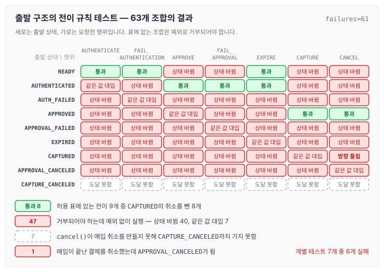
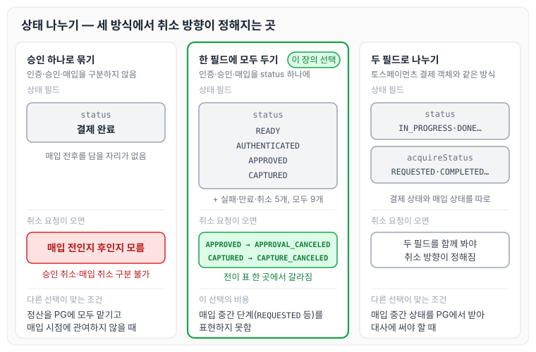
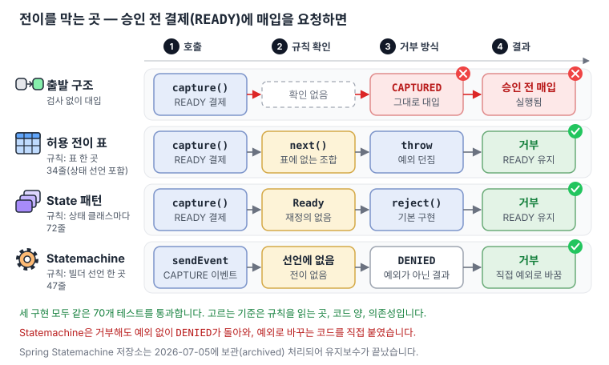
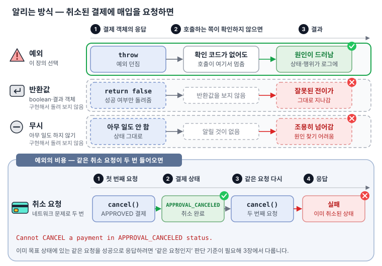
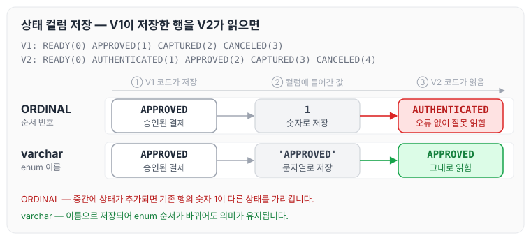
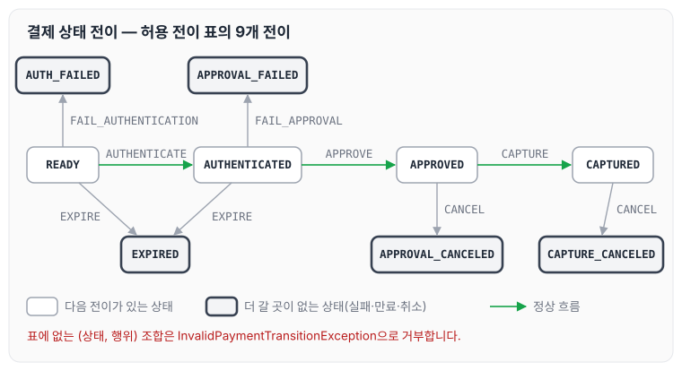

오늘부터 "결제 시스템 챌린지"라는 연재를 시작하려고 합니다. 단일 서버의 Spring Boot 결제에서 출발해, 장마다 지금 구조로는 막을 수 없는 문제를 테스트로 먼저 재현하고, 그 문제를 해결하면서 구조를 조금씩 키워 나가는 방식으로 진행합니다. 구현 방법보다는 설계를 고를 때 무엇을 비교했고 왜 그쪽을 골랐는지, 그 선택으로 무엇을 포기했는지를 기록하는 데 초점을 두려고 합니다.

연재는 다음 순서로 진행할 예정입니다.

- 1부 단일 서버: 1장 결제 기초와 상태 머신, 2장 가장 단순한 결제 구현과 트랜잭션 경계, 3장 금액 검증과 멱등성, 4장 응답을 못 받았을 때의 처리, 5장 취소와 부분 취소, 6장 웹훅 처리
- 2부 서버가 여러 대가 되면: 7장 동시성 제어, 8장 결제와 재고·포인트·쿠폰
- 3부 서비스를 분리하면: 9장 Transactional Outbox와 Kafka, 10장 Saga와 보상 트랜잭션, 11장 컨슈머 멱등성·재시도·DLQ
- 4부 운영: 12장 대사와 장애 대응

오늘은 그 첫 번째 글로, 결제가 어떤 단계를 거치는지 살펴보고 그 단계를 코드의 상태 머신으로 옮기면서 내린 결정들을 정리하도록 하겠습니다.

## 결제의 네 단계: 인증, 승인, 매입, 취소

카드 결제는 고객이 결제 버튼을 누른 순간 한 번에 끝나지 않고, 몇 단계로 나뉘어 진행됩니다.

- 인증: 결제를 진행해도 되는지 판단하는 과정입니다. 카드사가 고객의 카드 정보와 결제 금액을 보고 이 거래를 허용해도 되는지 확인하며, 고객이 결제창에서 카드사 인증을 마치면 이 단계가 끝납니다.
- 승인: 가맹점 서버가 인증이 끝난 결제의 승인을 요청하고 최종 결제 결과를 받는 단계입니다. 토스페이먼츠 API 레퍼런스 기준으로는 결제 인증이 유효한 10분 안에 승인 API를 호출하지 않으면 그 결제는 만료됩니다.
- 매입: 승인만으로는 대금이 오가지 않고, 승인한 건에 대해 정상적으로 거래되었으니 대금을 지급하라고 카드사에 청구하는 절차가 따로 있습니다. 토스페이먼츠 블로그에 따르면 카드 승인은 매일 23:59:59에 마감되고, 24:00부터 전날의 승인 건을 카드사에 청구하는 매입 작업이 시작됩니다.
- 취소: 같은 취소라도 매입 전인지 후인지에 따라 처리가 다릅니다. 토스페이먼츠 블로그에 따르면 매입 전 취소(승인 취소)는 기록도 남지 않고 간단하지만, 매입 후 취소(매입 취소)는 보통 카드사에서 D+3일가량 걸립니다.

네 단계를 고객, 가맹점 서버, PG(결제대행사), 카드사 사이의 흐름으로 그리면 아래와 같습니다.



그림에서 승인과 매입은 서로 다른 시점에 일어나고, 취소는 매입이 끝났는지에 따라 승인 취소와 매입 취소로 갈라지는 것을 확인할 수 있습니다.

같은 흐름을 누가 누구에게 무엇을 보내고 무엇을 돌려받는지 순서대로 그리고, 각 시점에 이 글의 결제 상태가 무엇이 되는지 오른쪽에 붙이면 아래와 같습니다.



인증 실패, 승인 요청 없이 유효 시간이 지난 경우, 승인 거절은 각각 `AUTH_FAILED`, `EXPIRED`, `APPROVAL_FAILED`로 끝납니다. 다만 1장 코드가 구현한 것은 오른쪽 결제 상태의 전이뿐이고, 가맹점 서버의 API와 PG 호출은 2장부터 만듭니다.

참고로 토스페이먼츠의 결제 객체는 결제 상태(`status`)와 카드 매입 상태(`acquireStatus`)를 서로 다른 필드로 둡니다. 결제 상태는 `READY`, `IN_PROGRESS`(인증 완료), `DONE`(승인), `CANCELED`, `PARTIAL_CANCELED`, `ABORTED`(승인 실패), `EXPIRED` 등이고, 매입 상태는 `READY`, `REQUESTED`, `COMPLETED`, `CANCEL_REQUESTED`, `CANCELED`입니다. 이 차이는 아래 첫 번째 결정에서 다시 다룹니다.

## 현재 구조: 이름은 있지만 검사하지 않는 변경 메서드

출발점으로 삼은 코드는 아래와 같습니다. 결제 상태는 enum 하나로 두고, 결제는 정적 팩터리 `Payment.create()`로 만들며, 상태는 setter가 아니라 `approve()`, `capture()`, `cancel()`처럼 의도가 드러나는 메서드로만 바꾸도록 하였습니다.

```java
public enum PaymentStatus {
    READY,              // 결제 생성, 인증 전
    AUTHENTICATED,      // 결제수단 인증 완료, 승인 전
    AUTH_FAILED,        // 인증 실패
    APPROVED,           // 승인 완료, 매입 전
    APPROVAL_FAILED,    // 승인 거절
    EXPIRED,            // 승인 요청 없이 유효 시간이 지나 만료
    CAPTURED,           // 매입 완료(대금 청구 확정)
    APPROVAL_CANCELED,  // 매입 전 취소(승인 취소)
    CAPTURE_CANCELED    // 매입 후 취소(매입 취소)
}
```

```java
@Entity
@Table(name = "payment")
@Getter
@NoArgsConstructor(access = AccessLevel.PROTECTED)
public class Payment {
    // id, orderId 생략

    @Column(name = "amount", nullable = false, updatable = false, precision = 19, scale = 2)
    private BigDecimal amount;

    @Enumerated(EnumType.STRING)
    @Column(name = "status", nullable = false, length = 30)
    private PaymentStatus status;

    @Builder
    private Payment(String orderId, BigDecimal amount, PaymentStatus status) {
        this.orderId = orderId;
        this.amount = amount;
        this.status = status;
    }

    public static Payment create(String orderId, BigDecimal amount) {
        return Payment.builder()
                .orderId(orderId)
                .amount(amount)
                .status(PaymentStatus.READY)
                .build();
    }

    public void approve() {
        this.status = PaymentStatus.APPROVED;
    }

    public void capture() {
        this.status = PaymentStatus.CAPTURED;
    }

    public void cancel() {
        this.status = PaymentStatus.APPROVAL_CANCELED;
    }
    // authenticate(), failAuthentication(), failApproval(), expire()도 같은 모양
}
```

setter를 없앤 것만으로도 "어떤 일이 일어났는지"는 메서드 이름으로 드러납니다. 다만 각 메서드는 지금 상태가 무엇인지 보지 않고 목표 상태를 그대로 대입합니다.

## 현재 구조의 문제: 테스트로 재현하기

이 구조가 무엇을 막지 못하는지 테스트로 먼저 확인하였습니다. 구현이 바뀌어도 같은 규칙을 검사할 수 있도록, 테스트는 결제 객체를 `perform(action)`과 `status()`로만 다루는 추상 클래스(`PaymentTransitionContract`)로 만들고 구현마다 상속하게 했습니다. 구현마다 둔 `PaymentHandle`이 `perform(CAPTURE)`를 그 구현의 방식대로 넘기고(허용 전이 표와 State 패턴은 `capture()` 같은 메서드 호출, Statemachine은 이벤트 전송), 테스트에 쓰는 `paymentIn(from)`은 상태를 직접 넣지 않고 `READY`에서 행위를 차례로 호출해 원하는 상태를 만듭니다.

규칙은 허용되는 전이만 적은 표로 정의하였습니다. 표에 없는 (상태, 행위) 조합은 모두 거부되어야 합니다. 뒤에서 비교할 State 패턴과 Spring Statemachine 구현은 이 표를 쓰지 않기 때문에, 테스트는 구현과 상관없이 기대 규칙을 따로 적어 둡니다. 운영 코드의 표를 그대로 가져다 쓰면 그 표가 틀렸을 때 테스트도 함께 틀리게 됩니다.

```java
static final Map<PaymentStatus, Map<PaymentAction, PaymentStatus>> ALLOWED = Map.of(
        READY, Map.of(
                AUTHENTICATE, AUTHENTICATED,
                FAIL_AUTHENTICATION, AUTH_FAILED,
                EXPIRE, EXPIRED),
        AUTHENTICATED, Map.of(
                APPROVE, APPROVED,
                FAIL_APPROVAL, APPROVAL_FAILED,
                EXPIRE, EXPIRED),
        APPROVED, Map.of(
                CAPTURE, CAPTURED,
                CANCEL, APPROVAL_CANCELED),
        CAPTURED, Map.of(
                CANCEL, CAPTURE_CANCELED));
```

작성한 테스트는 아래와 같습니다.

1. 승인 전에는 매입할 수 없다
2. 취소된 결제는 매입할 수 없다
3. 취소된 결제는 다시 승인할 수 없다
4. 승인만 된 결제를 취소하면 승인 취소가 된다
5. 매입까지 끝난 결제를 취소하면 매입 취소가 된다
6. 인증에 실패한 결제는 승인할 수 없다
7. 승인이 거절된 결제는 매입할 수 없다
8. 결제는 허용 표에 있는 다음 단계로만 넘어가고, 표에 없는 요청은 받지 않는다 — 상태 9개 × 행위 7개 = 63개 조합

테스트 하나에는 규칙 하나만 담았고, 테스트 이름은 테스트 리포트만 읽어도 결제 규칙이 보이도록 도메인 언어로 지었습니다. 63개 조합을 모두 도는 테스트는 아래와 같습니다.

```java
@ParameterizedTest(name = "{0} 상태에서 {1} 요청")
@MethodSource("allCombinations")
@DisplayName("결제는 허용 표에 있는 다음 단계로만 넘어가고, 표에 없는 요청은 받지 않는다")
void followsTransitionTable(PaymentStatus from, PaymentAction action) {
    // given
    PaymentHandle payment = paymentIn(from);
    PaymentStatus expected = ALLOWED.getOrDefault(from, Map.of()).get(action);

    // when & then
    if (isAllowed(expected)) {
        payment.perform(action);
        assertThat(payment.status()).isEqualTo(expected);
        return;
    }
    assertThatThrownBy(() -> payment.perform(action))
            .isInstanceOf(InvalidPaymentTransitionException.class);
    assertThat(payment.status()).isEqualTo(from);
}
```

예제 코드의 출발 상태에서 돌린 결과는 아래와 같습니다.

```text
tests=70 failures=61 errors=0 time=0.163s
FAIL 승인 전에는 매입할 수 없다 | java.lang.AssertionError: Expecting code to raise a throwable.
FAIL 취소된 결제는 매입할 수 없다 | java.lang.AssertionError: Expecting code to raise a throwable.
FAIL 취소된 결제는 다시 승인할 수 없다 | java.lang.AssertionError: Expecting code to raise a throwable.
PASS 승인만 된 결제를 취소하면 승인 취소가 된다
FAIL 매입까지 끝난 결제를 취소하면 매입 취소가 된다 | org.opentest4j.AssertionFailedError: expected: CAPTURE_CANCELED but was: APPROVAL_CANCELED
FAIL 인증에 실패한 결제는 승인할 수 없다 | java.lang.AssertionError: Expecting code to raise a throwable.
FAIL 승인이 거절된 결제는 매입할 수 없다 | java.lang.AssertionError: Expecting code to raise a throwable.
FAIL READY 상태에서 CAPTURE 요청 | java.lang.AssertionError: Expecting code to raise a throwable.
FAIL CAPTURED 상태에서 CANCEL 요청 | org.opentest4j.AssertionFailedError: expected: CAPTURE_CANCELED but was: APPROVAL_CANCELED
```

70개 중 61개가 실패하였습니다(결과 71줄 중 일부 줄을 골라 순서를 바꿔 옮겼습니다). 통과한 9개는 허용 표에 있는 전이 9개 중 `CAPTURED`에서의 취소를 뺀 8개(`READY`에서 인증, `APPROVED`에서 매입 등)와, 승인만 된 결제를 취소하는 테스트였습니다. 출발 구조의 `cancel()`이 언제나 `APPROVAL_CANCELED`를 대입하기 때문에 이 경우만 우연히 맞았습니다. 실패는 두 종류로 나뉩니다.

- 거부되어야 할 54개 조합 중 47개는 예외 없이 그대로 실행되었습니다. 40개는 상태가 바뀌었고(승인 전 매입, 취소 후 재승인, 인증 실패 후 승인 등), 7개는 `APPROVED`에서 다시 승인하는 경우처럼 같은 상태를 다시 대입했습니다. 나머지 7개는 `CAPTURE_CANCELED`에서 출발하는 조합인데, 출발 구조의 `cancel()`이 매입 취소를 만들지 못해 그 상태까지 가지도 못하고 실패하였습니다.
- 매입이 끝난 결제를 취소해도 `APPROVAL_CANCELED`가 되었습니다. 매입 후 취소는 카드사 처리 기간도, 이후 대사(가맹점의 결제 기록을 PG·카드사 기록과 맞춰 보는 작업)에서 맞춰 볼 대상도 다른데, 상태만 보면 매입 전 취소와 구분할 수 없습니다.

63개 조합의 결과를 출발 상태와 요청한 행위별로 한 칸씩 나누어 그리면 아래와 같습니다.



그림에서 통과한 칸은 허용 표에 있는 전이에만 있고, 거부되어야 할 칸은 대부분 예외 없이 실행된 것을 확인할 수 있습니다.

메서드 이름을 명시적으로 만든 것만으로는 "지금 상태에서 이 행위를 해도 되는가"를 막을 수 없다는 것을 확인할 수 있었습니다.

## 선택지와 트레이드오프

이 문제를 해결하면서 내린 결정은 네 가지입니다.

### 결정 1. 결제 단계를 상태로 어떻게 나눌까

이 장에서는 인증·승인·매입을 하나의 상태 필드에 모두 두는 방식을 골랐습니다. 검토한 선택지는 세 가지입니다.

- 승인 하나로 묶기: 인증·승인·매입을 구분하지 않고 "결제 완료" 하나로 둡니다.
- 하나의 상태 필드에 인증, 승인, 매입을 모두 두기: 매입 여부까지 상태 하나로 표현합니다.
- 결제 상태와 매입 상태를 다른 필드로 나누기: 토스페이먼츠의 `status` / `acquireStatus`와 같은 방식입니다.

세 방식에서 상태 필드가 어떻게 생기고, 취소 요청이 왔을 때 무엇을 보고 방향을 정하는지 나란히 그리면 아래와 같습니다.



승인 하나로 묶으면 매입 전인지 후인지를 알 수 없어, 위에서 본 승인 취소와 매입 취소를 가를 수 없습니다. 한 필드에 모두 둔 이유는 취소 방향 때문입니다. 취소가 매입 여부에 따라 `APPROVAL_CANCELED`와 `CAPTURE_CANCELED`로 갈라져야 하는데, 상태가 한 필드에 있으면 이 분기가 전이 표 한 곳에 모입니다. 매입 상태를 따로 두면 "승인됨 + 매입 완료"처럼 두 필드를 함께 봐야 취소 방향이 정해집니다.

이 선택으로 치르는 비용은 매입의 중간 단계를 표현하지 못한다는 점입니다. 토스페이먼츠의 매입 상태에는 매입 요청됨(`REQUESTED`)과 매입 취소 요청됨(`CANCEL_REQUESTED`) 같은 중간 상태가 있지만, 이 장의 모델은 매입을 한 번에 `CAPTURED`가 되는 일로 취급합니다. 또한 인증 실패와 승인 실패를 다른 상태로 두면서 상태가 9개로 늘었습니다.

조건이 바뀌면 다른 선택이 맞습니다. 매입이 요청되고 완료되기까지의 상태를 PG로부터 따로 받고, 그 중간 상태를 대사에 써야 한다면 결제 상태와 매입 상태를 나누는 편이 맞습니다. 반대로 정산을 PG에 모두 맡기고 가맹점이 매입 시점에 관여하지 않는다면, 매입을 상태로 두지 않고 승인 하나로 묶어도 됩니다. 이 연재에서는 12장 대사에서 매입 상태가 다시 필요해지는지 확인할 예정입니다.

### 결정 2. 상태 전이를 어디서 막을까

이 장에서는 enum에 허용 전이 표를 두고, 엔티티의 변경 메서드가 그 표를 거쳐서만 상태를 바꾸는 방식을 골랐습니다. 이번에는 아래 세 방식을 모두 구현해서 같은 테스트로 돌려 보았습니다.

- enum에 허용 전이 표를 두고, 엔티티의 변경 메서드가 그 표를 거쳐서만 상태를 바꾸기
- State 패턴: 상태마다 클래스를 두고, 그 상태에서 허용되는 행위만 재정의하기
- Spring Statemachine: 상태·이벤트·전이를 빌더로 선언하기

허용 전이 표 방식은 아래와 같습니다.

```java
// 허용 전이 표. 여기 없는 (상태, 행위) 조합은 모두 거부한다.
private static final Map<PaymentStatus, Map<PaymentAction, PaymentStatus>> TRANSITIONS =
        new EnumMap<>(PaymentStatus.class);

static {
    allow(READY, AUTHENTICATE, AUTHENTICATED);
    allow(READY, FAIL_AUTHENTICATION, AUTH_FAILED);
    allow(READY, EXPIRE, EXPIRED);

    allow(AUTHENTICATED, APPROVE, APPROVED);
    allow(AUTHENTICATED, FAIL_APPROVAL, APPROVAL_FAILED);
    allow(AUTHENTICATED, EXPIRE, EXPIRED);

    allow(APPROVED, CAPTURE, CAPTURED);
    allow(APPROVED, CANCEL, APPROVAL_CANCELED);

    allow(CAPTURED, CANCEL, CAPTURE_CANCELED);
}

public PaymentStatus next(PaymentAction action) {
    PaymentStatus to = TRANSITIONS.getOrDefault(this, Collections.emptyMap()).get(action);
    if (Objects.isNull(to)) {
        throw new InvalidPaymentTransitionException(name(), action.name());
    }
    return to;
}
```

State 패턴은 기본 구현이 모든 행위를 거부하고, 상태 클래스가 허용되는 행위만 재정의합니다.

```java
abstract static class State {
    abstract PaymentStatus status();

    State authenticate() { return reject(PaymentAction.AUTHENTICATE); }
    State approve() { return reject(PaymentAction.APPROVE); }
    State capture() { return reject(PaymentAction.CAPTURE); }
    State cancel() { return reject(PaymentAction.CANCEL); }
    // failAuthentication(), failApproval(), expire() 생략
}

static class Approved extends State {
    PaymentStatus status() { return PaymentStatus.APPROVED; }
    State capture() { return new Captured(); }
    State cancel() { return new Terminal(PaymentStatus.APPROVAL_CANCELED); }
}

static class Captured extends State {
    PaymentStatus status() { return PaymentStatus.CAPTURED; }
    State cancel() { return new Terminal(PaymentStatus.CAPTURE_CANCELED); }
}
```

Spring Statemachine은 전이를 선언하고, 거부된 이벤트를 예외로 바꾸는 코드를 직접 붙여야 했습니다. 이벤트가 거부되어도 예외가 나지 않고 결과 타입이 `DENIED`로 돌아오기 때문입니다.

```java
builder.configureTransitions()
        .withExternal().source(READY).target(AUTHENTICATED).event(AUTHENTICATE).and()
        .withExternal().source(AUTHENTICATED).target(APPROVED).event(APPROVE).and()
        .withExternal().source(APPROVED).target(CAPTURED).event(CAPTURE).and()
        .withExternal().source(APPROVED).target(APPROVAL_CANCELED).event(CANCEL).and()
        .withExternal().source(CAPTURED).target(CAPTURE_CANCELED).event(CANCEL);
        // 나머지 전이 생략

public void perform(PaymentAction action) {
    PaymentStatus from = getStatus();
    StateMachineEventResult<PaymentStatus, PaymentAction> result = machine
            .sendEvent(Mono.just(MessageBuilder.withPayload(action).build()))
            .blockLast();
    if (isRejected(result)) {
        throw new InvalidPaymentTransitionException(from.name(), action.name());
    }
}

// 이벤트가 거부되어도 예외가 나지 않고 결과 타입이 DENIED 로 돌아온다
private boolean isRejected(StateMachineEventResult<PaymentStatus, PaymentAction> result) {
    return Objects.isNull(result) || result.getResultType() != StateMachineEventResult.ResultType.ACCEPTED;
}
```

승인 전 결제(`READY`)에 매입을 요청했을 때, 출발 구조와 세 구현에서 이 호출이 어디서 걸리는지 그리면 아래와 같습니다.



출발 구조에서는 확인 없이 `CAPTURED`가 대입되지만, 세 구현은 모두 요청을 거부하고 상태를 `READY`로 둡니다. 차이는 규칙을 확인하는 곳과, Spring Statemachine처럼 거부를 예외로 바꾸는 코드를 따로 붙여야 하는지에 있습니다.

세 구현 모두 같은 70개 테스트를 통과하였습니다. 규칙을 지키는 능력은 같았기 때문에, 고르는 기준은 코드를 읽고 고칠 때의 비용과 의존성이었습니다.

- 코드 양(구현 파일 하나씩, package·import·빈 줄·주석 제외): 허용 전이 표를 둔 `PaymentStatus`가 34줄, State 패턴이 72줄, Spring Statemachine 구현이 47줄이었습니다. `PaymentStatus`의 34줄에는 상태 선언이 들어 있고, 나머지 두 구현은 이 enum을 가져다 쓰기 때문에 상태 선언이 줄 수에 들어 있지 않습니다.
- 규칙을 읽는 곳: 허용 전이 표와 Statemachine 선언은 전이 9개가 한 화면에 모여 있습니다. State 패턴은 상태 클래스마다 흩어져 있어, 전체 전이를 보려면 클래스를 하나씩 열어 봐야 합니다.
- 의존성: Spring Statemachine 저장소의 README에는 "Spring Statemachine is no longer maintained"라고 적혀 있고, GitHub 저장소는 2026-07-05에 보관(archived) 처리되었습니다. 마지막 버전인 4.0.2는 Spring Framework 6.2.19를 기준으로 만들어졌습니다. 이번 테스트에서는 Spring Framework 7.0.10(Spring Boot 4.1.2) 위에서도 동작했지만, 앞으로 버전을 올릴 때 계속 동작한다는 보장은 없습니다.
- 영속성: 이번 Statemachine 구현은 메모리에서만 돌렸고, DB에 저장된 상태로 머신을 다시 세우는 코드는 만들지 않았습니다. 엔티티의 상태 컬럼과 머신의 상태를 맞추는 일이 따로 남습니다.

허용 전이 표 방식을 고른 이유는 규칙이 한 곳에 모여 있고, 추가 의존성 없이 JPA 엔티티의 상태 컬럼과 그대로 맞물리기 때문입니다.

다만 전이에 조건이나 부수 효과가 붙으면 이 방식의 한계가 드러납니다. 표는 "이 상태에서 이 행위를 하면 저 상태가 된다"만 표현합니다. "취소 금액이 남은 금액보다 크면 거부한다" 같은 조건은 표 밖, 엔티티 메서드 안에 따로 써야 합니다. 이런 조건이 늘어날수록 규칙이 표와 메서드 두 곳으로 나뉩니다.

상태마다 하는 일이 크게 달라지고(예: 상태마다 다른 외부 호출, 다른 검증) 조건 붙은 전이가 많아진다면, 상태별 행동을 한 클래스에 모으는 State 패턴이 더 읽기 쉬울 것 같습니다. 상태 머신 라이브러리는 계층 상태나 병렬 상태가 필요할 때 검토할 만하지만, Spring Statemachine은 유지보수가 끝났기 때문에 새로 도입한다면 다른 라이브러리를 찾아봐야 합니다.

### 결정 3. 허용되지 않은 전이를 어떻게 알릴까

이 장에서는 허용되지 않은 전이를 예외로 알리는 방식을 골랐습니다. 알리는 방법으로는 아래 세 가지를 비교하였습니다.

- 예외를 던지기
- 성공 여부를 반환하기(`boolean`이나 결과 객체)
- 아무 일도 하지 않기

잘못된 전이는 호출하는 쪽의 버그이거나 이미 처리된 요청이 다시 들어온 경우이고, 어느 쪽이든 조용히 넘어가면 원인을 찾기 어렵습니다. 성공 여부를 반환하는 방식도 호출하는 쪽이 반환값을 확인하지 않으면 잘못된 전이가 그대로 지나갑니다. 예외는 확인을 빠뜨려도 호출이 그 자리에서 멈춥니다.

취소된 결제에 매입을 요청했을 때 세 방식이 어떻게 되는지, 그리고 예외 방식에서 같은 취소 요청이 두 번 들어오면 어떻게 되는지 그리면 아래와 같습니다.



위 그림에서 예외만 호출하는 쪽의 확인 여부와 상관없이 잘못된 전이가 드러나는 것을 확인할 수 있습니다. 아래 그림의 두 번째 요청이 실패하는 문제는 뒤에서 다시 다룹니다.

예외(`InvalidPaymentTransitionException`)는 여러 도메인이 함께 쓰는 공통 패키지(`global/error`)에 모아 두고, 오류 코드와 함께 원래 상태와 시도한 행위를 로그용 문장에 담았습니다. 이 패키지가 결제 도메인 타입에 의존하지 않도록 상태와 행위는 이름(`String`)으로 받습니다.

```java
public InvalidPaymentTransitionException(String status, String action) {
    super(ErrorCode.INVALID_PAYMENT_TRANSITION, "Cannot " + action + " a payment in " + status + " status.");
}
```

다만 이렇게 하면 정상적인 재시도까지 실패로 보입니다. 같은 취소 요청이 네트워크 문제로 두 번 들어오면, 두 번째 요청은 `Cannot CANCEL a payment in APPROVAL_CANCELED status.`로 실패합니다. 클라이언트 입장에서는 이미 취소가 끝났는데도 오류를 받게 됩니다.

같은 요청이 여러 번 들어오는 일이 흔하다면, 이미 목표 상태에 있는 요청은 성공으로 응답하는 처리가 필요합니다. 다만 이것은 "같은 요청인지"를 판단하는 기준이 있어야 가능하기 때문에, 3장 금액 검증과 멱등성에서 다루겠습니다. 아무 일도 하지 않는 방식은 이 판단 기준 없이 모든 잘못된 요청을 삼키기 때문에 이 장에서는 쓰지 않았습니다.

### 결정 4. 상태를 DB에 어떻게 저장할까

이 장에서는 상태를 `varchar(30)` 컬럼에 enum 이름으로 저장하고, 스키마는 `schema.sql`로 직접 관리하도록 하였습니다. 저장 방식은 아래 세 가지를 비교하였습니다.

- `@Enumerated(EnumType.ORDINAL)`: enum의 순서 번호를 숫자로 저장
- `@Enumerated(EnumType.STRING)` + `varchar` 컬럼: enum 이름을 문자열로 저장
- `@Enumerated(EnumType.STRING)` + MySQL `enum` 타입 컬럼

세 방식을 MySQL 8.4(Testcontainers)에서 같은 상황으로 확인하였습니다. 배포 전 코드(V1)가 저장한 행을, enum 중간에 상태를 하나 추가한 코드(V2)가 읽는 상황입니다.

```java
/** 상태를 추가하기 전 버전 */
public enum StatusV1 {
    READY, APPROVED, CAPTURED, CANCELED
}

/** READY와 APPROVED 사이에 AUTHENTICATED를 추가한 버전 */
public enum StatusV2 {
    READY, AUTHENTICATED, APPROVED, CAPTURED, CANCELED
}
```

V1이 저장한 `APPROVED`를 V2가 읽을 때 ORDINAL과 varchar 컬럼에서 어떤 값이 오가는지 그리면 아래와 같습니다.



실행 결과는 아래와 같습니다.

```text
stored ordinal=1, V2 ordinal=AUTHENTICATED, V2 string=APPROVED
enum insert error: Data truncated for column 'enum_status' at row 1
```

- ORDINAL: V1이 `APPROVED`를 저장하면 숫자 1이 들어갑니다. V2에서는 1번이 `AUTHENTICATED`이기 때문에, 승인된 결제가 오류 없이 인증만 끝난 결제로 읽혔습니다.
- varchar: `'APPROVED'`로 저장되어 V2에서도 `APPROVED`로 읽혔습니다. 새 상태 `'AUTHENTICATED'`도 그대로 저장되었습니다.
- MySQL enum: 컬럼 정의에 없는 `'AUTHENTICATED'`를 넣으면 `Data truncated for column 'enum_status'` 오류로 거부되었습니다. 새 상태를 쓰려면 애플리케이션 배포 전에 `ALTER TABLE`로 컬럼 정의를 먼저 바꿔야 합니다.

여기서 하나 더 확인한 것이 있습니다. 스키마를 Hibernate(7.4.13)에게 만들게 하면, `@Enumerated(EnumType.STRING)`에 `length = 30`을 지정해도 상태 컬럼이 `varchar`가 아니라 MySQL `enum` 타입으로 만들어졌습니다.

```text
hibernate status column_type = enum('APPROVAL_CANCELED','APPROVAL_FAILED','APPROVED','AUTHENTICATED','AUTH_FAILED','CAPTURED','CAPTURE_CANCELED','EXPIRED','READY')
```

그래서 스키마는 Hibernate에게 맡기지 않고 `schema.sql`로 직접 관리합니다(`spring.jpa.hibernate.ddl-auto=none`).

```sql
create table if not exists payment (
    id       bigint         not null auto_increment,
    order_id varchar(64)    not null,
    amount   decimal(19, 2) not null,
    status   varchar(30)    not null,
    primary key (id),
    unique key uk_payment_order_id (order_id)
);
```

대신 DB가 값을 검사해 주지 않습니다. `varchar` 컬럼에는 `'APROVED'` 같은 오타도 그대로 들어갑니다. 애플리케이션을 거치지 않고 SQL로 직접 상태를 고치는 일이 생기면 이 점이 문제가 될 수 있습니다. 또한 상태 이름을 바꾸면 기존 행을 함께 바꾸는 마이그레이션이 필요합니다.

반대로 상태 목록이 거의 바뀌지 않고, 운영 중 SQL로 직접 값을 고치는 일이 잦아 DB 차원의 검사가 더 중요하다면 MySQL `enum` 타입이나 `CHECK` 제약을 두는 편이 나을 것 같습니다. 저장 공간을 줄여야 해서 숫자로 저장하고 싶다면, ordinal 대신 상태마다 고정 코드를 정해 두고 `AttributeConverter`로 바꾸는 방식이 enum 순서 변경에 영향을 받지 않습니다.

## 구현

결정을 모아 바꾼 엔티티는 아래와 같습니다. 변경 메서드는 그대로 두고, 목표 상태를 직접 대입하던 부분만 `changeStatus()`를 거쳐 허용 전이 표에 묻도록 바꿨습니다. 다음 상태를 정하는 일은 엔티티가 직접 판단하지 않고 `PaymentStatus`에게 맡깁니다.

```java
public void authenticate() {
    changeStatus(PaymentAction.AUTHENTICATE);
}

public void approve() {
    changeStatus(PaymentAction.APPROVE);
}

public void capture() {
    changeStatus(PaymentAction.CAPTURE);
}

public void cancel() {
    changeStatus(PaymentAction.CANCEL);
}
// failAuthentication(), failApproval(), expire()도 같은 모양

private void changeStatus(PaymentAction action) {
    this.status = status.next(action);
}
```

`cancel()`은 메서드 하나지만, 현재 상태가 `APPROVED`면 `APPROVAL_CANCELED`로, `CAPTURED`면 `CAPTURE_CANCELED`로 갑니다. 호출하는 쪽은 매입 여부를 몰라도 되고, 취소 방향은 전이 표가 정합니다.

바뀐 전이 표를 상태 다이어그램으로 그리면 아래와 같습니다.



굵은 테두리로 표시한 실패·만료·취소 5개 상태는 더 갈 곳이 없는 상태이고, 이 상태에서 들어오는 행위는 모두 예외로 거부됩니다.

빌더도 함께 닫았습니다. 출발 구조에서는 빌더가 열려 있어서, `Payment.builder().status(CAPTURED).build()`처럼 전이 표를 거치지 않고 아무 상태의 결제나 만들 수 있었습니다. 빌더를 private으로 바꿔 결제는 `Payment.create()`로만 만들고, 상태는 변경 메서드로만 바뀌도록 하였습니다.

```java
@Builder(access = AccessLevel.PRIVATE)
private Payment(String orderId, BigDecimal amount, PaymentStatus status) {
    ...
}
```

## 테스트 결과

1장 완성 코드에서 전체 테스트를 돌린 결과는 아래와 같습니다.

```text
결제 서버: tests=1 failures=0 errors=0
결제 상태 바꾸기 — 허용 전이 표: tests=70 failures=0 errors=0
결제 상태 바꾸기 — State 패턴(비교 구현): tests=70 failures=0 errors=0
결제 상태 바꾸기 — Spring Statemachine(비교 구현): tests=70 failures=0 errors=0
저장 구조를 서버가 직접 만들게 두면: tests=1 failures=0 errors=0
    hibernate status column_type = enum('APPROVAL_CANCELED','APPROVAL_FAILED','APPROVED','AUTHENTICATED','AUTH_FAILED','CAPTURED','CAPTURE_CANCELED','EXPIRED','READY')
결제 기록 — 실제 보관함에서: tests=2 failures=0 errors=0
    status column_type = varchar(30)
상태를 남기는 방식 비교 — 실제 보관함에서: tests=4 failures=0 errors=0
    stored ordinal=1, V2 ordinal=AUTHENTICATED, V2 string=APPROVED
    enum insert error: Data truncated for column 'enum_status' at row 1
total 218
coverage INSTRUCTION 100%, BRANCH 100%, LINE 100%, COMPLEXITY 100%, METHOD 100%, CLASS 100%
```

- 출발 구조에서 61개가 실패하던 전이 규칙 테스트가 허용 전이 표 방식에서 70개 모두 통과하였습니다.
- 비교 구현인 State 패턴과 Spring Statemachine도 같은 70개를 통과하였습니다.
- `schema.sql`로 만든 상태 컬럼은 `varchar(30)`이고, 승인한 결제를 저장했다가 다시 읽으면 `APPROVED`로 저장·조회되었습니다.
- 전이 규칙 테스트 210개를 뺀 8개("결제 서버", "저장 구조", "실제 보관함에서")는 Testcontainers로 띄운 MySQL 8.4에서 돌렸고, "결제 서버"는 MySQL에 연결된 채로 애플리케이션이 뜨는지 보는 테스트입니다.
- 전체 218개 테스트가 통과했고, JaCoCo로 잰 커버리지는 100%였습니다(애플리케이션 시작 클래스 제외).

실행 환경은 Apple M1 Max(메모리 32GB), Azul Zulu 17.0.15, Spring Boot 4.1.2, Hibernate 7.4.13.Final, MySQL 8.4.11(Testcontainers 2.0.5), JaCoCo 0.8.13입니다. 이 장은 처리량이나 락 경합을 다루지 않기 때문에 부하 테스트는 하지 않았습니다.

## 남은 한계

이 장의 상태 머신은 한 객체 안에서 잘못된 전이를 막을 뿐, 다음 문제들은 아직 막지 못합니다.

- 실제 PG를 호출하지 않습니다. 승인 요청을 DB 트랜잭션 안에서 보낼지 밖에서 보낼지에 따라 실패했을 때 남는 상태가 달라지는데, 이것은 2장에서 다룹니다.
- 같은 요청이 두 번 들어오면 두 번째는 예외로 실패합니다. 같은 요청을 같은 결과로 응답하는 멱등성과 요청 금액 검증은 3장에서 다룹니다.
- 승인 요청을 보냈는데 응답을 받지 못하면, 지금 상태로는 승인이 됐는지 안 됐는지 표현할 방법이 없습니다. 4장에서 다룹니다.
- 취소는 전액만 가능합니다. 부분 취소는 5장에서 다룹니다.
- PG의 웹훅이 순서가 바뀌어 들어오면(예: 매입 알림이 승인 알림보다 먼저) 지금의 전이 표는 그 알림을 거부합니다. 6장에서 다룹니다.
- 두 요청이 같은 결제를 동시에 읽어 각각 전이하면, 객체 안의 검사만으로는 막을 수 없습니다. 이 문제는 서버가 한 대여도 같은 결제에 요청이 동시에 들어오면 생기고, 서버가 여러 대가 되면 더 자주 드러납니다. 7장 동시성 제어에서 다룹니다.
- 상태가 언제 어떻게 바뀌었는지 이력이 남지 않습니다. PG 기록과 맞춰 보는 대사에서 필요해지면 12장에서 다룹니다.

## 요약

오늘은 결제의 인증·승인·매입·취소 단계를 정리하고, 이를 상태 머신으로 옮기면서 내린 결정을 정리하였습니다. 요약하자면 아래와 같습니다.

- setter 대신 명시적인 변경 메서드를 두어도, 메서드가 현재 상태를 보지 않으면 잘못된 전이를 막지 못합니다. 출발 구조에서 전이 규칙 테스트 70개 중 61개가 실패하였습니다.
- 인증·승인·매입을 하나의 상태 필드에 두고, 취소는 매입 여부에 따라 승인 취소와 매입 취소로 나누었습니다. 매입의 중간 단계가 필요해지면 매입 상태를 따로 두는 방식으로 바꿀 수 있습니다.
- 허용 전이 표, State 패턴, Spring Statemachine 모두 같은 테스트를 통과하였고, 규칙이 한 곳에 모이고 추가 의존성이 없는 허용 전이 표를 골랐습니다. Spring Statemachine은 유지보수가 끝난 상태입니다.
- 잘못된 전이는 예외로 알리고, 중복 요청 처리는 3장으로 넘겼습니다.
- 상태 컬럼은 ORDINAL이면 상태를 추가할 때 기존 행의 의미가 바뀌고, Hibernate가 만든 스키마는 MySQL enum 타입이 되어 새 상태를 받지 못했습니다. 그래서 `varchar(30)`을 `schema.sql`로 직접 관리합니다.

결제를 처음 다룰 때는 승인만 생각하기 쉬운데, 정리하면서 매입과 취소 시점까지 상태에 담아야 이후의 취소와 대사가 성립할 수 있다는 것을 알 수 있었습니다.

## 다음 글 예고

다음 글에서는 이번에 만든 상태 머신 위에 가장 단순한 결제 API를 올립니다. 타임아웃과 지연을 조작할 수 있는 Mock PG를 직접 만들고, PG 승인 요청을 DB 트랜잭션 안에서 보내는 구현이 어떤 상황에서 문제가 되는지 테스트로 재현해 보겠습니다.

참조 :

- [결제 요청, 인증, 승인 차이는? 토스페이먼츠 결제 연동 흐름 정리 — 토스페이먼츠](https://www.tosspayments.com/blog/articles/54253)
- [결제 요청, 인증, 승인… 이게 다 뭔가요? — 토스페이먼츠](https://www.tosspayments.com/blog/articles/paytech-3)
- [[결제수단] 신용카드 승인과 매입, 어떤 개념인가요? — 토스페이먼츠](https://www.tosspayments.com/blog/articles/33907)
- [API 레퍼런스(Payment 객체, 결제 승인) — 토스페이먼츠 개발자센터](https://docs.tosspayments.com/reference)
- [spring-projects/spring-statemachine — GitHub](https://github.com/spring-projects/spring-statemachine)
