이전에 [결제 동시성 제어](../payment-concurrency/)에 대해 작성하였습니다. 그 글에서는 같은 결제를 바꾸는 기록이 결제 줄을 `select … for update`로 잠그고 읽게 하고, 서버마다 도는 주기 작업은 작업 잠금으로 한 번에 서버 한 대만 돌게 바꿨습니다. 그리고 다음 글 예고에 "지금까지는 결제 하나만 지켰는데, 결제와 함께 재고를 줄이고 포인트와 쿠폰을 쓰는 경우에는 결제 밖의 데이터도 같은 결과로 맞춰야 합니다."라고 적었습니다.

7장까지 결제는 주문번호와 금액만 받았습니다. 실제 주문에는 상품과 수량이 있고, 고객은 쿠폰을 쓰거나 포인트로 일부를 냅니다. 결제가 승인되면 재고는 줄어 있어야 하고, 결제가 승인 없이 끝나거나 전액 취소되면 줄인 재고와 쓴 포인트·쿠폰은 돌아와 있어야 합니다.

오늘은 연재의 여덟 번째 글로, 결제와 함께 재고·포인트·쿠폰을 같은 결과로 맞추는 방법을 정리하도록 하겠습니다. 결정마다 다른 선택지를 같은 계약 테스트와 같은 측정으로 비교합니다.

범위를 먼저 밝히겠습니다. 이 장의 재고·포인트·쿠폰은 결제 서버 안에 있고, 결제와 같은 MySQL에 있습니다. 그래서 결제와 재고를 한 트랜잭션에 묶을 수 있습니다. 재고나 포인트가 다른 서비스로 나뉘는 경우는 9장, 이미 끝난 일을 되돌리는 보상 트랜잭션은 10장에서 다룹니다. 상품·재고·회원 포인트·쿠폰을 등록하는 API는 만들지 않았고, 시험이 테이블에 직접 남깁니다.

이 장이 다루는 것과 범위를 그리면 아래와 같습니다.


이 장의 코드는 [payment-challenge](https://github.com/qkrxodud/payment-challenge/tree/chapter-08)의 `chapter-08` 브랜치에 있고, 출발 코드는 `ch08-start`, 완성 코드는 `ch08` 태그입니다.

## 현재 구조: 고객 금액을 믿고 승인 뒤에 줄이는 결제

이 장의 문제를 재현하려면 상품·재고·포인트·쿠폰이 코드에 먼저 있어야 합니다. 그래서 출발 코드(`ch08-start`)에 이 넷을 가장 먼저 떠오르는 방법으로 넣었습니다. 고객이 보낸 금액을 믿고, 승인된 뒤에 재고와 포인트를 잠그지 않고 읽어 줄이고, 결제가 실패하거나 취소돼도 돌려주지 않습니다.

테이블은 다섯 개를 더했습니다. 재고는 상품마다 한 줄이라 같은 상품의 주문은 모두 이 한 줄을 바꿉니다.

```sql
-- src/main/resources/schema.sql (ch08-start)
-- 8장: 상품과 재고. 재고는 상품마다 한 줄이라 같은 상품의 주문은 모두 이 한 줄을 바꾼다
create table if not exists stock (
    product_id bigint not null,
    quantity   int    not null,
    primary key (product_id),
    constraint fk_stock_product foreign key (product_id) references product (id)
);

-- 8장: 결제에 담긴 상품. 준비할 때의 상품가를 함께 남긴다(나중에 상품가가 바뀌어도 이 결제의 금액은 그대로다)
create table if not exists payment_item (
    id         bigint         not null auto_increment,
    payment_id bigint         not null,
    product_id bigint         not null,
    quantity   int            not null,
    unit_price decimal(19, 2) not null,
    primary key (id),
    constraint fk_payment_item_payment foreign key (payment_id) references payment (id)
);
```

나머지는 상품(`product`), 회원마다 한 줄인 포인트 잔액(`point_wallet`), 회원에게 발급한 정액 할인 쿠폰(`coupon`, `ISSUED`·`USED`와 쓴 결제)입니다. 결제에는 주문자(`member_id`), 쓴 쿠폰(`coupon_id`), 쓴 포인트(`point_amount`)를 더했습니다. 쓴 포인트는 결제 금액, 즉 PG에 승인받는 금액에 들어 있지 않습니다.

준비 요청에는 `memberId`, `items`, `couponId`, `usePoint`를 더했습니다. 모두 보내지 않아도 되는 값이고, `items`가 없으면 7장까지와 같이 주문번호와 금액만으로 준비합니다. 앞 장의 계약과 테스트를 바꾸지 않으려고 이렇게 두었습니다.

```java
// src/main/java/com/example/payment/presentation/payment/dto/PreparePaymentRequest.java
// 8장부터 memberId·items·couponId·usePoint 를 더 받을 수 있다(모두 고를 수 있음). items 가 없으면 7장까지와 같다
public record PreparePaymentRequest(String orderId, BigDecimal amount, String memberId, List<OrderLineRequest> items,
                                    Long couponId, BigDecimal usePoint) {
```

상품을 담은 준비는 상품을 찾아 그때의 상품가를 남기고, 쿠폰이 이 회원이 지금 쓸 수 있는 쿠폰인지 한 번 봅니다. 결제 금액은 고객이 보낸 금액 그대로입니다.

```java
// src/main/java/com/example/payment/application/payment/PaymentOrders.java (ch08-start)
public Payment order(PreparePaymentCommand command) {
    List<PaymentItem> items = itemsOf(command);
    checkCoupon(command);
    return Payment.order(command.orderId(), command.memberId(), items, command.couponId(), command.usePoint(),
            command.amount());
}
```

재고·쿠폰·포인트는 PG가 승인했다는 답을 기록하는 트랜잭션에서 줄입니다. 거절·결과 모름·취소에는 아무것도 하지 않습니다.

```java
// src/main/java/com/example/payment/application/payment/PaymentRecorder.java (ch08-start)
private void settleWith(Payment payment, PaymentApproval approval) {
    if (approval.isDeclined()) {
        payment.failApproval();
        return;
    }
    payment.approve();
    paymentHoldings.hold(payment);
}
```

재고는 지금 수량을 읽고, 거기서 수량을 뺀 값을 씁니다. 포인트 잔액도 같은 모양입니다. 쿠폰은 준비할 때 이미 확인했으니 쓴 것으로 바꾸기만 합니다.

```java
// src/main/java/com/example/payment/infrastructure/persistence/stock/StockRepositoryAdapter.java (ch08-start)
// 출발 구조: 지금 재고를 읽고, 거기서 수량을 뺀 값을 쓴다
@Override
public void decrease(Long productId, int quantity) {
    Integer current = jdbcTemplate.queryForObject("select quantity from stock where product_id = ?", Integer.class,
            productId);
    jdbcTemplate.update("update stock set quantity = ? where product_id = ?", current - quantity, productId);
}
```

```java
// src/main/java/com/example/payment/infrastructure/persistence/coupon/CouponRepositoryAdapter.java (ch08-start)
// 출발 구조: 준비할 때 쓸 수 있는 쿠폰인지 이미 봤으니 쓴 것으로 바꾸기만 한다
@Override
public void use(Long couponId, Long paymentId) {
    jdbcTemplate.update("update coupon set status = 'USED', payment_id = ? where id = ?", paymentId, couponId);
}
```

출발 코드에서 상품을 담은 주문 하나가 지나는 순서를 그리면 아래와 같습니다. 준비는 고객 금액을 그대로 결제에 남기고, 재고·쿠폰·포인트는 PG가 승인했다는 답을 기록할 때 읽은 값에서 빼서 씁니다.


그림에서 재고·쿠폰·포인트를 바꾸는 단계는 승인 답 기록(10번) 한 곳뿐입니다.

Mock PG에는 PG 쪽 만료(`EXPIRED`)를 더했습니다. 승인 요청이 PG에 닿지 않은 결제를 시험이 바로 만료시키고, 만료한 결제는 주문번호 조회에 `EXPIRED`로 답합니다. [6장](../payment-webhook/)에서 만든 승인 답 붙잡기는 이 장부터 거절 답도 붙잡습니다.

토스페이먼츠 문서에서는 두 문장을 확인했습니다. Payment 객체 설명에 "`EXPIRED`: 결제 유효 시간 30분이 지나 거래가 취소된 상태입니다. `IN_PROGRESS` 상태에서 결제 승인 API를 호출하지 않으면 `EXPIRED`가 됩니다."라고 적혀 있고, 웹훅 이벤트 문서에 "…결제 인증이 유효한 10분 안에 상점에서 결제 승인 API를 호출하지 않으면 결제 상태가 `EXPIRED`로 변경됩니다."라고 적혀 있습니다. Mock PG는 시간을 기다리지 않고 시험이 바로 만료시킵니다. `EXPIRED`로 바뀔 때 `PAYMENT_STATUS_CHANGED` 웹훅을 보낸다는 것과, 주문번호 조회가 만료된 결제도 `EXPIRED`로 돌려준다는 것은 문서에서 문장을 찾지 못해 가정으로 두었습니다.

## 현재 구조의 문제: 테스트로 재현하기

출발 코드에 아래 테스트를 먼저 작성했습니다. 앞 장들처럼 지켜야 하는 규칙은 추상 클래스에 두고, 구현마다 상속해 같은 테스트를 돌립니다.

- 결제 금액(`ServerPriceContract`, 4개): 상품 2개(10000원 × 2) − 쿠폰 2000원 − 포인트 1000원 = 17000원인 주문을 1000원으로 낮춰 보냈을 때
- 재고를 잡는 때(`HoldTimingContract`, 6개): 재고 0개 상품의 주문, 준비만 한 주문, PG 답을 기다리는 주문이 잡은 재고
- 같은 상품에 몰린 주문(`StockContract`, 6개): 재고 1개에 두 주문이 겹칠 때, 재고 10개에 30건이 한꺼번에 올 때
- 승인 없이 끝난 결제의 되돌리기(돌려주기, `ReleaseContract`, 11개): 거절, PG 쪽 만료(보정·알림 처리), 결과 모름, 전액 취소, 부분 취소, 거절을 세 곳이 겹쳐 닫을 때
- 같은 쿠폰(`CouponContract`, 3개)과 같은 회원의 포인트(`PointContract`, 3개): 두 주문이 겹칠 때
- 준비 확인(`OrderPrepareTest`)과 결제 API(`OrderPaymentApiTest`)

출발 코드에 돌린 테스트 42개를 묶음별로 그리면 아래와 같습니다.

![출발 코드에 돌린 8장 테스트 42개 — 결제 금액 ServerPriceContract 4개(상품 2개 10000원 × 2 − 쿠폰 2000원 − 포인트 1000원 = 17000원 주문을 1000원으로 낮춰 보냄), 재고를 잡는 때 HoldTimingContract 6개(재고 0개 상품의 주문, 준비만 한 주문, PG 답을 기다리는 주문이 잡은 재고), 같은 상품에 몰린 주문 StockContract 6개(재고 1개에 두 주문 겹침, 재고 10개에 30건 한꺼번에), 승인 없이 끝난 결제의 되돌리기 ReleaseContract 11개(거절, PG 쪽 만료, 결과 모름, 전액 취소, 부분 취소, 거절을 세 곳이 겹쳐 닫음), 같은 쿠폰 CouponContract 3개와 같은 회원의 포인트 PointContract 3개(두 주문이 겹칠 때), 준비 확인 OrderPrepareTest 5개와 결제 API OrderPaymentApiTest 4개. 4 + 6 + 6 + 11 + 3 + 3 + 5 + 4 = 42](images/13_contract-groups.svg)

겹침은 7장과 같은 방법으로 고정했습니다. 먼저 보낸 주문의 인증 기록, 즉 결제 상태를 `AUTHENTICATED`로 바꾸는 UPDATE를 트리거로 1초 붙잡습니다. 재고·쿠폰·포인트를 바꾸는 문장은 `JdbcTemplate`으로 바로 나가고 결제 상태 UPDATE는 커밋 때 나가기 때문에, 먼저 보낸 주문은 바꾼 재고·쿠폰·포인트 줄의 잠금을 쥔 채 잠듭니다. 잠든 것을 확인한 뒤 두 번째 주문의 승인을 보냅니다.

```java
// src/test/java/com/example/payment/application/payment/StockContract.java
// 먼저 보낸 주문이 재고를 줄이고 인증을 남기다 붙잡힌 동안 두 번째 주문의 승인을 보낸다. 두 주문의 답을 보낸 순서대로 돌려준다
List<Attempt<PaymentResult>> orderTogether(PreparePaymentCommand first, PreparePaymentCommand later) {
    PaymentResult firstPrepared = prepare(first);
    PaymentResult laterPrepared = prepare(later);
    slowWrites.holdPaymentChangeTo(PaymentStatus.AUTHENTICATED);
    CompletableFuture<Attempt<PaymentResult>> firstAnswer = Attempt.start(() -> confirm(firstPrepared));
    slowWrites.awaitHeld();
    Attempt<PaymentResult> laterAnswer = Attempt.of(() -> confirm(laterPrepared));
    return List.of(firstAnswer.join(), laterAnswer);
}
```

먼저 보낸 주문이 붙잡힌 동안 두 번째 주문의 승인이 들어가는 순서와 다른 두 경우의 고정 방법을 그리면 아래와 같습니다.


거절을 세 곳이 겹쳐 닫는 경우는 PG가 거절을 남기고 거절 답은 붙잡아 둡니다. 거절 알림을 받은 알림 처리가 승인 실패를 남기다 1초 붙잡힌 동안 보정을 시작하고, 그다음 붙잡아 둔 거절 답을 보냅니다.

재고 10개에 30건은 겹침을 고정하지 않고, 미리 준비해 둔 주문 30건의 승인을 스레드 30개에서 래치로 한꺼번에 보냅니다.

출발 코드에서 이 테스트로 재현한 문제를 한 장에 모으면 아래와 같습니다. 넷째 문제(포인트가 여러 번 돌아옴)만 출발 코드가 아니라 결정 4의 비교 구현에서 재현했습니다.

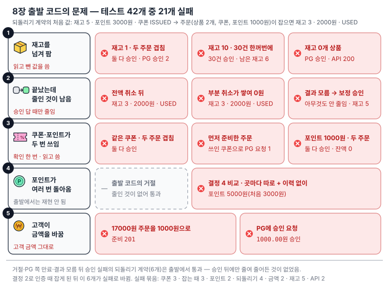

출발 코드에서 8장 테스트를 돌린 결과는 아래와 같습니다. 부분 취소가 쌓여 남은 금액이 0원이 되는 계약 하나와 포인트 계약 3개는 결정을 진행하면서 나중에 더했고, 출발 코드에 얹어 다시 돌린 값입니다.

테스트 이름의 '카드사'는 이 연재에서 PG(Mock PG)를 가리킵니다.

```text
tests=42 failures=21 errors=0 time=57.562s
## 쿠폰 한 장을 두 주문에 — 운영 구현
FAIL 다른 결제에 이미 쓴 쿠폰을 담은 주문은 카드사에 승인을 요청하지 않는다 (1.06s) | org.opentest4j.AssertionFailedError:  expected: 0  but was: 1
FAIL 같은 쿠폰을 담은 두 주문이 겹치면 한 주문만 승인된다 (1.126s) | org.opentest4j.AssertionFailedError:  expected: 1L  but was: 2L
FAIL 같은 쿠폰을 담은 두 주문이 겹치면 나중 주문은 쓸 수 없는 쿠폰이라고 받지 않는다 (1.117s) | org.opentest4j.AssertionFailedError:  expected: COUPON_NOT_AVAILABLE  but was: null
## 재고를 줄이는 때 — 운영 구현
FAIL 재고가 없는 상품의 주문은 재고가 없다고 받지 않는다 (0.047s) | org.opentest4j.AssertionFailedError:  expected: OUT_OF_STOCK  but was: null
FAIL 재고가 없는 상품의 주문은 카드사에 승인을 요청하지 않는다 (0.051s) | org.opentest4j.AssertionFailedError:  expected: 0  but was: 1
PASS 준비만 하고 승인을 요청하지 않은 주문은 재고를 줄이지 않는다 (0.024s)
PASS 재고가 없는 상품의 주문은 카드사에서 승인된 뒤 취소되는 일이 없다 (0.045s)
FAIL 카드사 답을 기다리는 주문이 잡은 재고는 다른 주문이 가져가지 못한다 (3.134s) | org.awaitility.core.ConditionTimeoutException: Condition with Lambda expression in com.example.payment.application.payment.HoldTimingContract was not fulfilled within 3 seconds.
PASS 승인된 주문은 담은 수량만큼 재고를 줄여 둔다 (0.045s)
## 상품을 담은 결제 준비
PASS 수량이 0 인 상품을 담은 준비는 받지 않는다 (0.021s)
PASS 없는 쿠폰으로는 준비할 수 없다 (0.02s)
PASS 없는 상품을 담은 준비는 받지 않는다 (0.015s)
PASS 이미 결제에 쓴 쿠폰으로는 준비할 수 없다 (0.058s)
PASS 다른 회원의 쿠폰으로는 준비할 수 없다 (0.029s)
## 같은 회원이 겹쳐 쓰는 포인트 — 운영 구현
FAIL 포인트 1000원인 회원의 두 주문이 겹치면 나중 주문은 포인트가 모자라다고 받지 않는다 (1.083s) | org.opentest4j.AssertionFailedError:  expected: INSUFFICIENT_POINT  but was: null
PASS 포인트 1000원인 회원의 두 주문이 겹쳐도 포인트 잔액은 0 아래로 내려가지 않는다 (1.11s)
FAIL 포인트 1000원인 회원의 두 주문이 겹쳐 각각 1000원을 쓰면 한 주문만 승인된다 (1.08s) | org.opentest4j.AssertionFailedError:  expected: 1L  but was: 2L
## 승인 없이 끝난 결제가 잡아 둔 재고·포인트·쿠폰 — 운영 구현
FAIL 승인된 결제를 전액 취소하면 잡아 둔 재고·포인트·쿠폰이 돌아온다 (0.129s) | org.opentest4j.AssertionFailedError:  Expecting actual:   [3, "2000", "USED"] to contain exactly (and in same order):   [5, "3000", "ISSUED"] but some elements were not found:   [5, "3000", "ISSUED"] and others were not expected:   [3, "2000", "USED"] 
FAIL 부분 취소가 쌓여 남은 금액이 0원이 되면 잡아 둔 재고·포인트·쿠폰이 돌아온다 (0.115s) | org.opentest4j.AssertionFailedError:  Expecting actual:   [3, "2000", "USED"] to contain exactly (and in same order):   [5, "3000", "ISSUED"] but some elements were not found:   [5, "3000", "ISSUED"] and others were not expected:   [3, "2000", "USED"] 
PASS 승인 요청이 닿지 않아 카드사에서 만료된 결제를 보정이 승인 실패로 닫으면 잡아 둔 것이 돌아온다 (1.105s)
PASS 승인 거절의 기록·보정·알림 처리가 겹쳐도 포인트는 한 번만 돌아온다 (1.173s)
FAIL 결과를 모르던 결제를 보정이 승인으로 닫으면 잡아 둔 재고·포인트·쿠폰은 그대로다 (1.604s) | org.opentest4j.AssertionFailedError:  Expecting actual:   [5, "3000", "ISSUED"] to contain exactly (and in same order):   [3, "2000", "USED"] but some elements were not found:   [3, "2000", "USED"] and others were not expected:   [5, "3000", "ISSUED"] 
FAIL 승인 결과를 모르는 동안은 잡아 둔 재고·포인트·쿠폰을 그대로 둔다 (1.057s) | org.opentest4j.AssertionFailedError:  Expecting actual:   [5, "3000", "ISSUED"] to contain exactly (and in same order):   [3, "2000", "USED"] but some elements were not found:   [3, "2000", "USED"] and others were not expected:   [5, "3000", "ISSUED"] 
PASS 승인이 거절되면 잡아 둔 재고·포인트·쿠폰이 처음으로 돌아온다 (0.05s)
PASS 승인 요청이 닿지 않아 카드사에서 만료된 결제를 알림 처리가 승인 실패로 닫으면 잡아 둔 것이 돌아온다 (1.075s)
PASS 결과를 모르던 결제를 보정이 승인 실패로 닫으면 잡아 둔 것이 돌아온다 (1.594s)
PASS 승인된 결제를 부분 취소하면 재고·포인트·쿠폰은 그대로다 (0.066s)
PASS 승인 거절의 기록·보정·알림 처리가 겹쳐도 재고는 한 번만 돌아온다 (1.156s)
## 결제 금액 — 운영 구현
FAIL 금액을 낮춰 보낸 주문으로 승인을 요청해도 카드사에서 낮춘 금액이 승인되지 않는다 (0.053s) | java.lang.AssertionError:  Expecting   [1000.00] not to contain   [1000] but found   [1000] when comparing values using ServerPriceContract$$Lambda$3271/0x000000700217f6a0
FAIL 고객이 보낸 금액이 상품가·쿠폰·포인트로 계산한 금액과 다르면 준비를 받지 않는다 (0.028s) | org.opentest4j.AssertionFailedError:  expected: AMOUNT_MISMATCH  but was: null
PASS 상품을 담아 준비하면 결제 금액은 상품가 합에서 쿠폰 할인과 쓴 포인트를 뺀 금액이다 (0.026s)
PASS 상품을 담지 않고 금액만 보낸 준비는 보낸 금액으로 준비된다 (0.025s)
## 같은 상품에 몰린 주문의 재고 — 운영 구현
PASS 재고 10개에 주문 30건이 한꺼번에 와도 재고는 0 아래로 내려가지 않는다 (0.471s)
FAIL 재고 10개에 주문 30건이 한꺼번에 와도 남은 재고는 승인된 주문 수만큼만 줄어 있다 (0.478s) | org.opentest4j.AssertionFailedError:  expected: -20L  but was: 6L
FAIL 재고 1개에 두 주문이 겹치면 나중 주문은 재고가 없다고 받지 않는다 (1.081s) | org.opentest4j.AssertionFailedError:  expected: OUT_OF_STOCK  but was: null
FAIL 재고 10개에 주문 30건이 한꺼번에 와도 10건만 승인된다 (0.41s) | org.opentest4j.AssertionFailedError:  expected: 10L  but was: 30L
FAIL 재고 1개에 두 주문이 겹쳐도 카드사 승인은 한 건이다 (1.073s) | org.opentest4j.AssertionFailedError:  expected: 1  but was: 2
FAIL 재고 1개에 두 주문이 겹치면 한 주문만 승인된다 (1.071s) | org.opentest4j.AssertionFailedError:  expected: 1L  but was: 2L
## 결제 API — 상품을 담은 주문(8장)
FAIL 재고가 없는 상품의 승인 요청은 재고가 없다고 409 로 답한다 (0.085s) | org.opentest4j.AssertionFailedError:  expected: 409  but was: 200
PASS 상품을 담아 맞는 금액으로 준비하면 그 금액의 준비 응답을 받는다 (0.024s)
FAIL 상품가로 계산한 금액과 다른 금액으로 준비하면 금액이 맞지 않는다고 400 으로 답한다 (0.022s) | org.opentest4j.AssertionFailedError:  expected: 400  but was: 201
PASS 쓸 수 없는 쿠폰을 담아 준비하면 409 로 답한다 (0.027s)
```

42개 중 21개가 실패했습니다. 되돌리기 계약의 처음 값은 재고 5, 포인트 3000원, 쿠폰 쓸 수 있음이고, 주문은 상품 2개·쿠폰 하나·포인트 1000원을 씁니다. 그래서 잡아 둔 상태는 재고 3, 포인트 2000원, 쿠폰 쓰임입니다. 문제는 출발 코드에서 드러난 넷과 결정 4 비교에서 재현한 하나, 다섯 가지로 나눌 수 있습니다.

첫째, 재고를 넘겨 팝니다. 재고 1개에 두 주문이 겹치면 둘 다 승인되고 PG 승인도 2건 남았습니다. 재고 10개에 30건이 한꺼번에 오면 30건이 모두 승인됐는데, 남은 재고는 −20이 아니라 6이었습니다(30건 뒤 남은 재고는 실행마다 6\~7로 달라집니다). 읽고 뺀 값을 쓰는 사이에 서로 덮어썼기 때문입니다. 그래서 "재고는 0 아래로 내려가지 않는다"는 출발 코드에서도 통과했고, 실패는 "남은 재고는 승인된 주문 수만큼만 줄어 있다"가 잡았습니다. 재고 0개 상품도 PG에 승인을 요청해 승인됐습니다(API 200).

둘째, 결제가 끝났는데 줄인 것이 남습니다. 전액 취소한 뒤에도, 부분 취소가 쌓여 남은 금액이 0원이 된 뒤에도 재고 3·포인트 2000원·쿠폰 쓰임 그대로였습니다. 결과 모름 결제를 보정이 승인으로 닫았을 때는 반대로 아무것도 줄이지 않았습니다. 승인 답을 기록할 때만 줄이기 때문입니다. 여기서 하나 밝혀 둘 것이 있습니다. 거절, PG 쪽 만료(보정·알림 처리), 결과 모름 뒤 승인 실패, 겹친 거절(재고·포인트)의 되돌리기 계약 6개는 출발 코드에서 통과했습니다. 승인 뒤에만 줄이므로 줄어든 것이 없었기 때문입니다. 승인 없이 끝난 결제가 잡은 것을 돌려주지 않는 문제는, 결정 2에서 재고·쿠폰·포인트를 인증 때 잡도록 바꾼 뒤에 이 6개가 실패로 바뀌며 드러났습니다.

되돌리기 계약 11개에서 있어야 할 값과 출발 코드가 남긴 값을 경우마다 나란히 놓으면 아래와 같습니다.


셋째, 쿠폰 한 장이 두 번 쓰입니다. 같은 쿠폰을 담은 두 주문이 겹치면 둘 다 승인됐습니다. 겹치지 않아도, 쿠폰을 담아 먼저 준비해 둔 주문은 그 쿠폰을 다른 결제가 쓴 뒤에도 PG에 승인을 요청했습니다. 쿠폰 확인이 준비 때 한 번뿐이었기 때문입니다. 같은 회원의 포인트도 같아서, 포인트 1000원인 회원이 각각 1000원을 쓰는 두 주문이 겹치면 둘 다 승인됐습니다. 두 기록이 같은 1000원을 읽고 0을 써서 잔액은 0 아래로 내려가지 않았습니다.

넷째, 포인트가 여러 번 돌아올 수 있습니다. 출발 코드에서는 거절에 줄인 것이 없어서 거절을 세 곳이 겹쳐 닫는 계약이 통과했습니다. 이 문제는 결정 4의 비교 구현에서 재현했습니다. 거절 답 기록, 보정, 알림 처리 세 기록이 저마다 1000원씩 돌려줘, 잡은 뒤 2000원이던 포인트가 5000원(처음 3000원)이 되었습니다.

다섯째, 고객이 금액을 바꿀 수 있습니다. 17000원 주문을 1000원으로 낮춰 보내도 준비됐고(API 201), PG에서 1000.00원이 승인됐습니다. [3장](../payment-amount-idempotency/)에서 승인 때 결제에 남은 금액과 비교하도록 했지만, 남은 금액이 처음부터 고객이 보낸 금액이라 아무것도 막지 못했습니다.

구현 중에 확인한 것이 하나 있습니다. 처음 작성한 "낮춘 금액이 승인되지 않는다" 테스트는 출발 코드에서 잘못 통과했습니다. PG가 받은 `1000.00`과 `1000`을 `equals`로 비교했기 때문입니다. 3장에서 겪은 것과 같은 함정이라 값으로 비교하도록 고쳤고, 고친 테스트로 출발 코드를 다시 돌린 값이 위 결과입니다.

## 선택지와 트레이드오프

이 문제를 해결하면서 내린 결정은 다섯 가지입니다.

### 결정 1. 결제 금액을 누가 정할까

이 장에서는 상품을 담은 준비의 결제 금액을 서버가 상품가 합 − 쿠폰 할인 − 쓴 포인트로 계산해 결제에 남기고, 고객이 보낸 금액이 그와 다르면 400 `AMOUNT_MISMATCH`로 준비를 받지 않기로 했습니다. 승인 때는 3장 규칙 그대로 결제에 남은 금액과 비교합니다.

검토한 선택지는 두 가지입니다.

- 서버가 계산해 고객 금액과 맞춰 봄
- 고객이 보낸 금액을 믿고 결제에 남김(출발 구조)

금액은 결제를 만드는 도메인 메서드가 정합니다. 쓴 포인트가 음수이거나, 할인과 포인트를 빼고 남는 금액이 없으면 받지 않습니다.

```java
// src/main/java/com/example/payment/domain/payment/Payment.java
// 8장 결정 1: 상품을 담은 주문의 결제. 금액은 서버가 정한다 — 담긴 상품가 합에서 쿠폰 할인과 쓴 포인트를 뺀 금액이다.
// 쓴 포인트가 음수이거나, 할인·포인트를 빼고 남는 금액이 없으면 받지 않는다
public static Payment order(String orderId, String memberId, List<PaymentItem> items, Long couponId,
                            BigDecimal couponDiscount, BigDecimal pointAmount) {
    BigDecimal usedPoint = Objects.requireNonNullElse(pointAmount, BigDecimal.ZERO);
    if (usedPoint.signum() < 0) {
        throw new InvalidAmountException(orderId);
    }
    BigDecimal amount = items.stream()
            .map(PaymentItem::totalPrice)
            .reduce(BigDecimal.ZERO, BigDecimal::add)
            .subtract(couponDiscount)
            .subtract(usedPoint);
    if (isNotPositive(amount)) {
        throw new InvalidAmountException(orderId);
    }
```

준비 쪽에서는 상품을 찾고 쿠폰 할인을 읽은 뒤, 계산한 금액을 3장의 `verifyAmount`로 고객 금액과 비교합니다.

```java
// src/main/java/com/example/payment/application/payment/PaymentOrders.java
public Payment order(PreparePaymentCommand command) {
    List<PaymentItem> items = itemsOf(command);
    Payment payment = Payment.order(command.orderId(), command.memberId(), items, command.couponId(),
            discountOf(command), command.usePoint());
    payment.verifyAmount(command.amount());
    return payment;
}
```

같은 주문번호로 다시 온 준비도 먼저 계산하고 비교한 뒤 3장 규칙(같은 금액이면 그 결제, 다르면 409 `DUPLICATE_ORDER`)으로 답합니다.

고객 금액을 믿는 비교는 받은 금액으로 결제만 남기고, 승인 때는 결제에 남은 금액과만 비교합니다. 계약 4개 중 2개가 실패했습니다.

```text
FAIL 금액을 낮춰 보낸 주문으로 승인을 요청해도 카드사에서 낮춘 금액이 승인되지 않는다 (0.049s) | java.lang.AssertionError:  Expecting   [1000.00] not to contain   [1000] but found   [1000] when comparing values using ServerPriceContract$$Lambda$3576/0x0000007001219000
FAIL 고객이 보낸 금액이 상품가·쿠폰·포인트로 계산한 금액과 다르면 준비를 받지 않는다 (0.021s) | org.opentest4j.AssertionFailedError:  expected: AMOUNT_MISMATCH  but was: null
```

같은 주문을 1000원으로 낮춰 보냈을 때 두 방식이 어디서 갈리는지 그리면 아래와 같습니다.

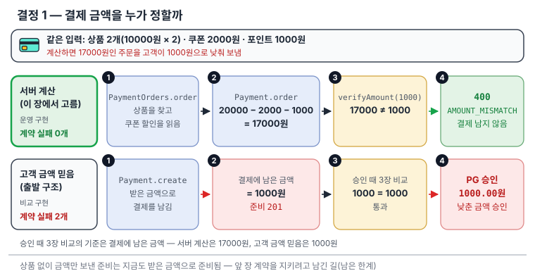

서버가 계산하는 이유는 승인 때의 비교가 결제에 남은 금액을 기준으로 하기 때문입니다. 남은 금액이 고객 금액이면 3장 규칙은 고객이 같은 값을 두 번 보냈는지만 확인합니다. 금액을 서버가 정해 두면 고객이 할인을 부풀리거나 금액을 낮춰 보내도 그 금액으로 결제가 남지 않습니다. 다른 금액을 400으로 받지 않고 결제를 남기지 않는 것은 3장에서 승인 금액이 다를 때 정한 것과 같은 처리입니다.

이 선택으로 치르는 비용은 두 가지입니다.

- 금액을 계산하려면 준비 요청마다 상품과 쿠폰을 읽어야 합니다. 고객 금액을 믿는 비교는 이 둘을 읽지 않습니다. 이 비용은 측정하지 않았습니다.
- 상품 없이 금액만 보낸 준비는 지금도 받은 금액으로 준비됩니다. 앞 장 계약을 지키려고 남긴 길이라 서버가 금액을 정하지 않습니다.

다른 선택이 맞는 경우도 있습니다. 상품과 할인이 결제 서버 밖에서 정해지고 결제 서버에는 금액만 넘어오는 구조라면, 결제 서버는 받은 금액을 믿을 수밖에 없습니다. 그때는 금액을 정한 쪽이 같은 검증을 맡아야 합니다. 이 장의 상품 없는 준비가 그 모양입니다.

### 결정 2. 재고·쿠폰·포인트를 언제 잡을까

이 장에서는 재고·쿠폰·포인트를 PG에 승인을 요청하기 직전, 인증을 남기는 트랜잭션 안에서 잡기로 했습니다. 하나라도 모자라면 409(`OUT_OF_STOCK`, `COUPON_NOT_AVAILABLE`, `INSUFFICIENT_POINT`)로 받지 않고 PG에 승인을 요청하지 않습니다.

검토한 선택지는 세 가지입니다.

- 승인 요청 직전, 인증 트랜잭션 안에서 잡음
- PG 승인 뒤에 잡음(출발 구조와 같은 때). 모자라면 받은 승인을 PG에 전액 취소함
- 준비할 때 잡음

세 구현은 잡는 방법이 같고 때만 다릅니다. 비교 구현은 운영 `PaymentHoldings`를 인증 때 잡지 않는 것으로 바꿔 끼우고, 준비 뒤나 승인 뒤에 같은 방법으로 잡습니다. 승인 뒤 잡기는 모자라면 운영 취소 서비스로 전액 취소합니다.

```java
// src/test/java/com/example/payment/application/payment/comparison/HoldAfterApprovalConfirmService.java
public PaymentResult confirm(ConfirmPaymentCommand command) {
    PaymentResult result = paymentConfirmService.confirm(command);
    if (result.status() != PaymentStatus.APPROVED) {
        return result;
    }
    try {
        deferredHoldRecorder.hold(command.orderId());
        return result;
    } catch (PaymentChallengeException notHeld) {
        paymentCancelService.cancel(new CancelPaymentCommand(command.orderId(), "not-held-" + command.orderId(), null,
                "Could not hold the order"));
        throw notHeld;
    }
}
```

승인 뒤 잡기는 계약 6개 중 3개가 실패했습니다.

```text
FAIL 재고가 없는 상품의 주문은 카드사에 승인을 요청하지 않는다 (0.061s) | org.opentest4j.AssertionFailedError:  expected: 0  but was: 1
FAIL 재고가 없는 상품의 주문은 카드사에서 승인된 뒤 취소되는 일이 없다 (0.063s) | org.opentest4j.AssertionFailedError:  expected: 0  but was: 1
FAIL 카드사 답을 기다리는 주문이 잡은 재고는 다른 주문이 가져가지 못한다 (3.247s) | org.awaitility.core.ConditionTimeoutException: Condition with Lambda expression in com.example.payment.application.payment.HoldTimingContract was not fulfilled within 3 seconds.
```

재고 0개 상품의 주문도 PG에 승인을 요청했고, 승인된 뒤 취소됐습니다. "재고가 없다고 받지 않는다"는 통과했습니다. 고객이 받는 답은 `OUT_OF_STOCK`으로 같지만, 그 사이 PG에는 승인 1건과 취소 1건이 남았습니다. 응답 코드만 봐서는 차이가 보이지 않습니다. 세 번째 실패는 재고 1개를 담은 첫 주문이 PG 답을 기다리는 동안 같은 상품의 다른 주문이 온 경우입니다. 잡은 재고가 없으니 다른 주문도 PG까지 가서 답을 기다렸습니다. 이 시험은 Mock PG의 승인 답을 붙잡아 두므로(`holdConfirmAnswers`), 3초 안에 답을 받지 못한 것은 이 붙잡기 때문입니다. 실패가 뜻하는 것은 나중 주문이 재고에서 막히지 않고 PG까지 갔다는 점입니다.

준비 때 잡기는 6개 중 1개가 실패했습니다. 준비만 하고 승인을 요청하지 않은 주문이 재고를 3에서 2로 줄였습니다.

```text
FAIL 준비만 하고 승인을 요청하지 않은 주문은 재고를 줄이지 않는다 (0.029s) | org.opentest4j.AssertionFailedError:  expected: 3  but was: 2
```

세 구현에 같은 세 입력을 넣은 결과를 나란히 놓으면 아래와 같습니다.

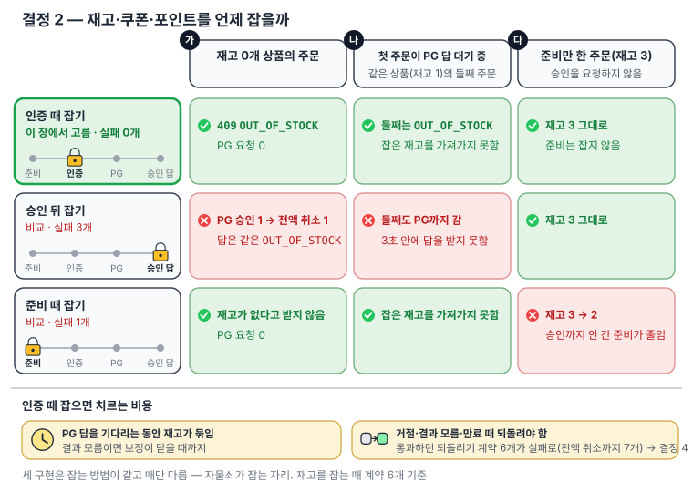

운영 구현은 인증 기록에서 잡습니다. 인증 전이를 한 뒤 같은 트랜잭션에서 `PaymentHoldings.hold`를 부릅니다.

```java
// src/main/java/com/example/payment/application/payment/PaymentRecorder.java
@Transactional
public ConfirmAttempt authenticate(ConfirmPaymentCommand command) {
    Payment payment = find(command.orderId());
    payment.verifyAmount(command.amount());
    if (payment.isRequestedWith(command.paymentKey())) {
        return ConfirmAttempt.repeat(PaymentResult.from(payment));
    }
    payment.authenticate(command.paymentKey(), clock.instant());
    paymentHoldings.hold(payment);
    return ConfirmAttempt.send(payment.getOrderId(), payment.getAmount());
}
```

잡는 순서는 상품 번호 순 재고, 쿠폰, 포인트로 정해 두었습니다. 코드 주석에 적은 대로, 여러 상품을 담은 주문끼리 서로의 줄을 기다리며 멈추지 않게 하려는 순서입니다.

```java
// src/main/java/com/example/payment/application/payment/PaymentHoldings.java
public void hold(Payment payment) {
    payment.getItems().stream()
            .sorted(Comparator.comparing(PaymentItem::getProductId))
            .forEach(item -> holdStock(payment, item));
    if (payment.usesCoupon()) {
        holdCoupon(payment);
    }
    if (payment.usesPoint()) {
        holdPoint(payment);
    }
}

private void holdStock(Payment payment, PaymentItem item) {
    if (stockRepository.decrease(item.getProductId(), item.getQuantity())) {
        return;
    }
    throw new OutOfStockException(payment.getOrderId());
}
```

하나라도 모자라면 예외로 인증 트랜잭션이 통째로 롤백되어, 앞서 잡은 것과 인증도 남지 않습니다. 재고·쿠폰은 `JdbcTemplate` 문장이고 인증은 JPA 결제라 정말 함께 롤백되는지 실행으로 확인했습니다. 재고 5개·쿠폰 2000원은 있고 포인트가 500원인 회원이 포인트 1000원을 쓰는 주문을 보냈습니다. 답은 `INSUFFICIENT_POINT`였고, 재고 5·쿠폰 `ISSUED` 그대로, PG 승인 요청 0, 결제는 `READY`였습니다(`HoldRefusalTest` 4개 통과).

포인트가 모자란 이 주문이 인증 트랜잭션을 지나는 순서를 그리면 아래와 같습니다.


인증 때 잡는 이유는 승인해 놓고 재고가 없는 결제를 만들지 않기 위해서입니다. 잡은 뒤에만 PG에 승인을 요청하므로, 재고가 없는 주문은 PG까지 가지 않고 고객 카드에 승인과 취소가 남지 않습니다. 준비 때 잡지 않은 이유는 승인까지 가지 않는 준비가 재고를 잡고 있지 않게 하려는 것입니다.

이 선택으로 치르는 비용은 두 가지입니다.

- 거절·결과 모름·만료 때 잡은 것을 돌려줘야 합니다. 출발 코드에서 통과하던 거절·만료 되돌리기 계약 6개가 이 결정 뒤에 실패로 바뀌었고(그때 있던 되돌리기 계약 10개 중 전액 취소까지 7개 실패), 결정 4에서 다룹니다.
- PG 답을 기다리는 동안 재고가 묶입니다. 결과 모름이 되면 보정이 닫을 때까지 묶이고, 운영 설정은 승인을 요청한 지 1분(`payment.reconciliation.wait-after-request=1m`)이 지난 결제를 1분마다 보정합니다.

다른 선택이 맞는 경우도 있습니다. 재고가 모자라는 일이 드물고 고객 카드에 승인과 취소가 함께 남아도 괜찮다면, PG 답을 기다리는 동안 재고를 묶지 않는 승인 뒤 잡기가 맞을 수 있습니다. 준비한 주문에 재고를 먼저 보장해야 하는 판매라면 준비 때 잡는 쪽이 맞지만, 그때는 승인까지 가지 않은 준비의 재고를 풀어 줄 작업이 함께 있어야 합니다. 이 장에는 그런 작업이 없습니다.

세 때가 재고·쿠폰·포인트를 쥐는 구간과 각각 맞는 경우를 나란히 놓으면 아래와 같습니다.


### 결정 3. 같은 상품에 몰린 주문의 재고를 어떻게 줄일까

이 장에서는 재고를 조건부 UPDATE 한 문장(`… where product_id = ? and quantity >= ?`)으로 줄이고, 바뀐 줄이 없으면 재고가 모자란 것으로 보기로 했습니다. 포인트 잔액도 같은 방법으로 씁니다.

검토한 선택지는 네 가지입니다.

- 조건부 UPDATE
- `select … for update`로 재고 줄을 잠그고 읽은 뒤 확인하고 줄임
- 변경 번호 + 다시 시도: 잠그지 않고 읽고 `update … where version = 읽은 번호`, 어긋나면 처음부터 다시
- 잠그지 않고 읽고 확인한 뒤 씀(결정 2까지)

운영 구현은 아래 한 문장입니다.

```java
// src/main/java/com/example/payment/infrastructure/persistence/stock/StockRepositoryAdapter.java
@Override
public boolean decrease(Long productId, int quantity) {
    return jdbcTemplate.update("update stock set quantity = quantity - ? where product_id = ? and quantity >= ?",
            quantity, productId, quantity) == 1;
}
```

비교 구현은 재고 저장소만 우선 빈으로 바꿔 끼웠습니다. `select … for update`는 잠그고 읽은 뒤 줄입니다.

```java
// src/test/java/com/example/payment/infrastructure/persistence/stock/comparison/ForUpdateStockRepository.java
@Override
public boolean decrease(Long productId, int quantity) {
    Integer current = jdbcTemplate.queryForObject("select quantity from stock where product_id = ? for update",
            Integer.class, productId);
    if (current < quantity) {
        return false;
    }
    jdbcTemplate.update("update stock set quantity = quantity - ? where product_id = ?", quantity, productId);
    return true;
}
```

변경 번호는 시험 DB에만 `stock.version` 칸을 더하고, 읽은 번호 그대로일 때만 줄이며 번호를 올립니다. 다시 시도를 같은 트랜잭션 안에서 할 수는 없었습니다. 격리 수준이 REPEATABLE READ라 같은 트랜잭션에서 다시 읽으면 첫 읽기의 스냅숏을 다시 봅니다. 그래서 어긋나면 인증 트랜잭션을 처음부터 다시 하는 승인 서비스로 감쌌고, 최대 30번까지 다시 합니다.

```java
// src/test/java/com/example/payment/application/payment/comparison/RetryOnStockChangeConfirmService.java
public PaymentResult confirm(ConfirmPaymentCommand command) {
    StockChangedException lastChange = null;
    for (int attempt = 0; attempt < MAX_ATTEMPTS; attempt++) {
        try {
            return paymentConfirmService.confirm(command);
        } catch (StockChangedException changed) {
            retries.incrementAndGet();
            lastChange = changed;
        }
    }
    throw lastChange;
}
```

재고 1개에 두 주문이 겹칠 때 네 방식이 나중 주문을 어떻게 다루는지 그리면 아래와 같습니다.

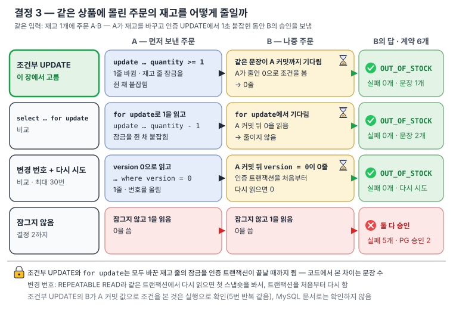

같은 상품 계약 6개에서 잠그지 않음은 5개가 실패했습니다. 겹친 두 주문이 모두 승인되고 PG 승인이 2건이었고, 30건이 모두 승인돼 남은 재고는 7이었습니다. 조건부 UPDATE, `for update`, 변경 번호 + 다시 시도는 6개 모두 통과했습니다.

계약은 두 요청의 겹침을 고정합니다. 여러 요청이 한꺼번에 오면 어떻게 되는지 보려고 `./gradlew stockMeasurement`로 재고 100개 상품에 승인 요청 300건을 한꺼번에 보냈습니다. 측정은 두 번 실행했고 묶음마다 3번씩 돌렸습니다. 전체 결과는 아래 "테스트 결과"에 모았고, 두 실행의 범위만 옮기면 아래와 같습니다.

- 조건부 UPDATE: 승인 100, 과판매 0, 응답 중앙 461\~590ms, 처리량 406\~510건/초
- `select … for update`: 승인 100, 과판매 0, 응답 중앙 437\~629ms, 처리량 400\~537건/초
- 변경 번호 + 다시 시도: 승인 100, 과판매 0, 응답 중앙 906\~1327ms, 처리량 212\~306건/초, 300건에 다시 시도 841\~851번
- 잠그지 않음: 승인 300, 과판매 200, 남은 재고 68\~70, 응답 중앙 994\~1407ms, 처리량 196\~271건/초

이 측정은 두 조건 아래에서 잰 값입니다. 결제 서버의 DB 연결은 HikariCP 기본 10개라 300건을 보내도 재고 줄에서 겹치는 트랜잭션은 많아야 10개이고, Mock PG는 바로 답합니다. 이 두 조건이 결과의 모양을 정했을 수 있습니다.

두 실행 6번의 값을 같은 축에 놓으면 아래와 같습니다.

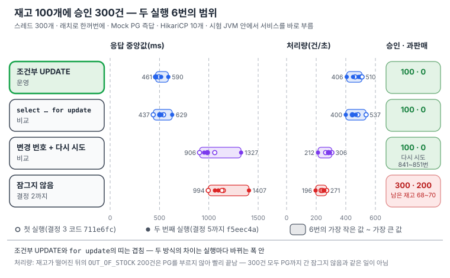

점 하나가 묶음 한 번이고, 띠는 두 실행 6번의 가장 작은 값부터 가장 큰 값까지입니다.

조건부 UPDATE를 고르며 처음 든 이유는 재고 줄에 주문이 몰린다는 점이었습니다. 7장의 결제 줄 잠금은 결제마다 줄이 달라 충돌이 적었지만, 재고 줄은 같은 상품의 모든 주문이 한 줄을 바꿉니다. 변경 번호 + 다시 시도와 견주면 측정이 이 이유와 맞았습니다. 300건 가운데 승인될 수 있는 것은 100건인데 다시 시도가 841\~851번 일어났고, 응답 중앙값은 조건부 UPDATE의 두 배 정도였습니다.

`select … for update`와의 차이는 측정으로 보이지 않았습니다. 응답 중앙값의 범위가 461\~590ms와 437\~629ms로 겹쳤고, 실행마다 바뀌는 폭 안이었습니다. 두 방식 모두 바꾼 재고 줄의 잠금을 인증 트랜잭션이 끝날 때까지 쥡니다. 코드에서 확인한 차이는 읽기와 쓰기 두 문장이 한 문장이 된다는 점뿐입니다.

7장의 결제 줄과 이 장의 재고 줄에 요청이 모이는 모양, 그리고 측정에서 본 것을 그리면 아래와 같습니다.


재고 1개에 겹친 두 주문에서 나중 주문의 조건부 UPDATE는 앞 주문의 커밋까지 기다린 뒤, 앞 주문이 줄인 수량으로 조건을 보고 0줄을 바꿨습니다(`OUT_OF_STOCK`). 5번 반복해 같은 결과였습니다. MySQL 문서는 이 동작을 "The snapshot of the database state applies to SELECT statements within a transaction, not necessarily to DML statements. If you insert or modify some rows and then commit that transaction, a DELETE or UPDATE statement issued from another concurrent REPEATABLE READ transaction could affect those just-committed rows…"라고 설명합니다.

포인트 잔액도 같은 조건부 UPDATE로 바꿨습니다(`update point_wallet set balance = balance - ? where member_id = ? and balance >= ?`). 결정 3은 재고만 비교했고, 포인트 잔액도 같은 까닭으로 함께 바꿨습니다. 포인트를 겹쳐 쓰는 계약은 그 뒤에 더했습니다. 포인트 계약 3개(한 주문만 승인, 나중 주문은 `INSUFFICIENT_POINT`, 잔액은 0 아래로 내려가지 않음)는 모두 통과했습니다. 포인트에는 비교 구현을 따로 만들지 않았습니다.

이 선택으로 치르는 비용은 같은 상품의 주문이 재고 줄에서 차례로 기다린다는 점입니다. 재고 줄의 잠금은 인증 트랜잭션이 끝날 때까지 이어지므로, 그 사이 쿠폰·포인트를 잡고 인증을 남기는 시간도 다른 주문이 기다립니다. 300건을 한꺼번에 보낸 측정에서 응답 p95는 575\~721ms였습니다.

다른 선택이 맞는 경우도 있습니다. 줄이기 전에 남은 수량을 보고 다른 판단을 해야 한다면(남은 만큼만 팔기 같은 규칙), 읽는 문장이 있어야 하므로 `select … for update`가 맞습니다. 같은 상품에 주문이 몰리는 일이 드물다면 변경 번호도 쓸 수 있지만, 이번 측정처럼 한 줄에 몰리면 다시 시도가 승인 수보다 훨씬 많아졌습니다.

### 결정 4. 잡아 둔 것을 언제, 몇 번 돌려줄까

이 장에서는 잡아 둔 재고·포인트·쿠폰을 결제 상태가 승인 실패·만료·승인 취소·매입 취소로 바뀌는 그 트랜잭션에서 한 번 돌려주기로 했습니다. 결과 모름은 보정이 정할 때까지 쥔 채로 두고, 포인트는 증감 이력(`point_history`)에 결제마다 종류별로 한 줄씩만 남깁니다.

결정 2로 인증 때 잡게 되면서 거절·PG 쪽 만료·결과 모름 뒤 승인 실패·전액 취소에도 재고 3·포인트 2000원·쿠폰 쓰임이 그대로 남았습니다. 이것을 어디서 돌려줄지 정해야 했습니다.

검토한 선택지는 네 가지입니다.

- 결제 상태 전이와 같은 트랜잭션에서 한 번 + 포인트 이력
- 실패를 기록하는 곳마다 따로 되돌리기(포인트 이력은 운영과 같음)
- 포인트 이력 없이 잔액만 고치기(되돌리는 때는 운영과 같음)
- 곳마다 따로 + 이력 없이

돌려줄 때는 결제 상태로 정합니다. 결제가 잡은 것을 쥐는 상태(인증, 결과 모름, 승인, 매입)와 돌려줄 상태(승인 실패, 만료, 승인 취소, 매입 취소)를 나누고, 쥐던 상태에서 돌려줄 상태로 온 한 번만 돌려줍니다.

```java
// src/main/java/com/example/payment/domain/payment/PaymentStatus.java
// 8장: 결제가 잡아 둔 재고·포인트·쿠폰을 쥐고 있는 상태인가. 인증 때 잡고(결정 2), 승인 결과를 기다리는 동안(결과 모름 포함)과
// 승인이 남은 동안 쥔다
public boolean keepsHoldings() {
    return isAwaitingApprovalResult() || holdsApproval();
}

// 8장: 승인 없이 끝났거나 승인이 모두 취소된 상태인가(승인 실패, 만료, 승인 취소, 매입 취소). 잡아 둔 것을 돌려줄 상태다
public boolean dropsHoldings() {
    return this == APPROVAL_FAILED || this == EXPIRED || this == APPROVAL_CANCELED || this == CAPTURE_CANCELED;
}
```

```java
// src/main/java/com/example/payment/domain/payment/Payment.java
// 8장 결정 4: 이 상태(before)에서 지금 상태로 오며 잡아 둔 재고·포인트·쿠폰을 돌려줄 때가 됐는가.
// 쥐고 있던 상태에서 승인 없이 끝나거나(승인 실패·만료) 승인이 모두 취소된 상태로 온 한 번만 맞다. 결과 모름은 쥔 채로 둔다 —
// 카드사에 승인이 남았을 수 있다(4장 보정이 정한다). 이미 끝난 결제를 다시 보면(before 도 끝난 상태) 아니다
public boolean releasesHoldingsFrom(PaymentStatus before) {
    return before.keepsHoldings() && status.dropsHoldings();
}
```

[1장](../payment-state-machine/) 상태 머신 위에 쥐는 상태와 돌려줄 상태를 나누어 그리면 아래와 같습니다.

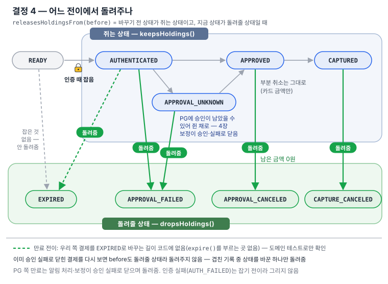

결과 모름은 쥐는 상태에 들어 있어서, 인증에서 결과 모름으로 가는 전이에서는 돌려주지 않습니다.

결제를 바꾸는 기록은 모두 바꾸기 전 상태를 들고 있다가, 결제를 바꾼 뒤 같은 트랜잭션에서 `releaseIfClosed`를 부릅니다. 승인 답 기록과 결과 모름 보정(`PaymentRecorder`), 취소 답 기록과 취소 보정(`PaymentCancelRecorder`), 알림 반영(`PaymentWebhookRecorder`)입니다.

```java
// src/main/java/com/example/payment/application/payment/PaymentRecorder.java
@Transactional
public PaymentResult recordApproval(String orderId, PaymentApproval approval) {
    Payment payment = find(orderId);
    PaymentStatus before = payment.getStatus();
    if (payment.isAwaitingApprovalResult()) {
        settleWith(payment, approval);
    }
    paymentHoldings.releaseIfClosed(payment, before);
    return PaymentResult.from(payment);
}
```

이 기록들은 모두 7장의 결제 줄 잠금(`findByOrderIdForUpdate`) 안에서 결제를 읽습니다. 그래서 같은 거절을 거절 답 기록·보정·알림 처리가 겹쳐 닫아도, 나중 기록은 이미 승인 실패가 된 결제를 읽습니다. `before`가 돌려줄 상태라 `releasesHoldingsFrom`이 거짓이 되고, 상태를 바꾼 먼저 기록만 돌려줍니다.

결제를 바꾸는 기록 다섯 곳이 같은 트랜잭션에서 돌려주는 순서를 그리면 아래와 같습니다.

![결제를 바꾸는 기록 다섯 곳이 돌려주는 순서 — 승인 답 기록 PaymentRecorder.recordApproval, 결과 모름 보정 PaymentRecorder.recordInquiry, 취소 답 기록 PaymentCancelRecorder.recordOutcome, 취소 보정 PaymentCancelRecorder.recordInquiry, 알림 반영 PaymentWebhookRecorder.follow가 모두 7장의 결제 줄 잠금(findByOrderIdForUpdate)으로 결제를 읽고, 바꾸기 전 상태(before)를 들고, 결제를 바꾼 뒤 같은 트랜잭션에서 releaseIfClosed를 부름. releasesHoldingsFrom이 before가 쥐는 상태이고 지금 상태가 돌려줄 상태일 때만 참이라 release로 재고 += 수량, 이 결제가 쓴 쿠폰만 ISSUED, 포인트는 RESTORE 이력이 들어간 때만 잔액 +=. 같은 거절을 겹쳐 닫은 나중 기록은 이미 승인 실패가 된 결제를 읽어 before가 돌려줄 상태라 거짓이 되고 그대로 둠. 승인이나 부분 취소로 바꾼 기록도 거짓](images/19_release-callers.svg)

곳마다 따로 되돌리는 비교는 이 기록이 상태를 바꿨는지 보지 않고, 결제가 끝난 상태면 돌려줍니다.

```java
// src/test/java/com/example/payment/application/payment/comparison/SeparateReleaseHoldings.java
@Override
public void releaseIfClosed(Payment payment, PaymentStatus before) {
    if (payment.getStatus().dropsHoldings()) {
        release(payment);
    }
}
```

포인트는 돌려줄 때 이력을 먼저 남기고(`insert ignore`), 이력이 들어간 때만 잔액을 늘립니다. `point_history`에는 `(payment_id, type)` unique 키가 있어서, 결제 하나에 `RESTORE`는 한 줄만 올라갑니다.

```java
// src/main/java/com/example/payment/infrastructure/persistence/point/PointRepositoryAdapter.java
@Override
public void restore(String memberId, Long paymentId, BigDecimal amount, Instant now) {
    int recorded = jdbcTemplate.update(
            "insert ignore into point_history (member_id, payment_id, type, amount, created_at) values (?, ?, 'RESTORE', ?, ?)",
            memberId, paymentId, amount, Timestamp.from(now));
    if (recorded == 0) {
        return;
    }
    jdbcTemplate.update("update point_wallet set balance = balance + ? where member_id = ?", amount, memberId);
}
```

곳마다 따로 되돌리는 비교에서 세 기록이 포인트를 돌려줄 때 이력이 막는 모양을 그리면 아래와 같습니다.


되돌리기 계약 11개의 결과는 아래와 같습니다. 두 번째와 네 번째 비교의 실패 줄입니다.

```text
## 승인 없이 끝난 결제가 잡아 둔 재고·포인트·쿠폰 — 비교: 실패를 기록하는 곳마다 따로 되돌리기(포인트 이력은 운영과 같음)
FAIL 승인 거절의 기록·보정·알림 처리가 겹쳐도 재고는 한 번만 돌아온다 (1.186s) | org.opentest4j.AssertionFailedError:  expected: 5  but was: 9
## 승인 없이 끝난 결제가 잡아 둔 재고·포인트·쿠폰 — 비교: 곳마다 따로 되돌리기 + 포인트 이력 없이 잔액만
FAIL 승인 거절의 기록·보정·알림 처리가 겹쳐도 포인트는 한 번만 돌아온다 (1.173s) | org.opentest4j.AssertionFailedError:  expected: 3000  but was: 5000.00
FAIL 승인 거절의 기록·보정·알림 처리가 겹쳐도 재고는 한 번만 돌아온다 (1.169s) | org.opentest4j.AssertionFailedError:  expected: 5  but was: 9
```

- 상태 전이에서 한 번 + 이력(운영): 11개 모두 통과
- 곳마다 따로(이력은 운영과 같음): 1개 실패. 거절 답 기록·보정·알림 처리가 저마다 재고 2개씩을 돌려줘 재고가 9(처음 5)가 됐습니다. 포인트는 이력이 두 번째부터 막아 3000원이었습니다.
- 이력 없이 잔액만: 11개 모두 통과
- 곳마다 따로 + 이력 없이: 2개 실패. 재고 9, 포인트 5000원(처음 3000원)이었습니다.

거절 하나를 세 기록이 겹쳐 닫을 때 네 구현에서 누가 돌려주는지 그리면 아래와 같습니다.

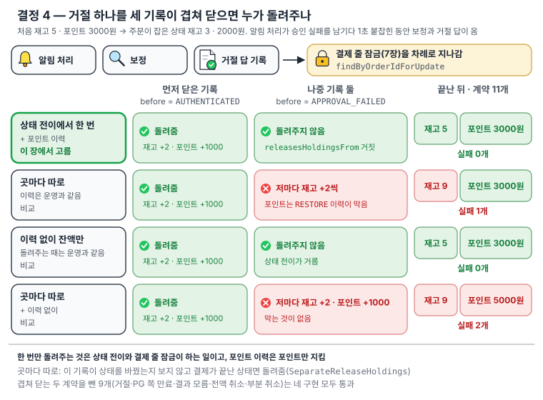

이 결과에서 밝혀 둘 것이 있습니다. 이력 없이 잔액만 고친 비교도 계약을 모두 지켰습니다. 한 번만 돌려주는 것은 상태 전이와 결제 줄 잠금이 하는 일이고, 이력은 포인트만 지킵니다. 곳마다 따로 되돌리면 이력이 있어도 재고는 세 번 돌아왔습니다.

상태 전이에서 돌려주는 이유는 "이 결제가 끝났다"를 정하는 곳이 상태 전이 하나뿐이기 때문입니다. 거절은 승인 답 기록, 보정, 알림 처리 어디서든 닫힐 수 있고, 7장에서 이 기록들이 모두 결제 줄 잠금을 지나게 했습니다. 상태를 바꾼 기록에서 돌려주면 겹친 기록 가운데 하나만 돌려줍니다. 이력을 둔 이유는 코드 주석에 적은 대로, 상태 전이 판단이 어긋나는 경우에도 포인트 잔액이 두 번 늘지 않게 막으려는 것입니다. 계약으로는 이 두 번째 방어가 필요한 경우를 만들지 못했고, 곳마다 따로 되돌리는 비교에서만 이력이 포인트를 막는 것을 확인했습니다.

결과 모름은 돌려주지 않습니다. 결과 모름 결제는 PG에 승인이 남았을 수 있고, [4장](../payment-approval-unknown/)의 보정이 PG에 조회해 승인이나 승인 실패로 닫습니다. 보정이 승인 실패로 닫으면 그때 돌려주고, 승인으로 닫으면 쥔 채로 둡니다. 두 경우 모두 계약으로 확인했습니다.

만료는 이 장에서 새 작업을 만들지 않았습니다. 우리 쪽 결제를 `EXPIRED`로 바꾸는 길은 지금 코드에 없습니다(`Payment.expire()`를 부르는 곳이 없습니다). PG 쪽 만료는 6장부터의 규칙대로 알림 처리와 보정이 승인 실패로 닫고, 그때 돌려주는 것을 계약으로 확인했습니다. 

`expire()` 전이에도 같은 규칙을 걸었습니다. 인증 뒤 만료는 돌려줄 때이고 준비만 한 결제의 만료는 돌려줄 때가 아니라는 것은 도메인 테스트로만 확인했습니다.

취소는 전액 취소에서만 돌려주고, 부분 취소는 [5장](../payment-partial-cancel/)처럼 카드 금액만 돌려줍니다. 부분 취소가 쌓여 남은 금액이 0원이 되면 결제가 취소 상태가 되므로 그때 모두 돌려줍니다. 17000원 결제에 10000원과 7000원을 차례로 취소한 계약으로 확인했습니다.

```java
// src/main/java/com/example/payment/application/payment/PaymentCancelRecorder.java
// 카드사 답(취소 또는 거절)을 남긴다. 카드사가 같은 키의 앞 요청을 아직 처리 중이면 그대로 둔다.
// 8장 결정 4부터 이 취소로 남은 금액이 0원이 돼 결제가 취소 상태가 되면 잡아 둔 재고·포인트·쿠폰을 돌려준다(부분 취소는 카드 금액만)
@Transactional
public CancelResult recordOutcome(String orderId, String idempotencyKey, CancelOutcome outcome) {
    Payment payment = find(orderId);
    PaymentStatus before = payment.getStatus();
    PaymentCancel cancel = closeWith(payment, idempotencyKey, outcome);
    paymentHoldings.releaseIfClosed(payment, before);
    return CancelResults.of(payment, cancel);
}
```

이 선택으로 치르는 비용은 세 가지입니다.

- 결과 모름 동안 재고·포인트·쿠폰이 묶입니다. 보정이 닫을 때까지입니다.
- 포인트 이력 테이블이 하나 늘고, 쓰고 돌려줄 때마다 이력 한 줄을 남깁니다.
- 부분 취소에서는 재고·포인트·쿠폰이 돌아오지 않습니다. 상품 하나만 취소하는 경우는 다루지 않았습니다.

다른 선택이 맞는 경우도 있습니다. 포인트 변동 내역을 따로 보여 줄 필요가 없고 돌려주는 곳이 상태 전이 하나뿐이라면, 이력 없이 잔액만 고쳐도 이번 계약은 모두 지켜졌습니다. 실패를 닫는 길이 하나뿐인 구조라면 곳마다 따로 되돌리기와 상태 전이에서 되돌리기는 차이가 나지 않습니다. 이 장의 결제는 실패를 닫는 길이 셋이라 차이가 났습니다.

### 결정 5. 같은 쿠폰을 담은 두 주문을 어떻게 가릴까

이 장에서는 쿠폰을 조건부 UPDATE(`… where id = ? and status = 'ISSUED'`)로 쓰고, 바뀐 줄이 없으면 409 `COUPON_NOT_AVAILABLE`로 받지 않기로 했습니다.

검토한 선택지는 세 가지입니다.

- 조건부 UPDATE
- 읽고 확인한 뒤 저장(결정 4까지)
- 사용 기록 테이블에 두 번 올라갈 수 없게(`coupon_usage`, `coupon_id` 기본 키)

```java
// src/main/java/com/example/payment/infrastructure/persistence/coupon/CouponRepositoryAdapter.java
// 8장 결정 5: 쿠폰은 조건부 UPDATE 한 문장으로 쓴다 — 아직 쓰지 않은(ISSUED) 때만 바뀐다. 바뀐 줄이 없으면 이미 다른 결제에 쓰였다(409).
// 읽고 확인한 뒤 쓰면(결정 2) 겹친 두 주문이 둘 다 쓸 수 있는 쿠폰으로 읽어 둘 다 썼다. 이 문장은 쿠폰 줄을 잠그고 최신 상태로 조건을 본다
@Override
public boolean use(Long couponId, Long paymentId) {
    return jdbcTemplate.update("update coupon set status = 'USED', payment_id = ? where id = ? and status = 'ISSUED'",
            paymentId, couponId) == 1;
}

@Override
public void restore(Long couponId, Long paymentId) {
    jdbcTemplate.update("update coupon set status = 'ISSUED', payment_id = null where id = ? and payment_id = ? and status = 'USED'",
            couponId, paymentId);
}
```

돌려줄 때는 이 결제에 쓰인 `USED` 쿠폰만 `ISSUED`로 바꿉니다. 다른 결제가 쓴 쿠폰을 잘못 돌려주지 않게 하려는 조건입니다.

읽고 확인한 뒤 저장은 계약 3개 중 2개가 실패했습니다. 겹친 두 주문이 모두 쓸 수 있는 쿠폰으로 읽어 둘 다 승인됐습니다. 먼저 준비해 둔 주문이 다른 주문이 쿠폰을 쓴 뒤에 승인을 요청하는 경우(겹치지 않음)는 인증 때 다시 읽으므로 막았습니다.

```text
FAIL 같은 쿠폰을 담은 두 주문이 겹치면 한 주문만 승인된다 (2.075s) | org.opentest4j.AssertionFailedError:  expected: 1L  but was: 2L
FAIL 같은 쿠폰을 담은 두 주문이 겹치면 나중 주문은 쓸 수 없는 쿠폰이라고 받지 않는다 (2.076s) | org.opentest4j.AssertionFailedError:  expected: COUPON_NOT_AVAILABLE  but was: null
```

사용 기록 비교는 쿠폰을 쓸 때 쿠폰 줄을 바꾸지 않고 `coupon_usage`에 한 줄을 남깁니다. 겹친 두 번째 기록은 앞 기록이 커밋될 때까지 기다렸다가 키 중복으로 들어가지 않고, 이미 쓰인 쿠폰으로 답합니다. 계약 3개를 모두 통과했습니다.

```java
// src/test/java/com/example/payment/infrastructure/persistence/coupon/comparison/UsageRecordCouponRepository.java
@Override
public boolean use(Long couponId, Long paymentId) {
    try {
        jdbcTemplate.update("insert into coupon_usage (coupon_id, payment_id) values (?, ?)", couponId, paymentId);
        return true;
    } catch (DuplicateKeyException alreadyUsed) {
        return false;
    }
}
```

세 방식에 같은 두 입력을 넣은 결과를 나란히 놓으면 아래와 같습니다.

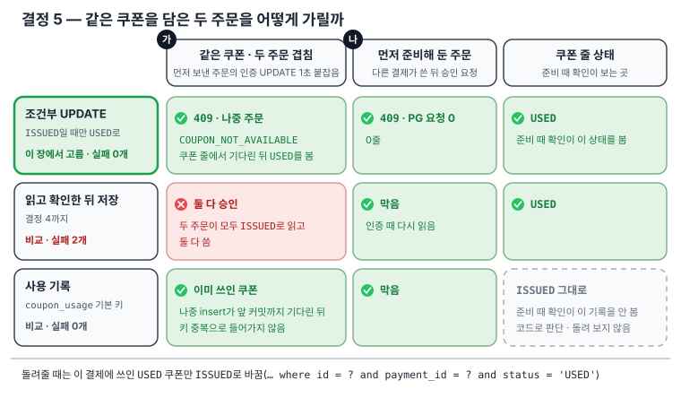

두 방식 모두 계약을 지켰고, 두 방식의 차이는 쿠폰 줄의 상태입니다. 조건부 UPDATE는 쿠폰 줄을 `USED`로 바꾸므로 준비 때의 쿠폰 확인("이미 결제에 쓴 쿠폰으로는 준비할 수 없다")이 그 상태를 봅니다. 사용 기록 비교에서는 쿠폰 줄의 상태가 `ISSUED` 그대로라, 준비 때의 확인은 이 기록을 보지 않습니다. 코드를 읽고 판단한 것이고, 그 준비 테스트를 사용 기록 비교로 돌리지는 않았습니다. 조건부 UPDATE로 쓰는 이유는 쿠폰이 쓰였는지를 쿠폰 줄의 상태 한 곳에서 보게 하려는 것입니다. 사용 기록 방식을 쓰려면 준비 때의 확인도 사용 기록을 함께 봐야 합니다.

두 방식에서 쿠폰이 쓰였는지를 어디서 보는지 나란히 놓으면 아래와 같습니다.


이 선택으로 치르는 비용은 쿠폰을 쓴 이력이 쿠폰 줄의 지금 상태와 `payment_id` 하나로만 남는다는 점입니다. 돌려주면 `payment_id`가 지워지므로, 한 쿠폰이 어떤 결제들에 쓰였다가 돌아왔는지는 쿠폰 줄에 남지 않습니다.

다른 선택이 맞는 경우도 있습니다. 한 쿠폰을 정해진 횟수까지 여러 번 쓸 수 있거나 쿠폰 사용 내역을 따로 남겨야 한다면, 사용 기록 테이블 쪽이 맞습니다. 그때는 준비 때의 확인도 같은 기록을 보도록 바꿔야 합니다.

## 구현

결정을 모아 바꾼 8장 완성 코드에서, 상품을 담은 주문 하나가 지나는 메서드 순서는 아래와 같습니다.

1. 준비: `PaymentPrepareService.prepare` → `PaymentPrepareRecorder.prepare`(트랜잭션 시작) → `PaymentOrders.order`에서 상품을 찾고(`findAllById`) 쿠폰 할인을 읽음(`findById`, `isUsableBy`) → `Payment.order`가 상품가 합 − 쿠폰 할인 − 쓴 포인트로 금액을 정함 → `verifyAmount`로 고객 금액과 비교(다르면 400 `AMOUNT_MISMATCH`) → 주문번호로 찾고 없으면 결제와 담긴 상품을 남김
2. 승인 앞 기록: `PaymentConfirmService.confirm` → `PaymentRecorder.authenticate`(트랜잭션 시작) → `findByOrderIdForUpdate`로 결제 줄 잠금(7장) → `verifyAmount`(3장) → `Payment.authenticate` → `PaymentHoldings.hold`: 상품 번호 순으로 재고 조건부 UPDATE → 쿠폰 조건부 UPDATE → 포인트 조건부 UPDATE와 `USE` 이력 → 커밋(모자라면 409로 통째로 롤백)
3. 트랜잭션 밖에서 PG에 승인 요청([2장](../payment-transaction-boundary/))
4. 승인 답 기록: `PaymentRecorder.recordApproval`(트랜잭션 시작) → 결제 줄 잠금 → 바꾸기 전 상태를 들고 → 승인이면 `approve`, 거절이면 `failApproval` → `PaymentHoldings.releaseIfClosed` → `releasesHoldingsFrom`이 참이면(인증 → 승인 실패) `release`: 재고 += 수량, 이 결제가 쓴 쿠폰만 `ISSUED`로, 포인트는 `RESTORE` 이력이 들어간 때만 잔액 += → 커밋

같은 순서를 요청과 응답으로 그리면 아래와 같습니다. 그림의 승인 답은 거절로 그려, 잡은 것을 돌려주는 단계까지 보이게 했습니다.


잡는 곳은 승인 앞 기록(8번) 하나이고, 돌려주는 곳은 결제 상태를 닫는 기록(12번)입니다.

결과 모름이면 목록의 4단계 대신 결과 모름이 남고 잡은 것은 그대로입니다. 그 뒤 보정(`PaymentRecorder.recordInquiry`)이나 알림 반영(`PaymentWebhookRecorder.follow`)이 승인 실패로 닫으면, 4단계와 같이 그 트랜잭션에서 돌려줍니다. 승인된 결제는 전액 취소 답 기록(`PaymentCancelRecorder.recordOutcome`)이나 취소 보정(`recordInquiry`)에서 결제가 취소 상태가 될 때 돌려줍니다.

돌려줄 때도 잡을 때와 같은 순서로 돌려줍니다.

```java
// src/main/java/com/example/payment/application/payment/PaymentHoldings.java
// 이 기록이 결제를 before 에서 지금 상태로 바꾸며 승인 없이 끝냈거나 승인을 모두 취소했으면 잡아 둔 것을 돌려준다
public void releaseIfClosed(Payment payment, PaymentStatus before) {
    if (payment.releasesHoldingsFrom(before)) {
        release(payment);
    }
}

// 잡을 때와 같은 순서로 돌려준다
public void release(Payment payment) {
    payment.getItems().stream()
            .sorted(Comparator.comparing(PaymentItem::getProductId))
            .forEach(item -> stockRepository.increase(item.getProductId(), item.getQuantity()));
    if (payment.usesCoupon()) {
        couponRepository.restore(payment.getCouponId(), payment.getId());
    }
    if (payment.usesPoint()) {
        pointRepository.restore(payment.getMemberId(), payment.getId(), payment.getPointAmount(), clock.instant());
    }
}
```

알림 반영도 같은 모양으로 바꿨습니다.

```java
// src/main/java/com/example/payment/application/payment/PaymentWebhookRecorder.java
private void follow(Payment payment, GatewayPayment gatewayPayment) {
    PaymentStatus before = payment.getStatus();
    payment.follow(gatewayPayment, clock.instant());
    paymentHoldings.releaseIfClosed(payment, before);
}
```

포인트를 쓸 때도 이력을 남깁니다.

```java
// src/main/java/com/example/payment/infrastructure/persistence/point/PointRepositoryAdapter.java
@Override
public boolean use(String memberId, Long paymentId, BigDecimal amount, Instant now) {
    int changed = jdbcTemplate.update(
            "update point_wallet set balance = balance - ? where member_id = ? and balance >= ?", amount, memberId, amount);
    if (changed == 0) {
        return false;
    }
    jdbcTemplate.update("insert into point_history (member_id, payment_id, type, amount, created_at) values (?, ?, 'USE', ?, ?)",
            memberId, paymentId, amount, Timestamp.from(now));
    return true;
}
```

### 앞 장 코드에서 바뀐 것

- 3장의 준비(`PaymentPrepareRecorder`)는 상품을 담은 준비면 `PaymentOrders`로 결제를 만들고, 없으면 7장까지처럼 주문번호와 금액으로 만듭니다(결정 1).
- 2장의 승인 앞 기록(인증)에서 잡도록 바꾸고, 출발 코드가 승인 답 기록에서 하던 줄이기는 뺐습니다(결정 2).
- 4·5·6장의 기록(승인 답, 결과 모름 보정, 취소 답, 취소 보정, 알림 반영)이 바꾸기 전 상태를 들고, 결제를 바꾼 뒤 `releaseIfClosed`를 부릅니다(결정 4).
- 결제를 지우는 앞 장 시험 4개(`ReconciliationContract`, `MultiServerContract`, `JobMeasurement`, `ReconciliationMeasurement`)는 외래 키 때문에 `payment_item`을 먼저 지웁니다. `PaymentPrepareServiceTest`는 준비 기록의 생성자 인자가 하나 늘어 고쳤습니다.
- 빌드의 모든 시험 태스크에 `spring.test.context.cache.maxSize=10`을 주었습니다. 결정 5 커밋에서 `./gradlew clean check`가 641개 중 20개 실패했는데, 모두 웹훅 시험 두 묶음의 시험 컨텍스트가 새 MySQL 컨테이너에 접속하지 못한 것("Container is started, but cannot be accessed")이었습니다. 캐시를 10개로 묶은 뒤 641개가 모두 통과했습니다.

캐시를 묶은 까닭은 이렇습니다. 시험 컨텍스트마다 MySQL 컨테이너가 하나씩 뜨고, Spring 시험 컨텍스트 캐시는 기본 32개까지 닫지 않습니다. 8장 비교 구현으로 컨텍스트가 늘어 컨테이너가 한꺼번에 많이 떠 있던 탓으로 보았습니다. 원인을 확정할 컨테이너 로그는 모으지 않았습니다.

앞 장 코드에서 바뀐 곳을 모으면 아래와 같습니다.

![앞 장 코드에서 바뀐 것 — 3장의 준비(PaymentPrepareRecorder)는 상품을 담은 준비면 PaymentOrders로 결제를 만들고 없으면 7장까지처럼 주문번호와 금액으로 만듦(결정 1). 2장의 승인 앞 기록(인증)에서 잡고 출발 코드가 승인 답 기록에서 하던 줄이기는 뺌(결정 2). 4·5·6장의 기록 다섯 곳이 바꾸기 전 상태를 들고 결제를 바꾼 뒤 releaseIfClosed를 부름(결정 4). 결제를 지우는 앞 장 시험 4개는 외래 키 때문에 payment_item을 먼저 지우고 PaymentPrepareServiceTest는 생성자 인자가 늘어 고침. 빌드의 모든 시험 태스크에 spring.test.context.cache.maxSize=10 — 결정 5 커밋에서 clean check 641개 중 20개가 웹훅 시험 두 묶음의 컨테이너 접속 실패로 실패했고, 캐시를 10개로 묶은 뒤 641개 모두 통과. 컨텍스트가 늘어 컨테이너가 한꺼번에 많이 떠 있던 탓으로 보았고 원인을 확정할 컨테이너 로그는 모으지 않음](images/22_changed-from-earlier.svg)

## 테스트 결과

8장 완성 코드에서 전체 테스트(`./gradlew clean check`)를 돌린 결과는 아래와 같습니다. 8장 테스트만 남기고 나머지 통과 목록은 생략했습니다. 구현마다의 계약 결과는 출력 뒤의 격자에 모았습니다.

```text
tests=648 failures=0 errors=0 time=383.128s
## 승인 없이 끝난 결제가 잡아 둔 재고·포인트·쿠폰 — 비교: 포인트 이력 없이 잔액만 고치기(되돌리는 때는 운영과 같음)
(11개 모두 PASS, 목록 생략)
## 쿠폰 한 장을 두 주문에 — 운영 구현
PASS 다른 결제에 이미 쓴 쿠폰을 담은 주문은 카드사에 승인을 요청하지 않는다 (0.083s)
PASS 같은 쿠폰을 담은 두 주문이 겹치면 한 주문만 승인된다 (1.077s)
PASS 같은 쿠폰을 담은 두 주문이 겹치면 나중 주문은 쓸 수 없는 쿠폰이라고 받지 않는다 (1.08s)
## 같은 상품에 몰린 주문의 재고 — 비교: select … for update
(6개 모두 PASS, 목록 생략)
## 잡지 못한 주문
PASS 받지 않은 주문의 결제는 인증도 남지 않고 준비 상태 그대로다 (0.045s)
PASS 포인트가 모자라 받지 않은 주문은 먼저 잡은 재고와 쿠폰도 남기지 않는다 (0.033s)
PASS 포인트가 모자란 주문은 포인트가 모자라다고 받지 않는다 (0.027s)
PASS 포인트가 모자라 받지 않은 주문은 카드사에 승인을 요청하지 않는다 (0.029s)
## 재고를 줄이는 때 — 운영 구현
PASS 재고가 없는 상품의 주문은 재고가 없다고 받지 않는다 (0.025s)
PASS 재고가 없는 상품의 주문은 카드사에 승인을 요청하지 않는다 (0.022s)
PASS 준비만 하고 승인을 요청하지 않은 주문은 재고를 줄이지 않는다 (0.019s)
PASS 재고가 없는 상품의 주문은 카드사에서 승인된 뒤 취소되는 일이 없다 (0.024s)
PASS 카드사 답을 기다리는 주문이 잡은 재고는 다른 주문이 가져가지 못한다 (0.228s)
PASS 승인된 주문은 담은 수량만큼 재고를 줄여 둔다 (0.035s)
## 상품을 담은 결제 준비
PASS 같은 주문을 같은 상품으로 다시 준비하면 처음 결제를 그대로 받는다 (0.029s)
PASS 수량이 0 인 상품을 담은 준비는 받지 않는다 (0.016s)
PASS 없는 쿠폰으로는 준비할 수 없다 (0.016s)
PASS 없는 상품을 담은 준비는 받지 않는다 (0.01s)
PASS 같은 주문을 다른 수량으로 다시 준비하면 이미 있는 주문이라고 받지 않는다 (0.026s)
PASS 이미 결제에 쓴 쿠폰으로는 준비할 수 없다 (0.047s)
PASS 다른 회원의 쿠폰으로는 준비할 수 없다 (0.02s)
## 같은 회원이 겹쳐 쓰는 포인트 — 운영 구현
PASS 포인트 1000원인 회원의 두 주문이 겹치면 나중 주문은 포인트가 모자라다고 받지 않는다 (1.071s)
PASS 포인트 1000원인 회원의 두 주문이 겹쳐도 포인트 잔액은 0 아래로 내려가지 않는다 (1.069s)
PASS 포인트 1000원인 회원의 두 주문이 겹쳐 각각 1000원을 쓰면 한 주문만 승인된다 (1.059s)
## 승인 없이 끝난 결제가 잡아 둔 재고·포인트·쿠폰 — 운영 구현
PASS 승인된 결제를 전액 취소하면 잡아 둔 재고·포인트·쿠폰이 돌아온다 (0.082s)
PASS 부분 취소가 쌓여 남은 금액이 0원이 되면 잡아 둔 재고·포인트·쿠폰이 돌아온다 (0.081s)
PASS 승인 요청이 닿지 않아 카드사에서 만료된 결제를 보정이 승인 실패로 닫으면 잡아 둔 것이 돌아온다 (1.063s)
PASS 승인 거절의 기록·보정·알림 처리가 겹쳐도 포인트는 한 번만 돌아온다 (1.169s)
PASS 결과를 모르던 결제를 보정이 승인으로 닫으면 잡아 둔 재고·포인트·쿠폰은 그대로다 (1.607s)
PASS 승인 결과를 모르는 동안은 잡아 둔 재고·포인트·쿠폰을 그대로 둔다 (1.047s)
PASS 승인이 거절되면 잡아 둔 재고·포인트·쿠폰이 처음으로 돌아온다 (0.045s)
PASS 승인 요청이 닿지 않아 카드사에서 만료된 결제를 알림 처리가 승인 실패로 닫으면 잡아 둔 것이 돌아온다 (1.086s)
PASS 결과를 모르던 결제를 보정이 승인 실패로 닫으면 잡아 둔 것이 돌아온다 (1.624s)
PASS 승인된 결제를 부분 취소하면 재고·포인트·쿠폰은 그대로다 (0.063s)
PASS 승인 거절의 기록·보정·알림 처리가 겹쳐도 재고는 한 번만 돌아온다 (1.173s)
## 결제 금액 — 운영 구현
PASS 금액을 낮춰 보낸 주문으로 승인을 요청해도 카드사에서 낮춘 금액이 승인되지 않는다 (0.024s)
PASS 고객이 보낸 금액이 상품가·쿠폰·포인트로 계산한 금액과 다르면 준비를 받지 않는다 (0.016s)
PASS 상품을 담아 준비하면 결제 금액은 상품가 합에서 쿠폰 할인과 쓴 포인트를 뺀 금액이다 (0.022s)
PASS 상품을 담지 않고 금액만 보낸 준비는 보낸 금액으로 준비된다 (0.018s)
## 같은 상품에 몰린 주문의 재고 — 운영 구현
PASS 재고 10개에 주문 30건이 한꺼번에 와도 재고는 0 아래로 내려가지 않는다 (0.324s)
PASS 재고 10개에 주문 30건이 한꺼번에 와도 남은 재고는 승인된 주문 수만큼만 줄어 있다 (0.292s)
PASS 재고 1개에 두 주문이 겹치면 나중 주문은 재고가 없다고 받지 않는다 (1.057s)
PASS 재고 10개에 주문 30건이 한꺼번에 와도 10건만 승인된다 (0.278s)
PASS 재고 1개에 두 주문이 겹쳐도 카드사 승인은 한 건이다 (1.049s)
PASS 재고 1개에 두 주문이 겹치면 한 주문만 승인된다 (1.06s)
## 쿠폰 한 장을 두 주문에 — 비교: 사용 기록에 두 번 올라갈 수 없게
(3개 모두 PASS, 목록 생략)
## 같은 상품에 몰린 주문의 재고 — 비교: 변경 번호 + 처음부터 다시 시도
(6개 모두 PASS, 목록 생략)
## 상품을 담은 주문의 결제 금액(8장)
PASS 고객이 보낸 금액이 계산한 금액과 다르면 금액이 맞지 않는다 (0.0s)
PASS 쓴 포인트가 0 보다 작으면 주문을 받지 않는다 (0.0s)
PASS 할인과 포인트를 빼고 남는 금액이 없으면 주문을 받지 않는다 (0.0s)
PASS 쿠폰도 포인트도 쓰지 않으면 결제 금액은 상품가 합이다 (0.0s)
PASS 결제 금액은 상품가 × 수량의 합에서 쿠폰 할인과 쓴 포인트를 뺀 금액이다 (0.0s)
## 잡아 둔 재고·포인트·쿠폰을 돌려줄 때(8장)
PASS 승인된 결제가 취소 상태가 되면 돌려줄 때다 (0.0s)
PASS 승인되면 돌려줄 때가 아니다 (0.0s)
PASS 인증한 결제의 승인이 거절되면 돌려줄 때다 (0.0s)
PASS 승인 결과를 모르게 되면 카드사에 승인이 남았을 수 있어 돌려줄 때가 아니다 (0.001s)
PASS 결과를 모르던 결제가 승인 실패로 닫히면 돌려줄 때다 (0.0s)
PASS 인증한 결제가 승인 요청 없이 유효 시간이 지나 만료되면 돌려줄 때다 (0.0s)
PASS 준비만 한 결제가 만료되면 잡은 것이 없어 돌려줄 때가 아니다 (0.0s)
PASS 이미 승인 실패로 닫힌 결제를 다시 보면 돌려줄 때가 아니다 (0.001s)
## 결제 API — 상품을 담은 주문(8장)
PASS 재고가 없는 상품의 승인 요청은 재고가 없다고 409 로 답한다 (0.051s)
PASS 상품을 담아 맞는 금액으로 준비하면 그 금액의 준비 응답을 받는다 (0.02s)
PASS 상품가로 계산한 금액과 다른 금액으로 준비하면 금액이 맞지 않는다고 400 으로 답한다 (0.014s)
PASS 쓸 수 없는 쿠폰을 담아 준비하면 409 로 답한다 (0.021s)
(나머지 통과한 테스트 목록 생략)
coverage (JaCoCo, PaymentChallengeApplication 제외)
INSTRUCTION 4155/4240 98.0%
BRANCH 246/257 95.7%
LINE 899/925 97.2%
COMPLEXITY 438/457 95.8%
METHOD 317/326 97.2%
CLASS 89/90 98.9%
```

- 출발 코드에서 실패하던 21개가 모두 통과하였습니다.
- 기본 테스트에 둔 비교 구현 넷(재고 `select … for update`, 재고 변경 번호 + 다시 시도, 포인트 이력 없이 잔액만, 쿠폰 사용 기록)도 각각 계약 6·6·11·3개를 모두 통과했습니다.
- 전체는 7장의 561개에서 648개가 되었습니다. 애플리케이션 시작 클래스를 빼고 잰 라인 커버리지는 97.2%(925줄 중 899줄)였습니다.
- 반복 실행으로 흔들리는지 확인했습니다. 8장 기본 테스트 80개를 5번 돌려 5번 모두 통과했고, 8장 known-failing 비교 47개를 3번 돌려 3번 모두 같은 16개가 실패했습니다. 이 반복은 포인트 계약을 더하기 전 코드에서 한 것입니다.

계약을 지키지 못하는 비교 구현은 `./gradlew knownFailingTest`로 돌렸습니다. 357개 중 92개가 실패했고, 2\~7장 비교 구현의 76개는 7장 기록과 같은 테스트입니다. 8장 비교는 47개 중 16개가 실패했습니다. 뒤이어 도는 7장 `jpaVersionTest`는 11개 중 4개가 실패해 7장과 같았습니다.

기본 테스트와 비교 구현 테스트의 수를 그리면 아래와 같습니다.


8장 계약을 구현마다 모으면 아래와 같습니다.

- 결제 금액(4개): 서버 계산(운영) 0개, 고객 금액 믿음 2개 실패
- 잡는 때(6개): 인증 때(운영) 0개, 승인 뒤 3개, 준비 때 1개 실패
- 같은 상품 재고(6개): 조건부 UPDATE(운영)·`for update`·변경 번호 + 다시 시도 0개, 잠그지 않음 5개 실패
- 되돌리기(11개): 상태 전이에서 한 번(운영)·이력 없이 잔액만 0개, 곳마다 따로 1개, 곳마다 따로 + 이력 없이 2개 실패
- 같은 쿠폰(3개): 조건부 UPDATE(운영)·사용 기록 0개, 읽고 확인한 뒤 저장 2개 실패

구현마다 계약 하나하나의 결과를 격자로 그리면 아래와 같습니다. 칸은 저장소 docs/ch08의 결과 파일과 맞췄습니다.

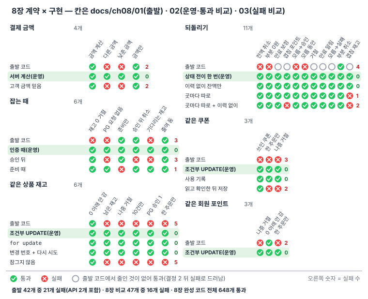

되돌리기 계약 11개 가운데 겹쳐 닫는 두 계약을 뺀 9개는 네 구현 모두 통과했습니다. 거절, PG 쪽 만료, 결과 모름, 전액 취소, 부분 취소처럼 한 기록만 결제를 닫는 경우에는 어디서 되돌려도 결과가 같았습니다.

### 재고 100개에 승인 300건을 보낸 측정

결정 3의 그림 05가 이 측정의 응답 중앙값과 처리량을 그린 것입니다.

`./gradlew stockMeasurement`로 재고를 줄이는 방식마다 재고 100개 상품 하나에 주문 300건(상품 1개씩, 10000원, 쿠폰·포인트 없음)을 미리 준비해 두고, 승인 요청 300건을 스레드 300개에서 래치로 한꺼번에 보냈습니다. 겹침을 고정하지 않고, Mock PG는 바로 답합니다. 결제 서버의 DB 연결은 HikariCP 기본 10개입니다.

묶음마다 3번(#1\~#3) 돌렸고, 묶음 전에 재고 5·주문 20 묶음을 한 번 돌리고 그 결과는 버렸습니다. 전체를 두 번 실행했습니다. 첫 실행은 결정 3 코드(`711e6fc`)에, 두 번째 실행은 결정 5까지 들어간 코드(`f5eec4a`)에 측정 코드를 더해 돌렸습니다. 아래는 두 번째 실행입니다.

재고 100개에 승인 300건을 보낸 측정의 조건을 그리면 아래와 같습니다.

![재고 100개에 승인 300건을 보낸 측정의 조건 — ./gradlew stockMeasurement가 재고를 줄이는 방식마다 재고 100개 상품 하나에 주문 300건(상품 1개씩, 10000원, 쿠폰·포인트 없음)을 미리 준비해 두고 승인 요청 300건을 스레드 300개에서 래치로 한꺼번에 보냄. 겹침을 고정하지 않고, 서비스를 시험 JVM 안에서 바로 불러 쟀으며 k6는 돌리지 않음. 결제 서버의 DB 연결은 HikariCP 기본 10개, Mock PG는 바로 답함. 묶음 전에 재고 5·주문 20 묶음을 한 번 돌려 버리고 묶음마다 3번 돌림. 전체를 두 번 실행했고 첫 실행은 결정 3 코드(711e6fc), 두 번째는 결정 5까지 들어간 코드(f5eec4a). 과판매는 승인 수에서 처음 재고를 뺀 값, 처리량은 300을 전체 시간(초)으로 나눈 값. 재고가 떨어진 뒤의 OUT_OF_STOCK 200건은 PG를 부르지 않아 빨리 끝나 300건이 모두 PG까지 간 잠그지 않음과는 같은 일을 한 처리량이 아님](images/24_measurement-setup.svg)

```text
조건부 UPDATE(운영) | #1 | 재고 100 · 주문 300 | 승인 100 | 과판매 0 | 남은 재고 0(처음 − 승인 = 0) | 카드사 승인 100 | 답 {APPROVED=100, OUT_OF_STOCK=200} | 응답 ms 중앙 590 · p95 721 · 최대 736 | 전체 739ms · 처리량 406건/초
조건부 UPDATE(운영) | #2 | 재고 100 · 주문 300 | 승인 100 | 과판매 0 | 남은 재고 0(처음 − 승인 = 0) | 카드사 승인 100 | 답 {APPROVED=100, OUT_OF_STOCK=200} | 응답 ms 중앙 517 · p95 653 · 최대 666 | 전체 668ms · 처리량 449건/초
조건부 UPDATE(운영) | #3 | 재고 100 · 주문 300 | 승인 100 | 과판매 0 | 남은 재고 0(처음 − 승인 = 0) | 카드사 승인 100 | 답 {APPROVED=100, OUT_OF_STOCK=200} | 응답 ms 중앙 464 · p95 606 · 최대 614 | 전체 617ms · 처리량 486건/초
select … for update | #1 | 재고 100 · 주문 300 | 승인 100 | 과판매 0 | 남은 재고 0(처음 − 승인 = 0) | 카드사 승인 100 | 답 {APPROVED=100, OUT_OF_STOCK=200} | 응답 ms 중앙 521 · p95 650 · 최대 668 | 전체 673ms · 처리량 446건/초
select … for update | #2 | 재고 100 · 주문 300 | 승인 100 | 과판매 0 | 남은 재고 0(처음 − 승인 = 0) | 카드사 승인 100 | 답 {APPROVED=100, OUT_OF_STOCK=200} | 응답 ms 중앙 629 · p95 736 · 최대 748 | 전체 750ms · 처리량 400건/초
select … for update | #3 | 재고 100 · 주문 300 | 승인 100 | 과판매 0 | 남은 재고 0(처음 − 승인 = 0) | 카드사 승인 100 | 답 {APPROVED=100, OUT_OF_STOCK=200} | 응답 ms 중앙 503 · p95 622 · 최대 640 | 전체 642ms · 처리량 467건/초
잠그지 않음 | #1 | 재고 100 · 주문 300 | 승인 300 | 과판매 200 | 남은 재고 69(처음 − 승인 = -200) | 카드사 승인 300 | 답 {APPROVED=300} | 응답 ms 중앙 1407 · p95 1511 · 최대 1527 | 전체 1528ms · 처리량 196건/초
잠그지 않음 | #2 | 재고 100 · 주문 300 | 승인 300 | 과판매 200 | 남은 재고 70(처음 − 승인 = -200) | 카드사 승인 300 | 답 {APPROVED=300} | 응답 ms 중앙 1062 · p95 1161 · 최대 1177 | 전체 1177ms · 처리량 255건/초
잠그지 않음 | #3 | 재고 100 · 주문 300 | 승인 300 | 과판매 200 | 남은 재고 68(처음 − 승인 = -200) | 카드사 승인 300 | 답 {APPROVED=300} | 응답 ms 중앙 1097 · p95 1191 · 최대 1203 | 전체 1205ms · 처리량 249건/초
변경 번호 + 다시 시도(최대 30번) | #1 | 재고 100 · 주문 300 | 승인 100 | 과판매 0 | 남은 재고 0(처음 − 승인 = 0) | 카드사 승인 100 | 답 {APPROVED=100, OUT_OF_STOCK=200} | 응답 ms 중앙 987 · p95 1063 · 최대 1067 | 전체 1070ms · 처리량 280건/초 | 다시 시도 849번
변경 번호 + 다시 시도(최대 30번) | #2 | 재고 100 · 주문 300 | 승인 100 | 과판매 0 | 남은 재고 0(처음 − 승인 = 0) | 카드사 승인 100 | 답 {APPROVED=100, OUT_OF_STOCK=200} | 응답 ms 중앙 953 · p95 1015 · 최대 1021 | 전체 1023ms · 처리량 293건/초 | 다시 시도 842번
변경 번호 + 다시 시도(최대 30번) | #3 | 재고 100 · 주문 300 | 승인 100 | 과판매 0 | 남은 재고 0(처음 − 승인 = 0) | 카드사 승인 100 | 답 {APPROVED=100, OUT_OF_STOCK=200} | 응답 ms 중앙 1327 · p95 1409 · 최대 1417 | 전체 1418ms · 처리량 212건/초 | 다시 시도 851번
```

과판매는 승인 수에서 처음 재고를 뺀 값이고, 처리량은 300을 전체 시간(초)으로 나눈 값입니다.

- 조건부 UPDATE, `for update`, 변경 번호 + 다시 시도는 두 실행 모두 승인 100, 과판매 0, 남은 재고 0이었습니다.
- 잠그지 않음은 300건이 모두 승인돼 과판매가 200이었고, 남은 재고는 −200이 아니라 68\~70이었습니다. 서로 덮어써서 재고 줄은 0 아래로 내려가지 않았지만, 승인 수와 재고가 맞지 않습니다.
- 응답 중앙값은 두 실행을 합쳐 조건부 UPDATE 461\~590ms, `for update` 437\~629ms였습니다. 첫 실행에서는 각각 461\~494ms와 437\~542ms, 두 번째 실행에서는 464\~590ms와 503\~629ms였습니다.
- 변경 번호 + 다시 시도는 응답 중앙 906\~1327ms, 300건에 다시 시도 841\~851번이었습니다. 30번을 넘긴 요청은 없었습니다.
- 처리량은 조건부 UPDATE 406\~510, `for update` 400\~537, 변경 번호 212\~306, 잠그지 않음 196\~271건/초였습니다. 다만 재고가 떨어진 뒤의 `OUT_OF_STOCK` 200건은 PG를 부르지 않아 빨리 끝나므로, 300건이 모두 PG 승인과 승인 기록까지 간 잠그지 않음과는 같은 일을 한 처리량이 아닙니다.

이번 측정은 서비스를 시험 JVM 안에서 바로 불러 쟀고, k6는 돌리지 않았습니다.

## 남은 한계

이 장의 구조로도 아래 문제들은 아직 해결하지 못합니다.

- 우리 쪽 결제를 `EXPIRED`로 만드는 길이 없습니다. 인증한 뒤 PG에 승인 요청이 가지 않은 결제는 PG 쪽 만료를 알림 처리나 보정이 승인 실패로 닫을 때 잡은 것을 돌려줍니다. `expire()`의 되돌리기는 도메인 테스트로만 확인했습니다. 또 PG가 만료 때 웹훅을 보낸다는 것과 주문번호 조회가 만료된 결제를 돌려준다는 것은 문서에서 확인하지 못한 가정입니다.
- 상품 없이 금액만 보낸 준비는 서버가 금액을 정하지 않습니다. 7장까지와 같이 받은 금액으로 준비합니다.
- `memberId`는 고객이 보낸 값을 믿습니다. 인증이 없어서 다른 회원의 포인트와 쿠폰을 쓰려는 요청을 가리지 못합니다.
- 부분 취소는 카드 금액만 돌려줍니다. 상품 단위 부분 취소와, 부분 취소 때 포인트를 먼저 돌려줄지 카드 금액을 먼저 돌려줄지는 다루지 않았습니다.
- 결과 모름 동안 재고·포인트·쿠폰이 보정이 닫을 때까지 묶입니다.
- 조건부 UPDATE를 `select … for update`보다 앞에 둔 이유를 이번 측정은 뒷받침하지 않았습니다. 두 방식의 차이는 측정 범위 안에서 보이지 않았습니다.
- 인증 트랜잭션이 결제 줄 하나가 아니라 결제·재고·쿠폰·포인트 여러 줄을 잠그게 되었습니다. 7장의 남은 한계에는 "여러 결제를 한 트랜잭션에서 잠그는 기록이 생기면 다시 봐야 합니다."라고 적었습니다. 이 장의 인증 트랜잭션은 결제를 여러 개 잠그지는 않지만, 같은 걱정이 결제 밖의 줄(재고·쿠폰·포인트)로 넓어졌습니다. 재고는 상품 번호 순으로 잡도록 했을 뿐 교착 상태는 이 장에서도 시험하지 않았습니다.

인증 트랜잭션이 커밋까지 쥐는 줄과 시험하지 않은 것을 그리면 아래와 같습니다.


- 재고 줄 하나에 몰린 주문의 대기는 300건까지만 재었고, 같은 상품의 주문이 그보다 많을 때나 잠금을 쥔 인증 트랜잭션이 느려질 때는 실행하지 않았습니다. 이 측정은 DB 연결 10개와 Mock PG 즉시 응답 조건에서 잰 값이라, 연결이 더 많거나 PG가 늦게 답하면 결과의 모양이 달라질 수 있습니다.
- 상품·재고·쿠폰을 등록하는 API가 없습니다. 시험이 테이블에 직접 남깁니다.
- 시험 컨텍스트 캐시를 10개로 묶어 컨테이너 접속 실패를 넘겼지만, 원인은 확정하지 않았습니다.

앞 글에서 8장으로 넘긴 항목은 이렇게 되었습니다.

- 1장 연재 목차의 "8장 결제와 재고·포인트·쿠폰": 한 서비스·같은 MySQL 안에서 결제와 재고·포인트·쿠폰을 한 트랜잭션에 묶어 다뤘습니다. 서비스가 나뉘는 경우는 9장으로 넘깁니다.
- 7장 다음 글 예고의 "결제 밖의 데이터도 같은 결과로 맞춰야 합니다": 승인 요청 전에 재고·쿠폰·포인트를 잡고(결정 2), 결제 상태가 승인 없이 끝나거나 전액 취소되는 그 트랜잭션에서 한 번 돌려줍니다(결정 4). 결과 모름은 4장 보정이 정할 때까지 쥔 채로 둡니다.
- 7장 남은 한계의 "여러 결제를 한 트랜잭션에서 잠그는 기록": 이 장에서 잠그는 결제는 여전히 하나지만, 인증 트랜잭션이 결제 밖의 재고·쿠폰·포인트 줄까지 잠그게 되어 같은 걱정이 그 줄들로 넓어졌습니다. 재고는 상품 번호 순으로 잡게 했고, 교착 상태는 시험하지 않았습니다(위 남은 한계).

넘겨받은 항목과 남은 한계를 한 장에 모으면 아래와 같습니다.


## 요약

오늘은 결제와 함께 재고·포인트·쿠폰을 같은 결과로 맞추는 방법을 정리하였습니다. 요약하자면 아래와 같습니다.

- 고객 금액을 믿고, 승인 뒤에 잠그지 않고 읽어 줄이고, 실패해도 돌려주지 않는 출발 코드에서는 8장 테스트 42개 중 21개가 실패했습니다. 1000원으로 낮춘 17000원 주문이 승인됐고, 재고 10개에 30건이 모두 승인됐고, 같은 쿠폰과 같은 포인트가 두 주문에 쓰였고, 전액 취소한 뒤에도 재고·포인트·쿠폰이 돌아오지 않았습니다.
- 상품을 담은 준비의 금액은 서버가 상품가 합 − 쿠폰 할인 − 쓴 포인트로 정하고, 고객 금액이 다르면 400 `AMOUNT_MISMATCH`로 받지 않습니다.
- 재고·쿠폰·포인트는 PG에 승인을 요청하기 직전 인증 트랜잭션에서 잡고, 모자라면 409로 받지 않아 PG까지 가지 않습니다. 승인 뒤에 잡으면 재고 없는 주문도 PG에서 승인된 뒤 취소됐고, 준비 때 잡으면 승인까지 가지 않은 준비가 재고를 줄였습니다.
- 재고·포인트·쿠폰은 조건부 UPDATE 한 문장으로 줄이고, 바뀐 줄이 없으면 모자란 것으로 봅니다. 재고 100개에 300건을 보낸 측정에서 과판매는 0이었고, 변경 번호 + 다시 시도는 다시 시도가 841\~851번 일어났습니다. `for update`와의 응답 시간 차이는 측정 범위 안에서 보이지 않았습니다.
- 잡아 둔 것은 결제 상태가 승인 실패·만료·전액 취소로 바뀌는 그 트랜잭션에서 한 번 돌려줍니다. 7장의 결제 줄 잠금 덕분에 거절을 세 곳이 겹쳐 닫아도 한 번만 돌아왔고, 곳마다 따로 되돌리면 재고가 9(처음 5)가 됐습니다. 포인트 이력은 포인트만 지킵니다.
- 같은 쿠폰은 `ISSUED`일 때만 `USED`로 바꾸는 조건부 UPDATE로 가려, 겹친 나중 주문은 409로 받지 않습니다.

결정 다섯 가지를 한눈에 그리면 아래와 같습니다.

![8장 결정 다섯 가지 한눈에 — 결정 1 결제 금액은 출발 코드에서 고객 금액 그대로라 1000원으로 낮춘 17000원 주문이 PG에서 승인 → 서버가 상품가 합 − 쿠폰 할인 − 쓴 포인트로 정하고 다르면 400 AMOUNT_MISMATCH. 결정 2 잡는 때는 승인 뒤라 재고 0개 상품도 PG에서 승인 → 승인 요청 직전 인증 트랜잭션에서 잡고 모자라면 409로 PG까지 가지 않음. 결정 3 같은 상품 재고는 읽고 뺀 값을 써서 재고 10개에 30건이 모두 승인 → 조건부 UPDATE 한 문장, 재고 100개에 300건 측정에서 과판매 0, 측정 범위 안에서 for update와 차이가 보이지 않음. 결정 4 돌려주기는 출발 코드에서 돌려주지 않아 전액 취소 뒤 재고 3·포인트 2000원·쿠폰 USED → 결제 상태가 승인 실패·만료·전액 취소로 바뀌는 그 트랜잭션에서 한 번과 포인트 이력, 겹친 거절에도 한 번, 결과 모름은 쥠. 결정 5 같은 쿠폰은 겹친 두 주문이 모두 승인 → ISSUED일 때만 USED로 바꾸는 조건부 UPDATE, 나중 주문은 409 COUPON_NOT_AVAILABLE](images/26_decision-summary.svg)

정리하면서 "한 번만 돌려준다"를 지키는 것은 이력 테이블보다 상태 전이를 어디서 하느냐라는 것을 알 수 있었습니다. 이력 없이 잔액만 고친 비교도 계약을 모두 지켰고, 이력이 있어도 곳마다 따로 되돌리면 재고가 세 번 돌아왔습니다. 결제를 닫는 길이 승인 답 기록·보정·알림 처리로 여럿이어도, 7장에서 그 길들이 모두 결제 줄 잠금을 지나게 해 둔 것이 이 장에서 그대로 쓰였습니다. 다만 조건부 UPDATE와 `for update` 사이의 선택은 이번 측정으로 가르지 못해서, 다른 조건에서 다시 재 볼 필요가 있을 것 같습니다.

## 다음 글 예고

이번 글로 2부 "서버가 여러 대가 되면"을 마칩니다. 다음 글부터는 3부 "서비스를 분리하면"으로 넘어가 9장 Transactional Outbox와 Kafka를 다룹니다. 이 장에서는 재고·포인트·쿠폰이 결제와 같은 MySQL에 있어서 한 트랜잭션으로 잡고 돌려줄 수 있었습니다. 이 데이터가 다른 서비스로 나뉘면 결제의 상태 전이와 같은 트랜잭션에서 돌려준다는 이 장의 방법을 그대로 쓸 수 없습니다.

참조 :

- [Payment 객체(status) — 토스페이먼츠 API 레퍼런스](https://docs.tosspayments.com/reference)
- [웹훅 이벤트(PAYMENT_STATUS_CHANGED) — 토스페이먼츠 API 레퍼런스](https://docs.tosspayments.com/reference/using-api/webhook-events#payment_status_changed)
- [Locking Reads — MySQL 8.4 Reference Manual](https://dev.mysql.com/doc/refman/8.4/en/innodb-locking-reads.html)
- [Consistent Nonlocking Reads — MySQL 8.4 Reference Manual](https://dev.mysql.com/doc/refman/8.4/en/innodb-consistent-read.html)
