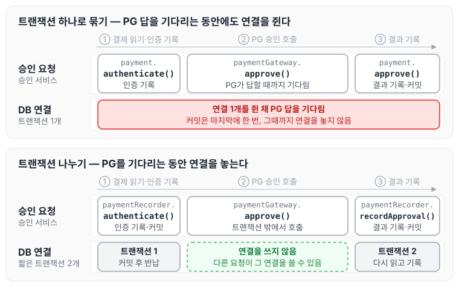
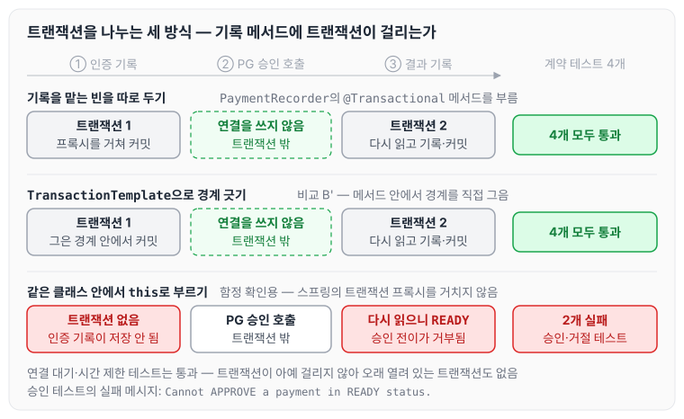
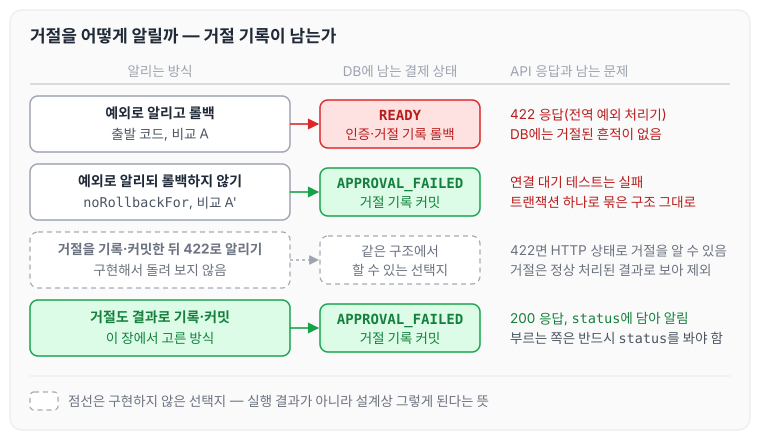
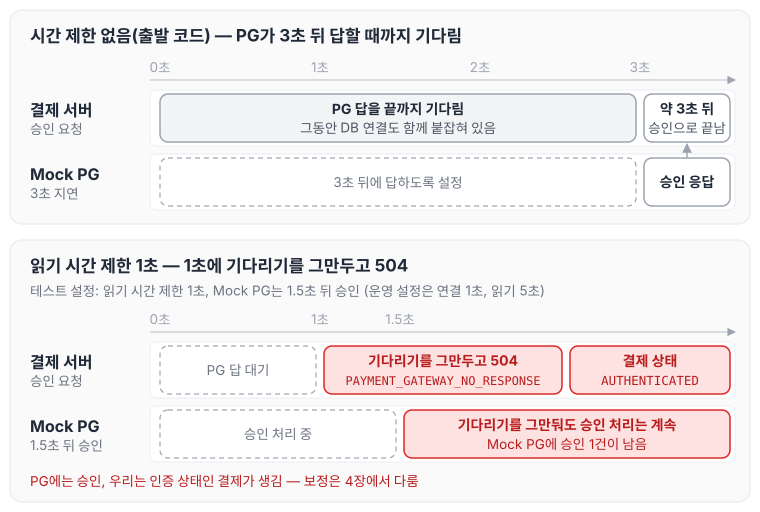
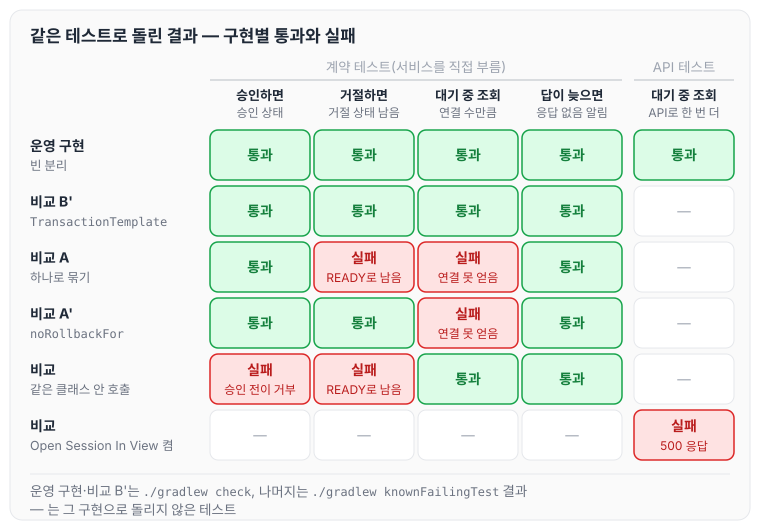

이전에 [결제 기초: 인증, 승인, 매입, 취소와 상태 머신](../payment-state-machine/)에 대해 작성하였습니다. 그 글에서는 결제의 인증·승인·매입·취소 단계를 상태 머신으로 옮겼는데, 그 상태 머신은 객체 하나 안에서 잘못된 전이를 막을 뿐 실제 PG를 호출하지는 않았습니다.

오늘은 연재의 두 번째 글로, 그 위에 가장 단순한 결제 API를 올리고 PG 승인 요청을 DB 트랜잭션 안에서 보낼지 밖에서 보낼지에 따라 무엇이 달라지는지 정리하도록 하겠습니다.

이 장의 코드는 [payment-challenge](https://github.com/qkrxodud/payment-challenge/tree/chapter-02)의 `chapter-02` 브랜치에 있고, 출발 코드는 `ch02-start`, 완성 코드는 `ch02` 태그입니다.

## 현재 구조: 트랜잭션 하나로 묶은 승인 API

API는 세 개입니다.

- `POST /api/v1/payments`: 주문번호와 금액으로 결제를 준비합니다(`READY`).
- `POST /api/v1/payments/{orderId}/confirm`: 결제창에서 인증을 마친 고객이 돌아오면, PG가 준 `paymentKey`로 승인을 요청합니다.
- `GET /api/v1/payments/{orderId}`: 결제를 조회합니다.

승인 요청에서 금액은 받지 않습니다. 요청 금액이 준비한 금액과 같은지 확인하는 일은 3장 주제라서, 이 장에서는 준비할 때 저장한 금액을 그대로 PG에 보냅니다.

가장 먼저 떠오르는 승인 구현은 아래와 같습니다. 결제를 읽어 인증을 기록하고, PG에 승인을 요청하고, 결과를 기록하는 일을 `@Transactional` 하나로 묶었습니다. 거절이면 승인 거절로 바꾸고, API를 부른 쪽에 실패를 알리려고 예외를 던집니다.

```java
@Transactional
public PaymentResult confirm(ConfirmPaymentCommand command) {
    Payment payment = paymentRepository.findByOrderId(command.orderId())
            .orElseThrow(() -> new PaymentNotFoundException(command.orderId()));
    payment.authenticate();

    PaymentApproval approval = paymentGateway.approve(command.paymentKey(), payment.getOrderId(), payment.getAmount());
    if (approval.isDeclined()) {
        payment.failApproval();
        throw new PaymentDeclinedException(command.orderId(), approval.getDeclineCode());
    }
    payment.approve();
    return PaymentResult.from(payment);
}
```

PG 호출은 `PaymentGateway` 인터페이스를 도메인에 두고, 인프라 계층에서 `RestClient`로 구현했습니다. PG가 2xx로 답하면 승인, 4xx면 거절로 읽고, 그 밖의 상태 코드(5xx 등)는 `PaymentGatewayFailedException`(502)으로, 연결이나 읽기 중 입출력 실패가 나면 `PaymentGatewayNoResponseException`으로 바꿉니다. HTTP 클라이언트는 JDK `HttpClient`를 그대로 썼습니다.

PG의 응답 상태 코드에 따라 승인, 거절, 오류로 나뉘는 갈래를 그리면 아래와 같습니다.


```java
@Bean
RestClient pgRestClient(PgProperties pgProperties) {
    return RestClient.builder()
            .baseUrl(pgProperties.getBaseUrl())
            .requestFactory(new JdkClientHttpRequestFactory(HttpClient.newHttpClient()))
            .build();
}
```

### Mock PG

이 장부터는 PG 역할을 하는 Mock PG를 별도 모듈(`mock-pg`)로 직접 만들어 씁니다. Spring Boot 웹 애플리케이션이고, 승인 API `POST /v1/payments/confirm`은 제어 API로 정해 둔 시나리오의 지연 시간만큼 기다렸다가 승인(200), 거절(400, `CARD_REJECTED`), 서버 오류(500) 중 하나로 답합니다. 아래 코드는 2장 완성 코드 기준이고, Mock PG의 서버 오류 분기는 PG 서버 오류 응답을 테스트하려고 완성 코드에서 더했습니다. 출발 코드의 Mock PG에는 이 분기가 없습니다.

```java
@PostMapping("/v1/payments/confirm")
public ResponseEntity<Object> confirm(@RequestBody ConfirmRequest request) throws InterruptedException {
    Scenario scenario = scenarioStore.current();
    scenarioStore.enter(request.orderId());
    try {
        Thread.sleep(scenario.getDelay().toMillis());
    } finally {
        scenarioStore.leave(request.orderId());
    }
    if (scenario.getOutcome().isFail()) {
        return ResponseEntity.status(HttpStatus.INTERNAL_SERVER_ERROR)
                .body(new ErrorResponse("FAILED_INTERNAL_SYSTEM_PROCESSING", "The gateway failed to process this request."));
    }
    if (scenario.getOutcome().isDecline()) {
        return ResponseEntity.status(HttpStatus.BAD_REQUEST)
                .body(new ErrorResponse("CARD_REJECTED", "The card company rejected this payment."));
    }
    // 결제 서버가 이미 기다리기를 그만뒀어도 PG 쪽 승인은 남는다
    scenarioStore.recordApproval(request.orderId());
    return ResponseEntity.ok(ConfirmResponse.done(request));
}
```

시나리오는 제어 API(`PUT /control/scenario`)로 바꿉니다. Mock PG는 지금 응답을 기다리게 하고 있는 주문과 주문별 승인 횟수도 기록하므로, 테스트에서 "두 요청이 모두 PG 답을 기다리는 중"인 순간을 정확히 잡을 수 있습니다. 결제 서버 테스트에서는 Mock PG를 같은 JVM 안에서 임의 포트로 띄우지만, 결제 서버와는 실제 HTTP로 주고받습니다. 따로 띄우면 8090 포트를 씁니다.

Mock PG의 승인 API가 시나리오대로 기다렸다가 답하는 순서를 그리면 아래와 같습니다.


## 현재 구조의 문제: 테스트로 재현하기

출발 코드에 아래 테스트를 먼저 작성했습니다. 승인 규칙 테스트 4개는 구현 방식과 상관없이 지켜야 하는 계약이라 추상 클래스(`PaymentConfirmContract`)에 두고, 구현마다 상속해 같은 테스트를 돌립니다. 이 계약 테스트는 DB 연결을 2개, 연결을 기다리는 시간을 250ms(Spring Boot 기본 커넥션 풀인 HikariCP가 허용하는 최솟값), PG 읽기 시간 제한 설정을 1초로 줄여서 돌립니다. 다만 출발 코드의 PG 설정 클래스(`PgProperties`)에는 PG 주소(`baseUrl`)만 있어서, 읽기 시간 제한 설정은 출발 코드에서 읽히지 않고 무시됩니다.

테스트 이름의 '카드사'는 이 연재에서 PG(Mock PG)를 가리킵니다.

- 카드사가 승인하면 결제는 승인 상태가 된다
- 카드사가 승인을 거절하면 결제는 승인 거절 상태로 남는다
- 카드사 답을 기다리는 승인이 연결 수만큼 있어도 다른 결제를 조회할 수 있다
- 카드사 답이 정해진 시간 안에 오지 않으면 기다리지 않고 응답 없음을 알린다

여기에 실제 HTTP로 API를 부르는 테스트 8개(준비, 승인, 거절, 응답 없음, 없는 결제 승인·조회, 이미 승인된 결제 재승인, 읽을 수 없는 요청 내용)와, 같은 "연결 수만큼 승인이 기다리는 중 조회" 테스트를 API로 한 번 더 두었습니다. API로 한 번 더 확인하는 이유는 결정 4에서 설명합니다.

연결 수만큼 승인이 기다리는 중 조회하는 테스트는 아래와 같습니다. Mock PG가 800ms 뒤에 답하게 하고, 승인 두 건을 동시에 보낸 뒤, 두 건 모두 PG 답을 기다리는 것을 확인한 다음 다른 결제를 조회합니다.

```java
@Test
@DisplayName("카드사 답을 기다리는 승인이 연결 수만큼 있어도 다른 결제를 조회할 수 있다")
void lookupWhileApprovalsWait() {
    String other = prepare();
    String[] waiting = {prepare(), prepare()};
    mockPg.respondAfter(Duration.ofMillis(800));

    CompletableFuture<?>[] approvals = new CompletableFuture<?>[CONNECTIONS];
    for (int i = 0; i < CONNECTIONS; i++) {
        String orderId = waiting[i];
        approvals[i] = CompletableFuture.runAsync(() -> confirm(new ConfirmPaymentCommand(orderId, "key-" + orderId)));
    }
    await().atMost(Duration.ofSeconds(5))
            .until(() -> mockPg.isWaiting(waiting[0]) && mockPg.isWaiting(waiting[1]));

    Throwable lookupFailure = catchThrowable(() -> paymentQueryService.find(other));
    // 다음 테스트가 남은 승인 요청의 영향을 받지 않도록 결과를 보기 전에 모두 끝낸다
    CompletableFuture.allOf(approvals).handle((done, failure) -> done).join();

    assertThat(lookupFailure).isNull();
}
```

처음에는 조회 결과를 바로 단언했는데, 단언이 실패하면 승인 두 건이 연결을 쥔 채 남아 다음 테스트(시간 제한 테스트)가 결제를 준비하다가 연결을 얻지 못해 실패하였습니다. 원인이 다른 실패가 섞이지 않도록 승인을 모두 끝낸 뒤에 결과를 보도록 고쳤습니다.

2장 출발 코드에서 돌린 결과는 아래와 같습니다.

```text
tests=13 failures=6 errors=0 time=36.482s
## 결제 승인 — 운영 구현
FAIL 카드사 답을 기다리는 승인이 연결 수만큼 있어도 다른 결제를 조회할 수 있다 (1.913s) | org.opentest4j.AssertionFailedError: expected: null but was: org.springframework.transaction.CannotCreateTransactionException: Could not open JPA EntityManager for transaction
FAIL 카드사 답이 정해진 시간 안에 오지 않으면 기다리지 않고 응답 없음을 알린다 (3.031s) | java.lang.AssertionError: Expecting actual not to be null
PASS 카드사가 승인하면 결제는 승인 상태가 된다 (0.027s)
FAIL 카드사가 승인을 거절하면 결제는 승인 거절 상태로 남는다 (0.026s) | org.opentest4j.AssertionFailedError: expected: APPROVAL_FAILED but was: READY
## 결제 API
FAIL 카드사가 정해진 시간 안에 답하지 않으면 결과를 알 수 없다고 답한다 (2.046s) | org.opentest4j.AssertionFailedError: expected: 504 but was: 200
FAIL 카드사가 승인을 거절하면 승인 거절 상태로 답한다 (0.023s) | org.opentest4j.AssertionFailedError: expected: 200 but was: 422
(통과한 API 테스트 6개 생략)
## 승인 대기 중 조회 — 운영 설정
FAIL 카드사 답을 기다리는 승인 요청이 연결 수만큼 있어도 다른 결제를 조회할 수 있다 (0.853s) | org.opentest4j.AssertionFailedError: expected: 200 but was: 500
```

13개 중 6개가 실패했고, 원인은 세 가지입니다.

실패한 6개를 테스트 묶음과 원인별로 모으면 아래와 같습니다.


첫째, 거절 기록이 사라집니다. 거절이면 `failApproval()`로 승인 거절 상태로 바꾼 뒤 예외를 던지는데, 그 예외 때문에 트랜잭션이 롤백되면서 승인 거절 기록과 그 앞의 인증 기록까지 함께 사라집니다. 그래서 결제는 `APPROVAL_FAILED`가 아니라 처음 상태인 `READY`로 남았습니다. API는 전역 예외 처리기를 거쳐 422로 거절을 알렸지만, DB에는 거절된 흔적이 없습니다.

둘째, PG 답을 기다리는 동안 DB 연결이 바닥납니다. 트랜잭션이 PG 호출을 감싸고 있으므로, 승인 한 건은 PG가 답할 때까지 DB 연결 하나를 쥐고 있습니다. 연결이 2개뿐인데 승인 두 건이 모두 PG를 기다리고 있으니, PG와 상관없는 조회조차 연결을 얻지 못하고 250ms 뒤에 실패하였습니다. API로 돌린 테스트에서는 이 실패가 500 응답이 되었습니다.

연결 수만큼 승인이 기다리는 중 조회하는 테스트에서 일어난 일을 시간 순서로 그리면 아래와 같습니다.



그림처럼 연결 2개가 모두 PG를 기다리는 동안에는 조회가 들어갈 틈이 없습니다.

셋째, 느린 PG를 끝까지 기다립니다. 출발 코드는 JDK `HttpClient`에 읽기 시간 제한을 주지 않았고 위의 1초 설정도 읽지 않으므로, PG가 3초 뒤에 답하게 하자 테스트는 약 3초 뒤 승인으로 끝났습니다. 그동안 위에서 본 것처럼 DB 연결도 함께 붙잡혀 있습니다.

## 선택지와 트레이드오프

이 문제를 해결하면서 내린 결정은 여섯 가지입니다.

### 결정 1. PG 승인 호출을 트랜잭션 안에서 할까 밖에서 할까

이 장에서는 트랜잭션을 나눠 PG 승인 호출을 트랜잭션 밖에서 하기로 했습니다.

검토한 선택지는 세 가지입니다.

- 트랜잭션 하나로 묶기(출발 코드, 아래 테스트 결과의 비교 A): 인증 기록, PG 호출, 결과 기록을 한 트랜잭션에서 합니다.
- 트랜잭션을 나누기: 결제를 읽어 인증을 기록하고 커밋한 뒤, 트랜잭션 없이 PG를 호출하고, 새 트랜잭션에서 결과를 기록합니다.
- 커밋 뒤 비동기로 호출하기: 인증 기록을 커밋한 뒤 이벤트로 PG 호출을 넘기고, API는 결과를 기다리지 않고 답합니다.

트랜잭션 하나로 묶을 때와 나눌 때 승인 한 건이 DB 연결을 쥐는 구간을 비교하면 아래와 같습니다.



위 두 번째 문제의 원인이 "PG를 기다리는 동안 DB 연결을 쥐고 있다"는 것이었으므로, 그림의 아래 패널처럼 PG 호출을 트랜잭션 밖으로 빼면 기다리는 동안에는 연결을 쓰지 않습니다. 실제로 나눈 구현은 같은 계약 테스트를 모두 통과했고, 같은 머신에서 부하 테스트 도구 k6로 잰 조회 p95도 1.4초에서 10ms 수준으로 줄었습니다(아래 테스트 결과 참고).

이 선택으로 치르는 비용은 세 가지입니다.

- 커밋이 한 번에서 두 번으로 늘어납니다.
- PG 답을 기다리는 동안 결제가 `AUTHENTICATED`로 밖에 보입니다. 하나로 묶으면 이 중간 상태는 커밋되지 않습니다.
- PG는 승인했는데 우리 쪽 결과 기록이 실패하는 틈이 남습니다. 이 틈은 트랜잭션을 하나로 묶어도 사라지지 않았습니다. 승인 상태로 바꾸는 저장을 MySQL 트리거로 막아 기록 실패를 만들어 보니, 두 방식 모두 Mock PG에는 승인이 1건 남았고, 우리 쪽 결제는 나눈 구조에서 `AUTHENTICATED`, 하나로 묶은 구조에서 `READY`로 남았습니다. 하나로 묶어도 PG 호출은 롤백되지 않기 때문입니다.

결과 기록을 트리거로 막았을 때 두 구조에 남은 것을 그리면 아래와 같습니다.


비동기 호출은 구현하지 않았습니다. 승인 API를 부르는 쪽(결제창에서 돌아온 고객)이 승인 결과를 그 응답으로 받는 구조인데, 비동기로 바꾸면 결과를 알려 줄 다른 경로(조회 반복이나 알림)가 필요해져 API의 약속 자체가 바뀝니다. 같은 테스트로 비교할 수 있는 대상이 아니라서 이 장에서는 제외했습니다.

조건이 바뀌면 다른 선택이 맞습니다. 초당 들어오는 승인 수에 PG 응답 시간을 곱한 값(동시에 PG를 기다리는 승인 수)이 연결 수보다 충분히 작아 연결 대기가 생기지 않는 규모라면, 트랜잭션 하나로 묶는 방식도 코드가 짧고 중간 상태가 밖에 보이지 않는다는 장점이 있습니다. 승인 결과를 응답으로 바로 줄 필요가 없는 흐름(예: 정기 결제처럼 고객이 기다리지 않는 결제)이라면 비동기 호출을 검토할 수 있습니다.

결정 1의 세 선택지를 치르는 것과 맞는 경우로 나란히 놓으면 아래와 같습니다.


### 결정 2. 트랜잭션을 어떻게 나눌까

이 장에서는 기록을 맡는 빈(`PaymentRecorder`)을 따로 두는 방식을 골랐습니다.

트랜잭션을 나누는 방법으로 아래 세 가지를 구현해 같은 계약 테스트로 돌렸습니다.

- 기록을 맡는 빈을 따로 두고 그 빈의 `@Transactional` 메서드를 부르기
- `TransactionTemplate`으로 메서드 안에서 경계를 직접 긋기(아래 테스트 결과의 비교 B')
- 같은 클래스 안에 `@Transactional` 기록 메서드를 두고 `this`로 부르기

세 번째는 고를 후보라기보다, 첫 번째 방식을 쓰다가 기록 메서드를 같은 클래스로 옮기면 생기는 함정을 확인하려고 넣었습니다. 결과는 아래와 같았습니다.

- 빈 분리, `TransactionTemplate`: 계약 테스트 4개 모두 통과
- 같은 클래스 안에서 부르기: "카드사가 승인하면 결제는 승인 상태가 된다"가 `Cannot APPROVE a payment in READY status.`로 실패, "카드사가 승인을 거절하면 결제는 승인 거절 상태로 남는다"가 `expected: APPROVAL_FAILED but was: READY`로 실패

세 방식에서 기록 메서드에 트랜잭션이 걸리는지와 계약 테스트 결과를 나란히 그리면 아래와 같습니다.



위의 두 방식은 경계를 긋는 위치만 다르고, 맨 아래 방식만 기록 메서드에 트랜잭션이 걸리지 않습니다.

같은 클래스 안에서 `this`로 부르면 스프링의 트랜잭션 프록시를 거치지 않아 두 기록 메서드에 트랜잭션이 걸리지 않습니다. 그래서 인증 기록(`authenticate()`로 바꾼 상태)이 저장되지 않았고, 결과를 기록할 때 다시 읽은 결제는 여전히 `READY`라서 승인 전이가 거부되었습니다. 연결 대기 테스트와 시간 제한 테스트는 통과했는데, 트랜잭션이 아예 걸리지 않아 오래 열려 있는 트랜잭션도 없었기 때문입니다. 같은 클래스 안의 호출이 프록시를 거치지 않는 문제는 이전에 [@Transactional 롤백 안 되는 원인 [프록시]](../transaction-rollback-proxy/)에서도 다루었습니다.

빈을 따로 둔 이유는, 이 저장소의 다른 서비스(`PaymentPrepareService`, `PaymentQueryService`)가 모두 `@Transactional` 메서드로 경계를 표시하고 있어서, 트랜잭션 경계가 곧 메서드 경계로 보이는 방식을 그대로 이어 갈 수 있기 때문입니다.

대신 클래스가 하나 늘고, 누군가 두 기록 메서드를 승인 서비스 안으로 합치면 위의 함정이 그대로 재현됩니다. 테스트가 이 경우를 잡아내기는 하지만, `PaymentRecorder`에도 따로 둔 이유를 주석으로 남겼습니다.

`TransactionTemplate`이 맞는 경우도 있습니다. 경계를 한 메서드 흐름 안에서 여러 번 그어야 하거나, 호출마다 전파 방식이나 시간 제한 같은 트랜잭션 설정을 다르게 줘야 한다면, 코드 안에서 경계가 바로 보이는 `TransactionTemplate`이 더 읽기 쉽습니다.

빈 분리를 고른 이유와 `TransactionTemplate`이 맞는 경우를 나란히 놓으면 아래와 같습니다.


### 결정 3. 거절을 어떻게 알릴까

이 장에서는 거절도 결과로 기록하고 커밋한 뒤, 200 응답의 `status`에 담아 알리는 방식을 골랐습니다.

거절을 알리는 방법으로는 아래 네 가지를 비교하였습니다.

- 예외로 알리고 롤백하기(출발 코드, 비교 A)
- 예외로 알리되 그 예외에는 롤백하지 않기(`@Transactional(noRollbackFor = ...)`, 비교 A')
- 트랜잭션을 나눈 구조에서 거절을 기록하고 커밋한 뒤, 422로 알리기
- 거절도 결과로 기록하고 커밋한 뒤, 결제 상태를 응답에 담기

네 방식에서 DB에 거절 기록이 남는지와 API가 무엇으로 답하는지를 나란히 그리면 아래와 같습니다. 세 번째 방식은 구현해서 돌려 보지 않았기 때문에 점선으로 그렸습니다.



그림에서 거절 기록이 사라지는 것은 예외로 알리고 롤백하는 첫 번째 방식뿐입니다.

출발 코드에서 거절 기록이 사라진 것은 예외가 트랜잭션 프록시까지 올라가 롤백되었기 때문입니다. 예외가 프록시까지 올라가야 롤백되는 내부 동작은 [@Transactional try ~ catch 롤백 안 되는 원인](../transactional-try-catch-rollback/)에 정리하였습니다.

`noRollbackFor`는 트랜잭션 하나로 묶은 구조에 붙여 비교 구현으로 돌렸습니다. 거절 테스트는 통과했지만(승인 거절 기록이 커밋됨), 연결 대기 테스트는 출발 코드와 똑같이 실패하였습니다. 거절 처리 방식만 바꿔서는 결정 1의 문제가 그대로 남습니다.

트랜잭션을 나눈 구조에서는 결과 기록이 그 자체로 짧은 트랜잭션이라, 거절을 `APPROVAL_FAILED`로 기록하고 커밋하면 됩니다. API는 200으로 답하고, 응답의 `status`에 `APPROVAL_FAILED`를 담습니다(API 테스트 "카드사가 승인을 거절하면 승인 거절 상태로 답한다").

거절을 기록한 뒤 422로 알리는 방식도 같은 구조에서 할 수 있지만, 이 방식은 구현해서 돌려 보지는 않았습니다. 카드사의 거절은 요청이 잘못된 것이 아니라 결제가 정상적으로 처리된 결과라고 보았기 때문에, 4xx 오류 대신 200으로 답하고 결과는 `status`에 담았습니다.

다만 이렇게 하면 API를 부르는 쪽이 HTTP 상태만 보고 성공으로 판단하면 안 되고, 반드시 `status`를 봐야 합니다. 출발 코드처럼 422로 답하면 HTTP 상태만으로 거절을 알 수 있었습니다.

반대로 거절된 결제를 따로 남길 필요가 없고 실패하면 모든 변경을 되돌리는 것이 맞는 작업이라면 예외와 롤백이 가장 단순할 것 같습니다. 트랜잭션을 하나로 유지해야 하는 이유가 있는데 거절 기록은 남겨야 한다면 `noRollbackFor`가 맞습니다. 다만 `noRollbackFor`는 지정한 예외 타입에만 적용되므로, 거절을 알리는 예외가 다른 타입으로 바뀌면 다시 롤백된다는 점을 함께 관리해야 합니다.

거절을 알리는 방식마다 맞는 경우와 주의할 점을 모으면 아래와 같습니다.


### 결정 4. Open Session In View를 켤까 끌까

이 장에서는 Open Session In View를 끄는 쪽(`spring.jpa.open-in-view=false`)을 골랐습니다.

트랜잭션을 나눈 뒤에도 API로 돌린 "승인 대기 중 조회" 테스트가 통과할지는 따로 확인해야 했습니다. Open Session In View(OSIV)는 웹 요청이 끝날 때까지 영속성 컨텍스트와 그 DB 연결을 요청에 묶어 두는 설정입니다. Spring Boot는 `spring.jpa.open-in-view`가 기본으로 켜져 있고(설정 설명: "Binds a JPA EntityManager to the thread for the entire processing of the request."), 2장 출발 코드를 띄울 때도 아래 경고가 찍혔습니다.

```text
WARN ... JpaBaseConfiguration$JpaWebConfiguration : spring.jpa.open-in-view is enabled by default. Therefore, database queries may be performed during view rendering. Explicitly configure spring.jpa.open-in-view to disable this warning
```

선택지는 켜 두기(기본값)와 끄기입니다. 트랜잭션을 나눈 구현에 Open Session In View만 다시 켜서 API 테스트를 돌려 보니, 조회가 500으로 실패하였습니다. 서버 로그에는 아래처럼 연결 2개가 모두 쓰이는 중이라 연결을 얻지 못했다고 남았습니다.

```text
Caused by: java.sql.SQLTransientConnectionException: HikariPool-4 - Connection is not available, request timed out after 260ms (total=2, active=2, idle=0, waiting=0)
```

설정한 대기 시간은 250ms이고, 로그의 값은 실제로 기다린 시간이라 실행마다 조금씩 다릅니다.

트랜잭션을 나눈 구현에서 Open Session In View를 켰을 때와 껐을 때 DB 연결을 언제 반납하는지 비교하면 아래와 같습니다.



웹 요청 하나가 끝날 때까지 영속성 컨텍스트와 그 DB 연결이 요청에 묶여 있으므로, 서비스 계층에서 트랜잭션을 나눠도 PG를 기다리는 동안 연결을 놓지 않은 것입니다. 서비스를 직접 부르는 계약 테스트는 웹 요청을 거치지 않아 이 설정의 영향을 받지 않으므로, 이 문제는 API로 돌린 테스트에서만 드러납니다. 위에서 같은 테스트를 API로 한 번 더 둔 이유가 이것입니다.

그 대신 끄면 트랜잭션 밖(컨트롤러나 응답 변환)에서는 지연 로딩을 할 수 없습니다. 지금 결제 엔티티에는 연관관계가 없어서 영향이 없지만, 연관관계가 생기면 필요한 데이터를 서비스의 트랜잭션 안에서 모두 읽어 와야 합니다. 트랜잭션 밖에서 지연 로딩을 하다 예외가 났던 경우는 [LazyInitializationException이 나는 이유](../jpa-lazy-init-exception/)에 정리하였습니다.

반대로 서버에서 화면을 렌더링하면서 지연 로딩에 기대고, 요청 처리 중에 외부 호출처럼 오래 기다리는 일이 없는 애플리케이션이라면 켜 두는 편이 편할 수 있습니다.

### 결정 5. PG 호출에 시간 제한을 둘까

이 장에서는 PG 호출에 연결 1초, 읽기 5초 시간 제한을 두었습니다.

선택지는 기본값 그대로 두기와 연결·읽기 시간 제한을 지정하기입니다. 기본값 그대로 둔 출발 코드는 위에서 본 것처럼 3초 지연을 끝까지 기다렸습니다.

연결 1초, 읽기 5초라는 값은 Mock PG를 기준으로 정한 값이고 근거가 있는 운영 값이 아닙니다. 실제 값은 PG가 안내하는 승인 처리 시간과, 이 서버가 고객에게 약속한 응답 시간을 보고 정해야 합니다. 시간 안에 답이 오지 않으면 결제를 `AUTHENTICATED`로 둔 채 504와 `PAYMENT_GATEWAY_NO_RESPONSE`로 답합니다.

다만 시간 제한으로 끝난 요청은 실패로 볼 수 없고, 결과를 모르는 상태로 남습니다. Mock PG는 실제 PG처럼, 결제 서버가 기다리기를 그만둬도 승인 처리는 끝까지 하도록 만들어 두었습니다. 이 Mock PG가 1.5초 뒤 승인하게 하고 읽기 시간 제한을 1초로 둔 테스트에서, 결제 서버는 응답 없음을 알리고 결제를 `AUTHENTICATED`로 남겼지만, Mock PG에는 그 뒤에 승인이 1건 남았습니다. 기다리기를 그만둬도 PG 쪽 처리는 계속되기 때문입니다. 그래서 시간 제한을 두면 "PG에는 승인, 우리는 인증 상태"인 결제가 생길 수 있고, 이 결제를 어떻게 보정할지는 4장에서 다룹니다.

시간 제한이 없을 때와 있을 때, PG가 늦게 답하면 요청이 어떻게 끝나는지 그리면 아래와 같습니다.



아래 패널처럼 결제 서버는 1초에 기다리기를 그만두지만, PG 쪽 승인은 그 뒤에 끝나 남습니다.

시간 제한을 두지 않는 쪽이 맞는 경우는 이 장의 범위에서는 찾지 못했지만, 값의 크기는 조건에 따라 달라집니다. PG가 승인 처리에 오래 걸리는 결제수단을 다루면 읽기 시간 제한을 늘려야 하고, 그만큼 "결과를 모름"인 결제는 줄지만 기다리는 동안 요청 스레드를 쥐는 시간이 늘어납니다.

### 결정 6. Mock PG를 어떤 형태로 만들까

이 장에서는 Mock PG를 실제 HTTP로 답하는 별도 모듈로 직접 만들었습니다.

Mock PG는 아래 세 가지 형태를 놓고 비교하였습니다.

- 같은 JVM 안의 가짜 구현: `PaymentGateway` 인터페이스를 테스트용 클래스로 대신합니다.
- WireMock 같은 HTTP 테스트 대역(test double) 도구
- 직접 만든 별도 모듈: 실제 HTTP로 답하는 Spring Boot 애플리케이션

별도 모듈을 고른 이유는 이렇습니다. 이 장의 읽기 시간 제한은 `JdkClientHttpRequestFactory`가 실제 HTTP 요청에서 거는 것이라, 인터페이스를 가짜로 대신하면 시간 제한 설정을 지나가지 않습니다. 또 6장에서는 PG가 우리 서버로 웹훅을 보내야 하는데, 그때도 같은 Mock PG에 기능을 더하면 됩니다. WireMock은 비교 구현하지 않았습니다. 그래서 이 장에서는 WireMock과 직접 만든 모듈의 차이를 확인하지 못했습니다.

대신 빌드가 멀티 모듈이 되고, 테스트마다 Mock PG를 띄우는 시간이 듭니다. 또 테스트에서는 Mock PG가 결제 서버와 같은 클래스 경로를 쓰므로, Mock PG 쪽에서는 DB 자동 구성을 끄고 띄웁니다.

PG 호출 결과에 따른 분기만 확인하면 되고 HTTP 계층(시간 제한, 상태 코드 해석)을 확인할 필요가 없다면 같은 JVM 안의 가짜 구현이 가장 빠를 것 같습니다. PG가 보내는 요청과 응답 형식을 실제 PG 문서와 맞춰 많이 흉내 내야 한다면, 요청 일치 규칙과 응답 틀을 제공하는 HTTP 대역 도구가 직접 만드는 것보다 품이 덜 들 수 있습니다.

Mock PG의 세 형태를 읽기 시간 제한, 맞는 경우, 치르는 것으로 나란히 놓으면 아래와 같습니다.


## 구현

2장 완성 코드에서 결제 한 건을 준비하고 승인하기까지 요청과 응답이 오가는 순서를 그리면 아래와 같습니다.


출발 코드와 달라진 곳은 트랜잭션 1과 트랜잭션 2 사이입니다. PG에 승인을 요청하고 답을 기다리는 동안에는 트랜잭션이 없어 DB 연결을 쓰지 않습니다. 결제가 없거나 상태가 맞지 않으면 트랜잭션 1에서 404·409로 끝나 PG를 부르지 않고, 거절과 응답 없음은 그림 아래 갈래처럼 답합니다.

결정을 모아 바꾼 승인 서비스는 아래와 같습니다. 서비스 자체에는 `@Transactional`이 없고, 인증 기록과 결과 기록은 `PaymentRecorder`의 짧은 트랜잭션에 맡깁니다. PG 호출은 그 사이, 트랜잭션 밖에서 합니다.

```java
@Service
@RequiredArgsConstructor
public class PaymentConfirmService {

    private final PaymentRecorder paymentRecorder;
    private final PaymentGateway paymentGateway;

    public PaymentResult confirm(ConfirmPaymentCommand command) {
        Payment payment = paymentRecorder.authenticate(command.orderId());
        PaymentApproval approval = paymentGateway.approve(command.paymentKey(), payment.getOrderId(), payment.getAmount());
        return paymentRecorder.recordApproval(command.orderId(), approval);
    }
}
```

```java
@Component
@RequiredArgsConstructor
public class PaymentRecorder {

    private final PaymentRepository paymentRepository;

    @Transactional
    public Payment authenticate(String orderId) {
        Payment payment = find(orderId);
        payment.authenticate();
        return payment;
    }

    @Transactional
    public PaymentResult recordApproval(String orderId, PaymentApproval approval) {
        Payment payment = find(orderId);
        if (approval.isDeclined()) {
            payment.failApproval();
            return PaymentResult.from(payment);
        }
        payment.approve();
        return PaymentResult.from(payment);
    }

    private Payment find(String orderId) {
        return paymentRepository.findByOrderId(orderId)
                .orElseThrow(() -> new PaymentNotFoundException(orderId));
    }
}
```

결과를 기록할 때는 결제를 다시 읽습니다. 인증 기록 트랜잭션이 끝나면 처음 읽은 결제 객체는 더 이상 영속성 컨텍스트에 속하지 않으므로, 그 객체의 상태를 바꿔도 저장되지 않기 때문입니다. 1장의 상태 머신은 그대로 써서, 결과 기록 시점에 결제가 `AUTHENTICATED`가 아니면 승인 전이가 거부됩니다.

위 순서에서 어디서 끝났는지에 따라 남는 결제 상태를 따로 그리면 아래와 같습니다.


승인과 거절은 결과 기록 트랜잭션에서 각각 `APPROVED`, `APPROVAL_FAILED`로 남습니다. 반면 PG 답을 기다리다 그만두거나 PG 승인 뒤 결과 기록이 실패하면 결제는 `AUTHENTICATED`에 머무르는데, 이 두 경우는 아래 남은 한계에서 다시 정리합니다.

PG 클라이언트에는 연결·읽기 시간 제한을 넣었습니다.

```java
@Bean
RestClient pgRestClient(PgProperties pgProperties) {
    HttpClient httpClient = HttpClient.newBuilder()
            .connectTimeout(pgProperties.getConnectTimeout())
            .build();
    JdkClientHttpRequestFactory requestFactory = new JdkClientHttpRequestFactory(httpClient);
    requestFactory.setReadTimeout(pgProperties.getReadTimeout());
    return RestClient.builder()
            .baseUrl(pgProperties.getBaseUrl())
            .requestFactory(requestFactory)
            .build();
}
```

설정은 아래와 같습니다.

```properties
# 웹 요청이 끝날 때까지 영속성 컨텍스트와 DB 연결을 붙잡지 않는다.
# 켜 두면 트랜잭션을 나눠도 PG 답을 기다리는 동안 연결을 놓지 않는다.
spring.jpa.open-in-view=false

payment.pg.base-url=http://localhost:8090
# 시간 제한은 Mock PG 기준으로 정한 값이다. 실제 값은 PG 가 안내하는 승인 처리 시간과
# 이 서버가 고객에게 약속한 응답 시간을 보고 정한다.
payment.pg.connect-timeout=1s
payment.pg.read-timeout=5s
```

오류 응답은 웹 계층이 생기면서 새로 둔 전역 예외 처리기(`GlobalExceptionHandler`) 한 곳에서 `{"code": "...", "message": "..."}` 모양으로 바꿉니다. 없는 결제는 404(`PAYMENT_NOT_FOUND`), 지금 상태에서 할 수 없는 전이는 409(`INVALID_PAYMENT_TRANSITION`), PG 응답 없음은 504, PG 서버 오류는 502, 읽을 수 없는 요청 내용은 400으로 답합니다.

계약을 지키지 못하는 비교 구현(하나로 묶기, `noRollbackFor`, 같은 클래스 안에서 부르기, Open Session In View 켬)은 기본 빌드에서 빼고, 같은 테스트를 따로 돌리는 작업(`./gradlew knownFailingTest`)으로 실행해 실패를 기록합니다. 기본 빌드(`./gradlew check`)는 항상 통과하면서도, 비교 결과는 같은 테스트로 다시 확인할 수 있습니다.

```gradle
tasks.named('test') {
    useJUnitPlatform {
        // 계약을 지키지 못하는 비교 구현은 기본 빌드에서 빼고 knownFailingTest 로 따로 돌린다
        excludeTags 'known-failing'
    }
    finalizedBy jacocoTestReport
}

tasks.register('knownFailingTest', Test) {
    description = '계약 테스트를 지키지 못하는 비교 구현을 같은 테스트로 돌려 실패를 기록한다'
    group = 'verification'
    testClassesDirs = sourceSets.test.output.classesDirs
    classpath = sourceSets.test.runtimeClasspath
    useJUnitPlatform {
        includeTags 'known-failing'
    }
    ignoreFailures = true
}
```

## 테스트 결과

아래 결과에서 비교 구현은 이름으로 구분합니다. 비교 A는 트랜잭션 하나로 묶은 출발 구조(`InTransactionConfirmService`), 비교 A'는 거기에 `noRollbackFor`를 붙인 구현, 비교 B'는 운영 구현과 같은 경계를 `TransactionTemplate`으로 직접 그은 구현입니다. "같은 클래스 안에서 기록 메서드 부르기"는 결정 2에서 본 self-invocation 함정을 재현한 구현입니다.

2장 완성 코드에서 전체 테스트(`./gradlew check`)를 돌린 결과는 아래와 같습니다.

```text
tests=241 failures=0 errors=0
카드사 승인 뒤 승인 기록이 실패하면: tests=2 failures=0 errors=0
카드사 답을 기다리다 그만두면: tests=1 failures=0 errors=0
결제 승인 — 운영 구현: tests=4 failures=0 errors=0
결제 승인 — 비교 B': TransactionTemplate 으로 나누기: tests=4 failures=0 errors=0
결제 API: tests=11 failures=0 errors=0
승인 대기 중 조회 — 운영 설정: tests=1 failures=0 errors=0
(1장 테스트 218개 모두 통과)
coverage INSTRUCTION 99.6%, BRANCH 87.5%, LINE 98.9%, COMPLEXITY 97.3%, METHOD 100.0%, CLASS 100.0%
```

- 출발 코드에서 실패하던 6개가 모두 통과하였습니다.
- 결제 API 테스트는 출발 코드의 8개에 PG 서버 오류(502), 지원하지 않는 HTTP 방식(405), 같은 주문번호로 다시 준비(지금은 500)를 더해 11개입니다. 같은 주문번호 문제는 3장 멱등성에서 다룹니다.
- 전체 241개(1장 218개 + 2장 23개)가 통과했고, JaCoCo로 잰 라인 커버리지는 98.9%였습니다(애플리케이션 시작 클래스 제외).
- 분기 커버리지는 87.5%(16개 중 14개)입니다. 지나가지 않은 2개는 전역 예외 처리기에서 오류 코드를 HTTP 상태로 바꾸는 `statusOf`의 `INVALID_INPUT`·`INTERNAL` 분기인데, 이 두 오류는 다른 처리기가 상태를 직접 넣어 답하기 때문에 `statusOf`를 거치지 않습니다. 빌드의 커버리지 문턱(90%)은 명령어(INSTRUCTION) 기준이라 통과합니다.

전체 테스트 수와 커버리지를 그리면 아래와 같습니다.


계약을 지키지 못하는 비교 구현을 같은 테스트로 돌린 결과(`./gradlew knownFailingTest`)는 아래와 같습니다.

```text
tests=13 failures=6 errors=0 time=44.059s
## 결제 승인 — 비교 A: 하나로 묶고 거절은 실패로 알림
FAIL 카드사 답을 기다리는 승인이 연결 수만큼 있어도 다른 결제를 조회할 수 있다 (1.82s) | org.opentest4j.AssertionFailedError: expected: null but was: org.springframework.transaction.CannotCreateTransactionException: Could not open JPA EntityManager for transaction
PASS 카드사 답이 정해진 시간 안에 오지 않으면 기다리지 않고 응답 없음을 알린다 (1.029s)
PASS 카드사가 승인하면 결제는 승인 상태가 된다 (0.027s)
FAIL 카드사가 승인을 거절하면 결제는 승인 거절 상태로 남는다 (0.02s) | org.opentest4j.AssertionFailedError: expected: APPROVAL_FAILED but was: READY
## 결제 승인 — 비교 A': 하나로 묶되 거절로 실패해도 기록은 남김
FAIL 카드사 답을 기다리는 승인이 연결 수만큼 있어도 다른 결제를 조회할 수 있다 (0.846s) | ... CannotCreateTransactionException ...
PASS 카드사 답이 정해진 시간 안에 오지 않으면 기다리지 않고 응답 없음을 알린다 (1.024s)
PASS 카드사가 승인하면 결제는 승인 상태가 된다 (0.02s)
PASS 카드사가 승인을 거절하면 결제는 승인 거절 상태로 남는다 (0.019s)
## 결제 승인 — 비교: 같은 클래스 안에서 기록 메서드 부르기
PASS 카드사 답을 기다리는 승인이 연결 수만큼 있어도 다른 결제를 조회할 수 있다 (0.868s)
PASS 카드사 답이 정해진 시간 안에 오지 않으면 기다리지 않고 응답 없음을 알린다 (1.025s)
FAIL 카드사가 승인하면 결제는 승인 상태가 된다 (0.016s) | com.example.payment.global.error.exception.InvalidPaymentTransitionException: Cannot APPROVE a payment in READY status.
FAIL 카드사가 승인을 거절하면 결제는 승인 거절 상태로 남는다 (0.021s) | org.opentest4j.AssertionFailedError: expected: APPROVAL_FAILED but was: READY
## 승인 대기 중 조회 — 비교: Open Session In View 켬
FAIL 카드사 답을 기다리는 승인 요청이 연결 수만큼 있어도 다른 결제를 조회할 수 있다 (0.876s) | org.opentest4j.AssertionFailedError: expected: 200 but was: 500
```

운영 구현과 비교 구현들의 결과를 테스트별로 모으면 아래와 같습니다. 운영 구현과 비교 B'는 위 `./gradlew check` 결과, 나머지는 `./gradlew knownFailingTest` 결과입니다.



연결 대기 테스트는 연결을 쥔 채 PG를 기다리는 구조(비교 A, 비교 A', Open Session In View 켬)에서만 실패하고, 기록 테스트는 거절이 롤백되거나 트랜잭션이 걸리지 않는 구조(비교 A, 같은 클래스 안에서 부르기)에서 실패합니다.

비교 A는 출발 코드와 같은 구조이고, 거절을 알리는 예외만 테스트용 예외(`ApprovalDeclinedException`)로 바꿨습니다. 비교 A에서 시간 제한 테스트가 통과한 것은 PG 클라이언트(시간 제한 설정)가 모든 구현에 공통이기 때문입니다.

연결 대기는 테스트로 "실패한다/안 한다"까지만 보여 줄 수 있으므로, 실제로 조회가 얼마나 늦어지는지는 k6로 따로 쟀습니다.

- 머신: Apple M1 Max(10코어), 메모리 32GB, macOS 26.4.1. 결제 서버, Mock PG, MySQL 8.4(Docker), k6 v1.7.1을 모두 같은 머신에서 띄웠습니다.
- 결제 서버 설정은 기본값 그대로입니다: Hikari 연결 10개, 연결 대기 30초.
- Mock PG는 모든 승인 요청에 1초 뒤 승인으로 답합니다.
- 승인: 가상 사용자(VU) 20명이 쉬지 않고 결제 준비 → 승인을 반복합니다(k6의 constant-vus 방식).
- 조회: 응답 속도와 상관없이 초당 20건씩, 미리 준비한 결제 하나를 조회합니다(constant-arrival-rate 방식).
- 10초 예열(결과는 버림) 뒤 30초를 쟀고, 회차마다 MySQL 컨테이너를 새로 만들었습니다. 2장 출발 코드와 완성 코드를 두 번씩 돌렸습니다.

2장 출발 코드(트랜잭션 하나로 묶기)의 결과입니다.

```text
1회차
    confirm_duration...............: avg=1.66s    min=1.01s  med=1.85s    p(95)=2.04s p(99)=2.06s max=2.09s
    confirm_failed.................: 0.00%  0 out of 308
    lookup_duration................: avg=643.62ms min=4.49ms med=622.26ms p(95)=1.4s  p(99)=1.8s  max=1.99s
    lookup_failed..................: 0.00%  0 out of 600
2회차
    confirm_duration...............: avg=1.66s    min=1.01s   med=1.78s    p(95)=2.04s p(99)=2.04s max=2.11s
    confirm_failed.................: 0.00%  0 out of 307
    lookup_duration................: avg=651.98ms min=13.66ms med=653.31ms p(95)=1.21s p(99)=1.79s max=2.01s
    lookup_failed..................: 0.00%  0 out of 600
```

2장 완성 코드(트랜잭션 나누기, Open Session In View 끄기)의 결과입니다.

```text
1회차
    confirm_duration...............: avg=1.03s    min=1.01s  med=1.03s   p(95)=1.04s   p(99)=1.05s   max=1.05s
    confirm_failed.................: 0.00%  0 out of 580
    lookup_duration................: avg=5.71ms   min=2.46ms med=4.88ms  p(95)=10.09ms p(99)=13.59ms max=18.29ms
    lookup_failed..................: 0.00%  0 out of 600
2회차
    confirm_duration...............: avg=1.02s    min=1s     med=1.02s    p(95)=1.04s   p(99)=1.04s   max=1.05s
    confirm_failed.................: 0.00%  0 out of 600
    lookup_duration................: avg=5.5ms    min=1.83ms med=4.58ms   p(95)=10.46ms p(99)=14.04ms max=24.23ms
    lookup_failed..................: 0.00%  0 out of 600
```

- 조회 p95가 1.4초·1.21초에서 10.09ms·10.46ms로 줄었습니다. 조회 중앙값은 622.26ms·653.31ms에서 4.88ms·4.58ms였습니다.
- 30초 동안 끝난 승인은 308건·307건에서 580건·600건으로 늘었고, 승인 응답 중앙값은 1.85초·1.78초에서 1.03초·1.02초가 되었습니다.
- 두 코드 모두 실패한 요청은 없었습니다. 출발 코드에서도 조회가 실패하지 않은 것은 연결 대기 시간이 기본값 30초라서, 조회가 실패하기 전에 연결을 얻었기 때문입니다. 연결 대기 시간을 250ms로 줄인 계약 테스트(연결 2개)에서는 같은 상황의 조회가 실패하였습니다.

출발 코드의 승인 건수가 30초에 300건 남짓인 것은, 승인 한 건이 PG의 1초 동안 연결 하나를 쥐고 있고 연결이 10개뿐이라 동시에 PG를 기다릴 수 있는 승인이 10건으로 묶인 결과와 맞습니다. 완성 코드는 승인이 PG를 기다리는 동안 연결을 쓰지 않으므로 20 VU가 거의 1초에 한 건씩 승인을 끝냈습니다.

두 코드의 조회 p95와 30초 동안 끝난 승인 수를 막대로 그리면 아래와 같습니다.


## 남은 한계

이 장의 구조로도 아래 문제들은 아직 해결하지 못합니다.

- 승인 요청 금액을 검증하지 않습니다. 3장에서 다룹니다.
- 같은 주문번호로 다시 준비하면 지금은 500으로 끝납니다. 같은 결제에 승인 요청이 두 번, 또는 동시에 들어오는 경우는 이 장에서 확인하지 않았습니다. 두 번 들어오는 경우는 3장 멱등성에서, 동시에 들어오는 경우는 7장 동시성 제어에서 다룹니다.
- PG가 승인한 뒤 우리 쪽 결과 기록이 실패하면 둘이 어긋납니다. 트리거로 재현한 테스트에서 Mock PG에는 승인이 남았고 결제는 `AUTHENTICATED`로 남았습니다. 4장에서 다룹니다.
- 시간 제한으로 기다리기를 그만두면 결과를 모르는 결제가 생깁니다. 테스트에서 결제는 `AUTHENTICATED`로 남았지만 Mock PG에는 나중에 승인이 남았습니다. PG에 조회해 보정할지, 망취소(응답을 받지 못한 승인을 PG에 취소 요청하는 것)를 보낼지는 4장에서 다룹니다.
- `AUTHENTICATED`라는 상태 하나로는 "인증만 되고 승인 요청 전"과 "승인 요청을 보냈지만 결과를 모름"을 구분하지 못합니다. 이 구분이 필요한지도 4장에서 다룹니다.
- PG가 준 `paymentKey`를 저장하지 않습니다(저장은 3장에서 같은 요청을 가리는 기준으로 먼저 했고, 4장의 PG 조회는 주문번호로 했습니다).

남은 한계를 다루는 장별로 모으면 아래와 같습니다.


## 요약

오늘은 가장 단순한 결제 구현과 트랜잭션 경계를 정리하였습니다. 요약하자면 아래와 같습니다.

- 인증 기록, PG 호출, 결과 기록을 트랜잭션 하나로 묶은 출발 코드에서는 테스트 13개 중 6개가 실패했습니다. 거절 기록이 롤백으로 사라졌고, PG를 기다리는 동안 DB 연결이 바닥나 조회가 실패했으며, 시간 제한이 없어 느린 PG를 끝까지 기다렸습니다.
- PG 호출을 트랜잭션 밖으로 빼고, 인증 기록과 결과 기록을 별도 빈의 짧은 트랜잭션으로 나눴습니다. 같은 클래스 안에서 `@Transactional` 메서드를 부르면 트랜잭션이 걸리지 않아 인증 기록이 사라졌습니다.
- 거절은 예외 대신 결과로 기록하고 커밋했습니다. `noRollbackFor`는 거절 기록은 남겼지만 연결 문제는 그대로였습니다.
- Spring Boot 기본값인 Open Session In View를 켜 두면 트랜잭션을 나눠도 요청이 끝날 때까지 연결을 쥐어, API로 돌린 조회가 500으로 실패했습니다. 그래서 껐습니다.
- PG 호출에는 연결 1초, 읽기 5초 시간 제한을 두었고, 시간 안에 답이 없으면 504로 "결과를 모름"을 알립니다.
- k6로 잰 조회 p95는 1.4초·1.21초에서 10.09ms·10.46ms로, 30초 동안 끝난 승인은 308건·307건에서 580건·600건으로 바뀌었습니다.

이 장의 결정 여섯 가지를 한눈에 그리면 아래와 같습니다.


정리하면서 트랜잭션 경계를 정하는 일은 `@Transactional`을 어디에 붙일지 정하는 것과 함께, 실패했을 때 어떤 상태가 남는지를 고르는 일이라는 것을 알 수 있었습니다. 다만 하나로 묶어도 PG 호출은 되돌릴 수 없어서, 어느 쪽을 골라도 PG와 우리 기록이 어긋나는 순간은 남았고, 이 부분은 4장에서 좀 더 살펴보려고 합니다.

## 다음 글 예고

다음 글에서는 금액 검증과 멱등성을 다룹니다. 승인 요청에 담긴 금액이 준비한 금액과 다를 때, 그리고 같은 승인 요청이 두 번 들어올 때 지금 구조에서 무슨 일이 생기는지 테스트로 재현하고, 같은 요청에 같은 결과를 돌려주는 방법을 비교해 보겠습니다.

참조 :

- [Common Application Properties(spring.jpa.open-in-view) — Spring Boot Reference](https://docs.spring.io/spring-boot/appendix/application-properties/index.html)
- [HikariCP(maximumPoolSize, connectionTimeout) — GitHub](https://github.com/brettwooldridge/HikariCP)
- [Using @Transactional(프록시 모드와 self-invocation) — Spring Framework Reference](https://docs.spring.io/spring-framework/reference/data-access/transaction/declarative/annotations.html)
- [Rolling Back a Declarative Transaction(rollbackFor/noRollbackFor) — Spring Framework Reference](https://docs.spring.io/spring-framework/reference/data-access/transaction/declarative/rolling-back.html)
- [k6 — Grafana k6 문서](https://grafana.com/docs/k6/latest/)
