이전에 [결제 취소와 부분 취소](../payment-partial-cancel/)에 대해 작성하였습니다. 그 글에서는 취소마다 `payment_cancel`에 한 줄을 남기고, 같은 취소 요청을 `Idempotency-Key`로 가리고, PG 답을 받지 못한 취소를 4장 보정을 넓혀 맞추도록 바꿨습니다. 그리고 다음 글 예고에 1장에서 미뤄 둔 웹훅 처리를 다루겠다고 적었습니다. 그 장의 보정이 PG에 조회한 `cancels`를 금액으로 짝짓고 취소 응답의 마지막 칸을 이번 취소로 읽는 가정에 기대고 있어서 알림을 받을 때 이 부분도 함께 살펴보겠다고 했습니다.

먼저 1장에서 쓴 예시 하나를 바로잡겠습니다. 1장의 남은 한계에 "PG의 웹훅이 순서가 바뀌어 들어오면(예: 매입 알림이 승인 알림보다 먼저) 지금의 전이 표는 그 알림을 거부합니다."라고 적었는데, 이번에 토스페이먼츠 웹훅 이벤트 문서를 확인해 보니 매입(capture)에 대한 이벤트는 없었습니다. 결제 상태 알림(`PAYMENT_STATUS_CHANGED`)은 결제 상태가 바뀔 때 오고, 이 장에서 실제로 순서가 바뀌는 경우로 다루는 것은 취소 알림이 승인 알림보다 먼저 오는 경우와, 승인 알림이 우리 승인 요청의 응답보다 먼저 오는 경우입니다.

오늘은 연재의 여섯 번째 글로, PG가 보내는 결제 상태 알림을 받아 결제를 PG와 맞추는 방법을 정리하도록 하겠습니다. 결정마다 다른 선택지를 같은 웹훅 계약 테스트와 같은 알림 묶음으로 비교합니다. 5장에서 남긴 가정이 어떻게 되었는지도 결정 3과 5에서 함께 적겠습니다.

이 글도 결제 서버가 한 대라고 보고 진행합니다. 알림 처리와 승인·취소 API가 같은 결제를 동시에 바꾸는 경우는 남은 한계에 적고 7장 동시성 제어로 넘깁니다.

이 장의 코드는 [payment-challenge](https://github.com/qkrxodud/payment-challenge/tree/chapter-06)의 `chapter-06` 브랜치에 있고, 출발 코드는 `ch06-start`, 완성 코드는 `ch06` 태그입니다.

## 현재 구조: 알림 본문의 상태를 그 자리에서 옮기는 웹훅 엔드포인트

6장 출발 코드에는 웹훅을 받는 `POST /api/v1/webhooks/tosspayments`를 두었습니다. 본문은 토스페이먼츠 웹훅 이벤트 문서의 모양을 따라 `eventType`, `createdAt`, `data`(상태가 바뀐 Payment 객체)이고, 우리는 그 가운데 `data.orderId`와 `data.status`만 읽습니다.

```java
@PostMapping("/api/v1/webhooks/tosspayments")
public void receive(@RequestBody PaymentWebhookRequest request) {
    paymentWebhookService.receive(request.toCommand());
}
```

받는 쪽은 결제 상태 알림이면 주문번호로 결제를 찾고(없으면 404), 본문에 적힌 상태를 허용 전이 표대로 그 자리에서 옮깁니다.

```java
@Transactional
public void receive(ReceiveWebhookCommand command) {
    if (command.isPaymentStatusChange()) {
        find(command.orderId()).report(GatewayStatus.of(command.reportedStatus()));
    }
}
```

PG 상태는 행위 하나로 바꿉니다. 승인(`DONE`)은 승인, 거절·만료(`ABORTED`, `EXPIRED`)는 승인 실패, 전액 취소(`CANCELED`)는 취소이고, 부분 취소는 옮기지 않습니다. 전이 표에 없는 행위면 1장부터 쓰던 예외가 나서 409 `INVALID_PAYMENT_TRANSITION`으로 답합니다.

```java
// 이 상태를 우리 결제에 옮길 행위. 승인은 승인, 거절·만료는 승인 실패, 전액 취소는 취소다. 부분 취소는 옮기지 않는다
public Optional<PaymentAction> reportedAction() {
    return switch (this) {
        case DONE -> Optional.of(PaymentAction.APPROVE);
        case ABORTED, EXPIRED -> Optional.of(PaymentAction.FAIL_APPROVAL);
        case CANCELED -> Optional.of(PaymentAction.CANCEL);
        default -> Optional.empty();
    };
}
```

```java
// 6장 출발 구조: 카드사가 알려 준 상태를 허용 전이 표대로 옮긴다. 표에 없는 전이는 받지 않는다
public void report(GatewayStatus reported) {
    reported.reportedAction().ifPresent(this::changeStatus);
}
```

앞 장들과 같은 방식으로, 이 장의 문제만 가장 먼저 떠오르는 구현으로 남겼습니다. 알림 본문을 믿고, 받은 요청 안에서 반영하고, 1장의 전이 표를 그대로 씁니다.

출발 코드에서 알림을 받아 답하기까지의 순서는 아래와 같습니다.


### Mock PG

Mock PG에는 결제 상태가 바뀌면 우리 서버로 웹훅을 보내는 기능을 더했습니다. 토스페이먼츠 개발자센터의 웹훅 가이드와 웹훅 이벤트 레퍼런스에서 확인한 동작만 흉내 냈습니다.

- 승인(`DONE`), 거절(`ABORTED`), 취소(`PARTIAL_CANCELED`, `CANCELED`)로 상태가 바뀌면 `PAYMENT_STATUS_CHANGED`를 POST로 보냅니다. 본문은 `eventType`, `createdAt`(`yyyy-MM-dd'T'HH:mm:ss.SSSSSS`), `data`이고, `data`는 Mock PG의 결제 조회 응답과 같은 모양입니다. `eventId`는 없습니다.
- 10초 안에 200으로 답하면 성공으로 봅니다. 아니면 7번까지 다시 보내고, 7번을 다 쓰면 더 보내지 않습니다.

웹훅 가이드에는 "웹훅을 잘 받았다면 10 초 이내로 200 응답을 보내주세요.", "200 응답을 보내지 않고 최초의 웹훅 전송이 실패하면 최대 7회(최초 전송으로부터 3일 19시간 후)까지 웹훅을 재전송합니다."라고 적혀 있고, 재전송 간격은 1, 4, 16, 64, 256, 1024, 4096분입니다. 테스트에서는 횟수만 같게 두고 간격을 100ms로 줄였습니다.

웹훅 이벤트 레퍼런스는 `PAYMENT_STATUS_CHANGED`를 "카드, 계좌이체, 휴대폰, 상품권 결제 상태를 알려주는 웹훅입니다."라고 설명하고, `data`를 "상태가 변경된 Payment 객체입니다."라고 적고 있습니다. 같은 문서에 "`PAYMENT_STATUS_CHANGED`처럼 본문에 `eventId`가 없는 웹훅도 있습니다."라는 문장도 있습니다.

문서에서 확인하지 못해 Mock PG의 가정으로 둔 것도 있습니다.

- 알림 순서: 웹훅 이벤트 문서에서 "이벤트 순서는 보장되지 않습니다."는 에스크로 이벤트 설명에만 있고, 결제 상태 알림 설명에는 순서에 대한 문장이 없습니다. Mock PG는 상태가 바뀐 순서대로 바로 보내고, 테스트에서만 알림을 쌓아 두었다가 순서를 바꿔 0.1초씩 띄워 보냅니다.
- 다시 보내는 알림의 본문은 처음 본문과 같다고(`createdAt`도 같다고) 두었습니다. "같은 상태를 다른 때에 다시"는 테스트가 새 `createdAt`으로 새 알림을 만듭니다.
- `createdAt`은 한국 시각으로 두었습니다. 문서의 형식에 시간대가 없습니다.
- 서명: 레퍼런스의 웹훅 헤더 목록에 `tosspayments-webhook-signature`가 있지만, 어느 이벤트에 붙는지는 적혀 있지 않아 결제 상태 알림에 붙는지 판단하지 못했습니다. Mock PG는 서명과 `tosspayments-webhook-transmission-*` 헤더를 붙이지 않습니다.

테스트를 위해 시험용 조작도 두었습니다. 알림 쌓아 두기와 순서 바꿔 보내기, 같은 본문 두 번 보내기, 늦게 보내기, 같은 상태 다시 보내기, 위조 알림, 승인을 기록하고 알린 뒤 승인 답만 붙잡아 두기, 그리고 가맹점 관리 화면에서 한 취소처럼 PG에서만 일어나는 취소입니다. Mock PG는 알림마다 받은 상태 코드와 걸린 시간을 기록합니다.

## 현재 구조의 문제: 테스트로 재현하기

출발 코드에 아래 테스트를 먼저 작성했습니다. 알림을 어떻게 읽고 언제 반영하는지는 구현마다 다르지만 지켜야 하는 규칙은 같아서, 앞 장들처럼 추상 클래스(`WebhookContract`)에 두고 구현마다 상속해 같은 테스트를 돌립니다. 계약은 15개이고, Mock PG가 실제 HTTP로 구현마다 다른 주소에 알림을 보냅니다.

- 순서: 승인 알림이 승인 응답보다 먼저 와도 결제는 승인 하나로 맞는다. 취소 알림이 승인 알림보다 먼저 와도 결제는 카드사와 같아진다.
- 중복: 같은 취소 알림이 두 번 와도, 같은 상태의 알림이 다른 때에 다시 와도 취소 기록은 하나만 생긴다. 같은 알림이 두 번 와도 두 번 모두 받았다고 답한다.
- 위조: 카드사 기록과 다른 취소 알림이 와도 결제를 취소하지 않는다. 카드사에 승인이 없는 결과 모름 결제에 승인 알림이 와도 승인으로 바꾸지 않는다.
- 모르는 주문: 모르는 주문의 알림에도 받았다고 답하고, 그 알림으로 결제를 만들지 않는다.
- 응답 시간: 카드사 조회가 늦어도 알림에는 10초 안에 받았다고 답한다.
- 결과 모름: 결과 모름 결제에 승인 알림이 오면 보정 대기 시간 전에 승인으로 맞춰진다. 결과 모름 취소에 알림이 오면 보정 대기 시간 전에 남은 금액이 카드사 잔액과 같아지고, 그 취소가 결과 모름에서 벗어나며, 카드사 취소를 따로 한 번 더 기록하지 않는다.
- PG에서만 일어난 취소: 카드사에서만 일어난 부분 취소 알림이 오면 남은 금액이 카드사 잔액과 같아진다.

계약은 결제 금액 15000원, 부분 취소 5000원으로 돌립니다. PG 읽기 시간 제한은 1초로 줄이고, 늦은 답은 1.5초 뒤에 오게 둡니다. 보정 대기 시간은 10초입니다. "카드사와 같다"는 결제 상태가 Mock PG 상태와 짝이 맞고(`DONE`·`PARTIAL_CANCELED`는 승인·매입, `CANCELED`는 승인 취소·매입 취소, `ABORTED`는 승인 실패), 우리 남은 금액이 Mock PG 잔액과 같은지로 봅니다. 순서가 바뀌는 테스트는 아래와 같습니다.

```java
@Test
@DisplayName("취소 알림이 승인 알림보다 먼저 와도 결제는 카드사와 같아진다")
void cancelNoticeBeforeApprovalNoticeMatchesCardCompany() {
    // given: 승인 답을 못 받은 결제를 카드사가 승인했고, 그 뒤 가맹점 관리 화면에서 전액 취소했다
    String orderId = prepare();
    sendWebhooks();
    mockPg.holdWebhooks();
    mockPg.respondAfter(LATE);
    catchThrowable(() -> paymentConfirmService.confirm(confirmRequest(orderId)));
    awaitCardCompany(orderId);
    mockPg.reset();
    mockPg.cancelAtCardCompany(orderId);

    // when: 취소 알림이 먼저, 승인 알림이 나중에 온다
    mockPg.releaseWebhooks(true);
    awaitWebhooks();
    process();

    // then
    assertMatchesCardCompany(orderId);
}
```

`process()`는 구현마다 받은 알림을 처리하는 주기 작업을 한 번 돌리는 자리이고, 받은 요청 안에서 처리하는 구현은 아무것도 하지 않습니다. 운영 구현에는 계약 밖의 테스트 하나(카드사 조회에 실패한 알림은 다음 처리 때 다시 확인한다)를 더 두었고, 웹훅 받기 API 테스트 4개도 함께 넣었습니다. 5장처럼 도메인 테스트는 출발 코드가 아니라 각 결정의 코드와 함께 넣었습니다.

6장 출발 코드에서 6장 테스트(웹훅 계약 운영 구현, 웹훅 받기 API)를 돌린 결과는 아래와 같습니다.

```text
tests=20 failures=14 errors=0 time=39.454s
## 카드사 웹훅 받기 API
FAIL 승인된 결제의 승인 알림을 받으면 받았다고 답한다 (0.996s) | org.opentest4j.AssertionFailedError: expected: 200 but was: 409
PASS 결제 상태 알림이 아닌 알림에도 받았다고 답한다 (0.038s)
FAIL 주문번호가 없는 결제 상태 알림에도 받았다고 답한다 (0.016s) | org.opentest4j.AssertionFailedError: expected: 200 but was: 404
PASS 읽을 수 없는 알림 본문에는 요청을 읽을 수 없다고 답한다 (0.007s)
## 카드사 웹훅 처리 — 운영 구현
FAIL 같은 상태의 알림이 다른 때에 다시 와도 취소 기록은 하나만 생긴다 (0.3s) | java.lang.AssertionError: Expected size: 1 but was: 0 in: []
FAIL 결과 모름 취소에 알림이 오면 보정 대기 시간 전에 그 취소가 끝난 취소로 닫힌다 (1.736s) | org.opentest4j.AssertionFailedError: expected: DONE but was: UNKNOWN
PASS 결과 모름 결제에 승인 알림이 오면 보정 대기 시간 전에 승인으로 맞춰진다 (1.697s)
FAIL 취소 알림이 승인 알림보다 먼저 와도 결제는 카드사와 같아진다 (1.79s) | org.opentest4j.AssertionFailedError: [카드사 잔액] expected: 0.00 but was: 15000
FAIL 승인 알림이 승인 응답보다 먼저 와도 결제는 승인 하나로 맞는다 (0.124s) | java.util.concurrent.CompletionException: com.example.payment.global.error.exception.InvalidPaymentTransitionException: Cannot APPROVE a payment in APPROVED status.
PASS 결과 모름 취소에 알림이 와도 카드사 취소를 따로 한 번 더 기록하지 않는다 (1.687s)
FAIL 모르는 주문의 알림에도 받았다고 답한다 (0.874s) | org.opentest4j.AssertionFailedError: Expecting actual: [404] to contain exactly (and in same order): [200] but some elements were not found: [200] and others were not expected: [404]
FAIL 카드사에서만 일어난 부분 취소 알림이 오면 남은 금액이 카드사 잔액과 같아진다 (0.145s) | org.opentest4j.AssertionFailedError: expected: 10000.00 but was: 15000
FAIL 같은 취소 알림이 두 번 와도 취소 기록은 하나만 생긴다 (0.146s) | java.lang.AssertionError: Expected size: 1 but was: 0 in: []
PASS 모르는 주문의 알림으로 결제를 만들지 않는다 (0.849s)
PASS 카드사 조회가 늦어도 알림에는 10초 안에 받았다고 답한다 (0.137s)
FAIL 카드사 기록과 다른 취소 알림이 와도 결제를 취소하지 않는다 (0.137s) | org.opentest4j.AssertionFailedError: expected: APPROVED but was: APPROVAL_CANCELED
FAIL 같은 알림이 두 번 와도 두 번 모두 받았다고 답한다 (0.883s) | org.opentest4j.AssertionFailedError: Expecting actual: [409, 409] to contain exactly (and in same order): [200, 200] but some elements were not found: [200, 200] and others were not expected: [409, 40
FAIL 카드사에 승인이 없는 결과 모름 결제에 승인 알림이 와도 승인으로 바꾸지 않는다 (1.675s) | org.opentest4j.AssertionFailedError: expected: APPROVAL_UNKNOWN but was: APPROVED
FAIL 결과 모름 취소에 알림이 오면 보정 대기 시간 전에 남은 금액이 카드사 잔액과 같아진다 (1.718s) | org.opentest4j.AssertionFailedError: expected: 10000.00 but was: 15000
FAIL 카드사 조회에 실패한 알림은 다음 처리 때 다시 확인해 카드사 잔액과 맞춘다 (0.146s) | org.opentest4j.AssertionFailedError: expected: 10000.00 but was: 15000
```

20개 중 14개(계약 11개, 운영 전용 1개, API 2개)가 실패했습니다(출발 결과의 "그 취소가 끝난 취소로 닫힌다"는 결정 3을 만들면서 "그 취소가 결과 모름에서 벗어난다"로 바꿨습니다).

출발 코드에서 실패한 네 장면을 그리면 아래와 같습니다. 그림의 네 장면은 아래 첫째\~셋째 원인에 해당합니다.

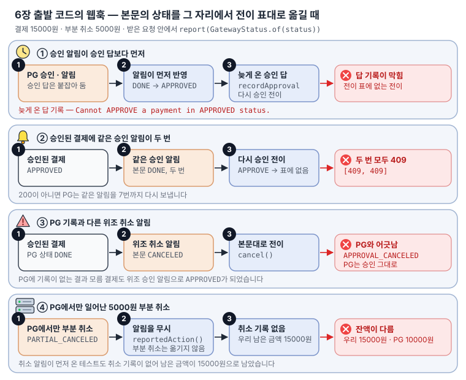

원인은 네 가지로 나눌 수 있습니다.

첫째, 전이 표가 알림을 거부합니다. 승인 답보다 먼저 온 승인 알림이 결제를 승인한 뒤, 늦게 온 승인 답을 기록하는 쪽이 `Cannot APPROVE a payment in APPROVED status.`로 막혔습니다. 승인된 결제에 같은 승인 알림이 오면 409로 답했고, 같은 알림이 두 번 오면 두 번 모두 409였습니다. 409를 받은 PG는 같은 알림을 다시 보냅니다.

둘째, 본문을 그대로 믿습니다. PG 기록과 다른 위조 취소 알림으로 승인된 결제가 `APPROVAL_CANCELED`가 되었고, PG에 기록이 없는 결과 모름 결제가 위조 승인 알림으로 `APPROVED`가 되었습니다.

셋째, 부분 취소와 취소 이력을 옮기지 않습니다. PG에서만 일어난 부분 취소 알림을 무시해서 우리 남은 금액은 15000원, PG 잔액은 10000원이었습니다. 취소 알림이 먼저 온 테스트에서 결제 상태는 PG의 재전송 덕분에 취소까지 갔지만, 취소 기록이 없어서 남은 금액이 15000원으로 남아 실패했습니다(`[카드사 잔액] expected: 0.00 but was: 15000`). 결과 모름 취소도 알림으로는 닫히지 않았습니다.

넷째, 모르는 주문과 주문번호가 없는 알림에 404로 답합니다. PG 쪽에서는 받지 못한 알림이라 다시 보냅니다.

통과한 6개 중에도 살펴볼 것이 있습니다. "결과 모름 결제에 승인 알림이 오면 보정 대기 시간 전에 승인으로 맞춰진다"는 본문의 `DONE`을 믿어 승인한 것이라, 같은 길로 위조 승인 알림도 승인으로 바꿨습니다. "카드사 조회가 늦어도 알림에는 10초 안에 받았다고 답한다"는 출발 코드가 PG에 조회하지 않아서 통과한 것입니다.

## 선택지와 트레이드오프

이 문제를 해결하면서 내린 결정은 다섯 가지입니다.

### 결정 1. 알림의 내용을 믿을까

이 장에서는 알림을 "이 결제를 다시 보라"는 신호로만 쓰고, PG 결제 조회(`GET /v1/payments/orders/{orderId}`)로 지금 상태와 취소 이력을 다시 읽어 맞추기로 했습니다.

검토한 선택지는 세 가지입니다.

- 알림 본문은 주문번호만 쓰고, PG 결제 조회로 다시 읽은 결과를 믿기
- 본문에 적힌 상태와 취소 이력을 그대로 믿기(비교 A)
- 서명 헤더를 확인한 뒤 본문을 믿기

비교 A는 운영 구현과 같은 반영 로직에 본문에 적힌 결제를 넘기고, 받은 자리에서 반영합니다.

```java
@PostMapping(PATH)
public void receive(@RequestBody ReportedWebhook webhook) {
    if (webhook.isPaymentStatusChange()) {
        paymentWebhookRecorder.follow(webhook.orderId(), webhook.reported());
    }
}
```

비교 A는 계약 15개 중 2개가 실패했습니다. 위조 취소 알림으로 승인된 결제가 승인 취소가 되었고, 위조 승인 알림으로 PG에 기록이 없는 결과 모름 결제가 승인되었습니다. 같은 알림 묶음 측정에서도 위조 알림 2건이 25초 뒤까지 PG와 어긋났습니다. 늦은 조회와 결과 모름 시나리오는 PG에 조회하지 않으니 운영 구현보다 오히려 빨리 맞았습니다.

같은 두 위조 알림에 세 방식이 어떻게 답하는지 그리면 아래와 같습니다.

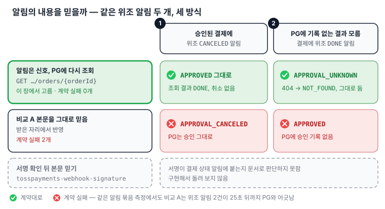

조회를 고른 이유는, 이번 범위에서 알림이 PG가 보낸 것인지 확인할 방법이 PG에 다시 묻는 것밖에 없었기 때문입니다. 서명 헤더는 레퍼런스에 "웹훅 서명입니다. 토스페이먼츠가 보낸 웹훅인지 검증할 수 있는 값입니다."라고 적혀 있지만, 앞에서 적은 대로 결제 상태 알림에 붙는지 판단하지 못했습니다. 그래서 서명 확인은 구현하지 않았고, 비교로 돌리지 않았습니다.

PG 조회 결과는 `GatewayPayment`(PG 상태와 끝난 취소들)로 읽습니다. PG가 404 `NOT_FOUND_PAYMENT`로 답하면 "따를 기록이 없음"(`NOT_FOUND`)으로 읽고, 웹훅은 그 결제를 그대로 둡니다. 같은 404를 4장 보정은 승인 실패로 닫는데, 웹훅에서는 그렇게 하지 않았습니다. 위조 승인 알림 하나로 아직 처리 중일 수 있는 결과 모름 결제를 실패로 닫지 않으려는 것입니다. 보정은 승인을 요청한 지 대기 시간이 지난 결제만 보기 때문에 404를 "승인 요청이 닿지 않음"으로 읽을 수 있지만, 알림은 언제든 올 수 있습니다. 위조 승인 알림을 받은 결과 모름 결제는 결과 모름으로 남고, 나중에 주기 보정이 닫습니다.

```java
// 결제가 없다는 404(NOT_FOUND_PAYMENT)는 카드사에 따를 기록이 없다는 답으로 읽는다
private static GatewayPayment toGatewayPayment(String orderId,
                                               RestClient.RequestHeadersSpec.ConvertibleClientHttpResponse response)
        throws IOException {
    if (response.getStatusCode().is2xxSuccessful()) {
        return gatewayPaymentOf(response.bodyTo(PgPaymentResponse.class));
    }
    if (isPaymentNotFound(response)) {
        return GatewayPayment.notFound();
    }
    throw new PaymentGatewayFailedException(orderId, response.getStatusCode().value());
}
```

모르는 주문의 알림은 다시 볼 결제가 없어서 PG에 묻지 않고 200으로 답합니다. 조회는 트랜잭션 밖에서 하고, 반영만 짧은 트랜잭션(`PaymentWebhookRecorder`)에서 합니다. 2장에서 PG 호출은 트랜잭션 밖에서 하고 기록은 `PaymentRecorder`의 짧은 트랜잭션에 맡긴 것과 같은 구조입니다.

이 선택으로 치르는 비용은 두 가지입니다.

- 알림마다(결정 4부터는 처리 주기마다 주문 하나에) PG 조회가 한 번 생기고, 조회가 실패하면 반영이 늦어집니다.
- 알림 주소에는 인증이 없어서 누구나 보낼 수 있습니다. 위조 알림은 반영되지 않지만, 우리가 아는 주문번호로 알림을 보내면 그때마다 PG 조회가 생깁니다. 이 부하는 실행해 보지 않았습니다.

다른 선택이 맞는 경우도 있습니다. 서명 확인처럼 본문이 위조되지 않았다는 보장이 있다면 본문을 믿어도 됩니다. 이번 시험에서 비교 A가 실패한 것은 위조 두 경우뿐이었으므로, 위조를 다른 방법으로 막을 수 있다면 본문을 믿어도 계약은 지켜집니다.

### 결정 2. 순서가 바뀐 알림을 어떻게 받을까

이 장에서는 PG에서 다시 읽은 상태가 지금 상태에서 갈 수 있는 방향이면 따라가고, 이미 지난 상태면 거부하지 않고 아무것도 하지 않기로 했습니다.

검토한 선택지는 세 가지입니다.

- 갈 수 있는 방향이면 따라가고, 지난 상태면 무시하기
- PG 상태를 행위 하나로 바꿔, 전이 표에 없으면 409로 거부하기(비교 B)
- 본문을 믿되 `createdAt`이 이미 받은 알림보다 이르면 버리기(비교 C)

결과 모름 결제에 취소 알림이 먼저 온 경우를 따라가기로 받으면 아래 순서로 처리됩니다. 주황 봉투는 늦게 온 승인 알림입니다.


비교 B는 운영 구현처럼 PG에 조회하지만, PG 상태를 행위 하나로 바꿔 지금 상태에서 표에 없으면 거부합니다. 표에 부분 취소 행위가 없어서 `PARTIAL_CANCELED`도 취소로 봤습니다. 받은 자리에서 조회하고 반영합니다.

```java
GatewayPayment gatewayPayment = paymentGateway.findPayment(command.orderId());
PaymentAction action = actionOf(gatewayPayment.getStatus());
if (Objects.nonNull(action) && payment.getStatus().refuses(action)) {
    throw new InvalidPaymentTransitionException(payment.getStatus().name(), action.name());
}
paymentWebhookRecorder.follow(command.orderId(), gatewayPayment);
```

비교 B는 계약 15개 중 3개가 실패했습니다. 취소 알림이 먼저 온 결과 모름 결제는 조회 결과가 `CANCELED`라 취소 행위가 되는데, 결과 모름에서는 표에 없어서 두 알림 모두 409로 답했고 결제는 결과 모름으로 남았습니다. 승인된 결제에 같은 승인 알림이 두 번 오면 두 번 모두 409였고, 늦은 조회에는 504로 답했습니다. 측정에서는 첫 전송에 200을 받지 못한 알림이 12건, 재전송이 52번, 재전송을 다 써도 200을 받지 못한 알림이 6건이었습니다.

비교 C는 본문을 믿을 때에만 뜻이 있어서 비교 A 위에 얹었습니다. 조회해서 읽으면 알림의 시각을 비교할 일이 없기 때문입니다. 비교 C는 비교 A와 같은 위조 2개가 실패했고, 측정도 A와 같은 모양(위조 2건 어긋남)이었습니다. A와 C가 쓰는 반영 로직도 이 결정의 따라가기라 지난 상태를 이미 무시하므로, 시각 비교가 더 막아 준 경우는 이번 시험과 측정에 없었습니다.

따라가기를 고른 이유는, 알림이 순서대로 온다는 보장이 문서에 없고, 지금 상태를 PG에서 다시 읽으면 알림이 어떤 순서로 오든 같은 곳에 도착하기 때문입니다. 웹훅 이벤트 문서의 에스크로 설명에는 "이벤트 순서는 보장되지 않습니다. 순서 판별을 시각으로 하지 말고, `status` 값으로 판단하세요."라고 적혀 있습니다. 결제 상태 알림에 대한 문장은 아니지만, 같은 PG가 순서를 보장하지 않는 이벤트를 두고 시각이 아니라 상태로 보라고 안내한 것입니다.

결정은 결제(`Payment.follow`)가 합니다. 승인 결과를 기다리는 결제(인증, 결과 모름)는 PG에 승인이 있었으면 승인, 거절·만료면 승인 실패로 닫고, PG도 처리 중이거나 기록이 없으면 그대로 둡니다. "승인이 있었다"에는 `DONE`뿐 아니라 `PARTIAL_CANCELED`와 `CANCELED`도 넣었습니다. 토스페이먼츠 코어 API 문서가 두 상태를 각각 "승인된 결제가 부분 취소된 상태입니다.", "승인된 결제가 취소된 상태입니다."로 설명하기 때문입니다.

```java
// 카드사가 한 번은 승인한 결제인가. 토스페이먼츠의 부분 취소·취소는 "승인된 결제가" 취소된 상태다
public boolean hasApproval() {
    return this == DONE || this == PARTIAL_CANCELED || this == CANCELED;
}
```

지난 상태를 무시하려면 앞 장의 코드도 바꿔야 했습니다. 승인 답보다 알림이 먼저 결과를 남기면, 2장의 승인 답 기록과 4장의 결과 모름 기록이 이미 승인된 결제에 다시 전이를 시도하기 때문입니다. 두 곳 모두 승인 결과를 기다리는 결제일 때만 바꾸도록 했습니다.

```java
// 6장부터: 승인 답을 기다리는 사이 웹훅이 먼저 결과를 남겼으면 건드리지 않고 지금 결과로 답한다
@Transactional
public PaymentResult recordApproval(String orderId, PaymentApproval approval) {
    Payment payment = find(orderId);
    if (payment.isAwaitingApprovalResult()) {
        settleWith(payment, approval);
    }
    return PaymentResult.from(payment);
}
```

승인 알림이 승인 답보다 먼저 온 경우를 시간 순서로 그리면 아래와 같습니다.

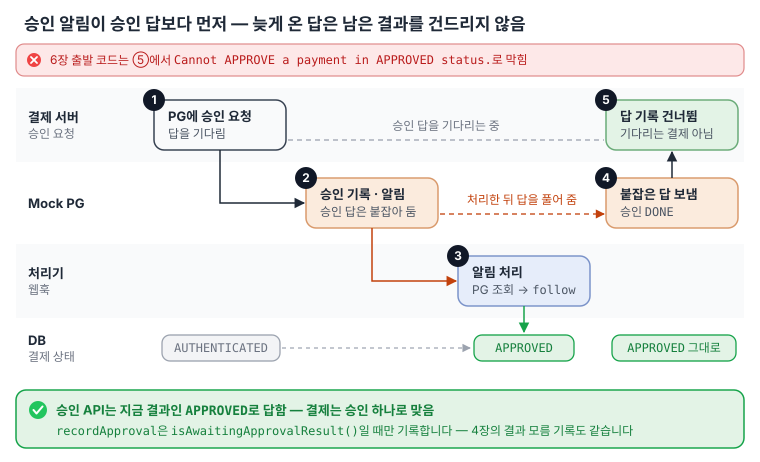

그래서 승인 API는 승인 답이 오기 전에 알림이 결과를 남겼으면 그 결과로 답합니다. 계약 "승인 알림이 승인 응답보다 먼저 와도 결제는 승인 하나로 맞는다"가 이것을 확인합니다.

이 선택으로 치르는 비용은, PG 상태와 짝이 맞지 않는 지난 상태를 알림으로 고치지 못한다는 점입니다. 예를 들어 우리가 승인 실패로 닫은 결제를 PG에서 `DONE`으로 읽으면, 승인 실패에서 승인으로 가는 전이가 없어서 그대로 둡니다. 도메인 테스트 "승인 실패로 닫힌 결제는 카드사 승인을 읽어도 허용된 전이가 없어 그대로 둔다"가 이 동작입니다. 이 어긋남은 로그로도 남기지 않습니다.

다른 선택이 맞는 경우도 있습니다. 알림이 반드시 순서대로 오고, 표에 없는 알림을 오류로 드러내는 것이 더 중요하다면 비교 B처럼 거부할 수 있습니다. 순서가 바뀌면 PG가 재전송을 다 쓸 때까지 같은 알림에 계속 409로 답하게 됩니다. 본문을 믿어야 하는 구조라면 비교 C의 시각 비교로 늦게 온 알림을 거를 수 있습니다.

### 결정 3. 같은 알림이 여러 번 오면 어떻게 할까

이 장에서는 중복 알림을 거르는 표를 따로 두지 않고, PG 취소 이력을 `transactionKey`로 맞춰 처리 자체를 멱등으로 하기로 했습니다.

검토한 선택지는 세 가지입니다.

- 거르지 않고, PG 취소 이력 가운데 우리가 모르는 `transactionKey`만 들여오기
- 받은 본문의 SHA-256을 남겨 같은 본문을 거르고, 처리는 알림 한 건을 변화 한 건으로 보기(비교 D)
- 전송 헤더나 이벤트 식별자로 거르기

전송 헤더는 쓸 수 없었습니다. 레퍼런스는 `tosspayments-webhook-transmission-id`를 "웹훅 발송 한 건의 식별자입니다. 웹훅을 보낼 때마다 새로 발급되므로 중복 처리에 쓰지 마세요. 이벤트 본문에 `eventId`가 있으면 그 값으로 중복을 처리하세요."라고 설명하는데, 결제 상태 알림에는 `eventId`가 없습니다. 중복을 가리는 표를 둔다면 키로 쓸 값이 본문밖에 없어서, 본문 해시를 비교 D로 돌렸습니다. 헤더로 거르는 방식은 구현하지 않아 비교로 돌리지 않았습니다.

비교 D는 같은 본문을 거르고 남은 알림을 운영 구현으로 넘기되, 처리할 때 PG에서 읽은 마지막 취소 하나를 이번 알림이 알린 새 취소로 봅니다. 거르기를 믿기 때문에 처리 자체는 멱등이 아닌 구성입니다.

```java
@PostMapping(PATH)
public void receive(@RequestBody String body) {
    if (received.add(sha256(body))) {
        service.receive(jsonMapper.readValue(body, PaymentWebhookRequest.class).toCommand());
    }
}
```

비교 D는 계약 15개 중 1개가 실패했습니다. 같은 상태가 다른 `createdAt`으로 다시 오면 본문이 달라서 걸러지지 않았고, 취소 기록이 2건 생겼습니다(실패 메시지에 주문번호가 들어 있어 줄은 옮기지 않았습니다). 같은 본문 두 번은 해시로 걸러졌고, 걸러지지 않았더라도 두 알림이 처리기 한 번에 같은 주문으로 묶여 조회·반영이 한 번만 일어나므로 통과했을 것입니다(해시를 빼고 돌려도 1건이었습니다). 측정에서는 3건이 어긋났습니다. 같은 상태를 다른 때에 다시 보낸 2건과 결과 모름 취소 1건입니다.

같은 세 입력에 두 방식이 남기는 취소 기록을 비교하면 아래와 같습니다.

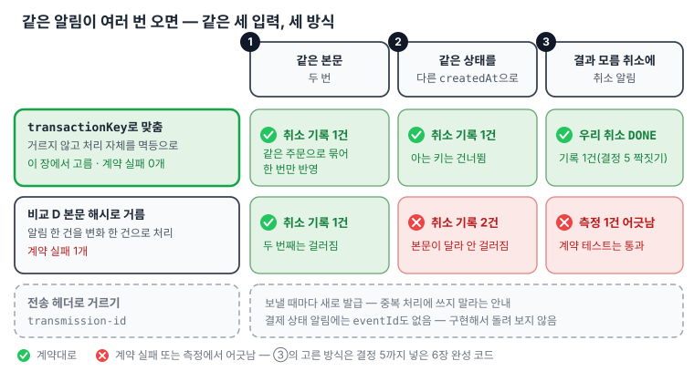

토스페이먼츠 코어 API 문서는 `transactionKey`를 "취소 건의 키값입니다. 여러 건의 취소 거래를 구분하는 데 사용됩니다."라고 설명합니다. 승인이 남은 결제는 PG 취소 이력 가운데 우리 기록에 없는 키만 끝난 취소로 들여오고, 아는 키는 건너뜁니다. 같은 상태가 다른 `createdAt`으로 다시 와서 같은 PG 취소를 다시 읽어도 새 기록이 생기지 않는 것을 계약 "같은 상태의 알림이 다른 때에 다시 와도 취소 기록은 하나만 생긴다"가 확인합니다. 남은 금액이 0원이 되면 취소 상태로 바꿉니다.

```java
private boolean isUnknownTransaction(GatewayCancel gatewayCancel) {
    return cancels.stream().noneMatch(cancel -> cancel.hasTransactionKey(gatewayCancel.getTransactionKey()));
}
```

우리 기록에 없는 PG 취소는 가맹점 관리 화면에서 한 취소처럼 PG에서만 일어난 취소입니다. 이 취소를 들여오려고 5장의 `payment_cancel`을 바꿨습니다. 이 취소에는 고객이 보낸 `Idempotency-Key`와 요청 비교값이 없어서 두 칸을 비워 둘 수 있게 하고, PG가 사유를 주지 않으면 PG 쪽 취소라고 적습니다.

```java
// 6장: 카드사에서만 일어난 취소(우리가 요청하지 않은 취소)를 끝난 취소로 들여온다. 사유가 없으면 카드사 쪽 취소라고 적는다
static PaymentCancel fromGateway(Payment payment, GatewayCancel canceled, Instant now) {
    return PaymentCancel.builder()
            .payment(payment)
            .amount(canceled.getAmount())
            .reason(Objects.requireNonNullElse(canceled.getReason(), GATEWAY_ONLY_REASON))
            .status(CancelStatus.DONE)
            .transactionKey(canceled.getTransactionKey())
            .requestedAt(now)
            .build();
}
```

PG 취소 이력을 우리 취소 목록과 맞추는 모습은 아래와 같습니다.

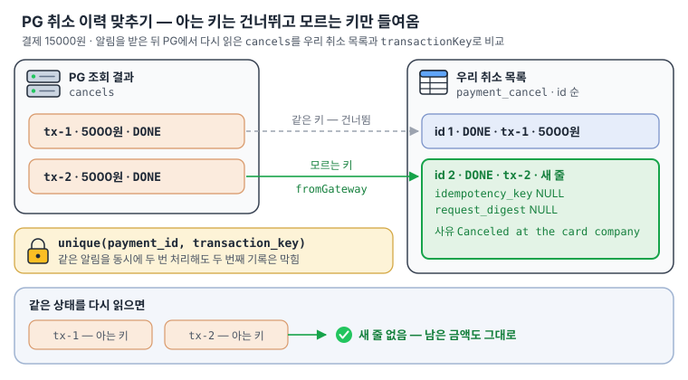

`(payment_id, transaction_key)`에는 unique 키를 더했습니다. 이 결정을 만든 시점에는 알림을 받은 요청 안에서 반영했는데, 같은 알림 두 개가 동시에 닿아 둘 다 같은 PG 취소를 들여와 2건이 된 것을 실행에서 봤기 때문입니다. unique 키를 넣은 뒤에는 두 번째 기록이 막혀 500으로 끝나고, PG의 재전송에 정상 처리되었습니다.

```sql
-- 6장: 카드사에서만 일어난 취소(가맹점 관리 화면 취소 등)도 한 줄로 들여온다. 그 줄에는 고객 키와 요청 비교값이 없다
create table if not exists payment_cancel (
    id              bigint         not null auto_increment,
    payment_id      bigint         not null,
    idempotency_key varchar(300),
    -- 같은 키로 다시 온 요청이 처음과 같은 내용인지 비교할 값(요청 금액·사유의 SHA-256)
    request_digest  char(64),
    -- ...
    unique key uk_payment_cancel_idempotency_key (payment_id, idempotency_key),
    -- 6장: 카드사 취소 한 건은 한 번만 들여온다. 같은 알림을 동시에 두 번 처리해도 두 번째 기록은 막힌다
    unique key uk_payment_cancel_transaction_key (payment_id, transaction_key),
    -- ...
);
```

5장에서 살펴보겠다고 한 가정 가운데 하나가 여기서 정리되었습니다. 알림을 따라갈 때는 PG `cancels`의 마지막 칸을 보지 않고 목록 전체를 `transactionKey`로 맞추므로, PG가 목록을 어떤 순서로 주는지에 기대지 않습니다. 코어 API 문서에서도 `cancels` 순서에 대한 문장은 찾지 못했습니다. 다만 5장의 취소 API는 지금도 PG 취소 응답의 마지막 칸을 이번 취소로 읽습니다. 이 가정은 그대로 남아서 남은 한계에 적었습니다.

우리 쪽 취소 목록은 `@OrderBy("id asc")`로 번호 순으로 읽게 했습니다. 순서를 정하지 않으면 읽을 때마다 순서가 같다는 보장이 없기 때문입니다.

이 선택으로 치르는 비용은, 우리 표에 없는 PG 취소를 모두 PG에서만 일어난 취소로 들여온다는 점입니다. 우리가 요청한 취소의 결과를 아직 모를 때 알림이 오면, 그 취소가 우리 쪽 한 줄과 PG 쪽 한 줄로 두 번 남을 수 있습니다. 이 결정만 넣은 시점에는 실제로 그랬고(남은 금액은 맞았습니다), 결정 5에서 먼저 짝짓기로 막았습니다.

다른 선택이 맞는 경우도 있습니다. 알림 본문에 이벤트마다 고유한 식별자가 있고 처리 한 번이 변화 한 번에 대응한다면, 그 식별자로 거르는 표가 맞습니다. 결제 상태 알림처럼 식별자가 없고 같은 상태가 다른 시각으로 다시 올 수 있다면, 본문 해시로는 "같은 상태의 알림이 다른 때에 다시 와도 취소 기록은 하나만 생긴다"를 지키지 못합니다.

### 결정 4. 언제 200으로 답할까

이 장에서는 받은 알림을 `payment_webhook`에 남기고 바로 200으로 답하며, PG 조회와 반영은 주기 처리기가 하기로 했습니다.

검토한 선택지는 두 가지입니다.

- 받은 알림을 남기기만 하고 바로 200, 조회·반영은 주기 처리기(`PaymentWebhookProcessor`)
- 받은 요청 안에서 조회와 반영까지 끝내고 답하기(비교 E). 조회에 답이 없거나 오류면 504·502로 답합니다.

비교 E는 결정 3 시점의 운영 구현 그대로입니다. 조회와 반영은 운영 구현과 같고, 받은 알림을 남기지 않습니다.

```java
public void receive(ReceiveWebhookCommand command) {
    if (isNothingToFollow(command)) {
        return;
    }
    GatewayPayment gatewayPayment = paymentGateway.findPayment(command.orderId());
    paymentWebhookRecorder.follow(command.orderId(), gatewayPayment);
}
```

비교 E는 계약 15개 중 1개가 실패했습니다. PG 조회가 읽기 시간 제한(1초)보다 늦게(1.5초) 답하는 조건에서 조회가 시간 초과로 끝나 504로 답했습니다. 측정에서는 첫 전송에 200을 받지 못한 알림이 6건, 재전송이 10번이었습니다. 결제는 재전송이 결국 맞춰서 25초 뒤 어긋난 결제는 0건이었습니다.

같은 늦은 조회 조건에서 두 방식이 언제 답하는지 그리면 아래와 같습니다.

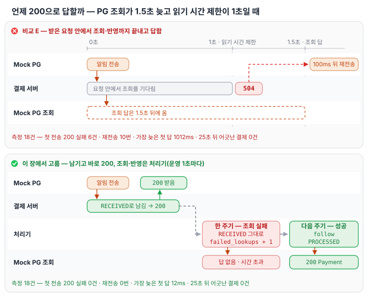

남기고 바로 답하기로 한 이유는, 이번 실행에서 비교 E가 실패한 원인이 "조회가 늦으면 오류로 답하고, 그 답 때문에 PG가 같은 알림을 다시 보낸다"는 것이었기 때문입니다. 받는 쪽이 PG 조회를 기다리지 않으면 조회의 지연이나 실패가 알림의 답에 섞이지 않습니다. 이 결정을 계획할 때는 "PG 조회의 읽기 시간 제한(5초)과 DB 기록을 더하면 토스페이먼츠가 기다리는 10초를 넘을 수 있다"는 이유도 들었는데, 이것은 재지 않았습니다. 실행으로 확인한 것은 읽기 제한 1초, 지연 1.5초 조건의 조회 시간 초과까지입니다.

받은 알림 한 건은 주문번호, `eventType`, 본문의 상태와 `createdAt`(기록용), 처리 상태(`RECEIVED`, `PROCESSED`, `IGNORED`), 조회 실패 횟수, 받은 때와 처리한 때를 남깁니다. 결제를 외래 키로 가리키지 않고 주문번호만 둔 것은 모르는 주문의 알림도 남기기 때문입니다. 결제 상태 알림이 아니거나 주문번호가 없는 알림은 맞출 결제가 없어서 남기지 않고 200으로 답합니다.

```sql
-- 6장: 받은 웹훅 한 건마다 한 줄. 받자마자 남기고 200 으로 답한 뒤, 처리기가 카드사 조회로 결제를 맞춘다.
-- 모르는 주문의 알림도 남기므로 결제를 가리키지 않는다(주문번호만 둔다). 본문의 상태·시각은 받은 그대로 기록으로만 남긴다
create table if not exists payment_webhook (
    id                  bigint       not null auto_increment,
    order_id            varchar(64)  not null,
    event_type          varchar(50)  not null,
    reported_status     varchar(30),
    reported_created_at varchar(40),
    -- RECEIVED(처리 전), PROCESSED(카드사 조회로 맞춤), IGNORED(모르는 주문)
    status              varchar(20)  not null,
    -- 카드사 조회에 실패한 횟수. 실패한 알림은 RECEIVED 로 남아 다음 처리 때 다시 본다
    failed_lookups      int          not null,
    received_at         datetime(6)  not null,
    processed_at        datetime(6),
    primary key (id),
    key idx_payment_webhook_status_id (status, id)
);
```

처리기는 `payment.webhook.interval`(1초)마다 돌고, 테스트에서는 `payment.webhook.enabled=false`로 주기 처리를 끄고 처리를 직접 부릅니다(주기 처리 테스트 하나만 켭니다).

이 선택으로 치르는 비용은 세 가지입니다.

- 알림부터 반영까지 처리 주기만큼 늦습니다. 측정에서 운영 구현은 비교 A·C보다 맞춰지기까지 오래 걸렸습니다. 늦은 조회 시나리오에서 운영 구현이 3초 넘게 걸린 것은 처리기의 조회가 읽기 제한(1초)에 걸려 실패하고 다음 주기에 다시 조회했기 때문이고, 다른 시나리오의 수백 ms 차이는 처리 주기(측정에서는 0.2초)와 조회 때문입니다. 결제별 로그로 원인을 확인하지는 않았습니다. 운영 설정(1초)에서의 시간은 재지 않았습니다.
- `payment_webhook`이 계속 자랍니다. 처리한 알림을 지우는 작업은 두지 않았습니다.
- 조회가 계속 실패하면 알림이 `RECEIVED`로 남아 주기마다 다시 조회합니다. 재처리 횟수에 상한이 없습니다.

다른 선택이 맞는 경우도 있습니다. PG 조회가 늘 읽기 제한 안에 답하고, 재전송을 받는 것이 문제가 되지 않는다면 요청 안에서 반영해도 결제는 맞습니다. 이번 측정에서 비교 E의 어긋난 결제가 0건이었던 것이 그 범위입니다. 반영이 바로 보여야 하는 화면이 있다면 처리 주기만큼의 지연이 없는 쪽이 낫습니다.

### 결정 5. 결과를 모르는 결제와 취소를 알림으로 바로 맞출까

이 장에서는 결과 모름 결제·취소에 알림이 오면 보정 대기 시간을 기다리지 않고 그 결제만 바로 맞추고, 결과를 기다리는 우리 취소는 PG 취소와 먼저 짝지어 닫기로 했습니다.

검토한 선택지는 두 가지입니다.

- 알림으로 그 결제를 바로 맞추기. PG 취소는 결과를 기다리는 우리 취소(결과 모름, 요청)와 먼저 금액으로 짝짓고, 남은 것만 PG에서만 일어난 취소로 들여오기
- 알림에는 200만 답하고, 4·5장의 주기 보정만 돌리기(비교 F)

결과 모름 결제는 결정 2의 따라가기로 이미 바로 맞춰집니다. 이 결정에서 더한 것은 취소 쪽입니다. 결정 3·4 시점에는 결과 모름 취소에 알림이 오면 PG 취소를 PG에서만 일어난 취소로 따로 들여와서, 남은 금액은 맞지만 우리 취소는 결과 모름으로 남고 기록이 한 줄 더 생겼습니다.

```java
private void followCancels(List<GatewayCancel> gatewayCancels, Instant now) {
    List<GatewayCancel> unknown = new ArrayList<>(gatewayCancels.stream()
            .filter(this::isUnknownTransaction)
            .toList());
    cancels.stream()
            .filter(PaymentCancel::isAwaitingResult)
            .forEach(cancel -> completeIfMatched(cancel, unknown));
    unknown.forEach(gatewayCancel -> recordGatewayCancel(gatewayCancel, now));
}

private void completeIfMatched(PaymentCancel cancel, List<GatewayCancel> unmatched) {
    GatewayCancel matched = sameAmountOf(cancel, unmatched);
    if (Objects.nonNull(matched)) {
        unmatched.remove(matched);
        complete(cancel, matched.getTransactionKey());
    }
}
```

짝짓기는 5장 보정과 같은 함수(`sameAmountOf`)를 씁니다. 5장 보정과 다른 점은 두 가지입니다. 보정 대기 시간과 상관없이 결과를 기다리는 모든 우리 취소를 보고, 짝이 없는 우리 취소를 실패로 닫지 않습니다. 알림이 왔다고 PG가 그 취소를 끝냈다는 뜻은 아니어서, 아직 처리 중일 수 있는 취소를 실패로 닫는 것은 대기 시간이 지난 주기 보정에 남겼습니다.

결과 모름 취소에 알림이 온 경우의 처리 순서는 아래와 같습니다.


비교 F는 알림에 받았다고만 답하고, 테스트의 처리 자리에서 4·5장 보정을 지금 시각으로 한 번 돌립니다. 보정 대기 시간(10초)이 지나지 않은 결제·취소는 보지 않습니다.

```java
// 알림 대신 4·5장 주기 보정을 지금 시각으로 한 번 돌린다. 보정 대기 시간(10초)이 지나지 않은 결제·취소는 보지 않는다
@Override
void process() {
    paymentReconciler.reconcile(Instant.now());
    paymentCancelReconciler.reconcile(Instant.now());
}
```

비교 F는 계약 15개 중 7개가 실패했습니다. 결과 모름 결제·취소는 대기 시간 전이라 맞춰지지 않았고, PG에서만 일어난 취소는 대기 시간과 상관없이 끝내 맞춰지지 않았습니다. 5장 보정은 우리가 요청한 취소만 보기 때문입니다. 측정에서는 25초 뒤 어긋난 결제가 8건이었고(같은 알림 두 번 2, 같은 상태 다시 2, 늦은 조회 2, PG에서만 일어난 부분 취소 2), 모두 PG에서만 일어난 취소가 있는 시나리오입니다. 결과 모름 결제·취소는 보정 대기 시간 가까이 지나서야 맞았습니다(시간은 아래 측정 절에 적었습니다).

운영 구현과 비교 F가 맞춰지기까지 걸린 시간을 시나리오별로 그리면 아래와 같습니다.

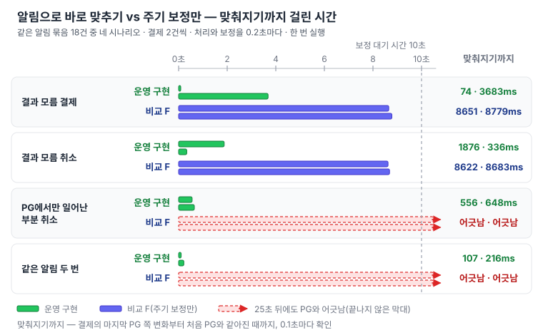

바로 맞추기로 한 이유는, 알림이 오면 그 결제를 바로 PG에서 다시 읽어 PG에 이미 결과가 있는 것만 반영하므로 대기 시간을 기다릴 까닭이 없기 때문입니다. 결과가 없다는 이유로 실패로 닫는 일만 대기 시간이 지난 보정에 남겼습니다. 4장에서 보정 대기 시간을 둔 것은 PG가 아직 처리 중인 결제를 기록 없음으로 읽지 않기 위해서였는데, 알림을 받은 결제는 PG가 이미 상태를 바꾼 결제입니다. 그리고 PG에서만 일어난 취소는 알림이 아니면 우리가 알 길이 없었습니다.

이 선택으로 치르는 비용은 두 가지입니다.

- 금액으로 짝을 짓기 때문에, 같은 금액의 우리 요청 취소(PG가 처리 중)와 PG에서만 일어난 취소가 함께 있으면 PG 쪽 취소가 우리 취소와 잘못 짝지어질 수 있습니다. 5장 보정과 같은 한계가 알림 쪽으로도 넓어졌습니다. 이 경우는 실행해 보지 않았습니다.
- 처리기가 한 스레드라, 늦게 답하는 조회가 있으면 같은 주기의 다른 주문도 기다립니다. 측정에서 운영 구현의 결과 모름 결제 한 건이 3683ms 걸린 것은 늦은 조회 시나리오와 겹친 것으로 보이지만, 로그로 원인을 확인하지는 않았습니다.

다른 선택이 맞는 경우도 있습니다. PG에서만 일어나는 취소가 없고, 결과 모름이 대기 시간만큼 이어져도 괜찮은 서비스라면 주기 보정만으로도 결과 모름은 결국 맞춰집니다. 이번 측정에서 결과 모름 결제·취소는 비교 F도 8.6\~8.8초 뒤에 맞았습니다. PG에서만 일어난 취소가 있으면 "카드사에서만 일어난 부분 취소 알림이 오면 남은 금액이 카드사 잔액과 같아진다" 같은 경우가 끝내 맞춰지지 않습니다.

## 구현

결정을 모아 바꾼 6장 완성 코드에서 Mock PG, 결제 서버, DB, 처리기 사이에 오가는 요청과 응답을 그리면 아래와 같습니다.


웹훅 받기는 알림 한 건을 남기기만 합니다.

```java
@Transactional
public void receive(ReceiveWebhookCommand command) {
    if (isNothingToFollow(command)) {
        log.info("A webhook with nothing to follow was received and left as is.");
        return;
    }
    paymentWebhookRepository.save(PaymentWebhook.received(command.orderId(), command.eventType(),
            command.reportedStatus(), command.reportedCreatedAt(), clock.instant()));
}

private static boolean isNothingToFollow(ReceiveWebhookCommand command) {
    if (command.isPaymentStatusChange()) {
        return Objects.isNull(command.orderId());
    }
    return true;
}
```

처리기는 처리 전 알림을 받은 순서대로 100건까지 읽어 주문마다 묶고, 주문마다 PG 조회를 한 번 합니다. 같은 주문의 알림이 여러 건이어도 PG의 지금 상태는 하나라 한 번 읽으면 됩니다. 모르는 주문은 조회하지 않고 닫고, 조회에 실패하면 알림을 받은 상태로 남겨 다음 처리 때 다시 봅니다. PG 조회에 실패한 주문이 있어도 나머지 주문은 이어서 맞춥니다.

```java
public void process() {
    Map<String, List<Long>> byOrder = paymentWebhookRepository.findReceived().stream()
            .collect(Collectors.groupingBy(PaymentWebhook::getOrderId, LinkedHashMap::new,
                    Collectors.mapping(PaymentWebhook::getId, Collectors.toList())));
    byOrder.forEach(this::process);
}

private void process(String orderId, List<Long> webhookIds) {
    if (paymentRepository.findByOrderId(orderId).isEmpty()) {
        paymentWebhookRecorder.ignore(webhookIds);
        return;
    }
    try {
        GatewayPayment gatewayPayment = paymentGateway.findPayment(orderId);
        paymentWebhookRecorder.follow(orderId, webhookIds, gatewayPayment);
    } catch (PaymentGatewayNoResponseException | PaymentGatewayFailedException unanswered) {
        paymentWebhookRecorder.recordFailedLookup(webhookIds);
        log.warn("Could not look up a payment for a webhook ({}). It will be processed again next time.",
                unanswered.getClass().getSimpleName());
    }
}
```

결제를 맞춘 것과 알림을 닫은 것은 같은 트랜잭션에서 함께 반영됩니다.

```java
// 결제를 맞추고, 그 결제를 다시 보라던 알림들을 닫는다
@Transactional
public void follow(String orderId, List<Long> webhookIds, GatewayPayment gatewayPayment) {
    follow(orderId, gatewayPayment);
    webhooks(webhookIds).forEach(webhook -> webhook.process(clock.instant()));
}
```

받은 알림의 상태는 처리 전에서 한 번만 닫힙니다. 이미 처리한 알림은 다시 닫아도 처음 처리한 때가 바뀌지 않습니다.

```java
// 카드사 조회에 실패했다. 받은 상태로 남겨 다음 처리 때 다시 본다
public void failLookup() {
    failedLookups++;
}

private void close(WebhookStatus closed, Instant now) {
    if (status.isReceived()) {
        this.status = closed;
        this.processedAt = now;
    }
}
```

다시 읽은 PG 결제를 따라가는 것은 결제가 합니다. 승인 결과를 기다리는 결제면 먼저 승인 쪽을 따라가고, 그 결과 승인이 남은 결제가 되면 이어서 취소 이력을 따라갑니다. 그래서 결과 모름 결제에 취소 알림이 먼저 와도, 한 번의 처리에서 승인한 뒤 취소를 들여와 승인 취소까지 갑니다.

```java
public void follow(GatewayPayment gatewayPayment, Instant now) {
    if (status.isAwaitingApprovalResult()) {
        followApproval(gatewayPayment.getStatus());
    }
    if (status.holdsApproval()) {
        followCancels(gatewayPayment.getCancels(), now);
    }
}

private void followApproval(GatewayStatus gatewayStatus) {
    if (gatewayStatus.hasApproval()) {
        approve();
        return;
    }
    if (gatewayStatus.isDeclined()) {
        failApproval();
    }
}
```

다시 읽은 PG 결제를 따라가는 규칙을 모으면 아래와 같습니다.

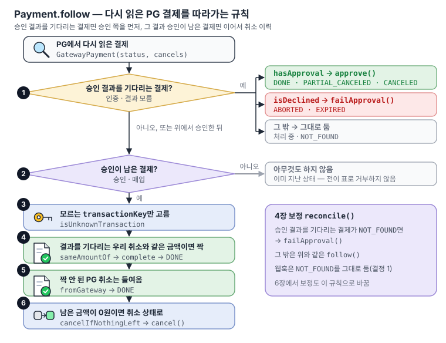

PG에서만 일어난 취소를 들여올 때도 남은 금액을 그 취소 행에 남기고, 0원이 되면 취소 상태로 바꿉니다. 이미 취소 상태인 결제는 다시 바꾸지 않습니다.

```java
private void recordGatewayCancel(GatewayCancel gatewayCancel, Instant now) {
    PaymentCancel cancel = PaymentCancel.fromGateway(this, gatewayCancel, now);
    cancels.add(cancel);
    cancel.keepBalance(balanceAmount());
    cancelIfNothingLeft();
}

// 이미 취소 상태면(앞 취소로 0원이 됨) 다시 바꾸지 않는다
private void cancelIfNothingLeft() {
    if (status.holdsApproval() && balanceAmount().signum() == 0) {
        cancel();
    }
}
```

`holdsApproval()`은 승인과 매입 상태입니다. 이 장에서 `PaymentStatus`에 더한 메서드는 이것 하나이고, 상태와 전이 표는 바꾸지 않았습니다.

완성 코드의 웹훅 API를 정리하면 아래와 같습니다.

- `POST /api/v1/webhooks/tosspayments`, 본문 `{eventType, createdAt, data: {orderId, status, …}}`
- 200(본문 없음): `PAYMENT_STATUS_CHANGED`이고 주문번호가 있으면 `payment_webhook`에 `RECEIVED`로 남깁니다. 모르는 주문도 남깁니다. 다른 `eventType`이나 주문번호가 없는 알림은 남기지 않습니다.
- 400 `INVALID_INPUT`: 읽을 수 없는 본문
- 처리기(1초마다): 주문마다 `GET /v1/payments/orders/{orderId}` 한 번 → 결제 따라가기 → 알림 `PROCESSED`. 모르는 주문은 `IGNORED`, 조회 실패는 `RECEIVED` 그대로
- 승인·취소·조회·준비 API는 5장과 같습니다. 승인 답이 오기 전에 알림이 결과를 남겼으면 승인 API는 그 결과로 답합니다.

### 앞 장 코드에서 바뀐 것

웹훅을 넣으면서 2\~5장 코드도 바뀌었습니다.

- 2·4장의 승인 답 기록(`recordApproval`)과 결과 모름 기록(`recordApprovalUnknown`)은 알림이 먼저 결과를 남긴 결제를 건드리지 않습니다. 전에는 409로 끝났습니다(결정 2).
- 5장의 `payment_cancel`은 PG에서 들여온 취소를 담을 수 있게 `idempotency_key`와 `request_digest`를 비워 둘 수 있고, `unique(payment_id, transaction_key)`가 더해졌습니다. 결제의 취소 목록은 번호 순으로 읽습니다(결정 3).
- 4장 보정의 해석을 이 장에서 바꿨습니다. 아래에서 설명합니다.

4장 보정은 결과 모름 결제를 PG에 조회해 `CANCELED`를 읽으면 "승인이 없음"으로 보고 승인 실패로 닫았습니다. 반면 웹훅은 같은 `CANCELED`를 "승인 뒤 취소"로 읽고, 승인한 뒤 PG 취소 이력을 들여와 승인 취소로 닫습니다. 같은 결제를 보정이 먼저 보면 승인 실패로 남고, 그 뒤 온 알림은 지난 상태라 고치지 않아서, 어느 쪽이 먼저 도느냐에 따라 결과가 달랐습니다. 그래서 4장 보정도 웹훅과 같은 조회(`findPayment`)를 쓰고, 기록 없음만 따로 본 뒤 나머지는 웹훅과 같은 `follow`로 닫게 바꿨습니다.

```java
public void reconcile(GatewayPayment gatewayPayment, Instant now) {
    if (status.isAwaitingApprovalResult() && gatewayPayment.getStatus().isNotFound()) {
        failApproval();
        return;
    }
    follow(gatewayPayment, now);
}
```

같은 결과 모름 결제를 두 시점의 보정이 어떻게 닫는지 비교하면 아래와 같습니다.

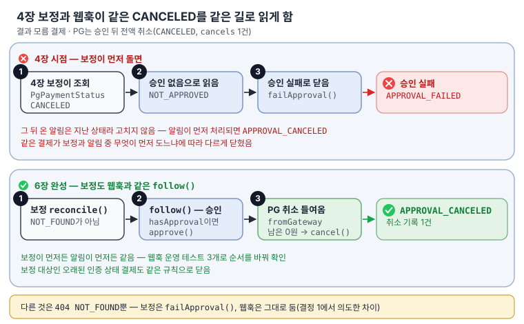

404의 해석만 두 길이 다르고, 이것은 결정 1에서 설명한 대로 의도한 차이입니다. 보정 대상인 오래된 인증 상태 결제(PG 승인 뒤 우리 기록에 실패한 결제)도 같은 규칙으로 닫습니다. 그 결제가 PG에서 취소됐다면 승인이 있었던 결제이므로 승인 취소가 PG와 짝이 맞는다고 판단했습니다.

이 변경으로 4장의 `PaymentGateway.inquire`, `PgPaymentStatus`, `PaymentInquiry`, `Payment.settle(PaymentInquiry)`는 쓰이지 않게 되어 지웠습니다.

4장 테스트도 고쳤습니다. PG 조회 답을 읽는 테스트 9개는 `CANCELED`를 "승인이 있었던 결제"로 읽는 9개로 바꿨습니다. 확인한 결과로 결제를 닫는 도메인 테스트는 3개에서 7개가 되었습니다. 승인 없음을 거절과 기록 없음으로 나누고, 승인 뒤 전액 취소, 승인 뒤 부분 취소, 인증 상태 결제의 전액 취소를 더했습니다. 4장 보정 계약과 측정이 PG 상태와 결제 상태의 짝을 보는 기준에서도 `CANCELED`의 짝을 승인 실패에서 승인 취소로 바꿨습니다.

더한 테스트는 4장 운영 보정 테스트 3개와, 보정과 알림의 순서를 바꿔 보는 웹훅 운영 테스트 3개입니다. 4장 비교 구현 가운데 망취소에 생긴 결과는 테스트 결과 절에 적었습니다.

4장 글은 그 시점의 기록이라, 바뀐 사실을 알리는 한 줄만 더했습니다. 4장 글의 PG 상태 읽기(`CANCELED`를 승인 없음으로 읽음)와 "망취소도 보정 계약 9개를 모두 통과했습니다"는 6장 완성 코드에서는 맞지 않습니다.

## 테스트 결과

6장 완성 코드에서 전체 테스트(`./gradlew clean check`)를 돌린 결과는 아래와 같습니다.

```text
tests=511 failures=0 errors=0 time=203.184s
(통과한 테스트 목록 생략)
coverage (JaCoCo, PaymentChallengeApplication 제외)
INSTRUCTION 3101/3129 99.1%
BRANCH 171/179 95.5%
LINE 705/709 99.4%
COMPLEXITY 335/345 97.1%
METHOD 251/253 99.2%
CLASS 69/69 100.0%
```

- 출발 코드에서 실패하던 14개가 모두 통과하였습니다.
- 운영 구현의 웹훅 처리 테스트는 계약 15개에 운영 구현에만 있는 4개를 더해 19개입니다. 조회 실패 재처리 1개와, 4장 보정과의 순서를 보는 3개("주기 보정이 먼저 돌고 알림이 나중에 처리돼도 카드사와 같아진다", "알림이 먼저 처리되고 주기 보정이 나중에 돌아도 카드사와 같아진다", "주기 보정과 알림 처리가 둘 다 돌아도 카드사 취소는 한 번만 기록된다")입니다.
- 웹훅 받기 API 테스트는 출발 코드의 4개에 "결제 상태 알림을 받으면 처리 전 알림으로 남긴다", "결제 상태 알림이 아닌 알림은 남기지 않는다"를 더해 6개이고, 주기 처리 테스트가 1개입니다.
- 도메인 테스트는 카드사에서 다시 읽은 결제 상태 따라가기 9개, 카드사 취소 이력 따라가기 7개, 카드사 답을 기다리는 취소를 카드사 취소 이력으로 바로 닫기 5개, 받은 카드사 웹훅 6개입니다.
- 전체는 5장의 460개에서 511개가 되었습니다. 6장 테스트 53개와 4장 보정 테스트 증감(도메인 +4, 운영 보정 +3, 망취소 9개는 기본 테스트에서 빠짐)을 더한 수입니다.
- 라인 커버리지는 99.4%(709줄 중 705줄)였습니다(애플리케이션 시작 클래스 제외). 지나가지 않은 4줄 가운데 6장 코드는 웹훅 본문에 `data`가 아예 없을 때 명령을 만드는 한 줄이고, 나머지 세 줄은 5장에서 설명한 SHA-256을 쓸 수 없을 때 던지는 두 줄과 전역 예외 처리기의 `INTERNAL` 분기입니다. 5장에서 지나가지 않던 4장 PG 승인 조회의 오류 줄은 `inquire`를 지우면서 없어졌습니다.

계약을 지키지 못하는 비교 구현은 `./gradlew knownFailingTest`로 같은 웹훅 계약을 돌렸습니다. 비교 주소는 모두 한 테스트 환경에 함께 올리고, 주소가 달라 운영 구현의 동작에는 끼어들지 않습니다.

기록 전에 시험 두 곳을 고쳤습니다. 먼저 결과 모름 취소를 만드는 도우미는 알림을 쌓아 두었다가 결과 모름을 확인한 뒤 보내게 했습니다. 받은 자리에서 본문으로 옮기는 A·C가 확인 전에 이미 취소를 닫아 앞 단계 확인에서 실패했기 때문입니다. 다음으로 Mock PG가 쌓아 둔 알림을 0.1초씩 띄워 보내게 했습니다. 한꺼번에 보내면 두 알림이 동시에 닿아 순서를 바꿔 보낸 뜻이 없어지고, A는 두 트랜잭션이 서로 덮어써 실행마다 결과가 달랐습니다.

출발 코드, 운영 구현, 비교 구현 6개의 통과·실패를 계약에 맞춰 모으면 아래와 같습니다.

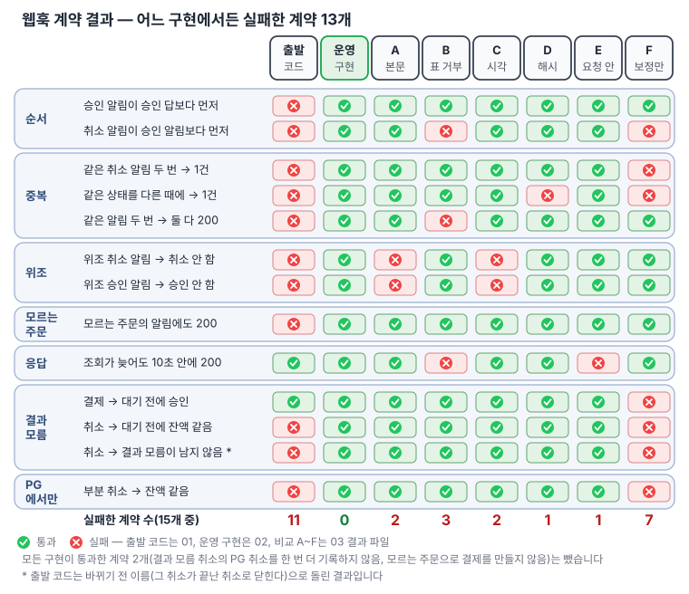

비교 구현마다 결과는 아래와 같습니다.

### 비교 A: 본문의 상태를 그대로 믿음

```text
FAIL 카드사 기록과 다른 취소 알림이 와도 결제를 취소하지 않는다 (0.136s) | org.opentest4j.AssertionFailedError: expected: APPROVED but was: APPROVAL_CANCELED
FAIL 카드사에 승인이 없는 결과 모름 결제에 승인 알림이 와도 승인으로 바꾸지 않는다 (1.658s) | org.opentest4j.AssertionFailedError: expected: APPROVAL_UNKNOWN but was: APPROVED
(나머지 13개 통과)
```

결정 1에서 설명한 위조 두 경우입니다.

### 비교 B: 허용 전이 표에 없는 전이는 오류로 답함

```text
FAIL 취소 알림이 승인 알림보다 먼저 와도 결제는 카드사와 같아진다 (2.481s) | java.lang.AssertionError: [카드사 상태 CANCELED 와 짝] Expecting Set12: [CAPTURE_CANCELED, APPROVAL_CANCELED] to contain: [APPROVAL_UNKNOWN] but could not find the following element(s): [APPROVAL_UNKNOWN]
FAIL 카드사 조회가 늦어도 알림에는 10초 안에 받았다고 답한다 (1.056s) | org.opentest4j.AssertionFailedError: expected: 200 but was: 504
FAIL 같은 알림이 두 번 와도 두 번 모두 받았다고 답한다 (0.84s) | org.opentest4j.AssertionFailedError: Expecting actual: [409, 409] to contain exactly (and in same order): [200, 200] but some elements were not found: [200, 200] and others were not expected: [409, 40
(나머지 12개 통과)
```

취소 알림이 먼저 온 결과 모름 결제는 두 알림 모두 409를 받고 결과 모름으로 남았습니다. 늦은 조회의 504는 받은 자리에서 조회하기 때문에 생긴 실패라, 결정 2가 아니라 결정 4 쪽의 차이입니다. 비교 A·B·C는 받은 자리에서 반영하므로 결정 4도 운영 구현과 다르고, 이 비교들을 결정 4 위에서 다시 돌리지는 않았습니다.

### 비교 C: 본문을 믿고 createdAt이 가장 늦은 알림만 받음

```text
FAIL 카드사 기록과 다른 취소 알림이 와도 결제를 취소하지 않는다 (0.125s) | org.opentest4j.AssertionFailedError: expected: APPROVED but was: APPROVAL_CANCELED
FAIL 카드사에 승인이 없는 결과 모름 결제에 승인 알림이 와도 승인으로 바꾸지 않는다 (1.653s) | org.opentest4j.AssertionFailedError: expected: APPROVAL_UNKNOWN but was: APPROVED
(나머지 13개 통과)
```

비교 A와 같은 두 개입니다. 순서가 바뀐 테스트는 A도 C도 통과해서, 시각 비교가 따로 막아 준 테스트는 없었습니다.

### 비교 D: 받은 본문을 남겨 같은 본문을 거르고, 알림 한 건을 변화 한 건으로 처리함

"같은 상태의 알림이 다른 때에 다시 와도 취소 기록은 하나만 생긴다" 1개가 `Expected size: 1 but was: 2`로 실패했고(실패 메시지에 주문번호가 들어 있어 줄은 옮기지 않았습니다), 나머지 14개는 통과했습니다. 같은 상태가 새 `createdAt`으로 다시 오면 본문이 달라 걸러지지 않았고, 처리가 마지막 PG 취소를 새 취소로 봐서 같은 취소가 두 번 남았습니다.

### 비교 E: 받은 요청 안에서 카드사 조회와 반영까지 끝내고 답함

```text
FAIL 카드사 조회가 늦어도 알림에는 10초 안에 받았다고 답한다 (1.067s) | org.opentest4j.AssertionFailedError: expected: 200 but was: 504
(나머지 14개 통과)
```

읽기 시간 제한 1초를 넘긴 조회가 504로 끝났습니다.

### 비교 F: 알림을 무시하고 주기 보정만 함

```text
FAIL 같은 상태의 알림이 다른 때에 다시 와도 취소 기록은 하나만 생긴다 (0.249s) | java.lang.AssertionError: Expected size: 1 but was: 0 in: []
FAIL 결과 모름 결제에 승인 알림이 오면 보정 대기 시간 전에 승인으로 맞춰진다 (1.651s) | org.opentest4j.AssertionFailedError: expected: APPROVED but was: APPROVAL_UNKNOWN
FAIL 취소 알림이 승인 알림보다 먼저 와도 결제는 카드사와 같아진다 (1.769s) | java.lang.AssertionError: [카드사 상태 CANCELED 와 짝] Expecting Set12: [CAPTURE_CANCELED, APPROVAL_CANCELED] to contain: [APPROVAL_UNKNOWN] but could not find the following element(s): [APPROVAL_UNKNOWN]
FAIL 카드사에서만 일어난 부분 취소 알림이 오면 남은 금액이 카드사 잔액과 같아진다 (0.138s) | org.opentest4j.AssertionFailedError: expected: 10000.00 but was: 15000
FAIL 같은 취소 알림이 두 번 와도 취소 기록은 하나만 생긴다 (0.129s) | java.lang.AssertionError: Expected size: 1 but was: 0 in: []
FAIL 결과 모름 취소에 알림이 오면 보정 대기 시간 전에 남은 금액이 카드사 잔액과 같아진다 (1.682s) | org.opentest4j.AssertionFailedError: expected: 10000.00 but was: 15000
(나머지 8개 통과)
```

위 6개에 더해 "결과 모름 취소에 알림이 오면 보정 대기 시간 전에 그 취소가 결과 모름에서 벗어난다"도 실패했습니다(실패 메시지에 주문번호가 들어 있어 줄은 옮기지 않았습니다). 취소 기록이 0건인 실패는 PG에서만 일어난 취소를 들여오지 못한 것이고, 나머지는 대기 시간 전이라 보정이 보지 않은 것입니다.

### 4장 비교 구현 망취소

4장 보정의 해석을 바꾸면서, 4장 비교 A 망취소가 보정 계약 9개 중 3개를 지키지 못하게 되었습니다.

```text
FAIL 카드사 승인 뒤 결과 기록이 실패해도, 보정 뒤 결제 기록이 카드사와 어긋나지 않는다 (0.053s) | org.opentest4j.AssertionFailedError: [카드사 상태 CANCELED 와 짝] expected: APPROVAL_CANCELED but was: APPROVAL_FAILED
FAIL 카드사가 승인했지만 답이 시간 제한을 넘기면, 보정 뒤 결제 기록이 카드사와 어긋나지 않는다 (1.565s) | org.opentest4j.AssertionFailedError: [카드사 상태 CANCELED 와 짝] expected: APPROVAL_CANCELED but was: APPROVAL_FAILED
FAIL 확인 요청에 답이 없던 결제는 다음 보정에서 다시 확인해 카드사와 맞춘다 (2.58s) | org.opentest4j.AssertionFailedError: [카드사 상태 CANCELED 와 짝] expected: APPROVAL_CANCELED but was: APPROVAL_FAILED
(나머지 6개 통과)
```

망취소는 PG가 승인한 결제에 취소를 보내 PG를 `CANCELED`로 만들고, 우리 결제는 승인 실패로 닫습니다. 4장 기준에서는 `CANCELED`의 짝이 승인 실패라 계약을 모두 지켰지만, 6장 기준에서는 짝이 승인 취소라 PG 승인이 남았던 세 경우(기록 실패, 늦은 승인, 조회 무응답 뒤 재보정)가 어긋납니다.

기준을 "`CANCELED`는 승인 취소와 승인 실패 둘 다 짝"으로 넓히면 망취소는 다시 통과합니다. 하지만 그러면 새 보정 테스트 두 개("카드사에서 승인 뒤 전액 취소된 결과 모름 결제는 승인 취소 상태가 된다", "결과를 기록하지 못하고 인증 상태에 남은 결제도 카드사에서 승인 뒤 취소됐으면 승인 취소 상태가 된다")가 4장처럼 승인 실패로 닫아도 통과하게 됩니다. 그래서 기준은 바꾸지 않고 망취소를 계약을 못 지키는 비교 구현 쪽으로 옮겼습니다. 이 판단은 코드로 했고, 기준을 넓혀서 돌려 보지는 않았습니다.

망취소 코드는 닫을 때 거절과 같은 기록을 쓰게만 바꿨고, 결과는 전과 같은 승인 실패입니다.

4장 측정(`./gradlew reconciliationMeasurement`)도 6장 코드에서 같은 조건으로 다시 돌렸습니다. 4장 시점 기록은 그대로 두고, 다시 잰 값은 6장 기록에 따로 남겼습니다.

망취소의 "카드사와 어긋난 결제"는 두 묶음(보정 때 PG가 바로 답함, 첫 보정의 확인 요청에 늦게 답함) 모두 6건이었고, 4장 기록에서는 둘 다 0건이었습니다. 결제와 PG의 상태 값은 4장 기록과 같았습니다(PG 최종 상태 `{ABORTED=3, CANCELED=6, NONE=3}`, 보정 뒤 결제 상태 `{APPROVAL_FAILED=12}`). 결제 상태가 바뀐 것이 아니라 짝 기준이 바뀐 결과입니다.

운영 보정(0건)과 비교 B(12건), C(6건), D(2건)의 어긋난 결제 수는 4장 기록과 같았습니다.

2\~5장의 다른 비교 구현도 함께 돌렸고, 전과 같은 39개가 같은 이유로 실패했습니다. 전체 결과는 263개 중 58개 실패(2\~5장 39개 + 4장 망취소 3개 + 6장 비교 A 2개, B 3개, C 2개, D 1개, E 1개, F 7개)입니다.

### 같은 알림 묶음으로 잰 결과

계약 테스트는 경우마다 결제 하나를 보므로, 어긋남이 몇 건 쌓이는지와 재전송이 얼마나 생기는지는 드러나지 않습니다. 그래서 구현마다 같은 알림 묶음을 보내는 측정(`./gradlew webhookMeasurement`)을 따로 두었습니다. 결제는 18건이고, 아래 9개 시나리오를 2건씩 보냅니다. 모든 결제에서 승인 알림도 갑니다.

- 순서 바뀜: 결과 모름 결제를 PG가 승인한 뒤 전액 취소, 취소 알림이 먼저
- 승인 알림이 승인 답보다 먼저(답을 0.5초 붙잡음)
- 같은 알림 두 번: PG에서만 일어난 부분 취소, 같은 본문
- 같은 상태를 다른 때에 다시: PG에서만 일어난 부분 취소 뒤, 0.5초 뒤 새 `createdAt`으로 다시
- 위조 알림: 승인된 결제에 전액 취소
- PG 조회가 늦음: 1.5초 동안 조회가 1.5초 늦게 답하고, 그사이 PG에서만 부분 취소
- 결과 모름 결제
- 결과 모름 취소
- PG에서만 일어난 부분 취소

받은 알림 처리(구현마다 다름)와 4·5장 주기 보정(모두 같음)을 0.2초마다 함께 돌립니다. 운영 설정은 처리 1초, 보정 1분입니다. 읽기 시간 제한은 1초, 보정 대기 시간은 10초이고, 알림은 200이 아니면 100ms 간격으로 7번까지 다시 보냅니다. "맞춰지기까지"는 결제의 마지막 PG 쪽 변화(위조는 위조 알림을 보낸 때)부터 처음 PG와 같아진 때까지이고, 묶음을 다 보낸 뒤 25초까지 봐서 그때 PG와 다른 결제를 "어긋남"으로 셉니다. 한 번 실행한 값입니다.

운영 구현과 비교 B의 결과는 아래와 같습니다.

```text
## 운영 구현
결제 18건, 카드사와 어긋난 결제(25초 뒤) 0건
알림 36건, 첫 전송에 200 을 받지 못한 알림 0건, 재전송 0번, 재전송을 다 써도 200 을 받지 못한 알림 0건, 가장 늦은 첫 답 12ms
묶음을 보내는 데 14746ms
- 순서 바뀜(취소 알림이 승인 알림보다 먼저): 211ms, 103ms
- 승인 알림이 승인 답보다 먼저: 104ms, 11ms
- 같은 알림 두 번: 107ms, 216ms
- 같은 상태를 다른 때에 다시: 194ms, 301ms
- 위조 알림(전액 취소): 98ms, 87ms
- 카드사 조회가 늦음(1.5초): 3163ms, 1885ms
- 결과 모름 결제: 74ms, 3683ms
- 결과 모름 취소: 1876ms, 336ms
- 카드사에서만 일어난 부분 취소: 556ms, 648ms

## 비교 B 표에 없는 전이는 오류로 답함
결제 18건, 카드사와 어긋난 결제(25초 뒤) 0건
알림 36건, 첫 전송에 200 을 받지 못한 알림 12건, 재전송 52번, 재전송을 다 써도 200 을 받지 못한 알림 6건, 가장 늦은 첫 답 1009ms
묶음을 보내는 데 14750ms
- 순서 바뀜(취소 알림이 승인 알림보다 먼저): 8636ms, 8616ms
- 승인 알림이 승인 답보다 먼저: 79ms, 21ms
- 같은 알림 두 번: 46ms, 35ms
- 같은 상태를 다른 때에 다시: 14ms, 55ms
- 위조 알림(전액 취소): 90ms, 66ms
- 카드사 조회가 늦음(1.5초): 3445ms, 2275ms
- 결과 모름 결제: 114ms, 100ms
- 결과 모름 취소: 2313ms, 1100ms
- 카드사에서만 일어난 부분 취소: 17ms, 121ms
```

운영 구현은 18건이 모두 PG와 맞았고, 36개 알림 모두 첫 전송에 200을 받았습니다.

구현 7개의 측정 결과를 한 번에 보면 아래와 같습니다.

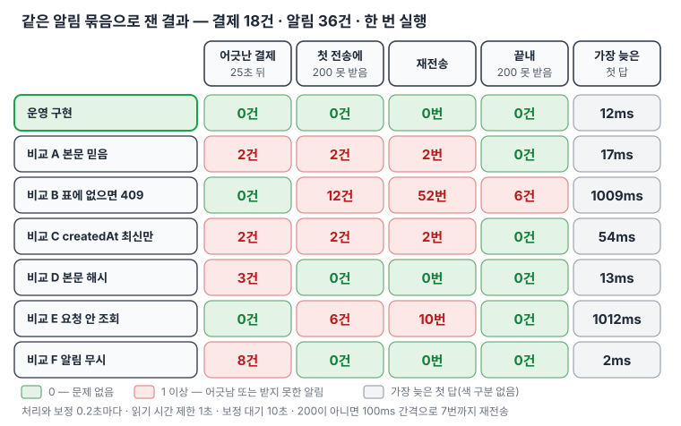

비교 B는 25초 뒤 어긋난 결제가 운영 구현과 같은 0건입니다. 다만 순서 바뀜 2건은 이번 한 번의 실행에서 8.6초 뒤에야 맞았는데, 보정 대기 시간(10초)에 가까운 값이라, 알림이 아니라 웹훅과 같은 해석으로 바꾼 4장 주기 보정이 맞춘 것으로 보입니다. 결제별 처리 기록은 남기지 않아 확인하지는 않았습니다. 결제는 맞아도 B는 같은 알림에 계속 409로 답해서, 재전송 52번 끝에 200을 끝내 받지 못한 알림이 6건 남았습니다. 결제가 PG와 맞는지만 보면 운영 구현과 차이가 없지만, PG 쪽에는 실패한 알림이 남습니다.

나머지 구현은 아래와 같습니다.

- 비교 A 본문 믿음: 어긋난 결제 2건(위조 알림 2건), 첫 전송 200 실패 2건, 재전송 2번, 가장 늦은 첫 답 17ms. 첫 전송 실패 2건은 받은 자리에서 반영하다 오류로 답한 것인데, 어떤 오류였는지는 로그로 확인하지 않았습니다.
- 비교 C createdAt으로 최신만: 어긋난 결제 2건(위조 알림 2건), 첫 전송 200 실패 2건, 재전송 2번, 가장 늦은 첫 답 54ms.
- 비교 D 본문 해시: 어긋난 결제 3건(같은 상태를 다른 때에 다시 2건, 결과 모름 취소 1건), 첫 전송 200 실패 0건, 가장 늦은 첫 답 13ms.
- 비교 E 요청 안에서 조회·반영: 어긋난 결제 0건, 첫 전송 200 실패 6건, 재전송 10번, 끝내 못 받은 알림 0건, 가장 늦은 첫 답 1012ms.
- 비교 F 알림 무시: 어긋난 결제 8건(같은 알림 두 번 2, 같은 상태 다시 2, 늦은 조회 2, PG에서만 일어난 부분 취소 2), 첫 전송 200 실패 0건, 가장 늦은 첫 답 2ms. 순서 바뀜은 8647ms와 12295ms, 결과 모름 결제는 8651ms와 8779ms, 결과 모름 취소는 8622ms와 8683ms 뒤에 맞았습니다.
- 묶음을 보내는 데는 구현마다 14676ms에서 15311ms가 걸렸습니다.

## 남은 한계

이 장의 구조로도 아래 문제들은 아직 해결하지 못합니다.

- 서명 검증을 구현하지 않았습니다. 웹훅 헤더 목록에 `tosspayments-webhook-signature`가 있지만 결제 상태 알림에 붙는지 문서로 판단하지 못했습니다. 위조 알림은 PG 조회로만 막고, 위조 승인 알림을 받은 결과 모름 결제는 주기 보정까지 결과 모름으로 남습니다.
- 알림 주소에 인증이 없습니다. 누구나 알림을 보낼 수 있고, 우리가 아는 주문번호로 보내면 처리 주기마다 PG 조회가 생깁니다. 실행해 보지 않았습니다.
- 같은 결제에 같은 금액의 우리 요청 취소(PG가 처리 중)와 PG에서만 일어난 취소가 함께 있으면, 금액으로 짝을 짓기 때문에 PG 쪽 취소가 우리 취소와 잘못 짝지어질 수 있습니다. 끝난 취소의 금액 합은 맞을 것으로 보이지만 실행하지 않았습니다. 5장 보정의 같은 한계가 알림 쪽으로 넓어진 것입니다.
- 5장 취소 API는 지금도 PG 취소 응답의 `cancels` 마지막 칸을 이번 취소로 읽습니다. 알림을 따라갈 때는 목록 전체를 `transactionKey`로 맞추지만, 취소 응답을 읽는 쪽의 가정은 그대로입니다.
- PG 조회 실패의 재처리에 상한이 없습니다. 조회가 계속 실패하면 알림이 `RECEIVED`로 남아 처리 주기마다 다시 조회하고, 실패 횟수만 늘어납니다. 처리한 알림을 지우는 작업도 없습니다.
- 따라갈 수 없는 어긋남을 알리지 않습니다. 우리가 승인 실패로 닫은 결제를 PG에서 `DONE`으로 읽는 경우처럼 허용된 전이가 없으면 그대로 두고, 로그도 남기지 않습니다.
- `CANCELED`를 "승인이 있었던 결제"로 읽습니다. 코어 API 문서는 `CANCELED`를 "승인된 결제가 취소된 상태입니다. 가상계좌 입금 전에 결제가 취소된 경우도 이 상태로 전환됩니다."라고 설명합니다. Mock PG에는 가상계좌가 없어서 그 경우는 확인하지 않았습니다.
- Mock PG의 가정 위에서 확인한 결과입니다. 알림 순서, 재전송 본문이 처음과 같다는 것, `createdAt`의 시간대, 서명·전송 헤더를 붙이지 않는 것은 문서로 확인하지 못했습니다. 재전송 간격은 실제(1\~4096분)와 달리 100ms로 줄였습니다.
- 처리기의 반영과 승인·취소 API의 기록이 같은 결제를 동시에 바꾸는 경우를 막지 않습니다. 잠금이나 버전이 없습니다. 받은 자리에서 반영하는 비교 A에서 두 알림이 동시에 닿아 서로 덮어쓰고 실행마다 결과가 달라지는 것을 봤지만, 운영 구현에서 같은 경합은 실행해 보지 않았습니다. 7장 동시성 제어에서 다룹니다.
- 결제 서버가 여러 대면 처리기가 서버마다 돌아서, 같은 알림을 여러 서버가 함께 처리합니다. 이 장은 서버 한 대를 범위로 두었고, 7장에서 다룹니다.
- `schema.sql`이 `create table if not exists`라서, 이미 테이블이 있는 DB에는 `payment_cancel`의 칸 변경과 새 unique 키가 반영되지 않습니다. 4·5장과 같은 한계입니다.

1장과 5장에서 넘긴 항목은 이렇게 되었습니다. 순서가 바뀐 알림은 전이 표로 거부하지 않고 PG에서 다시 읽어 따라가며, 1장 예시의 매입 알림은 문서에 없어 다루지 않았습니다. 5장의 금액 짝짓기는 알림에서도 같은 함수로 쓰고, PG 취소 목록은 알림을 따라갈 때 `transactionKey`로 맞춥니다.

## 요약

오늘은 PG 웹훅 처리를 정리하였습니다. 요약하자면 아래와 같습니다.

- 알림 본문의 상태를 전이 표대로 그 자리에서 옮기는 출발 코드에서는 6장 테스트 20개 중 14개가 실패했습니다. 승인 답보다 먼저 온 알림 뒤에 승인 답 기록이 409로 끝났고, 위조 알림이 그대로 반영되었고, PG에서만 일어난 부분 취소는 무시되었습니다.
- 알림은 신호로만 쓰고 PG 결제 조회로 다시 읽습니다. 본문을 믿으면 위조 알림 2건이 PG와 어긋났습니다.
- 다시 읽은 상태는 갈 수 있는 방향이면 따라가고 지난 상태면 무시합니다. 표에 없다고 거부하면 같은 18건에서 재전송이 52번 생기고 6개 알림이 끝내 200을 받지 못했습니다.
- 중복은 거르지 않고 PG 취소 이력을 `transactionKey`로 맞춰 처리 자체를 멱등으로 합니다. 본문 해시로 거르면 같은 상태가 다른 시각으로 다시 올 때 취소가 두 번 남았습니다.
- 받은 알림은 남기고 바로 200으로 답하고, 조회와 반영은 주기 처리기가 합니다. 요청 안에서 조회하면 늦은 조회에 504로 답해 재전송이 생겼습니다.
- 결과 모름 결제·취소는 알림으로 바로 맞추고, 우리 취소와 먼저 짝지은 뒤 남은 PG 취소를 들여옵니다. 주기 보정만 두면 PG에서만 일어난 취소가 있는 8건이 끝내 맞지 않았습니다.
- 4장 보정도 웹훅과 같은 해석으로 바꿔, 4장 비교 구현 망취소는 보정 계약 9개 중 3개를 지키지 못하게 되었습니다.

정리하면서 주기 보정과 웹훅이 PG 상태를 결제 상태에 반영하는 로직을 서로 다르게 두면, 어느 쪽이 먼저 도느냐에 따라 결과가 달라진다는 것을 알 수 있었습니다. 4장 보정과 웹훅이 `CANCELED`를 다르게 읽던 동안에는 보정이 먼저 돈 결제를 알림이 고치지 못했고, 두 길이 같은 반영 로직(`follow`)을 쓰게 한 뒤에는 처리 순서를 바꿔 봐도 결과가 같았습니다.

## 다음 글 예고

이번 글로 1부 단일 서버를 마칩니다. 다음 글부터는 2부 "서버가 여러 대가 되면"으로 넘어가 7장 동시성 제어를 다룹니다. 1장에서 "두 요청이 같은 결제를 동시에 읽어 각각 전이하면, 객체 안의 검사만으로는 막을 수 없습니다."라고 적은 문제이고, 2\~6장에서 넘긴 동시 요청과 서버마다 도는 작업을 함께 다룹니다.

참조 :

- [웹훅 — 토스페이먼츠 개발자센터](https://docs.tosspayments.com/guides/v2/webhook)
- [웹훅 이벤트(PAYMENT_STATUS_CHANGED, 웹훅 헤더, 에스크로 이벤트 순서) — 토스페이먼츠 개발자센터](https://docs.tosspayments.com/reference/using-api/webhook-events)
- [코어 API(주문번호로 결제 조회, Payment 객체의 status·cancels·transactionKey) — 토스페이먼츠 개발자센터](https://docs.tosspayments.com/reference)
