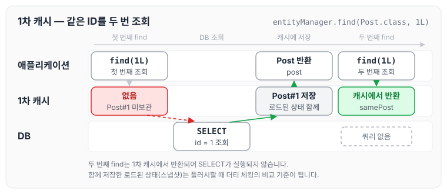
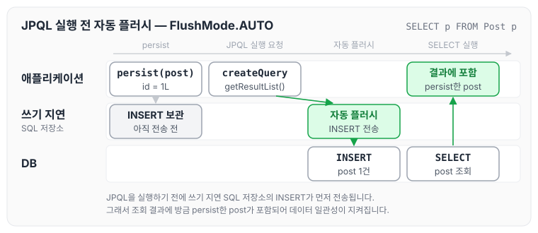
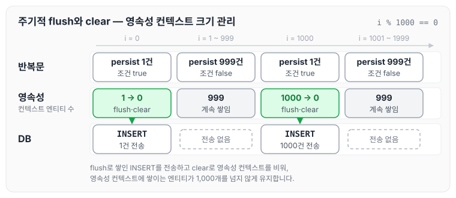

이전에 [영속성 컨텍스트](../jpa-persistence-context/)에 대해 작성하였습니다. 그 글에서는 엔티티의 생명주기와 1차 캐시, 쓰기 지연, 변경 감지, 플러시의 기본 동작을 정리하였습니다. 오늘은 Hibernate를 기준으로 영속성 컨텍스트의 내부 구조와 플러시 발생 시점, 플러시 모드, 그리고 배치 처리와 플러시 모드를 활용한 성능 최적화 방법을 정리하도록 하겠습니다.

## 영속성 컨텍스트의 역할

영속성 컨텍스트는 EntityManager(Hibernate에서는 Session)가 관리하는 1차 캐시입니다. 트랜잭션 안에서 엔티티의 상태를 추적하고, 데이터베이스와의 동기화를 뒤로 미루는(Write-Behind) 방식으로 성능을 최적화합니다. JPA와 Hibernate의 핵심 메커니즘으로, 데이터 일관성과 성능을 함께 보장합니다.

영속성 컨텍스트의 역할은 아래와 같습니다.

- 캐싱: 같은 엔티티를 반복해서 조회하면 데이터베이스에 접근하지 않고 1차 캐시에서 반환하며, 애플리케이션 수준의 반복 읽기(Repeatable Read)를 보장합니다. 예를 들어 같은 트랜잭션 안에서 같은 ID로 조회하면 추가 쿼리 없이 캐시를 사용합니다.
- 변경 감지(Dirty Checking): 엔티티의 상태 변경을 추적하고, 플러시할 때 수정된 데이터를 SQL(UPDATE, INSERT, DELETE)로 변환합니다.
- 쓰기 지연: persist, merge, remove를 호출해도 SQL을 바로 실행하지 않고, 플러시 시점에 모아서 실행해 데이터베이스 왕복을 최소화합니다.

## 내부 구조

- Hibernate의 영속성 컨텍스트는 엔티티를 `Map<EntityKey, Object>`에 저장하며, 각 엔티티는 로드된 상태(Loaded State, 스냅샷)와 함께 관리됩니다.
- 로드된 상태는 더티 체킹을 할 때 비교 기준으로 사용되어 변경된 속성을 감지합니다.
- 스냅샷 예시: 엔티티를 로드할 때 초기 상태를 저장해 두고, 플러시할 때 현재 상태와 비교해 변경된 엔티티의 UPDATE SQL을 만듭니다. 기본 설정에서는 변경된 속성만이 아니라 모든 컬럼을 UPDATE하며, 변경된 컬럼만 반영하려면 `@DynamicUpdate`를 사용합니다.

같은 트랜잭션 안에서 같은 엔티티를 조회하면 캐시를 활용해 쿼리 수를 줄일 수 있습니다.

```java
Post post = entityManager.find(Post.class, 1L); // 데이터베이스 조회
Post samePost = entityManager.find(Post.class, 1L); // 1차 캐시에서 반환, 추가 쿼리 없음
```

두 번의 `find`가 1차 캐시를 어떻게 사용하는지 그리면 아래와 같습니다.



첫 번째 조회에서만 SELECT가 실행되고, 두 번째 조회는 1차 캐시에서 반환됩니다. 이때 함께 저장한 로드된 상태가 이후 더티 체킹의 비교 기준이 됩니다.

## 플러시

플러시는 영속성 컨텍스트의 변경 내용을 데이터베이스에 동기화하는 과정입니다. 더티 체킹으로 변경된 엔티티를 찾아 INSERT, UPDATE, DELETE 쿼리를 쓰기 지연 SQL 저장소에 등록하고, 이 쿼리들을 데이터베이스에 전송합니다. 전송된 변경 내용은 트랜잭션이 커밋되어야 확정됩니다.

### 플러시 발생 시점

- 명시적 플러시: `entityManager.flush()`를 직접 호출해 즉시 동기화합니다.
- 트랜잭션 커밋: 트랜잭션을 커밋하기 직전에 자동으로 플러시가 발생해 모든 변경 사항이 반영됩니다.
- JPQL/Criteria 쿼리: 쿼리를 실행하기 전에 관련 테이블(쿼리 공간, Query Space)에 변경 사항이 있으면 자동으로 플러시합니다. 데이터 일관성을 보장하기 위해서입니다.
- 네이티브 SQL 쿼리: 쿼리 공간을 등록하지 않으면 항상 플러시하고, 등록하면 관련 테이블만 플러시합니다(예: `addSynchronizedEntityClass` 사용).

### 플러시 모드

- AUTO(기본값): 트랜잭션을 커밋하거나 JPQL 쿼리를 실행하기 전에 플러시합니다. Hibernate 5.2 이후 JPA 표준과 동기화되어 쿼리와 관련된 테이블만 플러시합니다.
- COMMIT: 트랜잭션을 커밋할 때만 플러시합니다. 쿼리 전 플러시를 생략하므로 성능이 향상됩니다.
- ALWAYS(Hibernate 전용): 모든 쿼리를 실행하기 전에 플러시합니다. 불필요한 플러시로 성능이 저하될 위험이 있습니다.
- MANUAL(Hibernate 전용): 명시적으로 호출한 플러시만 수행하며, 고급 최적화에 사용합니다.

플러시 모드는 아래와 같이 설정합니다.

```java
entityManager.setFlushMode(FlushModeType.COMMIT); // JPA
session.setHibernateFlushMode(FlushMode.MANUAL); // Hibernate
```

아래는 JPQL을 실행하기 전에 자동으로 플러시되어 데이터 일관성이 보장되는 예시입니다.

```java
Post post = new Post("Hibernate");
post.setId(1L);
entityManager.persist(post);
List<Post> posts = entityManager.createQuery("SELECT p FROM Post p", Post.class).getResultList();
// JPQL 실행 전 자동 플러시, INSERT 쿼리 실행
```

`persist`부터 JPQL 결과를 받기까지의 흐름은 아래와 같습니다.



JPQL은 1차 캐시가 아니라 데이터베이스를 조회하기 때문에, 쓰기 지연 SQL 저장소에 남아 있던 INSERT를 먼저 전송해야 조회 결과에 방금 저장한 post가 포함됩니다.

## 성능 최적화

### 쓰기 지연과 배치 처리

- persist, merge, remove를 호출해도 SQL을 바로 실행하지 않고, 플러시 시점에 배치로 처리해 데이터베이스 왕복을 최소화합니다. 다만 식별자 생성 전략이 IDENTITY이면 `persist` 시점에 INSERT가 바로 실행되어 배치로 모을 수 없습니다. IDENTITY 전략은 [엔티티 매핑](../jpa-entity-mapping/)에 정리하였습니다.
- 배치 처리 설정: `hibernate.jdbc.batch_size=50`, `hibernate.order_inserts=true`, `hibernate.order_updates=true`로 같은 테이블의 SQL을 묶어 성능을 높입니다.
- ID 생성 연계: 대규모 배치 처리에서는 `GenerationType.SEQUENCE`(예: `allocationSize=50`)로 ID를 미리 할당받고, 플러시와 함께 사용해 배치 삽입을 최적화합니다. 예를 들어 100만 건을 삽입할 때 `hibernate.jdbc.batch_size=100`과 주기적인 flush를 함께 사용하면 처리 속도를 10배 향상시킬 수 있습니다.

```java
@Entity
public class Post {
    @Id @GeneratedValue(strategy = GenerationType.SEQUENCE, generator = "post_seq")
    @SequenceGenerator(name = "post_seq", sequenceName = "post_sequence", allocationSize = 50)
    private Long id;
    private String title;
}
```

### 더티 체킹 최적화

- 기본 더티 체킹은 Java 리플렉션으로 모든 속성을 비교하므로, 엔티티나 속성 수가 많으면 성능이 저하됩니다(예: 1000개 엔티티를 처리할 때 수백 ms 소요).
- 바이트코드 향상으로 변경된 속성만 추적하면 플러시 시간을 줄일 수 있습니다. 바이트코드 향상은 엔티티에 애너테이션을 붙이는 방식이 아니라 Hibernate의 Maven·Gradle 빌드 플러그인으로 적용하며, 플러그인의 `enableDirtyTracking` 옵션이 변경된 속성을 추적하는 기능입니다. 아래 엔티티 코드는 그대로 두고, 빌드할 때 플러그인이 바이트코드를 향상시킵니다.

```java
@Entity
public class Post {
    @Id @GeneratedValue
    private Long id;
    private String title;
}
```

### 영속성 컨텍스트 관리

- 대량 데이터(예: 100만 건)를 처리하면 영속성 컨텍스트의 크기가 커져 메모리 문제(OutOfMemoryError)가 발생할 수 있습니다.
- 주기적으로 flush와 clear를 호출해 관리하면 메모리 사용량을 줄이고 성능을 유지할 수 있습니다.

```java
for (int i = 0; i < 10000; i++) {
    Post post = new Post("Post " + i);
    entityManager.persist(post);
    if (i % 1000 == 0) {
        entityManager.flush(); // 변경 사항 동기화
        entityManager.clear(); // 영속성 컨텍스트 초기화
    }
}
```

반복문이 돌면서 영속성 컨텍스트에 쌓이는 엔티티 수가 어떻게 바뀌는지 그리면 아래와 같습니다.



`i % 1000 == 0`일 때마다 flush로 INSERT를 전송하고 clear로 영속성 컨텍스트를 비우기 때문에, 쌓이는 엔티티가 1,000개를 넘지 않습니다.

### 플러시 모드 최적화

- `FlushMode.COMMIT`으로 쿼리 실행 전의 불필요한 플러시를 막으면 트랜잭션 처리 속도가 향상됩니다.
- 네이티브 SQL 쿼리에서 쿼리 공간을 등록하면 플러시를 최소화해 성능을 최적화할 수 있습니다.

```java
session.createSQLQuery("SELECT * FROM post")
       .addSynchronizedEntityClass(Post.class);
```

### 실무 팁

- 대량 배치 처리에서는 MANUAL 모드와 네이티브 쿼리를 조합해 플러시를 제어하면 메모리 사용량을 줄일 수 있습니다.
- Hypersistence Optimizer로 불필요한 플러시(예: RedundantSessionFlushEvent)를 진단할 수 있습니다.
- 예를 들어 100만 건의 데이터를 마이그레이션할 때 `hibernate.jdbc.batch_size=100`, 주기적인 flush/clear, `GenerationType.SEQUENCE`를 조합하면 처리 시간을 10배 단축할 수 있습니다.

### 모니터링

Hibernate 통계(`hibernate.generate_statistics=true`)로 플러시 시간, 쿼리 실행 횟수, 더티 체킹 비용을 분석할 수 있습니다.

## 권장사항

- 영속성 컨텍스트 크기를 최소화하고, 주기적인 flush와 clear로 메모리를 관리합니다.
- `FlushMode.COMMIT` 또는 MANUAL로 불필요한 플러시를 막아 쿼리 성능을 최적화합니다.
- 바이트코드 향상(빌드 플러그인의 `enableDirtyTracking`)으로 더티 체킹 성능을 개선합니다.
- 네이티브 쿼리를 사용할 때는 쿼리 공간을 명시(`addSynchronizedEntityClass`)해 플러시를 최소화합니다.
- Hibernate 통계(`hibernate.generate_statistics=true`)로 플러시 시간과 배치 처리 성능을 분석하고 병목 지점을 찾습니다.
- 대량 데이터를 처리할 때는 `hibernate.jdbc.batch_size`(예: 50~100)와 `GenerationType.SEQUENCE`(예: `allocationSize=50`)로 ID 생성과 삽입을 최적화합니다.
- Hypersistence Optimizer로 플러시와 배치 처리의 비효율(예: 불필요한 플러시, 더티 체킹 오버헤드)을 진단합니다.
- 테스트 환경에서 Testcontainers를 사용해 대량 데이터 처리 시나리오(예: 10만 건 삽입)로 성능을 검증합니다.

## 마무리

오늘은 Hibernate를 기준으로 영속성 컨텍스트의 내부 구조와 플러시 발생 시점, 플러시 모드, 그리고 쓰기 지연과 배치 처리, 플러시 모드를 활용한 성능 최적화 방법에 대해 정리하였습니다. 대량 데이터를 다룰 때는 영속성 컨텍스트의 크기와 플러시 시점을 함께 살펴보는 것이 중요할 것 같습니다.

참조 : [세계 자바 챔피언, Vlad Mihalcea 강의 로드맵 - 인프런](https://www.inflearn.com/roadmaps/9183)
