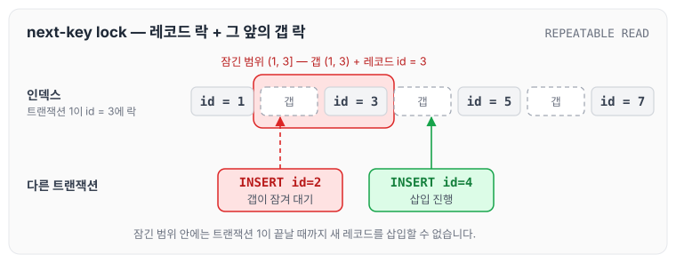
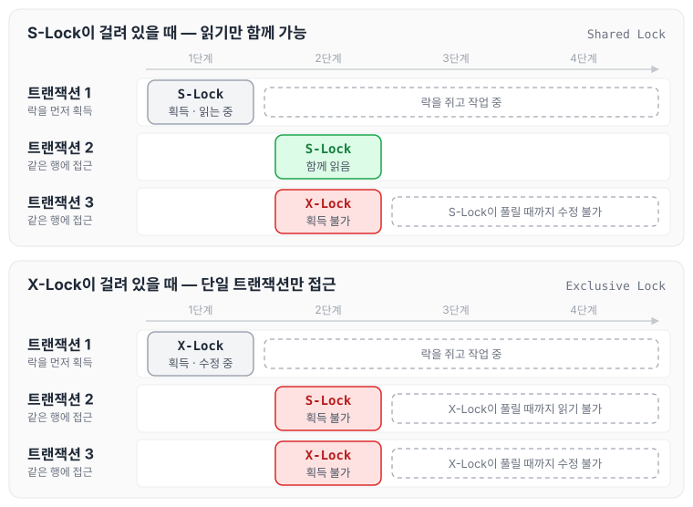
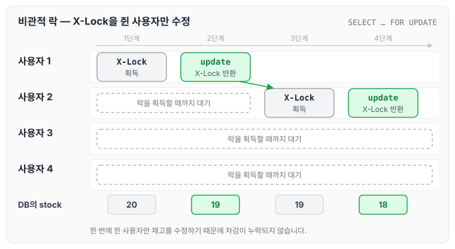
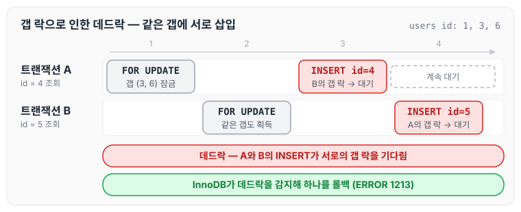

이전에 [낙관적 락](../optimistic-lock/)에 대해 작성하였습니다. 낙관적 락을 요약하자면 아래와 같습니다.

- 데이터를 읽을 때 버전 상태를 확인
- 데이터를 수정할 때 현재 데이터의 버전을 확인합니다. 이때 다른 사용자가 수정하지 않았으면 업데이트가 진행되고, 버전이 변경되었으면 충돌이 난 것으로 확인하여 수정 작업은 실패하고, 충돌된 데이터를 해결하기 위한 추가 작업을 애플리케이션에서 진행합니다.

다만 낙관적 락에는 아래와 같은 단점이 있습니다.

- 데이터 수정이 많은 로직에서는 충돌이 많이 발생하여, 유저의 피로감이 높아져 서비스 유입에 좋지 않은 결과를 초래할 것입니다.

이를 해결하는 방법 중 하나로 비관적 락을 사용합니다. 오늘은 비관적 락에 대해 정리하겠습니다.

## 비관적 락(Pessimistic)

- 모든 트랜잭션에서 충돌이 날 것이라고 가정하고, 우선적으로 Lock을 점유하여 다른 트랜잭션이 접근하지 못하게 하는 방법입니다.
- 데이터를 수정할 때 X-Lock을 점유하고 있으므로, 충돌이 발생할 가능성이 적습니다.
- 사용자가 수정을 마칠 때까지 다른 사용자는 락 대기 상태로 기다립니다. InnoDB에서 행 락을 기다리는 트랜잭션은 CPU를 쓰며 반복 확인하지 않고, 락이 풀릴 때까지 잠든 채로 대기하다가 `innodb_lock_wait_timeout`(기본 50초)이 지나면 에러로 끝납니다. 이 때문에 비관적 락을 사용할 때는 Time-out 설정을 통해 언제까지 대기할 것인지 꼭 지정해 줘야 합니다.
- InnoDB의 기본 격리 수준(REPEATABLE READ)에서 비관적 락(`SELECT ... FOR UPDATE`)으로 인덱스를 검색하면 next-key lock을 사용하기 때문에, next-key lock과 갭 락이 무엇이고 어떻게 동작하는지 알아두면 비관적 락을 사용할 때 큰 도움이 될 것입니다.
    - 갭 락은 인덱스 레코드 사이의 빈 구간인 "갭"에 거는 락이고, next-key lock은 인덱스 레코드에 거는 레코드 락과 그 레코드 바로 앞의 갭 락을 합친 것입니다. 이는 트랜잭션이 실행되는 동안 해당 범위에 새로운 레코드가 삽입되는 것을 방지합니다. 갭락 설명 블로그 : [https://idea-sketch.tistory.com/46](https://idea-sketch.tistory.com/46)

id = 3 레코드에 next-key lock이 걸렸을 때 잠기는 범위와 삽입이 막히는 위치를 그리면 다음과 같습니다.



next-key lock은 레코드 id = 3과 그 앞의 갭 (1, 3), 즉 (1, 3] 범위를 잠그기 때문에, 그 사이에 들어갈 id = 2는 삽입하지 못하고 대기합니다. 잠기지 않은 갭 (3, 5)에 들어가는 id = 4는 그대로 삽입됩니다.

> 💡 S-Lock이란?
> Shared Lock이라고 하며, 다수의 트랜잭션이 동시에 특정 리소스(예: 데이터베이스의 행이나 테이블)를 읽을 수 있도록 허용하는 잠금 메커니즘입니다. 가장 큰 특징으로는 **S-Lock이 걸려 있는 동안에는 X-Lock을 획득할 수 없으며, 수정이 불가능합니다.**
>
> X-Lock이란?
> Exclusive Lock이라 하며, 데이터베이스의 특정 리소스에 단일 트랜잭션만 접근 가능하도록 합니다. X-Lock이 걸린 상태에서는 **S-Lock, X-Lock이 접근하지 못합니다.**

S-Lock과 X-Lock이 걸려 있을 때 다른 트랜잭션이 같은 행에 접근하면 다음과 같이 동작합니다.



S-Lock끼리는 함께 읽을 수 있지만, X-Lock은 다른 어떤 락과도 함께 걸리지 않습니다.

## 동시성 테스트

아래 코드는 동시성 테스트를 위한 코드입니다. 큰 특징은 다음과 같습니다.

1. newFixedThreadPool
    - Java의 스레드를 생성하는 함수로, 10개의 스레드를 생성하였습니다.
2. CountDownLatch
    - new CountDownLatch(THREAD_COUNT) : 스레드 작업 카운트를 적시하여, 차후에 함수에서 사용합니다.
    - latch.await(10, TimeUnit.SECONDS) : 위에 적시한 스레드 카운트가 0이 될 때까지 기다리고 이후에 작업을 진행합니다.

```java
package com.webtoonrank.demo.core.domain.product.service;

@SpringBootTest
public class ProductServiceTest {

    @Autowired
    private ProductService productService;

    @Autowired
    private ProductRepository productRepository;

    private static final int THREAD_COUNT = 10;

    @BeforeEach
    public void setup() {
        ProductEntity product = new ProductEntity("Test Product", 20);
        productRepository.save(product);
    }

    @Test
    public void testConcurrentStockDecrease() throws InterruptedException {
        ExecutorService executorService = Executors.newFixedThreadPool(THREAD_COUNT);
        CountDownLatch latch = new CountDownLatch(THREAD_COUNT);

        ProductEntity productEntity = productRepository.findAll().get(0);
        Long productId = productEntity.getId();

        for (int i = 0; i < THREAD_COUNT; i++) {
            executorService.submit(() -> {
                try {
                    boolean success = productService.decreaseStock(productId, 1);
                    System.out.println("Stock decreased: " + success);
                } catch (RuntimeException runtimeException) {
                    System.out.println(runtimeException.getMessage());
                } finally {
                    latch.countDown();
                }
            });
        }

        latch.await(10, TimeUnit.SECONDS);

        ProductEntity product = productRepository.findById(productId).orElseThrow();
        System.out.println("Final stock: " + product.getStock());
        assertThat(product.getStock()).isEqualTo(20 - THREAD_COUNT);
    }
}
```

상품 ProductEntity로 상품의 재고를 세팅한 후, decreaseStock을 통해 재고를 줄이는 로직입니다.

```java
package com.webtoonrank.demo.storage;

import jakarta.persistence.*;
import lombok.Getter;

@Entity
@Getter
public class ProductEntity {

    @Id
    @GeneratedValue(strategy = GenerationType.IDENTITY)
    private Long id;

    private String name;
    private int stock;

    public ProductEntity(String name, int stock) {
        this.name = name;
        this.stock = stock;
    }

    public ProductEntity() {

    }

    public boolean decreaseStock(int quantity) {
        if (this.stock >= quantity) {
            this.stock -= quantity;
            return true;
        } else {
            return false;
        }
    }
}
```

일반적으로 생각하면 스레드 개수만큼 `productService.decreaseStock(productId, 1);`로 차감하여 `[초기 재고 수량 20 - 스레드의 카운트]`만큼 나올 것이라고 기대합니다. 하지만 실제로는 기대한 값이 나오지 않습니다.

이렇게 나오는 이유는 데이터가 커밋되기 전에 조회되어, 재고 카운트를 20으로 인지하기 때문입니다. 스레드 두 개로 순서를 그리면 다음과 같습니다.


두 스레드가 같은 재고 20을 읽고 각자 19로 저장하기 때문에 동시성 이슈가 발생합니다.

## 비관적 락을 사용한 동시성 문제 해결

사용자 1이 먼저 락을 획득하면 아래와 같이 동작합니다.

1. 사용자 1: X-Lock을 획득하여 다른 사용자가 접근하지 못하게 합니다.
2. 사용자 2: 락 대기 상태로 락을 획득할 때까지 대기합니다.
3. 사용자 3: 같은 사유로 락을 획득할 때까지 대기합니다.
4. 사용자 4: 같은 사유로 락을 획득할 때까지 대기합니다.

사용자 1이 작업을 마치면 사용자 2가 락을 획득합니다.

1. 사용자 1: 데이터를 update or insert 후 X-Lock을 반환합니다.
2. 사용자 2: X-Lock을 획득하여 update or insert를 진행합니다.
3. 사용자 3: 락 대기 상태로 락을 획득할 때까지 대기합니다.
4. 사용자 4: 같은 사유로 락을 획득할 때까지 대기합니다.

두 과정을 이어서 그리면 다음과 같습니다.



X-Lock을 쥔 사용자만 재고를 수정하고 나머지는 차례를 기다리기 때문에, 앞에서 본 것처럼 같은 재고를 두 번 읽는 일이 생기지 않습니다.

### 비관적 락을 사용하는 이유

- **데이터 무결성 보장**: 데이터 무결성을 강력하게 보장할 수 있어, 특히 트랜잭션 처리에서 안정성을 높일 수 있습니다.
- **충돌 방지**: 데이터에 락을 설정함으로써, 동시에 발생할 수 있는 데이터 수정 충돌을 효과적으로 방지할 수 있습니다.

### 비관적 락을 사용하면 좋은 경우

- 여러 사용자가 동시에 같은 데이터를 수정할 가능성이 높은 경우입니다. 예를 들어 은행 시스템의 계좌 이체와 같은 트랜잭션 처리에서 자주 사용됩니다.
- 데이터의 정확성과 일관성이 매우 중요한 경우

## 실습

JPA에서 비관적 락을 사용하는 방법은 아래와 같습니다.

```java
public interface ProductRepository extends JpaRepository<ProductEntity, Long> {
    @Lock(LockModeType.PESSIMISTIC_WRITE)
    @Query("SELECT p FROM ProductEntity p WHERE p.id = :id")
    @QueryHints({@QueryHint(name = "javax.persistence.lock.timeout", value = "10000")})
    Optional<ProductEntity> findByIdWithPessimisticLock(Long id);
}
```

실행하면 select for update를 사용하여 X-Lock을 획득하는 것을 볼 수 있습니다.

동시성 테스트 또한 문제없이 통과하였습니다.

- final stock : 10

## 주의할 점

비관적 락을 사용하면서 중요한 점은, timeout을 따로 지정하지 않으면 InnoDB의 `innodb_lock_wait_timeout`(기본 50초)만큼 락을 기다리게 되므로 서비스에 맞게 지정하는 것이 좋다는 것입니다. 또한 갭 락과 next-key lock으로 인해 발생할 수 있는 문제에 대해 생각하고 구현해야 합니다.

### 갭 락으로 인한 데드락 예제

비관적 락에서 갭 락에 의해 데드락이 발생하는 예제는 아래와 같습니다. `users` 테이블에 id가 1, 3, 6인 레코드가 있고, 격리 수준은 InnoDB 기본값인 REPEATABLE READ라고 가정합니다.

1. 트랜잭션 A가 `users` 테이블에서 존재하지 않는 `id = 4`를 조회합니다. 일치하는 레코드가 없기 때문에 `3 < id < 6` 갭에 갭 락을 설정합니다.

```sql
START TRANSACTION;
SELECT * FROM users WHERE id = 4 FOR UPDATE; -- 갭 락: 3 < id < 6
```

2. 트랜잭션 B가 동시에 존재하지 않는 `id = 5`를 조회하며, 같은 `3 < id < 6` 갭에 갭 락을 설정합니다. 갭 락끼리는 서로 충돌하지 않기 때문에 B도 대기 없이 락을 얻습니다.

```sql
START TRANSACTION;
SELECT * FROM users WHERE id = 5 FOR UPDATE; -- 갭 락: 3 < id < 6
```

3. 트랜잭션 A가 `id = 4`에 레코드를 삽입하려고 시도하지만, 이 갭은 트랜잭션 B의 갭 락에도 잠겨 있어 대기합니다.

```sql
INSERT INTO users (id, name) VALUES (4, 'Alice'); -- 트랜잭션 B의 갭 락 때문에 대기
```

4. 트랜잭션 B도 `id = 5`에 레코드를 삽입하려고 시도하지만, 이 갭은 트랜잭션 A의 갭 락에도 잠겨 있어 대기합니다.

```sql
INSERT INTO users (id, name) VALUES (5, 'Bob'); -- 트랜잭션 A의 갭 락 때문에 대기
```

네 단계를 순서대로 그리면 다음과 같습니다.



### 결과

트랜잭션 A와 트랜잭션 B의 INSERT는 각각 상대방이 쥔 갭 락 때문에 대기하므로, 두 트랜잭션은 교착 상태(데드락)에 빠지게 됩니다. InnoDB는 이 데드락을 감지하고, 둘 중 하나의 트랜잭션을 롤백(`ERROR 1213`)하여 문제를 해결합니다. DB가 데드락을 감지하고 롤백하는 방식은 [데드락의 네 가지 조건과 해결 전략](../deadlock/)에서 따로 정리하였습니다.

## 마무리

오늘은 비관적 락에 대해 정리하였습니다. 다음에는 [분산락](../distributed-lock/)에 대해 작성하도록 하겠습니다.
