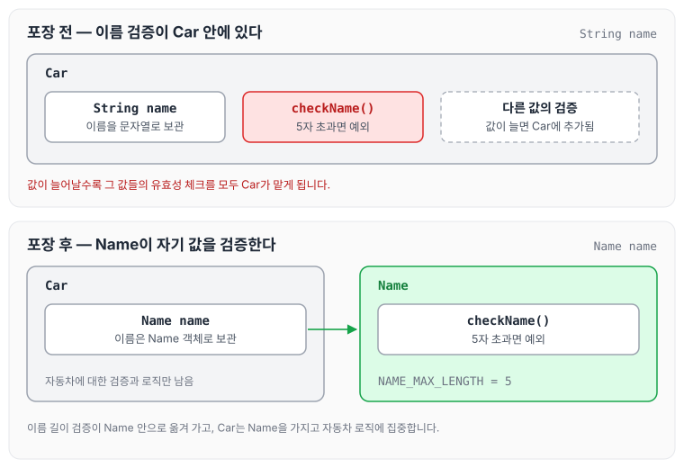

오늘은 원시값 포장에 대해 정리하도록 하겠습니다. [자동차 경주 우승자 — 4단계](../ccj-11-racing-winner/) 미션에서 자동차 이름을 클래스로 포장해 보라는 리뷰를 받았고, 그때 알아본 내용을 기록합니다.

변수를 선언하는 방법에는 두 가지가 있습니다. 원시 타입 변수를 그대로 선언하는 방법과, 원시 타입 변수를 객체화하는 방법입니다. 원시 타입 변수를 객체화하면 어떤 이점이 있는지 확인해 보겠습니다.

## 객체 내부에서 유효성 검증

원시 타입 변수를 객체화하면 객체 내부에서 값의 유효성을 체크할 수 있습니다. 먼저 자동차 객체가 이름을 `String`으로 가지고 있는 경우입니다.

```java
public Car(String name) {
    checkName(name);
    this.name = name;
}

public void checkName(String name) {
        if (name.length() > 5) {
            throw new IllegalArgumentException("이름이 다섯자 이상입니다.");
        }
    }
```

위와 같이 자동차 객체에 이름이 변수로 선언되어 있다면, 그 값이 유효한지 체크하는 일도 자동차 객체 안에서 해야 합니다. 이름 변수 하나만 있다면 그나마 괜찮지만, 여러 가지 값이 있다면 모든 유효성 체크를 자동차가 떠안게 됩니다.

이름을 `Name` 객체로 포장하면 아래와 같습니다.

```java
public class Name {
    private static final int NAME_MAX_LENGTH = 5;

    String name;

    public Name(String name) {
        checkName(name);
        this.name = name;
    }

    private void checkName(String name) {
        if (name.length() > NAME_MAX_LENGTH) {
            throw new IllegalArgumentException("이름이 다섯자 이상입니다.");
        }
    }

    public String getName() {
        return name;
    }

}
```

원시 타입 변수를 객체로 만들면 그 값의 유효성 체크가 자연스럽게 해당 객체로 들어가고, `Car` 객체에는 순수하게 자동차에 대한 유효성 검사와 로직만 남습니다. 이렇게 하면 관리하는 측면에서도 신규 기능 추가와 수정을 좀 더 명확하게 할 수 있습니다.

검증 로직이 어디에 있는지 포장 전후를 비교하면 아래와 같습니다.



포장 전에는 이름 길이 검증이 `Car` 안에 있고, 다른 값이 늘어날수록 그 값들의 검증도 `Car`에 쌓입니다. 포장 후에는 이름 검증을 `Name`이 맡고, `Car`는 `Name`을 가지고 자동차 로직에 집중합니다. 원시값 대신 컬렉션을 감싸는 방법은 [일급컬렉션](../first-class-collection/)에 정리하였습니다.

## 마무리

오늘은 원시값 포장에 대해 정리하였습니다. 좀 더 추가적인 내용도 검색해서 보았지만, 아직 실습에 적용하지는 않았기 때문에 적용해 본 뒤 이어서 작성하도록 하겠습니다.
