이전에 [예제 도메인 모델](../querydsl-domain-model/)에 대해 작성하였습니다. 이번에는 앞에서 만든 Member, Team 엔티티로 JPQL과 Querydsl을 비교해 보고, Querydsl의 기본 문법인 검색 조건, 결과 조회, 정렬, 페이징, 집합, 조인, 서브 쿼리, Case 문, 상수와 문자 더하기에 대해 정리하도록 하겠습니다.

## 시작 - JPQL vs Querydsl

### 테스트 기본 코드

테스트마다 `@BeforeEach`에서 팀 두 개와 회원 네 명을 저장해 두고 시작합니다. 데이터는 [예제 도메인 모델](../querydsl-domain-model/)의 테스트와 같습니다.

```java
@SpringBootTest
@Transactional
public class QuerydslBasicTest {

    @Autowired
    EntityManager em;

    JPAQueryFactory queryFactory;

    @BeforeEach
    public void before() {
        queryFactory = new JPAQueryFactory(em);

        Team teamA = new Team("teamA");
        Team teamB = new Team("teamB");
        em.persist(teamA);
        em.persist(teamB);

        Member member1 = new Member("member1", 10, teamA);
        Member member2 = new Member("member2", 20, teamA);

        Member member3 = new Member("member3", 30, teamB);
        Member member4 = new Member("member4", 40, teamB);

        em.persist(member1);
        em.persist(member2);
        em.persist(member3);
        em.persist(member4);
    }
}
```

### Querydsl vs JPQL

member1을 찾는 같은 쿼리를 JPQL과 Querydsl로 각각 작성하면 아래와 같습니다.

```java
@Test
    public void startJPQL() {
        //member1을 찾아라.
        String qlString =
                "select m from Member m " +
                        "where m.username = :username";
        Member findMember = em.createQuery(qlString, Member.class)
                .setParameter("username", "member1")
                .getSingleResult();
        assertThat(findMember.getUsername()).isEqualTo("member1");
    }

    @Test
    public void startQuerydsl() {
        // member1을 찾아라.
        QMember m = new QMember("m");

        Member findMember = queryFactory
                .select(m)
                .from(m)
                .where(m.username.eq("member1"))
                .fetchOne();

        assertThat(findMember.getUsername()).isEqualTo("member1");
    }
```

- EntityManager로 JPAQueryFactory를 생성합니다.
- Querydsl은 JPQL 빌더입니다.

### JPQL vs Querydsl 비교

- JPQL: 문자(실행 시점 오류), Querydsl: 코드(컴파일 시점 오류)
- JPQL: 파라미터 바인딩 직접, Querydsl: 파라미터 바인딩 자동 처리

두 방식의 차이를 위 예제로 나타내면 아래와 같습니다.

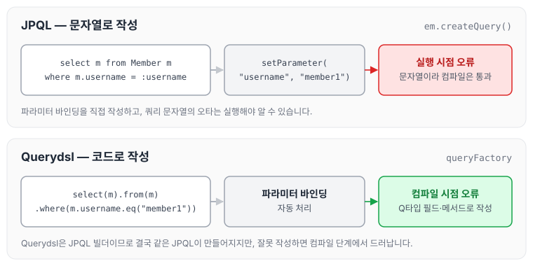

JPQL은 쿼리가 문자열이라 오타가 있어도 컴파일은 되고, 실행해서 쿼리를 파싱할 때 오류가 납니다. Querydsl은 Q타입의 필드와 메서드로 쿼리를 작성하기 때문에 잘못 작성하면 컴파일 단계에서 바로 확인할 수 있습니다.

### JPAQueryFactory를 필드로

```java
package study.querydsl;

import com.querydsl.jpa.impl.JPAQueryFactory;
import org.assertj.core.api.Assertions;
import org.junit.jupiter.api.BeforeEach;
import org.junit.jupiter.api.Test;
import org.springframework.beans.factory.annotation.Autowired;
import org.springframework.boot.test.context.SpringBootTest;
import org.springframework.transaction.annotation.Transactional;
import study.querydsl.entitiy.Member;
import study.querydsl.entitiy.QMember;
import study.querydsl.entitiy.Team;

import javax.persistence.EntityManager;

import static org.assertj.core.api.Assertions.*;

@SpringBootTest
@Transactional
public class QuerydslBasicTest {

    @Autowired
    EntityManager em;

    JPAQueryFactory queryFactory;

    @BeforeEach
    public void before() {
        queryFactory = new JPAQueryFactory(em);

        Team teamA = new Team("teamA");
        Team teamB = new Team("teamB");
        em.persist(teamA);
        em.persist(teamB);

        Member member1 = new Member("member1", 10, teamA);
        Member member2 = new Member("member2", 20, teamA);

        Member member3 = new Member("member3", 30, teamB);
        Member member4 = new Member("member4", 40, teamB);

        em.persist(member1);
        em.persist(member2);
        em.persist(member3);
        em.persist(member4);
    }

    @Test
    public void startJPQL() {
        //member1을 찾아라.
        String qlString =
                "select m from Member m " +
                        "where m.username = :username";
        Member findMember = em.createQuery(qlString, Member.class)
                .setParameter("username", "member1")
                .getSingleResult();
        assertThat(findMember.getUsername()).isEqualTo("member1");
    }

    @Test
    public void startQuerydsl() {
        // member1을 찾아라.
        QMember m = new QMember("m");

        Member findMember = queryFactory
                .select(m)
                .from(m)
                .where(m.username.eq("member1"))
                .fetchOne();

        assertThat(findMember.getUsername()).isEqualTo("member1");
    }
}
```

JPAQueryFactory를 필드로 두면 여러 쓰레드가 함께 사용하게 되므로 동시성 문제를 생각해 볼 수 있습니다. 동시성 문제는 JPAQueryFactory를 생성할 때 제공하는 EntityManager(em)에 달려 있습니다. 스프링 프레임워크는 여러 쓰레드에서 동시에 같은 EntityManager에 접근해도 트랜잭션마다 별도의 영속성 컨텍스트를 제공하기 때문에, 동시성 문제는 걱정하지 않아도 됩니다.

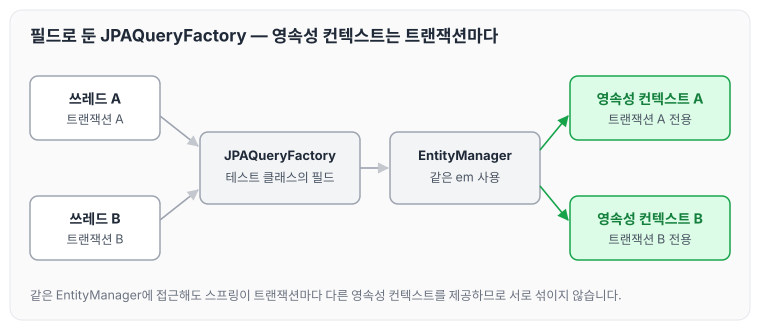

영속성 컨텍스트는 [영속성 컨텍스트](../jpa-persistence-context/)에 정리해 두었습니다.

## 기본 Q-Type 활용

### Q클래스 인스턴스를 사용하는 2가지 방법

```java
QMember qMember = new QMember("m"); // 별칭 직접 지정
QMember qMember = QMember.member; // 기본 인스턴스 사용
```

### 기본 인스턴스를 static import와 함께 사용

```java
@Test
    public void startQuerydsl3() {
        // member1을 찾아라.

        Member findMember = queryFactory
                .select(member)
                .from(member)
                .where(member.username.eq("member1"))
                .fetchOne();

        assertThat(findMember.getUsername()).isEqualTo("member1");
    }
```

### 실행되는 JPQL 확인

다음 설정을 추가하면 실행되는 JPQL을 볼 수 있습니다.

```yaml
spring.jpa.properties.hibernate.use_sql_comments: true
```

Querydsl로 작성한 코드는 JPQL로 만들어진 뒤 다시 SQL로 바뀌어 실행됩니다. 위 설정을 켜면 SQL 로그에 그 JPQL이 주석으로 함께 남습니다.

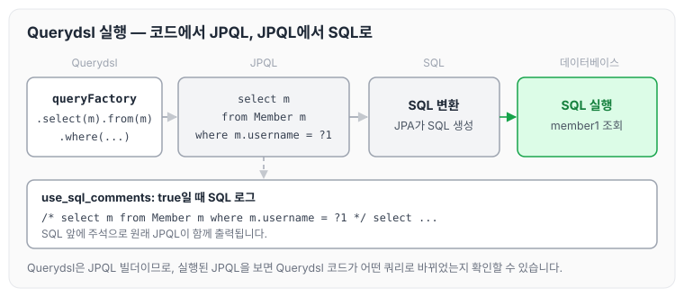

> 참고: 같은 테이블을 조인해야 하는 경우가 아니면 기본 인스턴스를 사용합니다.

## 검색 조건 쿼리

### JPQL이 제공하는 검색 조건

Querydsl은 JPQL이 제공하는 모든 검색 조건을 제공합니다.

```java
member.username.eq("member1") // username = 'member1'
member.username.ne("member1") // username != 'member1'
member.username.eq("member1").not() // username != 'member1'

member.username.isNotNull() //이름이 is not null

member.age.in(10, 20) // age in (10,20)
member.age.notIn(10, 20) // age not in (10, 20)
member.age.between(10,30) //between 10, 30

member.age.goe(30) // age >= 30
member.age.gt(30) // age > 30
member.age.loe(30) // age <= 30
member.age.lt(30) // age < 30

member.username.like("member%") //like 검색
member.username.contains("member") // like ‘%member%’ 검색
member.username.startsWith("member") //like ‘member%’ 검색
...
```

### AND 조건을 파라미터로 처리

```java
@Test
    public void searchAndParam() {
        List<Member> result1 = queryFactory
                .selectFrom(member)
                .where(member.username.eq("member1"),
                        member.age.eq(10))
                .fetch();
        assertThat(result1.size()).isEqualTo(1);
    }
```

- `where()`에 파라미터로 검색조건을 추가하면 `AND` 조건이 추가됩니다.
- 이 경우 `null` 값은 무시됩니다. 이를 이용해 메서드 추출로 동적 쿼리를 깔끔하게 만들 수 있으며, [중급 문법](../querydsl-intermediate/)의 Where 다중 파라미터 사용에서 정리합니다.

## 결과 조회

- `fetch()`: 리스트 조회, 데이터 없으면 빈 리스트 반환
- `fetchOne()`: 단 건 조회
    - 결과가 없으면: `null`
    - 결과가 둘 이상이면: `com.querydsl.core.NonUniqueResultException`
- `fetchFirst()`: `limit(1).fetchOne()`
- `fetchResults()`: 페이징 정보 포함, total count 쿼리 추가 실행 → 현재는 사용을 권장하지 않습니다. fetch를 사용하고 이후 Pageable을 사용하는 것을 권장합니다.
- `fetchCount()`: count 쿼리로 변경해서 count 수 조회

결과 건수에 따라 `fetch()`, `fetchOne()`, `fetchFirst()`가 돌려주는 값을 정리하면 아래와 같습니다.

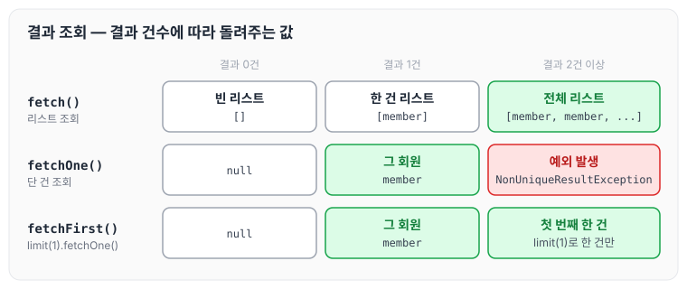

`fetchOne()`은 결과가 둘 이상이면 예외가 발생하므로, 여러 건 중 한 건만 필요하면 `fetchFirst()`를 사용합니다.

```java
//List
List<Member> fetch = queryFactory
			.selectFrom(member)
			.fetch();

//단 건
Member findMember1 = queryFactory
			.selectFrom(member)
			.fetchOne();

//처음 한 건 조회
Member findMember2 = queryFactory
			.selectFrom(member)
			.fetchFirst();

//페이징에서 사용
QueryResults<Member> results = queryFactory
			.selectFrom(member)
			.fetchResults();

//count 쿼리로 변경
long count = queryFactory
			.selectFrom(member)
			.fetchCount();
```

## 정렬

```java
/**
 * 회원 정렬 순서
 * 1. 회원 나이 내림차순(desc)
 * 2. 회원 이름 올림차순(asc)
 * 단 2에서 회원 이름이 없으면 마지막에 출력(nulls last)
 */

@Test
    public void sort() {
        em.persist(new Member(null, 100));
        em.persist(new Member("member5", 100));
        em.persist(new Member("member6", 100));

        List<Member> result = queryFactory
                .selectFrom(member)
                .where(member.age.eq(100))
                .orderBy(member.age.desc(), member.username.asc().nullsLast())
                .fetch();

        Member member5 = result.get(0);
        Member member6 = result.get(1);
        Member memberNull = result.get(2);

        assertThat(member5.getUsername()).isEqualTo("member5");
        assertThat(member6.getUsername()).isEqualTo("member6");
        assertThat(memberNull.getUsername()).isNull();
    }
```

- desc(), asc(): 일반 정렬
- nullsLast(), nullsFirst(): null 데이터 순서 부여

나이가 100인 회원 세 명을 저장 순서와 정렬 결과로 비교하면 아래와 같습니다.

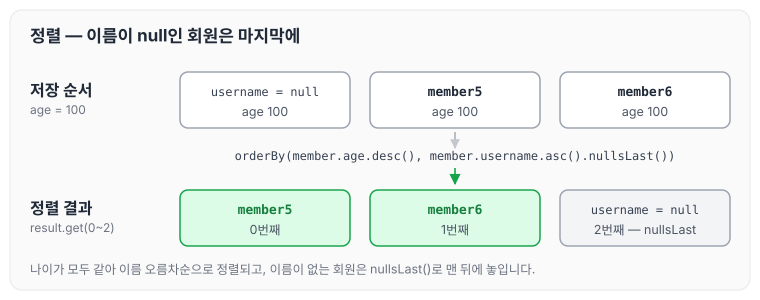

나이가 모두 같으므로 이름 오름차순으로 정렬되고, 이름이 `null`인 회원은 `nullsLast()` 때문에 마지막에 위치합니다.

## 페이징

### 조회 건수 제한

```java
@Test
    public void paging1() {
        List<Member> result = queryFactory
                .selectFrom(member)
                .orderBy(member.username.desc())
                .offset(1) //0부터 시작(zero index)
                .limit(2) //최대 2건 조회
                .fetch();
      
        assertThat(result.size()).isEqualTo(2);
    }
```

이름 내림차순으로 정렬한 회원 네 명에서 `offset(1)`, `limit(2)`가 가져오는 범위는 아래와 같습니다.

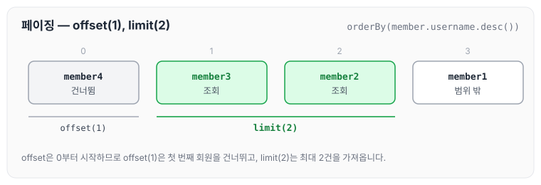

### 전체 조회 수가 필요할 때

조회한 결과와 `PageRequest`로 `PageImpl`을 만들어 페이지 정보를 확인하는 예제입니다.

```java
@Test
    public void paging2() {
        List<Member> fetch = queryFactory
                .selectFrom(member)
                .orderBy(member.username.desc())
                .offset(1)
                .limit(2)
                .fetch();
        Pageable pageRequest = PageRequest.of(1,2, Sort.Direction.DESC,"userName");
        PageImpl<Member> page = new PageImpl<>(fetch, pageRequest, fetch.size());

        List<Member> memberList = page.getContent();
        assertThat(memberList.size()).isEqualTo(2);
        assertThat(page.getTotalElements()).isEqualTo(4);
        assertThat(page.getNumber()).isEqualTo(1);
        assertThat(page.getTotalPages()).isEqualTo(2);
    }
```

## 집합

### 집합 함수

```java
		/**
     * JPQL
     * select
     * COUNT(m), //회원수
     * SUM(m.age), //나이 합
     * AVG(m.age), //평균 나이
     * MAX(m.age), //최대 나이
     * MIN(m.age) //최소 나이
     * from Member m
     */
    @Test
    public void aggregation() throws Exception {
        //given
        List<Tuple> result = queryFactory
                .select(member.count(),
                        member.age.sum(),
                        member.age.avg(),
                        member.age.max(),
                        member.age.min())
                .from(member)
                .fetch();

        //when
        Tuple tuple = result.get(0);

        //then
        assertThat(tuple.get(member.count())).isEqualTo(4);
        assertThat(tuple.get(member.age.sum())).isEqualTo(100);
        assertThat(tuple.get(member.age.avg())).isEqualTo(25);
        assertThat(tuple.get(member.age.max())).isEqualTo(40);
        assertThat(tuple.get(member.age.min())).isEqualTo(10);
    }
```

- JPQL이 제공하는 모든 집합 함수를 제공합니다.
- Tuple은 [중급 문법](../querydsl-intermediate/)의 프로젝션과 결과 반환에서 정리합니다.

### GroupBy 사용

```java
/**
     * 팀의 이름과 각 팀의 평균 연령을 구하라.
     */
    @Test
    public void group() throws Exception {
        List<Tuple> result = queryFactory
                .select(team.name, member.age.avg())
                .from(member)
                .join(member.team, team)
                .groupBy(team.name)
                .fetch();

        Tuple teamA = result.get(0);
        Tuple teamB = result.get(1);

        assertThat(teamA.get(team.name)).isEqualTo("teamA");
        assertThat(teamA.get(member.age.avg())).isEqualTo(15);
        
        assertThat(teamB.get(team.name)).isEqualTo("teamB");
        assertThat(teamB.get(member.age.avg())).isEqualTo(35);
    }
```

회원과 팀을 조인한 뒤 팀 이름으로 묶으면 아래와 같이 팀마다 평균 나이가 계산됩니다.

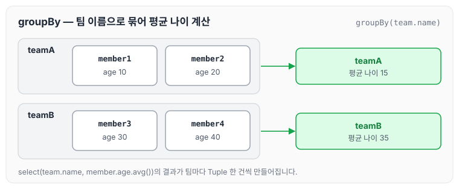

그룹화된 결과를 제한하려면 `having`을 사용합니다.

### groupBy(), having() 예시

```java
…
	.groupBy(item.price)
	.having(item.price.gt(1000))
…
```

## 조인 - 기본 조인

### 기본 조인

조인의 기본 문법은 첫 번째 파라미터에 조인 대상을 지정하고, 두 번째 파라미터에 별칭(alias)으로 사용할 Q 타입을 지정하면 됩니다.

```java
join(조인 대상, 별칭으로 사용할 Q타입)
```

팀 A에 소속된 모든 회원을 조회하는 예제는 아래와 같습니다.

```java
/**
     * 팀 A에 소속된 모든 회원
     */
    @Test
    public void join() throws Exception {
        QMember member = QMember.member;
        QTeam team = QTeam.team;

        List<Member> result = queryFactory
                .selectFrom(member)
                .join(member.team, team)
                .where(team.name.eq("teamA"))
                .fetch();

        assertThat(result)
                .extracting("username")
                .containsExactly("member1", "member2");
    }
```

- `join()`, `innerJoin()`: 내부 조인(inner join)
- `leftJoin()`: left 외부 조인(left outer join)
- `rightJoin()`: right 외부 조인(right outer join)
- JPQL의 `on`과 성능 최적화를 위한 `fetch` 조인을 제공합니다. 이어지는 on 절과 페치 조인에서 정리합니다.

### 세타 조인

연관관계가 없는 필드로 조인하는 방법입니다.

```java
/**
     * 세타 조인(연관관계가 없는 필드로 조인)
     * 회원의 이름이 팀 이름과 같은 회원 조회
     */
    @Test
    public void theta_join() throws Exception {
        em.persist(new Member("teamA"));
        em.persist(new Member("teamB"));

        List<Member> result = queryFactory
                .select(member)
                .from(member, team)
                .where(member.username.eq(team.name))
                .fetch();

        assertThat(result)
                .extracting("username")
                .containsExactly("teamA", "teamB");

    }
```

- from 절에 여러 엔티티를 선택해서 세타 조인을 합니다.
- 외부 조인은 불가능합니다. 다음에 정리할 조인 on을 사용하면 외부 조인이 가능합니다.

## 조인 - on절

ON절을 활용한 조인은 JPA 2.1부터 지원하며, 두 가지 용도로 사용합니다. JPQL의 ON 절은 [JPQL 기본 문법](../jpa-jpql-basics/)에도 정리해 두었습니다.

1. 조인 대상 필터링
2. 연관관계 없는 엔티티 외부 조인

### 1. 조인 대상 필터링

예를 들어 회원과 팀을 조인하면서, 팀 이름이 teamA인 팀만 조인하고 회원은 모두 조회하는 경우입니다.

```java
/**
     * 예) 회원과 팀을 조인하면서, 팀 이름이 teamA인 팀만 조인, 회원은 모두 조회
     * JPQL: SELECT m, t FROM Member m LEFT JOIN m.team t on t.name = 'teamA'
     * SQL: SELECT m.*, t.* FROM Member m LEFT JOIN Team t ON m.TEAM_ID=t.id and
     t.name='teamA'
     */
    @Test
    public void join_on_filtering() throws Exception {
        List<Tuple> result = queryFactory
                .select(member, team)
                .from(member)
                .leftJoin(member.team, team).on(team.name.eq("teamA"))
                .fetch();

        for (Tuple tuple : result) {
            System.out.println("tuple = " + tuple);
        }
    }
```

left 조인이므로 회원은 네 명 모두 조회되고, teamA에 소속되지 않은 회원은 팀 자리가 `null`로 채워집니다.

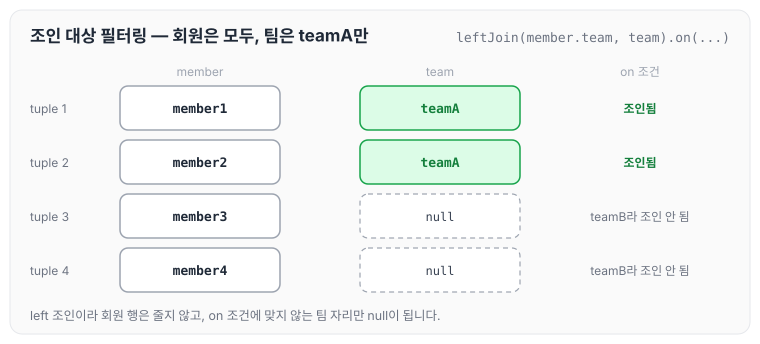

> 참고: on 절을 활용해 조인 대상을 필터링할 때, 외부조인이 아니라 내부조인(inner join)을 사용하면, where 절에서 필터링하는 것과 기능이 동일합니다. 따라서 on 절을 활용한 조인 대상 필터링을 사용할 때, 내부조인이면 익숙한 where 절로 처리해도 됩니다.

### 2. 연관관계 없는 엔티티 외부 조인

예를 들어 회원의 이름과 팀의 이름이 같은 대상을 외부 조인하는 경우입니다.

```java
/**
     * 2. 연관관계 없는 엔티티 외부 조인
     * 예) 회원의 이름과 팀의 이름이 같은 대상 외부 조인
     * JPQL: SELECT m, t FROM Member m LEFT JOIN Team t on m.username = t.name
     * SQL: SELECT m.*, t.* FROM Member m LEFT JOIN Team t ON m.username = t.name
     */
    @Test
    public void join_on_no_relation() throws Exception {
        em.persist(new Member("teamA"));
        em.persist(new Member("teamB"));

        List<Tuple> fetch = queryFactory
                .select(member, team)
                .from(member)
                .leftJoin(team).on(member.username.eq(team.name))
                .fetch();

        for (Tuple tuple : fetch) {
            System.out.println("t = " + tuple);
        }
    }
```

- 하이버네이트 5.1부터 `on`을 사용해서 서로 관계가 없는 필드로 외부 조인하는 기능이 추가되었습니다. 물론 내부 조인도 가능합니다.
- 주의할 점은 문법입니다. `leftJoin()` 부분에 일반 조인과 다르게 엔티티 하나만 들어갑니다.
    - 일반조인: `leftJoin(member.team, team)`
    - on조인: `from(member).leftJoin(team).on(xxx)`

앞의 세타 조인과 같은 데이터로 결과를 비교하면 아래와 같습니다.

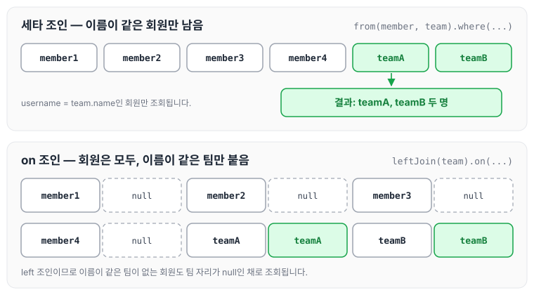

세타 조인은 조건에 맞는 회원만 남지만, on 조인은 left 조인이므로 이름이 같은 팀이 없는 회원도 팀이 `null`인 채로 조회됩니다.

## 조인 - 페치 조인

페치 조인은 SQL에서 제공하는 기능이 아닙니다. SQL 조인을 활용해서 연관된 엔티티를 SQL 한 번에 조회하는 기능이며, 주로 성능 최적화에 사용합니다. JPQL의 페치 조인은 [JPQL 경로 표현식과 페치 조인](../jpa-jpql-advanced/)에 정리해 두었습니다.

### 페치 조인 미적용

지연 로딩으로 Member, Team SQL 쿼리가 각각 실행됩니다.

```java
@Test
    public void fetchJoinNo() throws Exception {
        em.flush();
        em.clear();

        Member findMember = queryFactory
                .selectFrom(member)
                .where(member.username.eq("member1"))
                .fetchOne();

        boolean loaded = emf.getPersistenceUnitUtil().isLoaded(findMember.getTeam());
        assertThat(loaded).as("페치 조인 미적용").isFalse();
    }
```

### 페치 조인 적용

즉시 로딩으로 Member, Team SQL 쿼리를 조인으로 한 번에 조회합니다.

```java
@Test
    public void fetchJoinuse() throws Exception {
        em.flush();
        em.clear();

        Member findMember = queryFactory
                .selectFrom(member)
                .join(member.team, team).fetchJoin()
                .where(member.username.eq("member1"))
                .fetchOne();

        boolean loaded = emf.getPersistenceUnitUtil().isLoaded(findMember.getTeam());
        assertThat(loaded).as("페치 조인 적용").isTrue();
    }
```

두 테스트에서 member1의 팀이 로딩되는지를 비교하면 아래와 같습니다.

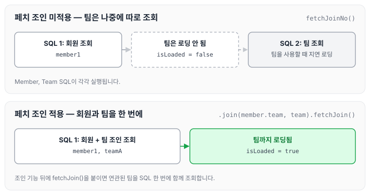

사용 방법은 `join()`, `leftJoin()` 등 조인 기능 뒤에 `fetchJoin()`을 추가하면 됩니다.

## 서브 쿼리

서브 쿼리는 `com.querydsl.jpa.JPAExpressions`를 사용합니다. 서브 쿼리 안에서는 바깥 쿼리와 별칭이 겹치지 않도록 `new QMember("memberSub")`로 별도의 Q타입을 만들어 사용합니다.

### 서브 쿼리 eq 사용

```java
/**
     * 나이가 가장 많은 회원 조회
     */
    @Test
    public void subQuery() throws Exception {
        QMember memberSub = new QMember("memberSub");

        List<Member> result = queryFactory
                .selectFrom(member)
                .where(member.age.eq(
                        select(memberSub.age.max())
                                .from(memberSub)
                )).fetch();

        assertThat(result).extracting("age")
                .containsExactly(40);
    }
```

### 서브 쿼리 goe 사용

```java
/**
     * 나이가 평균 나이 이상인 회원
     */
    @Test
    public void subQueryGoe() throws Exception {
        QMember memberSub = new QMember("memberSub");

        List<Member> result = queryFactory
                .selectFrom(member)
                .where(member.age.goe(
                        select(memberSub.age.avg())
                                .from(memberSub)
                ))
                .fetch();
        assertThat(result).extracting("age")
                .containsExactly(30, 40);
    }
```

### 서브쿼리 여러 건 처리 in 사용

```java
/**
     * 서브쿼리 여러 건 처리, in 사용
     */
    @Test
    public void subQueryIn() throws Exception {
        QMember memberSub = new QMember("memberSub");

        List<Member> result = queryFactory
                .selectFrom(member)
                .where(member.age.in(
                        select(memberSub.age)
                                .from(memberSub)
                                .where(memberSub.age.gt(10))
                )).fetch();

        assertThat(result).extracting("age")
                .containsExactly(20, 30, 40);
    }
```

### select 절에 subquery

```java
@Test
    public void subQuerySelect() throws  Exception {
        QMember memberSub = new QMember("memberSub");

        List<Tuple> fetch = queryFactory
                .select(member.username,
                        select(memberSub.age.avg())
                                .from(memberSub)
                ).from(member)
                .fetch();

        for (Tuple tuple : fetch) {
            System.out.println("username = " + tuple.get(member.username));
        }
    }
```

### from 절의 서브쿼리 한계

JPA JPQL 서브쿼리의 한계점으로 from 절의 서브쿼리(인라인 뷰)는 지원하지 않습니다. 당연히 Querydsl도 지원하지 않습니다. 하이버네이트 구현체를 사용하면 select 절의 서브쿼리는 지원합니다. Querydsl도 하이버네이트 구현체를 사용하면 select 절의 서브쿼리를 지원합니다.

위 예제들의 서브 쿼리 결과와, 서브 쿼리를 둘 수 있는 위치를 정리하면 아래와 같습니다.

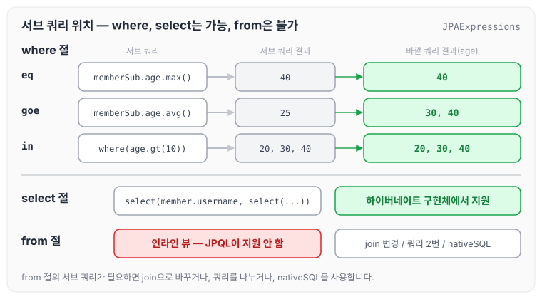

### from 절의 서브쿼리 해결방안

1. 서브쿼리를 join으로 변경합니다. (가능한 상황도 있고, 불가능한 상황도 있습니다.)
2. 애플리케이션에서 쿼리를 2번 분리해서 실행합니다.
3. nativeSQL을 사용합니다.

## Case 문

Case 문은 select, 조건절(where), order by에서 사용할 수 있습니다.

### 단순한 조건

```java
@Test
    public void caseQuery() throws Exception {
        List<String> result = queryFactory
                .select(member.age
                        .when(10).then("열살")
                        .when(20).then("스무살")
                        .otherwise("기타")
                ).from(member)
                .fetch();
    }
```

### 복잡한 조건

```java
@Test
    public void level1ComplexCaseQuery() throws Exception {
        List<String> result = queryFactory
                .select(new CaseBuilder()
                        .when(member.age.between(0,20)).then("0~20살")
                        .when(member.age.between(21,30)).then("21~30살")
                        .otherwise("기타"))
                .from(member)
                .fetch();

    }
```

### orderBy에서 case문 함께 사용하기

```java
@Test
    public void level2ComplexCaseQuery() throws Exception {
        NumberExpression<Integer> rankPath = new CaseBuilder()
                .when(member.age.between(0, 20)).then(2)
                .when(member.age.between(21, 30)).then(1)
                .otherwise(3);

        List<Tuple> fetch = queryFactory
                .select(member.age,
                        member.username,
                        rankPath)
                .from(member)
                .orderBy(rankPath.desc())
                .fetch();

        for (Tuple tuple : fetch) {
            String username = tuple.get(member.username);
            Integer age = tuple.get(member.age);
            Integer rank = tuple.get(rankPath);
            System.out.println("username = " + username + " age = " + age + " rank = "
                    + rank);
        }

    }
```

Querydsl은 자바 코드로 작성하기 때문에 `rankPath`처럼 복잡한 조건을 변수로 선언해서 `select` 절, `orderBy` 절에서 함께 사용할 수 있습니다. 예제 데이터에 `rankPath`를 적용하면 아래와 같습니다.

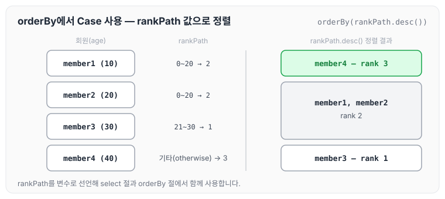

`rankPath.desc()`로 정렬하므로 값이 3인 member4가 먼저 나오고, 값이 1인 member3이 마지막에 나옵니다.

## 상수, 문자 더하기

### 상수

상수가 필요하면 `Expressions.constant(xxx)`를 사용합니다.

```java
@Test
    public void constant() {
        List<Tuple> result = queryFactory
                .select(member.username, Expressions.constant("A"))
                .from(member)
                .fetch();

        for (Tuple tuple : result) {
            System.out.println("tuple = " + tuple);
        }
    }
```

> 참고: 위와 같이 최적화가 가능하면 SQL에 constant 값을 넘기지 않습니다. 상수를 더하는 것처럼 최적화가 어려우면 SQL에 constant 값을 넘깁니다.

### 문자 더하기 concat

```java
@Test
    public void concat() {
        List<String> fetch = queryFactory
                .select(member.username.concat("_").concat(member.age.stringValue()))
                .from(member)
                .fetch();

        for (String concatValue : fetch) {
            System.out.println("concatValue = " + concatValue);
        }
    }
```

> 참고: `member.age.stringValue()` 부분이 중요한데, 문자가 아닌 다른 타입들은 `stringValue()`로 문자로 변환할 수 있습니다. 이 방법은 ENUM을 처리할 때도 자주 사용합니다.

## 마무리

오늘은 JPQL과 Querydsl을 비교하고, Querydsl의 기본 문법인 Q타입 활용, 검색 조건, 결과 조회, 정렬, 페이징, 집합, 조인(기본 조인, on 절, 페치 조인), 서브 쿼리, Case 문, 상수와 문자 더하기에 대해 정리하였습니다. 대부분의 문법이 JPQL과 일대일로 대응되기 때문에, 이전에 정리한 JPQL 문법과 함께 보면 이해하기 수월할 것 같습니다.

다음 글에서는 [중급 문법](../querydsl-intermediate/)에 대해 정리하도록 하겠습니다.

> 이 글은 인프런 김영한 님의 [실전! Querydsl](https://www.inflearn.com/course/querydsl-실전)을 들으며 정리한 노트입니다.
