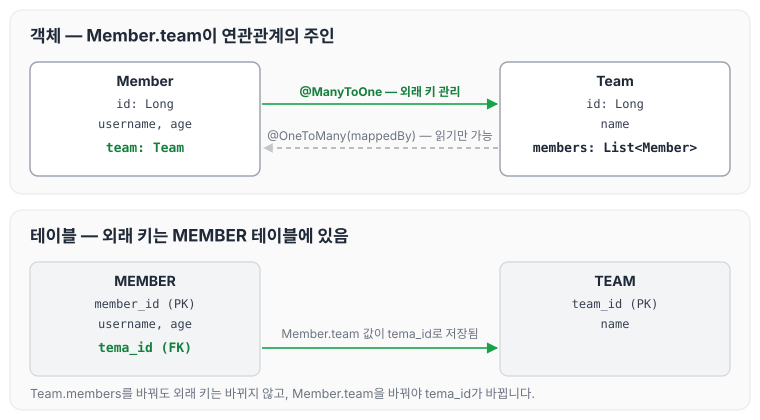
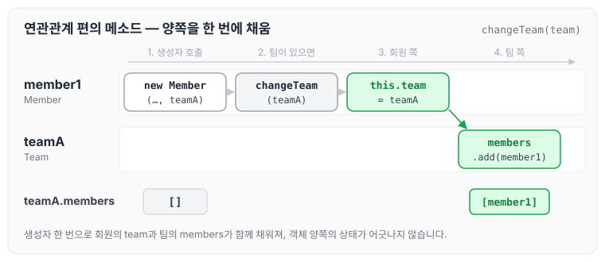
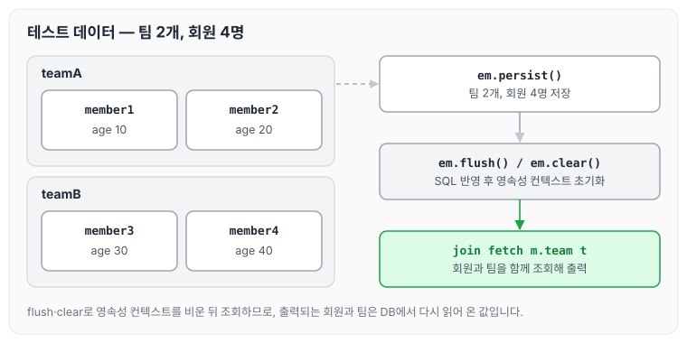

이전에 [프로젝트 생성과 환경 설정](../querydsl-setup/)에 대해 작성하였습니다. 이번에는 Querydsl 실습에 사용할 예제 도메인 모델인 Member와 Team 엔티티를 만들고, 순수 JPA로 데이터가 잘 들어가는지 확인하는 방법에 대해 정리하도록 하겠습니다.

## 예제 도메인 모델

예제에서 사용할 엔티티는 회원(Member)과 팀(Team) 두 개입니다. 회원은 하나의 팀에 소속되고, 팀에는 여러 회원이 소속됩니다.



### Member 엔티티

```java
package study.querydsl.entitiy;

import lombok.AccessLevel;
import lombok.Getter;
import lombok.NoArgsConstructor;
import lombok.ToString;

import javax.persistence.*;

@Entity
@Getter
@NoArgsConstructor(access = AccessLevel.PROTECTED)
@ToString(of = {"id", "username", "age"})
public class Member {

    @Id @GeneratedValue
    @Column(name = "member_id")
    private Long id;

    private String username;
    private  int age;

    @ManyToOne(fetch = FetchType.LAZY)
    @JoinColumn(name = "tema_id")
    private Team team;

    public Member(String username) {
        this(username, 0);
    }

    public Member(String username, int age) {
        this(username, age,null);
    }

    public Member(String username, int age, Team team) {
        this.username = username;
        this.age = age;
        if(team != null) {
            changeTeam(team);
        }
    }

    private void changeTeam(Team team) {
        this.team = team;
        team.getMembers().add(this);
    }
}
```

### 롬복 설명

- `@Setter`: 실무에서 가급적 Setter는 사용하지 않습니다.
- `@NoArgsConstructor(access = AccessLevel.PROTECTED)`: 기본 생성자를 막고 싶은데, JPA 스펙상 PROTECTED로 열어두어야 합니다.
- `@ToString`은 가급적 내부 필드만(연관관계 없는 필드만) 넣습니다.

`changeTeam()`은 양방향 연관관계를 한 번에 처리하는 연관관계 편의 메소드입니다. 생성자에 팀을 넘기면 회원 쪽의 `team`과 팀 쪽의 `members`가 함께 채워집니다.



### Team 엔티티

```java
package study.querydsl.entitiy;

import lombok.*;

import javax.persistence.*;
import java.util.ArrayList;
import java.util.List;

@Entity
@Getter @Setter
@NoArgsConstructor(access = AccessLevel.PROTECTED)
@ToString(of = {"id", "name"})
public class Team {

    @Id @GeneratedValue
    @Column(name = "team_id")
    private Long id;

    private String name;
    @OneToMany(mappedBy = "team")
    private List<Member> members = new ArrayList<>();

    public Team(String name) {
        this.name = name;
    }
}
```

Member와 Team은 양방향 연관관계이며, `Member.team`이 연관관계의 주인이고 `Team.members`는 연관관계의 주인이 아닙니다. 따라서 `Member.team`이 데이터베이스 외래키 값을 변경하고, 반대편은 읽기만 가능합니다. 연관관계의 주인을 정하는 기준은 [연관관계 매핑 기초](../jpa-association-basics/)에 정리해 두었습니다.

## 데이터 확인 테스트

팀 두 개와 회원 네 명을 저장한 뒤, 영속성 컨텍스트를 비우고 JPQL로 다시 조회하는 테스트는 아래와 같습니다.

```java
package study.querydsl.entitiy;

import org.junit.jupiter.api.Test;
import org.springframework.beans.factory.annotation.Autowired;
import org.springframework.boot.test.context.SpringBootTest;
import org.springframework.test.annotation.Commit;
import org.springframework.transaction.annotation.Transactional;
import javax.persistence.EntityManager;
import java.util.List;

@SpringBootTest
@Transactional
@Commit
class MemberTest {

    @Autowired
    EntityManager em;

    @Test
    public void testEntity() {
        Team teamA = new Team("teamA");
        Team teamB = new Team("teamB");
        em.persist(teamA);
        em.persist(teamB);

        Member member1 = new Member("member1", 10, teamA);
        Member member2 = new Member("member2", 20, teamA);

        Member member3 = new Member("member3", 30, teamB);
        Member member4 = new Member("member4", 40, teamB);

        em.persist(member1);
        em.persist(member2);
        em.persist(member3);
        em.persist(member4);

        //초기화
        em.flush();
        em.clear();

        List<Member> members = em.createQuery("select m from Member m " +
                        "join fetch m.team t", Member.class)
                .getResultList();
        for (Member member : members) {
            System.out.println("member = " + member);
            System.out.println("member.team = " + member.getTeam());
        }

    }
}
```

테스트에서 저장하는 데이터를 정리하면 아래와 같습니다. 이 회원·팀 데이터는 이후 글의 예제에서도 계속 사용합니다.



- 가급적 순수 JPA로 동작을 확인합니다(뒤에서 변경합니다).
- DB 테이블 결과를 확인합니다.
- 지연 로딩 동작을 확인합니다.

`@Commit`을 붙였기 때문에 테스트가 끝나도 데이터가 롤백되지 않아 DB 테이블에서 결과를 확인할 수 있습니다. 지연 로딩과 페치 조인은 [즉시 로딩과 지연 로딩](../jpa-lazy-eager-loading/), [JPQL 경로 표현식과 페치 조인](../jpa-jpql-advanced/)에 정리해 두었습니다.

## 마무리

오늘은 Querydsl 실습에 사용할 Member, Team 엔티티와 양방향 연관관계, 연관관계 편의 메소드, 롬복 설정, 그리고 순수 JPA로 데이터를 확인하는 테스트에 대해 정리하였습니다. 이후 예제는 모두 이 두 엔티티와 테스트 데이터를 기준으로 진행되기 때문에, 회원과 팀의 소속과 나이를 기억해 두면 결과를 확인하기 편할 것 같습니다.

다음 글에서는 [기본 문법](../querydsl-basics/)에 대해 정리하도록 하겠습니다.

> 이 글은 인프런 김영한 님의 [실전! Querydsl](https://www.inflearn.com/course/querydsl-실전)을 들으며 정리한 노트입니다.
