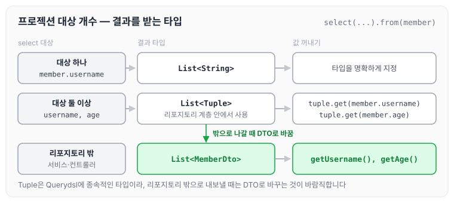
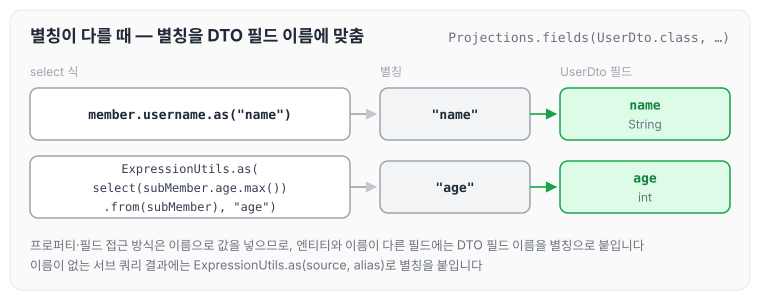
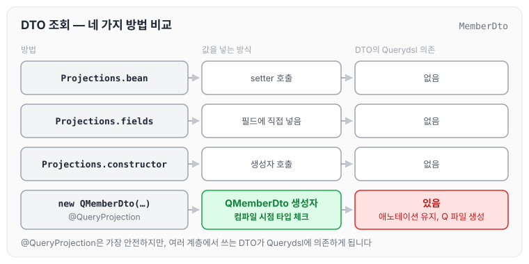
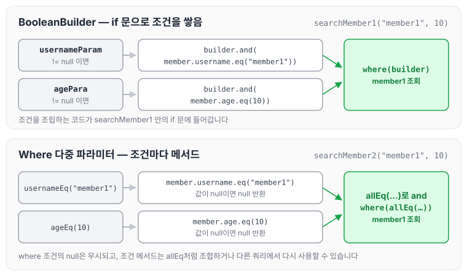
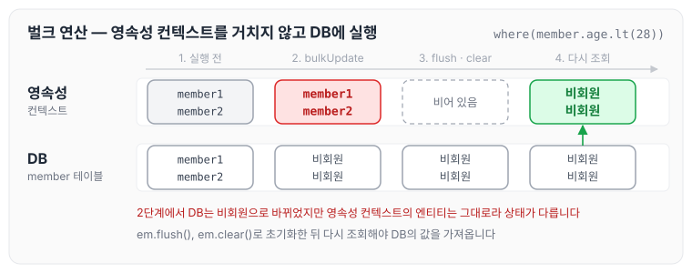

이전에 [기본 문법](../querydsl-basics/)에 대해 작성하였습니다. 이번에는 Querydsl의 중급 문법인 프로젝션과 결과 반환, 동적 쿼리, 수정·삭제 벌크 연산, SQL function 호출에 대해 정리하도록 하겠습니다.

## 프로젝션과 결과 반환 - 기본

프로젝션은 select 대상을 지정하는 것입니다.

### 프로젝션 대상이 하나

프로젝션 대상이 하나인 경우는 아래와 같습니다.

```java
@Test
   public void simpleProjection() {
       List<String> fetch = queryFactory
               .select(member.username)
               .from(member)
               .fetch();
       for (String username : fetch) {
           System.out.println("username = " + username);
       }
   }
```

- 프로젝션 대상이 하나면 타입을 명확하게 지정할 수 있습니다.
- 프로젝션 대상이 둘 이상이면 튜플이나 DTO로 조회합니다.

### 튜플 조회

튜플은 프로젝션 대상이 둘 이상일 때 사용하며, 타입은 `com.querydsl.core.Tuple`입니다.

```java
@Test
    public void tupleProjection() {
       List<Tuple> fetch = queryFactory
               .select(member.username, member.age)
               .from(member)
               .fetch();

       for (Tuple tuple : fetch) {
           String username = tuple.get(member.username);
           Integer integer = tuple.get(member.age);

           System.out.println("username = " +username);
           System.out.println("age = " + integer);
       }
   }
```

튜플은 리포지토리 계층 안에서 사용하는 것을 권장합니다. 튜플은 Querydsl에 종속적인 타입이기 때문에, 유지보수 측면에서 리포지토리 밖으로 나갈 때는 DTO로 바꾸는 것이 바람직합니다.

프로젝션 대상의 개수에 따라 결과를 어떤 타입으로 받는지 그리면 아래와 같습니다.



Tuple은 Querydsl 타입이므로 서비스나 컨트롤러까지 넘기지 않고, 리포지토리 안에서 DTO로 바꿔서 내보냅니다.

## 프로젝션과 결과 반환 - DTO 조회

DTO 조회는 실무에서 많이 사용하는 방법입니다. 먼저 순수 JPA에서 DTO를 조회하는 방법부터 정리합니다.

### 순수 JPA에서 DTO 조회

조회에 사용할 `MemberDto`는 아래와 같습니다.

```java
package study.querydsl.dto;

import lombok.AccessLevel;
import lombok.Data;
import lombok.NoArgsConstructor;

@Data
@NoArgsConstructor(access = AccessLevel.PROTECTED)
public class MemberDto {

    private String username;
    private int age;

    public MemberDto(String username, int age) {
        this.username = username;
        this.age = age;
    }
}
```

순수 JPA에서 DTO를 조회하는 코드는 아래와 같습니다.

```java
@Test
    public void findMemberDtoByJQPL() {
       List<MemberDto> resultList = em.createQuery("select new study.querydsl.dto.MemberDto(m.username, m.age) from Member m", MemberDto.class)
               .getResultList();

       for (MemberDto member1 : resultList) {
           System.out.println("member  = " + member1.getUsername());
           System.out.println("member  = " + member1.getAge());
       }
   }
```

이 방식에는 다음과 같은 단점이 있습니다.

- 순수 JPA에서 DTO를 조회할 때는 new 명령어를 사용해야 합니다.
- DTO의 package 이름을 다 적어 줘야 해서 지저분합니다.
- 생성자 방식만 지원합니다.

new 명령어로 DTO를 조회하는 방법은 [JPQL 기본 문법](../jpa-jpql-basics/)의 프로젝션에도 정리하였습니다.

### Querydsl 빈 생성(Bean population)

Querydsl은 결과를 DTO로 반환할 때 다음 3가지 방법을 지원합니다.

- 프로퍼티 접근
- 필드 직접 접근
- 생성자 사용

### 프로퍼티 접근 - setter

`Projections.bean()`을 사용하면 setter를 통해 값을 채웁니다.

```java
@Test
    public void findMemberDtoBySetter() {
       List<MemberDto> fetch = queryFactory
               .select(Projections.bean(MemberDto.class,
                       member.username,
                       member.age))
               .from(member)
               .fetch();

       for (MemberDto memberDto : fetch) {
           System.out.println(memberDto.getUsername());
           System.out.println(memberDto.getAge());
       }
   }
```

### 필드 직접 접근

`Projections.fields()`를 사용하면 필드에 값을 직접 넣습니다.

```java
@Test
    public void findMemberDtoByFields() {
       List<MemberDto> fetch = queryFactory
               .select(Projections.fields(MemberDto.class,
                       member.username,
                       member.age))
               .from(member)
               .fetch();
       for (MemberDto memberDto : fetch) {
           System.out.println(memberDto.getUsername());
           System.out.println(memberDto.getAge());
       }
   }
```

### 별칭이 다를 때

DTO의 필드 이름이 엔티티와 다를 때의 예제입니다. `UserDto`는 회원 이름을 `name` 필드로 가지고 있습니다.

```java
package study.querydsl.dto;

import lombok.Data;

@Data
public class UserDto {

    private String name;
    private int age;
}
```

```java
@Test
    public void findUserDtoByFields() {
        QMember subMember = new QMember("subMember");

        List<UserDto> fetch = queryFactory
                .select(Projections.fields(UserDto.class,
                        member.username.as("name"),
                        ExpressionUtils.as(
                                JPAExpressions
                                .select(subMember.age.max())
                                .from(subMember), "age")))
                .from(member)
                .fetch();
        for (UserDto userDto : fetch) {
            System.out.println(userDto.getName());
            System.out.println(userDto.getAge());
        }
    }
```

- 프로퍼티나 필드 접근 생성 방식에서 이름이 다를 때의 해결 방안입니다.
- `ExpressionUtils.as(source,alias)`: 필드나 서브 쿼리에 별칭을 적용합니다.
- `username.as("memberName")`: 필드에 별칭을 적용합니다.

위 예제에서 별칭이 DTO 필드에 어떻게 연결되는지 그리면 아래와 같습니다.



프로퍼티나 필드 접근 방식은 이름으로 값을 넣기 때문에, 이름이 다른 필드에는 `as()`로 DTO의 필드 이름을 별칭으로 붙여 줍니다. 서브 쿼리처럼 이름이 없는 결과에는 `ExpressionUtils.as()`를 사용합니다.

### 생성자 사용

`Projections.constructor()`를 사용하면 생성자를 통해 값을 넣습니다.

```java
@Test
    public void findMemberDtoByConstructor() {
       List<MemberDto> fetch = queryFactory
               .select(Projections.constructor(MemberDto.class,
                       member.username,
                       member.age))
               .from(member)
               .fetch();
       for (MemberDto memberDto : fetch) {
           System.out.println(memberDto.getUsername());
           System.out.println(memberDto.getAge());
       }
   }
```

## 프로젝션과 결과 반환 - @QueryProjection

### 생성자 + @QueryProjection

DTO의 생성자에 `@QueryProjection`을 붙입니다.

```java
package study.querydsl.dto;

import com.querydsl.core.annotations.QueryProjection;
import lombok.AccessLevel;
import lombok.Data;
import lombok.NoArgsConstructor;

@Data
@NoArgsConstructor(access = AccessLevel.PROTECTED)
public class MemberDto {

    private String username;
    private int age;

    @QueryProjection
    public MemberDto(String username, int age) {
        this.username = username;
        this.age = age;
    }
}
```

- `./gradlew compileQuerydsl`을 실행합니다.
- `QMemberDto`가 생성되었는지 확인합니다.

### @QueryProjection 활용

생성된 `QMemberDto`를 select 절에서 바로 사용합니다.

```java
@Test
    public void findDtoByQueryProjection() {
        List<MemberDto> result = queryFactory
                .select(new QMemberDto(member.username, member.age))
                .from(member)
                .fetch();

        for (MemberDto memberDto : result) {
            System.out.println(" memberDto  = " + memberDto.getUsername());
            System.out.println(" memberDto  = " + memberDto.getAge());
        }
    }
```

이 방법은 컴파일 시점에 타입을 체크할 수 있으므로 가장 안전한 방법입니다. 다만 DTO에 Querydsl 애노테이션을 유지해야 하고, DTO까지 Q 파일을 생성해야 하는 단점이 있습니다.

이렇게 되면 여러 계층에서 사용하는 DTO가 Querydsl에 의존하게 되어, DTO를 순수하게 사용하지 못하게 됩니다.

지금까지 정리한 DTO 조회 방법 네 가지를 나란히 놓으면 아래와 같습니다.



세 가지 `Projections` 방식은 DTO가 Querydsl에 의존하지 않고, `@QueryProjection`은 컴파일 시점 타입 체크를 얻는 대신 DTO가 Querydsl에 의존하게 됩니다.

## distinct

distinct는 아래와 같이 사용합니다.

```java
List<String> result = queryFactory
 .select(member.username).distinct()
 .from(member)
 .fetch();
```

참고로 distinct는 JPQL의 distinct와 같습니다.

## 동적 쿼리 - BooleanBuilder 사용

동적 쿼리를 해결하는 방식은 두 가지입니다.

- BooleanBuilder
- Where 다중 파라미터 사용

먼저 `BooleanBuilder`를 사용한 예제입니다. 파라미터가 null이 아닐 때만 조건을 `builder`에 추가합니다.

```java
@Test
    public void 동적쿼리_booleanBuilder() throws Exception {
        String usernameParam = "member1";
        Integer agePara = 10;

        List<Member> result = searchMember1(usernameParam, agePara);
        for (Member member1 : result) {
            System.out.println("member1" + member1.getUsername());
            System.out.println("member1" + member1.getAge());
        }
    }

    private List<Member> searchMember1(String usernameParam, Integer agePara) {
        BooleanBuilder builder = new BooleanBuilder();

        if (usernameParam != null) {
            builder.and(member.username.eq(usernameParam));
        }

        if (agePara != null) {
            builder.and(member.age.eq(agePara));
        }
        return queryFactory
                .selectFrom(member)
                .where(builder)
                .fetch();
    }
```

## 동적 쿼리 - Where 다중 파라미터 사용

다음은 조건마다 `BooleanExpression`을 반환하는 메서드를 만들어 where 절에 넘기는 방식입니다.

```java
@Test
    public void 동적쿼리_WhereParam() throws Exception {
        String usernameParam = "member1";
        Integer ageParam = 10;

        List<Member> result = searchMember2(usernameParam, ageParam);
        assertThat(result.size()).isEqualTo(1);
    }

    private List<Member> searchMember2(String usernameCond, Integer ageCond) {
        return queryFactory
                .select(member)
                .from(member)
                .where(allEq(usernameCond, ageCond))
                .fetch();
    }

    private BooleanExpression ageEq(Integer ageCond) {
        return ageCond != null ? member.age.eq(ageCond) : null;
    }

    private BooleanExpression usernameEq(String usernameCond) {
        return usernameCond != null ? member.username.eq(usernameCond) : null;
    }

    private BooleanExpression allEq(String usernameCond, Integer ageCond) {
        return usernameEq(usernameCond).and(ageEq(ageCond));
    }
```

- `where` 조건에 `null` 값은 무시됩니다.
- 메서드를 다른 쿼리에서도 재활용할 수 있습니다.
- 쿼리 자체의 가독성이 높아집니다.

두 방식으로 `member1`, `10` 조건을 만드는 과정을 비교하면 아래와 같습니다.



BooleanBuilder는 조건을 조립하는 코드가 메서드 안의 if 문에 들어가고, Where 다중 파라미터 방식은 조건마다 이름이 붙은 메서드로 나뉘어 있어 `allEq`처럼 조합하거나 다른 쿼리에서 다시 사용할 수 있습니다.

## 수정, 삭제 벌크 연산

쿼리 한 번으로 대량의 데이터를 수정하는 코드는 아래와 같습니다.

```java
@Test
    public void bulkUpdate() {
        long count = queryFactory
                .update(member)
                .set(member.username, "비회원")
                .where(member.age.lt(28))
                .execute();

    }
```

기존 숫자에 1을 더하는 경우입니다.

```java
@Test
    public void bulkAddUpdate() {
        long count = queryFactory
                .update(member)
                .set(member.age, member.age.add(1))
                .execute();
    }
```

기존 숫자에 곱하는 경우입니다.

```java
@Test
    public  void bulkMultiUpdate() {
        long count = queryFactory
                .update(member)
                .set(member.age, member.age.multiply(2))
                .execute();
    }
```

쿼리 한 번으로 대량의 데이터를 삭제하는 코드는 아래와 같습니다.

```java
@Test
    public void bulkDelete() {
        long count = queryFactory
                .delete(member)
                .where(member.age.gt(18))
                .execute();
    }
```

벌크 연산은 JPQL의 벌크 연산과 마찬가지로 영속성 컨텍스트에 있는 엔티티를 무시하고 실행됩니다. 그래서 벌크 쿼리를 실행하고 나면 `em.flush()`, `em.clear()`로 영속성 컨텍스트를 초기화하는 것이 안전합니다. 스프링 데이터 JPA에서 같은 문제를 다루는 방법은 [쿼리 메소드 기능](../data-jpa-query-methods/)의 벌크성 수정 쿼리에 정리하였습니다.

테스트 데이터(member1~member4, 나이 10·20·30·40)에 `bulkUpdate`를 실행했을 때 영속성 컨텍스트와 DB의 상태를 그리면 아래와 같습니다.



벌크 연산은 DB에 바로 실행되기 때문에 이미 영속성 컨텍스트에 올라와 있는 엔티티에는 바뀐 값이 반영되지 않습니다. 초기화한 뒤 다시 조회해야 DB의 값을 가져옵니다.

## SQL function 호출하기

SQL function은 JPA와 같이 Dialect에 등록된 내용만 호출할 수 있습니다.

`member`를 `M`으로 바꾸는 replace 함수를 사용하는 예제입니다.

```java
@Test
    public void sqlFunction() {
        List<String> fetch = queryFactory
                .select(
                        Expressions.stringTemplate("function('replace', {0}, {1}, {2})", member.username, "member", "M")
                )
                .from(member)
                .fetch();

        for (String member : fetch) {
            System.out.println(member);
        }
    }
```

다음은 소문자로 변경해서 비교하는 예제입니다.

```java
@Test
    public void sqlLowerFunction() {
        List<String> fetch = queryFactory
                .select(member.username)
                .from(member)
                //.where(member.username.eq(Expressions.stringTemplate("function('lower', {0})", member.username)))
                .where(member.username.eq(member.username.lower()))
                .fetch();
        for (String memberName : fetch) {
            System.out.println(memberName);
        }

    }
```

DB의 내장 함수를 따로 선언해서 사용해야 하는 경우에는, [JPQL 기본 문법](../jpa-jpql-basics/)의 사용자 정의 함수 호출에 정리한 것처럼 방언(Dialect) 클래스를 상속해서 함수를 등록하는 방법을 참고하면 됩니다.

## 마무리

오늘은 Querydsl의 프로젝션과 결과 반환, BooleanBuilder와 Where 다중 파라미터를 사용한 동적 쿼리, 수정·삭제 벌크 연산, SQL function 호출에 대해 정리하였습니다.

DTO 조회는 컴파일 시점에 타입을 체크할 수 있는 `@QueryProjection`과 DTO를 순수하게 유지할 수 있는 `Projections` 방식 중에서, DTO를 어디까지 사용하는지에 따라 고르는 것이 좋을 것 같습니다.

다음 글에서는 [순수 JPA와 함께 쓰기](../querydsl-pure-jpa/)에 대해 정리하도록 하겠습니다.

> 이 글은 인프런 김영한 님의 [실전! Querydsl](https://www.inflearn.com/course/querydsl-실전)을 들으며 정리한 노트입니다.
