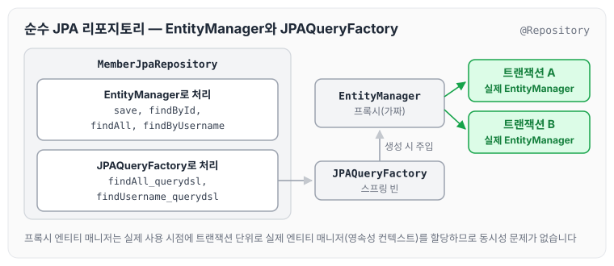
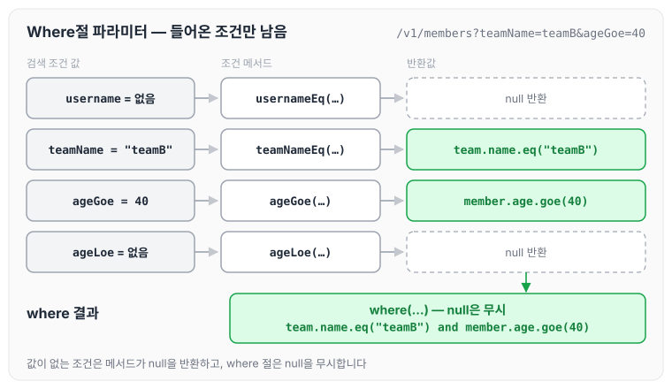
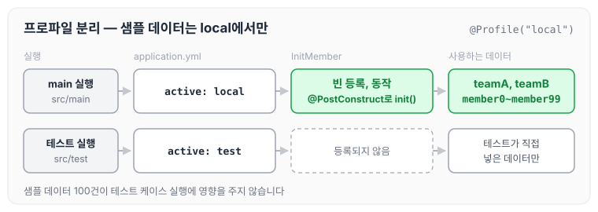

이전에 [중급 문법](../querydsl-intermediate/)에 대해 작성하였습니다. 이번에는 Querydsl을 순수 JPA 리포지토리와 함께 사용하는 방법을 정리하도록 하겠습니다. 다루는 내용은 아래와 같습니다.

- 순수 JPA 리포지토리와 Querydsl
- 동적 쿼리 Builder 적용
- 동적 쿼리 Where 적용
- 조회 API 컨트롤러 개발

## 순수 JPA 리포지토리와 Querydsl

순수 JPA와 Querydsl을 함께 사용하는 리포지토리는 아래와 같습니다.

```java
package study.querydsl.repository;

import com.querydsl.jpa.impl.JPAQueryFactory;
import lombok.RequiredArgsConstructor;
import org.springframework.stereotype.Repository;
import study.querydsl.entitiy.Member;

import javax.persistence.EntityManager;
import java.util.List;
import java.util.Optional;

import static study.querydsl.entitiy.QMember.member;

@Repository
@RequiredArgsConstructor
public class MemberJpaRepository {

    private final EntityManager em;
    private final JPAQueryFactory queryFactory;

    public void save(Member member) {
        em.persist(member);
    }

    public Optional<Member> findById(Long id) {
        Member member = em.find(Member.class, id);
        return Optional.ofNullable(member);
    }

    public List<Member> findAll() {
        return em.createQuery("select m From Member m ", Member.class)
                .getResultList();
    }

    public List<Member> findAll_querydsl() {
        return queryFactory.select(member)
                .from(member)
                .fetch();
    }

    public List<Member> findUsername_querydsl(String username) {
        return queryFactory.select(member)
                .from(member)
                .where(member.username.eq(username))
                .fetch();
    }

    public List<Member> findByUsername(String username) {
        return em.createQuery("select m From Member m where m.username = :username", Member.class)
                .setParameter("username", username)
                .getResultList();
    }

}
```

리포지토리를 테스트하는 코드는 아래와 같습니다. JPQL로 작성한 메서드와 Querydsl로 작성한 메서드가 같은 결과를 반환하는지 확인합니다.

```java
package study.querydsl.repository;

import org.junit.jupiter.api.Test;
import org.springframework.beans.factory.annotation.Autowired;
import org.springframework.boot.test.context.SpringBootTest;
import org.springframework.transaction.annotation.Transactional;
import study.querydsl.entitiy.Member;

import java.util.List;
import java.util.Optional;

import static org.assertj.core.api.Assertions.*;

@SpringBootTest
@Transactional
class MemberJpaRepositoryTest {

    @Autowired
    MemberJpaRepository memberJpaRepository;

    @Test
    public void basicTest() {
        Member member = new Member("member1", 10);
        memberJpaRepository.save(member);

        Optional<Member> findMember = memberJpaRepository.findById(member.getId());
        assertThat(findMember.get()).isEqualTo(member);

        List<Member> result1 = memberJpaRepository.findAll();
        assertThat(result1).containsExactly(member);

        List<Member> result2 = memberJpaRepository.findByUsername("member1");
        assertThat(result2).containsExactly(member);

        List<Member> querydslResult1 = memberJpaRepository.findAll_querydsl();
        assertThat(querydslResult1).containsExactly(member);

        List<Member> querydslResult2 = memberJpaRepository.findUsername_querydsl("member1");
        assertThat(querydslResult2).containsExactly(member);
    }

}
```

### JPAQueryFactory 스프링 빈 등록

다음과 같이 `JPAQueryFactory`를 스프링 빈으로 등록해서 주입받아 사용해도 됩니다.

```java
package study.querydsl;

..

@SpringBootApplication
public class QuerydslApplication {

	..
	@Bean
	JPAQueryFactory queryFactory (EntityManager em) {
		return new JPAQueryFactory(em);
	}
}
```

이렇게 사용해도 동시성 문제는 걱정하지 않아도 됩니다. 여기서 스프링이 주입해 주는 엔티티 매니저는 실제 동작 시점에 진짜 엔티티 매니저를 찾아 주는 프록시용 가짜 엔티티 매니저이기 때문입니다. 이 가짜 엔티티 매니저는 실제 사용 시점에 트랜잭션 단위로 실제 엔티티 매니저(영속성 컨텍스트)를 할당해 줍니다.

리포지토리의 구성과 엔티티 매니저가 연결되는 방식을 그리면 아래와 같습니다.



`JPAQueryFactory`는 하나의 빈으로 공유되지만 실제로 쿼리를 실행하는 엔티티 매니저는 트랜잭션마다 따로 할당되므로, 여러 요청이 동시에 들어와도 서로의 영속성 컨텍스트를 건드리지 않습니다.

## 동적 쿼리와 성능 최적화 조회 - Builder 사용

조회 최적화용 DTO인 `MemberTeamDto`를 추가합니다.

```java
package study.querydsl.dto;

import com.querydsl.core.annotations.QueryProjection;

public class MemberTeamDto {

    private Long memberId;
    private String username;
    private int age;
    private Long teamId;
    private String teamName;

    @QueryProjection
    public MemberTeamDto(Long memberId, String username, int age, Long teamId, String teamName) {
        this.memberId = memberId;
        this.username = username;
        this.age = age;
        this.teamId = teamId;
        this.teamName = teamName;
    }
}
```

- `@QueryProjection`을 추가했습니다. `QMemberTeamDto`를 생성하기 위해 `./gradlew compileQuerydsl`을 한 번 실행합니다.

`@QueryProjection`을 사용하면 해당 DTO가 Querydsl에 의존하게 됩니다. 이런 의존이 싫다면 해당 애노테이션을 제거하고 `Projections.bean()`, `fields()`, `constructor()`를 사용하면 됩니다. 각 방법은 [중급 문법](../querydsl-intermediate/)에 정리하였습니다.

회원 검색 조건은 아래와 같습니다.

```java
package study.querydsl.dto;

import lombok.Data;

@Data
public class MemberSearchCondition {

    private String username;
    private String teamName;
    private Integer ageGoe;
    private Integer ageLoe;
}
```

### 동적 쿼리 - Builder 사용

`BooleanBuilder`를 사용한 예제는 아래와 같습니다. 검색 조건에 값이 있을 때만 조건을 추가합니다.

```java
public List<MemberTeamDto> searchByBuilder(MemberSearchCondition condition) {

        BooleanBuilder builder = new BooleanBuilder();
        if (hasText(condition.getUsername())) {
            builder.and(member.username.eq(condition.getUsername()));
        }

        if (hasText(condition.getTeamName())) {
            builder.and(member.team.name.eq(condition.getTeamName()));
        }

        if (condition.getAgeGoe() != null) {
            builder.and(member.age.goe(condition.getAgeGoe()));
        }

        if (condition.getAgeLoe() != null) {
            builder.and(member.age.loe(condition.getAgeLoe()));

        }

        return queryFactory
                .select(new QMemberTeamDto(
                        member.id,
                        member.username,
                        member.age,
                        team.id,
                        team.name
                ))
                .from(member)
                .leftJoin(member.team, team)
                .where(builder)
                .fetch();

    }
```

## 동적 쿼리와 성능 최적화 조회 - Where절 파라미터 사용

Where절에 파라미터를 사용한 예제는 아래와 같습니다.

```java
public List<MemberTeamDto> searchByWhere(MemberSearchCondition condition) {
        return queryFactory
                .select(new QMemberTeamDto(
                        member.id,
                        member.username,
                        member.age,
                        team.id,
                        team.name
                )).from(member)
                .leftJoin(member.team, team)
                .where(
                        usernameEq(condition.getUsername()),
                        teamNameEq(condition.getTeamName()),
                        ageGoe(condition.getAgeGoe()),
                        ageLoe(condition.getAgeLoe())
                ).fetch();
    }

    private BooleanExpression usernameEq(String username) {
        return hasText(username) ? member.username.eq(username) : null;
    }

    private BooleanExpression teamNameEq(String teamName) {
        return hasText(teamName) ? team.name.eq(teamName) : null;
    }

    private BooleanExpression ageGoe(Integer ageGoe) {
        return ageGoe != null ? member.age.goe(ageGoe) : null;
    }

    private BooleanExpression ageLoe(Integer ageLoe) {
        return ageLoe != null ? member.age.loe(ageLoe) : null;
    }
```

where 절에 파라미터 방식을 사용하면 아래와 같이 조건을 재사용할 수 있습니다.

```java
//where 파라미터 방식은 이런식으로 재사용이 가능하다.
public List<Member> findMember(MemberSearchCondition condition) {
 return queryFactory
				.selectFrom(member)
				.leftJoin(member.team, team)
				.where(usernameEq(condition.getUsername()),
							teamNameEq(condition.getTeamName()),
							ageGoe(condition.getAgeGoe()),
							ageLoe(condition.getAgeLoe()))
				.fetch();
}
```

아래 조회 API 예제의 요청(`teamName=teamB&ageGoe=40`)이 `searchByWhere`의 조건으로 바뀌는 과정을 그리면 아래와 같습니다.



값이 없는 조건은 메서드가 null을 반환하고 where 절은 null을 무시하므로, 들어온 조건만 쿼리에 남습니다.

## 조회 API 컨트롤러 개발

편리한 데이터 확인을 위해 샘플 데이터를 추가합니다.

샘플 데이터 추가가 테스트 케이스 실행에 영향을 주지 않도록 다음과 같이 프로파일을 설정합니다.

### 프로파일 설정

`src/main/resources/application.yml`

```yaml
spring:
  profiles:
    active: local
```

테스트는 기존 application.yml을 다음 경로로 복사하고, 프로파일을 test로 수정합니다.

`src/test/resources/application.yml`

```yaml
spring:
  profiles:
    active: test
```

이렇게 분리하면 main 소스 코드와 테스트 소스 코드를 실행할 때 프로파일을 나눌 수 있습니다.

### 샘플 데이터 추가

샘플 데이터는 `local` 프로파일일 때만 등록되도록 `@Profile("local")`을 붙입니다.

```java
package study.querydsl;

import lombok.RequiredArgsConstructor;
import org.springframework.beans.factory.annotation.Autowired;
import org.springframework.context.annotation.Profile;
import org.springframework.stereotype.Component;
import org.springframework.transaction.annotation.Transactional;
import study.querydsl.entitiy.Member;
import study.querydsl.entitiy.Team;

import javax.annotation.PostConstruct;
import javax.persistence.EntityManager;
import javax.persistence.PersistenceContext;

@Profile("local")
@Component
@RequiredArgsConstructor
public class InitMember {
    private final InitMemberService initMemberService;

    @PostConstruct
    public void init() {
        initMemberService.init();
    }

    @Component
    static class InitMemberService {
        @PersistenceContext
        EntityManager em;

        @Transactional
        public void init() {
            Team teamA = new Team("teamA");
            Team teamB = new Team("teamB");
            em.persist(teamA);
            em.persist(teamB);

            for (int i = 0; i < 100; i++) {
                Team selectedTeam = i % 2 == 0 ? teamA : teamB;
                em.persist(new Member("member" + i, i, selectedTeam));
            }
        }
    }
}
```

프로파일에 따라 샘플 데이터가 들어가는지 그리면 아래와 같습니다.



테스트에서는 `InitMember`가 빈으로 등록되지 않으므로, 샘플 데이터 100건이 테스트의 검증 결과에 섞이지 않습니다.

### 조회 컨트롤러

```java
package study.querydsl.controller;

import lombok.RequiredArgsConstructor;
import org.springframework.web.bind.annotation.GetMapping;
import org.springframework.web.bind.annotation.RestController;
import study.querydsl.dto.MemberSearchCondition;
import study.querydsl.dto.MemberTeamDto;
import study.querydsl.repository.MemberJpaRepository;

import java.util.List;

@RestController
@RequiredArgsConstructor
public class MemberController {

    private final MemberJpaRepository memberJpaRepository;

    @GetMapping("/v1/members")
    public List<MemberTeamDto> searchMemberV1(MemberSearchCondition condition) {
        return memberJpaRepository.searchByWhere(condition);
    }
}
```

Postman으로 아래 주소를 호출해 결과를 확인합니다.

- [`http://127.0.0.1:8080/v1/members?teamName=teamB&ageGoe=40`](http://127.0.0.1:8080/v1/members?teamName=teamB&ageGoe=40)

## 마무리

오늘은 순수 JPA 리포지토리에 Querydsl을 함께 사용하는 방법과, BooleanBuilder와 Where절 파라미터로 작성한 동적 쿼리 DTO 조회, 그리고 프로파일을 나눈 샘플 데이터로 조회 API를 만드는 과정에 대해 정리하였습니다.

Where절 파라미터 방식은 조건 메서드를 다른 조회에서도 그대로 재사용할 수 있어서, 검색 조건이 많은 화면일수록 쓰임이 많을 것 같습니다.

다음 글에서는 [스프링 데이터 JPA와 함께 쓰기](../querydsl-spring-data/)에 대해 정리하도록 하겠습니다.

> 이 글은 인프런 김영한 님의 [실전! Querydsl](https://www.inflearn.com/course/querydsl-실전)을 들으며 정리한 노트입니다.
