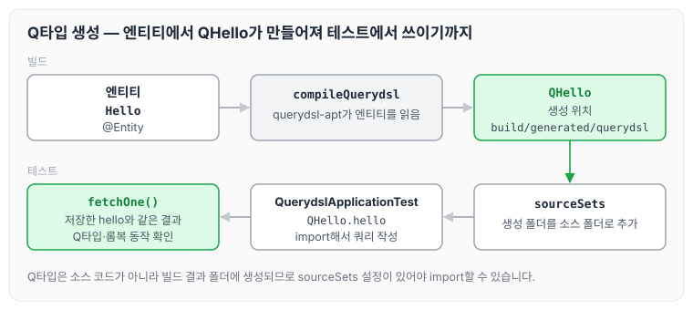
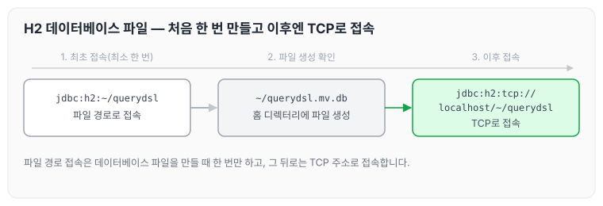

오늘은 Querydsl을 학습하기 위해 스프링 부트 프로젝트를 생성하고, Querydsl을 사용하기 위한 Gradle 설정과 동작 확인, H2 데이터베이스 설치, 스프링 부트의 JPA·DB 설정과 쿼리 로그 확인 방법에 대해 정리하도록 하겠습니다.

## 프로젝트 생성

프로젝트는 스프링 부트 스타터(https://start.spring.io/)에서 생성합니다.

- 사용 기능: spring web, jpa, h2, lombok
    - springBootVersion : 2.6.7
    - groupId: study
    - artifactId: querydsl
- 기본 셋팅
    - 빌드 방법을 gradle → intellij로 변경합니다.
    - 롬복을 셋팅합니다.

## Querydsl 설정과 검증

### build.gradle 환경 설정

Querydsl 플러그인과 라이브러리를 추가하고, Q타입이 생성될 위치를 지정하는 설정은 아래와 같습니다.

```gradle
buildscript {
	ext {
		queryDslVersion = "5.0.0"
	}
}

plugins {
	id 'org.springframework.boot' version '2.6.7'
	id 'io.spring.dependency-management' version '1.0.11.RELEASE'
	//querydsl 추가
	id "com.ewerk.gradle.plugins.querydsl" version "1.0.10"
	id 'java'
}

group = 'study'
version = '0.0.1-SNAPSHOT'
sourceCompatibility = '11'

configurations {
	compileOnly {
		extendsFrom annotationProcessor
	}
}

repositories {
	mavenCentral()
}

dependencies {
	implementation 'org.springframework.boot:spring-boot-starter-data-jpa'
	implementation 'org.springframework.boot:spring-boot-starter-web'

	//querydsl 추가
	implementation "com.querydsl:querydsl-jpa:${queryDslVersion}"
	implementation "com.querydsl:querydsl-apt:${queryDslVersion}"

	compileOnly 'org.projectlombok:lombok'
	runtimeOnly 'com.h2database:h2'
	annotationProcessor 'org.projectlombok:lombok'
	testImplementation 'org.springframework.boot:spring-boot-starter-test'
}

tasks.named('test') {
	useJUnitPlatform()
}

// querydsl 추가 시작
def querydslDir = "$buildDir/generated/querydsl"

querydsl {
	jpa = true
	querydslSourcesDir = querydslDir
}

sourceSets {
	main.java.srcDir querydslDir
}

configurations {
	compileOnly {
		extendsFrom annotationProcessor
	}
	querydsl.extendsFrom compileClasspath
}

compileQuerydsl {
	options.annotationProcessorPath = configurations.querydsl
}
// querydsl 추가 끝
```

설정의 아래쪽 부분을 보면 `compileQuerydsl` 작업이 엔티티를 읽어 Q타입을 만들고, 그 결과를 `querydslSourcesDir`로 지정한 `$buildDir/generated/querydsl`에 둡니다. 그리고 `sourceSets`에 같은 경로를 소스 폴더로 추가하기 때문에 테스트 코드에서 Q타입을 import해서 사용할 수 있습니다. 이 흐름을 그림으로 나타내면 아래와 같습니다.



`Hello` 엔티티에서 `QHello`가 만들어지고, 테스트 코드는 이 `QHello`로 쿼리를 작성합니다.

### Querydsl 테스트

Q타입과 롬복이 정상적으로 동작하는지 확인하는 테스트는 아래와 같습니다.

```java
package study.querydsl;

import com.querydsl.jpa.impl.JPAQueryFactory;
import org.assertj.core.api.Assertions;
import org.junit.jupiter.api.Test;
import org.springframework.beans.factory.annotation.Autowired;
import org.springframework.boot.test.context.SpringBootTest;
import org.springframework.transaction.annotation.Transactional;
import study.querydsl.entitiy.Hello;
import study.querydsl.entitiy.QHello;

import javax.persistence.EntityManager;

import static org.junit.jupiter.api.Assertions.*;

@SpringBootTest
@Transactional
class QuerydslApplicationTest {

    @Autowired
    EntityManager em;

    @Test
    void contextLoads() {
        Hello hello = new Hello();
        em.persist(hello);

        JPAQueryFactory query = new JPAQueryFactory(em);
        QHello qHello = QHello.hello; //Querydsl Q타입 동작 확인
        Hello result = query
                .selectFrom(qHello)
                .fetchOne();

        Assertions.assertThat(result).isEqualTo(hello);
        //lombok 동작 확인 (hello.getId())
        Assertions.assertThat(result.getId()).isEqualTo(hello.getId());
    }

}
```

## H2 데이터베이스 설치

H2는 개발이나 테스트 용도로 사용하기 가볍고 편리한 DB이며, 웹 화면을 제공합니다.

- https://www.h2database.com
- 다운로드 및 설치
- h2 데이터베이스 버전은 스프링 부트 버전에 맞춥니다.
- 권한 주기: chmod 755 h2
- 데이터베이스 파일 생성 방법
    - `jdbc:h2:~/querydsl`(최소 한 번)
    - `~/querydsl.mv.db` 파일 생성 확인
    - 이후부터는 `jdbc:h2:tcp://localhost/~/querydsl` 이렇게 접속합니다.

처음 한 번은 파일 경로로 접속해서 데이터베이스 파일을 만들고, 그 뒤로는 TCP로 접속합니다. 순서는 아래와 같습니다.



> 참고: h2데이터베이스의 MVCC 옵션은 H2 1.4.198 버전부터 제거되었습니다. 이후부터는 옵션 없이 사용하면 됩니다.

> 주의: 가급적 안정화 버전을 사용하는 것이 좋습니다. 1.4.200 버전은 몇 가지 오류가 있습니다.
> 현재 안정화 버전은 1.4.199입니다.

## 스프링 부트 설정 - JPA, DB

데이터소스와 JPA, 로그 설정은 `application.yml`에 아래와 같이 작성합니다.

```yaml
spring:
  datasource:
    url: jdbc:h2:tcp://localhost/~/jpashop
    username: sa
    password : 1
    driver-class-name: org.h2.Driver

  jpa:
    hibernate:
      ddl-auto: create
    properties:
      hibernate:
       # show_sql: true
        format_sql: true

logging:
  level:
    org.hibernate.SQL: debug
    #org.hibernate.type: trace
```

### 쿼리 파라미터 로그 남기기

- 로그에 `org.hibernate.type`을 추가하면 SQL 실행 파라미터를 로그로 남길 수 있습니다.
- 외부 라이브러리를 사용할 수도 있습니다.
    - 스프링 부트를 사용하면 이 라이브러리만 추가하면 됩니다.

```gradle
//쿼리 로그
	implementation 'com.github.gavlyukovskiy:p6spy-spring-boot-starter:1.5.8'
```

> 참고: 쿼리 파라미터를 로그로 남기는 외부 라이브러리는 시스템 자원을 사용하므로, 개발 단계에서는 편하게 사용해도 됩니다. 하지만 운영 시스템에 적용하려면 꼭 성능 테스트를 하고 사용하는 것이 좋습니다.

## 마무리

오늘은 Querydsl 학습을 위한 프로젝트 생성과 Gradle 설정, Q타입 동작 확인 테스트, H2 데이터베이스 설치, 그리고 스프링 부트의 JPA·DB 설정과 쿼리 파라미터 로그 남기는 방법에 대해 정리하였습니다. Querydsl은 엔티티로 만든 Q타입을 사용하기 때문에, 설정을 마친 뒤에는 Q타입이 생성되는 위치와 테스트에서 import되는지를 먼저 확인하는 것이 좋을 것 같습니다.

다음 글에서는 [예제 도메인 모델](../querydsl-domain-model/)에 대해 정리하도록 하겠습니다.

> 이 글은 인프런 김영한 님의 [실전! Querydsl](https://www.inflearn.com/course/querydsl-실전)을 들으며 정리한 노트입니다.
