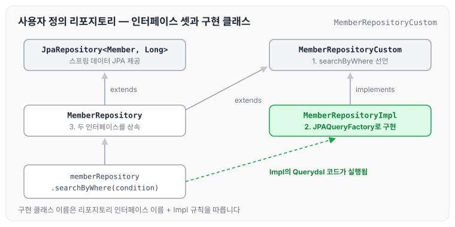
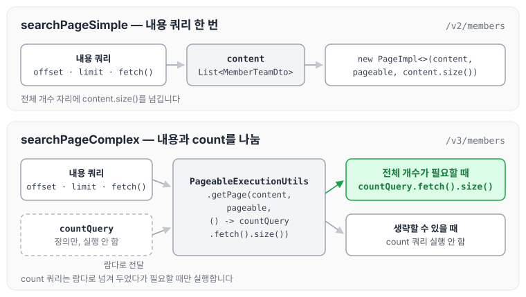
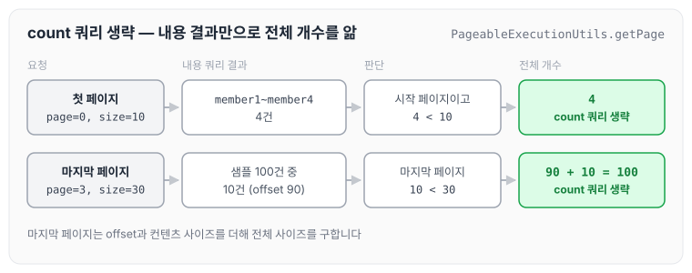

이전에 [순수 JPA와 함께 쓰기](../querydsl-pure-jpa/)에 대해 작성하였습니다. 이번에는 앞에서 만든 순수 JPA 리포지토리를 스프링 데이터 JPA 리포지토리로 바꾸고, Querydsl을 사용자 정의 리포지토리로 연결해 페이징까지 처리하는 방법을 정리하도록 하겠습니다.

## 스프링 데이터 JPA 리포지토리 변경

스프링 데이터 JPA로 `MemberRepository`를 생성합니다.

```java
package study.querydsl.repository;

import org.springframework.data.jpa.repository.JpaRepository;
import study.querydsl.entitiy.Member;

import java.util.List;

public interface MemberRepository extends JpaRepository<Member, Long> {

    List<Member> findByUsername(String username);
}
```

스프링 데이터 JPA 리포지토리를 테스트하는 코드는 아래와 같습니다.

```java
package study.querydsl.repository;

import org.junit.jupiter.api.Test;
import org.springframework.beans.factory.annotation.Autowired;
import org.springframework.boot.test.context.SpringBootTest;
import org.springframework.transaction.annotation.Transactional;
import study.querydsl.entitiy.Member;

import javax.persistence.EntityManager;
import java.util.List;
import java.util.Optional;

import static org.assertj.core.api.Assertions.assertThat;

@SpringBootTest
@Transactional
class MemberRepositoryTest {

    @Autowired
    MemberRepository memberRepository;

    @Autowired
    EntityManager em;

    @Test
    public void basicTest() {
        Member member = new Member("member1", 10);
        memberRepository.save(member);

        Optional<Member> findMember = memberRepository.findById(member.getId());
        assertThat(findMember.get()).isEqualTo(member);

        List<Member> result1 = memberRepository.findAll();
        assertThat(result1).containsExactly(member);

        List<Member> result2 = memberRepository.findByUsername("member1");
        assertThat(result2).containsExactly(member);
    }

}
```

다만 이 상태로는 Querydsl 전용 기능인 회원 검색을 작성할 수 없습니다. 인터페이스만으로는 Querydsl 코드를 넣을 곳이 없기 때문에 사용자 정의 리포지토리가 필요합니다.

## 사용자 정의 리포지토리

사용자 정의 리포지토리는 다음 순서로 사용합니다.

1. 사용자 정의 인터페이스 작성
2. 사용자 정의 인터페이스 구현
3. 스프링 데이터 리포지토리에 사용자 정의 인터페이스 상속

사용자 정의 리포지토리의 규칙은 [확장 기능](../data-jpa-extensions/)의 사용자 정의 리포지토리 구현에도 정리하였습니다.

### 1. 사용자 정의 인터페이스 작성

```java
package study.querydsl.repository;

import study.querydsl.dto.MemberSearchCondition;
import study.querydsl.dto.MemberTeamDto;

import java.util.List;

public interface MemberRepositoryCustom {
    public List<MemberTeamDto> searchByWhere(MemberSearchCondition condition);
}
```

### 2. 사용자 정의 인터페이스 구현

구현 클래스에 앞에서 작성한 Where절 파라미터 방식의 검색 코드를 옮깁니다.

```java
package study.querydsl.repository;

import com.querydsl.core.types.dsl.BooleanExpression;
import com.querydsl.jpa.impl.JPAQueryFactory;
import lombok.RequiredArgsConstructor;
import org.springframework.beans.factory.annotation.Autowired;
import study.querydsl.dto.MemberSearchCondition;
import study.querydsl.dto.MemberTeamDto;
import study.querydsl.dto.QMemberTeamDto;

import java.util.List;

import static org.springframework.util.StringUtils.hasText;
import static study.querydsl.entitiy.QMember.member;
import static study.querydsl.entitiy.QTeam.team;

@RequiredArgsConstructor
public class MemberRepositoryImpl implements MemberRepositoryCustom {

    @Autowired
    private final JPAQueryFactory queryFactory;

    @Override
    public List<MemberTeamDto> searchByWhere(MemberSearchCondition condition) {
        return queryFactory
                .select(new QMemberTeamDto(
                        member.id,
                        member.username,
                        member.age,
                        team.id,
                        team.name
                )).from(member)
                .leftJoin(member.team, team)
                .where(
                        usernameEq(condition.getUsername()),
                        teamNameEq(condition.getTeamName()),
                        ageGoe(condition.getAgeGoe()),
                        ageLoe(condition.getAgeLoe())
                ).fetch();

    }
    private BooleanExpression usernameEq(String username) {
        return hasText(username) ? member.username.eq(username) : null;
    }

    private BooleanExpression teamNameEq(String teamName) {
        return hasText(teamName) ? team.name.eq(teamName) : null;
    }

    private BooleanExpression ageGoe(Integer ageGoe) {
        return ageGoe != null ? member.age.goe(ageGoe) : null;
    }

    private BooleanExpression ageLoe(Integer ageLoe) {
        return ageLoe != null ? member.age.loe(ageLoe) : null;
    }

}
```

### 3. 스프링 데이터 리포지토리에 사용자 정의 인터페이스 상속

```java
package study.querydsl.repository;

import org.springframework.data.jpa.repository.JpaRepository;
import study.querydsl.entitiy.Member;

import java.util.List;

public interface MemberRepository extends JpaRepository<Member, Long>, MemberRepositoryCustom{
    List<Member> findByUsername(String username);
}
```

세 가지를 연결한 구조를 그리면 아래와 같습니다.



사용하는 쪽은 `MemberRepository` 하나만 주입받고, `findByUsername`은 스프링 데이터 JPA가, `searchByWhere`는 `MemberRepositoryImpl`의 Querydsl 코드가 처리합니다.

### 커스텀 리포지토리 동작 테스트

```java
@Test
    public void searchByWhereTest() throws Exception {
        //given
        Team teamA = new Team("teamA");
        Team teamB = new Team("teamB");
        em.persist(teamA);
        em.persist(teamB);

        Member member1 = new Member("member1", 10, teamA);
        Member member2 = new Member("member2", 20, teamA);
        Member member3 = new Member("member3", 30, teamB);
        Member member4 = new Member("member4", 40, teamB);
        em.persist(member1);
        em.persist(member2);
        em.persist(member3);
        em.persist(member4);

        MemberSearchCondition condition = new MemberSearchCondition();
        condition.setAgeGoe(35);
        condition.setAgeLoe(40);
        condition.setTeamName("teamB");

        //when
        List<MemberTeamDto> result = memberRepository.searchByWhere(condition);

        //then
        assertThat(result).extracting("username").containsExactly("member4");
    }
```

## 스프링 데이터 페이징 활용1 - Querydsl 페이징 연동

스프링 데이터의 `Page`, `Pageable`을 활용합니다. 스프링 데이터 JPA의 페이징은 [쿼리 메소드 기능](../data-jpa-query-methods/)의 스프링 데이터 JPA 페이징과 정렬에 정리하였습니다. 여기서는 두 가지 방법을 다룹니다.

- 전체 카운트를 한 번에 조회하는 단순한 방법
- 데이터 내용과 전체 카운트를 별도로 조회하는 방법

사용자 정의 인터페이스에 페이징 메서드를 추가합니다.

```java
package study.querydsl.repository;

import org.springframework.data.domain.Page;
import org.springframework.data.domain.Pageable;
import study.querydsl.dto.MemberSearchCondition;
import study.querydsl.dto.MemberTeamDto;

import java.util.List;

public interface MemberRepositoryCustom {
    public List<MemberTeamDto> searchByWhere(MemberSearchCondition condition);
    Page<MemberTeamDto> searchPageSimple(MemberSearchCondition condition, Pageable pageable);
}
```

### 전체 카운트를 한 번에 조회하는 방법

```java
@Override
    public Page<MemberTeamDto> searchPageSimple(MemberSearchCondition condition, Pageable pageable) {
        List<MemberTeamDto> content = queryFactory
                .select(new QMemberTeamDto(
                        member.id,
                        member.username,
                        member.age,
                        team.id,
                        team.name
                )).from(member)
                .leftJoin(member.team, team)
                .where(
                        usernameEq(condition.getUsername()),
                        teamNameEq(condition.getTeamName()),
                        ageGoe(condition.getAgeGoe()),
                        ageLoe(condition.getAgeLoe())
                ).offset(pageable.getOffset())
                .limit(pageable.getPageSize())
                .fetch();

        return new PageImpl<>(content, pageable, content.size());
    }
```

- 전체 카운트를 조회하는 방법을 최적화할 수 있으면 분리하는 것이 좋습니다.
- 코드를 리팩토링해서 내용 쿼리와 전체 카운트 쿼리를 읽기 좋게 분리하면 좋습니다.

## 스프링 데이터 페이징 활용2 - CountQuery 최적화

`PageableExecutionUtils.getPage()`로 count 쿼리를 최적화합니다. `searchPageComplex`도 `MemberRepositoryCustom`에 같은 형태로 선언해 두어야 `@Override`로 구현할 수 있습니다.

```java
@Override
    public Page<MemberTeamDto> searchPageComplex(MemberSearchCondition condition, Pageable pageable) {
        List<MemberTeamDto> content = queryFactory
                .select(new QMemberTeamDto(
                        member.id,
                        member.username,
                        member.age,
                        team.id,
                        team.name
                )).from(member)
                .leftJoin(member.team, team)
                .where(
                        usernameEq(condition.getUsername()),
                        teamNameEq(condition.getTeamName()),
                        ageGoe(condition.getAgeGoe()),
                        ageLoe(condition.getAgeLoe())
                ).offset(pageable.getOffset())
                .limit(pageable.getPageSize())
                .fetch();
        
        JPAQuery<MemberTeamDto> countQuery = queryFactory
                .select(new QMemberTeamDto(
                        member.id,
                        member.username,
                        member.age,
                        team.id,
                        team.name
                )).from(member)
                .leftJoin(member.team, team)
                .where(
                        usernameEq(condition.getUsername()),
                        teamNameEq(condition.getTeamName()),
                        ageGoe(condition.getAgeGoe()),
                        ageLoe(condition.getAgeLoe())
                );

        return PageableExecutionUtils.getPage(content, pageable, () -> countQuery.fetch().size());
    }
```

- 스프링 데이터 라이브러리가 제공합니다.
- count 쿼리를 생략할 수 있는 경우에는 생략해서 처리합니다.
    - 페이지 시작이면서 컨텐츠 사이즈가 페이지 사이즈보다 작을 때
    - 마지막 페이지일 때 (offset과 컨텐츠 사이즈를 더해서 전체 사이즈를 구합니다)

두 방법이 내용과 전체 개수를 어떻게 구하는지 비교하면 아래와 같습니다.



`searchPageComplex`는 count 쿼리를 바로 실행하지 않고 람다로 넘기기 때문에, 전체 개수가 필요할 때만 실행됩니다.

count 쿼리가 생략되는 두 경우를 예시 값으로 그리면 아래와 같습니다.



두 경우 모두 내용 쿼리의 결과만으로 전체 개수를 알 수 있기 때문에 count 쿼리를 실행하지 않습니다.

## 스프링 데이터 페이징 활용3 - 컨트롤러 개발

실제 컨트롤러는 아래와 같습니다.

```java
package study.querydsl.controller;

import lombok.RequiredArgsConstructor;
import org.springframework.data.domain.Page;
import org.springframework.data.domain.Pageable;
import org.springframework.web.bind.annotation.GetMapping;
import org.springframework.web.bind.annotation.RestController;
import study.querydsl.dto.MemberSearchCondition;
import study.querydsl.dto.MemberTeamDto;
import study.querydsl.repository.MemberJpaRepository;
import study.querydsl.repository.MemberRepository;

import java.util.List;

@RestController
@RequiredArgsConstructor
public class MemberController {

    private final MemberJpaRepository memberJpaRepository;
    private final MemberRepository memberRepository;

    @GetMapping("/v1/members")
    public List<MemberTeamDto> searchMemberV1(MemberSearchCondition condition) {
        return memberJpaRepository.searchByWhere(condition);
    }

    @GetMapping("/v2/members")
    public Page<MemberTeamDto> searchMemberV2(MemberSearchCondition condition, Pageable pageable) {
        return memberRepository.searchPageSimple(condition, pageable);
    }

    @GetMapping("/v3/members")
    public Page<MemberTeamDto> searchMemberV3(MemberSearchCondition condition, Pageable pageable) {
        return memberRepository.searchPageComplex(condition, pageable);
    }
}
```

아래 주소로 호출해 결과를 확인합니다.

- [`http://127.0.0.1:8080/v2/members?page=0&size=10`](http://127.0.0.1:8080/v2/members?page=0&size=10)

### 스프링 데이터 정렬

스프링 데이터의 `Sort`를 Querydsl의 `OrderSpecifier`로 변환하는 코드는 아래와 같습니다.

```java
JPAQuery<Member> query = queryFactory
				.selectFrom(member);
for (Sort.Order o : pageable.getSort()) {
		PathBuilder pathBuilder = new PathBuilder(member.getType(),
member.getMetadata());
		query.orderBy(new OrderSpecifier(o.isAscending() ? Order.ASC : Order.DESC,
				pathBuilder.get(o.getProperty())));
}
List<Member> result = query.fetch();
```

다만 정렬 `Sort`는 조건이 조금만 복잡해져도 `Pageable`의 Sort 기능을 사용하기 어렵습니다. 루트 엔티티 범위를 넘어가는 동적 정렬 기능이 필요하면 스프링 데이터 페이징이 제공하는 Sort를 사용하기보다는 파라미터를 받아서 직접 처리하는 것을 권장합니다.

## 마무리

오늘은 스프링 데이터 JPA 리포지토리에 Querydsl을 사용자 정의 리포지토리로 결합하는 방법과, 내용 쿼리와 count 쿼리를 나눈 페이징 처리, 그리고 `Sort`를 `OrderSpecifier`로 바꾸는 방법에 대해 정리하였습니다.

첫 페이지나 마지막 페이지처럼 count 쿼리를 생략할 수 있는 경우가 있으므로, 페이징 목록 API라면 `PageableExecutionUtils.getPage()`로 나눠 두는 것이 좋을 것 같습니다.

> 이 글은 인프런 김영한 님의 [실전! Querydsl](https://www.inflearn.com/course/querydsl-실전)을 들으며 정리한 노트입니다.
