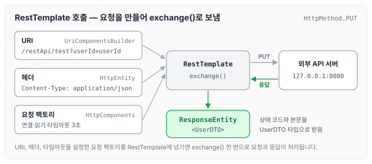
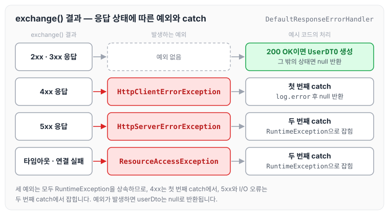

오늘은 Spring에서 REST API를 호출할 때 사용하는 RestTemplate의 특징과 메서드, 사용 예시를 정리하도록 하겠습니다.

## RestTemplate 이란

RestTemplate의 특징을 정리하면 아래와 같습니다.

- 간편하게 REST 방식의 API를 호출할 수 있는 Spring 내장 클래스입니다.
- Spring 3.0부터 지원하며, Spring 5.0 이후부터는 WebClient를 사용합니다.
- RESTful 원칙을 지키며, HTTP의 여러 메서드를 제공합니다.
- JSON, String, XML 모두 응답받을 수 있습니다.
- Blocking I/O 기반의 동기 방식을 사용합니다.
- Header와 Content-Type을 설정해 외부와 통신할 수 있습니다.

## RestTemplate 메서드

RestTemplate이 제공하는 주요 메서드는 아래와 같습니다.

| 메서드 | HTTP | 설명 |
| --- | --- | --- |
| getForObject | GET | 주어진 URL 주소로 GET 메서드를 실행하고 결과를 객체로 반환 |
| getForEntity | GET | 주어진 URL 주소로 GET 메서드를 실행하고 결과를 ResponseEntity로 반환 |
| postForLocation | POST | POST 요청을 보내고 헤더에 저장된 URI를 결과로 반환 |
| postForObject | POST | POST 요청을 보내고 결과를 객체로 반환 |
| postForEntity | POST | POST 요청을 보내고 결과를 ResponseEntity로 반환 |
| delete | DELETE | 주어진 URL 주소로 DELETE 메서드 실행 |
| headForHeaders | HEAD | HTTP HEAD 메서드를 사용해 헤더의 모든 정보를 얻음 |
| put | PUT | 주어진 URL 주소로 PUT 메서드 실행 |
| patchForObject | PATCH | 주어진 URL 주소로 PATCH 메서드 실행 |
| optionsForAllow | OPTIONS | 주어진 URL 주소에서 지원하는 HTTP 메서드 조회 |
| exchange | ANY | HTTP 헤더를 새로 만들 수 있고 어떤 HTTP 메서드도 사용 가능 |
| execute | ANY | Request/Response 콜백 수정 가능 |

## RestTemplate 사용 예시

아래는 타임아웃을 설정한 RestTemplate으로 URI와 헤더를 만들어 `exchange()`로 요청을 보내는 예시입니다.

```java
String path = "/restApi/test";
String param = "userId";

HttpComponentsClientHttpRequestFactory factory = new HttpComponentsClientHttpRequestFactory();
factory.setConnectTimeout(3000); // 타임아웃 설정 3초
factory.setReadTimeout(3000); // 타임아웃 설정 3초

UriComponentsBuilder builder = UriComponentsBuilder.fromUriString("http://127.0.0.1:8080");
builder.path(path);
builder.queryParam(param, param);

UriComponents uriComponents = builder.build().encode();

HttpHeaders httpHeaders = new HttpHeaders();
httpHeaders.add("Content-Type", "application/json");
httpHeaders.add("Accept", "*/*");
HttpEntity<MultiValueMap<String, Object>> requestEntity = new HttpEntity(httpHeaders);

UserDTO userDto = null;
try {
    RestTemplate restTemplate = new RestTemplate(factory);
    ResponseEntity<UserDTO> responseEntity = restTemplate.exchange(uriComponents.toUri(), HttpMethod.PUT, requestEntity,UserDTO.class);
    HttpStatus httpStatus =  responseEntity.getStatusCode();
    if(HttpStatus.OK.equals(httpStatus)) {
        userDto = new UserDTO(httpStatus.value());
    }
}catch (HttpClientErrorException e){
    log.error("{}", "error...");
} catch (RuntimeException re){
    log.error("{}", "error...");
}
return userDto;
```

요청 팩토리에 연결·읽기 타임아웃을 3초로 설정하고, `UriComponentsBuilder`로 URI를, `HttpHeaders`로 헤더를 만든 뒤 `exchange()`에 함께 넘깁니다. 요청이 만들어지는 흐름을 그리면 다음과 같습니다.



`exchange()`의 응답 결과에 따라 예시 코드가 어느 분기로 가는지도 정리하였습니다. RestTemplate은 기본 에러 핸들러(`DefaultResponseErrorHandler`)를 사용하면 4xx 응답에 `HttpClientErrorException`을, 5xx 응답에 `HttpServerErrorException`을 던지고, 타임아웃 같은 I/O 오류는 `ResourceAccessException`으로 던집니다. 이 예외들은 모두 `RuntimeException`을 상속합니다.



예시 코드에서는 4xx만 첫 번째 catch에서 따로 잡히고, 5xx와 타임아웃은 두 번째 `RuntimeException` catch에서 잡힙니다. 어느 경우든 예외가 발생하면 `userDto`는 null로 반환됩니다.

## 마무리

오늘은 Spring에서 많이 사용하는 REST API 호출 방법인 RestTemplate에 대해 정리하였습니다. 글을 쓰다 보니 문득, 예전 면접에서 REST API 연동 경험을 물어봤을 때 당황했던 기억이 떠올랐습니다. 물론 통과하긴 했지만, 나름대로 정리해 두는 것도 좋을 것 같아 작성하게 되었습니다.

참조 : [https://blog.naver.com/hj_kim97/222295259904](https://blog.naver.com/hj_kim97/222295259904), [https://backtony.github.io/spring/2021-07-12-spring-basic-8/](https://backtony.github.io/spring/2021-07-12-spring-basic-8/), [https://jjunn93.com/37](https://jjunn93.com/37)
